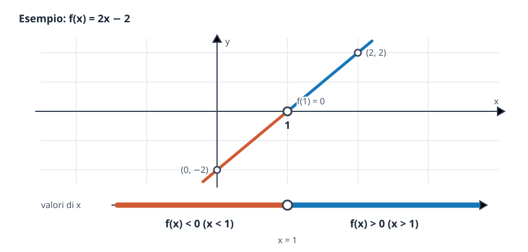
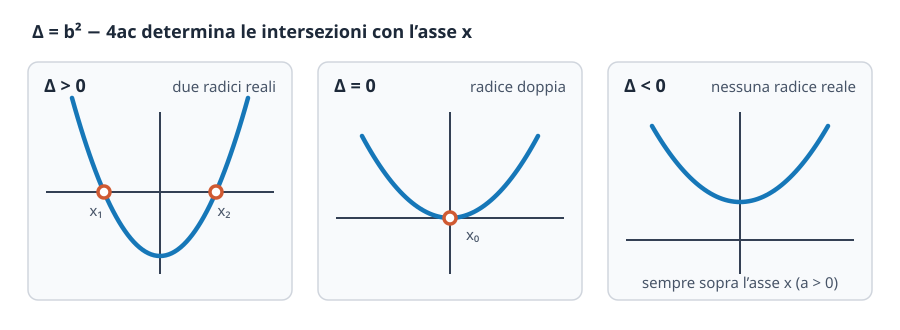
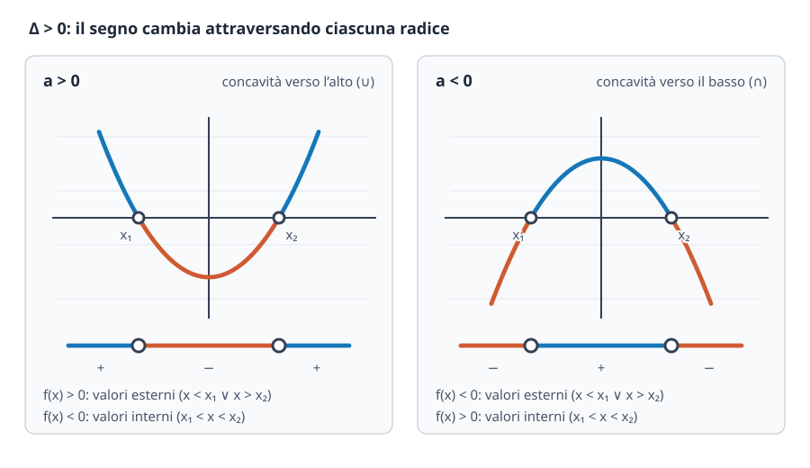

# Retta e parabola. Equazioni e disequazioni

## Cos'è il legame tra algebra e geometria e perché funziona

Ogni equazione o disequazione algebrica nella variabile $x$ possiede una traduzione visiva immediata nel **piano cartesiano**. Se associamo a un polinomio di primo grado $mx + q$ la funzione $y = mx + q$, il suo grafico è una **retta**; se associamo a un trinomio di secondo grado $ax^2 + bx + c$ la funzione $y = ax^2 + bx + c$, il suo grafico è una **parabola**.

Come possiamo sfruttare questi grafici per risolvere equazioni e disequazioni senza imparare decine di regole scollegate a memoria?
Semplice: nel piano cartesiano, l'**asse delle ascisse ($x$) coincide con la quota $y = 0$**. Di conseguenza, data una qualsiasi funzione $y = f(x)$:
- risolvere l'**equazione** $f(x) = 0$ significa trovare le ascisse $x$ dei punti in cui il grafico **interseca o tocca l'asse $x$** (gli *zeri* della funzione);
- risolvere la **disequazione** $f(x) > 0$ significa individuare gli intervalli dell'asse $x$ in corrispondenza dei quali il grafico si trova **sopra l'asse $x$** ($y > 0$);
- risolvere la **disequazione** $f(x) < 0$ significa individuare gli intervalli dell'asse $x$ in cui il grafico si trova **sotto l'asse $x$** ($y < 0$);
- con le disuguaglianze larghe $f(x) \ge 0$ oppure $f(x) \le 0$, si includono nelle soluzioni anche i punti di intersezione con l'asse $x$.

---

## La retta e le equazioni e disequazioni di primo grado

### Relazione lineare e retta nel piano cartesiano

Una relazione lineare tra le variabili $x$ e $y$ è descritta in forma esplicita dall'equazione della **retta** (non verticale):

$$
y = mx + q
$$

dove:
- $m \in \mathbb{R}$ è il **coefficiente angolare** (o *pendenza*): misura l'inclinazione della retta rispetto all'asse $x$. Se $m > 0$ la retta è **crescente** (sale da sinistra verso destra); se $m < 0$ la retta è **decrescente** (scende da sinistra verso destra); se $m = 0$ la retta è orizzontale ($y = q$, parallela all'asse $x$).
- $q \in \mathbb{R}$ è l'**ordinata all'origine** (o *intercetta* con l'asse $y$): rappresenta l'ordinata del punto $(0, q)$ in cui la retta taglia l'asse $y$ (ottenuto ponendo $x = 0$).

### Equazioni e disequazioni di primo grado

Ponendo $y = 0$, cerchiamo l'intersezione della retta con l'asse $x$ e otteniamo l'**equazione lineare di primo grado** in forma normale:

$$
mx + q = 0 \qquad (\text{o equivalentemente } ax + b = 0).
$$

- Se $m \neq 0$, l'equazione è **determinata** e ammette l'unica soluzione reale:

$$
x = -\frac{q}{m}.
$$

- Se $m = 0$ e $q \neq 0$, l'equazione $0x + q = 0$ è **impossibile** (nessuna soluzione: la retta orizzontale $y = q \neq 0$ è parallela all'asse $x$ e non lo incontra mai).
- Se $m = 0$ e $q = 0$, l'equazione $0x = 0$ è **indeterminata** (verificata per $\forall x \in \mathbb{R}$: la retta $y = 0$ coincide con l'intero asse $x$).

Per risolvere una **disequazione di primo grado** $mx + q > 0$ (o $< 0$), si isola la $x$ ricordando la **regola fondamentale del cambio di segno**:
- se si moltiplica o si divide entrambi i membri di una disequazione per un numero **strettamente positivo** ($m > 0$), il verso della disuguaglianza **si conserva**: $mx > -q \iff x > -\frac{q}{m}$;
- se si moltiplica o si divide per un numero **strettamente negativo** ($m < 0$), il verso della disuguaglianza **si inverte**: $mx > -q \iff x < -\frac{q}{m}$.

Nell'esempio grafico seguente, la retta $f(x) = 2x - 2$ (con $m = 2 > 0$ crescente) si annulla in $x = 1$: è sotto l'asse $x$ ($f(x) < 0$) per $x < 1$ ed è sopra l'asse $x$ ($f(x) > 0$) per $x > 1$.

---

## La parabola e le equazioni e disequazioni di secondo grado

### La parabola nel piano cartesiano

Una funzione polinomiale di secondo grado ha equazione:

$$
y = ax^2 + bx + c \qquad (a \neq 0),
$$

e il suo grafico nel piano cartesiano è una **parabola** con asse di simmetria verticale (parallelo all'asse $y$). Le sue caratteristiche geometriche fondamentali sono:
1. **Concavità** (determinata dal segno del coefficiente direttivo $a$):
   - se **$a > 0$**, la parabola ha la **concavità rivolta verso l'alto** ($\cup$) e il vertice è il punto di minimo assoluto;
   - se **$a < 0$**, la parabola ha la **concavità rivolta verso il basso** ($\cap$) e il vertice è il punto di massimo assoluto.
2. **Vertice $V$ e asse di simmetria**:

$$
V\left(-\frac{b}{2a}, \, -\frac{\Delta}{4a}\right), \qquad \text{Asse di simmetria: } x = -\frac{b}{2a}, \qquad \text{dove } \Delta = b^2 - 4ac.
$$

3. **Intersezione con l'asse $y$**: ponendo $x = 0$, la parabola passa sempre per il punto $(0, c)$.

### Equazioni di secondo grado

Ponendo $y = 0$, la ricerca delle intersezioni della parabola con l'asse $x$ conduce all'**equazione di secondo grado** in forma canonica:

$$
ax^2 + bx + c = 0 \qquad (a \neq 0)
$$

Il numero di soluzioni reali (e quindi il numero di punti in cui la parabola incontra l'asse $x$) dipende dal segno del **discriminante** $\Delta = b^2 - 4ac$:

- **Se $\Delta > 0$**: l'equazione ha **due soluzioni reali e distinte** $x_1 < x_2$ (la parabola taglia l'asse $x$ in due punti distinti):

$$
x_{1,2} = \frac{-b \pm \sqrt{b^2 - 4ac}}{2a}
$$

- **Se $\Delta = 0$**: l'equazione ha **due soluzioni reali coincidenti** (una *radice doppia* $x_1 = x_2 = x_0$: la parabola è **tangente** all'asse $x$ nel suo vertice):

$$
x_0 = -\frac{b}{2a}
$$

- **Se $\Delta < 0$**: poiché $\sqrt{\Delta}$ non esiste in $\mathbb{R}$, l'equazione **non ha soluzioni reali** ($\nexists x \in \mathbb{R}$: la parabola non interseca mai l'asse $x$ e rimane interamente sopra di esso se $a > 0$, oppure interamente sotto se $a < 0$).

#### Formula ridotta, relazioni radici-coefficienti e scomposizione del trinomio

- **Formula ridotta** (quando $b$ è pari, cioè $b = 2k$ con $k = \frac{b}{2}$): raccogliendo un fattore $4$ sotto radice si evita di lavorare con numeri grandi:

$$
\frac{\Delta}{4} = k^2 - ac \implies x_{1,2} = \frac{-k \pm \sqrt{k^2 - ac}}{a}.
$$

- **Somma e prodotto delle radici (Formule di Viète)**: per $\Delta \ge 0$, la somma $s$ e il prodotto $p$ delle due radici sono legati ai coefficienti da:

$$
s = x_1 + x_2 = -\frac{b}{a}, \qquad p = x_1 \cdot x_2 = \frac{c}{a}.
$$

- **Fattorizzazione (scomposizione) del trinomio di secondo grado**:
  - se $\Delta > 0$: $\quad ax^2 + bx + c = a(x - x_1)(x - x_2)$;
  - se $\Delta = 0$: $\quad ax^2 + bx + c = a(x - x_0)^2$ (quadrato di binomio a meno del fattore $a$);
  - se $\Delta < 0$: il trinomio è **irriducibile** in $\mathbb{R}$.

### Disequazioni di secondo grado

Per risolvere una disequazione di secondo grado ($ax^2 + bx + c > 0$, $\ge 0$, $< 0$, $\le 0$), basta **disegnare mentalmente la parabola** conoscendo la concavità (segno di $a$) e le eventuali intersezioni con l'asse $x$ (segno di $\Delta$ e radici $x_1, x_2$ dell'equazione associata $ax^2 + bx + c = 0$).

> [!tip] Consiglio pratico: rendi sempre $a > 0$!
> Se in una disequazione il coefficiente di $x^2$ è negativo ($a < 0$), puoi sempre cambiare tutti i segni moltiplicando per $-1$ e **invertendo il verso della disequazione** (es. $-x^2 + 3x - 2 > 0 \iff x^2 - 3x + 2 < 0$). In questo modo lavorerai sempre con una parabola rivolta verso l'alto ($\cup$)!

Ecco il quadro completo per ogni segno di $\Delta$ e di $a$:

#### 1. Caso $\Delta > 0$ (due radici reali distinte $x_1 < x_2$)

| Segno di $a$ (Concavità) | $ax^2 + bx + c > 0$ (sopra l'asse $x$) | $ax^2 + bx + c < 0$ (sotto l'asse $x$) |
| --- | --- | --- |
| **$a > 0$** ($\cup$) | **Valori esterni:** $x < x_1 \lor x > x_2$ | **Valori interni:** $x_1 < x < x_2$ |
| **$a < 0$** ($\cap$) | **Valori interni:** $x_1 < x < x_2$ | **Valori esterni:** $x < x_1 \lor x > x_2$ |

*(Se la disequazione presenta $\ge 0$ oppure $\le 0$, si aggiungono gli uguali agli estremi: $x \le x_1 \lor x \ge x_2$ e $x_1 \le x \le x_2$).*

#### 2. Caso $\Delta = 0$ (una radice doppia $x_0 = -\frac{b}{2a}$)

Il trinomio vale $a(x - x_0)^2$. Poiché il quadrato $(x - x_0)^2$ è sempre positivo per $x \neq x_0$ e si annulla in $x = x_0$:
- **Se $a > 0$** (parabola $\cup$ appoggiata sull'asse $x$ in $x_0$):
  - $ax^2 + bx + c > 0 \implies \forall x \in \mathbb{R} \text{ con } x \neq x_0$;
  - $ax^2 + bx + c \ge 0 \implies \forall x \in \mathbb{R}$;
  - $ax^2 + bx + c < 0 \implies \text{impossibile } (\emptyset)$;
  - $ax^2 + bx + c \le 0 \implies x = x_0$ (un solo punto!).
- **Se $a < 0$** (parabola $\cap$ che tocca l'asse $x$ dal basso in $x_0$): il trinomio è negativo per $x \neq x_0$ e nullo in $x_0$.

#### 3. Caso $\Delta < 0$ (nessuna intersezione con l'asse $x$)

Il trinomio non si annulla mai e **mantiene sempre il segno del coefficiente $a$ per ogni $x \in \mathbb{R}$**:
- **Se $a > 0$** (parabola $\cup$ tutta sopra l'asse $x$): $ax^2 + bx + c > 0$ (e $\ge 0$) è verificata $\forall x \in \mathbb{R}$, mentre $ax^2 + bx + c < 0$ (e $\le 0$) è **impossibile** ($\emptyset$).
- **Se $a < 0$** (parabola $\cap$ tutta sotto l'asse $x$): $ax^2 + bx + c < 0$ (e $\le 0$) è verificata $\forall x \in \mathbb{R}$, mentre $ax^2 + bx + c > 0$ (e $\ge 0$) è **impossibile** ($\emptyset$).

---

## Equazioni e disequazioni razionali fratte e di grado superiore

### Equazioni razionali fratte

Un'equazione si dice **fratta** quando l'incognita $x$ compare anche al denominatore. Ricondotta alla forma canonica (portando tutto a primo membro e riducendo allo stesso denominatore comune):

$$
\frac{N(x)}{D(x)} = 0,
$$

la procedura risolutiva si articola in tre passi:
1. **Imporre le Condizioni di Esistenza (C.E.)**: il denominatore non può mai annullarsi, quindi si impone **$D(x) \neq 0$**;
2. **Annullare il numeratore**: una frazione vale zero se e solo se vale zero il suo numeratore, quindi si risolve **$N(x) = 0$**;
3. **Controllo di accettabilità**: si scartano eventuali soluzioni di $N(x) = 0$ che violano la condizione $D(x) \neq 0$.

### Disequazioni razionali fratte

Una **disequazione fratta** deve essere **sempre** ricondotta anzitutto alla forma normale con lo **zero a secondo membro** e un'unica frazione a primo membro:

$$
\frac{N(x)}{D(x)} > 0 \qquad \left(\text{oppure } \ge 0, \, < 0, \, \le 0\right).
$$

> [!CAUTION] Mai eliminare il denominatore in una disequazione!
> In una disequazione fratta **è gravemente errato moltiplicare ambo i membri per $D(x)$ eliminando il denominatore!** Infatti, il segno di $D(x)$ dipende dal valore dell'incognita $x$: per le $x$ in cui $D(x) < 0$, moltiplicare per $D(x)$ invertirebbe il verso della disequazione senza che ce ne accorgiamo.

Per risolvere correttamente $\frac{N(x)}{D(x)} \gtrless 0$ si usa lo **studio del segno con la tabella dei segni**:
1. **Riduzione a forma normale**: si porta tutto a primo membro ($\dots \gtrless 0$) e si calcola il denominatore comune ottenendo un'unica frazione $\frac{N(x)}{D(x)} \gtrless 0$.
2. **Studio separato della positività di $N(x)$ e $D(x)$**:
   - indipendentemente dal verso ($\ge, \le, >, <$) della disequazione di partenza, per convenzione si risolvono **sempre** le due disequazioni:
     - **Segno di $N$**: $N(x) > 0$ (oppure $N(x) \ge 0$ se il testo iniziale ha $\ge$ o $\le$, includendo gli zeri del numeratore con un pallino pieno $\bullet$);
     - **Segno di $D$**: **$D(x) > 0$ strettamente** (mai $\ge 0$, perché il denominatore non può mai annullarsi! Gli zeri del denominatore si segnano con una $\times$ o pallino vuoto $\circ$).
3. **Tabella (o grafico) dei segni**: si traccia l'asse reale, si riportano in ordine crescente tutti i capisaldi trovati e si disegna una riga per $N(x)$ e una per $D(x)$ indicando con $+$ (linea continua) dove sono positivi e con $-$ (linea tratteggiata) dove sono negativi.
4. **Regola dei segni e scelta degli intervalli**: si moltiplicano i segni in ciascun intervallo verticale ($+ \cdot + = +$, $+ \cdot - = -$, $- \cdot - = +$) e si scelgono gli intervalli col segno $+$ se la disequazione ridotta chiedeva $> 0$ (o $\ge 0$), oppure quelli col segno $-$ se chiedeva $< 0$ (o $\le 0$).

### Disequazioni di grado superiore al secondo fattorizzabili

Lo stesso identico metodo della **tabella dei segni** permette di risolvere disequazioni polinomiali di grado superiore al secondo, una volta scomposto il polinomio nel prodotto di fattori di primo o secondo grado:

$$
A(x) \cdot B(x) \cdot C(x) \gtrless 0.
$$

Si studia dove ciascun fattore è $> 0$, si costruisce la tabella dei segni con una riga per ogni fattore e si applica la regola dei segni al prodotto!

---

## Sistemi di disequazioni

Un **sistema di disequazioni** è un insieme di due o più disequazioni nella stessa incognita $x$ che devono essere verificate **contemporaneamente**:

$$
\begin{cases}
f(x) > 0 \\
g(x) \le 0
\end{cases}
$$

Per risolverlo:
1. Si risolve **ciascuna disequazione separatamente** per conto proprio, trovando i rispettivi insiemi delle soluzioni $S_1, S_2, \dots$;
2. Si riportano gli insiemi $S_1, S_2, \dots$ su uno **schema grafico di intersezione** (usando solo linee continue per indicare dove ciascuna disequazione è soddisfatta, **senza** mettere segni $+$ o $-$!);
3. La soluzione del sistema è l'**intersezione** $S = S_1 \cap S_2 \cap \dots$, cioè gli intervalli in cui **tutte le linee continue sono presenti contemporaneamente**.

---

## Esempi guidati

### Esempio 1: Disequazione di secondo grado

**Problema:** Risolvere la disequazione $-2x^2 + 5x - 2 \ge 0$.

**Svolgimento passo-passo:**
1. **Equazione associata e discriminante**: risolviamo $-2x^2 + 5x - 2 = 0$:

$$
\Delta = b^2 - 4ac = 5^2 - 4(-2)(-2) = 25 - 16 = 9 > 0.
$$

$$
x_{1,2} = \frac{-5 \pm \sqrt{9}}{2(-2)} = \frac{-5 \pm 3}{-4} \implies x_1 = \frac{-5 - 3}{-4} = 2, \quad x_2 = \frac{-5 + 3}{-4} = \frac{1}{2}.
$$

Ordinate in senso crescente, le radici sono $\frac{1}{2}$ e $2$.
2. **Lettura grafica con la parabola**: il coefficiente di $x^2$ è $a = -2 < 0$, quindi la parabola ha la concavità rivolta verso il basso ($\cap$). Poiché cerchiamo dove il trinomio è $\ge 0$ (sopra o sull'asse $x$), dobbiamo prendere i **valori interni** alle radici, estremi inclusi:

$$
\frac{1}{2} \le x \le 2.
$$

*(Alternativa consigliata: cambiando subito segno e verso all'inizio, $2x^2 - 5x + 2 \le 0$ ha $a = 2 > 0$ ($\cup$) e chiede $\le 0$, dando ancora i valori interni $\frac{1}{2} \le x \le 2$).*

### Esempio 2: Disequazione razionale fratta con tabella dei segni

**Problema:** Risolvere la disequazione fratta $\frac{x - 1}{x + 3} \le 2$.

**Svolgimento passo-passo:**
1. **Portiamo il $2$ a primo membro e riduciamo a un'unica frazione** (non moltiplichiamo mai per $x + 3$!):

$$
\frac{x - 1}{x + 3} - 2 \le 0 \implies \frac{x - 1 - 2(x + 3)}{x + 3} \le 0 \implies \frac{x - 1 - 2x - 6}{x + 3} \le 0 \implies \frac{-x - 7}{x + 3} \le 0.
$$

2. **Studiamo il segno di numeratore e denominatore**:
   - **Numeratore ($N \ge 0$)**: $-x - 7 \ge 0 \implies -x \ge 7 \implies x \le -7$ (in $x = -7$ la frazione vale $0$, pallino pieno $\bullet$).
   - **Denominatore ($D > 0$ strettamente!)**: $x + 3 > 0 \implies x > -3$ (con C.E. $x \neq -3$, pallino vuoto $\circ$).
3. **Costruiamo la tabella dei segni** con i capisaldi $-7$ e $-3$:

| Intervallo | $x < -7$ | $x = -7$ | $-7 < x < -3$ | $x = -3$ | $x > -3$ |
| --- | :---: | :---: | :---: | :---: | :---: |
| Segno di $N = -x - 7$ | $+$ | $0$ | $-$ | $-$ | $-$ |
| Segno di $D = x + 3$ | $-$ | $-$ | $-$ | $0$ ($\nexists$) | $+$ |
| **Segno di $\frac{N}{D}$** | **$-$** | **$0$** | **$+$** | **$\nexists$** | **$-$** |

4. **Scelta degli intervalli**: la disequazione ridotta $\frac{-x - 7}{x + 3} \le 0$ richiede che la frazione sia **negativa o nulla** ($-$ oppure $0$). Leggendo l'ultima riga della tabella, otteniamo:

$$
x \le -7 \quad \lor \quad x > -3.
$$

### Esempio 3: Sistema di disequazioni

**Problema:** Risolvere il sistema di disequazioni $\begin{cases} x^2 - 4x + 3 < 0 \\ \frac{2x - 3}{x} \ge 0 \end{cases}$.

**Svolgimento passo-passo:**
1. **Prima disequazione ($S_1$)**: $x^2 - 4x + 3 < 0$. L'equazione associata $x^2 - 4x + 3 = 0$ ha radici $x_1 = 1$ e $x_2 = 3$ (poiché somma $s = 4$ e prodotto $p = 3$). Essendo $a = 1 > 0$ e cercando $< 0$, prendiamo i valori interni:

$$
S_1: \quad 1 < x < 3.
$$

2. **Seconda disequazione ($S_2$)**: $\frac{2x - 3}{x} \ge 0$. Studiamo il segno di $N$ e $D$:
   - $N \ge 0 \implies 2x - 3 \ge 0 \implies x \ge \frac{3}{2}$;
   - $D > 0 \implies x > 0$ (con $x \neq 0$).
   Dalla tabella dei segni tra $0$ e $\frac{3}{2}$, la frazione è $\ge 0$ per i valori esterni:

$$
S_2: \quad x < 0 \quad \lor \quad x \ge \frac{3}{2}.
$$

3. **Intersezione grafica ($S = S_1 \cap S_2$)**: cerchiamo dove $S_1 = (1, 3)$ e $S_2 = (-\infty, 0) \cup \left[\frac{3}{2}, +\infty\right)$ sono verificate contemporaneamente. Poiché $1 < \frac{3}{2} = 1{,}5 < 3$, la sovrapposizione avviene tra $\frac{3}{2}$ (incluso) e $3$ (escluso):

$$
S: \quad \frac{3}{2} \le x < 3.
$$

---

## Errori frequenti

> [!CAUTION] Riepilogo degli errori da evitare assolutamente
> 1. **Scrivere $x^2 > 4 \implies x > \pm 2$ oppure $x > 2$:**
>    - ❌ *Errato:* Estrarre la radice in una disequazione quadratica come se fosse un'equazione.
>    - ✅ *Corretto:* Si porta tutto a primo membro ($x^2 - 4 > 0$), si trovano le radici $\pm 2$ e si usa la parabola ($\cup$): $x^2 > 4 \iff x < -2 \lor x > 2$ (valori esterni), mentre $x^2 < 4 \iff -2 < x < 2$ (valori interni).
> 2. **Eliminare il denominatore in una disequazione fratta:**
>    - ❌ *Errato:* Passare da $\frac{1}{x} < 2$ a $1 < 2x \implies x > \frac{1}{2}$ (perdendo tutte le soluzioni $x < 0$!).
>    - ✅ *Corretto:* Portare il $2$ a primo membro ($\frac{1 - 2x}{x} < 0$) e fare la tabella dei segni, ottenendo $x < 0 \lor x > \frac{1}{2}$.
> 3. **Dimenticare di invertire il verso quando si divide per un numero negativo:**
>    - ❌ *Errato:* $-3x > 6 \implies x > -2$.
>    - ✅ *Corretto:* Dividendo per $-3 < 0$, il verso si inverte: $-3x > 6 \implies x < -2$.
> 4. **Confondere la tabella dei segni (per prodotti e frazioni) con il grafico di intersezione (per i sistemi):**
>    - ❌ *Errato:* Fare la regola dei segni $+ \cdot - = -$ in un sistema di disequazioni!
>    - ✅ *Corretto:* La regola dei segni si usa **solo** per studiare il segno di una singola frazione $\frac{N}{D}$ o di un prodotto $A \cdot B$. In un sistema di disequazioni si cerca invece l'**intersezione** (dove valgono tutte le condizioni insieme).

---

## Esercizi di prova

1. **(Base)** Determinare le intersezioni con gli assi e il vertice della parabola $y = x^2 - 6x + 5$, e risolvere la disequazione $x^2 - 6x + 5 \le 0$.
> [!tip]- Soluzione
> - **Intersezione con l'asse $y$ ($x = 0$)**: $y = 5 \implies P(0, 5)$.
> - **Intersezioni con l'asse $x$ ($y = 0$)**: risolviamo $x^2 - 6x + 5 = 0$ con la formula ridotta ($k = -3$):
>
> $$
> \frac{\Delta}{4} = (-3)^2 - 1 \cdot 5 = 9 - 5 = 4 > 0 \implies x_{1,2} = 3 \pm \sqrt{4} = 3 \pm 2 \implies x_1 = 1, \quad x_2 = 5.
> $$
>
> I punti sull'asse $x$ sono $A(1, 0)$ e $B(5, 0)$.
> - **Vertice**: $x_V = -\frac{-6}{2} = 3$ e $y_V = 3^2 - 6(3) + 5 = -4 \implies V(3, -4)$.
> - **Disequazione $x^2 - 6x + 5 \le 0$**: poiché $a = 1 > 0$ ($\cup$), la parabola è sotto o sull'asse $x$ per i valori interni:
>
> $$
> 1 \le x \le 5.
> $$

2. **(Base)** Risolvere le seguenti disequazioni di secondo grado:
   a) $x^2 - 4x + 4 > 0$; $\qquad$ b) $x^2 + 2x + 5 < 0$; $\qquad$ c) $9 - x^2 \ge 0$.
> [!tip]- Soluzione
> - **a)** Riconosciamo il quadrato di binomio $(x - 2)^2 > 0$ ($\Delta = 0$, radice doppia $x_0 = 2$). Un quadrato è strettamente positivo per ogni valore reale tranne dove si annulla:
>
> $$
> \forall x \in \mathbb{R} \text{ con } x \neq 2.
> $$
>
> - **b)** Calcoliamo $\frac{\Delta}{4} = 1^2 - 5 = -4 < 0$. Poiché $a = 1 > 0$ e $\Delta < 0$, la parabola è sempre sopra l'asse $x$ ($> 0$ per ogni $x \in \mathbb{R}$), quindi non è mai negativa:
>
> $$
> \text{Impossibile } (\nexists x \in \mathbb{R}).
> $$
>
> - **c)** L'equazione associata $9 - x^2 = 0$ ha radici $x_1 = -3$ e $x_2 = 3$. Poiché $a = -1 < 0$ ($\cap$) e cerchiamo $\ge 0$ (oppure cambiando segno in $x^2 - 9 \le 0$), prendiamo i valori interni:
>
> $$
> -3 \le x \le 3.
> $$

3. **(Intermedio)** Risolvere l'equazione razionale fratta $\frac{x}{x - 2} - \frac{2}{x + 2} = \frac{8}{x^2 - 4}$.
> [!tip]- Soluzione
> 1. Scomponiamo i denominatori: $x^2 - 4 = (x - 2)(x + 2)$. Il denominatore comune è $(x - 2)(x + 2)$.
> 2. **Condizioni di Esistenza (C.E.)**: $x - 2 \neq 0 \land x + 2 \neq 0 \implies \mathbf{x \neq 2 \land x \neq -2}$.
> 3. Riduciamo allo stesso denominatore ed eliminiamo il denominatore comune:
>
> $$
> \frac{x(x + 2) - 2(x - 2)}{(x - 2)(x + 2)} = \frac{8}{(x - 2)(x + 2)} \implies x^2 + 2x - 2x + 4 = 8 \implies x^2 = 4 \implies x = \pm 2.
> $$
>
> 4. **Controllo delle C.E.**: entrambi i valori trovati ($x = 2$ e $x = -2$) sono esclusi dalle C.E. perché annullano il denominatore! Pertanto l'equazione è **impossibile** ($\emptyset$).

4. **(Intermedio)** Risolvere la disequazione fratta $\frac{x^2 - 5x + 6}{x^2 - 4} \ge 0$.
> [!tip]- Soluzione
> 1. **Segno del numeratore ($N \ge 0$)**: $x^2 - 5x + 6 \ge 0$. Le radici di $x^2 - 5x + 6 = 0$ sono $x_1 = 2$ e $x_2 = 3$ ($s = 5, p = 6$). Con $a = 1 > 0$:
>
> $$
> N \ge 0 \iff x \le 2 \lor x \ge 3.
> $$
>
> 2. **Segno del denominatore ($D > 0$ strettamente!)**: $x^2 - 4 > 0$. Le radici sono $-2$ e $2$ (con **C.E. $x \neq -2$ e $x \neq 2$**!):
>
> $$
> D > 0 \iff x < -2 \lor x > 2.
> $$
>
> 3. **Tabella dei segni** sui capisaldi $-2, 2, 3$ (attenzione: $x = 2$ annulla anche il denominatore, quindi in $x = 2$ la frazione **non esiste**!):
>    - Per $x < -2$: $\frac{+}{+} = +$;
>    - Per $-2 < x < 2$: $\frac{+}{-} = -$;
>    - Per $x = 2$: $\nexists$ (escluso per C.E.!);
>    - Per $2 < x < 3$: $\frac{-}{+} = -$;
>    - Per $x \ge 3$: $\frac{+}{+} = +$ (con valore $0$ in $x = 3$).
>
> La soluzione della disequazione è quindi:
>
> $$
> x < -2 \quad \lor \quad x \ge 3.
> $$

5. **(Intermedio)** Risolvere la disequazione polinomiale di terzo grado $x^3 - 2x^2 - 3x > 0$.
> [!tip]- Soluzione
> 1. **Scomponiamo in fattori il polinomio**: raccogliamo anzitutto $x$ a fattor comune e poi scomponiamo il trinomio di secondo grado $x^2 - 2x - 3 = (x - 3)(x + 1)$:
>
> $$
> x(x^2 - 2x - 3) > 0 \iff x(x + 1)(x - 3) > 0.
> $$
>
> 2. **Studiamo il segno dei tre fattori**:
>    - $F_1 = x > 0 \iff x > 0$;
>    - $F_2 = x + 1 > 0 \iff x > -1$;
>    - $F_3 = x - 3 > 0 \iff x > 3$.
> 3. **Tabella dei segni** sui capisaldi $-1, 0, 3$:
>    - Per $x < -1$: $(-)\cdot(-)\cdot(-) = -$;
>    - Per $-1 < x < 0$: $(-)\cdot(+)\cdot(-) = +$;
>    - Per $0 < x < 3$: $(+)\cdot(+)\cdot(-) = -$;
>    - Per $x > 3$: $(+)\cdot(+)\cdot(+) = +$.
>
> Poiché cerchiamo $> 0$, gli intervalli positivi sono:
>
> $$
> -1 < x < 0 \quad \lor \quad x > 3.
> $$

6. **(Avanzato / Stile Esame)** Risolvere il sistema di disequazioni $\begin{cases} \frac{x + 1}{x - 3} < 1 \\ x^2 - 2x - 8 \le 0 \end{cases}$.
> [!tip]- Soluzione
> 1. **Prima disequazione ($S_1$)**: portiamo $1$ a primo membro e facciamo il denominatore comune:
>
> $$
> \frac{x + 1}{x - 3} - 1 < 0 \implies \frac{x + 1 - (x - 3)}{x - 3} < 0 \implies \frac{4}{x - 3} < 0.
> $$
>
> Poiché il numeratore $4$ è sempre strettamente positivo, la frazione è negativa se e solo se il denominatore è negativo ($x - 3 < 0$):
>
> $$
> S_1: \quad x < 3.
> $$
>
> 2. **Seconda disequazione ($S_2$)**: risolviamo $x^2 - 2x - 8 = 0$ con la formula ridotta ($k = -1$):
>
> $$
> x_{1,2} = 1 \pm \sqrt{1 - (-8)} = 1 \pm 3 \implies x_1 = -2, \quad x_2 = 4.
> $$
>
> Essendo $a = 1 > 0$ e cercando $\le 0$, prendiamo i valori interni:
>
> $$
> S_2: \quad -2 \le x \le 4.
> $$
>
> 3. **Intersezione del sistema ($S = S_1 \cap S_2$)**: intersecando $x < 3$ con $-2 \le x \le 4$, otteniamo:
>
> $$
> -2 \le x < 3.
> $$

---

## Provenienza del materiale

Sintesi ed espansione della lezione allegata `C1MAT1U1L1_Retta_e_Parabola.pdf` e del [[Formulario di Matematica Base|Formulario del corso]].

---

## Esercizi per esercitarsi

- [[1.1.1 - Esercizi|Esercizi svolti della lezione]]
