# Equazioni e disequazioni irrazionali

## Cos'è un'equazione o disequazione irrazionale e perché serve cautela quando si eleva a potenza

Un'**equazione (o disequazione) irrazionale** è una relazione algebrica in cui l'incognita $x$ compare sotto almeno un segno di radice, del tipo:

$$
\sqrt[n]{f(x)} = g(x) \qquad \text{oppure} \qquad \sqrt[n]{f(x)} \gtrless g(x).
$$

Per eliminare la radice $n$-esima, l'idea naturale è **elevare entrambi i membri alla potenza $n$**. Tuttavia, come abbiamo studiato in [[0.1 - Radicali|Radicali]] e [[0.3 - Esponenti|Esponenti]], c'è una differenza abissale tra **esponente $n$ dispari** ed **esponente $n$ pari**:
- **Potenza con esponente dispari ($n = 3, 5, \dots$)**: conserva sempre i segni ($a = b \iff a^3 = b^3$ e $a > b \iff a^3 > b^3$ per *qualunque* numero reale $a, b$, anche negativo!) e la radice di indice dispari esiste per ogni radicando reale. Quindi con $n$ dispari non serve alcuna condizione!
- **Potenza con esponente pari ($n = 2, 4, \dots$)**: **distrugge le informazioni sul segno**! Ad esempio, l'uguaglianza $-3 = 3$ è **falsa**, ma elevando al quadrato ambo i membri diventa $(-3)^2 = 3^2 \implies 9 = 9$, che è **vera**; analogamente $-5 < 2$ è vera, ma elevando al quadrato diventa $25 < 4$, che è falsa!
  Infatti, elevare al quadrato trasforma $A = B$ in $A^2 = B^2 \iff A = \pm B$, mescolando tra loro le soluzioni di $\sqrt{f(x)} = g(x)$ (la semiparabola superiore) e quelle di $-\sqrt{f(x)} = g(x)$ (la semiparabola inferiore).

Per questo motivo, quando l'indice $n$ è **pari**, elevare alla potenza $n$ è un passaggio lecito ed equivalente **solo se siamo certi che entrambi i membri siano non negativi ($\ge 0$)**!

---

## Caso 1: Equazioni e disequazioni con indice $n$ dispari

Quando l'indice della radice $n$ è **dispari** ($n = 3, 5, 7, \dots$):
1. **Non occorrono condizioni di esistenza** sul radicando (a meno di eventuali frazioni o logaritmi interni a $f(x)$);
2. **Qualunque sia il segno di $g(x)$**, si elevano direttamente entrambi i membri alla potenza $n$ mantenendo lo stesso segno di uguaglianza o disuguaglianza:

$$
\sqrt[n]{f(x)} = g(x) \iff f(x) = [g(x)]^n \qquad (n \text{ dispari}),
$$

$$
\sqrt[n]{f(x)} \gtrless g(x) \iff f(x) \gtrless [g(x)]^n \qquad (n \text{ dispari}).
$$

---

## Caso 2: Equazioni irrazionali con indice $n$ pari

Consideriamo l'equazione con indice $n$ **pari** ($n = 2, 4, \dots$):

$$
\sqrt[n]{f(x)} = g(x).
$$

Analizziamo i due membri:
- Il primo membro $\sqrt[n]{f(x)}$ esiste in $\mathbb{R}$ se e solo se **$f(x) \ge 0$** (Condizione di Esistenza del radicale), e quando esiste è per definizione una quantità **sempre non negativa ($\ge 0$)**.
- Poiché il secondo membro $g(x)$ deve essere uguale a $\sqrt[n]{f(x)} \ge 0$, anche $g(x)$ deve necessariamente essere non negativo: **$g(x) \ge 0$** (Condizione di **concordanza del segno**).
- Quando $g(x) \ge 0$, entrambi i membri sono non negativi e possiamo elevare alla potenza $n$: **$f(x) = [g(x)]^n$**.

> [!important] Schema risolutivo per $\sqrt[n]{f(x)} = g(x)$ ($n$ pari)
> L'equazione $\sqrt[n]{f(x)} = g(x)$ con $n$ pari equivale al sistema:
>
> $$
> \begin{cases}
> \cancel{f(x) \ge 0} & (\text{superflua!}) \\
> g(x) \ge 0 & (\text{concordanza del segno}) \\
> f(x) = [g(x)]^n & (\text{elevamento alla potenza } n)
> \end{cases} \iff \begin{cases}
> g(x) \ge 0 \\
> f(x) = [g(x)]^n
> \end{cases}
> $$
>
> *Osservazione fondamentale:* La condizione di esistenza $f(x) \ge 0$ è **ridondante (superflua)** e non serve risolverla! Infatti, se $f(x) = [g(x)]^n$ con $n$ pari, poiché $[g(x)]^n$ è una potenza pari ed è sempre $\ge 0$, $f(x)$ sarà automaticamente $\ge 0$. Basta quindi risolvere $f(x) = [g(x)]^n$ e controllare che le soluzioni trovate rendano **$g(x) \ge 0$**!

---

## Caso 3: Disequazioni irrazionali con indice $n$ pari

Nelle disequazioni con indice $n$ pari non bisogna **mai** imparare gli schemi a memoria senza capirne il senso logico: basta ragionare sul segno del secondo membro $g(x)$!

### Tipo A: Disequazione "minore di", $\sqrt[n]{f(x)} < g(x)$ (oppure $\le g(x)$)

Chiediamoci: quando una radice di indice pari $\sqrt[n]{f(x)}$ (che è un numero $\ge 0$) può essere **più piccola** di $g(x)$?
1. Anzitutto la radice deve esistere: **$f(x) \ge 0$** (C.E.);
2. Poiché $0 \le \sqrt[n]{f(x)} < g(x)$, il secondo membro $g(x)$ è maggiore di una quantità non negativa, quindi **$g(x)$ deve essere strettamente positivo ($g(x) > 0$)**! (Se $g(x)$ fosse negativo o nullo, una radice $\ge 0$ non potrebbe mai essere minore di un numero $\le 0$);
3. Poiché sia $\sqrt[n]{f(x)}$ sia $g(x)$ sono ora non negativi, possiamo elevare entrambi i membri alla potenza $n$ conservando il verso: **$f(x) < [g(x)]^n$**.

Tutte e tre le condizioni devono valere contemporaneamente, quindi si ottiene **un unico sistema di 3 disequazioni**:

$$
\sqrt[n]{f(x)} < g(x) \iff \begin{cases}
f(x) \ge 0 & (\text{C.E. della radice}) \\
g(x) > 0 & (\text{positività del secondo membro}) \\
f(x) < [g(x)]^n & (\text{elevamento a potenza})
\end{cases}
$$

*(Se la disequazione iniziale ha $\le$, cioè $\sqrt[n]{f(x)} \le g(x)$, le ultime due condizioni diventano $g(x) \ge 0$ e $f(x) \le [g(x)]^n$, mentre la C.E. resta sempre $f(x) \ge 0$).*

### Tipo B: Disequazione "maggiore di", $\sqrt[n]{f(x)} > g(x)$ (oppure $\ge g(x)$)

Chiediamoci ora: quando una radice di indice pari $\sqrt[n]{f(x)}$ (che è $\ge 0$) è **più grande** di $g(x)$?
Qui dobbiamo distinguere due possibilità per il segno di $g(x)$, perché **anche quando $g(x)$ è negativo la disequazione è verificata!**
- **Primo caso ($g(x) < 0$)**: se il secondo membro $g(x)$ è negativo, allora la radice $\sqrt[n]{f(x)}$ (che è $\ge 0$) è **automaticamente maggiore** di $g(x)$ (un numero $\ge 0$ è sempre maggiore di un numero negativo!), purché la radice esista (**$f(x) \ge 0$**). Non dobbiamo né possiamo elevare al quadrato!
- **Secondo caso ($g(x) \ge 0$)**: se invece il secondo membro $g(x)$ è non negativo, allora entrambi i membri sono $\ge 0$ e possiamo elevare alla potenza $n$ ottenendo **$f(x) > [g(x)]^n$** (che garantisce già automaticamente anche $f(x) > [g(x)]^n \ge 0$, rendendo superflua la C.E. in questo secondo sistema!).

Unendo i due casi complementari otteniamo l'**unione di due sistemi**:

$$
\sqrt[n]{f(x)} > g(x) \iff \left\{
\begin{array}{l}
f(x) \ge 0 \\
g(x) < 0
\end{array}
\right.
\quad \cup \quad
\left\{
\begin{array}{l}
g(x) \ge 0 \\
f(x) > [g(x)]^n
\end{array}
\right.
$$

*(Se la disequazione iniziale ha $\ge$, cioè $\sqrt[n]{f(x)} \ge g(x)$, nel secondo sistema l'ultima riga diventa $f(x) \ge [g(x)]^n$).*

### Tipo C: Confronto diretto tra due radici con lo stesso indice pari, $\sqrt[n]{f(x)} \gtrless \sqrt[n]{g(x)}$

Quando in entrambi i membri c'è una sola radice di indice pari $n$, entrambi i membri sono già $\ge 0$ ovunque esistano! Basta quindi mettere a sistema le Condizioni di Esistenza di entrambe le radici con la disequazione ottenuta elevando alla potenza $n$:

$$
\sqrt[n]{f(x)} > \sqrt[n]{g(x)} \iff \begin{cases}
\cancel{f(x) \ge 0} & (\text{superflua perché } f(x) > g(x) \ge 0) \\
g(x) \ge 0 & (\text{C.E. della radice minore}) \\
f(x) > g(x) & (\text{elevamento alla potenza } n)
\end{cases}
$$

---

## Esempi guidati

### Esempio 1: Equazione e disequazione irrazionale con indice dispari

**Problema:** Risolvere la disequazione $\sqrt[3]{x^3 - 3x^2 + 4} > x - 1$.

**Svolgimento passo-passo:**
1. L'indice della radice è $n = 3$ (**dispari**): non servono condizioni di esistenza né discussioni sul segno del secondo membro. Eleviamo direttamente entrambi i membri al cubo ricordando il cubo di binomio $(a - b)^3 = a^3 - 3a^2b + 3ab^2 - b^3$:

$$
x^3 - 3x^2 + 4 > (x - 1)^3 \implies x^3 - 3x^2 + 4 > x^3 - 3x^2 + 3x - 1.
$$

2. Semplifichiamo i termini uguali $x^3 - 3x^2$ presenti in ambo i membri:

$$
4 > 3x - 1 \implies 3x < 5 \implies x < \frac{5}{3}.
$$

### Esempio 2: Equazione irrazionale con indice pari

**Problema:** Risolvere l'equazione $\sqrt{2x^2 - 3x + 2} = 2x - 1$.

**Svolgimento passo-passo:**
1. Impostiamo il sistema con la concordanza del segno del secondo membro ($2x - 1 \ge 0$) e l'elevamento al quadrato:

$$
\begin{cases}
2x - 1 \ge 0 \\
2x^2 - 3x + 2 = (2x - 1)^2
\end{cases} \implies \begin{cases}
x \ge \frac{1}{2} \\
2x^2 - 3x + 2 = 4x^2 - 4x + 1
\end{cases}
$$

2. Risolviamo l'equazione di secondo grado portando tutto a secondo membro:

$$
2x^2 - x - 1 = 0 \implies x_{1,2} = \frac{1 \pm \sqrt{1 - 4(2)(-1)}}{4} = \frac{1 \pm 3}{4} \implies x_1 = -\frac{1}{2}, \quad x_2 = 1.
$$

3. **Controlliamo la condizione di concordanza del segno ($x \ge \frac{1}{2}$)**:
   - $x_1 = -\frac{1}{2}$ **non è accettabile** (infatti sostituendo nell'equazione iniziale darebbe $\sqrt{4} = -2 \implies 2 = -2$, falso!);
   - $x_2 = 1$ **è accettabile** (poiché $1 \ge \frac{1}{2}$).
   L'unica soluzione è **$x = 1$**.

### Esempio 3: Disequazione irrazionale del tipo $\sqrt{f(x)} < g(x)$

**Problema:** Risolvere la disequazione $\sqrt{x + 6} < x$.

**Svolgimento passo-passo:**
1. È una disequazione del tipo "radice minore di $g(x)$", quindi equivale a un **unico sistema di 3 disequazioni**:

$$
\begin{cases}
x + 6 \ge 0 & (\text{C.E.}) \\
x > 0 & (g(x) > 0) \\
x + 6 < x^2 & (\text{elevamento al quadrato})
\end{cases}
$$

2. Risolviamo separatamente le tre disequazioni del sistema:
   - Prima: $x \ge -6$;
   - Seconda: $x > 0$;
   - Terza: $x^2 - x - 6 > 0$. Le radici di $x^2 - x - 6 = 0$ sono $-2$ e $3$, quindi $x < -2 \lor x > 3$.
3. **Intersechiamo le tre condizioni**:

$$
\begin{cases}
x \ge -6 \\
x > 0 \\
x < -2 \lor x > 3
\end{cases} \implies \mathbf{x > 3}.
$$

### Esempio 4: Disequazione irrazionale del tipo $\sqrt{f(x)} > g(x)$

**Problema:** Risolvere la disequazione $\sqrt{x + 2} > x$.

**Svolgimento passo-passo:**
1. È una disequazione del tipo "radice maggiore di $g(x)$", quindi equivale all'**unione di due sistemi**:

$$
\text{Sistema 1: } \begin{cases}
x + 2 \ge 0 \\
x < 0
\end{cases}
\quad \cup \quad
\text{Sistema 2: } \begin{cases}
x \ge 0 \\
x + 2 > x^2
\end{cases}
$$

2. **Risolviamo il Sistema 1**:

$$
\begin{cases}
x \ge -2 \\
x < 0
\end{cases} \implies S_1: \quad -2 \le x < 0.
$$

3. **Risolviamo il Sistema 2**: la disequazione $x^2 - x - 2 < 0$ ha radici associate $-1$ e $2$, quindi è verificata per $-1 < x < 2$:

$$
\begin{cases}
x \ge 0 \\
-1 < x < 2
\end{cases} \implies S_2: \quad 0 \le x < 2.
$$

4. **Uniamo le soluzioni dei due sistemi ($S = S_1 \cup S_2$)**: incollando l'intervallo $[-2, 0)$ con l'intervallo $[0, 2)$, otteniamo l'unico intervallo continuo:

$$
-2 \le x < 2.
$$

---

## Errori frequenti

> [!CAUTION] Riepilogo degli errori da evitare assolutamente
> 1. **Elevare al quadrato un'equazione irrazionale senza controllare $g(x) \ge 0$:**
>    - ❌ *Errato:* $\sqrt{x + 3} = -2 \implies x + 3 = 4 \implies x = 1$.
>    - ✅ *Corretto:* Una radice di indice pari non può **mai** essere uguale a un numero negativo! $\sqrt{x + 3} = -2$ è immediatamente **impossibile** ($\emptyset$).
> 2. **Dimenticare il primo sistema ($g(x) < 0 \land f(x) \ge 0$) in $\sqrt{f(x)} > g(x)$:**
>    - ❌ *Errato:* Imporre $g(x) \ge 0$ anche quando la radice è *maggiore* di $g(x)$, perdendo tutte le soluzioni in cui $g(x)$ è negativo!
>    - ✅ *Corretto:* Quando $g(x) < 0$, la radice (dove esiste, cioè per $f(x) \ge 0$) è positiva e quindi è *sempre* maggiore di $g(x)$!
> 3. **Dimenticare il doppio prodotto quando si eleva al quadrato $g(x) = x + k$:**
>    - ❌ *Errato:* $\sqrt{x + 5} = x - 1 \implies x + 5 = x^2 + 1$.
>    - ✅ *Corretto:* Si eleva al quadrato l'**intero secondo membro** come un quadrato di binomio: $(x - 1)^2 = x^2 - 2x + 1$.
> 4. **Elevare al quadrato una somma di due radici pensando che $(\sqrt{A} + \sqrt{B})^2 = A + B$:**
>    - ❌ *Errato:* $\sqrt{x + 1} + \sqrt{x} = 3 \implies x + 1 + x = 9$.
>    - ✅ *Corretto:* $(\sqrt{A} + \sqrt{B})^2 = A + B + 2\sqrt{AB}$! Conviene isolare una radice a primo membro ($\sqrt{x + 1} = 3 - \sqrt{x}$) prima di elevare al quadrato.

---

## Esercizi di prova

1. **(Base)** Risolvere le seguenti equazioni e disequazioni immediate:
   a) $\sqrt{3x - 5} = -4$; $\qquad$ b) $\sqrt{2x - 6} > -1$; $\qquad$ c) $\sqrt{x + 4} \le 0$.
> [!tip]- Soluzione
> Ragioniamo sul segno della radice quadrata senza bisogno di lunghi calcoli:
> - **a)** **Impossibile** ($\nexists x \in \mathbb{R}$), perché una radice quadrata è sempre $\ge 0$ e non può mai valere $-4$.
> - **b)** Poiché una radice quadrata, ovunque esista, è $\ge 0$ e quindi è **sempre strettamente maggiore di $-1$**, la disequazione equivale semplicemente alla sua **Condizione di Esistenza**:
>
> $$
> 2x - 6 \ge 0 \implies \mathbf{x \ge 3}.
> $$
>
> - **c)** Poiché $\sqrt{x + 4} \ge 0$ sempre, non può mai essere $< 0$; può solo essere **uguale a $0$** quando il radicando si annulla:
>
> $$
> x + 4 = 0 \implies \mathbf{x = -4}.
> $$

2. **(Base)** Risolvere l'equazione con radice cubica $\sqrt[3]{x^3 - 2x^2 + 3x - 1} = x - 1$.
> [!tip]- Soluzione
> Poiché l'indice $3$ è dispari, non occorrono condizioni di esistenza né condizioni di segno sul secondo membro. Eleviamo direttamente entrambi i membri al cubo:
>
> $$
> x^3 - 2x^2 + 3x - 1 = (x - 1)^3 \implies x^3 - 2x^2 + 3x - 1 = x^3 - 3x^2 + 3x - 1.
> $$
>
> Semplificando i termini uguali ($x^3, 3x, -1$) da ambo i membri, otteniamo:
>
> $$
> -2x^2 = -3x^2 \implies x^2 = 0 \implies \mathbf{x = 0}.
> $$

3. **(Intermedio)** Risolvere l'equazione irrazionale $x - \sqrt{2x + 3} = 0$.
> [!tip]- Soluzione
> Isoliamo anzitutto il radicale a primo membro:
>
> $$
> \sqrt{2x + 3} = x.
> $$
>
> Impostiamo il sistema risolutivo per indice pari:
>
> $$
> \begin{cases}
> x \ge 0 \\
> 2x + 3 = x^2
> \end{cases} \implies \begin{cases}
> x \ge 0 \\
> x^2 - 2x - 3 = 0
> \end{cases}
> $$
>
> Le radici di $x^2 - 2x - 3 = 0$ sono $x_1 = -1$ e $x_2 = 3$. Scartiamo $x_1 = -1 < 0$ e accettiamo solo **$x = 3$**.

4. **(Intermedio)** Risolvere la disequazione $\sqrt{2x^2 - 7x - 4} < x - 2$.
> [!tip]- Soluzione
> Applichiamo lo schema del sistema a 3 condizioni per $\sqrt{f(x)} < g(x)$:
>
> $$
> \begin{cases}
> 2x^2 - 7x - 4 \ge 0 & (\text{C.E.}) \\
> x - 2 > 0 & (g(x) > 0) \\
> 2x^2 - 7x - 4 < (x - 2)^2 & (\text{elevamento al quadrato})
> \end{cases}
> $$
>
> Risolviamo le tre disequazioni:
> 1. $2x^2 - 7x - 4 \ge 0$: le radici associate ($\Delta = 49 + 32 = 81$) sono $\frac{7 \pm 9}{4}$, cioè $-\frac{1}{2}$ e $4$. Quindi **$x \le -\frac{1}{2} \lor x \ge 4$**.
> 2. $x - 2 > 0 \implies \mathbf{x > 2}$.
> 3. $2x^2 - 7x - 4 < x^2 - 4x + 4 \implies x^2 - 3x - 8 < 0$: le radici sono $\frac{3 \pm \sqrt{41}}{2}$ (con $\frac{3 + \sqrt{41}}{2} \approx \frac{3 + 6{,}4}{2} = 4{,}7$). Quindi **$\frac{3 - \sqrt{41}}{2} < x < \frac{3 + \sqrt{41}}{2}$**.
>
> Intersecando le tre condizioni ($x \ge 4$, $x > 2$ e $x < \frac{3 + \sqrt{41}}{2}$), otteniamo:
>
> $$
> \mathbf{4 \le x < \frac{3 + \sqrt{41}}{2}}.
> $$

5. **(Intermedio)** Risolvere la disequazione con due radicali $\sqrt{3x - 2} \ge \sqrt{x + 4}$.
> [!tip]- Soluzione
> Entrambi i membri sono radici quadrate ($\ge 0$). Imponiamo la C.E. della radice minore ($x + 4 \ge 0$, mentre $3x - 2 \ge x + 4 \ge 0$ sarà garantita automaticamente, o possiamo imporle entrambe) ed eleviamo al quadrato:
>
> $$
> \begin{cases}
> 3x - 2 \ge 0 \\
> x + 4 \ge 0 \\
> 3x - 2 \ge x + 4
> \end{cases} \implies \begin{cases}
> x \ge \frac{2}{3} \\
> x \ge -4 \\
> 2x \ge 6 \implies x \ge 3
> \end{cases} \implies \mathbf{x \ge 3}.
> $$

6. **(Avanzato / Stile Esame)** Risolvere la disequazione $\sqrt{4 - x^2} > x - 1$.
> [!tip]- Soluzione
> È del tipo $\sqrt{f(x)} > g(x)$, quindi si spezza nell'unione di due sistemi:
>
> $$
> \text{Sistema 1: } \begin{cases}
> 4 - x^2 \ge 0 \\
> x - 1 < 0
> \end{cases}
> \quad \cup \quad
> \text{Sistema 2: } \begin{cases}
> x - 1 \ge 0 \\
> 4 - x^2 > (x - 1)^2
> \end{cases}
> $$
>
> - **Sistema 1**: $4 - x^2 \ge 0 \iff -2 \le x \le 2$, intersecato con $x < 1$, dà:
>
> $$
> S_1: \quad -2 \le x < 1.
> $$
>
> - **Sistema 2**: la seconda disequazione è $4 - x^2 > x^2 - 2x + 1 \implies 2x^2 - 2x - 3 < 0$. Le radici associate ($\frac{\Delta}{4} = 1 + 6 = 7$) sono $\frac{1 \pm \sqrt{7}}{2}$, quindi è verificata per $\frac{1 - \sqrt{7}}{2} < x < \frac{1 + \sqrt{7}}{2}$ (nota che $\frac{1 + \sqrt{7}}{2} \approx 1{,}82 > 1$). Intersecando con $x \ge 1$:
>
> $$
> S_2: \quad 1 \le x < \frac{1 + \sqrt{7}}{2}.
> $$
>
> - **Unione finale ($S_1 \cup S_2$)**:
>
> $$
> \mathbf{-2 \le x < \frac{1 + \sqrt{7}}{2}}.
> $$

---

## Provenienza del materiale

Sintesi ed espansione della lezione allegata `C1MAT1U1L4_Equazioni_e_Disequazioni_irrazionali.pdf`.

---

## Esercizi per esercitarsi

- [[1.4.1 - Esercizi|Esercizi svolti della lezione]]
