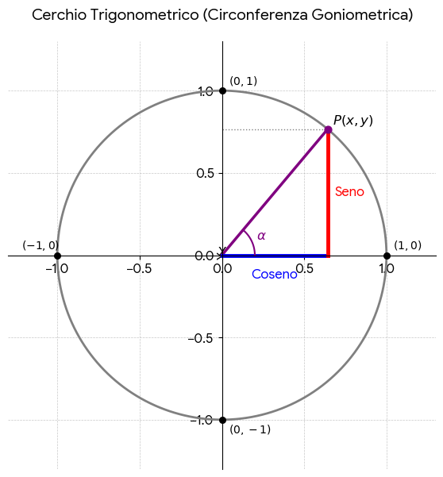

# Cenni sulle questioni trigonometriche

## Cos'è la goniometria e perché si studia sulla circonferenza unitaria

Nella geometria elementare, seno, coseno e tangente nascono come rapporti tra i lati di un triangolo rettangolo, e sono quindi limitati agli angoli acuti ($0^\circ < \alpha < 90^\circ$). Tuttavia, in fisica, in analisi matematica e in informatica grafica, gli angoli descrivono **rotazioni arbitrarie** (anche maggiori di un giro completo o in senso orario, cioè negative) e fenomeni che si ripetono ciclicamente nel tempo (onde sonore, segnali elettromagnetici, oscillazioni).
Avvolgendo la retta dei numeri reali attorno a una **circonferenza di raggio $1$ centrata nell'origine**, possiamo definire seno e coseno per **qualunque numero reale $\alpha \in \mathbb{R}$**: il coseno e il seno diventano semplicemente le **coordinate cartesiane $(x, y)$** del punto $P$ individuato dall'angolo sulla circonferenza!

---

## Circonferenza unitaria, radianti e definizioni fondamentali

### Misura degli angoli in radianti

In analisi matematica gli angoli si misurano in **radianti**: la misura in radianti di un angolo $\alpha$ è la lunghezza dell'arco intercettato sull'arco della circonferenza di raggio $R = 1$. Poiché l'intera circonferenza di raggio $1$ è lunga $2\pi$, l'angolo giro ($360^\circ$) misura $2\pi$ radianti e l'angolo piatto ($180^\circ$) misura $\pi$ radianti. La proporzione di conversione tra gradi e radianti è:

$$
\alpha_{\text{rad}} = \alpha^\circ \cdot \frac{\pi}{180^\circ}, \qquad \alpha^\circ = \alpha_{\text{rad}} \cdot \frac{180^\circ}{\pi}
$$

### La circonferenza goniometrica (unitaria)

La **circonferenza unitaria** (o *goniometrica*) ha centro nell'origine $O(0, 0)$, raggio $R = 1$ ed equazione cartesiana:

$$
x^2 + y^2 = 1
$$

Dato un angolo orientato $\alpha$ misurato a partire dal semiasse positivo delle ascisse (in senso antiorario se $\alpha > 0$, orario se $\alpha < 0$), il secondo lato dell'angolo incontra la circonferenza in un unico punto $P(x_P, y_P)$:
- **$\cos\alpha$ (coseno di $\alpha$)** è l'**ascissa** $x_P$ del punto $P$;
- **$\sin\alpha$ (seno di $\alpha$)** è l'**ordinata** $y_P$ del punto $P$;
- **$\tan\alpha$ (tangente di $\alpha$)** è il rapporto tra ordinata e ascissa (geometricamente rappresenta il coefficiente angolare della retta $OP$, ovvero l'ordinata del punto di intersezione della retta $OP$ con la retta tangente verticale $x = 1$):

$$
\tan\alpha = \frac{\sin\alpha}{\cos\alpha} \qquad \left(\text{definita per } \cos\alpha \neq 0, \text{ cioè } \alpha \neq \frac{\pi}{2} + k\pi\right);
$$

- **$\cot\alpha$ (cotangente di $\alpha$)** è il rapporto reciproco:

$$
\cot\alpha = \frac{\cos\alpha}{\sin\alpha} = \frac{1}{\tan\alpha} \qquad \left(\text{definita per } \sin\alpha \neq 0, \text{ cioè } \alpha \neq k\pi\right).
$$

---

## Dominio, codominio, periodicità e relazioni fondamentali

### Dominio, codominio e periodo

Poiché il punto $P(\cos\alpha, \sin\alpha)$ appartiene alla circonferenza di raggio $1$, le sue coordinate non possono mai uscire dall'intervallo $[-1, 1]$:

$$
-1 \le \sin\alpha \le 1, \qquad -1 \le \cos\alpha \le 1 \qquad (\forall \alpha \in \mathbb{R}).
$$

- **Seno e coseno**: hanno dominio $\mathbb{R}$, codominio $[-1, 1]$ e sono funzioni periodiche di **periodo $2\pi$** (aggiungendo multipli interi di un giro completo $2k\pi$ con $k \in \mathbb{Z}$, il punto $P$ torna nella stessa posizione):

$$
\sin(\alpha + 2k\pi) = \sin\alpha, \qquad \cos(\alpha + 2k\pi) = \cos\alpha \qquad (k \in \mathbb{Z}).
$$

- **Tangente**: ha dominio $\mathbb{R} \setminus \left\{\frac{\pi}{2} + k\pi : k \in \mathbb{Z}\right\}$, codominio tutto $\mathbb{R} = (-\infty, +\infty)$ e **periodo $\pi$** (mezzo giro!):

$$
\tan(\alpha + k\pi) = \tan\alpha \qquad (k \in \mathbb{Z}).
$$

- **Cotangente**: ha dominio $\mathbb{R} \setminus \{k\pi : k \in \mathbb{Z}\}$, codominio $\mathbb{R}$ e **periodo $\pi$**:

$$
\cot(\alpha + k\pi) = \cot\alpha \qquad (k \in \mathbb{Z}).
$$

### Relazione fondamentale della goniometria

Sostituendo le coordinate $x = \cos\alpha$ e $y = \sin\alpha$ nell'equazione della circonferenza unitaria $x^2 + y^2 = 1$ (che equivale al Teorema di Pitagora applicato al triangolo rettangolo di ipotenusa $1$), si ottiene la **prima relazione fondamentale della goniometria**:

$$
\sin^2\alpha + \cos^2\alpha = 1 \qquad (\forall \alpha \in \mathbb{R}),
$$

da cui si ricavano le formule inverse per passare dal seno al coseno e viceversa:

$$
\sin^2\alpha = 1 - \cos^2\alpha \implies \sin\alpha = \pm\sqrt{1 - \cos^2\alpha}, \qquad \cos^2\alpha = 1 - \sin^2\alpha \implies \cos\alpha = \pm\sqrt{1 - \sin^2\alpha},
$$

dove il segno $+$ o $-$ si sceglie in base al quadrante in cui cade l'angolo $\alpha$.

---

## Valori degli angoli notevoli e riduzione al primo quadrante

### Tabella degli angoli ricorrenti

| Radianti | Gradi | $\sin$ | $\cos$ | $\tan$ | $\cot$ |
| --- | ---: | ---: | ---: | ---: | ---: |
| $0$ | $0^\circ$ | $0$ | $1$ | $0$ | non definita |
| $\frac{\pi}{6}$ | $30^\circ$ | $\frac{1}{2}$ | $\frac{\sqrt{3}}{2}$ | $\frac{\sqrt{3}}{3}$ | $\sqrt{3}$ |
| $\frac{\pi}{4}$ | $45^\circ$ | $\frac{\sqrt{2}}{2}$ | $\frac{\sqrt{2}}{2}$ | $1$ | $1$ |
| $\frac{\pi}{3}$ | $60^\circ$ | $\frac{\sqrt{3}}{2}$ | $\frac{1}{2}$ | $\sqrt{3}$ | $\frac{\sqrt{3}}{3}$ |
| $\frac{\pi}{2}$ | $90^\circ$ | $1$ | $0$ | non definita | $0$ |
| $\pi$ | $180^\circ$ | $0$ | $-1$ | $0$ | non definita |
| $\frac{3\pi}{2}$ | $270^\circ$ | $-1$ | $0$ | non definita | $0$ |

> [!tip] 💡 Trucco mnemonico: "Easy Formula della Radice (da 0 a 4)"
> Per ricostruire al volo le prime cinque righe della tabella sopra ($0^\circ, 30^\circ, 45^\circ, 60^\circ, 90^\circ$, ovvero $0, \frac{\pi}{6}, \frac{\pi}{4}, \frac{\pi}{3}, \frac{\pi}{2}$) senza impararle a memoria:
>
> - **1. Il Seno (ordine crescente da $0$ a $4$):** disponi gli angoli dal più piccolo ($0^\circ$) al più grande ($90^\circ$), associa a ciascuno un **Numero** intero da **$0$ a $4$** e applica la formula generale:
>
> $$
> \sin(\alpha) = \frac{\sqrt{\text{Numero}}}{2}
> $$
>
>   Otterrai nell'ordine: $\frac{\sqrt{0}}{2} = \mathbf{0}$ ($0^\circ$), $\frac{\sqrt{1}}{2} = \mathbf{\frac{1}{2}}$ ($30^\circ$), $\mathbf{\frac{\sqrt{2}}{2}}$ ($45^\circ$), $\mathbf{\frac{\sqrt{3}}{2}}$ ($60^\circ$) e $\frac{\sqrt{4}}{2} = \mathbf{1}$ ($90^\circ$).
> - **2. Il Coseno (ordine inverso da $4$ a $0$):** segue esattamente l'**ordine inverso** rispetto al seno (da $4$ a $0$), ovvero corrisponde alla colonna del seno letta **dal basso verso l'alto** ($1, \frac{\sqrt{3}}{2}, \frac{\sqrt{2}}{2}, \frac{1}{2}, 0$).
> - **3. La Tangente (rapporto rapido $\tan = \frac{\sin}{\cos}$):** dividendo seno per coseno, i denominatori "$2$" si semplificano sempre tra loro:
>   - **$\alpha = 30^\circ \left(\frac{\pi}{6}\right)$:** $\tan(30^\circ) = \frac{1/2}{\sqrt{3}/2} = \frac{1}{\sqrt{3}} = \mathbf{\frac{\sqrt{3}}{3}}$ *(razionalizzando)*;
>   - **$\alpha = 45^\circ \left(\frac{\pi}{4}\right)$:** poiché seno e coseno sono identici ($\frac{\sqrt{2}}{2}$), il rapporto vale direttamente **$\tan(45^\circ) = 1$**.

### Passaggio da un quadrante all'altro (Angoli associati)

Per simmetria sulla circonferenza unitaria, qualunque angolo può essere ricondotto a un angolo acuto $\alpha \in \left(0, \frac{\pi}{2}\right)$ del primo quadrante, detto **angolo associato**: si mantengono i valori assoluti di seno, coseno, tangente e cotangente di $\alpha$ e si assegna il segno in base al quadrante in cui si trova l'angolo:
- **I quadrante ($0 < x < \frac{\pi}{2}$)**: $\sin > 0, \cos > 0, \tan > 0$;
- **II quadrante ($\frac{\pi}{2} < x < \pi$)**: $\sin > 0, \cos < 0, \tan < 0$;
- **III quadrante ($\pi < x < \frac{3\pi}{2}$)**: $\sin < 0, \cos < 0, \tan > 0$;
- **IV quadrante ($\frac{3\pi}{2} < x < 2\pi$)**: $\sin < 0, \cos > 0, \tan < 0$.

| Quadrante / Tipo | Angolo | Seno | Coseno | Tangente | Cotangente |
| --- | --- | --- | --- | --- | --- |
| **II (Supplementari)** | $\pi - \alpha$ | $\sin(\pi - \alpha) = \sin\alpha$ | $\cos(\pi - \alpha) = -\cos\alpha$ | $\tan(\pi - \alpha) = -\tan\alpha$ | $\cot(\pi - \alpha) = -\cot\alpha$ |
| **III (Differiscono di $\pi$)** | $\pi + \alpha$ | $\sin(\pi + \alpha) = -\sin\alpha$ | $\cos(\pi + \alpha) = -\cos\alpha$ | $\tan(\pi + \alpha) = \tan\alpha$ | $\cot(\pi + \alpha) = \cot\alpha$ |
| **IV (Esplementari / Opposti)** | $2\pi - \alpha$ (o $-\alpha$) | $\sin(-\alpha) = -\sin\alpha$ | $\cos(-\alpha) = \cos\alpha$ | $\tan(-\alpha) = -\tan\alpha$ | $\cot(-\alpha) = -\cot\alpha$ |
| **Complementari** | $\frac{\pi}{2} - \alpha$ | $\sin\left(\frac{\pi}{2} - \alpha\right) = \cos\alpha$ | $\cos\left(\frac{\pi}{2} - \alpha\right) = \sin\alpha$ | $\tan\left(\frac{\pi}{2} - \alpha\right) = \cot\alpha$ | $\cot\left(\frac{\pi}{2} - \alpha\right) = \tan\alpha$ |

*(Nota: le relazioni per $-\alpha$ mostrano che il **coseno è una funzione pari**, mentre **seno, tangente e cotangente sono funzioni dispari**).*

**Esempio di riduzione al primo quadrante:** Calcoliamo le funzioni trigonometriche di $\frac{5\pi}{6}$ (secondo quadrante). Poiché $\frac{5\pi}{6} = \pi - \frac{\pi}{6}$, l'angolo associato è $\frac{\pi}{6}$. Nel II quadrante solo il seno è positivo:

$$
\sin\frac{5\pi}{6} = \sin\frac{\pi}{6} = \frac{1}{2}, \qquad \cos\frac{5\pi}{6} = -\cos\frac{\pi}{6} = -\frac{\sqrt{3}}{2}, \qquad \tan\frac{5\pi}{6} = -\frac{\sqrt{3}}{3}, \qquad \cot\frac{5\pi}{6} = -\sqrt{3}.
$$

---

## Principali formule goniometriche

Attenzione: le funzioni goniometriche **non sono lineari**, quindi in generale $\sin(\alpha + \beta) \neq \sin\alpha + \sin\beta$ e $\sin(2\alpha) \neq 2\sin\alpha$! Per trasformare somme e multipli di angoli si usano le seguenti identità:

### 1. Formule di addizione e sottrazione

$$
\sin(\alpha \pm \beta) = \sin\alpha\cos\beta \pm \cos\alpha\sin\beta,
$$

$$
\cos(\alpha \pm \beta) = \cos\alpha\cos\beta \mp \sin\alpha\sin\beta \qquad (\text{attenzione: nel coseno il segno } \mp \text{ si inverte!}),
$$

$$
\tan(\alpha \pm \beta) = \frac{\tan\alpha \pm \tan\beta}{1 \mp \tan\alpha\tan\beta}.
$$

### 2. Formule di duplicazione (ponendo $\beta = \alpha$)

- **Seno del doppio di un angolo:**

$$
\sin(2\alpha) = 2\sin\alpha\cos\alpha.
$$

- **Coseno del doppio di un angolo** (nelle sue 3 forme equivalenti, utilissime nelle equazioni):

$$
\cos(2\alpha) = \cos^2\alpha - \sin^2\alpha = 1 - 2\sin^2\alpha = 2\cos^2\alpha - 1.
$$

### 3. Formule di bisezione (e formule di abbassamento di grado)
#### 3.1 Introduzione intuitiva: abbassamento di grado vs bisezione

Nello studio dell'Analisi Matematica 1 ci si imbatte costantemente in due problemi speculari:
1. **Problema analitico (potenze elevate):** manipolare, derivare o soprattutto *integrare* funzioni goniometriche elevate al quadrato (o a potenze superiori), come $\sin^2\alpha$ o $\cos^2\alpha$.
2. **Problema geometrico e algebrico (angoli dimezzati):** calcolare il valore esatto di seno, coseno e tangente della **metà di un angolo noto** (come $\frac{\pi}{8} = \frac{\pi/4}{2}$ o $\frac{\pi}{12} = \frac{\pi/6}{2}$), oppure ricondurre un'equazione in cui compaiono sia $x$ sia $\frac{x}{2}$ a un unico argomento.

Per risolvere questi due problemi si utilizzano due famiglie di identità strettamente imparentate: le **formule di abbassamento di grado** e le **formule di bisezione**.

##### Che cosa significa esattamente "abbassare il grado" di una funzione goniometrica?
In algebra, il **grado** di un termine rispetto a una funzione goniometrica è l'esponente a cui tale funzione è elevata:
- $\sin\alpha$ e $\cos(2\alpha)$ sono espressioni di **primo grado** (o *lineari*), poiché la funzione goniometrica compare con esponente $1$;
- $\sin^2\alpha = (\sin\alpha)^2$ e $\cos^2\alpha = (\cos\alpha)^2$ sono espressioni di **secondo grado** (o *quadratiche*).

> [!note] Definizione — Formule di abbassamento di grado (o di linearizzazione)
> Si chiamano **formule di abbassamento di grado** le identità goniometriche che trasformano il quadrato del seno o del coseno di un angolo $\alpha$ (termine di **grado $2$**) in un'espressione di **primo grado** (termine di **grado $1$**) rispetto al coseno dell'**angolo doppio** $2\alpha$.

- **Esempio intuitivo (perché servono in Analisi 1):** Se devi calcolare l'integrale $\int \sin^2 x \, dx$, non disponi di una regola di integrazione immediata per il quadrato del seno. Tuttavia, "abbassando il grado", puoi riscrivere $\sin^2 x$ come $\frac{1 - \cos(2x)}{2}$: la potenza quadratica scompare e resta soltanto il termine lineare $\cos(2x)$, il cui integrale è immediato!

##### Che cosa sono le formule di bisezione e perché si chiamano così?
Il termine **bisezione** deriva dal latino *bisectio* (*bi-* = «due», *sectio* = «taglio, divisione») e significa letteralmente **«divisione in due parti uguali»** (esattamente come la *bisettrice* di un angolo in geometria euclidea divide un angolo di ampiezza $x$ in due angoli congruenti di ampiezza $\frac{x}{2}$).

> [!note] Definizione — Formule di bisezione
> Si chiamano **formule di bisezione** le identità che permettono di esprimere il seno, il coseno e la tangente della **metà di un angolo**, cioè $\frac{x}{2}$, in funzione unicamente del **coseno dell'angolo intero** $x$ (e del segno determinato dal quadrante in cui cade $\frac{x}{2}$).

##### Qual è la differenza tra i due gruppi di formule e perché si studiano insieme?
Dal punto di vista strettamente algebrico, le due famiglie rappresentano **la medesima identità matematica**, letta però con due obiettivi opposti e con un semplice cambio di nome dell'angolo ($\alpha = \frac{x}{2}$, ossia $2\alpha = x$):
- Nelle **formule di abbassamento di grado**, il tuo punto di partenza è una **potenza** ($\sin^2\alpha$ o $\cos^2\alpha$) e il tuo obiettivo è **eliminare il quadrato** pagando il prezzo di raddoppiare l'angolo ($\alpha \to 2\alpha$). Non compaiono radici quadrate né ambiguità di segno.
- Nelle **formule di bisezione**, il tuo punto di partenza è un **angolo dimezzato** ($\sin\frac{x}{2}$ o $\cos\frac{x}{2}$) di primo grado e il tuo obiettivo è **tornare all'angolo intero** ($\frac{x}{2} \to x$) pagando il prezzo di introdurre una **radice quadrata** e una **scelta di segno $\pm$**.

---

#### 3.2 Derivazione delle formule di abbassamento di grado

Per ricavare le formule di abbassamento di grado non occorre memorizzare nulla di nuovo: basta partire dalle **formule di duplicazione del coseno** (viste nella sottosezione precedente) e risolverle algebricamente rispetto a $\sin^2\alpha$ e $\cos^2\alpha$.

Ricordiamo che, combinando $\cos(2\alpha) = \cos^2\alpha - \sin^2\alpha$ con l'identità fondamentale $\sin^2\alpha + \cos^2\alpha = 1$, valgono per ogni $\alpha \in \mathbb{R}$ le due relazioni:

$$
\cos(2\alpha) = 1 - 2\sin^2\alpha \qquad \text{(1)}, \qquad\qquad \cos(2\alpha) = 2\cos^2\alpha - 1 \qquad \text{(2)}.
$$

##### 1. Derivazione della formula per $\sin^2\alpha$
Partiamo dalla relazione $\text{(1)}$ e isoliamo gradualmente il termine $\sin^2\alpha$:
1. **Scrittura dell'identità di partenza:**
   $$
   \cos(2\alpha) = 1 - 2\sin^2\alpha
   $$
2. **Isolamento del termine quadratico:** sommiamo $2\sin^2\alpha$ a entrambi i membri e sottraiamo $\cos(2\alpha)$ da entrambi i membri (ossia trasportiamo $-2\sin^2\alpha$ a primo membro e $\cos(2\alpha)$ a secondo membro cambiando loro di segno):
   $$
   2\sin^2\alpha = 1 - \cos(2\alpha)
   $$
3. **Divisione per il coefficiente $2$:** dividendo ambo i membri per $2 \neq 0$, otteniamo la **formula di abbassamento di grado del seno**:
   $$
   \boxed{\sin^2\alpha = \frac{1 - \cos(2\alpha)}{2}} \qquad \forall \alpha \in \mathbb{R}.
   $$

##### 2. Derivazione della formula per $\cos^2\alpha$
Partiamo ora dalla relazione $\text{(2)}$ e isoliamo il termine $\cos^2\alpha$:
1. **Scrittura dell'identità di partenza:**
   $$
   \cos(2\alpha) = 2\cos^2\alpha - 1
   $$
2. **Isolamento del termine quadratico:** sommiamo $1$ a entrambi i membri:
   $$
   1 + \cos(2\alpha) = 2\cos^2\alpha \iff 2\cos^2\alpha = 1 + \cos(2\alpha)
   $$
3. **Divisione per il coefficiente $2$:** dividendo ambo i membri per $2$, otteniamo la **formula di abbassamento di grado del coseno**:
   $$
   \boxed{\cos^2\alpha = \frac{1 + \cos(2\alpha)}{2}} \qquad \forall \alpha \in \mathbb{R}.
   $$

##### 3. Derivazione della formula per $\tan^2\alpha$
Per ogni angolo $\alpha$ in cui la tangente è definita ($\cos\alpha \neq 0$, ossia $\alpha \neq \frac{\pi}{2} + k\pi$ con $k \in \mathbb{Z}$), dividiamo membro a membro la formula di $\sin^2\alpha$ per quella di $\cos^2\alpha$. I denominatori "$2$" si semplificano:

$$
\tan^2\alpha = \frac{\sin^2\alpha}{\cos^2\alpha} = \frac{\dfrac{1 - \cos(2\alpha)}{2}}{\dfrac{1 + \cos(2\alpha)}{2}} \implies \boxed{\tan^2\alpha = \frac{1 - \cos(2\alpha)}{1 + \cos(2\alpha)}} \qquad \left(\alpha \neq \frac{\pi}{2} + k\pi,\ k \in \mathbb{Z}\right).
$$

> [!important] Legge di scambio tra grado e argomento
> Osserva con attenzione la struttura di entrambe le formule:
> - **L'esponente (grado) si dimezza:** si passa dal grado $2$ ($\sin^2\alpha$, $\cos^2\alpha$) al grado $1$ ($\cos(2\alpha)$).
> - **L'angolo (argomento) raddoppia:** si passa dall'angolo $\alpha$ all'angolo doppio $2\alpha$.
> - **Regola mnemonica dei segni:** tutte le formule di abbassamento di grado contengono $\cos(2\alpha)$ al secondo membro; il **coseno** mantiene il segno **$+$** ($1 + \cos(2\alpha)$), mentre il **seno** prende il segno **$-$** ($1 - \cos(2\alpha)$).

---

#### 3.3 Derivazione delle formule di bisezione

Dalle formule di abbassamento di grado appena dimostrate possiamo ora ricavare le **formule di bisezione** mediante una semplice sostituzione di variabile.

##### 1. Il cambio di variabile $\alpha = \dfrac{x}{2}$
Poiché le formule di abbassamento di grado valgono per qualsiasi numero reale $\alpha \in \mathbb{R}$, possiamo scegliere di porre:

$$
\alpha = \frac{x}{2} \quad \Longleftrightarrow \quad 2\alpha = 2 \cdot \left(\frac{x}{2}\right) = x.
$$

Sostituendo $\alpha = \frac{x}{2}$ e $2\alpha = x$ nelle formule di abbassamento di grado di seno e coseno, otteniamo:

$$
\sin^2\left(\frac{x}{2}\right) = \frac{1 - \cos x}{2}, \qquad\qquad \cos^2\left(\frac{x}{2}\right) = \frac{1 + \cos x}{2}.
$$

##### 2. Perché compare la radice quadrata e perché il radicando è sempre $\ge 0$?
Le relazioni appena scritte ci forniscono il **quadrato** di $\sin\left(\frac{x}{2}\right)$ e di $\cos\left(\frac{x}{2}\right)$, mentre noi vogliamo conoscere il valore di $\sin\left(\frac{x}{2}\right)$ e $\cos\left(\frac{x}{2}\right)$ alla **prima potenza**. Per eliminare l'elevamento al quadrato dobbiamo estrarre la **radice quadrata aritmetica** di ambo i membri.

Prima di estrarre la radice quadrata in $\mathbb{R}$, un matematico deve sempre porsi una domanda fondamentale: **i radicandi $\frac{1 - \cos x}{2}$ e $\frac{1 + \cos x}{2}$ sono sempre maggiori o uguali a zero?**
La risposta è **sì, per qualunque $x \in \mathbb{R}$**:
- Poiché il coseno è una funzione limitata con codominio $[-1, 1]$, vale sempre $-1 \le \cos x \le 1$.
- Di conseguenza, $1 - \cos x \ge 0$ e $1 + \cos x \ge 0$ per ogni $x \in \mathbb{R}$ (anzi, entrambi i radicandi variano sempre nell'intervallo $[0, 1]$). Le radici quadrate sono dunque **sempre ben definite nei numeri reali**.

##### 3. Il passaggio cruciale: perché $\sqrt{\sin^2(x/2)} = \left|\sin(x/2)\right|$ e perché compare il segno $\pm$
In Analisi Matematica 1, la radice quadrata aritmetica $\sqrt{A}$ di un numero reale $A \ge 0$ è per definizione l'unico numero reale **non negativo** ($\ge 0$) il cui quadrato vale $A$. Pertanto, per qualunque quantità reale $u \in \mathbb{R}$, vale l'identità fondamentale dei radicali:

$$
\sqrt{u^2} = |u| \qquad (\text{e NON semplicemente } u!).
$$

Applicando la radice quadrata ad ambo i membri delle nostre equazioni otteniamo quindi un **valore assoluto** al primo membro:

$$
\sqrt{\sin^2\left(\frac{x}{2}\right)} = \sqrt{\frac{1 - \cos x}{2}} \quad \Longleftrightarrow \quad \left|\sin\left(\frac{x}{2}\right)\right| = \sqrt{\frac{1 - \cos x}{2}},
$$

$$
\sqrt{\cos^2\left(\frac{x}{2}\right)} = \sqrt{\frac{1 + \cos x}{2}} \quad \Longleftrightarrow \quad \left|\cos\left(\frac{x}{2}\right)\right| = \sqrt{\frac{1 + \cos x}{2}}.
$$

Togliere il valore assoluto significa esplicitare se la quantità interna è positiva o negativa ($|u| = k \iff u = \pm k$). Otteniamo così le **formule di bisezione del seno e del coseno**:

$$
\boxed{\sin\left(\frac{x}{2}\right) = \pm\sqrt{\frac{1 - \cos x}{2}}}, \qquad\qquad \boxed{\cos\left(\frac{x}{2}\right) = \pm\sqrt{\frac{1 + \cos x}{2}}} \qquad (\forall x \in \mathbb{R}).
$$

> [!warning] Che cosa significa davvero il simbolo $\pm$ nelle formule di bisezione?
> Il simbolo $\pm$ **non significa** che il seno o il coseno di un angolo $\frac{x}{2}$ abbiano due valori contemporaneamente (il seno e il coseno sono funzioni univoche!). Significa invece che **spetta a chi risolve l'esercizio scegliere uno solo dei due segni** ($+$ oppure $-$), dopo aver stabilito in quale quadrante cade l'angolo dimezzato $\frac{x}{2}$.

##### 4. Come scegliere il segno in base al quadrante (e quando usare direttamente il segno $+$)
Per scegliere correttamente tra $+$ e $-$ bisogna seguire una procedura in due passi:
1. **Dimezzare l'intervallo dell'angolo:** se il problema ti fornisce il quadrante (o l'intervallo) in cui si trova l'angolo intero $x$, devi prima **dividere per $2$ tutti i termini della disuguaglianza** per trovare in quale quadrante cade $\frac{x}{2}$.
   *(Ad esempio, se $x \in \left(\pi, \frac{3\pi}{2}\right)$ è nel III quadrante, dividendo per $2$ ottieni $\frac{\pi}{2} < \frac{x}{2} < \frac{3\pi}{4}$, che si trova nel **II quadrante**!).*
2. **Guardare il segno della funzione nel quadrante di $\frac{x}{2}$:**
   - Per **$\sin\left(\frac{x}{2}\right)$** (ordinata sulla circonferenza): scegli **$+$** se $\frac{x}{2}$ cade nel **I o II quadrante**; scegli **$-$** se $\frac{x}{2}$ cade nel **III o IV quadrante**.
   - Per **$\cos\left(\frac{x}{2}\right)$** (ascissa sulla circonferenza): scegli **$+$** se $\frac{x}{2}$ cade nel **I o IV quadrante**; scegli **$-$** se $\frac{x}{2}$ cade nel **II o III quadrante**.

**In quali situazioni possiamo utilizzare direttamente il segno positivo $+$?**
- **Caso 1 ($\frac{x}{2}$ nel I quadrante):** quando l'angolo di partenza $x$ è compreso tra $0$ e $\pi$ ($0^\circ < x < 180^\circ$), la sua metà $\frac{x}{2}$ è un **angolo acuto** compreso tra $0$ e $\frac{\pi}{2}$ ($0^\circ < \frac{x}{2} < 90^\circ$, **primo quadrante**). Nel primo quadrante **tutte** le funzioni goniometriche ($\sin$, $\cos$, $\tan$) sono strettamente positive, quindi si usa direttamente il segno $+$ per tutte!
- **Caso 2 (Angoli interni di un triangolo per il seno):** in geometria, ogni angolo interno $x$ di un triangolo verifica $0 < x < \pi$, perciò $\frac{x}{2} \in \left(0, \frac{\pi}{2}\right)$ ha sempre seno, coseno e tangente positivi. Più in generale, se $0 \le x \le 2\pi$, allora $0 \le \frac{x}{2} \le \pi$ (I o II quadrante), perciò **$\sin\left(\frac{x}{2}\right) \ge 0$ ha sempre il segno $+$** per qualunque angolo $x$ del primo giro!

##### 5. Formula di bisezione della tangente (forma irrazionale e forme razionali)
Per la tangente dell'angolo metà $\tan\left(\frac{x}{2}\right) = \dfrac{\sin(x/2)}{\cos(x/2)}$ esistono **tre forme equivalenti**, di cui le ultime due sono preziosissime perché **eliminano sia la radice quadrata sia l'ambiguità del segno $\pm$**:

1. **Forma irrazionale (con radice e $\pm$):** dividendo membro a membro $\sin\left(\frac{x}{2}\right)$ per $\cos\left(\frac{x}{2}\right)$:
   $$
   \boxed{\tan\left(\frac{x}{2}\right) = \pm\sqrt{\frac{1 - \cos x}{1 + \cos x}}} \qquad \text{valida per } \cos\left(\frac{x}{2}\right) \neq 0 \iff \frac{x}{2} \neq \frac{\pi}{2} + k\pi \iff \mathbf{x \neq \pi + 2k\pi}\ (k \in \mathbb{Z}).
   $$
   Il segno è $+$ se $\frac{x}{2}$ appartiene al I o III quadrante, $-$ se appartiene al II o IV quadrante.

2. **Prima forma razionale (moltiplicando numeratore e denominatore di $\frac{\sin(x/2)}{\cos(x/2)}$ per $2\cos\frac{x}{2}$):**
   Ricordando che al numeratore $2\sin\frac{x}{2}\cos\frac{x}{2} = \sin x$ (formula di duplicazione del seno applicata a $\frac{x}{2}$) e al denominatore $2\cos^2\frac{x}{2} = 1 + \cos x$:
   $$
   \tan\left(\frac{x}{2}\right) = \frac{2\sin\frac{x}{2}\cos\frac{x}{2}}{2\cos^2\frac{x}{2}} \implies \boxed{\tan\left(\frac{x}{2}\right) = \frac{\sin x}{1 + \cos x}} \qquad \text{valida per } 1 + \cos x \neq 0 \iff \mathbf{x \neq \pi + 2k\pi}\ (k \in \mathbb{Z}).
   $$

3. **Seconda forma razionale (moltiplicando numeratore e denominatore di $\frac{\sin(x/2)}{\cos(x/2)}$ per $2\sin\frac{x}{2}$):**
   Al numeratore $2\sin^2\frac{x}{2} = 1 - \cos x$ e al denominatore $2\sin\frac{x}{2}\cos\frac{x}{2} = \sin x$:
   $$
   \tan\left(\frac{x}{2}\right) = \frac{2\sin^2\frac{x}{2}}{2\sin\frac{x}{2}\cos\frac{x}{2}} \implies \boxed{\tan\left(\frac{x}{2}\right) = \frac{1 - \cos x}{\sin x}} \qquad \text{valida per } \sin x \neq 0 \iff \mathbf{x \neq k\pi}\ (k \in \mathbb{Z}).
   $$
   *(Nota: nella seconda forma razionale compare al denominatore $\sin x$, che si annulla anche per $x = 2k\pi$, dove $\tan(k\pi) = 0$; pertanto ha un dominio leggermente più ristretto della prima forma razionale $\frac{\sin x}{1 + \cos x}$, che ha esattamente lo stesso dominio naturale di $\tan\frac{x}{2}$!).*

---

#### 3.4 Supporti grafici e interpretazione visiva

##### 1. Confronto grafico: $y = \sin^2 x$ vs $y = \frac{1 - \cos(2x)}{2}$ e $y = \cos^2 x$ vs $y = \frac{1 + \cos(2x)}{2}$

Il grafico seguente (con angoli espressi in **radianti** sull'intervallo $[0, 2\pi]$) mostra visivamente perché le formule di abbassamento di grado sono identità esatte su tutto $\mathbb{R}$:

**Che cosa dimostrano questi due grafici?**
- **Coincidenza punto per punto:** Nel pannello di sinistra la curva continua blu $y_1 = \sin^2 x$ e la curva tratteggiata verde $y_2 = \frac{1 - \cos(2x)}{2} = \frac{1}{2} - \frac{1}{2}\cos(2x)$ sono **perfettamente sovrapposte**; lo stesso accade a destra tra $y_1 = \cos^2 x$ (viola) e $y_2 = \frac{1 + \cos(2x)}{2} = \frac{1}{2} + \frac{1}{2}\cos(2x)$ (tratteggiata rossa).
- **Non negatività e quota media $y = \frac{1}{2}$:** Elevando al quadrato $\sin x$ o $\cos x$, le semionde negative si ribaltano sopra l'asse delle ascisse e l'immagine diventa $[0, 1]$. Le formule di abbassamento di grado spiegano questo fenomeno come una **cosinusoide traslata verticalmente verso l'alto di $+\frac{1}{2}$** (la retta tratteggiata arancione $y = \frac{1}{2}$ è l'asse medio di oscillazione) e con **ampiezza dimezzata** pari a $\frac{1}{2}$ (oscilla tra $\frac{1}{2} - \frac{1}{2} = 0$ e $\frac{1}{2} + \frac{1}{2} = 1$).
- **Dimezzamento del periodo ($T = \pi\text{ rad}$):** Poiché l'argomento raddoppia da $x$ a $2x$ ($\omega = 2$), la frequenza raddoppia e il **periodo minimo si dimezza** passando da $2\pi$ a $T = \frac{2\pi}{2} = \pi\text{ rad}$. Infatti, nell'intervallo $[0, 2\pi]$ entrambe le curve compiono **due oscillazioni complete**!

##### 2. Rappresentazione sulla circonferenza goniometrica dell'angolo $\alpha$ e dell'angolo dimezzato $\frac{\alpha}{2}$

**Che cosa mostra la figura?**
- **Pannello sinistro (Geometria della bisezione):** Sulla circonferenza unitaria $x^2 + y^2 = 1$, la semiretta $OM$ (blu) è la **bisettrice** dell'angolo $\alpha$ individuato dal raggio $OP$ (viola). Anche quando l'angolo di partenza $\alpha$ si trova nel **II quadrante** (ad esempio $\alpha = \frac{2\pi}{3} = 120^\circ$, dove l'ascissa $\cos\alpha = -\frac{1}{2}$ è negativa), l'angolo dimezzato $\frac{\alpha}{2} = \frac{\pi}{3} = 60^\circ$ cade nel **I quadrante**, perciò sia l'ascissa $\cos\left(\frac{\alpha}{2}\right) = +\frac{1}{2}$ (verde) sia l'ordinata $\sin\left(\frac{\alpha}{2}\right) = +\frac{\sqrt{3}}{2}$ (rossa) sono **positive**.
- **Pannello destro (Bussola dei segni):** Riassume visivamente quale segno scegliere davanti alla radice quadrata in base al quadrante in cui cade **l'angolo dimezzato $\frac{x}{2}$**.

##### 3. Percorso logico passo-passo: dalla duplicazione all'abbassamento di grado fino alla bisezione

Per non dover imparare le formule a memoria come se fossero slegate tra loro, basta seguire questa catena logica in **tre passaggi consecutivi**:

1. **Tappa 1 — Partenza dalla duplicazione del coseno:**
   Dalla formula generale $\cos(2\alpha) = \cos^2\alpha - \sin^2\alpha$, usando l'identità fondamentale $\sin^2\alpha + \cos^2\alpha = 1$, si scrivono le due versioni che contengono **una sola funzione al quadrato**:
   - sostituendo $\cos^2\alpha = 1 - \sin^2\alpha$ si ottiene la forma nel solo seno: $\quad \cos(2\alpha) = 1 - 2\sin^2\alpha$;
   - sostituendo $\sin^2\alpha = 1 - \cos^2\alpha$ si ottiene la forma nel solo coseno: $\quad \cos(2\alpha) = 2\cos^2\alpha - 1$.

2. **Tappa 2 — Inversione algebrica $\longrightarrow$ Formule di abbassamento di grado:**
   Isolando i quadrati $\sin^2\alpha$ e $\cos^2\alpha$ nelle due equazioni precedenti, **il grado scende da $2$ a $1$** mentre **l'angolo raddoppia da $\alpha$ a $2\alpha$**:

   $$
   \begin{aligned}
   \cos(2\alpha) = 1 - 2\sin^2\alpha \quad &\xrightarrow{\text{isolo }\sin^2\alpha} \quad \sin^2\alpha = \frac{1 - \cos(2\alpha)}{2} \\[6pt]
   \cos(2\alpha) = 2\cos^2\alpha - 1 \quad &\xrightarrow{\text{isolo }\cos^2\alpha} \quad \cos^2\alpha = \frac{1 + \cos(2\alpha)}{2} \\[6pt]
   \frac{\sin^2\alpha}{\cos^2\alpha} \quad &\xrightarrow{\text{rapporto}} \quad \tan^2\alpha = \frac{1 - \cos(2\alpha)}{1 + \cos(2\alpha)}
   \end{aligned}
   $$

3. **Tappa 3 — Cambio di variabile ($\alpha = \frac{x}{2}$) e radice quadrata $\longrightarrow$ Formule di bisezione:**
   Chiamando $x$ l'angolo doppio (cioè ponendo $2\alpha = x$, da cui $\alpha = \frac{x}{2}$) ed estraendo la radice quadrata di entrambi i membri (ricordando che $\sqrt{u^2} = |u|$ introduce la scelta del segno $\pm$ in base al quadrante di $\frac{x}{2}$), si passa direttamente alle funzioni dell'angolo metà:

   $$
   \begin{aligned}
   \sin^2\alpha = \frac{1 - \cos(2\alpha)}{2} \quad &\xrightarrow{\text{pongo }\alpha = \frac{x}{2}} \quad \sin^2\left(\frac{x}{2}\right) = \frac{1 - \cos x}{2} \quad &&\xrightarrow{\text{radice quadrata}} \quad \sin\left(\frac{x}{2}\right) = \pm\sqrt{\frac{1 - \cos x}{2}} \\[8pt]
   \cos^2\alpha = \frac{1 + \cos(2\alpha)}{2} \quad &\xrightarrow{\text{pongo }\alpha = \frac{x}{2}} \quad \cos^2\left(\frac{x}{2}\right) = \frac{1 + \cos x}{2} \quad &&\xrightarrow{\text{radice quadrata}} \quad \cos\left(\frac{x}{2}\right) = \pm\sqrt{\frac{1 + \cos x}{2}} \\[8pt]
   \tan^2\alpha = \frac{1 - \cos(2\alpha)}{1 + \cos(2\alpha)} \quad &\xrightarrow{\text{pongo }\alpha = \frac{x}{2}} \quad \tan^2\left(\frac{x}{2}\right) = \frac{1 - \cos x}{1 + \cos x} \quad &&\xrightarrow{\text{radice o razionalizzazione}} \quad \tan\left(\frac{x}{2}\right) = \pm\sqrt{\frac{1 - \cos x}{1 + \cos x}} = \frac{\sin x}{1 + \cos x} = \frac{1 - \cos x}{\sin x}
   \end{aligned}
   $$

---

#### 3.5 Tabelle riassuntive

##### TABELLA A — Confronto tra formule di abbassamento di grado e formule di bisezione

| Caratteristica | Formule di abbassamento di grado (o di linearizzazione) | Formule di bisezione (dell'angolo metà) |
| :--- | :--- | :--- |
| **Definizione** | Identità che esprimono il quadrato di seno, coseno o tangente di un angolo $\alpha$ come combinazione lineare di $\cos(2\alpha)$. | Identità che esprimono seno, coseno o tangente dell'angolo dimezzato $\frac{x}{2}$ in funzione di $\cos x$ (e $\sin x$). |
| **Formule principali** | $\sin^2\alpha = \dfrac{1 - \cos(2\alpha)}{2}$ $\cos^2\alpha = \dfrac{1 + \cos(2\alpha)}{2}$ | $\sin\dfrac{x}{2} = \pm\sqrt{\dfrac{1 - \cos x}{2}}$ $\cos\dfrac{x}{2} = \pm\sqrt{\dfrac{1 + \cos x}{2}}$ |
| **Obiettivo principale** | **Eliminare le potenze** ($\text{grado } 2 \to \text{grado } 1$) per linearizzare l'espressione goniometrica. | **Calcolare funzioni in $\frac{x}{2}$** o ricondurre l'argomento dimezzato $\frac{x}{2}$ all'angolo intero $x$. |
| **Trasformazione effettuata** | - **Grado:** scende da $2$ a $1$ - **Angolo:** **raddoppia** da $\alpha$ a $2\alpha$ | - **Grado:** resta $1$ (sotto radice quadrata) - **Angolo:** **raddoppia** da $\frac{x}{2}$ a $x$ |
| **Presenza di radici e segni $\pm$** | **Nessuna radice** e **nessuna ambiguità di segno**: valgono con segno unico su tutto $\mathbb{R}$. | **Radice quadrata** e **scelta obbligatoria del segno $\pm$** in base al quadrante di $\frac{x}{2}$ (eccetto forme razionali di $\tan\frac{x}{2}$). |
| **Situazioni tipiche di utilizzo** | - Calcolo di integrali $\int \sin^2 x\,dx$, $\int \cos^4 x\,dx$ - Studio del periodo e dell'immagine di funzioni quadratiche - Sviluppi di Taylor e serie di Fourier | - Calcolo esatto di angoli non tabulati ($\frac{\pi}{8}, \frac{\pi}{12}, 15^\circ, 22^\circ 30'$) - Equazioni e disequazioni contenenti $\sin\frac{x}{2}$ e $\cos x$ - Problemi geometrici con bisettrici |

##### TABELLA B — Formulario completo e condizioni di validità

| Nome della formula | Formula matematica | Condizioni di validità (Dominio) |
| :--- | :---: | :--- |
| **Abbassamento di grado del seno** | $\sin^2\alpha = \dfrac{1 - \cos(2\alpha)}{2}$ | $\forall \alpha \in \mathbb{R}$ |
| **Abbassamento di grado del coseno** | $\cos^2\alpha = \dfrac{1 + \cos(2\alpha)}{2}$ | $\forall \alpha \in \mathbb{R}$ |
| **Abbassamento di grado della tangente** | $\tan^2\alpha = \dfrac{1 - \cos(2\alpha)}{1 + \cos(2\alpha)}$ | $\alpha \neq \dfrac{\pi}{2} + k\pi \quad (k \in \mathbb{Z})$ |
| **Bisezione del seno** | $\sin\left(\dfrac{x}{2}\right) = \pm\sqrt{\dfrac{1 - \cos x}{2}}$ | $\forall x \in \mathbb{R}$ |
| **Bisezione del coseno** | $\cos\left(\dfrac{x}{2}\right) = \pm\sqrt{\dfrac{1 + \cos x}{2}}$ | $\forall x \in \mathbb{R}$ |
| **Bisezione della tangente (irrazionale)** | $\tan\left(\dfrac{x}{2}\right) = \pm\sqrt{\dfrac{1 - \cos x}{1 + \cos x}}$ | $x \neq \pi + 2k\pi \quad (k \in \mathbb{Z})$ |
| **Bisezione della tangente (1ª razionale)** | $\tan\left(\dfrac{x}{2}\right) = \dfrac{\sin x}{1 + \cos x}$ | $x \neq \pi + 2k\pi \quad (k \in \mathbb{Z})$ *(nessun $\pm$!)* |
| **Bisezione della tangente (2ª razionale)** | $\tan\left(\dfrac{x}{2}\right) = \dfrac{1 - \cos x}{\sin x}$ | $x \neq k\pi \quad (k \in \mathbb{Z})$ *(nessun $\pm$!)* |

##### TABELLA C — Scelta del segno nelle formule di bisezione (in base al quadrante di $\frac{x}{2}$)

| Quadrante di $\dfrac{x}{2}$ | Intervallo dell'angolo metà $\dfrac{x}{2}$ (rad / gradi) | Intervallo corrispondente dell'angolo intero $x$ | Segno di $\sin\left(\dfrac{x}{2}\right)$ | Segno di $\cos\left(\dfrac{x}{2}\right)$ | Segno di $\tan\left(\dfrac{x}{2}\right)$ |
| :---: | :---: | :---: | :---: | :---: | :---: |
| **I quadrante** | $0 < \dfrac{x}{2} < \dfrac{\pi}{2}$ $(0^\circ < x/2 < 90^\circ)$ | $0 < x < \pi$ $(0^\circ < x < 180^\circ)$ | **$+$** $\left(+\sqrt{\frac{1-\cos x}{2}}\right)$ | **$+$** $\left(+\sqrt{\frac{1+\cos x}{2}}\right)$ | **$+$** |
| **II quadrante** | $\dfrac{\pi}{2} < \dfrac{x}{2} < \pi$ $(90^\circ < x/2 < 180^\circ)$ | $\pi < x < 2\pi$ $(180^\circ < x < 360^\circ)$ | **$+$** $\left(+\sqrt{\frac{1-\cos x}{2}}\right)$ | **$-$** $\left(-\sqrt{\frac{1+\cos x}{2}}\right)$ | **$-$** |
| **III quadrante** | $\pi < \dfrac{x}{2} < \dfrac{3\pi}{2}$ $(180^\circ < x/2 < 270^\circ)$ | $2\pi < x < 3\pi$ $(360^\circ < x < 540^\circ)$ | **$-$** $\left(-\sqrt{\frac{1-\cos x}{2}}\right)$ | **$-$** $\left(-\sqrt{\frac{1+\cos x}{2}}\right)$ | **$+$** |
| **IV quadrante** | $\dfrac{3\pi}{2} < \dfrac{x}{2} < 2\pi$ $(270^\circ < x/2 < 360^\circ)$ | $3\pi < x < 4\pi$ $(540^\circ < x < 720^\circ)$ | **$-$** $\left(-\sqrt{\frac{1-\cos x}{2}}\right)$ | **$+$** $\left(+\sqrt{\frac{1+\cos x}{2}}\right)$ | **$-$** |

*(Osservazione pratica: se l'angolo di partenza $x$ appartiene al primo giro $(0, 2\pi)$, la sua metà $\frac{x}{2}$ cade necessariamente in $(0, \pi)$, ossia nel **I o nel II quadrante**: pertanto per ogni $x \in [0, 2\pi]$ il seno dell'angolo metà $\sin\frac{x}{2}$ è **sempre $\ge 0$**, mentre il coseno $\cos\frac{x}{2}$ cambia segno attraversando $x = \pi$, cioè $\frac{x}{2} = \frac{\pi}{2}$!).*

---

#### 3.6 Esempi svolti di difficoltà crescente

##### Esempio 1 (Livello Base) — Abbassamento di grado di $\sin^2 x$
**Problema:**
1. Calcolare il valore esatto di $\sin^2\left(\frac{\pi}{12}\right)$ senza calcolare preventivamente $\sin\left(\frac{\pi}{12}\right)$.
2. Linearizzare la funzione $f(x) = 4\sin^2(3x)$ determinandone periodo minimo e insieme immagine.

**Perché scegliamo la formula di abbassamento di grado del seno?**
In entrambi i quesiti compare il **quadrato del seno** ($\sin^2\alpha$): non ci serve estrarre alcuna radice quadrata né discutere segni $\pm$; applicando $\sin^2\alpha = \frac{1 - \cos(2\alpha)}{2}$ raddoppiamo l'argomento trasformando subito $\frac{\pi}{12}$ nell'angolo notevole $\frac{\pi}{6}$ ($30^\circ$) e la potenza quadratica $\sin^2(3x)$ in una semplice funzione sinusoidale lineare.

**Svolgimento passo-passo:**
1. **Calcolo di $\sin^2\left(\frac{\pi}{12}\right)$:** poniamo $\alpha = \frac{\pi}{12}$, da cui l'angolo doppio è $2\alpha = 2 \cdot \frac{\pi}{12} = \frac{\pi}{6}$. Sostituendo nella formula di abbassamento di grado del seno:
   $$
   \sin^2\left(\frac{\pi}{12}\right) = \frac{1 - \cos\left(2 \cdot \frac{\pi}{12}\right)}{2} = \frac{1 - \cos\left(\frac{\pi}{6}\right)}{2}.
   $$
   Poiché $\cos\left(\frac{\pi}{6}\right) = \frac{\sqrt{3}}{2}$, otteniamo:
   $$
   \sin^2\left(\frac{\pi}{12}\right) = \frac{1 - \dfrac{\sqrt{3}}{2}}{2} = \frac{\dfrac{2 - \sqrt{3}}{2}}{2} = \boxed{\frac{2 - \sqrt{3}}{4}} \approx 0{,}0670.
   $$
2. **Linearizzazione di $f(x) = 4\sin^2(3x)$:** poniamo $\alpha = 3x$, per cui l'angolo doppio è $2\alpha = 6x$:
   $$
   f(x) = 4 \cdot \left(\frac{1 - \cos(6x)}{2}\right) = 2\bigl(1 - \cos(6x)\bigr) = \boxed{2 - 2\cos(6x)}.
   $$
   Dalla forma linearizzata leggiamo immediatamente:
   - **Periodo minimo:** poiché la pulsazione è $\omega = 6$, il periodo è $T = \frac{2\pi}{6} = \frac{\pi}{3}\text{ rad}$;
   - **Insieme immagine:** poiché $-1 \le \cos(6x) \le 1$, si ha $\operatorname{Im}(f) = [2 - 2, 2 + 2] = [0, 4]$.

**Verifica del risultato:**
Per $\frac{\pi}{12} = 15^\circ$, sappiamo che $\sin(15^\circ) = \sin(45^\circ - 30^\circ) = \frac{\sqrt{6} - \sqrt{2}}{4}$. Elevando al quadrato: $\left(\frac{\sqrt{6} - \sqrt{2}}{4}\right)^2 = \frac{6 - 2\sqrt{12} + 2}{16} = \frac{8 - 4\sqrt{3}}{16} = \frac{2 - \sqrt{3}}{4}$, che coincide esattamente!

---

##### Esempio 2 (Livello Intermedio) — Abbassamento di grado iterato di $\cos^2 x$ (potenza quarta $\cos^4 x$)
**Problema:** Trasformare la funzione di quarto grado $g(x) = \cos^4 x$ in una somma di coseni di **primo grado** (forma completamente linearizzata), utile per il calcolo dell'integrale $\int \cos^4 x\,dx$.

**Perché scegliamo la formula di abbassamento di grado del coseno?**
Poiché $\cos^4 x = (\cos^2 x)^2$, possiamo applicare una **prima volta** la formula $\cos^2\alpha = \frac{1 + \cos(2\alpha)}{2}$ con $\alpha = x$ per scendere dal grado $4$ al grado $2$, e una **seconda volta** con $\alpha = 2x$ per scendere dal grado $2$ al grado $1$.

**Svolgimento passo-passo:**
1. **Primo abbassamento di grado ($\alpha = x \implies 2\alpha = 2x$):**
   $$
   \cos^4 x = \bigl(\cos^2 x\bigr)^2 = \left(\frac{1 + \cos(2x)}{2}\right)^2 = \frac{1 + 2\cos(2x) + \cos^2(2x)}{4} = \frac{1}{4} + \frac{1}{2}\cos(2x) + \frac{1}{4}\cos^2(2x).
   $$
2. **Secondo abbassamento di grado sul termine residuo $\cos^2(2x)$ ($\alpha = 2x \implies 2\alpha = 4x$):**
   I primi due addendi ($\frac{1}{4}$ e $\frac{1}{2}\cos(2x)$) sono già di grado $\le 1$. Resta il termine quadratico $\cos^2(2x)$, a cui applichiamo nuovamente la formula di abbassamento di grado raddoppiando l'angolo da $2x$ a $4x$:
   $$
   \cos^2(2x) = \frac{1 + \cos(4x)}{2}.
   $$
3. **Sostituzione e somma dei termini costanti:**
   $$
   \cos^4 x = \frac{1}{4} + \frac{1}{2}\cos(2x) + \frac{1}{4}\left(\frac{1 + \cos(4x)}{2}\right) = \frac{1}{4} + \frac{1}{2}\cos(2x) + \frac{1}{8} + \frac{1}{8}\cos(4x).
   $$
   Sommando $\frac{1}{4} + \frac{1}{8} = \frac{3}{8}$, otteniamo l'identità completamente linearizzata:
   $$
   \boxed{\cos^4 x = \frac{3}{8} + \frac{1}{2}\cos(2x) + \frac{1}{8}\cos(4x)}.
   $$

**Verifica del risultato:**
Controlliamo l'identità in due angoli campione:
- Per $x = 0$: a primo membro $\cos^4(0) = 1^4 = 1$; a secondo membro $\frac{3}{8} + \frac{1}{2}\cos(0) + \frac{1}{8}\cos(0) = \frac{3 + 4 + 1}{8} = \frac{8}{8} = 1$. ✅
- Per $x = \frac{\pi}{2}$: a primo membro $\cos^4\left(\frac{\pi}{2}\right) = 0$; a secondo membro $\frac{3}{8} + \frac{1}{2}\cos(\pi) + \frac{1}{8}\cos(2\pi) = \frac{3}{8} - \frac{1}{2} + \frac{1}{8} = 0$. ✅

---

##### Esempio 3 (Livello Intermedio) — Bisezione con scelta del segno positivo ($\frac{\pi}{8} = 22^\circ 30'$)
**Problema:** Calcolare i valori esatti di $\sin\left(\frac{\pi}{8}\right)$, $\cos\left(\frac{\pi}{8}\right)$ e $\tan\left(\frac{\pi}{8}\right)$.

**Perché scegliamo le formule di bisezione e il segno positivo?**
L'angolo $\frac{\pi}{8}$ ($22{,}5^\circ$) non compare nella tabella degli angoli notevoli elementari, ma osserviamo che è esattamente **la metà** dell'angolo notevole $x = \frac{\pi}{4}$ ($45^\circ$):
$$
\frac{\pi}{8} = \frac{\pi/4}{2} \quad \implies \quad x = \frac{\pi}{4}, \qquad \frac{x}{2} = \frac{\pi}{8}.
$$
Poiché $0 < \frac{\pi}{8} < \frac{\pi}{2}$, l'angolo metà $\frac{\pi}{8}$ appartiene al **I quadrante**, dove seno, coseno e tangente sono tutti **strettamente positivi ($> 0$)**. Scegliamo quindi il segno **$+$** in tutte le formule!

**Svolgimento passo-passo:**
1. **Calcolo di $\sin\left(\frac{\pi}{8}\right)$:** sapendo che $\cos\left(\frac{\pi}{4}\right) = \frac{\sqrt{2}}{2}$:
   $$
   \sin\left(\frac{\pi}{8}\right) = +\sqrt{\frac{1 - \cos\left(\frac{\pi}{4}\right)}{2}} = \sqrt{\frac{1 - \dfrac{\sqrt{2}}{2}}{2}} = \sqrt{\frac{2 - \sqrt{2}}{4}} = \frac{\sqrt{2 - \sqrt{2}}}{\sqrt{4}} = \boxed{\frac{\sqrt{2 - \sqrt{2}}}{2}}.
   $$
2. **Calcolo di $\cos\left(\frac{\pi}{8}\right)$:**
   $$
   \cos\left(\frac{\pi}{8}\right) = +\sqrt{\frac{1 + \cos\left(\frac{\pi}{4}\right)}{2}} = \sqrt{\frac{1 + \dfrac{\sqrt{2}}{2}}{2}} = \sqrt{\frac{2 + \sqrt{2}}{4}} = \boxed{\frac{\sqrt{2 + \sqrt{2}}}{2}}.
   $$
3. **Calcolo di $\tan\left(\frac{\pi}{8}\right)$:** usiamo la **seconda forma razionale** della bisezione della tangente, che evita i radicali doppi:
   $$
   \tan\left(\frac{\pi}{8}\right) = \frac{1 - \cos\left(\frac{\pi}{4}\right)}{\sin\left(\frac{\pi}{4}\right)} = \frac{1 - \dfrac{\sqrt{2}}{2}}{\dfrac{\sqrt{2}}{2}} = \frac{2 - \sqrt{2}}{\sqrt{2}}.
   $$
   Razionalizzando il denominatore (moltiplicando numeratore e denominatore per $\sqrt{2}$):
   $$
   \tan\left(\frac{\pi}{8}\right) = \frac{(2 - \sqrt{2})\sqrt{2}}{2} = \frac{2\sqrt{2} - 2}{2} = \boxed{\sqrt{2} - 1} \approx 0{,}4142.
   $$

**Verifica del risultato:**
Verifichiamo l'identità fondamentale $\sin^2\left(\frac{\pi}{8}\right) + \cos^2\left(\frac{\pi}{8}\right) = 1$:
$$
\left(\frac{\sqrt{2 - \sqrt{2}}}{2}\right)^2 + \left(\frac{\sqrt{2 + \sqrt{2}}}{2}\right)^2 = \frac{2 - \sqrt{2}}{4} + \frac{2 + \sqrt{2}}{4} = \frac{4}{4} = 1. \quad \checkmark
$$

---

##### Esempio 4 (Livello Avanzato / Esame) — Bisezione con scelta del segno negativo
**Problema:** Sapendo che $\cos x = -\frac{7}{25}$ e che l'angolo $x$ verifica $\pi < x < \frac{3\pi}{2}$ (III quadrante), calcolare il valore esatto di $\sin\left(\frac{x}{2}\right)$, $\cos\left(\frac{x}{2}\right)$ e $\tan\left(\frac{x}{2}\right)$.

**Perché questo esercizio richiede particolare attenzione nella scelta del segno?**
L'errore più grave sarebbe pensare: *"poiché $x$ è nel III quadrante, sia il seno sia il coseno sono negativi"*. **Attenzione:** nelle formule di bisezione il segno non dipende dal quadrante di $x$, ma dal **quadrante dell'angolo dimezzato $\frac{x}{2}$**!

**Svolgimento passo-passo:**
1. **Determinazione del quadrante di $\frac{x}{2}$ e scelta dei segni:**
   Dividiamo per $2$ tutti i membri della disuguaglianza $\pi < x < \frac{3\pi}{2}$:
   $$
   \pi < x < \frac{3\pi}{2} \quad \overset{:2}{\Longrightarrow} \quad \frac{\pi}{2} < \frac{x}{2} < \frac{3\pi}{4} \qquad (90^\circ < x/2 < 135^\circ).
   $$
   L'angolo dimezzato $\frac{x}{2}$ appartiene dunque al **II quadrante**! Nel II quadrante:
   - l'ordinata è positiva $\implies \mathbf{\sin\left(\frac{x}{2}\right) > 0}$ (scegliamo il segno **$+$**);
   - l'ascissa è negativa $\implies \mathbf{\cos\left(\frac{x}{2}\right) < 0}$ (scegliamo il segno **$-$**);
   - la tangente è negativa $\implies \mathbf{\tan\left(\frac{x}{2}\right) < 0}$.

2. **Calcolo di $\sin\left(\frac{x}{2}\right)$ (con segno $+$):**
   Sostituiamo $\cos x = -\frac{7}{25}$ facendo attenzione al doppio segno meno ($1 - \cos x = 1 - \left(-\frac{7}{25}\right) = 1 + \frac{7}{25}$):
   $$
   \sin\left(\frac{x}{2}\right) = +\sqrt{\frac{1 - \cos x}{2}} = +\sqrt{\frac{1 - \left(-\dfrac{7}{25}\right)}{2}} = +\sqrt{\frac{\dfrac{32}{25}}{2}} = +\sqrt{\frac{16}{25}} = \boxed{+\frac{4}{5}}.
   $$

3. **Calcolo di $\cos\left(\frac{x}{2}\right)$ (con segno $-$):**
   $$
   \cos\left(\frac{x}{2}\right) = -\sqrt{\frac{1 + \cos x}{2}} = -\sqrt{\frac{1 + \left(-\dfrac{7}{25}\right)}{2}} = -\sqrt{\frac{\dfrac{18}{25}}{2}} = -\sqrt{\frac{9}{25}} = \boxed{-\frac{3}{5}}.
   $$

4. **Calcolo di $\tan\left(\frac{x}{2}\right)$:**
   Dividendo i due risultati appena trovati:
   $$
   \tan\left(\frac{x}{2}\right) = \frac{\sin(x/2)}{\cos(x/2)} = \frac{+\dfrac{4}{5}}{-\dfrac{3}{5}} = \boxed{-\frac{4}{3}}.
   $$

**Verifica del risultato:**
1. **Controllo pitagorico:** $\sin^2\left(\frac{x}{2}\right) + \cos^2\left(\frac{x}{2}\right) = \left(\frac{4}{5}\right)^2 + \left(-\frac{3}{5}\right)^2 = \frac{16}{25} + \frac{9}{25} = 1$. ✅
2. **Controllo con la duplicazione:** ricalcoliamo $\cos x = \cos^2\left(\frac{x}{2}\right) - \sin^2\left(\frac{x}{2}\right) = \frac{9}{25} - \frac{16}{25} = -\frac{7}{25}$, e $\sin x = 2\sin\left(\frac{x}{2}\right)\cos\left(\frac{x}{2}\right) = 2\left(\frac{4}{5}\right)\left(-\frac{3}{5}\right) = -\frac{24}{25} < 0$, coerente col fatto che $x$ appartiene al III quadrante! ✅

---

#### 3.7 Collegamento con le formule di prostaferesi e di Werner

Nella parte conclusiva dello studio delle identità goniometriche si incontrano altre due famiglie di formule, spesso citate insieme a duplicazione e bisezione ma con uno scopo strutturale ben distinto: le **formule di prostaferesi** e le **formule di Werner**.

##### 1. Formule di prostaferesi (da somma/differenza a prodotto)
Dal greco *prosthesis* («addizione») e *aphairesis* («sottrazione»), trasformano la **somma o la differenza** di due seni o di due coseni in un **prodotto**:

$$
\sin p + \sin q = 2\sin\left(\frac{p + q}{2}\right)\cos\left(\frac{p - q}{2}\right), \qquad \sin p - \sin q = 2\cos\left(\frac{p + q}{2}\right)\sin\left(\frac{p - q}{2}\right),
$$

$$
\cos p + \cos q = 2\cos\left(\frac{p + q}{2}\right)\cos\left(\frac{p - q}{2}\right), \qquad \cos p - \cos q = -2\sin\left(\frac{p + q}{2}\right)\sin\left(\frac{p - q}{2}\right).
$$

- **A cosa servono e principali applicazioni:** in algebra e in Analisi 1 un **prodotto è molto più semplice da azzerare o studiare nel segno** rispetto a una somma (grazie alla legge di annullamento del prodotto!). Servono quindi per risolvere equazioni o disequazioni del tipo $\sin(5x) + \sin(x) = 0$ e, in fisica acustica ed elettromagnetica, per descrivere il fenomeno dei **battimenti** (sovrapposizione di due onde con frequenze simili).

##### 2. Formule di Werner (da prodotto a somma/differenza)
Compiono esattamente l'operazione inversa della prostaferesi: trasformano il **prodotto** di due funzioni goniometriche di angoli diversi $\alpha$ e $\beta$ in una **somma o differenza**:

$$
\sin\alpha\cos\beta = \frac{1}{2}\bigl[\sin(\alpha + \beta) + \sin(\alpha - \beta)\bigr],
$$

$$
\cos\alpha\cos\beta = \frac{1}{2}\bigl[\cos(\alpha + \beta) + \cos(\alpha - \beta)\bigr], \qquad \sin\alpha\sin\beta = \frac{1}{2}\bigl[\cos(\alpha - \beta) - \cos(\alpha + \beta)\bigr].
$$

- **A cosa servono e principali applicazioni:** mentre per studiare il segno preferiamo i prodotti, **per calcolare derivate e integrali preferiamo le somme** (perché l'integrale di una somma è la somma degli integrali, ma l'integrale di un prodotto NON è il prodotto degli integrali!). Le formule di Werner sono lo strumento cardine per calcolare integrali come $\int \sin(3x)\cos(5x)\,dx$ e per dimostrare l'ortogonalità delle funzioni trigonometriche nelle **serie di Fourier**.

##### Come si distinguono (e come si legano) all'abbassamento di grado e alla bisezione?
- **Prostaferesi e Werner** operano su **due angoli distinti** ($p, q$ oppure $\alpha, \beta$) per convertire somme $\leftrightarrow$ prodotti.
- **Abbassamento di grado e bisezione** operano su **un singolo angolo** ($\alpha$ e il suo doppio $2\alpha$, oppure $x$ e la sua metà $\frac{x}{2}$).
- **Il legame profondo:** se nelle ultime due formule di Werner poni i due angoli uguali ($\beta = \alpha$), ricordando che $\cos(0) = 1$, riottieni esattamente le **formule di abbassamento di grado**:
  $$
  \cos\alpha\cos\alpha = \frac{1}{2}\bigl[\cos(2\alpha) + \cos(0)\bigr] = \frac{1 + \cos(2\alpha)}{2}, \qquad \sin\alpha\sin\alpha = \frac{1}{2}\bigl[\cos(0) - \cos(2\alpha)\bigr] = \frac{1 - \cos(2\alpha)}{2}.
  $$
  Le formule di abbassamento di grado non sono altro che il caso particolare delle formule di Werner quando i due fattori hanno lo stesso angolo!

---

#### 3.8 Errori comuni da evitare (bisezione e abbassamento di grado)

> [!CAUTION] I 5 errori più frequenti agli esami di Analisi 1
> 1. **Confondere il quadrato della funzione $\sin^2 x$ con il seno del quadrato dell'argomento $\sin(x^2)$:**
>    - ❌ *Errato:* scrivere $\sin^2 x = \sin(x^2)$ oppure applicare l'abbassamento di grado a $\sin(x^2)$.
>    - ✅ *Corretto:* per convenzione universale, $\sin^2 x = (\sin x)^2 = (\sin x)\cdot(\sin x)$ è il quadrato del numero $\sin x$ (e si linearizza con $\frac{1 - \cos(2x)}{2}$), mentre $\sin(x^2)$ ha l'elevamento al quadrato *dentro* l'argomento e **non** può essere ridotto con le formule goniometriche.
> 2. **Confondere $\sin\left(\frac{x}{2}\right)$ con $\frac{\sin x}{2}$ (errore di falsa linearità):**
>    - ❌ *Errato:* "portare fuori" il $\frac{1}{2}$ dall'argomento scrivendo $\sin\left(\frac{x}{2}\right) = \frac{1}{2}\sin x$ o $\cos\left(\frac{x}{2}\right) = \frac{\cos x}{2}$.
>    - ✅ *Corretto:* l'argomento di una funzione goniometrica è inviolabile dalle operazioni lineari esterne. Ad esempio, per $x = \pi$: $\sin\left(\frac{\pi}{2}\right) = 1$, mentre $\frac{\sin\pi}{2} = \frac{0}{2} = 0$! Bisogna sempre usare la formula di bisezione $\pm\sqrt{\frac{1 - \cos x}{2}}$.
> 3. **Dimenticare che $\sqrt{\sin^2 u} = |\sin u|$ (omettere il segno $\pm$ o guardare il quadrante sbagliato):**
>    - ❌ *Errato:* scrivere $\sin\left(\frac{x}{2}\right) = +\sqrt{\frac{1 - \cos x}{2}}$ senza verificare il quadrante, oppure scegliere il segno guardando il quadrante di $x$ anziché quello di $\frac{x}{2}$.
>    - ✅ *Corretto:* estrarre la radice quadrata genera un valore assoluto; occorre sempre **prima dimezzare l'intervallo di $x$** per trovare il quadrante di $\frac{x}{2}$ e poi fissare il segno $+$ o $-$.
> 4. **Pensare che "abbassamento di grado" significhi "dimezzamento dell'angolo":**
>    - ❌ *Errato:* scrivere $\sin^2\alpha = \frac{1 - \cos(\alpha/2)}{2}$ (dimezzando sia il grado sia l'angolo).
>    - ✅ *Corretto:* quando il grado scende da $2$ a $1$, **l'angolo raddoppia sempre** ($\alpha \to 2\alpha$, oppure $\frac{x}{2} \to x$).
> 5. **Applicare la bisezione della tangente senza verificare le Condizioni di Esistenza:**
>    - ❌ *Errato:* usare $\tan\left(\frac{x}{2}\right) = \frac{1 - \cos x}{\sin x}$ quando $\sin x = 0$ ($x = k\pi$), dividendo per zero.
>    - ✅ *Corretto:* verificare sempre prima che $x \neq \pi + 2k\pi$ (dove $\tan\frac{x}{2}$ non esiste) e, se si usa $\frac{1 - \cos x}{\sin x}$, che $x \neq 2k\pi$.

---

#### 3.9 Riepilogo finale per l'esame: formulario compatto, mappa concettuale e schema decisionale

> [!abstract] Formulario compatto pronto per l'esame
> - **Abbassamento di grado (Linearizzazione: $\text{grado } 2 \to 1$, angolo $\alpha \to 2\alpha$):**
>   $$
>   \sin^2\alpha = \frac{1 - \cos(2\alpha)}{2}, \qquad \cos^2\alpha = \frac{1 + \cos(2\alpha)}{2}, \qquad \tan^2\alpha = \frac{1 - \cos(2\alpha)}{1 + \cos(2\alpha)} \quad \left(\alpha \neq \frac{\pi}{2} + k\pi\right).
>   $$
> - **Bisezione (Angolo metà $\frac{x}{2}$ in funzione dell'angolo intero $x$):**
>   $$
>   \sin\left(\frac{x}{2}\right) = \pm\sqrt{\frac{1 - \cos x}{2}}, \qquad \cos\left(\frac{x}{2}\right) = \pm\sqrt{\frac{1 + \cos x}{2}} \qquad \left(\text{segno in base al quadrante di } \frac{x}{2}\right).
>   $$
> - **Bisezione della tangente (forme irrazionale e razionali):**
>   $$
>   \tan\left(\frac{x}{2}\right) = \pm\sqrt{\frac{1 - \cos x}{1 + \cos x}} = \frac{\sin x}{1 + \cos x} \quad (x \neq \pi + 2k\pi), \qquad \tan\left(\frac{x}{2}\right) = \frac{1 - \cos x}{\sin x} \quad (x \neq k\pi).
>   $$

##### Guida pratica per l'esame: come scegliere subito la formula giusta

Quando ti trovi davanti a un esercizio di Analisi 1, chiediti **che cosa compare nel testo** e segui la regola corrispondente:

1. **Nel testo compaiono potenze come $\sin^2\alpha$, $\cos^2\alpha$ o $\cos^4\alpha$ (ad esempio dentro un integrale o nello studio di una funzione)?**
   - **Cosa fare:** usa le **formule di abbassamento di grado**:
     $$
     \sin^2\alpha = \frac{1 - \cos(2\alpha)}{2}, \qquad \cos^2\alpha = \frac{1 + \cos(2\alpha)}{2}.
     $$
   - **Perché:** elimini immediatamente l'esponente quadratico trasformandolo in un coseno di primo grado, **senza introdurre radici quadrate e senza dover discutere alcun segno $\pm$** (ricorda solo di raddoppiare l'angolo da $\alpha$ a $2\alpha$).

2. **Nel testo compare il seno o il coseno di un angolo dimezzato ($\sin\frac{x}{2}$, $\cos\frac{x}{2}$) oppure devi calcolare un angolo che è la metà di un angolo noto (come $\frac{\pi}{8} = \frac{\pi/4}{2}$ o $\frac{\pi}{12} = \frac{\pi/6}{2}$)?**
   - **Cosa fare:** usa le **formule di bisezione** seguendo sempre questi **3 passaggi in ordine**:
     1. **Trova il quadrante della metà:** prendi l'intervallo dell'angolo $x$ e **dividilo per $2$** per capire in quale quadrante cade $\frac{x}{2}$;
     2. **Scegli il segno:** stabilisci se in quel quadrante il seno (ordinata) o il coseno (ascissa) di $\frac{x}{2}$ è positivo ($+$) o negativo ($-$);
     3. **Calcola la radice:** applica $\sin\left(\frac{x}{2}\right) = \pm\sqrt{\frac{1 - \cos x}{2}}$ oppure $\cos\left(\frac{x}{2}\right) = \pm\sqrt{\frac{1 + \cos x}{2}}$ con il segno appena scelto.

3. **Devi calcolare la tangente dell'angolo metà $\tan\left(\frac{x}{2}\right)$?**
   - **Se conosci sia $\sin x$ sia $\cos x$:** usa direttamente la **forma razionale**
     $$
     \tan\left(\frac{x}{2}\right) = \frac{\sin x}{1 + \cos x} \qquad \left(\text{oppure } \frac{1 - \cos x}{\sin x}\right),
     $$
     perché **non ha la radice quadrata**, evita i radicali doppi e **ti dà automaticamente il segno corretto** senza dover controllare il quadrante!
   - **Se conosci soltanto $\cos x$:** individua prima il quadrante di $\frac{x}{2}$ per fissare il segno e usa la forma con radice $\tan\left(\frac{x}{2}\right) = \pm\sqrt{\frac{1 - \cos x}{1 + \cos x}}$.

4. **Nel testo compaiono due angoli diversi (ad esempio $3x$ e $x$) sommati o moltiplicati tra loro?**
   - **Se hai una somma o differenza** ($\sin(3x) + \sin x = 0$) e vuoi raccogliere o studiare il segno $\longrightarrow$ usa le **formule di prostaferesi** per trasformare la somma in un prodotto.
   - **Se hai un prodotto** ($\int \sin(3x)\cos x\,dx$) e vuoi integrarlo $\longrightarrow$ usa le **formule di Werner** per trasformare il prodotto in una somma.

| Situazione nell'esercizio | Formula consigliata | Devo scegliere il segno $\pm$? |
| :--- | :--- | :---: |
| Integrare o semplificare $\sin^2\alpha$, $\cos^2\alpha$, $\cos^4\alpha$ | **Abbassamento di grado:** $\dfrac{1 \mp \cos(2\alpha)}{2}$ | **No** (mai) |
| Calcolare $\sin\left(\dfrac{x}{2}\right)$ o $\cos\left(\dfrac{x}{2}\right)$ | **Bisezione:** $\pm\sqrt{\dfrac{1 \mp \cos x}{2}}$ | **Sì** (in base al quadrante di $\frac{x}{2}$) |
| Calcolare $\tan\left(\dfrac{x}{2}\right)$ conoscendo $\sin x$ e $\cos x$ | **Bisezione razionale:** $\dfrac{\sin x}{1 + \cos x}$ | **No** (il segno esce da solo) |
| Risolvere $\sin p \pm \sin q = 0$ o $\cos p \pm \cos q = 0$ | **Prostaferesi** (da somma a prodotto) | **No** |
| Integrare un prodotto $\sin(\alpha)\cos(\beta)$ | **Werner** (da prodotto a somma) | **No** |

---

## Equazioni goniometriche

### 1. Equazioni goniometriche elementari

- **$\sin x = k$**:
  - se $|k| > 1$ (cioè $k < -1$ o $k > 1$), l'equazione è **impossibile** ($\nexists x \in \mathbb{R}$);
  - se $-1 \le k \le 1$, si traccia la retta orizzontale $y = k$ sulla circonferenza unitaria. Detto $\alpha$ un angolo tale che $\sin\alpha = k$, i due punti sulla circonferenza con ordinata $k$ corrispondono all'angolo $\alpha$ e al suo supplementare $\pi - \alpha$:

$$
\sin x = k \iff x = \alpha + 2k\pi \quad \lor \quad x = (\pi - \alpha) + 2k\pi \qquad (k \in \mathbb{Z}).
$$

- **$\cos x = k$**:
  - se $|k| > 1$, l'equazione è **impossibile**;
  - se $-1 \le k \le 1$, si traccia la retta verticale $x = k$. Detto $\alpha$ un angolo tale che $\cos\alpha = k$, i due punti sulla circonferenza con ascissa $k$ sono simmetrici rispetto all'asse $x$ e corrispondono a $+\alpha$ e $-\alpha$:

$$
\cos x = k \iff x = \pm\alpha + 2k\pi \qquad \left(\text{oppure } x = \alpha + 2k\pi \lor x = (2\pi - \alpha) + 2k\pi\right).
$$

- **$\tan x = k$**: ha **sempre soluzione** per qualunque $k \in \mathbb{R}$ e, poiché la tangente ha periodo $\pi$, si scrive in un'unica famiglia:

$$
\tan x = k \iff x = \alpha + k\pi \qquad (k \in \mathbb{Z}).
$$

### 2. Equazioni riconducibili a un'unica funzione goniometrica e omogenee di 2° grado

- **Riconducibili a una sola funzione**: se compaiono $\sin^2 x$ e $\cos x$ (oppure $\cos^2 x$ e $\sin x$), si sostituisce $\sin^2 x = 1 - \cos^2 x$ (o $\cos^2 x = 1 - \sin^2 x$) e si pone l'incognita ausiliaria $z = \cos x$ (o $z = \sin x$).
- **Equazioni omogenee di secondo grado in $\sin x$ e $\cos x$**: hanno la forma:

$$
a\sin^2 x + b\sin x\cos x + c\cos^2 x = 0,
$$

in cui tutti i termini sono di secondo grado. Dopo aver controllato se $\cos x = 0$ ($x = \frac{\pi}{2} + k\pi$) è soluzione (lo è se e solo se $a = 0$), si **divide tutta l'equazione per $\cos^2 x \neq 0$**, trasformandola in un'equazione di secondo grado in $z = \tan x$:

$$
a\tan^2 x + b\tan x + c = 0.
$$

*(Se nell'equazione compare anche un termine noto $d \neq 0$, come $a\sin^2 x + b\sin x\cos x + c\cos^2 x = d$, basta moltiplicare $d$ per $1 = \sin^2 x + \cos^2 x$ per renderla subito omogenea!).*

### 3. Equazioni lineari non omogenee in seno e coseno

Un'equazione lineare in seno e coseno ha forma:

$$
a\sin x + b\cos x = c, \qquad (a, b) \neq (0, 0).
$$

È detta **non omogenea** quando $c \neq 0$ (se $c = 0$, basta dividere per $\cos x$ ottenendo $\tan x = -\frac{b}{a}$). Poiché $\left|a\sin x + b\cos x\right| \le \sqrt{a^2 + b^2}$, esistono soluzioni reali se e solo se:

$$
|c| \le \sqrt{a^2 + b^2}.
$$

#### Metodo delle formule parametriche (tangente dell'angolo metà)

Ponendo $t = \tan\frac{x}{2}$ (definita per $x \neq \pi + 2k\pi$), possiamo esprimere $\sin x$ e $\cos x$ razionalmente in funzione di $t$:

$$
\sin x = \frac{2t}{1 + t^2}, \qquad \cos x = \frac{1 - t^2}{1 + t^2}.
$$

Sostituendo nell'equazione e moltiplicando per $1 + t^2 > 0$, si ottiene l'equazione algebrica di secondo grado in $t$:

$$
(b + c)t^2 - 2at + (c - b) = 0.
$$

Trovati i valori di $t$, si torna a $x$ risolvendo $\tan\frac{x}{2} = t$.

> [!warning] Controllo dei valori esclusi
> La sostituzione $t = \tan(x/2)$ non è definita per $x = \pi + 2k\pi$ (dove $\cos\pi = -1$ e $\sin\pi = 0$). Questi valori devono essere verificati direttamente nell'equazione iniziale: sono soluzioni esattamente quando $c = -b$.

---

## Disequazioni goniometriche

Per risolvere una **disequazione goniometrica elementare** ($\sin x \gtrless k$ o $\cos x \gtrless k$):
1. Si disegna la **circonferenza unitaria**;
2. Si traccia la retta **orizzontale $y = k$** (se la disequazione è in $\sin x$) oppure la retta **verticale $x = k$** (se è in $\cos x$), individuando gli angoli di intersezione sulla circonferenza;
3. Si evidenzia l'arco di circonferenza che si trova **sopra/sotto** la retta $y = k$ (per $\sin x > k$ / $\sin x < k$) oppure **a destra/a sinistra** della retta $x = k$ (per $\cos x > k$ / $\cos x < k$);
4. Si leggono gli estremi dell'arco percorrendo la circonferenza in **senso antiorario** e si aggiunge la periodicità $+ 2k\pi$.

Per le **disequazioni goniometriche fratte o fattorizzate**, si studiano separatamente il segno del numeratore e del denominatore nell'intervallo $[0, 2\pi)$ e si combinano i segni sulla circonferenza (o su una tabella lineare da $0$ a $2\pi$).

---

## Esempi guidati

### Esempio 1: Equazione lineare con discriminante nullo

**Problema:** Risolvere $\cos x - \sin x = \sqrt{2}$.

**Svolgimento passo-passo:**
1. Verifichiamo prima se $x = \pi + 2k\pi$ è soluzione: $\cos\pi - \sin\pi = -1 - 0 = -1 \neq \sqrt{2}$, quindi non è soluzione.
2. Poniamo $t = \tan\frac{x}{2}$ e sostituiamo le formule parametriche:

$$
\frac{1 - t^2}{1 + t^2} - \frac{2t}{1 + t^2} = \sqrt{2} \implies 1 - t^2 - 2t = \sqrt{2} + \sqrt{2}t^2 \implies (1 + \sqrt{2})t^2 + 2t + (\sqrt{2} - 1) = 0.
$$

3. Calcoliamo il discriminante:

$$
\Delta = 4 - 4(1 + \sqrt{2})(\sqrt{2} - 1) = 4 - 4(2 - 1) = 0.
$$

Si ottiene l'unica soluzione doppia (razionalizzando):

$$
t = -\frac{1}{1 + \sqrt{2}} = 1 - \sqrt{2} = -\tan\frac{\pi}{8}.
$$

4. Torniamo a $x$:

$$
\tan\frac{x}{2} = -\tan\frac{\pi}{8} \implies \frac{x}{2} = -\frac{\pi}{8} + k\pi \implies \boxed{x = -\frac{\pi}{4} + 2k\pi}, \qquad k \in \mathbb{Z}.
$$

### Esempio 2: Equazione lineare con due soluzioni per periodo

**Problema:** Risolvere $\sqrt{3}\sin x + \cos x = \sqrt{3}$.

**Svolgimento passo-passo:**
1. Con $t = \tan\frac{x}{2}$ l'equazione diventa:

$$
\sqrt{3}\frac{2t}{1 + t^2} + \frac{1 - t^2}{1 + t^2} = \sqrt{3} \implies (1 + \sqrt{3})t^2 - 2\sqrt{3}\,t + (\sqrt{3} - 1) = 0.
$$

2. Poiché $\Delta = 12 - 4(3 - 1) = 4$, le radici sono:

$$
t_1 = \frac{2\sqrt{3} + 2}{2(1 + \sqrt{3})} = 1, \qquad t_2 = \frac{2\sqrt{3} - 2}{2(\sqrt{3} + 1)} = \frac{\sqrt{3} - 1}{\sqrt{3} + 1} = 2 - \sqrt{3} = \tan\frac{\pi}{12}.
$$

3. Tornando a $x$:
   - per $t_1 = 1$: $\quad \tan\frac{x}{2} = 1 \implies \frac{x}{2} = \frac{\pi}{4} + k\pi \implies x = \frac{\pi}{2} + 2k\pi$;
   - per $t_2 = \tan\frac{\pi}{12}$: $\quad \tan\frac{x}{2} = \tan\frac{\pi}{12} \implies \frac{x}{2} = \frac{\pi}{12} + k\pi \implies x = \frac{\pi}{6} + 2k\pi$.

La soluzione complessiva è quindi:

$$
\boxed{x = \frac{\pi}{2} + 2k\pi \quad \lor \quad x = \frac{\pi}{6} + 2k\pi}, \qquad k \in \mathbb{Z}.
$$

---

## Errori frequenti

> [!CAUTION] Riepilogo degli errori da evitare assolutamente
> 1. **Trattare seno e coseno come funzioni lineari:**
>    - ❌ *Errato:* $\sin(2x) = 2\sin x$ oppure $\cos(\pi - x) = \cos\pi - \cos x$.
>    - ✅ *Corretto:* Usare sempre le formule di duplicazione ($\sin 2x = 2\sin x\cos x$) e degli angoli associati ($\cos(\pi - x) = -\cos x$).
> 2. **Dividere un'equazione per $\sin x$ o $\cos x$ perdendo le soluzioni in cui il fattore vale zero:**
>    - ❌ *Errato:* Passare da $\sin^2 x + 2\sin x = 0$ a $\sin x + 2 = 0$ dividendo per $\sin x$ (perdendo $\sin x = 0$!).
>    - ✅ *Corretto:* Non si divide mai per un'espressione che può annullarsi, ma si **raccoglie a fattor comune**: $\sin x(\sin x + 2) = 0 \implies \sin x = 0 \lor \sin x = -2$.
> 3. **Dimenticare che $-1 \le \sin x \le 1$ e $-1 \le \cos x \le 1$:**
>    - ❌ *Errato:* Cercare un angolo per $\sin x = 2$ o dimenticare che $1 - \sin x \ge 0$ sempre.
>    - ✅ *Corretto:* Poiché $\sin x \le 1$, una quantità come $2 - 2\sin x = 2(1 - \sin x)$ è **sempre $\ge 0$** (si annulla solo per $\sin x = 1$, cioè $x = \frac{\pi}{2} + 2k\pi$).

---

## Esercizi di prova (Esercizi della lezione svolti passo-passo)

1. **(Equazione omogenea di 2° grado)** Risolvere l'equazione $7\sin^2 x - \sin x\cos x + 3\cos^2 x = 0$.
> [!tip]- Soluzione
> 1. È un'equazione omogenea di secondo grado in $\sin x$ e $\cos x$. Controlliamo se $\cos x = 0$ è soluzione: sostituendo $\cos x = 0$ otteniamo $7\sin^2 x = 0 \implies \sin x = 0$, ma seno e coseno non possono annullarsi contemporaneamente ($\sin^2 x + \cos^2 x = 1$). Quindi $\cos x \neq 0$.
> 2. Dividiamo tutti i termini per $\cos^2 x \neq 0$:
>
> $$
> 7\frac{\sin^2 x}{\cos^2 x} - \frac{\sin x}{\cos x} + 3 = 0 \implies 7\tan^2 x - \tan x + 3 = 0.
> $$
>
> 3. Ponendo $z = \tan x$, calcoliamo il discriminante dell'equazione di secondo grado $7z^2 - z + 3 = 0$:
>
> $$
> \Delta = (-1)^2 - 4(7)(3) = 1 - 84 = -83 < 0.
> $$
>
> Poiché $\Delta < 0$, l'equazione non ha soluzioni reali: **impossibile** ($\nexists x \in \mathbb{R}$).

2. **(Equazione riconducibile a una sola funzione)** Risolvere l'equazione $4\sin^2 x - 7 + 10\cos^2 x = 0$.
> [!tip]- Soluzione
> 1. Sfruttiamo la prima relazione fondamentale $\sin^2 x = 1 - \cos^2 x$ per esprimere tutto in funzione di $\cos^2 x$:
>
> $$
> 4(1 - \cos^2 x) - 7 + 10\cos^2 x = 0 \implies 4 - 4\cos^2 x - 7 + 10\cos^2 x = 0.
> $$
>
> 2. Sommiamo i termini simili e isoliamo $\cos^2 x$:
>
> $$
> 6\cos^2 x - 3 = 0 \implies \cos^2 x = \frac{3}{6} = \frac{1}{2} \implies \cos x = \pm\frac{1}{\sqrt{2}} = \pm\frac{\sqrt{2}}{2}.
> $$
>
> 3. Sulla circonferenza unitaria, il coseno vale $+\frac{\sqrt{2}}{2}$ o $-\frac{\sqrt{2}}{2}$ nei quattro angoli delle bisettrici dei quadranti ($\frac{\pi}{4}, \frac{3\pi}{4}, \frac{5\pi}{4}, \frac{7\pi}{4}$), che distano tutti $\frac{\pi}{2}$ l'uno dall'altro:
>
> $$
> \boxed{x = \frac{\pi}{4} + k\frac{\pi}{2}}, \qquad k \in \mathbb{Z}.
> $$

3. **(Equazione fratta con angoli associati)** Risolvere l'equazione $\frac{\sin(\pi - x)}{\cos x} = 1$.
> [!tip]- Soluzione
> 1. **Condizione di Esistenza (C.E.)**: il denominatore deve essere diverso da zero:
>
> $$
> \cos x \neq 0 \implies x \neq \frac{\pi}{2} + k\pi, \qquad k \in \mathbb{Z}.
> $$
>
> 2. Applichiamo la formula degli angoli supplementari al numeratore: $\sin(\pi - x) = \sin x$. L'equazione diventa:
>
> $$
> \frac{\sin x}{\cos x} = 1 \iff \tan x = 1.
> $$
>
> 3. L'equazione elementare $\tan x = 1$ ha soluzioni (tutte compatibili con le C.E.):
>
> $$
> \boxed{x = \frac{\pi}{4} + k\pi}, \qquad k \in \mathbb{Z}.
> $$

4. **(Disequazione di 2° grado in seno)** Risolvere la disequazione $\frac{3}{2}\sin^2 x + 3\sin x \ge 0$.
> [!tip]- Soluzione
> 1. Moltiplichiamo entrambi i membri per $\frac{2}{3} > 0$ per semplificare i coefficienti e raccogliamo $\sin x$ a fattor comune:
>
> $$
> \sin^2 x + 2\sin x \ge 0 \iff \sin x(\sin x + 2) \ge 0.
> $$
>
> 2. Osserviamo il secondo fattore: poiché $-1 \le \sin x \le 1$ per ogni $x \in \mathbb{R}$, la quantità **$\sin x + 2$ è sempre strettamente positiva** (varia tra $1$ e $3$)!
> 3. Di conseguenza, il segno del prodotto dipende unicamente dal fattore $\sin x$:
>
> $$
> \sin x \ge 0.
> $$
>
> 4. Sulla circonferenza unitaria, l'ordinata $\sin x$ è $\ge 0$ nella semicirconferenza superiore (I e II quadrante, estremi inclusi):
>
> $$
> \boxed{2k\pi \le x \le \pi + 2k\pi}, \qquad k \in \mathbb{Z}.
> $$

5. **(Disequazione goniometrica fratta)** Risolvere la disequazione $\frac{3\cos x}{2 - 2\sin x} \ge 0$.
> [!tip]- Soluzione
> 1. **Condizione di Esistenza (C.E.)**: il denominatore deve essere diverso da zero:
>
> $$
> 2 - 2\sin x \neq 0 \implies \sin x \neq 1 \implies \mathbf{x \neq \frac{\pi}{2} + 2k\pi}.
> $$
>
> 2. **Studio del segno del denominatore**: poiché $\sin x \le 1$ per ogni $x \in \mathbb{R}$, per ogni $x \neq \frac{\pi}{2} + 2k\pi$ vale $\sin x < 1$, e quindi il denominatore **$2(1 - \sin x)$ è sempre strettamente positivo ($> 0$)**!
> 3. Pertanto la frazione è $\ge 0$ se e solo se il numeratore è $\ge 0$ (escludendo il punto della C.E.):
>
> $$
> \begin{cases}
> 3\cos x \ge 0 \iff \cos x \ge 0 \\
> x \neq \frac{\pi}{2} + 2k\pi
> \end{cases}
> $$
>
> 4. Sulla circonferenza unitaria, l'ascissa $\cos x$ è $\ge 0$ nella semicirconferenza destra (I e IV quadrante, cioè tra $-\frac{\pi}{2}$ e $\frac{\pi}{2}$). Escludendo l'estremo superiore $\frac{\pi}{2}$ per la C.E., otteniamo:
>
> $$
> \boxed{-\frac{\pi}{2} + 2k\pi \le x < \frac{\pi}{2} + 2k\pi} \qquad \left(\text{o su } [0, 2\pi): \left[0, \frac{\pi}{2}\right) \cup \left[\frac{3\pi}{2}, 2\pi\right)\right), \quad k \in \mathbb{Z}.
> $$

6. **(Disequazione riconducibile al solo coseno)** Risolvere la disequazione $2\cos x - 2\sin^2 x \le 0$.
> [!tip]- Soluzione
> 1. Dividiamo per $2 > 0$ e sostituiamo $\sin^2 x = 1 - \cos^2 x$:
>
> $$
> \cos x - (1 - \cos^2 x) \le 0 \implies \cos^2 x + \cos x - 1 \le 0.
> $$
>
> 2. Poniamo l'incognita ausiliaria $z = \cos x$ (con $-1 \le z \le 1$) e risolviamo $z^2 + z - 1 \le 0$:
>    Le radici dell'equazione associata ($\Delta = 1 + 4 = 5$) sono:
>
> $$
> z_1 = \frac{-1 - \sqrt{5}}{2} \approx -1{,}618, \qquad z_2 = \frac{-1 + \sqrt{5}}{2} \approx 0{,}618.
> $$
>
>    La disequazione quadratica è verificata per i valori interni:
>
> $$
> \frac{-1 - \sqrt{5}}{2} \le \cos x \le \frac{\sqrt{5} - 1}{2}.
> $$
>
> 3. Poiché $\cos x \ge -1 > \frac{-1 - \sqrt{5}}{2}$ è **sempre verificata** per ogni $x \in \mathbb{R}$, resta da risolvere soltanto:
>
> $$
> \cos x \le \frac{\sqrt{5} - 1}{2}.
> $$
>
> 4. Detto $\alpha = \arccos\left(\frac{\sqrt{5} - 1}{2}\right)$ (che vale esattamente $\frac{2\pi}{5} = 72^\circ$, oppure lasciando indicato $\arccos\frac{\sqrt{5}-1}{2}$), sulla circonferenza unitaria l'ascissa è $\le \cos\alpha$ nell'arco a sinistra della retta verticale, compreso tra $\alpha$ e $2\pi - \alpha$:
>
> $$
> \boxed{\arccos\left(\frac{\sqrt{5} - 1}{2}\right) + 2k\pi \le x \le 2\pi - \arccos\left(\frac{\sqrt{5} - 1}{2}\right) + 2k\pi}, \qquad k \in \mathbb{Z}.
> $$

---

## Provenienza del materiale

Contenuto riorganizzato e ampliato dall'appunto preesistente `Trigonometria.md`, dalla lezione allegata `C1MAT1U1L5_Cenni_sulle_questioni_trigonometriche.pdf` e dagli appunti della lezione sincrona del 9 ottobre 2026. La registrazione è disponibile su [Panopto](https://unimi.cloud.panopto.eu/Panopto/Pages/Viewer.aspx?id=a7bbe799-ce65-48e2-bb01-b4e100883431) previa autenticazione Unimi.

---

## Esercizi per esercitarsi

- [[1.5.1 - Esercizi|Esercizi svolti della lezione]]
