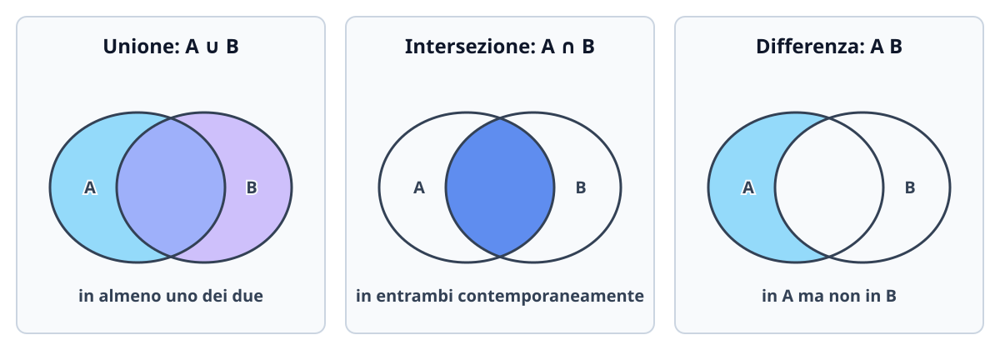

# Introduzione all'algebra: insiemi numerici

L'algebra utilizza simboli, connettivi logici e insiemi per descrivere oggetti matematici e relazioni in modo compatto, rigoroso e privo di ambiguità. In questa lezione fissiamo la notazione insiemistica e logica essenziale, studiamo le operazioni tra insiemi, analizziamo la struttura dei principali insiemi numerici ($\mathbb{N}, \mathbb{Z}, \mathbb{Q}, \mathbb{R}, \mathbb{C}$) e approfondiamo le proprietà di ordine e completezza del campo reale.

## Insiemi, appartenenza e inclusione

Un **insieme** è una collezione ben definita di oggetti distinti, detti **elementi** dell'insieme. Di solito si indicano gli insiemi con lettere maiuscole ($A, B, X, \dots$) e gli elementi con lettere minuscole ($a, b, x, \dots$).

La scrittura
$$
x \in A
$$
significa che l'elemento $x$ appartiene all'insieme $A$, mentre $x \notin A$ significa che $x$ non appartiene ad $A$. L'insieme privo di elementi si chiama **insieme vuoto** e si indica con il simbolo $\varnothing$.

Un insieme può essere descritto in due modi principali:
- **per elencazione (o rappresentazione tabulare)**, elencando tutti i suoi elementi tra parentesi graffe: per esempio $C = \{2, 3, 4.55, 7, 8\}$ (l'ordine non conta e gli elementi non si ripetono);
- **per proprietà caratteristica**, specificando una condizione $P(x)$ che individua gli elementi all'interno di un insieme ambiente:
$$
A = \{x \in \mathbb{N} \mid x \geq 5\}.
$$
La barra verticale «$\mid$» (oppure i due punti «$:$») si legge «tale che».

### Sottoinsiemi

Dati due insiemi $A$ e $B$, diciamo che $A$ è un **sottoinsieme** di $B$ (oppure che $A$ è incluso in $B$), e scriviamo
$$
A \subseteq B,
$$
se ogni elemento di $A$ è anche elemento di $B$. Due insiemi sono uguali ($A = B$) se hanno esattamente gli stessi elementi, cioè se vale contemporaneamente $A \subseteq B$ e $B \subseteq A$ (**principio di doppia inclusione**).

Se $A \subseteq B$ ma $A \neq B$ (esiste almeno un elemento di $B$ che non sta in $A$), si parla di **inclusione stretta** (o sottoinsieme proprio) e si scrive $A \subsetneq B$ (o $A \subset B$). Per ogni insieme $A$ valgono sempre le inclusioni banali $\varnothing \subseteq A$ e $A \subseteq A$.

## Quantificatori logici e negazione

Per formulare definizioni e teoremi matematici si utilizzano i **quantificatori logici** applicati a un predicato $P(x)$ con $x$ variabile in un insieme $A$:

| Simbolo | Nome | Lettura | Significato |
| --- | --- | --- | --- |
| $\forall$ | Quantificatore universale | «per ogni» | $\forall x \in A,\, P(x)$: la proprietà $P(x)$ è vera per **tutti** gli elementi di $A$ |
| $\exists$ | Quantificatore esistenziale | «esiste almeno un» | $\exists x \in A : P(x)$: la proprietà $P(x)$ è vera per **almeno un** elemento di $A$ |
| $\exists!$ | Esistenza e unicità | «esiste un unico» | $\exists! x \in A : P(x)$: la proprietà $P(x)$ è vera per **uno e un solo** elemento di $A$ |

### Regole di negazione dei quantificatori

Negare un'affermazione universale equivale a esibire un **controesempio**, mentre negare un'esistenza equivale a stabilire che la proprietà fallisce sempre. Indicando con $\neg P(x)$ la negazione di $P(x)$:

$$
\neg\bigl(\forall x \in A,\, P(x)\bigr) \iff \exists x \in A : \neg P(x),
$$
$$
\neg\bigl(\exists x \in A : P(x)\bigr) \iff \forall x \in A,\, \neg P(x).
$$

Quando in una proposizione compaiono più quantificatori in cascata, **l'ordine dei quantificatori di tipo diverso è fondamentale**:
- «$\forall x \in \mathbb{R}\ \exists y \in \mathbb{R} : y > x$» significa che per ogni numero reale ne esiste uno più grande (dove $y$ può dipendere da $x$, ad esempio $y = x+1$): è **vera**.
- «$\exists y \in \mathbb{R} : \forall x \in \mathbb{R},\ y > x$» significa che esiste un unico numero reale $y$ più grande di tutti i numeri reali: è **falsa**.

## Operazioni fra insiemi

Siano $A$ e $B$ sottoinsiemi di un insieme universo $U$.

- **Unione**: $A \cup B = \{x \in U \mid x \in A \text{ oppure } x \in B\}$ (dove «oppure» è il disgiuntivo logico inclusivo $\lor$: include anche gli elementi comuni).
- **Intersezione**: $A \cap B = \{x \in U \mid x \in A \text{ e } x \in B\}$. Se $A \cap B = \varnothing$, gli insiemi $A$ e $B$ si dicono **disgiunti**.
- **Differenza**: $A \setminus B = \{x \in A \mid x \notin B\}$, costituita dagli elementi di $A$ che non appartengono a $B$.
- **Complementare**: $A^c = U \setminus A = \{x \in U \mid x \notin A\}$.

### Proprietà algebriche delle operazioni insiemistiche

$$
\begin{aligned}
A \cup B &= B \cup A, & A \cap B &= B \cap A &&\text{(commutatività)},\\
(A \cup B) \cup C &= A \cup (B \cup C), & (A \cap B) \cap C &= A \cap (B \cap C) &&\text{(associatività)},\\
A \cup (B \cap C) &= (A \cup B) \cap (A \cup C), & A \cap (B \cup C) &= (A \cap B) \cup (A \cap C) &&\text{(distributività)},\\
A \cup A &= A, & A \cap A &= A &&\text{(idempotenza)},\\
A \cup \varnothing &= A, & A \cap \varnothing &= \varnothing &&\text{(elemento neutro / assorbente)},\\
A \cup (A \cap B) &= A, & A \cap (A \cup B) &= A &&\text{(assorbimento)}.
\end{aligned}
$$

Se $A \subseteq B$, allora vale:
$$
A \cup B = B, \qquad A \cap B = A.
$$

I **teoremi di De Morgan** legano il passaggio al complementare con unione e intersezione:
$$
(A \cap B)^c = A^c \cup B^c, \qquad (A \cup B)^c = A^c \cap B^c.
$$
Un modo pratico per ricordarli è questo: il complementare «entra nelle parentesi» trasformando ciascun insieme nel proprio complementare e scambiando $\cap$ con $\cup$.

## Insieme delle parti e prodotto cartesiano

### Insieme delle parti $\mathcal{P}(A)$

Dato un insieme $A$, l'**insieme delle parti** di $A$, indicato con $\mathcal{P}(A)$ (o $2^A$), è l'insieme i cui elementi sono **tutti e soli i sottoinsiemi** di $A$:
$$
\mathcal{P}(A) = \{X \mid X \subseteq A\}.
$$
Per esempio, se $A = \{1, 2\}$, i suoi sottoinsiemi sono il vuoto, i due singoletti e $A$ stesso:
$$
\mathcal{P}(\{1, 2\}) = \bigl\{\varnothing, \{1\}, \{2\}, \{1, 2\}\bigr\}.
$$
> [!important] Cardinalità dell'insieme delle parti
> Se $A$ è un insieme finito con $|A| = n$ elementi, nel costruire un sottoinsieme $X \subseteq A$ abbiamo $2$ scelte indipendenti per ciascuno degli $n$ elementi (includerlo o non includerlo in $X$). Pertanto la cardinalità di $\mathcal{P}(A)$ è:
> $$|\mathcal{P}(A)| = 2^{|A|} = 2^n.$$
> In particolare $\mathcal{P}(\varnothing) = \{\varnothing\}$ contiene $2^0 = 1$ elemento (non è vuoto!).

### Prodotto cartesiano $A \times B$

Dati due insiemi $A$ e $B$, il **prodotto cartesiano** $A \times B$ è l'insieme di tutte le **coppie ordinate** $(a, b)$ con primo elemento in $A$ e secondo elemento in $B$:
$$
A \times B = \{(a, b) \mid a \in A \text{ e } b \in B\}.
$$
Due coppie ordinate sono uguali se e solo se coincidono componente per componente:
$$
(a, b) = (c, d) \iff a = c \text{ e } b = d.
$$
In generale il prodotto cartesiano **non è commutativo**: se $A \neq B$ e nessuno dei due è vuoto, $A \times B \neq B \times A$. Se $A$ e $B$ sono finiti, il numero di coppie è $|A \times B| = |A| \cdot |B|$. Nel caso $A = B$, si scrive $A^2 = A \times A$ (e più in generale $A^n$ per l'insieme delle $n$-uple ordinate, come il piano cartesiano $\mathbb{R}^2$ o lo spazio $\mathbb{R}^3$).

## I principali insiemi numerici

| Simbolo | Nome | Descrizione ed esempi |
| --- | --- | --- |
| $\mathbb{N}$ | Numeri naturali | $\{0, 1, 2, 3, \dots\}$ (in alcuni contesti si indica con $\mathbb{N}_{>0}$ o $\mathbb{N}^*$ l'insieme senza lo zero) |
| $\mathbb{Z}$ | Numeri interi (relativi) | $\{\dots, -2, -1, 0, 1, 2, \dots\}$ |
| $\mathbb{Q}$ | Numeri razionali | Numeri esprimibili come frazione $\frac{p}{q}$ con $p, q \in \mathbb{Z}$ e $q \neq 0$ (decimali finiti o periodici) |
| $\mathbb{R}$ | Numeri reali | Razionali e irrazionali (decimali illimitati non periodici come $\sqrt{2}, \pi, e$) |
| $\mathbb{C}$ | Numeri complessi | Numeri della forma $a + ib$ con $a, b \in \mathbb{R}$ e $i^2 = -1$ |

Vale la catena di inclusioni strette:
$$
\mathbb{N} \subsetneq \mathbb{Z} \subsetneq \mathbb{Q} \subsetneq \mathbb{R} \subsetneq \mathbb{C}.
$$
Ogni estensione nasce per rendere sempre eseguibile un'operazione:
1. in $\mathbb{N}$ sono sempre definite somma e moltiplicazione, ma non la sottrazione ($3 - 5 \notin \mathbb{N}$);
2. in $\mathbb{Z}$ è sempre definita anche la sottrazione (struttura di *anello*), ma non la divisione ($3 / 2 \notin \mathbb{Z}$);
3. in $\mathbb{Q}$ è sempre definita la divisione per un elemento non nullo (struttura di *campo*), ma mancano le soluzioni di equazioni algebriche elementari come $x^2 = 2$;
4. in $\mathbb{R}$ la retta si completa senza «buchi» grazie all'assioma di completezza;
5. in $\mathbb{C}$ diventano risolubili tutte le equazioni polinomiali a coefficienti reali o complessi, come $x^2 + 1 = 0$.

### Irrazionalità di $\sqrt{2}$: dimostrazione per assurdo

Sebbene i numeri razionali $\mathbb{Q}$ siano **densi** sulla retta (tra due razionali qualsiasi ne esistono infiniti altri, ad esempio il punto medio $\frac{a+b}{2}$), essi lasciano infiniti «buchi». La diagonale di un quadrato di lato $1$ misura $\sqrt{2}$, che non appartiene a $\mathbb{Q}$.

> [!note] Teorema: $\sqrt{2} \notin \mathbb{Q}$
> **Dimostrazione (per assurdo).** Supponiamo per assurdo che $\sqrt{2}$ sia razionale. Allora esistono due interi positivi $p, q \in \mathbb{N}_{>0}$ tali che
> $$
> \sqrt{2} = \frac{p}{q},
> $$
> e possiamo supporre che la frazione sia già **ridotta ai minimi termini**, ossia che $p$ e $q$ siano coprimi ($\operatorname{MCD}(p, q) = 1$, quindi non entrambi pari).
>
> Elevando al quadrato ambo i membri otteniamo:
> $$
> 2 = \frac{p^2}{q^2} \implies p^2 = 2q^2.
> $$
> Da questa uguaglianza segue che $p^2$ è un numero pari. Poiché il quadrato di un numero dispari è sempre dispari ($(2k+1)^2 = 4k^2 + 4k + 1 = 2(2k^2+2k) + 1$), necessariamente anche $p$ deve essere **pari**.
>
> Esiste quindi un intero $k \in \mathbb{N}_{>0}$ tale che $p = 2k$. Sostituendo $p = 2k$ nella relazione $p^2 = 2q^2$ si ha:
> $$
> (2k)^2 = 2q^2 \implies 4k^2 = 2q^2 \implies q^2 = 2k^2.
> $$
> Ma allora anche $q^2$ è pari, e per lo stesso ragionamento anche $q$ deve essere **pari**.
>
> Siamo giunti a una **contraddizione**: $p$ e $q$ risultano entrambi pari (divisibili per $2$), contro l'ipotesi che la frazione $\frac{p}{q}$ fosse ridotta ai minimi termini. Pertanto l'ipotesi iniziale è falsa e $\sqrt{2} \notin \mathbb{Q}$. $\blacksquare$

## Struttura di $\mathbb{R}$ come campo ordinato completo

### Assiomi di campo e di ordine

In $\mathbb{R}$ sono definite due operazioni binarie, addizione ($+$) e moltiplicazione ($\cdot$), che soddisfano le proprietà di **campo commutativo**:
- associatività e commutatività di somma e prodotto;
- distributività del prodotto rispetto alla somma: $a(b+c) = ab + ac$;
- esistenza degli elementi neutri $0$ (per la somma) e $1$ (per il prodotto);
- esistenza dell'opposto $-a$ per ogni $a \in \mathbb{R}$ e del reciproco $a^{-1} = \frac{1}{a}$ per ogni $a \in \mathbb{R} \setminus \{0\}$.

La relazione d'ordine totale $\leq$ è compatibile con le operazioni algebriche:
- se $a \leq b$, allora $a + c \leq b + c$ per ogni $c \in \mathbb{R}$;
- se $a \leq b$ e $c \geq 0$, allora $ac \leq bc$ (mentre se $c < 0$ il verso della disuguaglianza si inverte: $ac \geq bc$).

### Intervalli reali

Gli intervalli sono i sottoinsiemi connessi della retta reale:

| Intervallo | Definizione | Tipo |
| --- | --- | --- |
| $[a, b]$ | $\{x \in \mathbb{R} \mid a \leq x \leq b\}$ | Limitato, chiuso |
| $(a, b)$ | $\{x \in \mathbb{R} \mid a < x < b\}$ | Limitato, aperto |
| $[a, b)$ | $\{x \in \mathbb{R} \mid a \leq x < b\}$ | Limitato, chiuso a sinistra e aperto a destra |
| $(a, b]$ | $\{x \in \mathbb{R} \mid a < x \leq b\}$ | Limitato, aperto a sinistra e chiuso a destra |
| $(-\infty, b]$ e $(-\infty, b)$ | $\{x \in \mathbb{R} \mid x \leq b\}$ e $\{x \in \mathbb{R} \mid x < b\}$ | Illimitati inferiormente |
| $[a, +\infty)$ e $(a, +\infty)$ | $\{x \in \mathbb{R} \mid x \geq a\}$ e $\{x \in \mathbb{R} \mid x > a\}$ | Illimitati superiormente |

Accanto ai simboli $-\infty$ e $+\infty$ si usano sempre **parentesi tonde**, poiché $\pm\infty$ non sono numeri reali e non appartengono mai all'intervallo.

### Insiemi limitati, estremo superiore/inferiore, massimo e minimo

Sia $A \subseteq \mathbb{R}$ un insieme non vuoto ($A \neq \varnothing$).

- Un numero $L \in \mathbb{R}$ è un **maggiorante** di $A$ se $\forall a \in A,\ a \leq L$. Se esiste almeno un maggiorante, $A$ si dice **limitato superiormente**.
- Un numero $\ell \in \mathbb{R}$ è un **minorante** di $A$ se $\forall a \in A,\ \ell \leq a$. Se esiste almeno un minorante, $A$ si dice **limitato inferiormente**.
- $A$ si dice **limitato** se è limitato sia superiormente sia inferiormente (equivalentemente, se è contenuto in un intervallo $[-M, M]$ per qualche $M > 0$).
- Il **massimo** di $A$ ($\max A$), se esiste, è un maggiorante di $A$ che **appartiene** ad $A$:
$$
M = \max A \iff M \in A \quad \text{e} \quad \forall a \in A,\ a \leq M.
$$
- Il **minimo** di $A$ ($\min A$), se esiste, è un minorante di $A$ che **appartiene** ad $A$:
$$
m = \min A \iff m \in A \quad \text{e} \quad \forall a \in A,\ m \leq a.
$$
- L'**estremo superiore** $\sup A$ è il **minimo dei maggioranti** di $A$ (se $A$ non è limitato superiormente, si pone per convenzione $\sup A = +\infty$).
- L'**estremo inferiore** $\inf A$ è il **massimo dei minoranti** di $A$ (se $A$ non è limitato inferiormente, si pone $\inf A = -\infty$).

Se $\sup A \in A$, allora $\max A$ esiste e coincide con $\sup A$; se invece $\sup A \notin A$, l'insieme non ha massimo. Analogamente per $\inf A$ e $\min A$.

**Assioma di completezza (di Dedekind-Cauchy):** Ogni sottoinsieme non vuoto $A \subseteq \mathbb{R}$ limitato superiormente ammette estremo superiore $\sup A \in \mathbb{R}$ (e simmetricamente, se è limitato inferiormente, ammette $\inf A \in \mathbb{R}$). Questa proprietà non vale in $\mathbb{Q}$: ad esempio l'insieme $\{x \in \mathbb{Q} \mid x^2 < 2\}$ è limitato superiormente in $\mathbb{Q}$, ma il suo estremo superiore è $\sqrt{2} \notin \mathbb{Q}$.

## Insiemi finiti, infiniti e numerabili

Due insiemi $A$ e $B$ hanno la stessa **cardinalità** (o potenza) se esiste una corrispondenza biunivoca tra i loro elementi. Un insieme infinito si dice **numerabile** se può essere messo in corrispondenza biunivoca con $\mathbb{N}$, ossia se i suoi elementi possono essere disposti in una successione infinita $x_0, x_1, x_2, \dots$ senza omissioni né ripetizioni.

- $\mathbb{N}$, $\mathbb{Z}$ e $\mathbb{Q}$ sono insiemi infiniti **numerabili**;
- $\mathbb{R}$ (così come qualsiasi intervallo $(a, b)$ con $a < b$) **non è numerabile**: ha la *potenza del continuo* (dimostrata da Cantor tramite il procedimento diagonale).

## Esempi guidati

### Esempio 1: Operazioni tra intervalli ed estremi

Siano dati i sottoinsiemi reali:
$$
A = [-1, 3), \qquad B = (1, 5].
$$
Determiniamo $A \cap B$, $A \cup B$, $A \setminus B$, $B \setminus A$ e studiamo estremi, minimo e massimo di $A$.

**Passaggi:**
1. **Intersezione $A \cap B$:** cerchiamo i numeri reali che soddisfano contemporaneamente $-1 \leq x < 3$ e $1 < x \leq 5$. La sovrapposizione avviene tra $1$ (escluso perché $1 \notin B$) e $3$ (escluso perché $3 \notin A$):
$$
A \cap B = (1, 3).
$$
2. **Unione $A \cup B$:** unendo i due intervalli copriamo in modo continuo tutti i reali da $-1$ (incluso) a $5$ (incluso):
$$
A \cup B = [-1, 5].
$$
3. **Differenze:** togliendo da $A$ gli elementi che stanno in $B$ (cioè quelli strettamente maggiori di $1$), l'elemento $1$ resta in $A \setminus B$ perché appartiene ad $A$ ma non a $B$:
$$
A \setminus B = [-1, 1], \qquad B \setminus A = [3, 5].
$$
4. **Estremi di $A = [-1, 3)$:** si ha $\inf A = -1$ e, poiché $-1 \in A$, esiste $\min A = -1$. Inoltre $\sup A = 3$, ma poiché $3 \notin A$ il massimo $\max A$ **non esiste**.

### Esempio 2: Insieme delle parti e prodotto cartesiano

Siano $A = \{a, b\}$ e $B = \{1, 2, 3\}$. Scriviamo $\mathcal{P}(A)$ e $A \times B$.

**Passaggi:**
1. Poiché $|A| = 2$, l'insieme delle parti $\mathcal{P}(A)$ ha $2^2 = 4$ elementi:
$$
\mathcal{P}(A) = \bigl\{\varnothing, \{a\}, \{b\}, \{a, b\}\bigr\}.
$$
2. Il prodotto cartesiano $A \times B$ contiene $|A| \cdot |B| = 2 \cdot 3 = 6$ coppie ordinate:
$$
A \times B = \bigl\{(a, 1), (a, 2), (a, 3), (b, 1), (b, 2), (b, 3)\bigr\}.
$$

### Esempio 3: Estremi di un insieme discreto

Determiniamo $\inf, \sup, \min, \max$ dell'insieme:
$$
E = \left\{\frac{1}{n} \;\middle|\; n \in \mathbb{N}_{>0}\right\} = \left\{1, \frac{1}{2}, \frac{1}{3}, \frac{1}{4}, \dots\right\}.
$$

**Passaggi:**
1. Per ogni $n \geq 1$ si ha $0 < \frac{1}{n} \leq 1$. Quindi $E$ è limitato sia inferiormente (da $0$) sia superiormente (da $1$).
2. Per $n = 1$ otteniamo l'elemento $1 \in E$, che è maggiorante di tutto l'insieme: dunque $\sup E = \max E = 1$.
3. Al crescere di $n$, le frazioni $\frac{1}{n}$ si avvicinano arbitrariamente a $0$ restando sempre positive: nessun numero $\varepsilon > 0$ può essere un minorante (basta scegliere $n > \frac{1}{\varepsilon}$ per avere $\frac{1}{n} < \varepsilon$). Pertanto $\inf E = 0$, ma poiché $0 \notin E$ (non esiste alcun $n$ per cui $\frac{1}{n} = 0$), $\min E$ **non esiste**.

## Errori frequenti

- **Confondere appartenenza ($\in$) e inclusione ($\subseteq$):** si scrive $2 \in \{1, 2, 3\}$ ma $\{2\} \subseteq \{1, 2, 3\}$. Analogamente, $\{1\} \in \mathcal{P}(\{1, 2\})$ mentre $\{1\} \subseteq \{1, 2\}$.
- **Negare un enunciato universale con un altro quantificatore universale:** la negazione di «tutti i numeri in $A$ sono positivi» non è «tutti i numeri in $A$ sono $\leq 0$», bensì «esiste almeno un numero in $A$ che è $\leq 0$».
- **Dimenticare gli estremi nelle differenze di intervalli:** nel calcolare $[-1, 3) \setminus (1, 5]$, il punto $x = 1$ non viene rimosso perché $1 \notin (1, 5]$, quindi il risultato è $[-1, 1]$ con $1$ incluso.
- **Scambiare $\sup A$ con $\max A$:** ogni insieme reale non vuoto e limitato superiormente ha sempre estremo superiore in $\mathbb{R}$, ma ha massimo solo se tale estremo appartiene effettivamente all'insieme.

## Esercizi di prova

1. (**Base - Operazioni tra intervalli**) Dati gli intervalli $A = (-2, 4]$ e $B = [0, 6)$, determina $A \cup B$, $A \cap B$, $A \setminus B$ e $B \setminus A$. Per ciascuno dei quattro insiemi ottenuti indica se esistono minimo e massimo.
> [!tip]- Soluzione
> Rappresentiamo i due intervalli sulla retta reale:
> - **Unione:** $A \cup B = (-2, 6)$. L'insieme è limitato con $\inf(A \cup B) = -2 \notin A \cup B$ e $\sup(A \cup B) = 6 \notin A \cup B$; quindi non ha né minimo né massimo.
> - **Intersezione:** gli elementi comuni verificano $0 \leq x \leq 4$, dunque $A \cap B = [0, 4]$. Essendo un intervallo chiuso e limitato, ha $\min(A \cap B) = 0$ e $\max(A \cap B) = 4$.
> - **Differenza $A \setminus B$:** togliamo da $(-2, 4]$ i punti $\geq 0$. Poiché $0 \in B$, lo zero viene rimosso: $A \setminus B = (-2, 0)$, che non ha né minimo né massimo.
> - **Differenza $B \setminus A$:** togliamo da $[0, 6)$ i punti $\leq 4$. Poiché $4 \in A$, il $4$ viene rimosso: $B \setminus A = (4, 6)$, che non ha né minimo né massimo.

2. (**Base - Insieme delle parti e cardinalità**) Sia $A = \{0, \{1\}, 2\}$. Determina la cardinalità di $\mathcal{P}(A)$, elenca tutti i suoi elementi e stabilisci quali delle seguenti scritture sono vere: (a) $1 \in A$; (b) $\{1\} \in A$; (c) $\{1\} \subseteq A$; (d) $\{\{1\}\} \subseteq A$.
> [!tip]- Soluzione
> L'insieme $A$ possiede $3$ elementi distinti: il numero $0$, l'insieme $\{1\}$ e il numero $2$. Pertanto $|\mathcal{P}(A)| = 2^3 = 8$.
> I suoi $8$ sottoinsiemi sono:
> $$\mathcal{P}(A) = \bigl\{\varnothing,\ \{0\},\ \{\{1\}\},\ \{2\},\ \{0, \{1\}\},\ \{0, 2\},\ \{\{1\}, 2\},\ \{0, \{1\}, 2\}\bigr\}.$$
> Analizziamo le quattro proposizioni:
> - (a) **Falsa**: $1$ non è un elemento di $A$, l'elemento è il singoletto $\{1\}$.
> - (b) **Vera**: $\{1\}$ figura direttamente tra gli elementi elencati in $A$.
> - (c) **Falsa**: affinché $\{1\} \subseteq A$ dovrebbe valere $1 \in A$, che è falso.
> - (d) **Vera**: il singoletto formato dall'elemento $\{1\} \in A$ è un sottoinsieme di $A$.

3. (**Intermedio - Quantificatori e negazione**) Scrivi in simboli e poi nega formalmente la seguente proposizione su $\mathbb{R}$, stabilendo infine se è vera la proposizione di partenza o la sua negazione:
   $$P: \text{Per ogni numero reale } x \text{ esiste almeno un numero reale } y \text{ tale che } x + y^2 \leq 0.$$
> [!tip]- Soluzione
> **Scrittura in simboli:**
> $$P:\quad \forall x \in \mathbb{R}\ \exists y \in \mathbb{R} : x + y^2 \leq 0.$$
> **Negazione formale ($\neg P$):** scambiamo $\forall$ con $\exists$, $\exists$ con $\forall$ e neghiamo la disuguaglianza finale ($\leq$ diventa $>$):
> $$\neg P:\quad \exists x \in \mathbb{R} : \forall y \in \mathbb{R},\ x + y^2 > 0.$$
> **Valore di verità:** se scegliamo $x = 1 > 0$, poiché $y^2 \geq 0$ per ogni $y \in \mathbb{R}$, risulta sempre $1 + y^2 \geq 1 > 0$. Dunque per $x = 1$ non esiste alcun $y \in \mathbb{R}$ tale che $1 + y^2 \leq 0$. Ne segue che **$P$ è falsa** e la sua negazione **$\neg P$ è vera**.

4. (**Intermedio - Estremo inferiore e superiore**) Determina $\inf A$, $\sup A$, ed eventualmente $\min A$ e $\max A$, per l'insieme:
   $$A = \left\{\frac{2n - 1}{n + 1} \;\middle|\; n \in \mathbb{N}\right\}.$$
> [!tip]- Soluzione
> Riscriviamo il termine generale separando la parte intera per studiare facilmente l'andamento al crescere di $n \in \{0, 1, 2, \dots\}$:
> $$a_n = \frac{2n - 1}{n + 1} = \frac{2(n + 1) - 3}{n + 1} = 2 - \frac{3}{n + 1}.$$
> Al crescere di $n \geq 0$, il denominatore $n + 1$ cresce, la frazione positiva $\frac{3}{n + 1}$ decresce e quindi la successione $a_n = 2 - \frac{3}{n + 1}$ è **strettamente crescente**:
> - Per $n = 0$ si ottiene il valore più piccolo: $a_0 = 2 - 3 = -1 \in A$. Dunque $\inf A = \min A = -1$.
> - Per ogni $n \in \mathbb{N}$ vale $a_n = 2 - \frac{3}{n + 1} < 2$, quindi $2$ è un maggiorante di $A$. Inoltre, per $n$ arbitrariamente grande, $\frac{3}{n + 1}$ diventa piccolo a piacere e $a_n$ si avvicina indefinitamente a $2$. Pertanto $\sup A = 2$. Poiché l'equazione $2 - \frac{3}{n + 1} = 2$ è impossibile, $2 \notin A$ e quindi **non esiste $\max A$**.

5. (**Esame - Dimostrazione di irrazionalità**) Adattando la traccia della dimostrazione vista per $\sqrt{2}$, dimostra per assurdo che $\sqrt{3} \notin \mathbb{Q}$.
> [!tip]- Soluzione
> Supponiamo per assurdo che $\sqrt{3} \in \mathbb{Q}$. Allora esistono $p, q \in \mathbb{N}_{>0}$ coprimi ($\operatorname{MCD}(p, q) = 1$) tali che $\sqrt{3} = \frac{p}{q}$.
> Elevando al quadrato ambo i membri otteniamo:
> $$3 = \frac{p^2}{q^2} \implies p^2 = 3q^2.$$
> Quindi $p^2$ è un multiplo di $3$. Osserviamo che se un intero $p$ non è multiplo di $3$, diviso per $3$ dà resto $1$ oppure $2$:
> - se $p = 3k + 1$, allora $p^2 = 9k^2 + 6k + 1 = 3(3k^2 + 2k) + 1$ (resto $1$, non divisibile per $3$);
> - se $p = 3k + 2$, allora $p^2 = 9k^2 + 12k + 4 = 3(3k^2 + 4k + 1) + 1$ (resto $1$, non divisibile per $3$).
>
> Di conseguenza, poiché $p^2$ è divisibile per $3$, anche $p$ deve essere divisibile per $3$, ossia $p = 3k$ per qualche $k \in \mathbb{N}_{>0}$. Sostituendo nella relazione $p^2 = 3q^2$:
> $$(3k)^2 = 3q^2 \implies 9k^2 = 3q^2 \implies q^2 = 3k^2.$$
> Allora anche $q^2$ è multiplo di $3$, e per lo stesso motivo anche $q$ è multiplo di $3$.
> Abbiamo così trovato che sia $p$ sia $q$ sono divisibili per $3$, il che contraddice l'ipotesi $\operatorname{MCD}(p, q) = 1$. Pertanto $\sqrt{3}$ è irrazionale. $\blacksquare$

## Provenienza del materiale

Sintesi ragionata ed estesa della lezione `C1MAT1U2L1_Introduzione_alla_algebra.pdf` e degli `Appunti_di_fine_Unità_2.pdf` (Corso di Matematica 1, CdL in Sicurezza Informatica / SecAI - Università degli Studi di Milano), con approfondimenti su quantificatori logici, insieme delle parti, prodotto cartesiano e dimostrazione dell'irrazionalità di $\sqrt{2}$.
