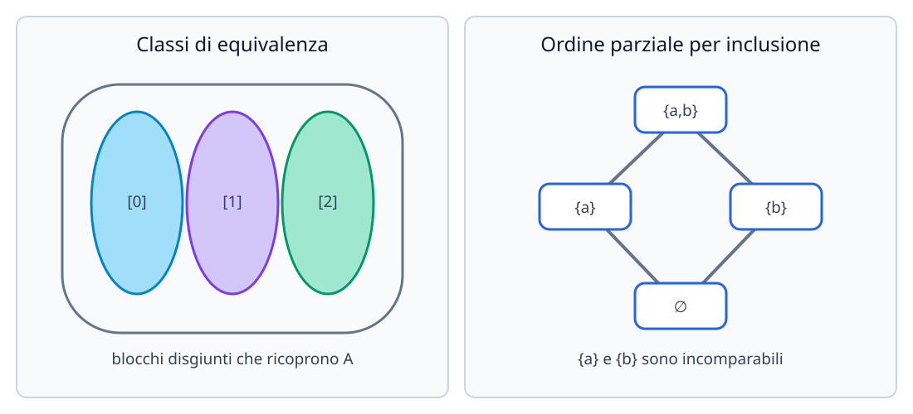

# Relazioni di ordine e di equivalenza

In matematica una **relazione** formalizza il concetto di legame o confronto tra gli elementi di due insiemi (o di uno stesso insieme): «essere uguale a», «essere minore o uguale di», «avere lo stesso resto nella divisione per $n$», «essere divisore di». Analizzando le proprietà strutturali di una relazione possiamo distinguere due grandi famiglie fondamentali: le **relazioni di equivalenza** (che ripartiscono un insieme in classi di oggetti simili) e le **relazioni d'ordine** (che dispongono gli elementi secondo una gerarchia).

## Definizione di relazione binaria

Dati due insiemi non vuoti $A$ e $B$, una **relazione binaria** $\mathcal{R}$ da $A$ a $B$ è un qualunque sottoinsieme del prodotto cartesiano $A \times B$:
$$
\mathcal{R} \subseteq A \times B.
$$
Se la coppia ordinata $(a, b)$ appartiene a $\mathcal{R}$, si scrive in notazione infissa:
$$
a\,\mathcal{R}\,b \quad \text{(oppure } (a, b) \in \mathcal{R}\text{)}
$$
e si legge «$a$ è in relazione con $b$». Poiché le coppie sono ordinate, in generale da $a\,\mathcal{R}\,b$ non segue affatto $b\,\mathcal{R}\,a$.

Quando $A = B$, si dice che $\mathcal{R} \subseteq A \times A$ è una **relazione definita su $A$**.

### Esempio introduttivo

Sull'insieme finito $A = \{1, 2, 3\}$ definiamo la relazione $x\,\mathcal{R}\,y \iff x < y$. Allora, come sottoinsieme di $A \times A$, la relazione è:
$$
\mathcal{R} = \{(1, 2), (1, 3), (2, 3)\}.
$$
Si ha ad esempio $1\,\mathcal{R}\,2$, mentre $(2, 1) \notin \mathcal{R}$ e $(1, 1) \notin \mathcal{R}$.

## Proprietà delle relazioni su un insieme

Sia $\mathcal{R} \subseteq A \times A$ una relazione definita su un insieme $A$. Le proprietà fondamentali che $\mathcal{R}$ può soddisfare sono:

| Proprietà | Definizione formale | Significato intuitivo |
| --- | --- | --- |
| **Riflessiva** | $\forall x \in A,\ x\,\mathcal{R}\,x$ | Ogni elemento è in relazione con se stesso |
| **Antiriflessiva** (o irriflessiva) | $\forall x \in A,\ x\not\mathcal{R}\,x$ | Nessun elemento è in relazione con se stesso |
| **Simmetrica** | $\forall x, y \in A,\ x\,\mathcal{R}\,y \implies y\,\mathcal{R}\,x$ | Il legame è sempre bidirezionale |
| **Antisimmetrica** | $\forall x, y \in A,\ (x\,\mathcal{R}\,y \land y\,\mathcal{R}\,x) \implies x = y$ | Due elementi **distinti** non possono essere in relazione in entrambi i versi |
| **Asimmetrica** | $\forall x, y \in A,\ x\,\mathcal{R}\,y \implies y\not\mathcal{R}\,x$ | Il legame non è mai reversibile (implica anche l'antiriflessività) |
| **Transitiva** | $\forall x, y, z \in A,\ (x\,\mathcal{R}\,y \land y\,\mathcal{R}\,z) \implies x\,\mathcal{R}\,z$ | Il legame si propaga a catena |

> [!warning] Attenzione: simmetria e antisimmetria non sono una la negazione dell'altra!
> - La relazione «avere la stessa età» è **simmetrica** ma non antisimmetrica (due persone diverse possono avere la stessa età).
> - La relazione $\leq$ su $\mathbb{R}$ è **antisimmetrica** ($x \leq y$ e $y \leq x$ implicano $x = y$) ma non simmetrica.
> - La relazione di uguaglianza «$=$» su $A$ è **sia simmetrica sia antisimmetrica**.
> - Esistono relazioni che non sono **né simmetriche né antisimmetriche** (basta avere una coppia bidirezionale tra elementi distinti e una coppia unidirezionale).

## Relazioni di equivalenza, classi e insieme quoziente

### Definizione

Una relazione $\mathcal{R}$ su un insieme $A$ si dice **relazione di equivalenza** (spesso indicata con $\sim$ o $\equiv$) se è contemporaneamente:
1. **riflessiva**: $\forall x \in A,\ x\,\mathcal{R}\,x$;
2. **simmetrica**: $\forall x, y \in A,\ x\,\mathcal{R}\,y \implies y\,\mathcal{R}\,x$;
3. **transitiva**: $\forall x, y, z \in A,\ (x\,\mathcal{R}\,y \land y\,\mathcal{R}\,z) \implies x\,\mathcal{R}\,z$.

Intuitivamente, una relazione di equivalenza formalizza un criterio di «somiglianza» o «uguaglianza rispetto a una caratteristica scelta», ignorando le altre differenze tra gli oggetti.

### Classi di equivalenza e partizioni

Data una relazione di equivalenza $\mathcal{R}$ su $A$ e fissato un elemento $x \in A$, si chiama **classe di equivalenza** di $x$ (rispetto a $\mathcal{R}$) il sottoinsieme di tutti gli elementi di $A$ equivalenti a $x$:
$$
[x]_{\mathcal{R}} = \{y \in A \mid y\,\mathcal{R}\,x\}.
$$
Ogni elemento $y \in [x]_{\mathcal{R}}$ si dice un **rappresentante** della classe, e vale $[y]_{\mathcal{R}} = [x]_{\mathcal{R}}$.

Le classi di equivalenza soddisfano tre proprietà fondamentali:
1. **Nessuna classe è vuota**: per riflessività $x \in [x]_{\mathcal{R}}$, quindi $[x]_{\mathcal{R}} \neq \varnothing$ per ogni $x \in A$.
2. **Classi distinte sono disgiunte**: per ogni $x, y \in A$, o $[x]_{\mathcal{R}} = [y]_{\mathcal{R}}$ (se $x\,\mathcal{R}\,y$) oppure $[x]_{\mathcal{R}} \cap [y]_{\mathcal{R}} = \varnothing$ (se $x\not\mathcal{R}\,y$).
3. **L'unione di tutte le classi ricopre $A$**: $\bigcup_{x \in A} [x]_{\mathcal{R}} = A$.

Una famiglia di sottoinsiemi non vuoti, a due a due disgiunti e la cui unione è tutto $A$ si chiama **partizione** di $A$. Vale una corrispondenza biunivoca fondamentale: ogni relazione di equivalenza su $A$ induce una partizione di $A$ (le sue classi di equivalenza), e viceversa ogni partizione di $A$ definisce una relazione di equivalenza («appartenere allo stesso blocco della partizione»).

### Insieme quoziente $A/\mathcal{R}$ e aritmetica modulare $\mathbb{Z}_n$

L'insieme i cui elementi sono tutte le diverse **classi di equivalenza** di $A$ rispetto a $\mathcal{R}$ si chiama **insieme quoziente** di $A$ modulo $\mathcal{R}$ e si indica con:
$$
A/\mathcal{R} = \bigl\{[x]_{\mathcal{R}} \;\big|\; x \in A\bigr\}.
$$
Attenzione alla natura degli oggetti: gli elementi di $A/\mathcal{R}$ sono sottoinsiemi di $A$ (cioè $A/\mathcal{R} \subseteq \mathcal{P}(A)$). Passare da $A$ ad $A/\mathcal{R}$ significa «incollare» in un unico punto tutti gli elementi tra loro equivalenti.

#### Esempio fondamentale: la congruenza modulo $n$ e l'insieme $\mathbb{Z}_n$

Fissato un intero $n \geq 2$, definiamo su $\mathbb{Z}$ la relazione di **congruenza modulo $n$**:
$$
a \equiv b \pmod{n} \iff n \mid (a - b) \iff \exists k \in \mathbb{Z} : a - b = kn.
$$
Due interi sono congrui modulo $n$ se e solo se la loro differenza è un multiplo di $n$, ovvero se e solo se danno lo **stesso resto** nella divisione euclidea per $n$.

Verifichiamo che è una relazione di equivalenza su $\mathbb{Z}$:
- **Riflessiva**: $a - a = 0 = 0 \cdot n$, quindi $n \mid (a - a)$ e $a \equiv a \pmod{n}$.
- **Simmetrica**: se $a - b = kn$ con $k \in \mathbb{Z}$, allora $b - a = (-k)n$ con $-k \in \mathbb{Z}$, quindi $b \equiv a \pmod{n}$.
- **Transitiva**: se $a - b = k_1 n$ e $b - c = k_2 n$, sommando si ha $a - c = (a - b) + (b - c) = (k_1 + k_2)n$, dunque $a \equiv c \pmod{n}$.

Poiché i possibili resti della divisione per $n$ sono esattamente $0, 1, 2, \dots, n-1$, vi sono esattamente $n$ classi di equivalenza distinte (dette **classi resto modulo $n$**):
$$
\begin{aligned}
[0]_n &= \{\dots, -2n, -n, 0, n, 2n, \dots\} = n\mathbb{Z},\\
[1]_n &= \{\dots, -2n+1, -n+1, 1, n+1, 2n+1, \dots\},\\
&\;\;\vdots\\
[n-1]_n &= \{\dots, -n-1, -1, n-1, 2n-1, \dots\}.
\end{aligned}
$$
L'insieme quoziente si indica con $\mathbb{Z}_n$ (oppure $\mathbb{Z}/n\mathbb{Z}$) ed è un insieme **finito** con $n$ elementi:
$$
\mathbb{Z}_n = \mathbb{Z}/\!\equiv_n \,= \bigl\{[0]_n, [1]_n, \dots, [n-1]_n\bigr\}.
$$
Per esempio, per $n = 3$, $\mathbb{Z}_3 = \{[0]_3, [1]_3, [2]_3\}$ e si ha $[5]_3 = [-1]_3 = [2]_3$.

## Relazioni d'ordine e insiemi parzialmente ordinati (poset)

### Ordine largo e ordine stretto

- Una relazione $\preceq$ su $A$ si dice relazione d'**ordine largo** (o non stretto) se è:
  1. **riflessiva**: $\forall x \in A,\ x \preceq x$;
  2. **antisimmetrica**: $\forall x, y \in A,\ (x \preceq y \land y \preceq x) \implies x = y$;
  3. **transitiva**: $\forall x, y, z \in A,\ (x \preceq y \land y \preceq z) \implies x \preceq z$.
  Esempi classici: l'ordine $\leq$ su $\mathbb{R}$, l'inclusione $\subseteq$ su $\mathcal{P}(X)$, la divisibilità $a \mid b$ su $\mathbb{N}_{>0}$.

- Una relazione $\prec$ su $A$ si dice relazione d'**ordine stretto** se è:
  1. **antiriflessiva**: $\forall x \in A,\ x \not\prec x$;
  2. **transitiva**: $\forall x, y, z \in A,\ (x \prec y \land y \prec z) \implies x \prec z$.
  (Dall'antiriflessività e dalla transitività segue automaticamente l'**asimmetria**: se fosse $x \prec y$ e $y \prec x$, per transitività avremmo $x \prec x$, assurdo). Esempi: $<$ su $\mathbb{R}$ e $\subsetneq$ su $\mathcal{P}(X)$.

Ad ogni ordine largo $\preceq$ corrisponde un ordine stretto ponendo $x \prec y \iff (x \preceq y \land x \neq y)$, e viceversa $x \preceq y \iff (x \prec y \lor x = y)$.

### Ordine totale, ordine parziale e diagrammi di Hasse

Una coppia $(A, \preceq)$ formata da un insieme $A$ e da una relazione d'ordine largo $\preceq$ su $A$ si chiama **insieme parzialmente ordinato** o **poset** (*partially ordered set*).

Due elementi $x, y \in A$ si dicono **confrontabili** se vale $x \preceq y$ oppure $y \preceq x$; altrimenti si dicono **incomparabili**.
- Se **ogni** coppia di elementi di $A$ è confrontabile ($\forall x, y \in A,\ x \preceq y \lor y \preceq x$), l'ordine si dice **totale** (o **lineare**), come $(\mathbb{R}, \leq)$.
- Se esistono almeno due elementi incomparabili, l'ordine si dice **parziale**, come $(\mathcal{P}(X), \subseteq)$ quando $|X| \geq 2$ oppure $(\mathbb{N}_{>0}, \mid)$.

Un poset finito $(A, \preceq)$ si rappresenta graficamente mediante il **diagramma di Hasse**:
- gli elementi si dispongono come vertici dal basso verso l'alto in modo che se $x \prec y$ allora $y$ sia disegnato più in alto di $x$;
- si omettono i cappi relativi alla proprietà riflessiva ($x \preceq x$);
- si traccia un segmento tra $x$ e $y$ (con $x \prec y$) solo se $y$ **copre** immediatamente $x$, ossia se non esiste alcun elemento intermedio $z$ tale che $x \prec z \prec y$ (omettendo i lati deducibili per transitività).

### Minimo, massimo, elementi minimali e massimali

In un insieme parzialmente ordinato $(A, \preceq)$, dove non tutti gli elementi sono confrontabili tra loro, è fondamentale distinguere tra minimo/massimo globale ed elementi minimali/massimali:

| Concetto | Definizione formale in $(A, \preceq)$ | Significato ed esistenza |
| --- | --- | --- |
| **Minimo** | $m \in A$ tale che $\forall x \in A,\ m \preceq x$ | È più piccolo di **tutti** gli elementi di $A$ (confrontabile con tutti). Se esiste, è **unico**. |
| **Massimo** | $M \in A$ tale che $\forall x \in A,\ x \preceq M$ | È più grande di **tutti** gli elementi di $A$ (confrontabile con tutti). Se esiste, è **unico**. |
| **Elemento minimale** | $a \in A$ tale che $\nexists x \in A : x \prec a$ (cioè $x \preceq a \implies x = a$) | Nessun elemento di $A$ è strettamente minore di $a$. Possono essercene **più d'uno**. |
| **Elemento massimale** | $b \in A$ tale che $\nexists x \in A : b \prec x$ (cioè $b \preceq x \implies x = b$) | Nessun elemento di $A$ è strettamente maggiore di $b$. Possono essercene **più d'uno**. |

> [!important] Differenza chiave tra minimale/massimale e minimo/massimo
> - Se un poset possiede un **minimo** $m$, allora $m$ è anche l'**unico** elemento minimale.
> - Il viceversa **non vale** in un ordine parziale: se ci sono due o più elementi minimali distinti, essi sono tra loro incomparabili e quindi **il minimo non esiste**.
>
> **Esempio chiarificatore:** Consideriamo l'insieme $A = \{2, 3, 4, 6, 12\}$ ordinato mediante la relazione di divisibilità $x \mid y$:
> - **Elementi minimali:** $2$ e $3$, perché nessun altro elemento di $A$ divide $2$ o divide $3$. Poiché $2 \nmid 3$ e $3 \nmid 2$, nessuno dei due precede tutti gli elementi di $A$: quindi **$A$ non ha minimo**.
> - **Elemento massimale e massimo:** $12$ è divisibile per tutti gli elementi di $A$ ($2 \mid 12$, $3 \mid 12$, $4 \mid 12$, $6 \mid 12$, $12 \mid 12$). Pertanto $12$ è l'unico elemento massimale ed è anche il **massimo** di $A$. Se invece togliessimo $12$ considerando $B = \{2, 3, 4, 6\}$, gli elementi massimali sarebbero $4$ e $6$ (nessuno dei due divide l'altro) e $B$ non avrebbe né minimo né massimo!

## Esempi guidati

### Esempio 1: Studio della relazione di divisibilità su $\mathbb{N}_{>0}$ vs $\mathbb{Z}$

Studiamo la relazione $a\,\mathcal{R}\,b \iff a \mid b$ ($\exists k \in \mathbb{Z} : b = ka$) prima su $\mathbb{N}_{>0} = \{1, 2, 3, \dots\}$ e poi su tutto $\mathbb{Z}$.

**Passaggi:**
1. **Riflessività:** per ogni $a$, $a = 1 \cdot a$, quindi $a \mid a$. Vale sia su $\mathbb{N}_{>0}$ sia su $\mathbb{Z}$.
2. **Transitività:** se $a \mid b$ ($b = k_1 a$) e $b \mid c$ ($c = k_2 b$), allora $c = (k_1 k_2)a$, quindi $a \mid c$. Vale sia su $\mathbb{N}_{>0}$ sia su $\mathbb{Z}$.
3. **Antisimmetria su $\mathbb{N}_{>0}$:** se $b = k_1 a$ e $a = k_2 b$ con $a, b \in \mathbb{N}_{>0}$, sostituendo si ha $a = k_1 k_2 a \implies k_1 k_2 = 1$. Poiché $a, b > 0$, anche $k_1, k_2 > 0$, dunque $k_1 = k_2 = 1$ e $a = b$. Su $\mathbb{N}_{>0}$ la divisibilità è una **relazione d'ordine largo parziale** (con minimo $1$, poiché $1 \mid a$ per ogni $a$).
4. **Fallimento dell'antisimmetria su $\mathbb{Z}$:** in $\mathbb{Z}$ possiamo scegliere $a = 2$ e $b = -2$. Si ha $2 \mid (-2)$ e $(-2) \mid 2$, ma $2 \neq -2$! Quindi su $\mathbb{Z}$ la divisibilità **non è antisimmetrica** e non è una relazione d'ordine.

### Esempio 2: Relazione di equivalenza definita da una funzione ($x^2 = y^2$)

Su $A = \mathbb{R}$ definiamo la relazione:
$$
x\,\mathcal{R}\,y \iff x^2 = y^2.
$$
Dimostriamo che $\mathcal{R}$ è una relazione di equivalenza, determiniamo la classe di equivalenza $[x]_{\mathcal{R}}$ di un generico $x \in \mathbb{R}$ e descriviamo l'insieme quoziente $\mathbb{R}/\mathcal{R}$.

**Passaggi:**
1. **Verifica delle tre proprietà:**
   - *Riflessiva*: $\forall x \in \mathbb{R}$, $x^2 = x^2$, quindi $x\,\mathcal{R}\,x$.
   - *Simmetrica*: $\forall x, y \in \mathbb{R}$, se $x^2 = y^2$ allora $y^2 = x^2$, quindi $y\,\mathcal{R}\,x$.
   - *Transitiva*: $\forall x, y, z \in \mathbb{R}$, se $x^2 = y^2$ e $y^2 = z^2$, allora $x^2 = z^2$, quindi $x\,\mathcal{R}\,z$.
   (Nota: più in generale, per qualsiasi funzione $f: A \to B$, la relazione $x\,\mathcal{R}\,y \iff f(x) = f(y)$ è sempre di equivalenza!).
2. **Classi di equivalenza:** fissato $x \in \mathbb{R}$, cerchiamo tutti gli $y \in \mathbb{R}$ tali che $y^2 = x^2$:
   $$y^2 - x^2 = 0 \iff (y - x)(y + x) = 0 \iff y = x \lor y = -x.$$
   Pertanto:
   - se $x \neq 0$, la classe contiene due elementi opposti: $[x]_{\mathcal{R}} = \{-x, x\}$;
   - se $x = 0$, la classe contiene un solo elemento: $[0]_{\mathcal{R}} = \{0\}$.
3. **Insieme quoziente:** ogni classe $[x]_{\mathcal{R}} = \{-|x|, |x|\}$ è univocamente individuata dal suo unico rappresentante non negativo $|x| \in [0, +\infty)$. Quindi l'insieme quoziente $\mathbb{R}/\mathcal{R}$ è in corrispondenza biunivoca con la semiretta $[0, +\infty)$.

## Errori frequenti

- **Dimostrare una proprietà generale con un solo esempio numerico:** per provare che $\mathcal{R}$ è transitiva non basta controllare $(1, 2)$ e $(2, 3)$, occorre ragionare su elementi generici $x, y, z \in A$. Invece, per dimostrare che una proprietà **non** vale, basta ed è necessario esibire **un solo controesempio** esplicito.
- **Confondere classi di equivalenza e elementi:** in $\mathbb{Z}_5$, la scrittura $[2]_5$ non indica solo il numero $2$, ma l'intero insieme infinito $\{\dots, -8, -3, 2, 7, 12, \dots\}$, e vale $[2]_5 = [7]_5$.
- **Confondere elemento minimale con minimo:** in un poset con più rami separati sul fondo del diagramma di Hasse ci sono più elementi minimali e nessun minimo.
- **Pensare che transitività + simmetria implichino riflessività:** questo argomento ($x\,\mathcal{R}\,y \implies y\,\mathcal{R}\,x \implies x\,\mathcal{R}\,x$) fallisce se esiste un elemento «isolato» $x \in A$ che non è in relazione con alcun $y \in A$. La riflessività va sempre verificata a parte per ogni $x \in A$.

## Esercizi di prova

1. (**Base - Proprietà di una relazione**) Sull'insieme $\mathbb{Z}$ si consideri la relazione $x\,\mathcal{R}\,y \iff x + y \text{ è un numero pari}$. Stabilisci se $\mathcal{R}$ è riflessiva, simmetrica, antisimmetrica, transitiva. È una relazione di equivalenza o d'ordine? Se è di equivalenza, determina le classi e l'insieme quoziente $\mathbb{Z}/\mathcal{R}$.
> [!tip]- Soluzione
> Analizziamo le proprietà:
> - **Riflessiva:** per ogni $x \in \mathbb{Z}$, $x + x = 2x$ è pari, quindi $x\,\mathcal{R}\,x$. (**Sì**)
> - **Simmetrica:** se $x + y$ è pari, poiché $y + x = x + y$, anche $y + x$ è pari, quindi $y\,\mathcal{R}\,x$. (**Sì**)
> - **Antisimmetrica:** per $x = 2$ e $y = 4$ si ha $2 + 4 = 6$ (pari), quindi $2\,\mathcal{R}\,4$ e $4\,\mathcal{R}\,2$, ma $2 \neq 4$. (**No**)
> - **Transitiva:** se $x + y = 2h$ e $y + z = 2k$ con $h, k \in \mathbb{Z}$, allora:
>   $$x + z = (x + y) + (y + z) - 2y = 2h + 2k - 2y = 2(h + k - y),$$
>   che è pari. Quindi $x\,\mathcal{R}\,z$. (**Sì**)
>
> Essendo riflessiva, simmetrica e transitiva, $\mathcal{R}$ è una **relazione di equivalenza** (coincide con la congruenza modulo $2$). La somma di due interi è pari se e solo se i due interi hanno la stessa parità (entrambi pari o entrambi dispari). Vi sono quindi esattamente due classi di equivalenza:
> - $[0]_{\mathcal{R}} = \{2k \mid k \in \mathbb{Z}\}$ (insieme dei numeri pari);
> - $[1]_{\mathcal{R}} = \{2k + 1 \mid k \in \mathbb{Z}\}$ (insieme dei numeri dispari).
> L'insieme quoziente è $\mathbb{Z}/\mathcal{R} = \mathbb{Z}_2 = \{[0]_{\mathcal{R}}, [1]_{\mathcal{R}}\}$.

2. (**Base - Classificazione di una relazione reale**) Sull'insieme $\mathbb{R}$ si consideri la relazione $x\,\mathcal{R}\,y \iff |x - y| \leq 1$. Verifica quali proprietà possiede e spiega perché **non** è una relazione di equivalenza.
> [!tip]- Soluzione
> - **Riflessiva:** $|x - x| = 0 \leq 1$ per ogni $x \in \mathbb{R}$. (**Sì**)
> - **Simmetrica:** se $|x - y| \leq 1$, allora $|y - x| = |-(x - y)| = |x - y| \leq 1$. (**Sì**)
> - **Antisimmetrica:** per $x = 0$ e $y = 1$ vale $|0 - 1| = 1 \leq 1$ e $|1 - 0| = 1 \leq 1$, ma $0 \neq 1$. (**No**)
> - **Transitiva:** **No!** Scegliamo come controesempio $x = 0$, $y = 1$, $z = 2$. Si ha:
>   $$|0 - 1| = 1 \leq 1 \implies 0\,\mathcal{R}\,1, \qquad |1 - 2| = 1 \leq 1 \implies 1\,\mathcal{R}\,2,$$
>   ma $|0 - 2| = 2 > 1$, quindi $0\not\mathcal{R}\,2$. Poiché non è transitiva (la «vicinanza entro distanza $1$» non si conserva concatenando più passi), $\mathcal{R}$ non è una relazione di equivalenza.

3. (**Intermedio - Poset, elementi minimali/massimali e minimo/massimo**) Sia $A = \{2, 3, 5, 6, 10, 15, 30\}$ dotato della relazione di divisibilità $x \mid y$, e sia $B = \{2, 3, 5, 6, 10, 15\}$ (ottenuto rimuovendo $1$ e $30$ dai divisori di $30$). Determina per ciascuno dei due poset $(A, \mid)$ e $(B, \mid)$ gli elementi minimali, gli elementi massimali, il minimo e il massimo.
> [!tip]- Soluzione
> **Studio di $(A, \mid)$ con $A = \{2, 3, 5, 6, 10, 15, 30\}$:**
> - **Elementi minimali:** i numeri primi $2, 3, 5$ non sono divisibili per alcun altro elemento di $A$. Quindi gli elementi minimali sono **$2, 3, 5$**.
> - **Minimo:** poiché ci sono tre elementi minimali distinti (incomparabili tra loro), **il minimo non esiste** (mancherebbe l'elemento $1$).
> - **Elementi massimali e massimo:** tutti gli elementi di $A$ dividono $30$ ($2 \mid 30, 3 \mid 30, 5 \mid 30, 6 \mid 30, 10 \mid 30, 15 \mid 30, 30 \mid 30$). Quindi **$30$** è l'unico elemento massimale ed è anche il **massimo** di $A$.
>
> **Studio di $(B, \mid)$ con $B = \{2, 3, 5, 6, 10, 15\}$:**
> - **Elementi minimali:** ancora **$2, 3, 5$**; **il minimo non esiste**.
> - **Elementi massimali:** in $B$ non c'è più $30$, quindi i multipli di due primi distinti ($6 = 2\cdot 3$, $10 = 2\cdot 5$, $15 = 3\cdot 5$) non dividono nessun altro elemento di $B$. Pertanto gli elementi massimali sono **$6, 10, 15$**, e **il massimo non esiste**.

4. (**Intermedio - Relazione di equivalenza nel piano cartesiano**) Sul piano $\mathbb{R}^2$ si definisca la relazione $(x_1, y_1)\,\mathcal{R}\,(x_2, y_2) \iff 2x_1 - y_1 = 2x_2 - y_2$. Dimostra che $\mathcal{R}$ è una relazione di equivalenza e descrivi geometricamente la classe di equivalenza del punto $P = (1, 3)$ e l'insieme quoziente $\mathbb{R}^2/\mathcal{R}$.
> [!tip]- Soluzione
> Posta $f(x, y) = 2x - y$, la relazione si scrive $(x_1, y_1)\,\mathcal{R}\,(x_2, y_2) \iff f(x_1, y_1) = f(x_2, y_2)$.
> - **Riflessiva:** $2x_1 - y_1 = 2x_1 - y_1$ è sempre vera.
> - **Simmetrica:** se $2x_1 - y_1 = 2x_2 - y_2$, allora $2x_2 - y_2 = 2x_1 - y_1$.
> - **Transitiva:** se $2x_1 - y_1 = 2x_2 - y_2$ e $2x_2 - y_2 = 2x_3 - y_3$, per transitività dell'uguaglianza $2x_1 - y_1 = 2x_3 - y_3$.
>
> **Classe di equivalenza di $P = (1, 3)$:** per $(1, 3)$ si ha $2(1) - 3 = -1$. Quindi:
> $$[(1, 3)]_{\mathcal{R}} = \{(x, y) \in \mathbb{R}^2 \mid 2x - y = -1\} = \{(x, y) \in \mathbb{R}^2 \mid y = 2x + 1\}.$$
> Geometricamente, la classe di $(1, 3)$ è la **retta** di coefficiente angolare $m = 2$ passante per $(1, 3)$.
> **Insieme quoziente $\mathbb{R}^2/\mathcal{R}$:** al variare del valore reale $q = 2x_0 - y_0 \in \mathbb{R}$, le classi di equivalenza sono tutte le rette del **fascio improprio di rette parallele** di equazione $y = 2x - q$. Ogni retta del fascio costituisce un singolo elemento dell'insieme quoziente $\mathbb{R}^2/\mathcal{R}$.

5. (**Esame - Ordine lessicografico su $\mathbb{R}^2$**) Su $\mathbb{R}^2$ si definisca la relazione $\preceq$ ponendo:
   $$(x_1, y_1) \preceq (x_2, y_2) \iff \bigl(x_1 < x_2\bigr) \lor \bigl(x_1 = x_2 \land y_1 \leq y_2\bigr).$$
   Dimostra che $(\mathbb{R}^2, \preceq)$ è un insieme **totalmente ordinato** (detto *ordine lessicografico*, simile all'ordine alfabetico del vocabolario).
> [!tip]- Soluzione
> Verifichiamo le tre proprietà di ordine largo più la totalità:
> 1. **Riflessiva:** per ogni $(x, y) \in \mathbb{R}^2$ vale $x = x$ e $y \leq y$, quindi $(x, y) \preceq (x, y)$.
> 2. **Antisimmetrica:** siano $(x_1, y_1) \preceq (x_2, y_2)$ e $(x_2, y_2) \preceq (x_1, y_1)$. Non può essere $x_1 < x_2$ (altrimenti la seconda relazione sarebbe falsa) né $x_2 < x_1$. Dunque necessariamente $x_1 = x_2$, e dalla seconda parte della definizione segue $y_1 \leq y_2$ e $y_2 \leq y_1$, da cui $y_1 = y_2$. Pertanto $(x_1, y_1) = (x_2, y_2)$.
> 3. **Transitiva:** siano $(x_1, y_1) \preceq (x_2, y_2)$ e $(x_2, y_2) \preceq (x_3, y_3)$. Allora $x_1 \leq x_2 \leq x_3$:
>    - se almeno una delle due disuguaglianze sulle ascisse è stretta, allora $x_1 < x_3$ e quindi $(x_1, y_1) \preceq (x_3, y_3)$;
>    - se invece $x_1 = x_2 = x_3$, allora valgono $y_1 \leq y_2$ e $y_2 \leq y_3$, da cui $y_1 \leq y_3$ e ancora $(x_1, y_1) \preceq (x_3, y_3)$.
> 4. **Totalità:** presi comunque due punti $(x_1, y_1), (x_2, y_2) \in \mathbb{R}^2$, per tricotomia dei reali vale $x_1 < x_2$ (allora $(x_1, y_1) \preceq (x_2, y_2)$), oppure $x_2 < x_1$ (allora $(x_2, y_2) \preceq (x_1, y_1)$), oppure $x_1 = x_2$; in quest'ultimo caso, essendo $\leq$ totale su $\mathbb{R}$, vale $y_1 \leq y_2$ oppure $y_2 \leq y_1$. Quindi ogni coppia di punti è confrontabile. $\blacksquare$

## Provenienza del materiale

Sintesi ragionata ed estesa della lezione `C1MAT1U2L2_Relazioni_di_ordine_e_di_equivalenza.pdf` e degli `Appunti_di_fine_Unità_2.pdf` (Corso di Matematica 1, CdL in Sicurezza Informatica / SecAI - Università degli Studi di Milano), con approfondimenti su insieme quoziente $A/\mathcal{R}$, classi resto $\mathbb{Z}_n$ ed elementi minimali/massimali nei poset.
