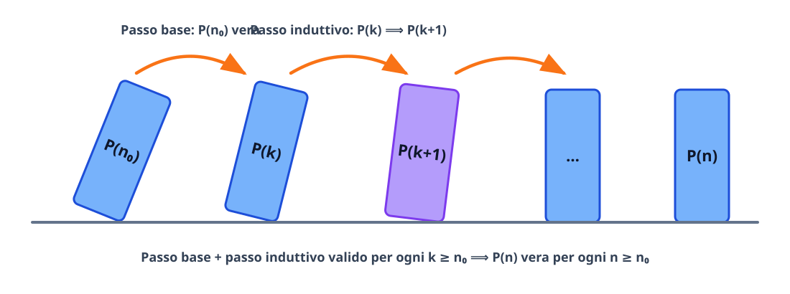

# Il principio di induzione

Il **principio di induzione matematica** è la tecnica dimostrativa fondamentale per provare che un enunciato $P(n)$, dipendente da un numero naturale $n$, è vero per **infiniti** valori di $n$ a partire da un indice iniziale $n_0$. In questa lezione introduciamo prima la notazione compatta di sommatoria $\sum$, indispensabile per formulare e manipolare identità algebriche su $n$ termini, e sviluppiamo poi il principio di induzione applicandolo a somme finite, divisibilità e disuguaglianze.

## Il simbolo di sommatoria $\sum$

Quando dobbiamo sommare una successione di termini $a_m, a_{m+1}, \dots, a_n$ indicizzati da un intero che varia da un estremo inferiore $m$ a un estremo superiore $n$ (con $m \leq n$), usiamo la lettera greca maiuscola sigma ($\sum$):
$$
\sum_{k=m}^{n} a_k = a_m + a_{m+1} + a_{m+2} + \cdots + a_n.
$$
La variabile $k$ si chiama **indice di sommatoria** ed è un **indice muto**: il risultato della somma non dipende dalla lettera scelta per indicarlo, per cui
$$
\sum_{k=1}^{n} a_k = \sum_{i=1}^{n} a_i = \sum_{j=1}^{n} a_j.
$$
Se $m = n$, la somma contiene un solo addendo: $\sum_{k=m}^{m} a_k = a_m$. (Per convenzione, se l'estremo superiore è minore dell'inferiore, la *somma vuota* vale $0$).

### Proprietà algebriche della sommatoria

1. **Sommatoria di una costante $c$:** sommare la stessa costante $c$ da $k = 1$ a $n$ significa addizionare $c$ per $n$ volte:
$$
\sum_{k=1}^{n} c = \underbrace{c + c + \cdots + c}_{n \text{ volte}} = n \cdot c \qquad \text{(e più in generale } \sum_{k=m}^{n} c = (n - m + 1)c\text{)}.
$$
2. **Omogeneità (raccoglimento di una costante che non dipende da $k$):**
$$
\sum_{k=m}^{n} (c \cdot a_k) = c \sum_{k=m}^{n} a_k.
$$
3. **Additività (linearità rispetto alla somma/differenza):**
$$
\sum_{k=m}^{n} (a_k \pm b_k) = \sum_{k=m}^{n} a_k \pm \sum_{k=m}^{n} b_k.
$$
4. **Scomposizione dell'intervallo di indici (isolamento dell'ultimo termine):** fondamentale nel passo induttivo per passare da $n$ a $n+1$:
$$
\sum_{k=1}^{n+1} a_k = \left(\sum_{k=1}^{n} a_k\right) + a_{n+1}.
$$
5. **Traslazione dell'indice:** se si aumenta l'indice negli estremi di un intero $p$, occorre diminuire di $p$ l'indice all'interno del termine generale:
$$
\sum_{k=m}^{n} a_k = \sum_{j=m+p}^{n+p} a_{j-p} \qquad (\text{ponendo } j = k + p).
$$
6. **Somme telescopiche:** se il termine generale si scrive come differenza di due termini consecutivi $a_k = b_{k+1} - b_k$, tutti i termini intermedi si elidono a coppie e sopravvivono solo il primo e l'ultimo:
$$
\sum_{k=1}^{n} (b_{k+1} - b_k) = (b_2 - b_1) + (b_3 - b_2) + \cdots + (b_{n+1} - b_n) = b_{n+1} - b_1.
$$

## L'idea intuitiva dell'induzione: l'effetto domino

Come possiamo dimostrare con un numero finito di passaggi che una proprietà $P(n)$ vale per tutti gli infiniti numeri naturali $n \geq n_0$? Immaginiamo una fila infinita di tessere del domino numerate a partire da $n_0$:
1. **Passo base:** spingiamo con il dito la prima tessera $n_0$, verificando direttamente che cada.
2. **Passo induttivo:** dimostriamo che le tessere sono posizionate abbastanza vicine tra loro da garantire che, **se** una qualunque tessera $k$ cade, allora urta e fa cadere necessariamente anche la tessera successiva $k + 1$.

Una volta garantite queste due condizioni, si innesca una reazione a catena inarrestabile: $P(n_0)$ è vera; per il passo induttivo $P(n_0) \implies P(n_0+1)$, quindi cade $n_0+1$; ma allora $P(n_0+1) \implies P(n_0+2)$, e così via per ogni $n \geq n_0$.

## Enunciato formale del principio di induzione

Sia $P(n)$ un predicato definito per ogni numero naturale $n \geq n_0$ (con $n_0 \in \mathbb{N}$ fissato, tipicamente $n_0 = 0$ oppure $n_0 = 1$). Se valgono entrambe le seguenti condizioni:
1. **Passo base:** $P(n_0)$ è vera;
2. **Passo induttivo:** per ogni $k \geq n_0$, assumendo vera $P(k)$ (**ipotesi induttiva**), segue che è vera anche $P(k+1)$ (**tesi induttiva**);

allora $P(n)$ è vera per ogni $n \geq n_0$.

In simboli logici:
$$
\Bigl[P(n_0) \;\land\; \forall k \geq n_0\,\bigl(P(k) \implies P(k+1)\bigr)\Bigr] \implies \forall n \geq n_0,\, P(n).
$$

> [!note] Perché assumere $P(k)$ non è un ragionamento circolare?
> Nel passo induttivo non stiamo affermando gratuitamente che $P(k)$ sia vera per ogni $k$: stiamo dimostrando l'**implicazione logica** $P(k) \implies P(k+1)$ per un generico $k \geq n_0$. Per dimostrare un'implicazione $A \implies B$, la regola deduttiva standard consiste proprio nell'assumere vera la premessa $A$ (ipotesi induttiva) e dedurne la conclusione $B$ (tesi induttiva).

### Schema operativo in 5 passi

Quando imposti una dimostrazione per induzione, segui sempre questa struttura ordinata:
1. **Enunciato $P(n)$ e dominio:** scrivi chiaramente qual è la proposizione $P(n)$ e da quale valore $n_0$ parte.
2. **Passo base ($n = n_0$):** sostituisci $n = n_0$ nei due membri (o nella proprietà) e verifica che sia soddisfatta.
3. **Ipotesi induttiva ($n = k$):** fissa un generico $k \geq n_0$ e scrivi esplicitamente l'enunciato $P(k)$ che supponi vero.
4. **Passo induttivo ($k \to k+1$):** scrivi la tesi $P(k+1)$ a cui vuoi arrivare, parti da un membro di $P(k+1)$, **sostituisci al suo interno l'ipotesi induttiva $P(k)$** e trasforma algebricamente l'espressione fino a ottenere l'altro membro di $P(k+1)$.
5. **Conclusione:** dichiara che, per il principio di induzione, $P(n)$ è vera per ogni $n \geq n_0$.

## Esempi guidati

### Esempio 1: Somma dei primi $n$ numeri naturali (Formula di Gauss)

Dimostriamo che per ogni $n \geq 1$ vale:
$$
P(n): \quad \sum_{i=1}^{n} i = 1 + 2 + \cdots + n = \frac{n(n+1)}{2}.
$$

- **Passo base ($n = 1$):** il membro sinistro è $\sum_{i=1}^1 i = 1$; il membro destro è $\frac{1(1+1)}{2} = 1$. Quindi $P(1)$ è vera.
- **Ipotesi induttiva:** sia $k \geq 1$ e supponiamo vera $P(k)$:
$$
\sum_{i=1}^{k} i = \frac{k(k+1)}{2}.
$$
- **Passo induttivo ($n = k+1$):** dobbiamo dimostrare che $\sum_{i=1}^{k+1} i = \frac{(k+1)(k+2)}{2}$. Isoliamo l'ultimo termine della sommatoria e usiamo l'ipotesi induttiva:
$$
\begin{aligned}
\sum_{i=1}^{k+1} i &= \left(\sum_{i=1}^{k} i\right) + (k+1) \\
&\overset{\text{ip. ind.}}{=} \frac{k(k+1)}{2} + (k+1) \\
&= (k+1)\left(\frac{k}{2} + 1\right) = \frac{(k+1)(k+2)}{2}.
\end{aligned}
$$
Abbiamo ottenuto esattamente $P(k+1)$. Per il principio di induzione la formula vale per ogni $n \geq 1$. $\blacksquare$

### Esempio 2: Somma dei primi $n$ numeri dispari

Dimostriamo che per ogni $n \geq 1$ la somma dei primi $n$ numeri dispari è uguale a $n^2$:
$$
P(n): \quad \sum_{i=1}^{n} (2i - 1) = 1 + 3 + 5 + \cdots + (2n - 1) = n^2.
$$

- **Passo base ($n = 1$):** a sinistra abbiamo $2(1) - 1 = 1$, a destra $1^2 = 1$. Vera.
- **Ipotesi induttiva:** supponiamo che per un certo $k \geq 1$ valga $\sum_{i=1}^{k} (2i - 1) = k^2$.
- **Passo induttivo ($n = k+1$):** il $(k+1)$-esimo numero dispari è $2(k+1) - 1 = 2k + 1$. Allora:
$$
\sum_{i=1}^{k+1} (2i - 1) = \left(\sum_{i=1}^{k} (2i - 1)\right) + (2k + 1) \overset{\text{ip. ind.}}{=} k^2 + 2k + 1 = (k + 1)^2.
$$
La tesi $P(k+1)$ è verificata, quindi $P(n)$ vale per ogni $n \geq 1$. $\blacksquare$

### Esempio 3: Divisibilità per induzione

Dimostriamo che per ogni $n \geq 1$ il numero $7^n - 1$ è divisibile per $6$, ossia:
$$
P(n): \quad \exists q \in \mathbb{Z} : 7^n - 1 = 6q.
$$

- **Passo base ($n = 1$):** $7^1 - 1 = 6 = 6 \cdot 1$, divisibile per $6$.
- **Ipotesi induttiva:** supponiamo che per $k \geq 1$ esista $q \in \mathbb{Z}$ tale che $7^k - 1 = 6q$, ovvero $7^k = 6q + 1$.
- **Passo induttivo ($n = k+1$):** consideriamo $7^{k+1} - 1$ e sostituiamo $7^k = 6q + 1$:
$$
7^{k+1} - 1 = 7 \cdot 7^k - 1 \overset{\text{ip. ind.}}{=} 7(6q + 1) - 1 = 42q + 7 - 1 = 42q + 6 = 6(7q + 1).
$$
Poiché $7q + 1 \in \mathbb{Z}$, anche $7^{k+1} - 1$ è multiplo di $6$. Per induzione la proprietà vale per ogni $n \geq 1$. $\blacksquare$

### Esempio 4: Disuguaglianze per induzione (Disuguaglianza di Bernoulli e $2^n > n$)

Nelle disuguaglianze per induzione si usa una catena di maggiorazioni o minorazioni per passare da $P(k)$ a $P(k+1)$.

#### 4a. Disuguaglianza di Bernoulli

Sia $x \in \mathbb{R}$ fissato con $x > -1$. Dimostriamo che per ogni $n \in \mathbb{N}$ vale:
$$
P(n): \quad (1 + x)^n \geq 1 + nx.
$$

- **Passo base ($n = 0$):** $(1 + x)^0 = 1$ e $1 + 0 \cdot x = 1$, quindi $1 \geq 1$ è vera (vale anche per $n = 1$: $1 + x \geq 1 + x$).
- **Ipotesi induttiva:** supponiamo $(1 + x)^k \geq 1 + kx$ per un certo $k \in \mathbb{N}$.
- **Passo induttivo ($n = k+1$):** poiché per ipotesi $x > -1$, il fattore $(1 + x)$ è **strettamente positivo** ($1 + x > 0$). Moltiplicando ambo i membri della disuguaglianza induttiva per $(1 + x) > 0$, il verso della disuguaglianza si conserva:
$$
\begin{aligned}
(1 + x)^{k+1} &= (1 + x)^k \cdot (1 + x) \\
&\overset{\text{ip. ind.}}{\geq} (1 + kx)(1 + x) \\
&= 1 + x + kx + kx^2 \\
&= 1 + (k + 1)x + \underbrace{kx^2}_{\geq 0} \\
&\geq 1 + (k + 1)x,
\end{aligned}
$$
dove nell'ultimo passaggio abbiamo usato il fatto che $k \geq 0$ e $x^2 \geq 0$, dunque $kx^2 \geq 0$. Ciò dimostra $P(k+1)$. $\blacksquare$

#### 4b. Crescita esponenziale $2^n > n$

Dimostriamo che per ogni $n \in \mathbb{N}$ vale $2^n > n$.
- **Passo base ($n = 0$):** $2^0 = 1 > 0$, vera (per $n = 1$: $2^1 = 2 > 1$).
- **Ipotesi induttiva:** sia $2^k > k$ per un generico $k \geq 1$.
- **Passo induttivo ($n = k+1$):** moltiplicando per $2$ e usando $k \geq 1$:
$$
2^{k+1} = 2 \cdot 2^k \overset{\text{ip. ind.}}{>} 2k = k + k \geq k + 1,
$$
quindi $2^{k+1} > k + 1$. $\blacksquare$

## Verifica empirica contro dimostrazione rigorosa, e induzione forte

Controllare che un enunciato $P(n)$ sia vero per $n = 1, 2, 3, \dots, 100$ **non** costituisce una dimostrazione: esistono predicati veri per molti valori iniziali ma falsi da un certo indice in poi!
- Ad esempio, il polinomio di Eulero $p(n) = n^2 - n + 41$ produce numeri primi per tutti gli interi $n = 0, 1, 2, \dots, 40$, ma per $n = 41$ dà $41^2 - 41 + 41 = 41^2$, che non è primo.
- Analogamente, la congettura «ogni numero dispari maggiore di $1$ è somma di una potenza di $2$ e di un numero primo» funziona per tutti i dispari fino a $125$, ma fallisce per $127$ (sottraendo da $127$ le potenze $1, 2, 4, 8, 16, 32, 64$ si ottengono $126, 125, 123, 119=7\cdot 17, 111=3\cdot 37, 95=5\cdot 19, 63=9\cdot 7$, nessuno dei quali è primo).

### Principio di induzione forte (o seconda forma)

Talvolta, per dimostrare $P(k+1)$ non basta sapere che è vera la sola proposizione immediatamente precedente $P(k)$, ma serve sapere che sono vere **tutte** le proposizioni da $n_0$ fino a $k$:
$$
\Bigl[P(n_0) \;\land\; \forall k \geq n_0\,\bigl(P(n_0) \land P(n_0+1) \land \cdots \land P(k) \implies P(k+1)\bigr)\Bigr] \implies \forall n \geq n_0,\, P(n).
$$
L'induzione forte è logicamente equivalente all'induzione ordinaria ed è essenziale, ad esempio, per dimostrare che ogni intero $n \geq 2$ si fattorizza come prodotto di numeri primi (perché se $k+1$ è composto, si scrive come $a \cdot b$ con $2 \leq a, b \leq k$, a cui si applica l'ipotesi induttiva forte) o per studiare successioni ricorsive a più passi come i numeri di Fibonacci ($F_{k+1} = F_k + F_{k-1}$).

## Errori frequenti

- **Saltare il passo base:** il solo passo induttivo $P(k) \implies P(k+1)$ non garantisce nulla se la catena non parte! Ad esempio, la proposizione falsa $P(n): 1 + 2 + \cdots + n = \frac{n(n+1)}{2} + 5$ soddisfa il passo induttivo (aggiungendo $k+1$ a $\frac{k(k+1)}{2} + 5$ si ottiene $\frac{(k+1)(k+2)}{2} + 5$), ma è falsa per ogni $n$ perché fallisce nel passo base $n = 1$.
- **Confondere l'ultimo termine aggiunto nel passaggio $k \to k+1$:** nella somma $\sum_{i=1}^n (2i-1)$, passando da $k$ a $k+1$ non si aggiunge $k+1$, bensì il termine ottenuto sostituendo $i = k+1$ nella formula generale, cioè $2(k+1) - 1 = 2k + 1$.
- **Assumere direttamente la tesi $P(k+1)$ e ridurla a un'identità senza verificare la reversibilità dei passaggi:** è sempre preferibile partire da un membro di $P(k+1)$ e arrivare all'altro attraverso una catena di uguaglianze o disuguaglianze orientate.
- **Dimenticare da quale $n_0$ vale una disuguaglianza:** alcune disuguaglianze (come $2^n > n^2$) sono false per $n = 2, 3, 4$ e diventano vere solo a partire da $n_0 = 5$.

## Esercizi di prova

1. (**Base - Somma dei quadrati**) Dimostra per induzione che per ogni $n \geq 1$ vale la formula per la somma dei primi $n$ quadrati perfetti:
   $$\sum_{i=1}^{n} i^2 = 1^2 + 2^2 + \cdots + n^2 = \frac{n(n+1)(2n+1)}{6}.$$
> [!tip]- Soluzione
> - **Passo base ($n = 1$):** a sinistra $\sum_{i=1}^1 i^2 = 1^2 = 1$; a destra $\frac{1 \cdot 2 \cdot 3}{6} = 1$. Vera.
> - **Ipotesi induttiva:** supponiamo vera la formula per $k \geq 1$: $\sum_{i=1}^k i^2 = \frac{k(k+1)(2k+1)}{6}$.
> - **Passo induttivo ($n = k+1$):** dobbiamo dimostrare che $\sum_{i=1}^{k+1} i^2 = \frac{(k+1)(k+2)(2k+3)}{6}$. Calcoliamo:
>   $$\begin{aligned}
>   \sum_{i=1}^{k+1} i^2 &= \left(\sum_{i=1}^{k} i^2\right) + (k+1)^2 \\
>   &\overset{\text{ip. ind.}}{=} \frac{k(k+1)(2k+1)}{6} + (k+1)^2 \\
>   &= \frac{k+1}{6}\bigl[k(2k+1) + 6(k+1)\bigr] \\
>   &= \frac{k+1}{6}\bigl(2k^2 + 7k + 6\bigr).
>   \end{aligned}$$
>   Fattorizzando il trinomio $2k^2 + 7k + 6 = (k+2)(2k+3)$ otteniamo:
>   $$\sum_{i=1}^{k+1} i^2 = \frac{(k+1)(k+2)(2k+3)}{6},$$
>   che coincide esattamente con $P(k+1)$. Per il principio di induzione la formula vale per ogni $n \geq 1$.

2. (**Base - Somma geometrica**) Sia $q \in \mathbb{R}$ con $q \neq 1$. Dimostra per induzione che per ogni $n \in \mathbb{N}$ vale:
   $$\sum_{i=0}^{n} q^i = 1 + q + q^2 + \cdots + q^n = \frac{1 - q^{n+1}}{1 - q}.$$
> [!tip]- Soluzione
> - **Passo base ($n = 0$):** a sinistra $\sum_{i=0}^0 q^i = q^0 = 1$; a destra $\frac{1 - q^1}{1 - q} = 1$. Vera.
> - **Ipotesi induttiva:** supponiamo che per $k \in \mathbb{N}$ valga $\sum_{i=0}^k q^i = \frac{1 - q^{k+1}}{1 - q}$.
> - **Passo induttivo ($n = k+1$):** aggiungiamo il termine $q^{k+1}$:
>   $$\begin{aligned}
>   \sum_{i=0}^{k+1} q^i &= \left(\sum_{i=0}^{k} q^i\right) + q^{k+1} \\
>   &\overset{\text{ip. ind.}}{=} \frac{1 - q^{k+1}}{1 - q} + q^{k+1} \\
>   &= \frac{1 - q^{k+1} + q^{k+1}(1 - q)}{1 - q} \\
>   &= \frac{1 - q^{k+1} + q^{k+1} - q^{k+2}}{1 - q} = \frac{1 - q^{(k+1)+1}}{1 - q}.
>   \end{aligned}$$
>   Ciò dimostra $P(k+1)$, quindi l'identità vale per ogni $n \in \mathbb{N}$.

3. (**Intermedio - Somma di frazioni / telescopica**) Dimostra per induzione che per ogni $n \geq 1$ vale:
   $$\sum_{i=1}^{n} \frac{1}{i(i+1)} = \frac{1}{1\cdot 2} + \frac{1}{2\cdot 3} + \cdots + \frac{1}{n(n+1)} = \frac{n}{n+1}.$$
> [!tip]- Soluzione
> - **Passo base ($n = 1$):** a sinistra $\frac{1}{1 \cdot 2} = \frac{1}{2}$; a destra $\frac{1}{1+1} = \frac{1}{2}$. Vera.
> - **Ipotesi induttiva:** supponiamo che per $k \geq 1$ valga $\sum_{i=1}^k \frac{1}{i(i+1)} = \frac{k}{k+1}$.
> - **Passo induttivo ($n = k+1$):**
>   $$\begin{aligned}
>   \sum_{i=1}^{k+1} \frac{1}{i(i+1)} &= \left(\sum_{i=1}^{k} \frac{1}{i(i+1)}\right) + \frac{1}{(k+1)(k+2)} \\
>   &\overset{\text{ip. ind.}}{=} \frac{k}{k+1} + \frac{1}{(k+1)(k+2)} \\
>   &= \frac{k(k+2) + 1}{(k+1)(k+2)} = \frac{k^2 + 2k + 1}{(k+1)(k+2)} \\
>   &= \frac{(k+1)^2}{(k+1)(k+2)} = \frac{k+1}{k+2}.
>   \end{aligned}$$
>   Questa è esattamente la formula per $n = k+1$. (Osservazione: l'identità si può ricavare anche come somma telescopica notando che $\frac{1}{i(i+1)} = \frac{1}{i} - \frac{1}{i+1}$, da cui la somma vale $1 - \frac{1}{n+1} = \frac{n}{n+1}$).

4. (**Intermedio - Divisibilità**) Dimostra per induzione che per ogni $n \in \mathbb{N}$ il numero $n^3 - n$ è divisibile per $3$ (e anche per $6$).
> [!tip]- Soluzione
> Mostriamo la divisibilità per $6$ (che implica quella per $3$): $P(n): \exists q \in \mathbb{Z} : n^3 - n = 6q$.
> - **Passo base ($n = 0$):** $0^3 - 0 = 0 = 6 \cdot 0$, divisibile per $6$.
> - **Ipotesi induttiva:** supponiamo $k^3 - k = 6q$ per un certo $k \in \mathbb{N}$ e $q \in \mathbb{Z}$.
> - **Passo induttivo ($n = k+1$):** sviluppiamo il cubo $(k+1)^3 - (k+1)$:
>   $$\begin{aligned}
>   (k+1)^3 - (k+1) &= (k^3 + 3k^2 + 3k + 1) - (k + 1) \\
>   &= (k^3 - k) + 3k^2 + 3k \\
>   &\overset{\text{ip. ind.}}{=} 6q + 3k(k + 1).
>   \end{aligned}$$
>   Osserviamo che tra due numeri interi consecutivi $k$ e $k+1$ uno dei due è sempre pari, quindi il prodotto $k(k+1) = 2m$ è sempre un multiplo di $2$. Pertanto $3k(k+1) = 3 \cdot 2m = 6m$, e dunque:
>   $$(k+1)^3 - (k+1) = 6q + 6m = 6(q + m),$$
>   che è divisibile per $6$. Per induzione la tesi vale per ogni $n \in \mathbb{N}$.

5. (**Esame - Disuguaglianza con base desplazata**) Dimostra per induzione che per ogni numero naturale $n \geq 4$ vale la disuguaglianza:
   $$2^n \geq n^2.$$
   *(Suggerimento: puoi usare il fatto già noto che per $k \geq 4$ vale $k^2 \geq 2k + 1$).*
> [!tip]- Soluzione
> - **Passo base ($n_0 = 4$):** a sinistra $2^4 = 16$; a destra $4^2 = 16$. Poiché $16 \geq 16$, $P(4)$ è vera. (Nota: per $n = 5$ si ha $32 \geq 25$).
> - **Ipotesi induttiva:** sia $k \geq 4$ e supponiamo $2^k \geq k^2$.
> - **Passo induttivo ($n = k+1$):** dobbiamo dimostrare che $2^{k+1} \geq (k+1)^2 = k^2 + 2k + 1$.
>   Osserviamo preliminarmente che per ogni $k \geq 4$ vale $k^2 - 2k - 1 = (k - 1)^2 - 2 \geq 3^2 - 2 = 7 > 0$, quindi $k^2 \geq 2k + 1$.
>   Allora, partendo da $2^{k+1}$ e applicando prima l'ipotesi induttiva e poi la stima $k^2 \geq 2k + 1$:
>   $$2^{k+1} = 2 \cdot 2^k \overset{\text{ip. ind.}}{\geq} 2k^2 = k^2 + k^2 \geq k^2 + (2k + 1) = (k + 1)^2.$$
>   Abbiamo ottenuto $2^{k+1} \geq (k+1)^2$. Per il principio di induzione, $2^n \geq n^2$ per ogni $n \geq 4$. $\blacksquare$

## Provenienza del materiale

Sintesi ragionata ed estesa della lezione `C1MAT1U2L3_Il_principio_di_induzione.pdf` e degli `Appunti_di_fine_Unità_2.pdf` (Corso di Matematica 1, CdL in Sicurezza Informatica / SecAI - Università degli Studi di Milano), con aggiunta delle proprietà del simbolo di sommatoria $\sum$, della disuguaglianza di Bernoulli e di esercizi svolti graduati.
