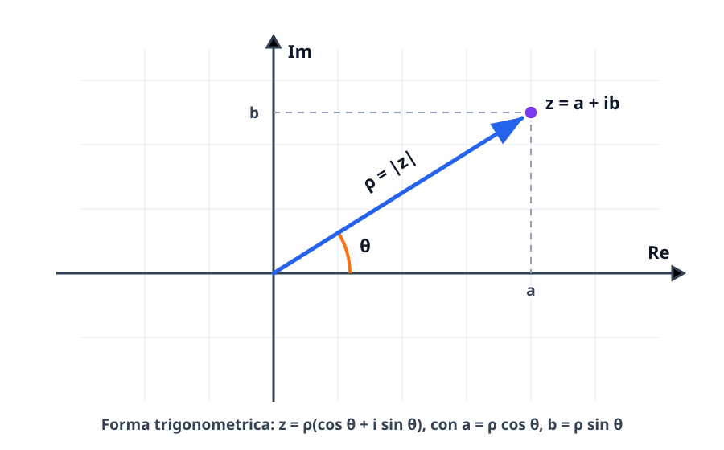

# Il campo complesso

Nel campo dei numeri reali $\mathbb{R}$ il quadrato di ogni numero è sempre non negativo ($x^2 \geq 0$), per cui equazioni algebriche elementari come $x^2 + 1 = 0$ (o più in generale equazioni di secondo grado con discriminante $\Delta < 0$) sono prive di soluzioni reali. Il **campo dei numeri complessi** $\mathbb{C}$ estende $\mathbb{R}$ introducendo l'unità immaginaria $i$ tale che $i^2 = -1$: in $\mathbb{C}$ non solo continuano a valere tutte le regole algebriche di campo, ma ogni polinomio di grado $n \geq 1$ possiede esattamente $n$ radici (Teorema Fondamentale dell'Algebra).

## Unità immaginaria e forma algebrica (o cartesiana)

Si definisce **unità immaginaria** il simbolo $i$ caratterizzato dalla relazione fondamentale:
$$
i^2 = -1.
$$
Un **numero complesso** $z \in \mathbb{C}$ in **forma algebrica** (o cartesiana) è un'espressione del tipo:
$$
z = a + ib \qquad \text{con } a, b \in \mathbb{R},
$$
dove:
- $a = \operatorname{Re}(z) \in \mathbb{R}$ si chiama **parte reale** di $z$;
- $b = \operatorname{Im}(z) \in \mathbb{R}$ si chiama **parte immaginaria** (o coefficiente dell'immaginario) di $z$. Si noti che $\operatorname{Im}(z)$ è il numero reale $b$, **non** $ib$.

Due numeri complessi sono uguali se e solo se hanno contemporaneamente la stessa parte reale e la stessa parte immaginaria:
$$
a + ib = c + id \iff a = c \quad \text{e} \quad b = d.
$$
- Se $b = 0$, il numero $z = a + i0 = a$ è un **numero reale** (quindi $\mathbb{R} \subsetneq \mathbb{C}$).
- Se $a = 0$ e $b \neq 0$, il numero $z = ib$ si dice **immaginario puro**.

> [!warning] In $\mathbb{C}$ non esiste un ordinamento compatibile con le operazioni!
> A differenza di $\mathbb{R}$, il campo complesso $\mathbb{C}$ **non è un campo ordinato**: non ha alcun senso scrivere disuguaglianze tra numeri complessi non reali come $z_1 < z_2$ o $2 + 3i > 1 - i$. Le disuguaglianze sono lecite solo tra quantità reali, come $\operatorname{Re}(z)$, $\operatorname{Im}(z)$ o il modulo $|z|$.

## Complesso coniugato e modulo

Dato $z = a + ib \in \mathbb{C}$ (con $a, b \in \mathbb{R}$):

- Il **complesso coniugato** di $z$ è il numero complesso ottenuto cambiando il segno della sola parte immaginaria:
$$
\bar{z} = a - ib.
$$
- Il **modulo** (o valore assoluto) di $z$ è il numero reale non negativo che misura la distanza euclidea di $z$ dall'origine nel piano:
$$
|z| = \sqrt{a^2 + b^2} \geq 0.
$$

### Proprietà fondamentali di coniugato e modulo

Per ogni $z, w \in \mathbb{C}$ valgono le seguenti identità:
$$
\begin{aligned}
\overline{\bar{z}} &= z, & z + \bar{z} &= 2\operatorname{Re}(z), & z - \bar{z} &= 2i\operatorname{Im}(z),\\
z \cdot \bar{z} &= (a + ib)(a - ib) = a^2 + b^2 = |z|^2, & \overline{z \pm w} &= \bar{z} \pm \bar{w}, & \overline{z \cdot w} &= \bar{z} \cdot \bar{w},\\
\overline{\left(\frac{z}{w}\right)} &= \frac{\bar{z}}{\bar{w}} \quad (w \neq 0), & |z| &= |\bar{z}| = |-z|, & |z \cdot w| &= |z|\,|w|,\\
\left|\frac{z}{w}\right| &= \frac{|z|}{|w|} \quad (w \neq 0), & |z + w| &\leq |z| + |w| &&\text{(disuguaglianza triangolare)}.
\end{aligned}
$$
In particolare, $z \in \mathbb{R} \iff z = \bar{z}$, mentre $z = 0 \iff |z| = 0$.

## Operazioni in forma algebrica

Siano $z = a + ib$ e $w = c + id$ con $a, b, c, d \in \mathbb{R}$.

1. **Somma e sottrazione:** si sommano o sottraggono separatamente le parti reali e le parti immaginarie:
$$
z \pm w = (a \pm c) + i(b \pm d).
$$
2. **Moltiplicazione:** si applica la proprietà distributiva ricordando che $i^2 = -1$:
$$
z \cdot w = (a + ib)(c + id) = ac + iad + ibc + i^2 bd = (ac - bd) + i(ad + bc).
$$
3. **Divisione (e reciproco):** per calcolare $\frac{z}{w}$ con $w = c + id \neq 0$, si moltiplicano numeratore e denominatore per il **coniugato del denominatore** $\bar{w} = c - id$, in modo da rendere reale il denominatore ($w\bar{w} = c^2 + d^2$):
$$
\frac{z}{w} = \frac{z\bar{w}}{w\bar{w}} = \frac{(a + ib)(c - id)}{c^2 + d^2} = \frac{ac + bd}{c^2 + d^2} + i\,\frac{bc - ad}{c^2 + d^2}.
$$
In particolare, il reciproco di $z \neq 0$ è $z^{-1} = \frac{1}{z} = \frac{\bar{z}}{|z|^2}$.

### Potenze intere dell'unità immaginaria $i$

Le potenze $i^n$ (con $n \in \mathbb{Z}$) sono periodiche di **periodo $4$**:
$$
i^0 = 1, \qquad i^1 = i, \qquad i^2 = -1, \qquad i^3 = i^2 \cdot i = -i, \qquad i^4 = (i^2)^2 = 1.
$$
Per calcolare $i^n$ per qualunque $n \in \mathbb{N}$, basta dividere $n$ per $4$ ($n = 4q + r$ con resto $r \in \{0, 1, 2, 3\}$) e si ha:
$$
i^n = i^{4q + r} = (i^4)^q \cdot i^r = 1^q \cdot i^r = i^r.
$$
Per esempio, $i^{103} = i^{4 \cdot 25 + 3} = i^3 = -i$, mentre $\frac{1}{i} = \frac{-i}{i(-i)} = -i = i^3$.

## Il piano di Gauss e la forma trigonometrica

Ogni numero complesso $z = a + ib$ corrisponde biunivocamente al punto $P(a, b)$ (o al vettore $\overrightarrow{OP}$) del piano cartesiano, detto **piano di Gauss** o **piano di Argand-Gauss**:
- l'asse delle ascisse è l'**asse reale** ($\operatorname{Re}$);
- l'asse delle ordinate è l'**asse immaginario** ($\operatorname{Im}$).

Geometricamente, il coniugato $\bar{z} = a - ib$ è il simmetrico di $z$ rispetto all'asse reale, mentre l'opposto $-z = -a - ib$ è il simmetrico rispetto all'origine.

### Coordinate polari e forma trigonometrica

Sia $z = a + ib \neq 0$. Individuando il punto $P(a, b)$ tramite la sua distanza dall'origine $\rho = |z| > 0$ e l'angolo orientato $\theta$ formato dal semiasse reale positivo con il vettore $\overrightarrow{OP}$ (detto **argomento** o **anomalia** di $z$, indicato con $\arg(z)$), valgono le formule di passaggio:
$$
\begin{cases}
a = \rho \cos\theta \\
b = \rho \sin\theta
\end{cases}
\iff
\begin{cases}
\rho = |z| = \sqrt{a^2 + b^2} \\
\cos\theta = \dfrac{a}{\rho}, \quad \sin\theta = \dfrac{b}{\rho}.
\end{cases}
$$
Sostituendo in $z = a + ib$ si ottiene la **forma trigonometrica** di $z$:
$$
z = \rho(\cos\theta + i\sin\theta).
$$
L'argomento $\theta$ è determinato a meno di multipli interi di $2\pi$ (cioè $\theta + 2k\pi$ con $k \in \mathbb{Z}$). L'unico valore dell'argomento appartenente all'intervallo $(-\pi, \pi]$ oppure $[0, 2\pi)$ si chiama **argomento principale** $\operatorname{Arg}(z)$. Per $z = 0$ si ha $\rho = 0$ e l'argomento è **indeterminato**.

### Come determinare correttamente l'argomento $\theta$ (attenzione al quadrante!)

Non usare mai ciecamente $\theta = \arctan(b/a)$ senza controllare i segni di $a$ e $b$, perché l'arcotangente restituisce solo angoli in $(-\pi/2, \pi/2)$ (I e IV quadrante). Il metodo più sicuro consiste nel calcolare $\rho = \sqrt{a^2 + b^2}$ e leggere insieme $\cos\theta = \frac{a}{\rho}$ e $\sin\theta = \frac{b}{\rho}$ (oppure sommare $\pi$ a $\arctan(b/a)$ quando $a < 0$):

| Posizione di $z = a + ib$ | Segni di $(a, b)$ | Quadrante / Semiasse | Scelta di $\theta \in [0, 2\pi)$ |
| --- | --- | --- | --- |
| Reale positivo ($b = 0, a > 0$) | $(+, 0)$ | Semiasse $\operatorname{Re} > 0$ | $\theta = 0$ |
| Immaginario puro positivo ($a = 0, b > 0$) | $(0, +)$ | Semiasse $\operatorname{Im} > 0$ | $\theta = \frac{\pi}{2}$ |
| Reale negativo ($b = 0, a < 0$) | $(-, 0)$ | Semiasse $\operatorname{Re} < 0$ | $\theta = \pi$ |
| Immaginario puro negativo ($a = 0, b < 0$) | $(0, -)$ | Semiasse $\operatorname{Im} < 0$ | $\theta = \frac{3\pi}{2}$ (o $-\frac{\pi}{2}$) |
| $a > 0, b > 0$ | $(+, +)$ | I quadrante | $\theta = \arctan(b/a)$ |
| $a < 0, b > 0$ | $(-, +)$ | II quadrante | $\theta = \pi + \arctan(b/a)$ |
| $a < 0, b < 0$ | $(-, -)$ | III quadrante | $\theta = \pi + \arctan(b/a)$ |
| $a > 0, b < 0$ | $(+, -)$ | IV quadrante | $\theta = 2\pi + \arctan(b/a)$ (o $\arctan(b/a) < 0$) |

## Forma esponenziale (o di Eulero)

La **formula di Eulero** stabilisce un legame profondo tra la funzione esponenziale complessa e le funzioni goniometriche: per ogni $\theta \in \mathbb{R}$, si pone
$$
e^{i\theta} = \cos\theta + i\sin\theta.
$$
Per $\theta = \pi$ si ottiene la celebre **identità di Eulero** $e^{i\pi} + 1 = 0$. Osserviamo che $|e^{i\theta}| = \sqrt{\cos^2\theta + \sin^2\theta} = 1$ (punti della circonferenza unitaria) e $\overline{e^{i\theta}} = \cos\theta - i\sin\theta = e^{-i\theta}$.

Grazie alla formula di Eulero, ogni numero complesso non nullo di modulo $\rho$ e argomento $\theta$ si scrive in **forma esponenziale**:
$$
z = \rho e^{i\theta}.
$$

### Prodotti, quozienti e formula di De Moivre

La forma trigonometrica e la forma esponenziale rendono immediati prodotti, quozienti e potenze perché seguono le normali proprietà delle potenze dell'esponenziale! Dati $z_1 = \rho_1 e^{i\theta_1} = \rho_1(\cos\theta_1 + i\sin\theta_1)$ e $z_2 = \rho_2 e^{i\theta_2} = \rho_2(\cos\theta_2 + i\sin\theta_2)$:

1. **Prodotto** (si moltiplicano i moduli e si sommano gli argomenti):
$$
z_1 z_2 = \rho_1 \rho_2 e^{i(\theta_1 + \theta_2)} = \rho_1 \rho_2\bigl[\cos(\theta_1 + \theta_2) + i\sin(\theta_1 + \theta_2)\bigr].
$$
Geometricamente, moltiplicare per $z_2 = \rho_2 e^{i\theta_2}$ significa applicare una **rotazione** di angolo $\theta_2$ attorno all'origine seguita da un'**omotetia** (dilatazione) di fattore $\rho_2$.
2. **Quoziente** (si dividono i moduli e si sottraggono gli argomenti, per $z_2 \neq 0$):
$$
\frac{z_1}{z_2} = \frac{\rho_1}{\rho_2} e^{i(\theta_1 - \theta_2)} = \frac{\rho_1}{\rho_2}\bigl[\cos(\theta_1 - \theta_2) + i\sin(\theta_1 - \theta_2)\bigr].
$$
3. **Potenza $n$-esima (Formula di De Moivre):** per ogni $n \in \mathbb{Z}$,
$$
z^n = \bigl(\rho e^{i\theta}\bigr)^n = \rho^n e^{in\theta} = \rho^n\bigl(\cos(n\theta) + i\sin(n\theta)\bigr).
$$

## Radici $n$-esime di un numero complesso e Teorema Fondamentale dell'Algebra

### Radici $n$-esime in $\mathbb{C}$

Sia $z = \rho(\cos\theta + i\sin\theta) = \rho e^{i\theta} \neq 0$ un numero complesso assegnato e sia $n \in \mathbb{N}$ con $n \geq 2$. Un numero complesso $w$ è una **radice $n$-esima** di $z$ se soddisfa l'equazione:
$$
w^n = z.
$$
Scrivendo l'incognita in forma polare come $w = r(\cos\varphi + i\sin\varphi)$ con $r > 0$, per la formula di De Moivre l'equazione $w^n = z$ diventa:
$$
r^n(\cos(n\varphi) + i\sin(n\varphi)) = \rho(\cos\theta + i\sin\theta) \iff
\begin{cases}
r^n = \rho \implies r = \sqrt[n]{\rho} \quad (\text{radice aritmetica reale positiva}) \\
n\varphi = \theta + 2k\pi \implies \varphi_k = \dfrac{\theta + 2k\pi}{n}, \quad k \in \mathbb{Z}.
\end{cases}
$$
Al variare di $k = 0, 1, 2, \dots, n-1$ si ottengono esattamente **$n$ radici complesse distinte** $w_0, w_1, \dots, w_{n-1}$ (per $k \geq n$ gli angoli si ripetono a meno di multipli di $2\pi$):
$$
w_k = \sqrt[n]{\rho}\left[\cos\left(\frac{\theta + 2k\pi}{n}\right) + i\sin\left(\frac{\theta + 2k\pi}{n}\right)\right] = \sqrt[n]{\rho}\,e^{i\frac{\theta + 2k\pi}{n}}, \qquad k = 0, 1, \dots, n-1.
$$
> [!important] Interpretazione geometrica delle radici $n$-esime
> Le $n$ radici $n$-esime di $z \neq 0$ hanno tutte lo stesso modulo $r = \sqrt[n]{|z|}$ e argomenti equispaziati di $\frac{2\pi}{n}$. Nel piano di Gauss esse sono quindi i **vertici di un poligono regolare di $n$ lati** inscritto nella circonferenza centrata nell'origine di raggio $\sqrt[n]{|z|}$.

### Teorema Fondamentale dell'Algebra

> [!note] Teorema Fondamentale dell'Algebra (Gauss)
> Ogni polinomio a coefficienti complessi $P(z) = a_n z^n + a_{n-1} z^{n-1} + \cdots + a_1 z + a_0$ di grado $n \geq 1$ (con $a_n \neq 0$) ammette almeno una radice in $\mathbb{C}$.
> Equivalentemente, $P(z)$ si fattorizza completamente in $\mathbb{C}$ come prodotto di $n$ fattori lineari:
> $$P(z) = a_n(z - z_1)(z - z_2)\cdots(z - z_n),$$
> e possiede quindi esattamente **$n$ radici complesse** $z_1, \dots, z_n$, contate ciascuna con la propria molteplicità.

**Proprietà dei polinomi a coefficienti reali:** se tutti i coefficienti $a_k$ di $P(z)$ sono **numeri reali**, allora per ogni radice complessa $z_0$ anche il suo coniugato $\bar{z}_0$ è radice di $P(z)$ con la stessa molteplicità (infatti $P(\bar{z}_0) = \overline{P(z_0)} = \bar{0} = 0$). Di conseguenza, le radici non reali di un polinomio a coefficienti reali compaiono sempre a **coppie di complessi coniugati**, e ogni polinomio reale di grado dispari ha sempre almeno una radice reale.

## Esempi guidati

### Esempio 1: Potenza elevata tramite forma trigonometrica/esponenziale

Calcoliamo $(-\sqrt{3} + i)^6$ scrivendo il risultato in forma algebrica.

**Passaggi:**
1. Convertiamo la base $z = -\sqrt{3} + i$ in forma trigonometrica. Si ha $a = -\sqrt{3} < 0$ e $b = 1 > 0$ (punto nel **II quadrante**):
   $$\rho = \sqrt{(-\sqrt{3})^2 + 1^2} = \sqrt{3 + 1} = 2.$$
   $$\cos\theta = -\frac{\sqrt{3}}{2}, \quad \sin\theta = \frac{1}{2} \implies \theta = \pi - \frac{\pi}{6} = \frac{5\pi}{6}.$$
   Quindi $z = 2\,e^{i\frac{5\pi}{6}} = 2\left(\cos\frac{5\pi}{6} + i\sin\frac{5\pi}{6}\right)$.
2. Applichiamo la formula di De Moivre con $n = 6$:
   $$z^6 = 2^6\left[\cos\left(6 \cdot \frac{5\pi}{6}\right) + i\sin\left(6 \cdot \frac{5\pi}{6}\right)\right] = 64(\cos(5\pi) + i\sin(5\pi)).$$
3. Poiché $5\pi = \pi + 2 \cdot 2\pi$, si ha $\cos(5\pi) = \cos\pi = -1$ e $\sin(5\pi) = 0$. Pertanto:
   $$(-\sqrt{3} + i)^6 = 64(-1 + 0i) = -64.$$

### Esempio 2: Calcolo completo delle radici cubiche di un numero complesso ($z^3 = -8$)

Determiniamo tutte le soluzioni complesse dell'equazione $z^3 = -8$ (ovvero $z^3 + 8 = 0$), scrivendole in forma trigonometrica, esponenziale e algebrica.

**Passaggi:**
1. Scriviamo il numero $w = -8$ in forma trigonometrica/esponenziale. Essendo un numero reale negativo, ha modulo $\rho = |-8| = 8$ e argomento $\theta = \pi$:
   $$-8 = 8(\cos\pi + i\sin\pi) = 8e^{i\pi}.$$
2. Applichiamo la formula delle radici $n$-esime con $n = 3$. Il modulo comune delle tre radici è $\sqrt[3]{8} = 2$, e gli argomenti sono:
   $$\varphi_k = \frac{\pi + 2k\pi}{3}, \qquad k = 0, 1, 2.$$
3. Calcoliamo esplicitamente le $3$ radici sostituendo $k = 0, 1, 2$:
   - Per $k = 0 \implies \varphi_0 = \frac{\pi}{3}$:
     $$z_0 = 2\,e^{i\frac{\pi}{3}} = 2\left(\cos\frac{\pi}{3} + i\sin\frac{\pi}{3}\right) = 2\left(\frac{1}{2} + i\frac{\sqrt{3}}{2}\right) = 1 + i\sqrt{3}.$$
   - Per $k = 1 \implies \varphi_1 = \frac{\pi + 2\pi}{3} = \pi$:
     $$z_1 = 2\,e^{i\pi} = 2(\cos\pi + i\sin\pi) = 2(-1 + 0i) = -2.$$
   - Per $k = 2 \implies \varphi_2 = \frac{\pi + 4\pi}{3} = \frac{5\pi}{3}$:
     $$z_2 = 2\,e^{i\frac{5\pi}{3}} = 2\left(\cos\frac{5\pi}{3} + i\sin\frac{5\pi}{3}\right) = 2\left(\frac{1}{2} - i\frac{\sqrt{3}}{2}\right) = 1 - i\sqrt{3}.$$
4. **Controllo geometrico e algebrico:** le tre radici $z_0 = 1 + i\sqrt{3}$, $z_1 = -2$ e $z_2 = 1 - i\sqrt{3}$ sono i vertici di un triangolo equilatero inscritto nella circonferenza di raggio $2$; inoltre le due radici non reali $z_0$ e $z_2$ sono complesse coniugate perché l'equazione $z^3 + 8 = 0$ ha coefficienti reali.

### Esempio 3: Equazione complessa con coniugato ($z^2 + 2\bar{z} = 0$)

Risolviamo in $\mathbb{C}$ l'equazione (tratta dalla lezione sincrona del 15 ottobre):
$$
z^2 + 2\bar{z} = 0.
$$

**Metodo 1 (in forma algebrica $z = x + iy$ con $x, y \in \mathbb{R}$):**
1. Sostituiamo $z = x + iy$ e $\bar{z} = x - iy$, ricordando che $z^2 = (x + iy)^2 = x^2 - y^2 + 2ixy$:
   $$(x^2 - y^2 + 2ixy) + 2(x - iy) = 0 \implies (x^2 - y^2 + 2x) + i(2xy - 2y) = 0.$$
2. Un numero complesso è nullo se e solo se si annullano contemporaneamente parte reale e parte immaginaria:
   $$\begin{cases}
   x^2 - y^2 + 2x = 0 \\
   2y(x - 1) = 0.
   \end{cases}$$
3. Dalla seconda equazione, per la legge di annullamento del prodotto, si aprono due casi:
   - **Caso A ($y = 0$):** sostituendo nella prima equazione otteniamo $x^2 + 2x = 0 \implies x(x + 2) = 0$, da cui $x = 0$ oppure $x = -2$. Otteniamo le due soluzioni reali:
     $$z_1 = 0, \qquad z_2 = -2.$$
   - **Caso B ($x = 1$):** sostituendo $x = 1$ nella prima equazione otteniamo $1 - y^2 + 2 = 0 \implies y^2 = 3 \implies y = \pm\sqrt{3}$. Otteniamo altre due soluzioni complesse coniugate:
     $$z_3 = 1 + i\sqrt{3}, \qquad z_4 = 1 - i\sqrt{3}.$$
   In totale l'equazione ha $4$ soluzioni: $\{0, -2, 1 + i\sqrt{3}, 1 - i\sqrt{3}\}$.

**Metodo 2 (in forma esponenziale $z = \rho e^{i\theta}$):**
- Osserviamo subito che $z = 0$ è soluzione.
- Per $z \neq 0$ ($\rho > 0$), sostituiamo $z^2 = \rho^2 e^{i2\theta}$ e $\bar{z} = \rho e^{-i\theta}$ nell'equazione $z^2 = -2\bar{z} = 2e^{i\pi}\rho e^{-i\theta}$:
  $$\rho^2 e^{i2\theta} = 2\rho e^{i(\pi - \theta)} \iff
  \begin{cases}
  \rho^2 = 2\rho \implies \rho = 2 \quad (\text{poiché } \rho > 0) \\
  2\theta = \pi - \theta + 2k\pi \implies 3\theta = (2k+1)\pi \implies \theta_k = \dfrac{(2k+1)\pi}{3}, \quad k = 0, 1, 2.
  \end{cases}$$
  Per $\rho = 2$ e $\theta_k \in \{\frac{\pi}{3}, \pi, \frac{5\pi}{3}\}$ ritroviamo immediatamente $1 + i\sqrt{3}$, $-2$ e $1 - i\sqrt{3}$!

## Errori frequenti

- **Applicare le proprietà dei radicali positivi a numeri negativi:** scrivere $-1 = i^2 = \sqrt{-1}\cdot\sqrt{-1} = \sqrt{(-1)(-1)} = \sqrt{1} = 1$ è un errore grave! La proprietà $\sqrt{a}\sqrt{b} = \sqrt{ab}$ vale solo per $a, b \geq 0$ reali. In $\mathbb{C}$ usa sempre $i^2 = -1$.
- **Includere la $i$ nella parte immaginaria:** per $z = 3 - 4i$, si ha $\operatorname{Im}(z) = -4 \in \mathbb{R}$ (non $-4i$), e il modulo è $\sqrt{3^2 + (-4)^2} = \sqrt{9 + 16} = 5$ (non $\sqrt{3^2 + (-4i)^2} = \sqrt{9 - 16}$!).
- **Calcolare l'argomento senza guardare il quadrante:** per $z = -1 - i$ (III quadrante), $\frac{b}{a} = 1$, ma l'argomento non è $\frac{\pi}{4}$ bensì $\pi + \frac{\pi}{4} = \frac{5\pi}{4}$ (o $-\frac{3\pi}{4}$).
- **Trovare una sola radice $n$-esima anziché tutte le $n$ radici:** in $\mathbb{C}$ l'equazione $z^4 = 16$ non ha solo le soluzioni $\pm 2$, ma $4$ soluzioni: $\{2, 2i, -2, -2i\}$.

## Esercizi di prova

1. (**Base - Operazioni in forma algebrica**) Siano $z_1 = 2 - 3i$ e $z_2 = 1 + 2i$. Calcola in forma algebrica $a + ib$: (a) $z_1 \cdot z_2$; (b) $\dfrac{z_1}{z_2}$; (c) $|z_1|^2 - \overline{z_2} + i^{47}$.
> [!tip]- Soluzione
> - (a) **Prodotto:**
>   $$z_1 \cdot z_2 = (2 - 3i)(1 + 2i) = 2 + 4i - 3i - 6i^2 = 2 + i + 6 = 8 + i.$$
> - (b) **Quoziente:** moltiplichiamo numeratore e denominatore per $\overline{z_2} = 1 - 2i$:
>   $$\frac{z_1}{z_2} = \frac{(2 - 3i)(1 - 2i)}{(1 + 2i)(1 - 2i)} = \frac{2 - 4i - 3i + 6i^2}{1^2 + 2^2} = \frac{-4 - 7i}{5} = -\frac{4}{5} - \frac{7}{5}i.$$
> - (c) **Espressione mista:** si ha $|z_1|^2 = 2^2 + (-3)^2 = 4 + 9 = 13$, $\overline{z_2} = 1 - 2i$ e $i^{47} = i^{4 \cdot 11 + 3} = i^3 = -i$. Pertanto:
>   $$|z_1|^2 - \overline{z_2} + i^{47} = 13 - (1 - 2i) - i = 12 + i.$$

2. (**Base - Passaggio a forma trigonometrica ed esponenziale**) Scrivere in forma trigonometrica e in forma esponenziale i numeri complessi $z_1 = 1 - i$, $z_2 = -2\sqrt{3} - 2i$ e calcolare il loro prodotto $z_1 z_2$ e il quoziente $\frac{z_2}{z_1}$ in forma esponenziale.
> [!tip]- Soluzione
> - **Per $z_1 = 1 - i$ (IV quadrante: $a = 1 > 0, b = -1 < 0$):**
>   $$\rho_1 = \sqrt{1^2 + (-1)^2} = \sqrt{2}, \qquad \cos\theta_1 = \frac{1}{\sqrt{2}},\ \sin\theta_1 = -\frac{1}{\sqrt{2}} \implies \theta_1 = \frac{7\pi}{4} \text{ (o } -\frac{\pi}{4}\text{)}.$$
>   Quindi $z_1 = \sqrt{2}\left(\cos\frac{7\pi}{4} + i\sin\frac{7\pi}{4}\right) = \sqrt{2}\,e^{i\frac{7\pi}{4}} = \sqrt{2}\,e^{-i\frac{\pi}{4}}$.
> - **Per $z_2 = -2\sqrt{3} - 2i$ (III quadrante: $a = -2\sqrt{3} < 0, b = -2 < 0$):**
>   $$\rho_2 = \sqrt{12 + 4} = 4, \qquad \cos\theta_2 = -\frac{\sqrt{3}}{2},\ \sin\theta_2 = -\frac{1}{2} \implies \theta_2 = \pi + \frac{\pi}{6} = \frac{7\pi}{6}.$$
>   Quindi $z_2 = 4\left(\cos\frac{7\pi}{6} + i\sin\frac{7\pi}{6}\right) = 4\,e^{i\frac{7\pi}{6}}$.
> - **Prodotto e quoziente:** usando $\theta_1 = -\frac{\pi}{4}$ e $\theta_2 = \frac{7\pi}{6}$:
>   $$z_1 z_2 = 4\sqrt{2}\,e^{i\left(\frac{7\pi}{6} - \frac{\pi}{4}\right)} = 4\sqrt{2}\,e^{i\frac{11\pi}{12}}, \qquad \frac{z_2}{z_1} = \frac{4}{\sqrt{2}}\,e^{i\left(\frac{7\pi}{6} - \left(-\frac{\pi}{4}\right)\right)} = 2\sqrt{2}\,e^{i\frac{17\pi}{12}}.$$

3. (**Intermedio - Radici quarte di un numero complesso**) Determina le radici quarte di $w = -1 + i\sqrt{3}$, cioè tutte le soluzioni di $z^4 = -1 + i\sqrt{3}$, esprimendole in forma trigonometrica ed esponenziale.
> [!tip]- Soluzione
> Portiamo $w = -1 + i\sqrt{3}$ in forma polare. Poiché $a = -1 < 0$ e $b = \sqrt{3} > 0$ (II quadrante):
> $$\rho = \sqrt{(-1)^2 + (\sqrt{3})^2} = 2, \qquad \cos\theta = -\frac{1}{2},\ \sin\theta = \frac{\sqrt{3}}{2} \implies \theta = \frac{2\pi}{3}.$$
> Quindi $w = 2\,e^{i\frac{2\pi}{3}}$. Le $4$ radici quarte hanno modulo $r = \sqrt[4]{2}$ e argomenti:
> $$\varphi_k = \frac{\frac{2\pi}{3} + 2k\pi}{4} = \frac{\pi}{6} + k\frac{\pi}{2}, \qquad k = 0, 1, 2, 3.$$
> Esplicitando per $k = 0, 1, 2, 3$:
> - $z_0 = \sqrt[4]{2}\,e^{i\frac{\pi}{6}} = \sqrt[4]{2}\left(\cos\frac{\pi}{6} + i\sin\frac{\pi}{6}\right) = \sqrt[4]{2}\left(\frac{\sqrt{3}}{2} + \frac{1}{2}i\right)$;
> - $z_1 = \sqrt[4]{2}\,e^{i\frac{2\pi}{3}} = \sqrt[4]{2}\left(\cos\frac{2\pi}{3} + i\sin\frac{2\pi}{3}\right) = \sqrt[4]{2}\left(-\frac{1}{2} + \frac{\sqrt{3}}{2}i\right)$;
> - $z_2 = \sqrt[4]{2}\,e^{i\frac{7\pi}{6}} = \sqrt[4]{2}\left(\cos\frac{7\pi}{6} + i\sin\frac{7\pi}{6}\right) = \sqrt[4]{2}\left(-\frac{\sqrt{3}}{2} - \frac{1}{2}i\right)$;
> - $z_3 = \sqrt[4]{2}\,e^{i\frac{5\pi}{3}} = \sqrt[4]{2}\left(\cos\frac{5\pi}{3} + i\sin\frac{5\pi}{3}\right) = \sqrt[4]{2}\left(\frac{1}{2} - \frac{\sqrt{3}}{2}i\right)$.
> Nel piano di Gauss $z_0, z_1, z_2, z_3$ sono i vertici di un quadrato inscritto nella circonferenza di raggio $\sqrt[4]{2}$.

4. (**Intermedio - Equazione con modulo e coniugato**) Risolvi in $\mathbb{C}$ l'equazione:
   $$z\bar{z} + 3(z - \bar{z}) = 4 + 12i.$$
> [!tip]- Soluzione
> Poniamo $z = x + iy$ con $x, y \in \mathbb{R}$. Allora $z\bar{z} = |z|^2 = x^2 + y^2$ e $z - \bar{z} = (x + iy) - (x - iy) = 2iy$.
> Sostituendo nell'equazione otteniamo:
> $$(x^2 + y^2) + 6iy = 4 + 12i.$$
> Uguagliando parte reale e parte immaginaria dei due membri:
> $$\begin{cases}
> x^2 + y^2 = 4 \\
> 6y = 12
> \end{cases} \iff
> \begin{cases}
> y = 2 \\
> x^2 + 2^2 = 4 \implies x^2 = 0 \implies x = 0.
> \end{cases}$$
> L'equazione ammette quindi l'unica soluzione $z = 2i$.

5. (**Esame - Polinomio di quarto grado e Teorema Fondamentale dell'Algebra**) Sapendo che $z_1 = 2i$ è una radice del polinomio a coefficienti reali $P(z) = z^4 - 2z^3 + 5z^2 - 8z + 4$, determina tutte le radici complesse di $P(z)$ e scomponilo in fattori lineari in $\mathbb{C}$ e in fattori irriducibili in $\mathbb{R}$.
> [!tip]- Soluzione
> Poiché $P(z)$ ha tutti i coefficienti reali e ammette la radice $z_1 = 2i$, per proprietà del coniugato anche $z_2 = \overline{2i} = -2i$ è necessariamente radice di $P(z)$.
> Quindi $P(z)$ è divisibile per il prodotto:
> $$(z - 2i)(z + 2i) = z^2 - (2i)^2 = z^2 + 4.$$
> Eseguiamo la divisione polinomiale di $P(z)$ per $z^2 + 4$:
> $$z^4 - 2z^3 + 5z^2 - 8z + 4 = (z^2 + 4)(z^2 - 2z + 1) = (z^2 + 4)(z - 1)^2.$$
> Dunque le radici di $P(z)$ in $\mathbb{C}$ sono:
> - $z_1 = 2i$ (molteplicità $1$),
> - $z_2 = -2i$ (molteplicità $1$),
> - $z_3 = z_4 = 1$ (radice reale doppia, molteplicità $2$).
>
> **Fattorizzazione in $\mathbb{C}$:** $P(z) = (z - 2i)(z + 2i)(z - 1)^2$.
> **Fattorizzazione in $\mathbb{R}$:** $P(z) = (z^2 + 4)(z - 1)^2$.

6. (**Esame - Equazione complessa non lineare**) Determina tutte le soluzioni in $\mathbb{C}$ dell'equazione:
   $$|z|^2\,z = 8i\,\bar{z}.$$
> [!tip]- Soluzione
> Osserviamo subito che **$z = 0$** verifica l'equazione ($0 = 0$) ed è la prima soluzione.
> Cerchiamo ora le soluzioni $z \neq 0$ usando la forma esponenziale $z = \rho e^{i\theta}$ con $\rho > 0$ e $\theta \in [0, 2\pi)$. Si ha $|z|^2 = \rho^2$, $\bar{z} = \rho e^{-i\theta}$ e $8i = 8e^{i\frac{\pi}{2}}$. Sostituendo nell'equazione:
> $$\rho^2 \cdot \rho e^{i\theta} = 8e^{i\frac{\pi}{2}} \cdot \rho e^{-i\theta} \implies \rho^3 e^{i\theta} = 8\rho\,e^{i\left(\frac{\pi}{2} - \theta\right)}.$$
> Uguagliando i moduli (con $\rho > 0$) e gli argomenti a meno di $2k\pi$:
> $$\begin{cases}
> \rho^3 = 8\rho \implies \rho^2 = 8 \implies \rho = \sqrt{8} = 2\sqrt{2} \\
> \theta = \dfrac{\pi}{2} - \theta + 2k\pi \implies 2\theta = \dfrac{\pi}{2} + 2k\pi \implies \theta_k = \dfrac{\pi}{4} + k\pi, \quad k = 0, 1.
> \end{cases}$$
> Per $k = 0$ e $k = 1$ troviamo due soluzioni non nulle:
> - per $k = 0$ ($\theta_0 = \frac{\pi}{4}$): $z_1 = 2\sqrt{2}\left(\cos\frac{\pi}{4} + i\sin\frac{\pi}{4}\right) = 2\sqrt{2}\left(\frac{\sqrt{2}}{2} + i\frac{\sqrt{2}}{2}\right) = 2 + 2i$;
> - per $k = 1$ ($\theta_1 = \frac{5\pi}{4}$): $z_2 = 2\sqrt{2}\left(\cos\frac{5\pi}{4} + i\sin\frac{5\pi}{4}\right) = -2 - 2i$.
> L'insieme completo delle soluzioni è $\{0,\ 2 + 2i,\ -2 - 2i\}$.

## Provenienza del materiale

Sintesi ragionata ed estesa della lezione `C1MAT1U2L4_Il_Campo_Complesso.pdf`, della lezione sincrona `Appunti_lezione_sincrona_15_ottobre.pdf` e degli `Appunti_di_fine_Unità_2.pdf` (Corso di Matematica 1, CdL in Sicurezza Informatica / SecAI - Università degli Studi di Milano), con forma esponenziale di Eulero, Teorema Fondamentale dell'Algebra ed equazioni complesse svolte.
