# Funzioni e applicazioni

Il concetto di **funzione** (o **applicazione**) è uno dei pilastri di tutta la matematica: modella una legge deterministica che associa a ogni elemento di un insieme di partenza (input) **uno e un solo** elemento di un insieme di arrivo (output). In questa lezione definiamo formalmente le funzioni, studiamo i concetti di immagine e controimmagine, classifichiamo le applicazioni in iniettive, suriettive e biiettive, e analizziamo l'operazione di composizione e il problema dell'invertibilità.

## Definizione di funzione, dominio, codominio e grafico

Siano $A$ e $B$ due insiemi non vuoti. Una **funzione** (o **applicazione**, o **mappa**) da $A$ in $B$, indicata con
$$
f: A \to B, \qquad x \mapsto y = f(x),
$$
è una particolare relazione $\Gamma_f \subseteq A \times B$ che associa a **ogni** elemento $x \in A$ **uno e un solo** elemento $y \in B$:
$$
\forall x \in A\ \exists! y \in B : (x, y) \in \Gamma_f \quad (\text{cioè } y = f(x)).
$$

> [!important] Le due condizioni di buona definizione di una funzione
> Non tutte le relazioni da $A$ a $B$ sono funzioni! La scrittura $\forall x \in A\ \exists! y \in B$ racchiude due requisiti imprescindibili:
> 1. **Ovunque definita su $A$ ($\forall x \in A\ \exists y$):** da *ogni* elemento $x \in A$ deve partire una freccia (nessun elemento del dominio può rimanere senza corrispondente).
> 2. **Univocità ($\exists! y$):** da ciascun $x \in A$ non possono partire due o più frecce verso elementi diversi di $B$ ($x_1 = x_2 \implies f(x_1) = f(x_2)$). Nel piano cartesiano, ciò equivale al **test delle rette verticali**: ogni retta verticale $x = x_0$ con $x_0 \in A$ interseca il grafico di una funzione in **un unico punto** (per questo la circonferenza $x^2 + y^2 = 1$ non è il grafico di un'unica funzione $y = f(x)$).

### Terminologia fondamentale

Data una funzione $f: A \to B$:
- L'insieme di partenza $A = \operatorname{Dom}(f)$ si chiama **dominio** della funzione.
- L'insieme di arrivo $B = \operatorname{Cod}(f)$ si chiama **codominio** della funzione.
- L'elemento $x \in A$ si chiama **variabile indipendente** (o argomento), mentre $y = f(x) \in B$ si chiama **variabile dipendente** o **immagine di $x$ mediante $f$**.
- Il sottoinsieme del prodotto cartesiano formato da tutte le coppie $(x, f(x))$ si chiama **grafico** di $f$:
$$
\Gamma_f = \bigl\{(x, y) \in A \times B \;\big|\; y = f(x)\bigr\} \subseteq A \times B.
$$
Due funzioni $f: A \to B$ e $g: C \to D$ sono uguali ($f = g$) se e solo se hanno lo stesso dominio ($A = C$), lo stesso codominio ($B = D$) e assumono lo stesso valore su ogni elemento ($f(x) = g(x)$ per ogni $x \in A$).

> [!note] Dominio naturale (o campo di esistenza)
> Quando una funzione reale di variabile reale viene assegnata tramite la sola legge analitica $y = f(x)$ senza specificare esplicitamente $A$, per **dominio naturale** (o **campo di esistenza**, C.E.) si intende il più grande sottoinsieme $A \subseteq \mathbb{R}$ per i cui elementi le operazioni algebriche e trascendenti che compongono $f(x)$ hanno senso in $\mathbb{R}$.

## Immagine e controimmagine (o preimmagine)

Sia $f: A \to B$ una funzione.

### Immagine di un sottoinsieme e insieme immagine $\operatorname{Im}(f)$

Dato un sottoinsieme $X \subseteq A$ del dominio, l'**immagine di $X$ mediante $f$** è il sottoinsieme di $B$ costituito dalle immagini di tutti gli elementi di $X$:
$$
f(X) = \{f(x) \mid x \in X\} = \{y \in B \mid \exists x \in X : f(x) = y\} \subseteq B.
$$
In particolare, l'immagine dell'intero dominio $A$ si chiama **insieme immagine** (o semplicemente **immagine**) di $f$:
$$
\operatorname{Im}(f) = f(A) = \{y \in B \mid \exists x \in A : f(x) = y\} \subseteq B.
$$
Si faccia molta attenzione a **non confondere il codominio $B$ con l'insieme immagine $\operatorname{Im}(f)$**: il codominio è l'insieme ambiente di arrivo dichiarato nella definizione di $f$, mentre $\operatorname{Im}(f) \subseteq B$ contiene solo i valori di $B$ che vengono *effettivamente raggiunti* da almeno una freccia. Per esempio, per $f: \mathbb{R} \to \mathbb{R}$ definita da $f(x) = x^2$, il codominio è $\mathbb{R}$, ma l'insieme immagine è $\operatorname{Im}(f) = [0, +\infty) \subsetneq \mathbb{R}$.

### Controimmagine (o preimmagine)

Dato un elemento $y \in B$, la **controimmagine** di $y$ è l'insieme di tutti gli elementi del dominio $A$ che hanno $y$ come immagine:
$$
f^{-1}(\{y\}) = \{x \in A \mid f(x) = y\} \subseteq A.
$$
Più in generale, dato un sottoinsieme $Y \subseteq B$ del codominio, la **controimmagine di $Y$ mediante $f$** è il sottoinsieme di $A$ formato dagli elementi la cui immagine cade in $Y$:
$$
f^{-1}(Y) = \{x \in A \mid f(x) \in Y\} \subseteq A.
$$
Osserviamo che la controimmagine $f^{-1}(Y)$ è **sempre definita per qualsiasi funzione $f$** (anche quando $f$ non è invertibile!): a seconda di $y \in B$, l'insieme $f^{-1}(\{y\})$ può essere vuoto (se $y \notin \operatorname{Im}(f)$), contenere un solo elemento, oppure contenere più elementi. Per esempio, per $f(x) = x^2$ da $\mathbb{R}$ in $\mathbb{R}$, si ha $f^{-1}(\{4\}) = \{-2, 2\}$, $f^{-1}(\{0\}) = \{0\}$ e $f^{-1}(\{-1\}) = \varnothing$.

## Funzioni iniettive, suriettive e biiettive

Il comportamento delle controimmagini $f^{-1}(\{y\})$ al variare di $y \in B$ permette di classificare le funzioni in tre categorie fondamentali.

### 1. Funzioni iniettive

Una funzione $f: A \to B$ si dice **iniettiva** se elementi distinti del dominio hanno sempre immagini distinte nel codominio:
$$
\forall x_1, x_2 \in A,\quad x_1 \neq x_2 \implies f(x_1) \neq f(x_2),
$$
o equivalentemente, nella forma contronominale (molto più comoda nei calcoli algebrici):
$$
\forall x_1, x_2 \in A,\quad f(x_1) = f(x_2) \implies x_1 = x_2.
$$
- **In termini di frecce e controimmagini:** su ogni elemento $y \in B$ arriva **al più una** freccia ($\forall y \in B$, $|f^{-1}(\{y\})| \leq 1$).
- **Interpretazione grafica (test delle rette orizzontali):** ogni retta orizzontale $y = k$ interseca il grafico $\Gamma_f$ in **al più un punto** (zero oppure uno).
- **Legame con la monotonia:** se $A \subseteq \mathbb{R}$ e $f: A \to \mathbb{R}$ è **strettamente crescente** ($x_1 < x_2 \implies f(x_1) < f(x_2)$) oppure **strettamente decrescente** ($x_1 < x_2 \implies f(x_1) > f(x_2)$), allora $f$ è automaticamente **iniettiva**.

### 2. Funzioni suriettive

Una funzione $f: A \to B$ si dice **suriettiva** se ogni elemento del codominio $B$ è immagine di **almeno un** elemento del dominio $A$:
$$
\forall y \in B\ \exists x \in A : f(x) = y,
$$
ossia se l'insieme immagine coincide con l'intero codominio:
$$
\operatorname{Im}(f) = B.
$$
- **In termini di frecce e controimmagini:** su ogni elemento $y \in B$ arriva **almeno una** freccia ($\forall y \in B$, $f^{-1}(\{y\}) \neq \varnothing$).
- **Interpretazione grafica:** ogni retta orizzontale $y = k$ con $k \in B$ interseca il grafico $\Gamma_f$ in **almeno un punto**.
- *Nota:* qualsiasi funzione $f: A \to B$ diventa suriettiva se si restringe il suo codominio al suo insieme immagine, considerando $\tilde{f}: A \to \operatorname{Im}(f)$.

### 3. Funzioni biiettive (o corrispondenze biunivoche)

Una funzione $f: A \to B$ si dice **biiettiva** (o **biunivoca**, o **invertibile**) se è contemporaneamente **iniettiva e suriettiva**:
$$
\forall y \in B\ \exists! x \in A : f(x) = y.
$$
- **In termini di frecce e controimmagini:** su ogni elemento $y \in B$ arriva **una e una sola** freccia ($\forall y \in B$, $|f^{-1}(\{y\})| = 1$).
- **Interpretazione grafica:** ogni retta orizzontale $y = k$ con $k \in B$ interseca il grafico $\Gamma_f$ in **uno e un solo punto**.

## Composizione di funzioni

Siano date due funzioni $f: A \to B$ e $g: C \to D$. Possiamo applicare prima $f$ a un elemento $x \in A$ ottenendo $f(x) \in B$, e subito dopo applicare $g$ al risultato $f(x)$, a patto che l'immagine di $f$ sia contenuta nel dominio di $g$:
$$
\operatorname{Im}(f) \subseteq \operatorname{Dom}(g) \quad (\text{in particolare se } B \subseteq C).
$$
Sotto questa **condizione di componibilità**, si definisce la **funzione composta** $g \circ f: A \to D$ (si legge «$g$ composto $f$», oppure «$g$ dopo $f$») ponendo:
$$
(g \circ f)(x) = g\bigl(f(x)\bigr) \qquad \forall x \in A.
$$

> [!warning] Attenzione all'ordine di scrittura e alla non commutatività!
> Nella scrittura $(g \circ f)(x) = g(f(x))$, **la prima funzione che agisce su $x$ è quella a destra ($f$)**, mentre $g$ agisce per seconda sull'output di $f$.
> In generale la composizione di funzioni **non è commutativa**:
> $$g \circ f \neq f \circ g.$$
> Per esempio, su $\mathbb{R}$, se $f(x) = x + 1$ e $g(x) = x^2$, allora:
> $$(g \circ f)(x) = g(x + 1) = (x + 1)^2 = x^2 + 2x + 1, \qquad (f \circ g)(x) = f(x^2) = x^2 + 1.$$

### Proprietà della composizione

- **Associatività:** se $f: A \to B$, $g: B \to C$ e $h: C \to D$, allora $h \circ (g \circ f) = (h \circ g) \circ f$.
- **Funzione identità:** per ogni insieme $A$, la **funzione identità** $\operatorname{id}_A: A \to A$ definita da $\operatorname{id}_A(x) = x$ per ogni $x \in A$ è biiettiva e funge da elemento neutro per la composizione: per ogni $f: A \to B$ vale $f \circ \operatorname{id}_A = f$ e $\operatorname{id}_B \circ f = f$.
- **Conservazione di iniettività e suriettività:** la composta di due funzioni iniettive è iniettiva; la composta di due funzioni suriettive è suriettiva; la composta di due funzioni biiettive è biiettiva.

## Funzione inversa $f^{-1}$

Sia $f: A \to B$ una funzione. Ci chiediamo quando la relazione inversa (ottenuta invertendo il verso di tutte le frecce, cioè scambiando input e output) sia a sua volta una funzione da $B$ ad $A$.

> [!important] Teorema di invertibilità
> Una funzione $f: A \to B$ è **invertibile** se e solo se è **biiettiva** (iniettiva e suriettiva).
> In tal caso, l'unica funzione $f^{-1}: B \to A$ che associa a ogni $y \in B$ l'unico $x \in A$ tale che $f(x) = y$ si chiama **funzione inversa** di $f$:
> $$f^{-1}(y) = x \iff f(x) = y \qquad \forall x \in A,\ \forall y \in B.$$

La funzione inversa $f^{-1}: B \to A$ è anch'essa biiettiva, ha dominio $\operatorname{Dom}(f^{-1}) = B = \operatorname{Im}(f)$ e codominio $\operatorname{Im}(f^{-1}) = A = \operatorname{Dom}(f)$, e soddisfa le relazioni di cancellazione:
$$
(f^{-1} \circ f)(x) = f^{-1}\bigl(f(x)\bigr) = x \quad \forall x \in A \quad (f^{-1} \circ f = \operatorname{id}_A),
$$
$$
(f \circ f^{-1})(y) = f\bigl(f^{-1}(y)\bigr) = y \quad \forall y \in B \quad (f \circ f^{-1} = \operatorname{id}_B).
$$
Inoltre $(f^{-1})^{-1} = f$, e se $f: A \to B$ e $g: B \to C$ sono biiettive allora $(g \circ f)^{-1} = f^{-1} \circ g^{-1}$ (l'ordine si inverte!).

### Simmetria del grafico rispetto alla bisettrice $y = x$

Se $f: A \to B$ (con $A, B \subseteq \mathbb{R}$) è biiettiva, un punto $(a, b)$ appartiene al grafico $\Gamma_f$ ($b = f(a)$) se e solo se il punto a coordinate scambiate $(b, a)$ appartiene al grafico $\Gamma_{f^{-1}}$ ($a = f^{-1}(b)$).
Quando si tracciano entrambi i grafici $y = f(x)$ e $y = f^{-1}(x)$ sullo stesso piano cartesiano (rinominando mutamente la variabile indipendente dell'inversa ancora con $x$), **il grafico di $f^{-1}$ è il simmetrico del grafico di $f$ rispetto alla bisettrice del I e III quadrante di equazione $y = x$**.

### Restrizione del dominio e del codominio per rendere invertibile una funzione

Quando una funzione $f: A \to B$ non è biiettiva, possiamo renderla invertibile operando due modifiche standard:
1. **Per ottenere la suriettività:** si restringe il codominio $B$ all'insieme immagine $\operatorname{Im}(f)$.
2. **Per ottenere l'iniettività:** si restringe il dominio $A$ a un sottoinsieme $A_0 \subseteq A$ su cui la funzione sia iniettiva (ad esempio un intervallo di monotonia stretta).

**Esempio fondamentale ($f(x) = x^2$):**
- La funzione $f: \mathbb{R} \to \mathbb{R}$, $f(x) = x^2$ non è né iniettiva ($f(-2) = f(2) = 4$) né suriettiva ($\operatorname{Im}(f) = [0, +\infty) \neq \mathbb{R}$).
- Restringendo il dominio alla semiretta non negativa $A_+ = [0, +\infty)$ e il codominio all'immagine $B_+ = [0, +\infty)$, la funzione ristretta $f_+: [0, +\infty) \to [0, +\infty)$, $f_+(x) = x^2$ diventa **biiettiva**, e la sua inversa è la radice quadrata aritmetica:
  $$f_+^{-1}: [0, +\infty) \to [0, +\infty), \qquad f_+^{-1}(y) = \sqrt{y}.$$
- Se invece restringessimo il dominio alla semiretta non positiva $A_- = (-\infty, 0]$ con codominio $[0, +\infty)$, la funzione $f_-: (-\infty, 0] \to [0, +\infty)$, $f_-(x) = x^2$ sarebbe anch'essa biiettiva, ma la sua inversa sarebbe il ramo negativo $f_-^{-1}(y) = -\sqrt{y}$!

## Esempi guidati

### Esempio 1: Studio di iniettività, suriettività e calcolo dell'inversa di una funzione omografica

Sia data la funzione reale $f(x) = \dfrac{2x - 1}{x + 3}$.
1. Determiniamo il dominio naturale $A \subseteq \mathbb{R}$ e l'insieme immagine $B = \operatorname{Im}(f)$.
2. Verifichiamo che $f: A \to B$ è biiettiva e calcoliamo l'espressione esplicita di $f^{-1}$.

**Passaggi:**
1. **Dominio naturale:** il denominatore deve essere non nullo, quindi $x + 3 \neq 0 \implies x \neq -3$. Il dominio è $A = \mathbb{R} \setminus \{-3\}$.
2. **Studio dell'equazione $f(x) = y$ (per immagine, iniettività e inversa in un solo colpo!):** fissiamo $y \in \mathbb{R}$ e risolviamo rispetto a $x \neq -3$:
   $$\frac{2x - 1}{x + 3} = y \iff 2x - 1 = y(x + 3) \iff 2x - yx = 3y + 1 \iff x(2 - y) = 3y + 1.$$
   - Se $y = 2$, l'equazione diventa $0 \cdot x = 7$, che è **impossibile**: quindi il valore $y = 2$ non appartiene all'immagine di $f$.
   - Se $y \neq 2$, possiamo dividere per $2 - y$ e otteniamo **un'unica** soluzione:
     $$x = \frac{3y + 1}{2 - y}.$$
     Verifichiamo che tale $x$ non valga mai $-3$: se fosse $\frac{3y + 1}{2 - y} = -3$, avremmo $3y + 1 = -6 + 3y \implies 1 = -6$, impossibile.
3. **Conclusioni:**
   - Per ogni $y \in \mathbb{R} \setminus \{2\}$ esiste **uno e un solo** $x \in \mathbb{R} \setminus \{-3\}$ tale che $f(x) = y$.
   - Quindi l'insieme immagine è $B = \operatorname{Im}(f) = \mathbb{R} \setminus \{2\}$, la funzione $f: \mathbb{R} \setminus \{-3\} \to \mathbb{R} \setminus \{2\}$ è **biiettiva**, e la sua funzione inversa è:
     $$f^{-1}: \mathbb{R} \setminus \{2\} \to \mathbb{R} \setminus \{-3\}, \qquad f^{-1}(y) = \frac{3y + 1}{2 - y} \quad \left(\text{o, usando } x,\ f^{-1}(x) = \frac{3x + 1}{2 - x}\right).$$

### Esempio 2: Dominio di componibilità ed espressione di funzioni composte

Siano date le funzioni reali:
$$
f(x) = \sqrt{x - 1}, \qquad g(x) = \ln(4 - x^2).
$$
Determiniamo i domini di $f$ e $g$, e costruiamo (specificandone il dominio di esistenza) le funzioni composte $g \circ f$ e $f \circ g$.

**Passaggi:**
1. **Domini delle singole funzioni:**
   - $\operatorname{Dom}(f)$: argomento della radice quadrata $\geq 0 \implies x - 1 \geq 0 \implies \operatorname{Dom}(f) = [1, +\infty)$.
   - $\operatorname{Dom}(g)$: argomento del logaritmo $> 0 \implies 4 - x^2 > 0 \implies -2 < x < 2 \implies \operatorname{Dom}(g) = (-2, 2)$.
2. **Composta $(g \circ f)(x) = g(f(x))$:** affinché $g(f(x))$ esista, $x$ deve appartenere a $\operatorname{Dom}(f)$ **e** la sua immagine $f(x)$ deve appartenere a $\operatorname{Dom}(g)$:
   $$\begin{cases}
   x \in \operatorname{Dom}(f) \iff x \geq 1 \\
   f(x) \in \operatorname{Dom}(g) \iff -2 < \sqrt{x - 1} < 2.
   \end{cases}$$
   Poiché $\sqrt{x - 1} \geq 0 > -2$ è sempre verificata per $x \geq 1$, resta $\sqrt{x - 1} < 2 \iff x - 1 < 4 \iff x < 5$.
   Mettendo a sistema $x \geq 1$ e $x < 5$ otteniamo:
   $$\operatorname{Dom}(g \circ f) = [1, 5), \qquad (g \circ f)(x) = \ln\Bigl(4 - \bigl(\sqrt{x - 1}\bigr)^2\Bigr) = \ln(4 - (x - 1)) = \ln(5 - x).$$
   *(Attenzione: se avessimo semplificato $(\sqrt{x - 1})^2 = x - 1$ prima di imporre $x \geq 1$, dalla sola formula finale $\ln(5 - x)$ avremmo trovato l'intervallo errato $(-\infty, 5)$!).*
3. **Composta $(f \circ g)(x) = f(g(x))$:** imponiamo $x \in \operatorname{Dom}(g)$ e $g(x) \in \operatorname{Dom}(f)$:
   $$\begin{cases}
   -2 < x < 2 \\
   \ln(4 - x^2) \geq 1 \iff 4 - x^2 \geq e \iff x^2 \leq 4 - e \iff -\sqrt{4 - e} \leq x \leq \sqrt{4 - e}.
   \end{cases}$$
   Poiché $\sqrt{4 - e} \approx \sqrt{1.28} < 2$, l'intersezione dà:
   $$\operatorname{Dom}(f \circ g) = \bigl[-\sqrt{4 - e},\, \sqrt{4 - e}\bigr], \qquad (f \circ g)(x) = \sqrt{\ln(4 - x^2) - 1}.$$

### Esempio 3: Calcolo di immagini e controimmagini di intervalli

Data $f: \mathbb{R} \to \mathbb{R}$ definita da $f(x) = x^2 - 2x$, determiniamo l'immagine $f([0, 3])$ e la controimmagine $f^{-1}([0, 3])$.

**Passaggi:**
1. Completiamo il quadrato: $f(x) = x^2 - 2x = (x - 1)^2 - 1$. Il grafico è una parabola con concavità verso l'alto e vertice in $V(1, -1)$.
2. **Immagine $f([0, 3])$:** quando $x$ varia nell'intervallo $[0, 3]$, il punto di minimo assoluto del tratto di parabola cade nel vertice $x = 1 \in [0, 3]$, dove $f(1) = -1$. Agli estremi dell'intervallo abbiamo $f(0) = 0$ e $f(3) = 9 - 6 = 3$. Pertanto, per continuità, $f(x)$ assume tutti i valori da $\min = -1$ a $\max = 3$:
   $$f([0, 3]) = [-1, 3].$$
   *(Nota bene: non basta calcolare $f(0) = 0$ e $f(3) = 3$ e scrivere $[0, 3]$, perché nell'intervallo $[0, 3]$ la funzione non è monotona e scende fino a $-1$ in $x = 1$!).*
3. **Controimmagine $f^{-1}([0, 3])$:** per definizione cerchiamo tutti gli $x \in \mathbb{R}$ tali che $0 \leq f(x) \leq 3$:
   $$\begin{cases}
   x^2 - 2x \geq 0 \iff x(x - 2) \geq 0 \iff x \leq 0 \lor x \geq 2 \\
   x^2 - 2x \leq 3 \iff x^2 - 2x - 3 \leq 0 \iff (x + 1)(x - 3) \leq 0 \iff -1 \leq x \leq 3.
   \end{cases}$$
   Intersecando le due condizioni otteniamo l'unione di due intervalli disgiunti:
   $$f^{-1}([0, 3]) = [-1, 0] \cup [2, 3].$$

## Errori frequenti

- **Confondere la funzione inversa $f^{-1}(x)$ con il reciproco algebrico $\frac{1}{f(x)} = [f(x)]^{-1}$:** per $f(x) = 2x$, la funzione inversa è $f^{-1}(x) = \frac{x}{2}$, mentre il reciproco è $\frac{1}{2x}$.
- **Semplificare l'espressione analitica di $(g \circ f)(x)$ prima di aver determinato il dominio di componibilità:** il dominio di $g \circ f$ deve sempre rispettare anche le condizioni di esistenza della funzione interna $f(x)$.
- **Calcolare l'immagine di un intervallo $[a, b]$ valutando solo gli estremi $[f(a), f(b)]$ quando $f$ non è monotona:** se in $[a, b]$ la funzione sale e poi scende (come $x^2$ su $[-2, 3]$), occorre tenere conto del minimo o massimo interno ($f([-2, 3]) = [0, 9]$, non $[4, 9]$!).
- **Dimenticare che l'iniettività e la suriettività dipendono anche da quali insiemi $A$ e $B$ sono fissati come dominio e codominio:** $f(x) = e^x$ da $\mathbb{R}$ in $\mathbb{R}$ non è suriettiva, mentre $f(x) = e^x$ da $\mathbb{R}$ in $(0, +\infty)$ è biiettiva.

## Esercizi di prova

1. (**Base - Iniettività e suriettività su $\mathbb{Z}$ vs $\mathbb{R}$**) Si consideri la legge $f(x) = 2x + 1$.
   (a) Stabilisci se $f: \mathbb{Z} \to \mathbb{Z}$ è iniettiva, suriettiva, biiettiva.
   (b) Stabilisci se $g: \mathbb{R} \to \mathbb{R}$ definita da $g(x) = 2x + 1$ è iniettiva, suriettiva, biiettiva, ed eventualmente calcolane l'inversa.
> [!tip]- Soluzione
> - (a) **Caso $f: \mathbb{Z} \to \mathbb{Z}$:**
>   *Iniettività:* siano $x_1, x_2 \in \mathbb{Z}$ tali che $2x_1 + 1 = 2x_2 + 1 \implies 2x_1 = 2x_2 \implies x_1 = x_2$. Quindi $f$ è **iniettiva**.
>   *Suriettività:* l'immagine di un intero $x \in \mathbb{Z}$ è $2x + 1$, che è sempre un numero **dispari**. Nessun numero pari (ad esempio $y = 2 \in \mathbb{Z}$) appartiene a $\operatorname{Im}(f)$, perché $2x + 1 = 2 \implies x = \frac{1}{2} \notin \mathbb{Z}$. Quindi $f$ **non è suriettiva** (e non è biiettiva).
> - (b) **Caso $g: \mathbb{R} \to \mathbb{R}$:**
>   La stessa verifica mostra che $g$ è iniettiva; inoltre per ogni $y \in \mathbb{R}$ l'equazione $2x + 1 = y$ ha l'unica soluzione reale $x = \frac{y - 1}{2} \in \mathbb{R}$. Pertanto $g$ è anche **suriettiva**, dunque **biiettiva**, con inversa $g^{-1}: \mathbb{R} \to \mathbb{R}$ data da $g^{-1}(y) = \frac{y - 1}{2}$.

2. (**Base - Composizione di funzioni**) Date le funzioni $f, g: \mathbb{R} \to \mathbb{R}$ definite da $f(x) = 3x - 2$ e $g(x) = x^2 - 4x + 1$, determina le espressioni analitiche di $(g \circ f)(x)$, $(f \circ g)(x)$ e $(f \circ f)(x)$, e risolvi l'equazione $(g \circ f)(x) = (f \circ g)(x)$.
> [!tip]- Soluzione
> Calcoliamo le tre composizioni:
> - $(g \circ f)(x) = g(3x - 2) = (3x - 2)^2 - 4(3x - 2) + 1 = (9x^2 - 12x + 4) - 12x + 8 + 1 = 9x^2 - 24x + 13$.
> - $(f \circ g)(x) = f(x^2 - 4x + 1) = 3(x^2 - 4x + 1) - 2 = 3x^2 - 12x + 1$.
> - $(f \circ f)(x) = f(3x - 2) = 3(3x - 2) - 2 = 9x - 8$.
>
> Uguagliando $(g \circ f)(x)$ e $(f \circ g)(x)$:
> $$9x^2 - 24x + 13 = 3x^2 - 12x + 1 \iff 6x^2 - 12x + 12 = 0 \iff x^2 - 2x + 2 = 0.$$
> Poiché il discriminante è $\Delta = 4 - 8 = -4 < 0$, l'equazione non ha soluzioni reali ($(g \circ f)(x) > (f \circ g)(x)$ per ogni $x \in \mathbb{R}$).

3. (**Intermedio - Immagini e controimmagini**) Sia $f: \mathbb{R} \to \mathbb{R}$ definita da $f(x) = |x - 2| - 1$. Determina: (a) $\operatorname{Im}(f)$; (b) $f([0, 5])$; (c) $f^{-1}(\{2\})$; (d) $f^{-1}([-1, 1])$.
> [!tip]- Soluzione
> - (a) Poiché $|x - 2| \geq 0$ per ogni $x \in \mathbb{R}$ (con uguaglianza per $x = 2$) e $|x - 2|$ può assumere qualsiasi valore reale non negativo, si ha $|x - 2| - 1 \geq -1$ e $\operatorname{Im}(f) = [-1, +\infty)$.
> - (b) Sull'intervallo $[0, 5]$, il punto angoloso (minimo assoluto) $x = 2$ appartiene a $[0, 5]$ e dà $f(2) = -1$. Agli estremi si ha $f(0) = |0 - 2| - 1 = 1$ e $f(5) = |5 - 2| - 1 = 2$. Quindi $f([0, 5]) = [-1, 2]$.
> - (c) $f^{-1}(\{2\})$: risolviamo $|x - 2| - 1 = 2 \iff |x - 2| = 3 \iff x - 2 = \pm 3 \iff x = -1 \lor x = 5$. Quindi $f^{-1}(\{2\}) = \{-1, 5\}$.
> - (d) $f^{-1}([-1, 1])$: risolviamo $-1 \leq |x - 2| - 1 \leq 1 \iff 0 \leq |x - 2| \leq 2 \iff -2 \leq x - 2 \leq 2 \iff 0 \leq x \leq 4$. Quindi $f^{-1}([-1, 1]) = [0, 4]$.

4. (**Intermedio - Invertibilità di una funzione esponenziale/logaritmica**) Sia data la funzione $f(x) = \ln(e^x - 2)$.
   (a) Determina il dominio naturale $A \subseteq \mathbb{R}$ di $f$.
   (b) Dimostra che $f: A \to \mathbb{R}$ è biiettiva e determina l'espressione della funzione inversa $f^{-1}: \mathbb{R} \to A$.
> [!tip]- Soluzione
> - (a) **Dominio naturale:** l'argomento del logaritmo deve essere strettamente positivo:
>   $$e^x - 2 > 0 \iff e^x > 2 \iff x > \ln 2.$$
>   Quindi $A = \operatorname{Dom}(f) = (\ln 2, +\infty)$.
> - (b) **Biiettività e inversa:** fissiamo un qualunque $y \in \mathbb{R}$ e risolviamo l'equazione $f(x) = y$ rispetto a $x \in (\ln 2, +\infty)$:
>   $$\ln(e^x - 2) = y \iff e^x - 2 = e^y \iff e^x = e^y + 2.$$
>   Poiché $e^y > 0$ per ogni $y \in \mathbb{R}$, il secondo membro $e^y + 2$ è sempre strettamente maggiore di $2$, quindi esiste **uno e un solo** $x = \ln(e^y + 2) > \ln 2$ che soddisfa l'equazione.
>   Pertanto $f: (\ln 2, +\infty) \to \mathbb{R}$ è biiettiva e la sua funzione inversa è:
>   $$f^{-1}: \mathbb{R} \to (\ln 2, +\infty), \qquad f^{-1}(y) = \ln(e^y + 2).$$

5. (**Intermedio - Restrizione di una funzione quadratica per l'invertibilità**) Data la funzione $f(x) = x^2 - 6x + 5$:
   (a) Determina l'insieme immagine $\operatorname{Im}(f)$ e spiega perché $f: \mathbb{R} \to \mathbb{R}$ non è iniettiva.
   (b) Determina il più grande intervallo $I \subseteq \mathbb{R}$ contenente $x_0 = 5$ su cui la restrizione di $f$ è iniettiva, e calcola l'inversa $f_I^{-1}: \operatorname{Im}(f) \to I$.
> [!tip]- Soluzione
> - (a) Completando il quadrato otteniamo $f(x) = (x - 3)^2 - 4$. Il grafico è una parabola con vertice $V(3, -4)$ e asse di simmetria $x = 3$. Pertanto $\operatorname{Im}(f) = [-4, +\infty)$ e la funzione non è iniettiva su $\mathbb{R}$ perché assume gli stessi valori in punti simmetrici rispetto a $x = 3$ (ad esempio $f(1) = f(5) = 0$).
> - (b) I due intervalli massimali di monotonia (e quindi di iniettività) sono $(-\infty, 3]$ e $[3, +\infty)$. Poiché $x_0 = 5 \in [3, +\infty)$, scegliamo il ramo destro $I = [3, +\infty)$, su cui $f$ è strettamente crescente con immagine $[-4, +\infty)$.
>   Per ricavare l'inversa risolviamo $(x - 3)^2 - 4 = y$ con $y \geq -4$ e la condizione $x \geq 3$:
>   $$(x - 3)^2 = y + 4 \implies |x - 3| = \sqrt{y + 4} \overset{x \geq 3}{\implies} x - 3 = +\sqrt{y + 4} \implies x = 3 + \sqrt{y + 4}.$$
>   Dunque $f_I^{-1}: [-4, +\infty) \to [3, +\infty)$ è data da $f_I^{-1}(y) = 3 + \sqrt{y + 4}$. *(Se avessimo scelto il ramo sinistro $(-\infty, 3]$, avremmo ottenuto $3 - \sqrt{y + 4}$).*

6. (**Esame - Composizione e invertibilità di funzioni razionali fratte**) Siano date $f(x) = \dfrac{x + 1}{x - 2}$ e $g(x) = \dfrac{2x + 3}{x}$.
   (a) Determina il dominio e l'espressione ridotta della funzione composta $h(x) = (g \circ f)(x)$.
   (b) Determina l'insieme immagine $\operatorname{Im}(h)$ (facendo attenzione ai punti esclusi dal dominio di $f$!) e l'inversa di $h$.
> [!tip]- Soluzione
> - (a) **Dominio di $h = g \circ f$:** abbiamo $\operatorname{Dom}(f) = \mathbb{R} \setminus \{2\}$ e $\operatorname{Dom}(g) = \mathbb{R} \setminus \{0\}$. Affinché $g(f(x))$ esista dobbiamo imporre:
>   $$\begin{cases}
>   x \neq 2 \\
>   f(x) \neq 0 \iff \dfrac{x + 1}{x - 2} \neq 0 \iff x \neq -1.
>   \end{cases}$$
>   Quindi $\operatorname{Dom}(h) = \mathbb{R} \setminus \{-1, 2\}$. Calcoliamo ora l'espressione per $x \notin \{-1, 2\}$:
>   $$h(x) = g\bigl(f(x)\bigr) = \frac{2\left(\dfrac{x + 1}{x - 2}\right) + 3}{\dfrac{x + 1}{x - 2}} = \frac{\dfrac{2x + 2 + 3x - 6}{x - 2}}{\dfrac{x + 1}{x - 2}} = \frac{5x - 4}{x + 1}.$$
> - (b) **Immagine e inversa di $h$:** risolviamo $\frac{5x - 4}{x + 1} = y$ per $x \in \mathbb{R} \setminus \{-1, 2\}$:
>   $$5x - 4 = yx + y \iff x(5 - y) = y + 4 \iff x = \frac{y + 4}{5 - y} \quad (\text{per } y \neq 5).$$
>   Ma attenzione: nel dominio di $h$ è escluso anche il valore **$x = 2$**! Quando $x = 2$, la frazione $\frac{5x - 4}{x + 1}$ assumerebbe il valore $y = \frac{10 - 4}{2 + 1} = 2$. Pertanto anche il valore $y = 2$ non può essere raggiunto da alcun $x \in \operatorname{Dom}(h)$!
>   Di conseguenza:
>   $$\operatorname{Im}(h) = \mathbb{R} \setminus \{2, 5\},$$
>   e $h: \mathbb{R} \setminus \{-1, 2\} \to \mathbb{R} \setminus \{2, 5\}$ è biiettiva con inversa $h^{-1}(y) = \dfrac{y + 4}{5 - y}$.

## Provenienza del materiale

Sintesi ragionata ed estesa della lezione `C1MAT1U2L6_Funzioni_e_Applicazioni.pdf`, della lezione sincrona `Appunti_lezione_sincrona_15_ottobre.pdf` e degli `Appunti_di_fine_Unità_2.pdf` (Corso di Matematica 1, CdL in Sicurezza Informatica / SecAI - Università degli Studi di Milano).
