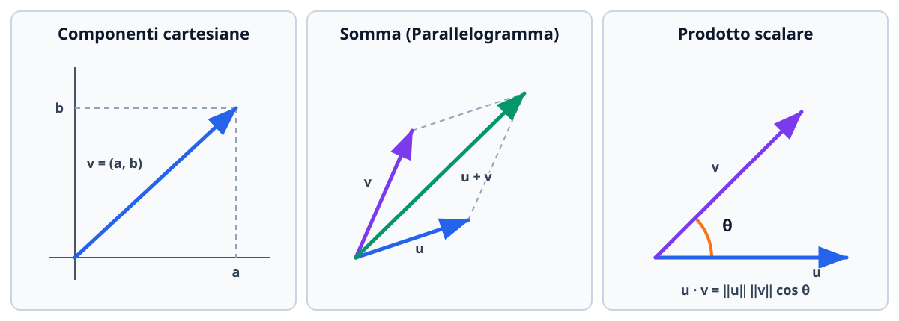

# Introduzione ai vettori

Un **vettore** raccoglie più componenti numeriche ordinate in un unico oggetto matematico. In fisica e in geometria descrive grandezze dotate di modulo, direzione e verso (spostamenti, velocità, forze); in informatica, analisi dati e intelligenza artificiale rappresenta un punto o una *feature* in uno spazio $n$-dimensionale $\mathbb{R}^n$. In questa lezione definiamo lo spazio vettoriale $\mathbb{R}^n$, le operazioni lineari, la norma euclidea, il prodotto scalare con la proiezione ortogonale e il prodotto vettoriale in $\mathbb{R}^3$.

## Vettori riga, vettori colonna e spazio $\mathbb{R}^n$

Un vettore reale a $n$ componenti è una $n$-upla ordinata di numeri reali ed è un elemento dello spazio $\mathbb{R}^n = \underbrace{\mathbb{R} \times \mathbb{R} \times \cdots \times \mathbb{R}}_{n \text{ volte}}$. Può essere scritto come **vettore riga**:
$$
\mathbf{v} = (v_1, v_2, \dots, v_n) \in \mathbb{R}^{1 \times n},
$$
oppure come **vettore colonna**:
$$
\mathbf{v} = \begin{pmatrix} v_1 \\ v_2 \\ \vdots \\ v_n \end{pmatrix} \in \mathbb{R}^{n \times 1}.
$$
I numeri reali $v_1, v_2, \dots, v_n$ si chiamano **componenti** (o coordinate) del vettore. L'operazione di **trasposizione** $(\cdot)^T$ trasforma un vettore riga in un vettore colonna e viceversa: $(v_1, \dots, v_n)^T = \begin{pmatrix} v_1 \\ \vdots \\ v_n \end{pmatrix}$.

- Due vettori $\mathbf{u}, \mathbf{v} \in \mathbb{R}^n$ sono **uguali** ($\mathbf{u} = \mathbf{v}$) se hanno la stessa dimensione $n$ e tutte le componenti corrispondenti uguali: $u_i = v_i$ per ogni $i = 1, \dots, n$.
- Il **vettore nullo** è $\mathbf{0} = (0, 0, \dots, 0)$, avente tutte le componenti uguali a zero.

## Operazioni lineari e combinazioni lineari

Siano $\mathbf{u} = (u_1, \dots, u_n)$ e $\mathbf{v} = (v_1, \dots, v_n)$ due vettori di $\mathbb{R}^n$ e sia $\lambda \in \mathbb{R}$ un numero reale (detto **scalare**).

### 1. Somma e differenza di vettori

La somma $\mathbf{u} + \mathbf{v}$ si esegue componente per componente (solo tra vettori della **stessa dimensione**):
$$
\mathbf{u} \pm \mathbf{v} = (u_1 \pm v_1,\, u_2 \pm v_2,\, \dots,\, u_n \pm v_n).
$$
La somma gode delle proprietà commutativa ($\mathbf{u} + \mathbf{v} = \mathbf{v} + \mathbf{u}$), associativa ($(\mathbf{u} + \mathbf{v}) + \mathbf{w} = \mathbf{u} + (\mathbf{v} + \mathbf{w})$), dell'elemento neutro $\mathbf{0}$ ($\mathbf{v} + \mathbf{0} = \mathbf{v}$) e del vettore opposto $-\mathbf{v} = (-v_1, \dots, -v_n)$.

### 2. Moltiplicazione di un vettore per uno scalare

Moltiplicando un vettore $\mathbf{v}$ per uno scalare $\lambda \in \mathbb{R}$, si moltiplica ciascuna componente per $\lambda$:
$$
\lambda \mathbf{v} = (\lambda v_1,\, \lambda v_2,\, \dots,\, \lambda v_n).
$$
Geometricamente, $\lambda \mathbf{v}$ è un vettore **parallelo** (o **collineare**) a $\mathbf{v}$:
- ha lunghezza dilatata o contratta di un fattore $|\lambda|$;
- conserva lo stesso verso di $\mathbf{v}$ se $\lambda > 0$, ha verso **opposto** se $\lambda < 0$, e si riduce al vettore nullo $\mathbf{0}$ se $\lambda = 0$.

Due vettori non nulli $\mathbf{u}$ e $\mathbf{v}$ sono **paralleli** ($\mathbf{u} \parallel \mathbf{v}$) se e solo se uno è multiplo scalare dell'altro, cioè se esiste $\lambda \neq 0$ tale che $\mathbf{u} = \lambda \mathbf{v}$ (componenti proporzionali).

### 3. Combinazioni lineari e versori canonici

Dati $k$ vettori $\mathbf{v}_1, \mathbf{v}_2, \dots, \mathbf{v}_k \in \mathbb{R}^n$ e $k$ scalari $\lambda_1, \lambda_2, \dots, \lambda_k \in \mathbb{R}$, il vettore
$$
\mathbf{w} = \lambda_1 \mathbf{v}_1 + \lambda_2 \mathbf{v}_2 + \cdots + \lambda_k \mathbf{v}_k = \sum_{i=1}^{k} \lambda_i \mathbf{v}_i
$$
si chiama **combinazione lineare** di $\mathbf{v}_1, \dots, \mathbf{v}_k$ con coefficienti (o pesi) $\lambda_1, \dots, \lambda_k$. L'insieme di tutte le possibili combinazioni lineari di $\mathbf{v}_1, \dots, \mathbf{v}_k$ si indica con $\operatorname{Span}(\mathbf{v}_1, \dots, \mathbf{v}_k)$ ed è il sottospazio vettoriale da essi generato.

In $\mathbb{R}^n$ i **versori della base canonica** sono gli $n$ vettori che hanno $1$ in una sola posizione e $0$ in tutte le altre:
$$
\mathbf{e}_1 = (1, 0, \dots, 0), \quad \mathbf{e}_2 = (0, 1, \dots, 0), \quad \dots, \quad \mathbf{e}_n = (0, 0, \dots, 1).
$$
In $\mathbb{R}^2$ e $\mathbb{R}^3$ si indicano spesso anche con $\mathbf{i} = (1, 0, 0)$, $\mathbf{j} = (0, 1, 0)$, $\mathbf{k} = (0, 0, 1)$. Ogni vettore $\mathbf{v} = (v_1, \dots, v_n) \in \mathbb{R}^n$ si scrive in modo unico come combinazione lineare dei versori canonici:
$$
\mathbf{v} = v_1 \mathbf{e}_1 + v_2 \mathbf{e}_2 + \cdots + v_n \mathbf{e}_n.
$$

Geometricamente nel piano e nello spazio, la somma $\mathbf{u} + \mathbf{v}$ si costruisce con la **regola del parallelogramma** (se i due vettori sono applicati nello stesso punto, $\mathbf{u} + \mathbf{v}$ è la diagonale principale del parallelogramma da essi individuato, mentre $\mathbf{u} - \mathbf{v}$ è l'altra diagonale che va dalla punta di $\mathbf{v}$ alla punta di $\mathbf{u}$) oppure con il **metodo punta-coda**.

## Norma euclidea (o modulo) e versori

La **norma euclidea** (o **modulo**, o lunghezza) di un vettore $\mathbf{v} = (v_1, v_2, \dots, v_n) \in \mathbb{R}^n$, motivata dal teorema di Pitagora, è il numero reale non negativo:
$$
\|\mathbf{v}\| = \sqrt{v_1^2 + v_2^2 + \cdots + v_n^2} = \sqrt{\sum_{i=1}^{n} v_i^2}.
$$
La distanza euclidea tra due punti (o vettori) $\mathbf{u}, \mathbf{v} \in \mathbb{R}^n$ è la norma della loro differenza: $d(\mathbf{u}, \mathbf{v}) = \|\mathbf{u} - \mathbf{v}\|$.

### Proprietà fondamentali della norma

Per ogni $\mathbf{u}, \mathbf{v} \in \mathbb{R}^n$ e $\lambda \in \mathbb{R}$:
1. **Positività:** $\|\mathbf{v}\| \geq 0$, e vale $\|\mathbf{v}\| = 0 \iff \mathbf{v} = \mathbf{0}$.
2. **Omogeneità positiva:** $\|\lambda \mathbf{v}\| = |\lambda|\,\|\mathbf{v}\|$ (attenzione al valore assoluto $|\lambda|$!).
3. **Disuguaglianza triangolare:** $\|\mathbf{u} + \mathbf{v}\| \leq \|\mathbf{u}\| + \|\mathbf{v}\|$ (in ogni triangolo un lato è minore o uguale della somma degli altri due; vale l'uguaglianza se e solo se $\mathbf{u}$ e $\mathbf{v}$ sono paralleli e concordi).

### Versori e normalizzazione

Un vettore $\mathbf{u}$ di lunghezza unitaria ($\|\mathbf{u}\| = 1$) si chiama **versore**. Dato qualsiasi vettore non nullo $\mathbf{v} \neq \mathbf{0}$, il procedimento di **normalizzazione** consiste nel dividere $\mathbf{v}$ per la sua norma, ottenendo l'unico versore $\hat{\mathbf{v}}$ con la stessa direzione e lo stesso verso di $\mathbf{v}$:
$$
\hat{\mathbf{v}} = \frac{\mathbf{v}}{\|\mathbf{v}\|}, \qquad \text{con } \|\hat{\mathbf{v}}\| = \frac{\|\mathbf{v}\|}{\|\mathbf{v}\|} = 1.
$$

## Prodotto scalare, angolo e proiezione ortogonale

### Definizione algebrica e geometrica del prodotto scalare

Dati due vettori $\mathbf{u} = (u_1, \dots, u_n)$ e $\mathbf{v} = (v_1, \dots, v_n)$ di $\mathbb{R}^n$, il loro **prodotto scalare** (o prodotto interno standard, indicato con $\mathbf{u} \cdot \mathbf{v}$ oppure $\langle \mathbf{u}, \mathbf{v} \rangle$) è il **numero reale** ottenuto sommando i prodotti delle componenti omonime:
$$
\mathbf{u} \cdot \mathbf{v} = u_1 v_1 + u_2 v_2 + \cdots + u_n v_n = \sum_{i=1}^{n} u_i v_i \in \mathbb{R}.
$$
In notazione matriciale per vettori colonna, $\mathbf{u} \cdot \mathbf{v} = \mathbf{u}^T \mathbf{v}$.

#### Proprietà del prodotto scalare
- **Simmetria (commutatività):** $\mathbf{u} \cdot \mathbf{v} = \mathbf{v} \cdot \mathbf{u}$.
- **Bilinearità (distributività e omogeneità):** $\mathbf{u} \cdot (\alpha \mathbf{v} + \beta \mathbf{w}) = \alpha(\mathbf{u} \cdot \mathbf{v}) + \beta(\mathbf{u} \cdot \mathbf{w})$.
- **Legame con la norma:** $\mathbf{v} \cdot \mathbf{v} = v_1^2 + \cdots + v_n^2 = \|\mathbf{v}\|^2 \implies \|\mathbf{v}\| = \sqrt{\mathbf{v} \cdot \mathbf{v}}$.
- **Sviluppo del quadrato della norma di una somma (Teorema di Carnot vettoriale):**
$$
\|\mathbf{u} \pm \mathbf{v}\|^2 = (\mathbf{u} \pm \mathbf{v}) \cdot (\mathbf{u} \pm \mathbf{v}) = \|\mathbf{u}\|^2 \pm 2(\mathbf{u} \cdot \mathbf{v}) + \|\mathbf{v}\|^2.
$$

### Disuguaglianza di Cauchy-Schwarz e angolo tra due vettori

> [!note] Teorema (Disuguaglianza di Cauchy-Schwarz)
> Per ogni coppia di vettori $\mathbf{u}, \mathbf{v} \in \mathbb{R}^n$ vale:
> $$|\mathbf{u} \cdot \mathbf{v}| \leq \|\mathbf{u}\|\,\|\mathbf{v}\|,$$
> e l'uguaglianza vale se e solo se $\mathbf{u}$ e $\mathbf{v}$ sono linearmente dipendenti (paralleli).

*Dimostrazione rapida della disuguaglianza triangolare da Cauchy-Schwarz:*
$$\|\mathbf{u} + \mathbf{v}\|^2 = \|\mathbf{u}\|^2 + 2(\mathbf{u} \cdot \mathbf{v}) + \|\mathbf{v}\|^2 \leq \|\mathbf{u}\|^2 + 2\|\mathbf{u}\|\|\mathbf{v}\| + \|\mathbf{v}\|^2 = (\|\mathbf{u}\| + \|\mathbf{v}\|)^2.$$

Poiché per vettori non nulli $\mathbf{u}, \mathbf{v} \neq \mathbf{0}$ il rapporto $\frac{\mathbf{u} \cdot \mathbf{v}}{\|\mathbf{u}\|\,\|\mathbf{v}\|}$ è sempre compreso nell'intervallo $[-1, 1]$, esiste un unico **angolo convesso** $\theta \in [0, \pi]$ formato dai due vettori tale che:
$$
\mathbf{u} \cdot \mathbf{v} = \|\mathbf{u}\|\,\|\mathbf{v}\|\cos\theta \iff \cos\theta = \frac{\mathbf{u} \cdot \mathbf{v}}{\|\mathbf{u}\|\,\|\mathbf{v}\|}.
$$
Dal segno del prodotto scalare leggiamo immediatamente il tipo di angolo:
- $\mathbf{u} \cdot \mathbf{v} > 0 \iff \cos\theta > 0 \iff \theta \in [0, \frac{\pi}{2})$ (**angolo acuto**);
- $\mathbf{u} \cdot \mathbf{v} = 0 \iff \cos\theta = 0 \iff \theta = \frac{\pi}{2}$ (**vettori ortogonali / perpendicolari**, $\mathbf{u} \perp \mathbf{v}$);
- $\mathbf{u} \cdot \mathbf{v} < 0 \iff \cos\theta < 0 \iff \theta \in (\frac{\pi}{2}, \pi]$ (**angolo ottuso**).

### Proiezione ortogonale di un vettore lungo un altro

Siano $\mathbf{u}, \mathbf{v} \in \mathbb{R}^n$ con $\mathbf{v} \neq \mathbf{0}$. Vogliamo scomporre $\mathbf{u}$ nella somma $\mathbf{u} = \mathbf{u}_{\parallel} + \mathbf{u}_{\perp}$ di un vettore $\mathbf{u}_{\parallel}$ parallelo a $\mathbf{v}$ e di un vettore $\mathbf{u}_{\perp}$ ortogonale a $\mathbf{v}$.
Il vettore $\mathbf{u}_{\parallel}$ si chiama **proiezione ortogonale** di $\mathbf{u}$ lungo la direzione di $\mathbf{v}$ e si indica con $\operatorname{proj}_{\mathbf{v}}(\mathbf{u})$:
- La **componente scalare con segno** di $\mathbf{u}$ lungo il versore $\hat{\mathbf{v}} = \frac{\mathbf{v}}{\|\mathbf{v}\|}$ è:
$$
u_v = \|\mathbf{u}\|\cos\theta = \mathbf{u} \cdot \hat{\mathbf{v}} = \frac{\mathbf{u} \cdot \mathbf{v}}{\|\mathbf{v}\|}.
$$
- Moltiplicando tale componente scalare per il versore direzione $\hat{\mathbf{v}} = \frac{\mathbf{v}}{\|\mathbf{v}\|}$ otteniamo il **vettore proiezione ortogonale**:
$$
\operatorname{proj}_{\mathbf{v}}(\mathbf{u}) = (u_v)\,\hat{\mathbf{v}} = \left(\frac{\mathbf{u} \cdot \mathbf{v}}{\|\mathbf{v}\|^2}\right)\mathbf{v} = \left(\frac{\mathbf{u} \cdot \mathbf{v}}{\mathbf{v} \cdot \mathbf{v}}\right)\mathbf{v}.
$$
Il componente residuo $\mathbf{u}_{\perp} = \mathbf{u} - \operatorname{proj}_{\mathbf{v}}(\mathbf{u})$ è sempre ortogonale a $\mathbf{v}$ (infatti $\mathbf{u}_{\perp} \cdot \mathbf{v} = \mathbf{u}\cdot\mathbf{v} - \frac{\mathbf{u}\cdot\mathbf{v}}{\|\mathbf{v}\|^2}(\mathbf{v}\cdot\mathbf{v}) = 0$).

## Il prodotto vettoriale e il prodotto misto in $\mathbb{R}^3$

Nello spazio tridimensionale $\mathbb{R}^3$ (e **solo** in $\mathbb{R}^3$) è definita un'ulteriore operazione tra due vettori che restituisce come risultato **un nuovo vettore ortogonale a entrambi**.

### Definizione e calcolo del prodotto vettoriale $\mathbf{u} \times \mathbf{v}$

Dati $\mathbf{u} = (u_1, u_2, u_3)$ e $\mathbf{v} = (v_1, v_2, v_3)$ in $\mathbb{R}^3$, il loro **prodotto vettoriale** (o prodotto esterno, indicato con $\mathbf{u} \times \mathbf{v}$ oppure $\mathbf{u} \wedge \mathbf{v}$) è il vettore di $\mathbb{R}^3$ definito tramite lo sviluppo lungo la prima riga del seguente determinante formale $3 \times 3$:
$$
\begin{aligned}
\mathbf{u} \times \mathbf{v} &= \det\begin{pmatrix}
\mathbf{i} & \mathbf{j} & \mathbf{k} \\
u_1 & u_2 & u_3 \\
v_1 & v_2 & v_3
\end{pmatrix} \\
&= (u_2 v_3 - u_3 v_2)\mathbf{i} - (u_1 v_3 - u_3 v_1)\mathbf{j} + (u_1 v_2 - u_2 v_1)\mathbf{k} \\
&= (u_2 v_3 - u_3 v_2,\; u_3 v_1 - u_1 v_3,\; u_1 v_2 - u_2 v_1).
\end{aligned}
$$

### Caratteristiche geometriche e proprietà algebriche di $\mathbf{u} \times \mathbf{v}$

1. **Direzione:** il vettore $\mathbf{u} \times \mathbf{v}$ è **simultaneamente ortogonale sia a $\mathbf{u}$ sia a $\mathbf{v}$** ($(\mathbf{u} \times \mathbf{v}) \cdot \mathbf{u} = 0$ e $(\mathbf{u} \times \mathbf{v}) \cdot \mathbf{v} = 0$), quindi è normale al piano generato da $\mathbf{u}$ e $\mathbf{v}$.
2. **Verso:** è stabilito dalla **regola della mano destra** (indice lungo $\mathbf{u}$, medio lungo $\mathbf{v}$, il pollice indica il verso di $\mathbf{u} \times \mathbf{v}$).
3. **Modulo e interpretazione geometrica (Area del parallelogramma):** se $\theta \in [0, \pi]$ è l'angolo tra $\mathbf{u}$ e $\mathbf{v}$, la norma di $\mathbf{u} \times \mathbf{v}$ vale:
$$
\|\mathbf{u} \times \mathbf{v}\| = \|\mathbf{u}\|\,\|\mathbf{v}\|\sin\theta = \text{Area}(\text{parallelogramma generato da }\mathbf{u}\text{ e }\mathbf{v}).
$$
Di conseguenza, l'area del triangolo di lati $\mathbf{u}$ e $\mathbf{v}$ è $\mathcal{A}_{\triangle} = \frac{1}{2}\|\mathbf{u} \times \mathbf{v}\|$, e vale il test di parallelismo:
$$
\mathbf{u} \times \mathbf{v} = \mathbf{0} \iff \mathbf{u} \parallel \mathbf{v} \quad (\text{in particolare } \mathbf{u} \times \mathbf{u} = \mathbf{0}).
$$
4. **Anticommutatività:** scambiando i due fattori il prodotto vettoriale **cambia segno** (inverte il verso):
$$
\mathbf{v} \times \mathbf{u} = -(\mathbf{u} \times \mathbf{v}).
$$
5. **Non associatività:** in generale $(\mathbf{u} \times \mathbf{v}) \times \mathbf{w} \neq \mathbf{u} \times (\mathbf{v} \times \mathbf{w})$. Per i versori canonici valgono le relazioni cicliche $\mathbf{i} \times \mathbf{j} = \mathbf{k}$, $\mathbf{j} \times \mathbf{k} = \mathbf{i}$, $\mathbf{k} \times \mathbf{i} = \mathbf{j}$.

### Prodotto misto e volume del parallelepipedo

Dati tre vettori $\mathbf{u}, \mathbf{v}, \mathbf{w} \in \mathbb{R}^3$, il numero reale $\mathbf{u} \cdot (\mathbf{v} \times \mathbf{w})$ si chiama **prodotto misto** e coincide con il determinante $3 \times 3$ avente per righe i tre vettori. Il suo valore assoluto $|\mathbf{u} \cdot (\mathbf{v} \times \mathbf{w})|$ misura il **volume del parallelepipedo** individuato da $\mathbf{u}, \mathbf{v}, \mathbf{w}$; pertanto tre vettori in $\mathbb{R}^3$ sono **complanari** (linearmente dipendenti) se e solo se il loro prodotto misto è nullo: $\mathbf{u} \cdot (\mathbf{v} \times \mathbf{w}) = 0$.

## Esempi guidati

### Esempio 1: Norma, angolo e proiezione ortogonale nel piano

Siano dati in $\mathbb{R}^2$ i vettori $\mathbf{u} = (2, -1)$ e $\mathbf{v} = (1, 3)$. Calcoliamo $\|\mathbf{u}\|$, $\|\mathbf{v}\|$, l'angolo $\theta$ tra essi e la decomposizione $\mathbf{u} = \mathbf{u}_{\parallel} + \mathbf{u}_{\perp}$ rispetto a $\mathbf{v}$.

**Passaggi:**
1. **Norme e prodotto scalare:**
   $$\|\mathbf{u}\| = \sqrt{2^2 + (-1)^2} = \sqrt{5}, \qquad \|\mathbf{v}\| = \sqrt{1^2 + 3^2} = \sqrt{10},$$
   $$\mathbf{u} \cdot \mathbf{v} = 2(1) + (-1)(3) = 2 - 3 = -1.$$
2. **Angolo $\theta$:**
   $$\cos\theta = \frac{\mathbf{u} \cdot \mathbf{v}}{\|\mathbf{u}\|\,\|\mathbf{v}\|} = \frac{-1}{\sqrt{5}\sqrt{10}} = -\frac{1}{5\sqrt{2}} = -\frac{\sqrt{2}}{10} < 0.$$
   Poiché il coseno è negativo, l'angolo $\theta = \arccos\left(-\frac{\sqrt{2}}{10}\right) \approx 98.13^\circ$ è **ottuso**.
3. **Proiezione ortogonale $\mathbf{u}_{\parallel} = \operatorname{proj}_{\mathbf{v}}(\mathbf{u})$ e componente ortogonale $\mathbf{u}_{\perp}$:**
   $$\mathbf{u}_{\parallel} = \operatorname{proj}_{\mathbf{v}}(\mathbf{u}) = \frac{\mathbf{u} \cdot \mathbf{v}}{\|\mathbf{v}\|^2}\mathbf{v} = \frac{-1}{10}(1, 3) = \left(-\frac{1}{10},\, -\frac{3}{10}\right).$$
   $$\mathbf{u}_{\perp} = \mathbf{u} - \mathbf{u}_{\parallel} = (2, -1) - \left(-\frac{1}{10},\, -\frac{3}{10}\right) = \left(\frac{21}{10},\, -\frac{7}{10}\right).$$
   *Verifica:* $\mathbf{u}_{\perp} \cdot \mathbf{v} = \frac{21}{10}(1) + \left(-\frac{7}{10}\right)(3) = \frac{21 - 21}{10} = 0$, quindi $\mathbf{u}_{\perp} \perp \mathbf{v}$.

### Esempio 2: Prodotto vettoriale e area di un triangolo in $\mathbb{R}^3$

Dati in $\mathbb{R}^3$ i punti $A(1, 0, 2)$, $B(2, -1, 3)$ e $C(0, 2, 1)$, determiniamo un vettore ortogonale al piano che li contiene e calcoliamo l'area del triangolo $ABC$.

**Passaggi:**
1. Costruiamo i due vettori lati uscenti dal vertice $A$:
   $$\mathbf{u} = \overrightarrow{AB} = B - A = (2 - 1,\ -1 - 0,\ 3 - 2) = (1, -1, 1),$$
   $$\mathbf{v} = \overrightarrow{AC} = C - A = (0 - 1,\ 2 - 0,\ 1 - 2) = (-1, 2, -1).$$
2. Calcoliamo il prodotto vettoriale $\mathbf{n} = \mathbf{u} \times \mathbf{v}$:
   $$\mathbf{n} = \det\begin{pmatrix}
   \mathbf{i} & \mathbf{j} & \mathbf{k} \\
   1 & -1 & 1 \\
   -1 & 2 & -1
   \end{pmatrix} = \bigl((-1)(-1) - (1)(2)\bigr)\mathbf{i} - \bigl((1)(-1) - (1)(-1)\bigr)\mathbf{j} + \bigl((1)(2) - (-1)(-1)\bigr)\mathbf{k} = (-1, 0, 1).$$
   *Verifica di ortogonalità:* $(-1, 0, 1) \cdot (1, -1, 1) = -1 + 0 + 1 = 0$ e $(-1, 0, 1) \cdot (-1, 2, -1) = 1 + 0 - 1 = 0$.
3. L'area del triangolo $ABC$ è la metà della norma del prodotto vettoriale:
   $$\mathcal{A}_{\triangle}(ABC) = \frac{1}{2}\|\mathbf{u} \times \mathbf{v}\| = \frac{1}{2}\sqrt{(-1)^2 + 0^2 + 1^2} = \frac{\sqrt{2}}{2}.$$

## Errori frequenti

- **Confondere la natura del risultato nei tre tipi di prodotto:**
  - *scalare per vettore* $\lambda \mathbf{v} \to$ restituisce un **vettore** parallelo a $\mathbf{v}$;
  - *prodotto scalare* $\mathbf{u} \cdot \mathbf{v} \to$ restituisce un **numero reale** (uno scalare!), mai un vettore $(u_1 v_1, \dots, u_n v_n)$;
  - *prodotto vettoriale* $\mathbf{u} \times \mathbf{v}$ (solo in $\mathbb{R}^3$) $\to$ restituisce un **vettore** ortogonale a $\mathbf{u}$ e $\mathbf{v}$.
- **Sbagliare il segno della seconda componente nel prodotto vettoriale:** nello sviluppo lungo la prima riga del determinante $3 \times 3$, il cofattore di $\mathbf{j}$ ha davanti il segno **meno** ($-(u_1 v_3 - u_3 v_1) = u_3 v_1 - u_1 v_3$). Controlla sempre alla fine che $(\mathbf{u} \times \mathbf{v}) \cdot \mathbf{u} = 0$!
- **Confondere la formula di $\operatorname{proj}_{\mathbf{v}}(\mathbf{u})$ con quella di $\operatorname{proj}_{\mathbf{u}}(\mathbf{v})$:** al denominatore compare sempre il quadrato della norma del vettore **su cui si proietta** ($\|\mathbf{v}\|^2$ se si proietta lungo $\mathbf{v}$).
- **Credere che da $\mathbf{u} \cdot \mathbf{v} = 0$ segua $\mathbf{u} = \mathbf{0}$ o $\mathbf{v} = \mathbf{0}$:** per i vettori non vale la legge di annullamento del prodotto scalare! Due vettori non nulli hanno prodotto scalare nullo ogni volta che sono perpendicolari.

## Esercizi di prova

1. (**Base - Operazioni, norma e versore**) Dati i vettori di $\mathbb{R}^3$ $\mathbf{u} = (2, -1, 2)$ e $\mathbf{v} = (-1, 4, 0)$, calcola: (a) $3\mathbf{u} - 2\mathbf{v}$; (b) la norma $\|\mathbf{u}\|$ e il versore $\hat{\mathbf{u}}$ concorde con $\mathbf{u}$; (c) la distanza $d(\mathbf{u}, \mathbf{v})$.
> [!tip]- Soluzione
> - (a) $3\mathbf{u} - 2\mathbf{v} = (6, -3, 6) - (-2, 8, 0) = (8, -11, 6)$.
> - (b) $\|\mathbf{u}\| = \sqrt{2^2 + (-1)^2 + 2^2} = \sqrt{4 + 1 + 4} = \sqrt{9} = 3$. Il versore è $\hat{\mathbf{u}} = \frac{\mathbf{u}}{\|\mathbf{u}\|} = \left(\frac{2}{3}, -\frac{1}{3}, \frac{2}{3}\right)$.
> - (c) $\mathbf{u} - \mathbf{v} = (3, -5, 2)$, quindi $d(\mathbf{u}, \mathbf{v}) = \|\mathbf{u} - \mathbf{v}\| = \sqrt{3^2 + (-5)^2 + 2^2} = \sqrt{9 + 25 + 4} = \sqrt{38}$.

2. (**Base - Condizione di ortogonalità e parallelismo con parametro**) Siano dati in $\mathbb{R}^3$ i vettori $\mathbf{u}_k = (k,\ 2,\ k - 1)$ e $\mathbf{v}_k = (3,\ -k,\ 2)$ al variare del parametro reale $k \in \mathbb{R}$.
   (a) Determina per quali valori di $k$ i due vettori sono ortogonali.
   (b) Esistono valori di $k$ per cui $\mathbf{u}_k$ e $\mathbf{v}_k$ sono paralleli?
> [!tip]- Soluzione
> - (a) **Ortogonalità:** imponiamo $\mathbf{u}_k \cdot \mathbf{v}_k = 0$:
>   $$3k + 2(-k) + 2(k - 1) = 0 \iff 3k - 2k + 2k - 2 = 0 \iff 3k - 2 = 0 \iff k = \frac{2}{3}.$$
> - (b) **Parallelismo:** affinché $\mathbf{u}_k = \lambda \mathbf{v}_k$ per uno scalare $\lambda$, confrontando la terza componente ($k - 1 = 2\lambda \implies \lambda = \frac{k-1}{2}$) e la prima ($k = 3\lambda$) deve valere:
>   $$k = \frac{3(k - 1)}{2} \implies 2k = 3k - 3 \implies k = 3.$$
>   Ma sostituendo $k = 3$ otteniamo $\mathbf{u}_3 = (3, 2, 2)$ e $\mathbf{v}_3 = (3, -3, 2)$, che non sono proporzionali sulla seconda componente ($2 \neq -3$). Quindi **non esiste alcun $k \in \mathbb{R}$** per cui i due vettori siano paralleli.

3. (**Intermedio - Proiezione ortogonale e angolo**) Dati $\mathbf{u} = (3, 1, -2)$ e $\mathbf{v} = (1, 2, 2)$ in $\mathbb{R}^3$, calcola l'angolo $\theta$ formato da $\mathbf{u}$ e $\mathbf{v}$, la proiezione ortogonale $\operatorname{proj}_{\mathbf{v}}(\mathbf{u})$ e la distanza della punta di $\mathbf{u}$ dalla retta generata da $\mathbf{v}$.
> [!tip]- Soluzione
> Calcoliamo norme e prodotto scalare:
> $$\|\mathbf{u}\| = \sqrt{9 + 1 + 4} = \sqrt{14}, \qquad \|\mathbf{v}\| = \sqrt{1 + 4 + 4} = 3, \qquad \mathbf{u} \cdot \mathbf{v} = 3(1) + 1(2) + (-2)(2) = 1.$$
> - **Angolo:** $\cos\theta = \frac{1}{3\sqrt{14}} > 0 \implies \theta = \arccos\left(\frac{1}{3\sqrt{14}}\right)$ (angolo acuto).
> - **Proiezione ortogonale:**
>   $$\operatorname{proj}_{\mathbf{v}}(\mathbf{u}) = \frac{\mathbf{u} \cdot \mathbf{v}}{\|\mathbf{v}\|^2}\mathbf{v} = \frac{1}{9}(1, 2, 2) = \left(\frac{1}{9}, \frac{2}{9}, \frac{2}{9}\right).$$
> - **Distanza dalla retta di $\mathbf{v}$:** è la norma del componente ortogonale $\mathbf{u}_{\perp} = \mathbf{u} - \operatorname{proj}_{\mathbf{v}}(\mathbf{u}) = \left(\frac{26}{9}, \frac{7}{9}, -\frac{20}{9}\right)$ (oppure per Pitagora $\sqrt{\|\mathbf{u}\|^2 - \|\operatorname{proj}_{\mathbf{v}}(\mathbf{u})\|^2}$):
>   $$\|\mathbf{u}_{\perp}\| = \sqrt{14 - \left(\frac{1}{3}\right)^2} = \sqrt{14 - \frac{1}{9}} = \frac{\sqrt{125}}{3} = \frac{5\sqrt{5}}{3}.$$

4. (**Intermedio - Identità metriche con norma e prodotto scalare**) Siano $\mathbf{u}, \mathbf{v} \in \mathbb{R}^n$ due vettori tali che $\|\mathbf{u}\| = 3$, $\|\mathbf{v}\| = 4$ e l'angolo tra essi sia $\theta = \frac{\pi}{3}$. Calcola $\mathbf{u} \cdot \mathbf{v}$, $\|2\mathbf{u} - \mathbf{v}\|$ e $( \mathbf{u} + \mathbf{v}) \cdot (\mathbf{u} - 2\mathbf{v})$.
> [!tip]- Soluzione
> - **Prodotto scalare:**
>   $$\mathbf{u} \cdot \mathbf{v} = \|\mathbf{u}\|\,\|\mathbf{v}\|\cos\frac{\pi}{3} = 3 \cdot 4 \cdot \frac{1}{2} = 6.$$
> - **Norma $\|2\mathbf{u} - \mathbf{v}\|$:** sviluppiamo il quadrato della norma tramite il prodotto scalare:
>   $$\|2\mathbf{u} - \mathbf{v}\|^2 = (2\mathbf{u} - \mathbf{v}) \cdot (2\mathbf{u} - \mathbf{v}) = 4\|\mathbf{u}\|^2 - 4(\mathbf{u} \cdot \mathbf{v}) + \|\mathbf{v}\|^2 = 4(9) - 4(6) + 16 = 36 - 24 + 16 = 28,$$
>   da cui $\|2\mathbf{u} - \mathbf{v}\| = \sqrt{28} = 2\sqrt{7}$.
> - **Espressione bilineare:**
>   $$(\mathbf{u} + \mathbf{v}) \cdot (\mathbf{u} - 2\mathbf{v}) = \|\mathbf{u}\|^2 - 2(\mathbf{u} \cdot \mathbf{v}) + (\mathbf{v} \cdot \mathbf{u}) - 2\|\mathbf{v}\|^2 = 9 - 6 - 2(16) = -29.$$

5. (**Intermedio - Prodotto vettoriale e versori ortogonali**) Determina tutti i versori di $\mathbb{R}^3$ che sono simultaneamente ortogonali sia a $\mathbf{u} = (1, 2, -1)$ sia a $\mathbf{v} = (2, 1, 1)$, e calcola l'area del parallelogramma generato da $\mathbf{u}$ e $\mathbf{v}$.
> [!tip]- Soluzione
> Ogni vettore ortogonale sia a $\mathbf{u}$ sia a $\mathbf{v}$ è parallelo al loro prodotto vettoriale $\mathbf{w} = \mathbf{u} \times \mathbf{v}$:
> $$\mathbf{w} = \mathbf{u} \times \mathbf{v} = \det\begin{pmatrix}
> \mathbf{i} & \mathbf{j} & \mathbf{k} \\
> 1 & 2 & -1 \\
> 2 & 1 & 1
> \end{pmatrix} = (2 - (-1))\mathbf{i} - (1 - (-2))\mathbf{j} + (1 - 4)\mathbf{k} = (3, -3, -3).$$
> La norma di $\mathbf{w}$ (che coincide con l'**area del parallelogramma** generato da $\mathbf{u}$ e $\mathbf{v}$) è:
> $$\text{Area} = \|\mathbf{u} \times \mathbf{v}\| = \sqrt{3^2 + (-3)^2 + (-3)^2} = \sqrt{27} = 3\sqrt{3}.$$
> Normalizzando $\mathbf{w}$ (e considerando entrambi i versi $\pm$) otteniamo i due versori richiesti:
> $$\hat{\mathbf{n}}_{1,2} = \pm \frac{\mathbf{w}}{\|\mathbf{w}\|} = \pm \left(\frac{1}{\sqrt{3}},\, -\frac{1}{\sqrt{3}},\, -\frac{1}{\sqrt{3}}\right).$$

6. (**Esame - Complanarità e volume tramite prodotto misto**) Dati i tre vettori $\mathbf{u} = (1, 1, 0)$, $\mathbf{v} = (0, 2, 1)$ e $\mathbf{w}_k = (2, k, -1)$ in $\mathbb{R}^3$:
   (a) Calcola il volume del parallelepipedo generato da $\mathbf{u}, \mathbf{v}, \mathbf{w}_k$ per $k = 0$.
   (b) Determina per quale valore di $k \in \mathbb{R}$ i tre vettori sono complanari (linearmente dipendenti) ed esprimi in tal caso $\mathbf{w}_k$ come combinazione lineare di $\mathbf{u}$ e $\mathbf{v}$.
> [!tip]- Soluzione
> Calcoliamo prima $\mathbf{u} \times \mathbf{v}$:
> $$\mathbf{u} \times \mathbf{v} = \det\begin{pmatrix}
> \mathbf{i} & \mathbf{j} & \mathbf{k} \\
> 1 & 1 & 0 \\
> 0 & 2 & 1
> \end{pmatrix} = (1, -1, 2).$$
> Il prodotto misto vale allora:
> $$(\mathbf{u} \times \mathbf{v}) \cdot \mathbf{w}_k = (1, -1, 2) \cdot (2, k, -1) = 2 - k - 2 = -k.$$
> - (a) Per $k = 0$ il prodotto misto è $0$, quindi il volume è $V = |0| = 0$! (Se fosse ad esempio $k = 3$, il volume sarebbe $|-3| = 3$).
> - (b) I tre vettori sono complanari se e solo se il prodotto misto è nullo: $-k = 0 \iff k = 0$.
>   Per $k = 0$, $\mathbf{w}_0 = (2, 0, -1)$. Cerchiamo $\alpha, \beta \in \mathbb{R}$ tali che $\alpha(1, 1, 0) + \beta(0, 2, 1) = (2, 0, -1)$:
>   dalla prima componente $\alpha = 2$, dalla terza $\beta = -1$ (che verifica anche la seconda: $2(1) + (-1)(2) = 0$). Quindi $\mathbf{w}_0 = 2\mathbf{u} - \mathbf{v}$.

## Provenienza del materiale

Sintesi ragionata ed estesa della lezione `C1MAT1U3L1_Introduzione_ai_vettorI.pdf` e degli `Appunti_di_Fine_Unità_3.pdf` (Corso di Matematica 1, CdL in Sicurezza Informatica / SecAI - Università degli Studi di Milano), con approfondimenti su disuguaglianza di Cauchy-Schwarz, proiezione ortogonale, prodotto vettoriale e prodotto misto.
