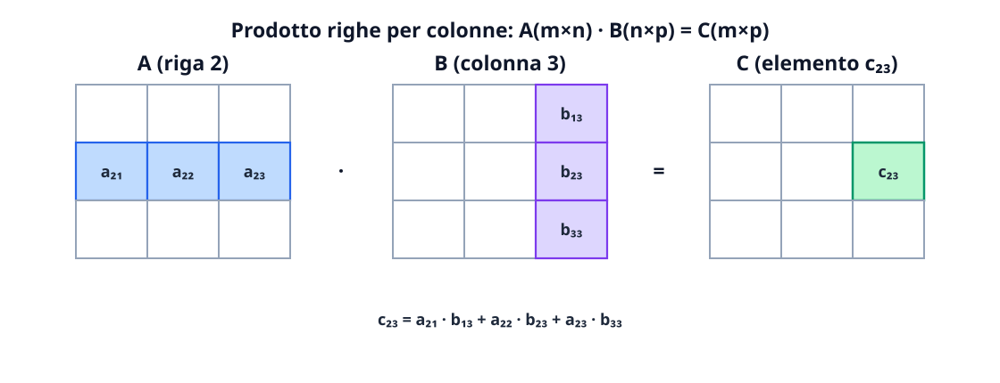

# Le matrici

Una **matrice** è una tabella rettangolare ordinata di numeri disposti in righe e colonne. Oltre a organizzare dati numerici, grafi e immagini digitali, le matrici costituiscono il linguaggio algebrico universale per rappresentare le applicazioni lineari tra spazi vettoriali e per risolvere i sistemi di equazioni lineari. In questa lezione studiamo l'algebra delle matrici, le classi di matrici quadrate particolari, il calcolo del determinante ( fino a $n \times n$ con Sarrus e Laplace), il concetto fondamentale di **rango** e i metodi per il calcolo della matrice inversa.

## Definizione, notazione e matrici particolari

Una **matrice reale** di tipo $m \times n$ (si legge «$m$ per $n$») è una tabella con $m$ **righe** orizzontali e $n$ **colonne** verticali:
$$
A = (a_{ij}) \in \mathbb{R}^{m \times n}, \qquad
A = \begin{pmatrix}
a_{11} & a_{12} & \cdots & a_{1n} \\
a_{21} & a_{22} & \cdots & a_{2n} \\
\vdots & \vdots & \ddots & \vdots \\
a_{m1} & a_{m2} & \cdots & a_{mn}
\end{pmatrix}.
$$
Nel doppio indice dell'elemento $a_{ij}$, **il primo indice $i \in \{1, \dots, m\}$ indica sempre la riga** e **il secondo indice $j \in \{1, \dots, n\}$ indica sempre la colonna**.
- Se $m = 1$, $A \in \mathbb{R}^{1 \times n}$ è un **vettore riga**; se $n = 1$, $A \in \mathbb{R}^{m \times 1}$ è un **vettore colonna**.
- Due matrici $A, B$ sono uguali ($A = B$) se hanno le stesse dimensioni $m \times n$ e $a_{ij} = b_{ij}$ per ogni coppia $(i, j)$.
- La **matrice nulla** $O_{m \times n}$ ha tutti gli elementi uguali a $0$.

### Matrici quadrate e classi notevoli

Se il numero di righe coincide con il numero di colonne ($m = n$), la matrice si dice **quadrata di ordine $n$** ($A \in \mathbb{R}^{n \times n}$). Gli elementi con indici uguali $a_{11}, a_{22}, \dots, a_{nn}$ formano la **diagonale principale**, e la loro somma si chiama **traccia** della matrice ($\operatorname{tr}(A) = \sum_{i=1}^n a_{ii}$).

All'interno delle matrici quadrate $n \times n$ distinguiamo le seguenti famiglie fondamentali:

| Tipo di matrice quadrata | Condizione formale sugli elementi | Esempio ($3 \times 3$) |
| --- | --- | --- |
| **Diagonale** | $a_{ij} = 0$ per ogni $i \neq j$ (elementi non nulli solo sulla diagonale principale) | $\begin{pmatrix} 2 & 0 & 0 \\ 0 & -5 & 0 \\ 0 & 0 & 1 \end{pmatrix}$ |
| **Identità** $I_n$ | Matrice diagonale con $a_{ii} = 1$ per ogni $i$ e $a_{ij} = 0$ per $i \neq j$ | $I_3 = \begin{pmatrix} 1 & 0 & 0 \\ 0 & 1 & 0 \\ 0 & 0 & 1 \end{pmatrix}$ |
| **Triangolare superiore** | $a_{ij} = 0$ per ogni $i > j$ (tutti zeri **sotto** la diagonale principale) | $\begin{pmatrix} 1 & 4 & -2 \\ 0 & 3 & 5 \\ 0 & 0 & -1 \end{pmatrix}$ |
| **Triangolare inferiore** | $a_{ij} = 0$ per ogni $i < j$ (tutti zeri **sopra** la diagonale principale) | $\begin{pmatrix} 2 & 0 & 0 \\ -1 & 3 & 0 \\ 4 & 2 & 5 \end{pmatrix}$ |

## Operazioni algebriche e trasposizione

### Somma e prodotto per uno scalare

Date $A, B \in \mathbb{R}^{m \times n}$ della **stessa dimensione** e $\lambda \in \mathbb{R}$:
$$
(A \pm B)_{ij} = a_{ij} \pm b_{ij}, \qquad (\lambda A)_{ij} = \lambda a_{ij}.
$$

### Trasposta di una matrice: matrici simmetriche, antisimmetriche e ortogonali

Data $A = (a_{ij}) \in \mathbb{R}^{m \times n}$, la **matrice trasposta** $A^T \in \mathbb{R}^{n \times m}$ si ottiene scambiando ordinatamente le righe con le colonne:
$$
(A^T)_{ij} = a_{ji} \qquad \forall i = 1, \dots, n,\ \forall j = 1, \dots, m.
$$
Valgono le proprietà: $(A^T)^T = A$, $(A + B)^T = A^T + B^T$, $(\lambda A)^T = \lambda A^T$ e **$(AB)^T = B^T A^T$** (il trasposto di un prodotto è il prodotto dei trasposti in **ordine inverso**).

Per una matrice **quadrata** $A \in \mathbb{R}^{n \times n}$:
- $A$ si dice **simmetrica** se $A^T = A$ (cioè $a_{ij} = a_{ji}$ per ogni $i, j$: speculare rispetto alla diagonale principale).
- $A$ si dice **antisimmetrica** se $A^T = -A$ (cioè $a_{ij} = -a_{ji}$ per ogni $i, j$; in particolare sulla diagonale deve essere $a_{ii} = -a_{ii} \implies a_{ii} = 0$).
- $A$ si dice **ortogonale** se le sue colonne (e righe) formano una base ortonormale di $\mathbb{R}^n$, ossia se la sua trasposta coincide con la sua inversa:
$$
A^T A = A A^T = I_n \iff A^{-1} = A^T.
$$

### Prodotto righe per colonne

Siano $A \in \mathbb{R}^{m \times n}$ e $B \in \mathbb{R}^{n \times p}$. Il prodotto matriciale $C = AB$ è definito **se e solo se il numero di colonne della prima matrice $A$ è uguale al numero di righe della seconda matrice $B$**:
$$
\underset{(m \times \mathbf{n})}{A} \cdot \underset{(\mathbf{n} \times p)}{B} = \underset{(m \times p)}{C}.
$$
L'elemento $c_{ij}$ di posto $(i, j)$ della matrice prodotto $C = AB$ è il **prodotto scalare** tra la riga $i$-esima di $A$ e la colonna $j$-esima di $B$:
$$
c_{ij} = (AB)_{ij} = \sum_{k=1}^{n} a_{ik} b_{kj} = a_{i1}b_{1j} + a_{i2}b_{2j} + \cdots + a_{in}b_{nj}.
$$

> [!warning] Le tre insidie del prodotto tra matrici
> 1. **Non commutatività:** in generale $AB \neq BA$ (anche quando sono entrambe quadrate dello stesso ordine!).
> 2. **Non vale la legge di annullamento del prodotto:** il prodotto di due matrici **non nulle** può essere la matrice nulla ($AB = O$ anche con $A \neq O$ e $B \neq O$). Ad esempio:
>    $$\begin{pmatrix} 1 & 0 \\ 0 & 0 \end{pmatrix} \begin{pmatrix} 0 & 0 \\ 1 & 0 \end{pmatrix} = \begin{pmatrix} 0 & 0 \\ 0 & 0 \end{pmatrix}.$$
> 3. **Non vale la cancellazione ($AB = AC \not\implies B = C$)** a meno che $A$ non sia quadrata e invertibile.

Il prodotto matriciale è invece sempre **associativo** ($(AB)C = A(BC)$), **distributivo** rispetto alla somma ($A(B+C) = AB + AC$) e ammette la matrice identità come elemento neutro ($A I_n = I_m A = A$).

## Il determinante di una matrice quadrata

Ad ogni matrice **quadrata** $A \in \mathbb{R}^{n \times n}$ è associato un numero reale, detto **determinante** di $A$ e indicato con $\det(A)$ oppure $|A|$, che racchiude informazioni geometriche (fattore di scala dei volumi orientati) e algebriche (invertibilità e dipendenza lineare di righe/colonne). **Il determinante non esiste per matrici rettangolari ($m \neq n$)!**

### 1. Caso $1 \times 1$ e caso $2 \times 2$

- Per $A = (a_{11}) \in \mathbb{R}^{1 \times 1}$, $\det(A) = a_{11}$.
- Per $A = \begin{pmatrix} a & b \\ c & d \end{pmatrix} \in \mathbb{R}^{2 \times 2}$, il determinante è il prodotto della diagonale principale meno il prodotto dell'antidiagonale:
$$
\det\begin{pmatrix} a & b \\ c & d \end{pmatrix} = ad - bc.
$$

### 2. Caso $3 \times 3$: Regola di Sarrus

Per una matrice $3 \times 3$, la **regola di Sarrus** (valida **esclusivamente** per matrici $3 \times 3$!) si ottiene affiancando a destra della matrice le sue prime due colonne e sommando i prodotti delle tre diagonali principali (da sinistra a destra $\searrow$) meno i prodotti delle tre diagonali secondarie (da destra a sinistra $\swarrow$):
$$
\det\begin{pmatrix}
a_{11} & a_{12} & a_{13} \\
a_{21} & a_{22} & a_{23} \\
a_{31} & a_{32} & a_{33}
\end{pmatrix}
= (a_{11}a_{22}a_{33} + a_{12}a_{23}a_{31} + a_{13}a_{21}a_{32}) - (a_{13}a_{22}a_{31} + a_{11}a_{23}a_{32} + a_{12}a_{21}a_{33}).
$$

### 3. Caso generale $n \times n$: Primo Teorema di Laplace

Per definire e calcolare il determinante di una matrice di ordine $n$ qualsiasi si introducono due concetti:
- **Minore complementare $M_{ij}$:** è il determinante della sottomatrice $(n-1) \times (n-1)$ ottenuta da $A$ **cancellando la riga $i$ e la colonna $j$**.
- **Complemento algebrico (o cofattore) $A_{ij}$:** è il minore complementare dotato del segno $(-1)^{i+j}$ (secondo una scacchiera di segni alternati che parte con $+$ in posizione $(1, 1)$):
$$
A_{ij} = (-1)^{i+j} M_{ij}, \qquad \text{scacchiera dei segni: }
\begin{pmatrix}
+ & - & + & \cdots \\
- & + & - & \cdots \\
+ & - & + & \cdots \\
\vdots & \vdots & \vdots & \ddots
\end{pmatrix}.
$$

> [!note] Primo Teorema di Laplace (Sviluppo per righe o per colonne)
> Il determinante di una matrice quadrata $A \in \mathbb{R}^{n \times n}$ è uguale alla somma dei prodotti degli elementi di una **qualunque riga** (o di una **qualunque colonna**) per i rispettivi complementi algebrici:
> - **Sviluppo lungo la riga $i$-esima** (fissato $i$):
>   $$\det(A) = \sum_{j=1}^{n} a_{ij} A_{ij} = \sum_{j=1}^{n} (-1)^{i+j} a_{ij} M_{ij}.$$
> - **Sviluppo lungo la colonna $j$-esima** (fissato $j$):
>   $$\det(A) = \sum_{i=1}^{n} a_{ij} A_{ij} = \sum_{i=1}^{n} (-1)^{i+j} a_{ij} M_{ij}.$$
>
> **Strategia pratica:** scegli sempre la riga o la colonna che contiene **il maggior numero di zeri**, così la maggior parte degli addendi si annulla!

### Proprietà fondamentali del determinante

Siano $A, B \in \mathbb{R}^{n \times n}$ e $\lambda \in \mathbb{R}$:
1. **Matrici triangolari e diagonali:** il determinante di una matrice triangolare (superiore o inferiore) o diagonale è semplicemente il **prodotto degli elementi sulla diagonale principale**: $\det(A) = a_{11} a_{22} \cdots a_{nn}$. In particolare $\det(I_n) = 1$.
2. **Trasposta:** $\det(A^T) = \det(A)$ (perciò ogni proprietà valida per le righe vale identicamente per le colonne).
3. **Teorema di Binet (prodotto):** il determinante del prodotto di due matrici quadrate è il prodotto dei determinanti:
$$
\det(AB) = \det(A) \cdot \det(B).
$$
4. **Moltiplicazione di tutta la matrice per uno scalare $\lambda$:** poiché moltiplicare $A \in \mathbb{R}^{n \times n}$ per $\lambda$ significa moltiplicare **tutte le $n$ righe** per $\lambda$, dalla linearità su ciascuna riga segue:
$$
\det(\lambda A) = \lambda^n \det(A) \qquad (\text{attenzione all'esponente } n\text{!}).
$$
5. **Effetto delle operazioni elementari sulle righe:**
   - scambiando tra loro due righe (o due colonne), il determinante **cambia segno**;
   - moltiplicando una singola riga per $\lambda$, il determinante viene moltiplicato per $\lambda$;
   - aggiungendo a una riga un multiplo di un'altra riga ($R_i \leftarrow R_i + c R_k$), **il determinante non cambia**.
6. **Casi di annullamento ($\det(A) = 0$):** il determinante è nullo se e solo se le righe (o le colonne) sono **linearmente dipendenti**; in particolare $\det(A) = 0$ se $A$ ha una riga/colonna tutta di zeri, due righe/colonne uguali o proporzionali, oppure una riga che è combinazione lineare delle altre.

## Rango di una matrice ($\operatorname{rank}(A)$ o $\operatorname{rg}(A)$)

Il concetto di **rango** (o caratteristica) si applica a **qualsiasi matrice $A \in \mathbb{R}^{m \times n}$, anche rettangolare**, e misura il «vero contenuto di informazione indipendente» della matrice.

> [!important] Tre definizioni equivalenti del rango $\operatorname{rank}(A)$
> Per ogni matrice $A \in \mathbb{R}^{m \times n}$, i seguenti tre numeri interi coincidono e definiscono il **rango** di $A$, indicato con $\operatorname{rank}(A)$ (o $\operatorname{rg}(A)$, $r(A)$):
> 1. **Per righe/colonne indipendenti:** il numero massimo di righe linearmente indipendenti di $A$, che è sempre uguale al numero massimo di colonne linearmente indipendenti di $A$.
> 2. **Per minori (sottomatrici quadrate):** l'ordine massimo $r$ di una sottomatrice quadrata estraibile da $A$ (eliminando righe e/o colonne) avente **determinante diverso da zero** (detto *minore di ordine $r$ non nullo*).
> 3. **Tramite riduzione a scala di Gauss:** il numero di **pivot** (o di righe non nulle) di una qualunque matrice a scala ottenuta da $A$ mediante operazioni elementari di riga.

Dalla definizione seguono subito i limiti elementari:
$$
0 \leq \operatorname{rank}(A) \leq \min(m, n), \qquad \text{e} \qquad \operatorname{rank}(A) = 0 \iff A = O_{m \times n}.
$$
Inoltre $\operatorname{rank}(A^T) = \operatorname{rank}(A)$. Una matrice $A \in \mathbb{R}^{m \times n}$ si dice a **rango massimo** (o pieno) se $\operatorname{rank}(A) = \min(m, n)$. Per una matrice quadrata $A \in \mathbb{R}^{n \times n}$, vale:
$$
\operatorname{rank}(A) = n \iff \det(A) \neq 0, \qquad \operatorname{rank}(A) < n \iff \det(A) = 0.
$$

### Due metodi operativi per calcolare il rango

1. **Metodo dell'eliminazione di Gauss (consigliato per matrici numeriche o grandi):** si applicano le operazioni elementari di riga ($R_i \leftrightarrow R_j$, $R_i \leftarrow \lambda R_i$ con $\lambda \neq 0$, $R_i \leftarrow R_i + c R_j$) per azzerare gli elementi sotto i pivot e portare $A$ in forma a scala. Poiché le operazioni elementari di riga non alterano il rango, **$\operatorname{rank}(A)$ è semplicemente il numero di righe non nulle (o di pivot) della matrice a scala finale**.
2. **Metodo dei minori e Teorema degli Orlati (di Kronecker):** per verificare che $\operatorname{rank}(A) = r$, non serve calcolare tutti i possibili minori di ordine $r+1$: basta trovare una sottomatrice quadrata $M$ di ordine $r$ con $\det(M) \neq 0$ e verificare che siano nulli tutti i determinanti delle sottomatrici di ordine $r+1$ ottenute **orlando** $M$ (cioè aggiungendo a $M$ una riga e una colonna di $A$ in tutti i modi possibili).

## Matrice inversa $A^{-1}$

Una matrice quadrata $A \in \mathbb{R}^{n \times n}$ si dice **invertibile** (o **non singolare**) se esiste una matrice $B \in \mathbb{R}^{n \times n}$ tale che:
$$
AB = BA = I_n.
$$
Quando esiste, tale matrice è unica, si chiama **matrice inversa** di $A$ e si indica con $A^{-1}$.

> [!important] Teorema di invertibilità di una matrice quadrata
> Sia $A \in \mathbb{R}^{n \times n}$. Le seguenti condizioni sono equivalenti:
> 1. $A$ è invertibile (esiste $A^{-1}$);
> 2. $\det(A) \neq 0$;
> 3. $\operatorname{rank}(A) = n$ (le $n$ righe e le $n$ colonne di $A$ sono linearmente indipendenti).
>
> Se $A$ è invertibile, per il teorema di Binet ($\det(A)\det(A^{-1}) = \det(I_n) = 1$) vale:
> $$\det(A^{-1}) = \frac{1}{\det(A)}.$$
> Inoltre $(A^{-1})^{-1} = A$, $(A^T)^{-1} = (A^{-1})^T$ e, se anche $B$ è invertibile, **$(AB)^{-1} = B^{-1} A^{-1}$**.

### Metodi di calcolo di $A^{-1}$ (quando $\det(A) \neq 0$)

1. **Formula rapida $2 \times 2$:** per $A = \begin{pmatrix} a & b \\ c & d \end{pmatrix}$ con $ad - bc \neq 0$, si scambiano gli elementi sulla diagonale principale, si cambia segno a quelli sull'antidiagonale e si divide per il determinante:
$$
A^{-1} = \frac{1}{ad - bc}\begin{pmatrix} d & -b \\ -c & a \end{pmatrix}.
$$
2. **Metodo della matrice aggiunta (dei cofattori):** si costruisce la matrice dei complementi algebrici $\operatorname{cof}(A) = (A_{ij})$ con $A_{ij} = (-1)^{i+j} M_{ij}$, se ne fa la **trasposta** (detta matrice aggiunta $\operatorname{adj}(A) = (\operatorname{cof}(A))^T$) e si divide per $\det(A)$:
$$
A^{-1} = \frac{1}{\det(A)} (\operatorname{cof}(A))^T, \qquad \text{ossia } (A^{-1})_{ij} = \frac{A_{ji}}{\det(A)}.
$$
3. **Metodo di Gauss-Jordan $[A \mid I_n] \longrightarrow [I_n \mid A^{-1}]$:** si affianca ad $A$ la matrice identità $I_n$ formando la matrice $n \times 2n$ $[A \mid I_n]$ e si applicano le operazioni elementari di riga fino a trasformare il blocco di sinistra in $I_n$; il blocco di destra si trasforma contemporaneamente in $A^{-1}$.

## Esempi guidati

### Esempio 1: Calcolo di un determinante $3 \times 3$ con Laplace e con Sarrus

Calcoliamo il determinante della matrice:
$$
A = \begin{pmatrix}
2 & 0 & -1 \\
1 & 3 & 2 \\
-1 & 2 & 1
\end{pmatrix}.
$$

**Metodo 1 (Sviluppo di Laplace lungo la prima riga, che contiene uno zero):**
La scacchiera dei segni per la prima riga è $(+, -, +)$. Sviluppando lungo la riga $1$:
$$
\begin{aligned}
\det(A) &= +2 \cdot \det\begin{pmatrix} 3 & 2 \\ 2 & 1 \end{pmatrix} - 0 \cdot \det\begin{pmatrix} 1 & 2 \\ -1 & 1 \end{pmatrix} + (-1) \cdot \det\begin{pmatrix} 1 & 3 \\ -1 & 2 \end{pmatrix} \\
&= 2(3 \cdot 1 - 2 \cdot 2) - 0 - 1(1 \cdot 2 - 3 \cdot (-1)) \\
&= 2(3 - 4) - 1(2 + 3) = 2(-1) - 5 = -7.
\end{aligned}
$$

**Metodo 2 (Regola di Sarrus):**
- Diagonali principali ($\searrow$): $(2 \cdot 3 \cdot 1) + (0 \cdot 2 \cdot (-1)) + (-1 \cdot 1 \cdot 2) = 6 + 0 - 2 = 4$.
- Diagonali secondarie ($\swarrow$): $((-1) \cdot 3 \cdot (-1)) + (2 \cdot 2 \cdot 2) + (0 \cdot 1 \cdot 1) = 3 + 8 + 0 = 11$.
- Differenza: $\det(A) = 4 - 11 = -7$. Poiché $\det(A) = -7 \neq 0$, la matrice ha rango $3$ ed è invertibile.

### Esempio 2: Calcolo del rango di una matrice $3 \times 4$ con Gauss

Determiniamo il rango della matrice rettangolare:
$$
B = \begin{pmatrix}
1 & 2 & -1 & 0 \\
2 & 4 & 1 & 3 \\
3 & 6 & 0 & 3
\end{pmatrix} \in \mathbb{R}^{3 \times 4}.
$$

**Passaggi (Eliminazione di Gauss):**
1. Poiché $B$ è $3 \times 4$, sappiamo già che $1 \leq \operatorname{rank}(B) \leq \min(3, 4) = 3$.
2. Usiamo il primo pivot $b_{11} = 1$ per azzerare gli elementi sottostanti nella colonna $1$ tramite le operazioni $R_2 \leftarrow R_2 - 2R_1$ e $R_3 \leftarrow R_3 - 3R_1$:
   $$B \longrightarrow \begin{pmatrix}
   \boxed{1} & 2 & -1 & 0 \\
   0 & 0 & 3 & 3 \\
   0 & 0 & 3 & 3
   \end{pmatrix}.$$
3. Nella seconda riga il primo elemento non nullo (secondo pivot) si trova in terza colonna ($3$). Azzeriamo l'elemento sottostante con l'operazione $R_3 \leftarrow R_3 - R_2$:
   $$\longrightarrow \begin{pmatrix}
   \boxed{1} & 2 & -1 & 0 \\
   0 & 0 & \boxed{3} & 3 \\
   0 & 0 & 0 & 0
   \end{pmatrix}.$$
4. La matrice è ora ridotta a scala e presenta esattamente **$2$ righe non nulle** (2 pivot). Pertanto $\operatorname{rank}(B) = 2$. (Si noti che effettivamente nella matrice iniziale la terza riga era la somma delle prime due: $R_3 = R_1 + R_2$).

### Esempio 3: Calcolo dell'inversa $3 \times 3$ con Gauss-Jordan e con i cofattori

Calcoliamo l'inversa della matrice:
$$
A = \begin{pmatrix}
1 & 0 & 2 \\
2 & -1 & 3 \\
4 & 1 & 8
\end{pmatrix}.
$$

**Passaggi con Gauss-Jordan $[A \mid I_3] \to [I_3 \mid A^{-1}]$:**
1. Scriviamo la matrice affiancata $[A \mid I_3]$:
   $$\left[\begin{array}{ccc|ccc}
   1 & 0 & 2 & 1 & 0 & 0 \\
   2 & -1 & 3 & 0 & 1 & 0 \\
   4 & 1 & 8 & 0 & 0 & 1
   \end{array}\right].$$
2. Eseguiamo $R_2 \leftarrow R_2 - 2R_1$ e $R_3 \leftarrow R_3 - 4R_1$:
   $$\left[\begin{array}{ccc|ccc}
   1 & 0 & 2 & 1 & 0 & 0 \\
   0 & -1 & -1 & -2 & 1 & 0 \\
   0 & 1 & 0 & -4 & 0 & 1
   \end{array}\right].$$
3. Eseguiamo $R_3 \leftarrow R_3 + R_2$ e poi cambiamo segno a $R_2$ ($R_2 \leftarrow -R_2$) e a $R_3$ ($R_3 \leftarrow -R_3$):
   $$\left[\begin{array}{ccc|ccc}
   1 & 0 & 2 & 1 & 0 & 0 \\
   0 & 1 & 1 & 2 & -1 & 0 \\
   0 & 0 & 1 & 6 & -1 & -1
   \end{array}\right].$$
   *(Da qui vediamo anche che $\det(A) = 1$, perciò $A$ è invertibile).*
4. Eliminiamo sopra il terzo pivot con $R_2 \leftarrow R_2 - R_3$ e $R_1 \leftarrow R_1 - 2R_3$:
   $$\left[\begin{array}{ccc|ccc}
   1 & 0 & 0 & -11 & 2 & 2 \\
   0 & 1 & 0 & -4 & 0 & 1 \\
   0 & 0 & 1 & 6 & -1 & -1
   \end{array}\right].$$
5. Il blocco di destra è la matrice inversa cercata:
   $$A^{-1} = \begin{pmatrix}
   -11 & 2 & 2 \\
   -4 & 0 & 1 \\
   6 & -1 & -1
   \end{pmatrix}.$$
   *Verifica:* $A A^{-1} = \begin{pmatrix} 1 & 0 & 2 \\ 2 & -1 & 3 \\ 4 & 1 & 8 \end{pmatrix} \begin{pmatrix} -11 & 2 & 2 \\ -4 & 0 & 1 \\ 6 & -1 & -1 \end{pmatrix} = \begin{pmatrix} 1 & 0 & 0 \\ 0 & 1 & 0 \\ 0 & 0 & 1 \end{pmatrix} = I_3$.

## Errori frequenti

- **Applicare i prodotti notevoli $(A+B)^2 = A^2 + 2AB + B^2$ o $(A+B)(A-B) = A^2 - B^2$ alle matrici:** poiché il prodotto tra matrici **non è commutativo** ($AB \neq BA$), lo sviluppo corretto è $(A + B)^2 = (A + B)(A + B) = A^2 + AB + BA + B^2$.
- **Usare la regola di Sarrus per matrici $4 \times 4$:** la regola di Sarrus vale **solo** per l'ordine $3 \times 3$. Per matrici $4 \times 4$ occorre usare lo sviluppo di Laplace (o ridurre prima con Gauss per creare zeri in una colonna).
- **Scrivere $\det(\lambda A) = \lambda \det(A)$:** se $A$ ha ordine $n \times n$, vale $\det(\lambda A) = \lambda^n \det(A)$.
- **Dimenticare di trasporre la matrice dei cofattori nel calcolo di $A^{-1}$:** nella formula $A^{-1} = \frac{1}{\det A}(\operatorname{cof} A)^T$ la trasposizione finale è indispensabile!

## Esercizi di prova

1. (**Base - Prodotto tra matrici e non commutatività**) Date le matrici:
   $$A = \begin{pmatrix} 1 & -2 \\ 3 & 0 \end{pmatrix}, \qquad B = \begin{pmatrix} 2 & 1 \\ -1 & 4 \end{pmatrix}, \qquad C = \begin{pmatrix} 1 & 0 & -1 \\ 2 & 3 & 1 \end{pmatrix},$$
   stabilisci quali tra i prodotti $AB$, $BA$, $AC$, $CA$ sono definiti e calcolali.
> [!tip]- Soluzione
> Le dimensioni sono $A \in \mathbb{R}^{2 \times 2}$, $B \in \mathbb{R}^{2 \times 2}$, $C \in \mathbb{R}^{2 \times 3}$.
> - **$AB$ ($2 \times 2$):**
>   $$AB = \begin{pmatrix} 1(2) + (-2)(-1) & 1(1) + (-2)(4) \\ 3(2) + 0(-1) & 3(1) + 0(4) \end{pmatrix} = \begin{pmatrix} 4 & -7 \\ 6 & 3 \end{pmatrix}.$$
> - **$BA$ ($2 \times 2$):**
>   $$BA = \begin{pmatrix} 2(1) + 1(3) & 2(-2) + 1(0) \\ -1(1) + 4(3) & -1(-2) + 4(0) \end{pmatrix} = \begin{pmatrix} 5 & -4 \\ 11 & 2 \end{pmatrix} \neq AB.$$
> - **$AC$ ($(2 \times 2) \cdot (2 \times 3) \to 2 \times 3$):**
>   $$AC = \begin{pmatrix} 1 - 4 & 0 - 6 & -1 - 2 \\ 3 + 0 & 0 + 0 & -3 + 0 \end{pmatrix} = \begin{pmatrix} -3 & -6 & -3 \\ 3 & 0 & -3 \end{pmatrix}.$$
> - **$CA$ ($(2 \times 3) \cdot (2 \times 2)$):** **non è definito**, perché il numero di colonne di $C$ ($3$) è diverso dal numero di righe di $A$ ($2$).

2. (**Base - Proprietà del determinante e teorema di Binet**) Siano $A, B \in \mathbb{R}^{3 \times 3}$ due matrici quadrate di ordine $3$ tali che $\det(A) = 2$ e $\det(B) = -3$. Calcola: (a) $\det(AB)$; (b) $\det(A^T B^{-1})$; (c) $\det(2A)$; (d) $\det(A^3)$.
> [!tip]- Soluzione
> Applichiamo le proprietà del determinante per matrici di ordine $n = 3$:
> - (a) Per il teorema di Binet: $\det(AB) = \det(A)\det(B) = 2 \cdot (-3) = -6$.
> - (b) $\det(A^T B^{-1}) = \det(A^T)\det(B^{-1}) = \frac{\det(A)}{\det(B)} = -\frac{2}{3}$.
> - (c) Poiché $A$ è $3 \times 3$, $\det(2A) = 2^3 \det(A) = 8 \cdot 2 = 16$.
> - (d) $\det(A^3) = (\det A)^3 = 2^3 = 8$.

3. (**Intermedio - Determinante $4 \times 4$ con il teorema di Laplace**) Calcola il determinante della matrice:
   $$M = \begin{pmatrix}
   2 & 1 & 0 & 3 \\
   0 & -1 & 0 & 2 \\
   1 & 4 & 3 & -1 \\
   -2 & 0 & 0 & 1
   \end{pmatrix}.$$
> [!tip]- Soluzione
> Osserviamo che la **terza colonna** di $M$ ha un solo elemento non nullo, che si trova in posizione $(3, 3)$ e vale $m_{33} = 3$. Sviluppiamo secondo il Primo Teorema di Laplace lungo la colonna $3$:
> $$\det(M) = (-1)^{3+3} \cdot 3 \cdot \det\begin{pmatrix}
> 2 & 1 & 3 \\
> 0 & -1 & 2 \\
> -2 & 0 & 1
> \end{pmatrix}.$$
> Calcoliamo ora il determinante $3 \times 3$ sviluppando lungo la terza riga (che contiene uno zero):
> $$\det\begin{pmatrix}
> 2 & 1 & 3 \\
> 0 & -1 & 2 \\
> -2 & 0 & 1
> \end{pmatrix} = (-2)\det\begin{pmatrix} 1 & 3 \\ -1 & 2 \end{pmatrix} + 1\det\begin{pmatrix} 2 & 1 \\ 0 & -1 \end{pmatrix} = -2(2 + 3) + 1(-2 - 0) = -10 - 2 = -12.$$
> Pertanto $\det(M) = 3 \cdot (-12) = -36$.

4. (**Intermedio - Studio di invertibilità e calcolo dell'inversa al variare di un parametro**) Sia data la matrice:
   $$A_k = \begin{pmatrix}
   1 & k & 0 \\
   0 & 2 & 1 \\
   k & 1 & 1
   \end{pmatrix}, \qquad k \in \mathbb{R}.$$
   Determina per quali valori di $k$ la matrice $A_k$ è invertibile e calcola $A_k^{-1}$ per $k = 1$.
> [!tip]- Soluzione
> Calcoliamo il determinante sviluppando lungo la prima riga:
> $$\det(A_k) = 1 \cdot \det\begin{pmatrix} 2 & 1 \\ 1 & 1 \end{pmatrix} - k \cdot \det\begin{pmatrix} 0 & 1 \\ k & 1 \end{pmatrix} = (2 - 1) - k(0 - k) = k^2 + 1.$$
> Poiché $k^2 + 1 \geq 1 > 0$ per ogni $k \in \mathbb{R}$, risulta $\det(A_k) \neq 0$ per ogni $k \in \mathbb{R}$: dunque **$A_k$ è invertibile per ogni $k \in \mathbb{R}$**.
> Per $k = 1$ abbiamo $\det(A_1) = 2$ e $A_1 = \begin{pmatrix} 1 & 1 & 0 \\ 0 & 2 & 1 \\ 1 & 1 & 1 \end{pmatrix}$. Calcoliamo la matrice dei cofattori $\operatorname{cof}(A_1)$:
> $$A_{11} = +\det\begin{pmatrix} 2 & 1 \\ 1 & 1 \end{pmatrix} = 1, \quad A_{12} = -\det\begin{pmatrix} 0 & 1 \\ 1 & 1 \end{pmatrix} = 1, \quad A_{13} = +\det\begin{pmatrix} 0 & 2 \\ 1 & 1 \end{pmatrix} = -2,$$
> $$A_{21} = -\det\begin{pmatrix} 1 & 0 \\ 1 & 1 \end{pmatrix} = -1, \quad A_{22} = +\det\begin{pmatrix} 1 & 0 \\ 1 & 1 \end{pmatrix} = 1, \quad A_{23} = -\det\begin{pmatrix} 1 & 1 \\ 1 & 1 \end{pmatrix} = 0,$$
> $$A_{31} = +\det\begin{pmatrix} 1 & 0 \\ 2 & 1 \end{pmatrix} = 1, \quad A_{32} = -\det\begin{pmatrix} 1 & 0 \\ 0 & 1 \end{pmatrix} = -1, \quad A_{33} = +\det\begin{pmatrix} 1 & 1 \\ 0 & 2 \end{pmatrix} = 2.$$
> Trasponendo la matrice dei cofattori e dividendo per $\det(A_1) = 2$ otteniamo:
> $$A_1^{-1} = \frac{1}{2}(\operatorname{cof} A_1)^T = \frac{1}{2}\begin{pmatrix}
> 1 & -1 & 1 \\
> 1 & 1 & -1 \\
> -2 & 0 & 2
> \end{pmatrix} = \begin{pmatrix}
> 1/2 & -1/2 & 1/2 \\
> 1/2 & 1/2 & -1/2 \\
> -1 & 0 & 1
> \end{pmatrix}.$$

5. (**Intermedio - Decomposizione in parte simmetrica e antisimmetrica**) Dimostra che ogni matrice quadrata $A \in \mathbb{R}^{n \times n}$ si scrive come somma $A = S + K$ di una matrice simmetrica $S = \frac{1}{2}(A + A^T)$ e di una matrice antisimmetrica $K = \frac{1}{2}(A - A^T)$, ed esegui tale decomposizione per $A = \begin{pmatrix} 2 & 5 \\ -1 & 4 \end{pmatrix}$.
> [!tip]- Soluzione
> Verifichiamo che $S$ è simmetrica e $K$ è antisimmetrica:
> $$S^T = \frac{1}{2}(A + A^T)^T = \frac{1}{2}(A^T + (A^T)^T) = \frac{1}{2}(A^T + A) = S,$$
> $$K^T = \frac{1}{2}(A - A^T)^T = \frac{1}{2}(A^T - A) = -\frac{1}{2}(A - A^T) = -K,$$
> e ovviamente $S + K = \frac{1}{2}A + \frac{1}{2}A^T + \frac{1}{2}A - \frac{1}{2}A^T = A$.
> Per $A = \begin{pmatrix} 2 & 5 \\ -1 & 4 \end{pmatrix}$ si ha $A^T = \begin{pmatrix} 2 & -1 \\ 5 & 4 \end{pmatrix}$, quindi:
> $$S = \frac{1}{2}\begin{pmatrix} 4 & 4 \\ 4 & 8 \end{pmatrix} = \begin{pmatrix} 2 & 2 \\ 2 & 4 \end{pmatrix} \text{ (simmetrica)}, \qquad K = \frac{1}{2}\begin{pmatrix} 0 & 6 \\ -6 & 0 \end{pmatrix} = \begin{pmatrix} 0 & 3 \\ -3 & 0 \end{pmatrix} \text{ (antisimmetrica)}.$$

6. (**Esame - Discussione del rango di una matrice $3 \times 4$ al variare di un parametro $k$**) Determina il rango della seguente matrice al variare del parametro reale $k \in \mathbb{R}$:
   $$M_k = \begin{pmatrix}
   1 & k & -1 & 2 \\
   2 & -1 & k & 5 \\
   1 & 10 & -6 & 1
   \end{pmatrix}.$$
> [!tip]- Soluzione
> Poiché $M_k \in \mathbb{R}^{3 \times 4}$, il rango massimo possibile è $3$. Osserviamo che il minore $2 \times 2$ formato dalle colonne $1$ e $4$ e dalle righe $1$ e $2$ non dipende da $k$:
> $$\det\begin{pmatrix} 1 & 2 \\ 2 & 5 \end{pmatrix} = 5 - 4 = 1 \neq 0,$$
> quindi **$\operatorname{rank}(M_k) \geq 2$ per ogni $k \in \mathbb{R}$**.
> Riduciamo $M_k$ con Gauss usando le operazioni $R_2 \leftarrow R_2 - 2R_1$ e $R_3 \leftarrow R_3 - R_1$:
> $$M_k \longrightarrow \begin{pmatrix}
> 1 & k & -1 & 2 \\
> 0 & -1 - 2k & k + 2 & 1 \\
> 0 & 10 - k & -5 & -1
> \end{pmatrix}.$$
> Sommiamo ora la seconda riga alla terza ($R_3 \leftarrow R_3 + R_2$) per sfruttare gli elementi $1$ e $-1$ dell'ultima colonna:
> $$\longrightarrow \begin{pmatrix}
> 1 & k & -1 & 2 \\
> 0 & -1 - 2k & k + 2 & 1 \\
> 0 & 9 - 3k & k - 3 & 0
> \end{pmatrix}.$$
> Guardiamo la terza riga $(0,\ 3(3 - k),\ k - 3,\ 0)$:
> - **Se $k = 3$:** la terza riga diventa interamente nulla $(0, 0, 0, 0)$, mentre la seconda riga è $(0, -7, 5, 1) \neq \mathbf{0}$. Ci sono quindi $2$ righe non nulle e **$\operatorname{rank}(M_3) = 2$**.
> - **Se $k \neq 3$:** nella terza riga l'elemento $k - 3 \neq 0$, mentre l'ultimo elemento è $0$; poiché nella seconda riga l'ultimo elemento è $1 \neq 0$, le ultime due righe non sono proporzionali e hanno pivot indipendenti. Pertanto per ogni $k \neq 3$ si ha **$\operatorname{rank}(M_k) = 3$**.

## Provenienza del materiale

Sintesi ragionata ed estesa della lezione `C1MAT1U3L2_Le_matrici.pdf`, della lezione sincrona del 22 ottobre e degli `Appunti_di_Fine_Unità_3.pdf` (Corso di Matematica 1, CdL in Sicurezza Informatica / SecAI - Università degli Studi di Milano), con regola di Sarrus, teorema di Laplace, studio del rango e calcolo dell'inversa.
