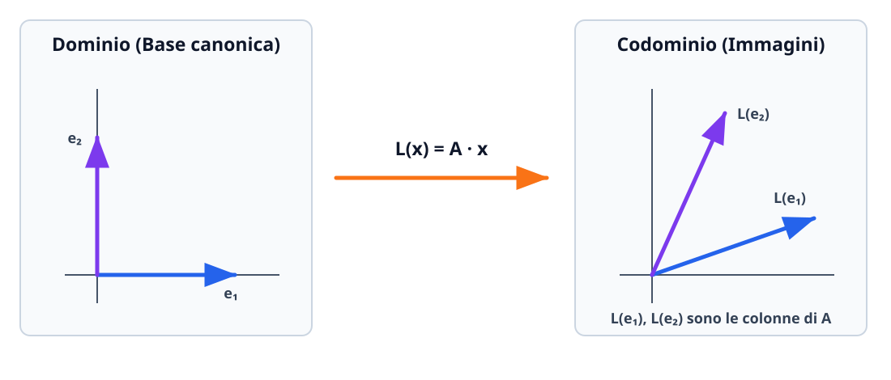

# Applicazioni lineari

Un'**applicazione lineare** (o trasformazione lineare, o omomorfismo di spazi vettoriali) è una funzione tra due spazi vettoriali che rispetta la struttura lineare, cioè conserva la somma di vettori e la moltiplicazione per uno scalare. Fissate le basi canoniche, ogni applicazione lineare $L: \mathbb{R}^n \to \mathbb{R}^m$ corrisponde in modo biunivoco a una matrice $A \in \mathbb{R}^{m \times n}$: lo studio geometrico delle trasformazioni si traduce così interamente nell'algebra delle matrici.

## Definizione e prime proprietà

Siano $V = \mathbb{R}^n$ e $W = \mathbb{R}^m$ due spazi vettoriali reali. Una funzione
$$
L: \mathbb{R}^n \to \mathbb{R}^m
$$
si dice **applicazione lineare** se soddisfa le due proprietà di linearità:
1. **Additività:** $L(\mathbf{u} + \mathbf{v}) = L(\mathbf{u}) + L(\mathbf{v})$ per ogni $\mathbf{u}, \mathbf{v} \in \mathbb{R}^n$;
2. **Omogeneità:** $L(\alpha \mathbf{u}) = \alpha L(\mathbf{u})$ per ogni $\mathbf{u} \in \mathbb{R}^n$ e per ogni scalare $\alpha \in \mathbb{R}$.

Le due condizioni si riassumono in un'unica condizione equivalente (**principio di sovrapposizione**): per ogni $\mathbf{u}, \mathbf{v} \in \mathbb{R}^n$ e per ogni coppia di scalari $\alpha, \beta \in \mathbb{R}$,
$$
L(\alpha \mathbf{u} + \beta \mathbf{v}) = \alpha L(\mathbf{u}) + \beta L(\mathbf{v}).
$$

### Conseguenze immediate della definizione

- **Condizione necessaria sul vettore nullo:** ponendo $\alpha = 0$ si ottiene sempre:
$$
L(\mathbf{0}_{\mathbb{R}^n}) = \mathbf{0}_{\mathbb{R}^m}.
$$
Se una funzione non manda l'origine nell'origine ($L(\mathbf{0}) \neq \mathbf{0}$), **non è sicuramente lineare**!
- **Conservazione delle combinazioni lineari:** per induzione, $L\left(\sum_{j=1}^k c_j \mathbf{v}_j\right) = \sum_{j=1}^k c_j L(\mathbf{v}_j)$.

> [!warning] Funzioni lineari vs funzioni affini
> In analisi elementare si chiama spesso «funzione lineare» l'equazione della retta $f(x) = mx + q$. In algebra lineare, invece, $f: \mathbb{R} \to \mathbb{R}$ definita da $f(x) = mx + q$ è un'**applicazione lineare se e solo se $q = 0$** ($f(x) = mx$, retta passante per l'origine). Quando $q \neq 0$, si ha $f(0) = q \neq 0$ e la funzione si chiama **applicazione affine** (ottenuta componendo un'applicazione lineare con una traslazione).
> Più in generale, $L(x_1, \dots, x_n)$ è lineare se e solo se ciascuna delle sue $m$ componenti è un **polinomio omogeneo di primo grado** nelle variabili $x_1, \dots, x_n$ (senza termini noti costanti, senza potenze $x_i^2$, prodotti $x_i x_j$, radici o funzioni trascendenti).

## Rappresentazione matriciale di un'applicazione lineare

Sia $L: \mathbb{R}^n \to \mathbb{R}^m$ un'applicazione lineare. Ogni vettore $\mathbf{x} = (x_1, x_2, \dots, x_n)^T \in \mathbb{R}^n$ si scrive come combinazione lineare dei versori della base canonica $\mathbf{e}_1, \mathbf{e}_2, \dots, \mathbf{e}_n$ di $\mathbb{R}^n$:
$$
\mathbf{x} = x_1 \mathbf{e}_1 + x_2 \mathbf{e}_2 + \cdots + x_n \mathbf{e}_n.
$$
Applicando $L$ e sfruttando la linearità otteniamo:
$$
L(\mathbf{x}) = L(x_1 \mathbf{e}_1 + \cdots + x_n \mathbf{e}_n) = x_1 L(\mathbf{e}_1) + x_2 L(\mathbf{e}_2) + \cdots + x_n L(\mathbf{e}_n).
$$
Questa combinazione lineare delle colonne $L(\mathbf{e}_1), \dots, L(\mathbf{e}_n) \in \mathbb{R}^m$ con pesi $x_1, \dots, x_n$ non è altro che il prodotto righe per colonne $A\mathbf{x}$, dove $A \in \mathbb{R}^{m \times n}$ è la matrice che ha per **colonne** le immagini dei versori canonici!

> [!important] Teorema di rappresentazione matriciale
> Ogni applicazione lineare $L: \mathbb{R}^n \to \mathbb{R}^m$ si scrive in modo unico nella forma
> $$L(\mathbf{x}) = A\mathbf{x} \qquad \forall \mathbf{x} \in \mathbb{R}^n,$$
> dove la **matrice associata** $A = M_L \in \mathbb{R}^{m \times n}$ (rispetto alle basi canoniche) ha dimensione $(\text{dim arrivo } m) \times (\text{dim partenza } n)$ e la sua colonna $j$-esima è il vettore colonna $L(\mathbf{e}_j)$:
> $$A = \begin{pmatrix}
> \big| & \big| & & \big| \\
> L(\mathbf{e}_1) & L(\mathbf{e}_2) & \cdots & L(\mathbf{e}_n) \\
> \big| & \big| & & \big|
> \end{pmatrix} \in \mathbb{R}^{m \times n}.$$

## Composizione di applicazioni lineari e isomorfismi

### Composizione e prodotto tra matrici

Perché il prodotto tra matrici è stato definito proprio con la regola «righe per colonne»? Perché corrisponde esattamente alla **composizione di applicazioni lineari**!
Siano $L: \mathbb{R}^n \to \mathbb{R}^m$ con matrice associata $M_L \in \mathbb{R}^{m \times n}$ e $G: \mathbb{R}^m \to \mathbb{R}^p$ con matrice associata $M_G \in \mathbb{R}^{p \times m}$. Allora l'applicazione composta
$$
G \circ L: \mathbb{R}^n \to \mathbb{R}^p, \qquad (G \circ L)(\mathbf{x}) = G\bigl(L(\mathbf{x})\bigr) = G(M_L \mathbf{x}) = M_G(M_L \mathbf{x}) = (M_G M_L)\mathbf{x}
$$
è ancora un'applicazione lineare e la sua matrice associata è il **prodotto matriciale** delle due matrici:
$$
M_{G \circ L} = M_G \cdot M_L \in \mathbb{R}^{p \times n}.
$$

### Applicazione lineare inversa e isomorfismi

Un'applicazione lineare **biiettiva** (iniettiva e suriettiva) $L: \mathbb{R}^n \to \mathbb{R}^n$ si chiama **isomorfismo** (o automorfismo di $\mathbb{R}^n$).
Un'applicazione lineare $L: \mathbb{R}^n \to \mathbb{R}^m$ può essere biiettiva **solo se la dimensione di partenza coincide con quella di arrivo ($m = n$)**, ossia quando la matrice associata $A \in \mathbb{R}^{n \times n}$ è **quadrata**, e vale:
$$
L \text{ è biiettiva (invertibile)} \iff A \text{ è invertibile } (\det A \neq 0 \iff \operatorname{rank} A = n).
$$
In tal caso, la funzione inversa $L^{-1}: \mathbb{R}^n \to \mathbb{R}^n$ è anch'essa un'applicazione lineare e la sua matrice associata è la **matrice inversa** $A^{-1}$:
$$
L^{-1}(\mathbf{y}) = A^{-1}\mathbf{y}, \qquad M_{L^{-1}} = (M_L)^{-1} = A^{-1}.
$$

## Trasformazioni geometriche lineari nel piano $\mathbb{R}^2$

Nel piano cartesiano $\mathbb{R}^2$, ogni matrice $A \in \mathbb{R}^{2 \times 2}$ descrive una trasformazione geometrica che lascia fissa l'origine $(0, 0)$ e trasforma rette in rette (e parallelogrammi in parallelogrammi, moltiplicandone l'area per $|\det A|$). Per scrivere la matrice di una qualsiasi trasformazione geometrica basta osservare **dove vanno a finire i due versori canonici $\mathbf{e}_1 = (1, 0)^T$ e $\mathbf{e}_2 = (0, 1)^T$**:

| Trasformazione geometrica in $\mathbb{R}^2$ | Immagini di $\mathbf{e}_1 = \binom{1}{0}$ e $\mathbf{e}_2 = \binom{0}{1}$ | Matrice associata $A = \bigl(L(\mathbf{e}_1) \;\big|\; L(\mathbf{e}_2)\bigr)$ |
| --- | --- | --- |
| **Rotazione antioraria di angolo $\theta$** attorno all'origine ($R_\theta$) | $R_\theta(\mathbf{e}_1) = \binom{\cos\theta}{\sin\theta}$, $R_\theta(\mathbf{e}_2) = \binom{-\sin\theta}{\cos\theta}$ | $R_\theta = \begin{pmatrix} \cos\theta & -\sin\theta \\ \sin\theta & \cos\theta \end{pmatrix}$ ($\det R_\theta = 1$, ortogonale) |
| **Riflessione rispetto all'asse $x$** ($y \mapsto -y$) | $\mathbf{e}_1 \mapsto \binom{1}{0}$, $\mathbf{e}_2 \mapsto \binom{0}{-1}$ | $\begin{pmatrix} 1 & 0 \\ 0 & -1 \end{pmatrix}$ ($\det = -1$) |
| **Riflessione rispetto all'asse $y$** ($x \mapsto -x$) | $\mathbf{e}_1 \mapsto \binom{-1}{0}$, $\mathbf{e}_2 \mapsto \binom{0}{1}$ | $\begin{pmatrix} -1 & 0 \\ 0 & 1 \end{pmatrix}$ ($\det = -1$) |
| **Riflessione rispetto alla bisettrice $y = x$** ($x \leftrightarrow y$) | $\mathbf{e}_1 \mapsto \binom{0}{1}$, $\mathbf{e}_2 \mapsto \binom{1}{0}$ | $\begin{pmatrix} 0 & 1 \\ 1 & 0 \end{pmatrix}$ ($\det = -1$) |
| **Omotetia / Dilatazione anisotropa** di fattori $k_x, k_y$ | $\mathbf{e}_1 \mapsto \binom{k_x}{0}$, $\mathbf{e}_2 \mapsto \binom{0}{k_y}$ | $\begin{pmatrix} k_x & 0 \\ 0 & k_y \end{pmatrix}$ ($\det = k_x k_y$) |
| **Taglio (Shear) orizzontale** di fattore $k$ | $\mathbf{e}_1 \mapsto \binom{1}{0}$, $\mathbf{e}_2 \mapsto \binom{k}{1}$ | $\begin{pmatrix} 1 & k \\ 0 & 1 \end{pmatrix}$ ($\det = 1$) |
| **Proiezione ortogonale sull'asse $x$** | $\mathbf{e}_1 \mapsto \binom{1}{0}$, $\mathbf{e}_2 \mapsto \binom{0}{0}$ | $\begin{pmatrix} 1 & 0 \\ 0 & 0 \end{pmatrix}$ ($\det = 0$, non invertibile) |

## Nucleo ($\ker L$), Immagine ($\operatorname{Im} L$) e Teorema Rango-Nullità

Sia $L: \mathbb{R}^n \to \mathbb{R}^m$ un'applicazione lineare con matrice associata $A \in \mathbb{R}^{m \times n}$ ($L(\mathbf{x}) = A\mathbf{x}$).

### 1. Nucleo ($\ker L$)

Il **nucleo** (o *kernel*) di $L$ è il sottospazio vettoriale del dominio $\mathbb{R}^n$ formato da tutti i vettori che vengono trasformati nel vettore nullo $\mathbf{0} \in \mathbb{R}^m$:
$$
\ker(L) = \bigl\{\mathbf{x} \in \mathbb{R}^n \;\big|\; L(\mathbf{x}) = \mathbf{0}\bigr\} = \bigl\{\mathbf{x} \in \mathbb{R}^n \;\big|\; A\mathbf{x} = \mathbf{0}\bigr\} \subseteq \mathbb{R}^n.
$$
Calcolare $\ker(L)$ significa quindi **risolvere il sistema lineare omogeneo $A\mathbf{x} = \mathbf{0}$**. Il numero di parametri liberi da cui dipendono le soluzioni è la **dimensione del nucleo** ($\dim(\ker L)$, detta anche *nullità* di $L$).

### 2. Immagine ($\operatorname{Im} L$)

L'**immagine** di $L$ è il sottospazio vettoriale del codominio $\mathbb{R}^m$ costituito da tutti i vettori $\mathbf{y} \in \mathbb{R}^m$ che sono immagine di almeno un $\mathbf{x} \in \mathbb{R}^n$:
$$
\operatorname{Im}(L) = \bigl\{L(\mathbf{x}) \;\big|\; \mathbf{x} \in \mathbb{R}^n\bigr\} = \bigl\{A\mathbf{x} \;\big|\; \mathbf{x} \in \mathbb{R}^n\bigr\} = \operatorname{Span}\bigl(\mathbf{a}_1, \mathbf{a}_2, \dots, \mathbf{a}_n\bigr) \subseteq \mathbb{R}^m,
$$
dove $\mathbf{a}_1, \dots, \mathbf{a}_n$ sono le **colonne** della matrice $A$. La dimensione dell'immagine coincide quindi con il numero massimo di colonne linearmente indipendenti di $A$, cioè con il **rango** della matrice $A$:
$$
\dim(\operatorname{Im} L) = \operatorname{rank}(L) = \operatorname{rank}(A).
$$
Per estrarre una **base di $\operatorname{Im}(L)$**, basta prendere le colonne della matrice originale $A$ corrispondenti alle colonne in cui compaiono i **pivot** nella riduzione di Gauss di $A$.

### 3. Teorema della dimensione (o Rango-Nullità) e criteri di iniettività/suriettività

> [!important] Teorema della dimensione (Rango-Nullità)
> Per ogni applicazione lineare $L: \mathbb{R}^n \to \mathbb{R}^m$ con matrice associata $A \in \mathbb{R}^{m \times n}$, la somma della dimensione del nucleo e della dimensione dell'immagine è uguale alla **dimensione dello spazio di partenza** $n$:
> $$\dim(\ker L) + \dim(\operatorname{Im} L) = n \iff \dim(\ker L) = n - \operatorname{rank}(A).$$

Dal teorema rango-nullità discendono i criteri operativi immediati per iniettività e suriettività:
- **Criterio di iniettività:** $L$ è **iniettiva** $\iff \ker(L) = \{\mathbf{0}\} \iff \dim(\ker L) = 0 \iff \operatorname{rank}(A) = n$ (rango uguale al numero di colonne / dimensione di partenza; richiede necessariamente $n \leq m$).
- **Criterio di suriettività:** $L$ è **suriettiva** $\iff \operatorname{Im}(L) = \mathbb{R}^m \iff \dim(\operatorname{Im} L) = m \iff \operatorname{rank}(A) = m$ (rango uguale al numero di righe / dimensione di arrivo; richiede necessariamente $n \geq m$).

## Indipendenza lineare e basi di un sottospazio

Un insieme di vettori $\{\mathbf{v}_1, \mathbf{v}_2, \dots, \mathbf{v}_k\}$ in uno spazio vettoriale $V$ si dice:
- **linearmente indipendente** se l'unica combinazione lineare che dà il vettore nullo è quella con tutti i coefficienti nulli:
$$
c_1 \mathbf{v}_1 + c_2 \mathbf{v}_2 + \cdots + c_k \mathbf{v}_k = \mathbf{0} \implies c_1 = c_2 = \cdots = c_k = 0;
$$
- **linearmente dipendente** se esistono scalari $c_1, \dots, c_k$ **non tutti nulli** tali che $c_1 \mathbf{v}_1 + \cdots + c_k \mathbf{v}_k = \mathbf{0}$ (equivalentemente, almeno uno dei vettori è combinazione lineare degli altri).

In pratica, disposti $\mathbf{v}_1, \dots, \mathbf{v}_k$ come colonne (o righe) di una matrice $M$, essi sono linearmente indipendenti se e solo se $\operatorname{rank}(M) = k$ (in particolare, $n$ vettori in $\mathbb{R}^n$ sono linearmente indipendenti e formano una **base di $\mathbb{R}^n$** se e solo se la matrice quadrata $n \times n$ da essi formata ha $\det(M) \neq 0$).

Una **base** di un sottospazio $U \subseteq \mathbb{R}^n$ è un insieme di vettori di $U$ che sono contemporaneamente **generatori di $U$** e **linearmente indipendenti**. Il numero di vettori che compongono una qualsiasi base di $U$ si chiama **dimensione** di $U$ ($\dim U$).

## Esempi guidati

### Esempio 1: Studio completo di matrice associata, nucleo, immagine, iniettività e suriettività

Sia data l'applicazione $L: \mathbb{R}^3 \to \mathbb{R}^4$ definita da:
$$
L(x, y, z) = (x + y,\; x + y,\; x + z,\; x + z).
$$
Scriviamo la matrice associata $A$, determiniamo dimensione e una base di $\ker(L)$ e di $\operatorname{Im}(L)$, e stabiliamo se $L$ è iniettiva o suriettiva.

**Passaggi:**
1. **Matrice associata $A \in \mathbb{R}^{4 \times 3}$:** calcoliamo le immagini dei versori canonici $\mathbf{e}_1 = (1, 0, 0)$, $\mathbf{e}_2 = (0, 1, 0)$, $\mathbf{e}_3 = (0, 0, 1)$ e disponiamole per colonna:
   $$A = \begin{pmatrix}
   1 & 1 & 0 \\
   1 & 1 & 0 \\
   1 & 0 & 1 \\
   1 & 0 & 1
   \end{pmatrix}.$$
2. **Rango e base dell'Immagine $\operatorname{Im}(L)$:** riduciamo $A$ a scala con Gauss ($R_2 \leftarrow R_2 - R_1$, $R_3 \leftarrow R_3 - R_1$, $R_4 \leftarrow R_4 - R_1$, e poi scambiamo $R_2 \leftrightarrow R_3$):
   $$A \longrightarrow \begin{pmatrix}
   \boxed{1} & 1 & 0 \\
   0 & \boxed{-1} & 1 \\
   0 & 0 & 0 \\
   0 & 0 & 0
   \end{pmatrix}.$$
   I pivot sono $2$ e cadono nella **prima** e nella **seconda** colonna. Pertanto $\dim(\operatorname{Im} L) = \operatorname{rank}(A) = 2$, e una base di $\operatorname{Im}(L)$ è data dalle prime due colonne della matrice originale $A$:
   $$\mathcal{B}_{\operatorname{Im}(L)} = \left\{ \begin{pmatrix} 1 \\ 1 \\ 1 \\ 1 \end{pmatrix},\ \begin{pmatrix} 1 \\ 1 \\ 0 \\ 0 \end{pmatrix} \right\}.$$
   Poiché $\dim(\operatorname{Im} L) = 2 < 4 = \dim(\mathbb{R}^4)$, **$L$ non è suriettiva**.
3. **Nucleo $\ker(L)$:** per il teorema rango-nullità sappiamo già che $\dim(\ker L) = 3 - \operatorname{rank}(A) = 3 - 2 = 1$, quindi **$L$ non è iniettiva**. Risolviamo il sistema omogeneo $A\mathbf{x} = \mathbf{0}$:
   $$\begin{cases} x + y = 0 \\ x + z = 0 \end{cases} \iff \begin{cases} y = -x \\ z = -x. \end{cases}$$
   Ponendo la variabile libera $x = t \in \mathbb{R}$, otteniamo:
   $$\ker(L) = \bigl\{(t, -t, -t) \;\big|\; t \in \mathbb{R}\bigr\} = \operatorname{Span}\bigl((1, -1, -1)\bigr), \qquad \mathcal{B}_{\ker(L)} = \{(1, -1, -1)\}.$$

### Esempio 2: Composizione di una rotazione e di una riflessione in $\mathbb{R}^2$

Determiniamo la matrice associata e la legge analitica della trasformazione lineare $T: \mathbb{R}^2 \to \mathbb{R}^2$ che consiste nell'applicare prima una **rotazione antioraria di $\theta = \frac{\pi}{4}$** attorno all'origine e poi la **riflessione rispetto all'asse $x$**.

**Passaggi:**
1. La matrice della rotazione antioraria di $\frac{\pi}{4}$ (dove $\cos\frac{\pi}{4} = \sin\frac{\pi}{4} = \frac{\sqrt{2}}{2}$) è:
   $$R_{\pi/4} = \begin{pmatrix} \frac{\sqrt{2}}{2} & -\frac{\sqrt{2}}{2} \\ \frac{\sqrt{2}}{2} & \frac{\sqrt{2}}{2} \end{pmatrix} = \frac{\sqrt{2}}{2}\begin{pmatrix} 1 & -1 \\ 1 & 1 \end{pmatrix}.$$
2. La matrice della riflessione rispetto all'asse $x$ è $S_x = \begin{pmatrix} 1 & 0 \\ 0 & -1 \end{pmatrix}$.
3. Poiché agisce **prima** $R_{\pi/4}$ e **dopo** $S_x$, la matrice di $T = S_x \circ R_{\pi/4}$ è il prodotto $M_T = S_x \cdot R_{\pi/4}$ (con $S_x$ a sinistra!):
   $$M_T = S_x R_{\pi/4} = \begin{pmatrix} 1 & 0 \\ 0 & -1 \end{pmatrix} \cdot \frac{\sqrt{2}}{2}\begin{pmatrix} 1 & -1 \\ 1 & 1 \end{pmatrix} = \frac{\sqrt{2}}{2}\begin{pmatrix} 1 & -1 \\ -1 & -1 \end{pmatrix}.$$
   La legge analitica è quindi $T(x, y) = \left(\frac{\sqrt{2}}{2}(x - y),\; -\frac{\sqrt{2}}{2}(x + y)\right)$.

### Esempio 3: Ricostruzione di un'applicazione lineare dalle immagini di una base non canonica

Determiniamo l'applicazione lineare $L: \mathbb{R}^2 \to \mathbb{R}^2$ sapendo che:
$$
L(1, 1) = (3, 2) \qquad \text{e} \qquad L(1, -1) = (-1, 4).
$$

**Passaggi:**
1. Per scrivere la matrice associata $A$ dobbiamo trovare $L(1, 0)$ e $L(0, 1)$. Esprimiamo i versori canonici $\mathbf{e}_1 = (1, 0)$ ed $\mathbf{e}_2 = (0, 1)$ attraverso $\mathbf{v}_1 = (1, 1)$ e $\mathbf{v}_2 = (1, -1)$:
   - sommando: $\mathbf{v}_1 + \mathbf{v}_2 = (2, 0) = 2\mathbf{e}_1 \implies \mathbf{e}_1 = \frac{1}{2}\mathbf{v}_1 + \frac{1}{2}\mathbf{v}_2$;
   - sottraendo: $\mathbf{v}_1 - \mathbf{v}_2 = (0, 2) = 2\mathbf{e}_2 \implies \mathbf{e}_2 = \frac{1}{2}\mathbf{v}_1 - \frac{1}{2}\mathbf{v}_2$.
2. Per linearità di $L$:
   $$L(1, 0) = \frac{1}{2}L(1, 1) + \frac{1}{2}L(1, -1) = \frac{1}{2}(3, 2) + \frac{1}{2}(-1, 4) = (1, 3),$$
   $$L(0, 1) = \frac{1}{2}L(1, 1) - \frac{1}{2}L(1, -1) = \frac{1}{2}(3, 2) - \frac{1}{2}(-1, 4) = (2, -1).$$
3. Affiancando $L(1, 0)$ e $L(0, 1)$ per colonna otteniamo:
   $$A = \begin{pmatrix} 1 & 2 \\ 3 & -1 \end{pmatrix} \implies L(x, y) = (x + 2y,\; 3x - y).$$

## Errori frequenti

- **Inserire le immagini $L(\mathbf{e}_j)$ per riga anziché per colonna nella matrice associata:** nella convenzione $L(\mathbf{x}) = A\mathbf{x}$ con vettori colonna, $L(\mathbf{e}_j)$ è sempre la **colonna $j$-esima** di $A$.
- **Invertire l'ordine del prodotto matriciale nella composizione:** la matrice di $G \circ L$ («prima $L$, poi $G$») è $M_G M_L$, non $M_L M_G$.
- **Prendere le colonne della matrice ridotta a scala $A_{\text{scala}}$ come base di $\operatorname{Im}(L)$:** le operazioni di riga alterano lo spazio generato dalle colonne! Le posizioni dei pivot nella matrice a scala servono a individuare **quali colonne della matrice di partenza $A$** sono linearmente indipendenti e formano una base di $\operatorname{Im}(L)$.
- **Confondere la dimensione $n$ nel teorema rango-nullità:** in $\dim(\ker L) + \dim(\operatorname{Im} L) = n$, $n$ è sempre la dimensione del **dominio di partenza** $\mathbb{R}^n$ (numero di colonne di $A$), mai la dimensione del codominio $\mathbb{R}^m$.

## Esercizi di prova

1. (**Base - Riconoscimento di applicazioni lineari**) Stabilisci quali delle seguenti funzioni da $\mathbb{R}^3$ a $\mathbb{R}^2$ sono applicazioni lineari e, per quelle lineari, scrivi la matrice associata $A \in \mathbb{R}^{2 \times 3}$:
   (a) $L_1(x, y, z) = (2x - y + 3z,\; x + 4z)$;
   (b) $L_2(x, y, z) = (x + y + 1,\; 2z)$;
   (c) $L_3(x, y, z) = (xy,\; x - z)$.
> [!tip]- Soluzione
> - (a) **$L_1$ è lineare**, perché entrambe le componenti sono polinomi omogenei di primo grado in $x, y, z$. Calcolando $L_1(1,0,0) = (2, 1)^T$, $L_1(0,1,0) = (-1, 0)^T$, $L_1(0,0,1) = (3, 4)^T$, la matrice associata è:
>   $$A_1 = \begin{pmatrix} 2 & -1 & 3 \\ 1 & 0 & 4 \end{pmatrix}.$$
> - (b) **$L_2$ non è lineare** (è affine), perché $L_2(0, 0, 0) = (1, 0) \neq (0, 0)$ a causa del termine noto $+1$.
> - (c) **$L_3$ non è lineare**, a causa del prodotto non lineare $xy$: ad esempio $L_3(1, 1, 0) = (1, 1)$ ma $L_3(2, 2, 0) = (4, 2) \neq 2L_3(1, 1, 0)$.

2. (**Base - Indipendenza lineare e base di $\mathbb{R}^3$**) Stabilisci se i tre vettori $\mathbf{v}_1 = (1, 2, 0)$, $\mathbf{v}_2 = (0, 1, -1)$ e $\mathbf{v}_3 = (2, 3, 2)$ sono linearmente indipendenti e se formano una base di $\mathbb{R}^3$. In caso affermativo, trova le coordinate del vettore $\mathbf{w} = (3, 5, 1)$ rispetto a tale base.
> [!tip]- Soluzione
> Affianchiamo i tre vettori come colonne di una matrice $3 \times 3$ e calcoliamone il determinante:
> $$M = \begin{pmatrix}
> 1 & 0 & 2 \\
> 2 & 1 & 3 \\
> 0 & -1 & 2
> \end{pmatrix} \implies \det(M) = 1(2 + 3) + 2(-2 - 0) = 5 - 4 = 1 \neq 0.$$
> Poiché $\det(M) = 1 \neq 0$, i tre vettori sono **linearmente indipendenti** e, essendo $3$ vettori in $\mathbb{R}^3$, formano una **base di $\mathbb{R}^3$**.
> Cerchiamo le coordinate $(c_1, c_2, c_3)$ tali che $c_1 \mathbf{v}_1 + c_2 \mathbf{v}_2 + c_3 \mathbf{v}_3 = (3, 5, 1)$, ovvero $M\mathbf{c} = \mathbf{w}$:
> $$\begin{cases}
> c_1 + 2c_3 = 3 \\
> 2c_1 + c_2 + 3c_3 = 5 \\
> -c_2 + 2c_3 = 1.
> \end{cases}$$
> Sommando la seconda e la terza equazione: $2c_1 + 5c_3 = 6$. Dalla prima $c_1 = 3 - 2c_3$, quindi $2(3 - 2c_3) + 5c_3 = 6 \implies 6 + c_3 = 6 \implies c_3 = 0$, da cui $c_1 = 3$ e $c_2 = -1$. Infatti $3\mathbf{v}_1 - \mathbf{v}_2 + 0\mathbf{v}_3 = (3, 6, 0) - (0, 1, -1) = (3, 5, 1)$.

3. (**Intermedio - Studio di nucleo e immagine**) Sia data l'applicazione lineare $L: \mathbb{R}^3 \to \mathbb{R}^3$ definita da:
   $$L(x, y, z) = (x - y + 2z,\; 2x + y - z,\; x + 2y - 3z).$$
   Determina la matrice associata $A$, la dimensione e una base di $\ker(L)$ e di $\operatorname{Im}(L)$, e stabilisci se $\mathbf{b} = (1, 5, 4)^T$ appartiene a $\operatorname{Im}(L)$.
> [!tip]- Soluzione
> La matrice associata è:
> $$A = \begin{pmatrix}
> 1 & -1 & 2 \\
> 2 & 1 & -1 \\
> 1 & 2 & -3
> \end{pmatrix}.$$
> Riduciamo con Gauss ($R_2 \leftarrow R_2 - 2R_1$, $R_3 \leftarrow R_3 - R_1$, e poi $R_3 \leftarrow R_3 - R_2$):
> $$A \longrightarrow \begin{pmatrix}
> 1 & -1 & 2 \\
> 0 & 3 & -5 \\
> 0 & 3 & -5
> \end{pmatrix} \longrightarrow \begin{pmatrix}
> \boxed{1} & -1 & 2 \\
> 0 & \boxed{3} & -5 \\
> 0 & 0 & 0
> \end{pmatrix}.$$
> - **Immagine:** i pivot cadono nelle colonne $1$ e $2$, quindi $\dim(\operatorname{Im} L) = \operatorname{rank}(A) = 2$ e una base di $\operatorname{Im}(L)$ è data dalle prime due colonne di $A$:
>   $$\mathcal{B}_{\operatorname{Im}(L)} = \left\{ \begin{pmatrix} 1 \\ 2 \\ 1 \end{pmatrix},\ \begin{pmatrix} -1 \\ 1 \\ 2 \end{pmatrix} \right\}.$$
> - **Nucleo:** per il teorema rango-nullità $\dim(\ker L) = 3 - 2 = 1$. Dal sistema ridotto:
>   $$\begin{cases} x - y + 2z = 0 \\ 3y - 5z = 0 \end{cases} \implies y = \frac{5}{3}z,\quad x = y - 2z = -\frac{1}{3}z.$$
>   Scegliendo $z = 3t$ otteniamo $(x, y, z) = t(-1, 5, 3)$, quindi $\mathcal{B}_{\ker(L)} = \{(-1, 5, 3)^T\}$.
> - **Appartenenza di $\mathbf{b} = (1, 5, 4)^T$ a $\operatorname{Im}(L)$:** osserviamo che nelle colonne di $A$ vale sempre la relazione $R_3 = R_2 - R_1$ (cioè $y_3 = y_2 - y_1$). Per $\mathbf{b} = (1, 5, 4)^T$ si ha $4 = 5 - 1$, quindi **$\mathbf{b} \in \operatorname{Im}(L)$** (infatti $\mathbf{b} = 2(1, 2, 1)^T + 1(-1, 1, 2)^T = L(2, 1, 0)$).

4. (**Intermedio - Composizione e inversa di applicazioni lineari**) Date $L, G: \mathbb{R}^2 \to \mathbb{R}^2$ definite da $L(x, y) = (2x + y,\; x + y)$ e $G(x, y) = (x - y,\; 3x + 2y)$:
   (a) determina le matrici $M_L$, $M_G$, $M_{G \circ L}$ e la legge di $(G \circ L)(x, y)$;
   (b) verifica che $L$ è un isomorfismo e scrivi la legge esplicita dell'applicazione inversa $L^{-1}(u, v)$.
> [!tip]- Soluzione
> - (a) Le matrici associate sono:
>   $$M_L = \begin{pmatrix} 2 & 1 \\ 1 & 1 \end{pmatrix}, \qquad M_G = \begin{pmatrix} 1 & -1 \\ 3 & 2 \end{pmatrix}.$$
>   La matrice della composta $G \circ L$ è:
>   $$M_{G \circ L} = M_G M_L = \begin{pmatrix} 1 & -1 \\ 3 & 2 \end{pmatrix}\begin{pmatrix} 2 & 1 \\ 1 & 1 \end{pmatrix} = \begin{pmatrix} 1 & 0 \\ 8 & 5 \end{pmatrix} \implies (G \circ L)(x, y) = (x,\; 8x + 5y).$$
> - (b) Si ha $\det(M_L) = 2(1) - 1(1) = 1 \neq 0$, quindi $L$ è un isomorfismo. La matrice inversa è:
>   $$M_{L^{-1}} = M_L^{-1} = \begin{pmatrix} 1 & -1 \\ -1 & 2 \end{pmatrix} \implies L^{-1}(u, v) = (u - v,\; -u + 2v).$$

5. (**Intermedio - Rotazioni nel piano**) Determina le coordinate del punto $P' = R_{\pi/3}(P)$ ottenuto ruotando in senso antiorario di un angolo $\theta = \frac{\pi}{3}$ attorno all'origine il punto $P = (2,\ 2\sqrt{3})$, e scrivi la matrice della rotazione inversa $R_{\pi/3}^{-1}$.
> [!tip]- Soluzione
> Per $\theta = \frac{\pi}{3}$ si ha $\cos\frac{\pi}{3} = \frac{1}{2}$ e $\sin\frac{\pi}{3} = \frac{\sqrt{3}}{2}$. La matrice di rotazione è:
> $$R_{\pi/3} = \begin{pmatrix} 1/2 & -\sqrt{3}/2 \\ \sqrt{3}/2 & 1/2 \end{pmatrix}.$$
> Moltiplicando per il vettore colonna $P = \binom{2}{2\sqrt{3}}$:
> $$P' = R_{\pi/3}\begin{pmatrix} 2 \\ 2\sqrt{3} \end{pmatrix} = \begin{pmatrix} \frac{1}{2}(2) - \frac{\sqrt{3}}{2}(2\sqrt{3}) \\ \frac{\sqrt{3}}{2}(2) + \frac{1}{2}(2\sqrt{3}) \end{pmatrix} = \begin{pmatrix} 1 - 3 \\ \sqrt{3} + \sqrt{3} \end{pmatrix} = \begin{pmatrix} -2 \\ 2\sqrt{3} \end{pmatrix}.$$
> Poiché $R_\theta$ è una matrice ortogonale, la sua inversa (che corrisponde alla rotazione oraria di angolo $-\frac{\pi}{3}$) coincide con la sua trasposta:
> $$R_{\pi/3}^{-1} = R_{-\pi/3} = R_{\pi/3}^T = \begin{pmatrix} 1/2 & \sqrt{3}/2 \\ -\sqrt{3}/2 & 1/2 \end{pmatrix}.$$

6. (**Esame - Discussione di un'applicazione lineare dipendente da parametro**) Sia data $L_k: \mathbb{R}^3 \to \mathbb{R}^3$ definita da:
   $$L_k(x, y, z) = (x + ky + z,\; 2x + y + kz,\; x + y + 2z), \qquad k \in \mathbb{R}.$$
   (a) Determina per quali valori di $k \in \mathbb{R}$ l'applicazione $L_k$ è un isomorfismo (biiettiva).
   (b) Per $k = 1$, determina $\dim(\ker L_1)$, $\dim(\operatorname{Im} L_1)$ e una base di $\ker(L_1)$.
> [!tip]- Soluzione
> - (a) Scriviamo la matrice associata $A_k \in \mathbb{R}^{3 \times 3}$ e calcoliamone il determinante:
>   $$A_k = \begin{pmatrix}
>   1 & k & 1 \\
>   2 & 1 & k \\
>   1 & 1 & 2
>   \end{pmatrix}.$$
>   Sottraendo la prima riga dalla terza ($R_3 \leftarrow R_3 - R_1$) otteniamo $\begin{pmatrix} 1 & k & 1 \\ 2 & 1 & k \\ 0 & 1-k & 1 \end{pmatrix}$, e sviluppando lungo la prima colonna:
>   $$\det(A_k) = 1\bigl(1 - k(1 - k)\bigr) - 2\bigl(k - (1 - k)\bigr) = (k^2 - k + 1) - 2(2k - 1) = k^2 - 5k + 3.$$
>   *(Controlliamo con Sarrus: $(2 + k^2 + 2) - (1 + k + 4k) = k^2 - 5k + 3$).*
>   L'applicazione $L_k$ è un isomorfismo se e solo se $\det(A_k) \neq 0$, cioè per:
>   $$k \neq \frac{5 \pm \sqrt{25 - 12}}{2} = \frac{5 \pm \sqrt{13}}{2}.$$
> - (b) Per $k = 1$, $\det(A_1) = 1 - 5 + 3 = -1 \neq 0$! Quindi anche per $k = 1$ la matrice ha rango $3$: $\dim(\operatorname{Im} L_1) = 3$ e $\dim(\ker L_1) = 0$ ($\ker(L_1) = \{\mathbf{0}\}$, che per convenzione ha base vuota $\varnothing$).
>   *(Nota: se invece considerassimo un valore che annulla il determinante o modificassimo l'ultimo coefficiente in $1$, allora $\dim(\ker L)$ salirebbe a $1$).*

## Provenienza del materiale

Sintesi ragionata ed estesa della lezione `C1MAT1U3L3_Applicazioni_lineari.pdf` e degli `Appunti_di_Fine_Unità_3.pdf` (Corso di Matematica 1, CdL in Sicurezza Informatica / SecAI - Università degli Studi di Milano), con composizione di applicazioni lineari, trasformazioni geometriche nel piano e teorema rango-nullità.
