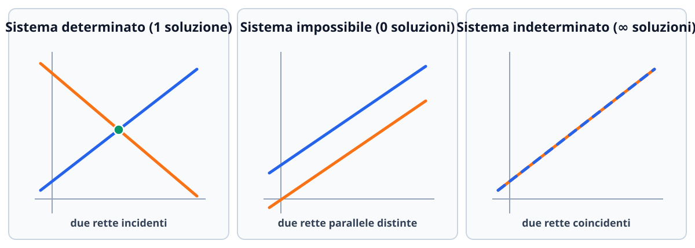

# Sistemi lineari

Un **sistema di equazioni lineari** (o sistema lineare) è un insieme di equazioni algebriche di primo grado in più incognite che devono essere verificate contemporaneamente. I sistemi lineari compaiono ovunque nelle scienze applicate e nell'informatica: dalla risoluzione di reti elettriche e flussi di traffico fino all'addestramento di modelli numerici e alla computer grafica. In questa lezione studiamo la rappresentazione matriciale $A\mathbf{x} = \mathbf{b}$, il **Teorema di Rouché-Capelli** per l'esistenza e la molteplicità delle soluzioni, i metodi risolutivi di **Gauss**, **Gauss-Jordan** e **Cramer**, la struttura geometrica dello spazio delle soluzioni e la discussione completa dei **sistemi lineari parametrici**.

## Forma generale e rappresentazione matriciale

Un sistema lineare di $m$ equazioni in $n$ incognite reali $x_1, x_2, \dots, x_n$ ha la forma:
$$
\begin{cases}
a_{11}x_1 + a_{12}x_2 + \cdots + a_{1n}x_n = b_1 \\
a_{21}x_1 + a_{22}x_2 + \cdots + a_{2n}x_n = b_2 \\
\;\;\vdots \\
a_{m1}x_1 + a_{m2}x_2 + \cdots + a_{mn}x_n = b_m,
\end{cases}
$$
dove i numeri reali $a_{ij}$ sono i **coefficienti delle incognite** e $b_1, \dots, b_m$ sono i **termini noti**.

Introducendo la **matrice dei coefficienti** (o matrice incompleta) $A \in \mathbb{R}^{m \times n}$, il **vettore colonna delle incognite** $\mathbf{x} \in \mathbb{R}^n$ e il **vettore colonna dei termini noti** $\mathbf{b} \in \mathbb{R}^m$:
$$
A = \begin{pmatrix}
a_{11} & a_{12} & \cdots & a_{1n} \\
a_{21} & a_{22} & \cdots & a_{2n} \\
\vdots & \vdots & \ddots & \vdots \\
a_{m1} & a_{m2} & \cdots & a_{mn}
\end{pmatrix}, \qquad
\mathbf{x} = \begin{pmatrix} x_1 \\ x_2 \\ \vdots \\ x_n \end{pmatrix}, \qquad
\mathbf{b} = \begin{pmatrix} b_1 \\ b_2 \\ \vdots \\ b_m \end{pmatrix},
$$
il sistema si scrive nella forma matriciale compatta:
$$
A\mathbf{x} = \mathbf{b}.
$$
Affiancando alla matrice $A$ la colonna dei termini noti $\mathbf{b}$ si ottiene la **matrice completa** (o matrice aumentata) del sistema, di dimensione $m \times (n+1)$:
$$
[A \mid \mathbf{b}] = \left(\begin{array}{cccc|c}
a_{11} & a_{12} & \cdots & a_{1n} & b_1 \\
a_{21} & a_{22} & \cdots & a_{2n} & b_2 \\
\vdots & \vdots & \ddots & \vdots & \vdots \\
a_{m1} & a_{m2} & \cdots & a_{mn} & b_m
\end{array}\right).
$$
Se $\mathbf{b} = \mathbf{0}$ (tutti i termini noti sono nulli), il sistema $A\mathbf{x} = \mathbf{0}$ si dice **omogeneo**.

## Esistenza e numero delle soluzioni: Teorema di Rouché-Capelli

Una $n$-upla $\mathbf{x} = (x_1, \dots, x_n)^T \in \mathbb{R}^n$ è una **soluzione** del sistema se soddisfa tutte le $m$ equazioni. Rispetto all'insieme delle soluzioni, un sistema lineare reale cade sempre in **uno e uno solo di tre casi** (non può mai avere, ad esempio, esattamente $2$ o $3$ soluzioni distinte!):
1. **Sistema impossibile (o incompatibile):** non ammette **nessuna** soluzione ($\mathcal{S} = \varnothing$).
2. **Sistema compatibile determinato:** ammette **una e una sola** soluzione ($\mathcal{S} = \{\mathbf{x}_0\}$).
3. **Sistema compatibile indeterminato:** ammette **infinite** soluzioni ($\infty^{n-r}$ soluzioni dipendenti da $n - r$ parametri liberi).

Il criterio universale che stabilisce in quale dei tre casi ci troviamo senza bisogno di indovinare è il **Teorema di Rouché-Capelli**, che confronta il rango della matrice incompleta $A$ con il rango della matrice completa $[A \mid \mathbf{b}]$.

> [!important] Teorema di Rouché-Capelli
> Sia dato un sistema lineare $A\mathbf{x} = \mathbf{b}$ di $m$ equazioni in $n$ incognite. Poniamo $r = \operatorname{rank}(A)$ e $r' = \operatorname{rank}([A \mid \mathbf{b}])$ (osservando che vale sempre $r \leq r' \leq r + 1$ e $r \leq n$).
> 1. **Condizione di compatibilità:** il sistema ammette soluzioni (è **compatibile**) **se e solo se** la matrice incompleta e la matrice completa hanno lo **stesso rango**:
>    $$\operatorname{rank}(A) = \operatorname{rank}([A \mid \mathbf{b}]) = r.$$
>    Se invece $\operatorname{rank}(A) < \operatorname{rank}([A \mid \mathbf{b}])$, il sistema è **impossibile** (nessuna soluzione).
> 2. **Numero di soluzioni (quando $r = r'$):**
>    - se $r = r' = n$ (il rango comune è uguale al numero delle incognite), il sistema è **determinato** e ammette **un'unica soluzione**;
>    - se $r = r' < n$ (il rango comune è strettamente minore del numero delle incognite), il sistema è **indeterminato** e ammette **$\infty^{n - r}$ soluzioni**, cioè infinite soluzioni che dipendono linearmente da $k = n - r$ **parametri liberi** (o variabili libere).

*(Interpretazione vettoriale: poiché $A\mathbf{x} = x_1 \mathbf{a}_1 + \cdots + x_n \mathbf{a}_n$ è combinazione lineare delle colonne di $A$, avere $\operatorname{rank}(A) = \operatorname{rank}([A \mid \mathbf{b}])$ significa esattamente che la colonna $\mathbf{b}$ appartiene a $\operatorname{Im}(A) = \operatorname{Span}(\mathbf{a}_1, \dots, \mathbf{a}_n)$, quindi non aumenta la dimensione dello spazio generato dalle colonne di $A$).*

## Struttura generale delle soluzioni e sistemi omogenei

### Sistemi omogenei $A\mathbf{x} = \mathbf{0}$

In un sistema omogeneo $A\mathbf{x} = \mathbf{0}$ l'ultima colonna della matrice completa è fatta tutta di zeri, quindi vale **sempre** $\operatorname{rank}(A) = \operatorname{rank}([A \mid \mathbf{0}])$. Pertanto:
- **un sistema omogeneo è sempre compatibile**, perché ammette almeno la **soluzione banale** $\mathbf{x} = \mathbf{0}$;
- se $\operatorname{rank}(A) = n$, la soluzione banale $\mathbf{x} = \mathbf{0}$ è l'unica soluzione;
- se $\operatorname{rank}(A) = r < n$, il sistema ammette anche **infinite soluzioni non banali** ($\infty^{n-r}$, dette *autosoluzioni*), che formano il sottospazio vettoriale $\ker(A) \subseteq \mathbb{R}^n$ di dimensione $n - r$.

### Teorema di struttura per i sistemi non omogenei $A\mathbf{x} = \mathbf{b}$

Sia $A\mathbf{x} = \mathbf{b}$ un sistema compatibile ($\operatorname{rank}(A) = \operatorname{rank}([A \mid \mathbf{b}]) = r$). Ogni soluzione $\mathbf{x}$ del sistema $A\mathbf{x} = \mathbf{b}$ si ottiene sommando una **soluzione particolare** fissata $\mathbf{x}_p$ di $A\mathbf{x} = \mathbf{b}$ con la **soluzione generale $\mathbf{x}_0 \in \ker(A)$ del sistema omogeneo associato $A\mathbf{x} = \mathbf{0}$**:
$$
\mathbf{x} = \mathbf{x}_p + \mathbf{x}_0 = \mathbf{x}_p + t_1 \mathbf{v}_1 + t_2 \mathbf{v}_2 + \cdots + t_{n-r} \mathbf{v}_{n-r}, \qquad t_1, \dots, t_{n-r} \in \mathbb{R},
$$
dove $\{\mathbf{v}_1, \dots, \mathbf{v}_{n-r}\}$ è una base di $\ker(A)$. Geometricamente, l'insieme delle soluzioni di un sistema non omogeneo compatibile è un **sottospazio affine** (una traslazione del sottospazio vettoriale $\ker(A)$ del vettore $\mathbf{x}_p$).

## Tecniche di risoluzione dei sistemi lineari

### 1. Metodo di eliminazione di Gauss e Gauss-Jordan

Due sistemi lineari si dicono **equivalenti** se hanno esattamente lo stesso insieme di soluzioni. Applicando alla matrice completa $[A \mid \mathbf{b}]$ le **tre operazioni elementari di riga**:
1. scambio di due righe: $R_i \leftrightarrow R_j$;
2. moltiplicazione di una riga per uno scalare **non nullo**: $R_i \leftarrow \lambda R_i$ ($\lambda \neq 0$);
3. sostituzione di una riga con la somma di se stessa e di un multiplo di un'altra riga: $R_i \leftarrow R_i + c R_j$;

si ottiene sempre un sistema equivalente.
- **Metodo di Gauss:** si riduce $[A \mid \mathbf{b}]$ in **forma a scala per righe** (sotto ogni pivot ci sono tutti zeri) e poi si ricavano le incognite dall'ultima equazione verso la prima per **sostituzione all'indietro** (*back-substitution*).
- **Metodo di Gauss-Jordan:** si prosegue l'eliminazione anche **sopra** i pivot e si divide ogni riga per il proprio pivot, portando i pivot a $1$ (forma a scala ridotta), da cui si legge direttamente la soluzione.

#### Come leggere subito i tre casi di Rouché-Capelli dalla matrice a scala $[A_{\text{scala}} \mid \mathbf{b}']$
- Se compare una riga della forma $(0\ \ 0\ \ \cdots\ \ 0 \mid c)$ con **$c \neq 0$** (che tradotta in equazione significa l'assurdo $0 = c$), allora $\operatorname{rank}(A) < \operatorname{rank}([A \mid \mathbf{b}])$ e il sistema è **impossibile**.
- Se tutte le righe con parte sinistra nulla hanno anche termine noto nullo $(0\ \ \cdots\ \ 0 \mid 0)$, quelle righe corrispondono all'identità $0 = 0$ e si cancellano; il sistema è **compatibile**. Le $r$ incognite corrispondenti alle colonne coi pivot si ricavano in funzione delle restanti $n - r$ incognite **senza pivot** (variabili libere, a cui si assegnano i parametri $t_1, t_2, \dots$).

### 2. Sistemi quadrati invertibili e Teorema (Regola) di Cramer

Consideriamo il caso particolare di un **sistema quadrato** di $n$ equazioni in $n$ incognite ($A \in \mathbb{R}^{n \times n}$).
Per Rouché-Capelli, il sistema $A\mathbf{x} = \mathbf{b}$ ha **soluzione unica** se e solo se $\operatorname{rank}(A) = n$, ovvero **se e solo se $\det(A) \neq 0$** ($A$ invertibile). In tal caso l'unica soluzione è $\mathbf{x} = A^{-1}\mathbf{b}$, che può essere calcolata componente per componente tramite la **Regola di Cramer**.

> [!note] Teorema di Cramer
> Sia $A\mathbf{x} = \mathbf{b}$ un sistema lineare quadrato di $n$ equazioni in $n$ incognite con $\det(A) \neq 0$. Allora il sistema ammette un'unica soluzione $\mathbf{x} = (x_1, x_2, \dots, x_n)^T$ le cui componenti sono date da:
> $$x_j = \frac{\det(A_j)}{\det(A)}, \qquad j = 1, 2, \dots, n,$$
> dove $A_j$ è la matrice $n \times n$ ottenuta dalla matrice dei coefficienti $A$ **sostituendo la colonna $j$-esima con la colonna dei termini noti $\mathbf{b}$**.

La regola di Cramer è rapidissima per sistemi $2 \times 2$ e $3 \times 3$ o quando serve calcolare **una sola incognita specifica** (o nei sistemi parametrici), mentre per $n \geq 4$ l'eliminazione di Gauss è computazionalmente molto più efficiente.

## Protocollo per discutere un sistema lineare parametrico

Negli esercizi d'esame in cui i coefficienti dipendono da un parametro reale $k \in \mathbb{R}$ ($A(k)\mathbf{x} = \mathbf{b}(k)$), segui questo schema infallibile:

1. **Se la matrice incompleta $A(k)$ è quadrata ($n \times n$):**
   - **Passo 1:** calcola il determinante $\det A(k)$ in funzione di $k$ e risolvi l'equazione $\det A(k) = 0$ per trovare i **valori critici** $k_1, k_2, \dots$.
   - **Passo 2 (Caso generale $k \neq k_1, k_2, \dots$):** per tutti i valori di $k$ che non annullano il determinante, si ha $\det A(k) \neq 0$, quindi $\operatorname{rank}(A(k)) = \operatorname{rank}([A(k) \mid \mathbf{b}(k)]) = n$. Per Rouché-Capelli (o Cramer) il sistema è **compatibile e determinato** (un'unica soluzione, calcolabile con Cramer o Gauss).
   - **Passo 3 (Casi singolari $k = k_i$):** sostituisci numericamente **uno alla volta** ciascun valore critico $k = k_i$ nella matrice completa $[A(k_i) \mid \mathbf{b}(k_i)]$, riducila con Gauss e confronta $\operatorname{rank}(A(k_i))$ e $\operatorname{rank}([A(k_i) \mid \mathbf{b}(k_i)])$ per stabilire se in quel valore il sistema diventa **impossibile** oppure **indeterminato** ($\infty^{n-r}$ soluzioni).
2. **Se la matrice $A(k)$ è rettangolare ($m \neq n$):** riduci direttamente $[A(k) \mid \mathbf{b}(k)]$ con Gauss (facendo attenzione a non dividere per espressioni in $k$ che possono annullarsi) oppure usa il teorema degli orlati su un minore non nullo.

## Esempi guidati

### Esempio 1: Sistema indeterminato e scrittura dello spazio delle soluzioni ($\mathbf{x} = \mathbf{x}_p + \mathbf{x}_0$)

Risolviamo il sistema lineare di $3$ equazioni in $4$ incognite $(x, y, z, w)$:
$$
\begin{cases}
x + 2y - z + w = 3 \\
2x + 4y + z - w = 3 \\
3x + 6y + 0z + 0w = 6.
\end{cases}
$$

**Passaggi:**
1. Scriviamo la matrice completa $[A \mid \mathbf{b}]$ ed eseguiamo l'eliminazione di Gauss con $R_2 \leftarrow R_2 - 2R_1$ e $R_3 \leftarrow R_3 - 3R_1$:
   $$\left[\begin{array}{cccc|c}
   1 & 2 & -1 & 1 & 3 \\
   2 & 4 & 1 & -1 & 3 \\
   3 & 6 & 0 & 0 & 6
   \end{array}\right] \longrightarrow
   \left[\begin{array}{cccc|c}
   \boxed{1} & 2 & -1 & 1 & 3 \\
   0 & 0 & \boxed{3} & -3 & -3 \\
   0 & 0 & 3 & -3 & -3
   \end{array}\right].$$
2. Eseguiamo $R_3 \leftarrow R_3 - R_2$ e dividiamo la seconda riga per $3$ ($R_2 \leftarrow \frac{1}{3}R_2$):
   $$\longrightarrow \left[\begin{array}{cccc|c}
   \boxed{1} & 2 & -1 & 1 & 3 \\
   0 & 0 & \boxed{1} & -1 & -1 \\
   0 & 0 & 0 & 0 & 0
   \end{array}\right].$$
3. **Analisi con Rouché-Capelli:** abbiamo $\operatorname{rank}(A) = \operatorname{rank}([A \mid \mathbf{b}]) = 2 < 4 = n$. Il sistema è **compatibile e indeterminato** con $\infty^{4 - 2} = \infty^2$ soluzioni (dipendenti da $2$ parametri liberi).
4. **Esplicitazione delle soluzioni:** i pivot si trovano nelle colonne di **$x$** e **$z$**; pertanto le incognite senza pivot sono **$y = t$** e **$w = s$** (variabili libere con $t, s \in \mathbb{R}$). Dalla seconda e prima riga ricaviamo:
   $$\begin{cases}
   z = -1 + w = -1 + s \\
   x = 3 - 2y + z - w = 3 - 2t + (-1 + s) - s = 2 - 2t.
   \end{cases}$$
   Scrivendo il vettore soluzione in forma vettoriale parametrica otteniamo la decomposizione $\mathbf{x} = \mathbf{x}_p + \mathbf{x}_0$:
   $$\begin{pmatrix} x \\ y \\ z \\ w \end{pmatrix} = \begin{pmatrix} 2 - 2t \\ t \\ -1 + s \\ s \end{pmatrix} = \underbrace{\begin{pmatrix} 2 \\ 0 \\ -1 \\ 0 \end{pmatrix}}_{\mathbf{x}_p} + t\underbrace{\begin{pmatrix} -2 \\ 1 \\ 0 \\ 0 \end{pmatrix}}_{\mathbf{v}_1} + s\underbrace{\begin{pmatrix} 0 \\ 0 \\ 1 \\ 1 \end{pmatrix}}_{\mathbf{v}_2}, \qquad t, s \in \mathbb{R},$$
   dove $\mathbf{x}_p = (2, 0, -1, 0)^T$ è una soluzione particolare e $\{\mathbf{v}_1, \mathbf{v}_2\}$ è una base di $\ker(A)$.

### Esempio 2: Risoluzione di un sistema $3 \times 3$ con la Regola di Cramer

Risolviamo con la regola di Cramer il sistema:
$$
\begin{cases}
2x - y + z = 3 \\
x + y - z = 0 \\
x - 2y + 3z = 4.
\end{cases}
$$

**Passaggi:**
1. Calcoliamo il determinante della matrice dei coefficienti $A$:
   $$\det(A) = \det\begin{pmatrix}
   2 & -1 & 1 \\
   1 & 1 & -1 \\
   1 & -2 & 3
   \end{pmatrix} = 2(3 - 2) - (-1)(3 + 1) + 1(-2 - 1) = 2 + 4 - 3 = 3 \neq 0.$$
   Poiché $\det(A) = 3 \neq 0$, il sistema ha un'unica soluzione.
2. Calcoliamo $\det(A_x)$, $\det(A_y)$, $\det(A_z)$ sostituendo $\mathbf{b} = (3, 0, 4)^T$ rispettivamente nella $1^{\text{a}}$, $2^{\text{a}}$ e $3^{\text{a}}$ colonna:
   $$\det(A_x) = \det\begin{pmatrix}
   \mathbf{3} & -1 & 1 \\
   \mathbf{0} & 1 & -1 \\
   \mathbf{4} & -2 & 3
   \end{pmatrix} = 3(3 - 2) + 4(1 - 1) = 3,$$
   $$\det(A_y) = \det\begin{pmatrix}
   2 & \mathbf{3} & 1 \\
   1 & \mathbf{0} & -1 \\
   1 & \mathbf{4} & 3
   \end{pmatrix} = -3(3 + 1) - 4(-2 - 1) = -12 + 12 = 0,$$
   $$\det(A_z) = \det\begin{pmatrix}
   2 & -1 & \mathbf{3} \\
   1 & 1 & \mathbf{0} \\
   1 & -2 & \mathbf{4}
   \end{pmatrix} = 3(-2 - 1) + 4(2 + 1) = -9 + 12 = 3.$$
3. Applichiamo le formule di Cramer:
   $$x = \frac{\det(A_x)}{\det(A)} = \frac{3}{3} = 1, \qquad y = \frac{\det(A_y)}{\det(A)} = \frac{0}{3} = 0, \qquad z = \frac{\det(A_z)}{\det(A)} = \frac{3}{3} = 1.$$
   L'unica soluzione è $(x, y, z) = (1, 0, 1)$.

### Esempio 3: Discussione e risoluzione completa di un sistema lineare parametrico

Discutiamo e risolviamo, al variare del parametro reale $k \in \mathbb{R}$, il sistema:
$$
\begin{cases}
x + y + kz = 1 \\
x + ky + z = 1 \\
kx + y + z = -2.
\end{cases}
$$

**Passaggi:**
1. **Calcolo di $\det A(k)$:** la matrice incompleta è $A(k) = \begin{pmatrix} 1 & 1 & k \\ 1 & k & 1 \\ k & 1 & 1 \end{pmatrix}$. Calcoliamo il determinante con Sarrus (o sottraendo le righe):
   $$\det A(k) = (k + k + k) - (k^3 + 1 + 1) = -k^3 + 3k - 2.$$
   Scomponiamo con Ruffini (notando che $k = 1$ è radice):
   $$-k^3 + 3k - 2 = -(k - 1)(k^2 + k - 2) = -(k - 1)^2(k + 2).$$
   Quindi $\det A(k) = 0 \iff k = 1 \text{ oppure } k = -2$.

2. **Caso 1 ($k \neq 1$ e $k \neq -2$):**
   Si ha $\det A(k) \neq 0$, quindi $\operatorname{rank}(A(k)) = \operatorname{rank}([A(k) \mid \mathbf{b}]) = 3$. Per il teorema di Rouché-Capelli il sistema è **compatibile e determinato** (ammette un'unica soluzione).

3. **Caso 2 ($k = 1$):**
   Sostituiamo $k = 1$ nella matrice completa:
   $$[A(1) \mid \mathbf{b}] = \left[\begin{array}{ccc|c}
   1 & 1 & 1 & 1 \\
   1 & 1 & 1 & 1 \\
   1 & 1 & 1 & -2
   \end{array}\right] \xrightarrow{\substack{R_2 \leftarrow R_2 - R_1 \\ R_3 \leftarrow R_3 - R_1}}
   \left[\begin{array}{ccc|c}
   \boxed{1} & 1 & 1 & 1 \\
   0 & 0 & 0 & 0 \\
   0 & 0 & 0 & \boxed{-3}
   \end{array}\right].$$
   La terza riga dà l'equazione assurda $0 = -3$: infatti $\operatorname{rank}(A(1)) = 1$ mentre $\operatorname{rank}([A(1) \mid \mathbf{b}]) = 2$. Per $k = 1$ il sistema è **impossibile**.

4. **Caso 3 ($k = -2$):**
   Sostituiamo $k = -2$ nella matrice completa e riduciamo con Gauss ($R_2 \leftarrow R_2 - R_1$, $R_3 \leftarrow R_3 + 2R_1$):
   $$[A(-2) \mid \mathbf{b}] = \left[\begin{array}{ccc|c}
   1 & 1 & -2 & 1 \\
   1 & -2 & 1 & 1 \\
   -2 & 1 & 1 & -2
   \end{array}\right] \longrightarrow
   \left[\begin{array}{ccc|c}
   1 & 1 & -2 & 1 \\
   0 & -3 & 3 & 0 \\
   0 & 3 & -3 & 0
   \end{array}\right] \xrightarrow{R_3 \leftarrow R_3 + R_2}
   \left[\begin{array}{ccc|c}
   \boxed{1} & 1 & -2 & 1 \\
   0 & \boxed{-3} & 3 & 0 \\
   0 & 0 & 0 & 0
   \end{array}\right].$$
   Qui la terza riga si annulla completamente! Abbiamo $\operatorname{rank}(A(-2)) = \operatorname{rank}([A(-2) \mid \mathbf{b}]) = 2 < 3$. Per $k = -2$ il sistema è **compatibile e indeterminato** con $\infty^{3 - 2} = \infty^1$ soluzioni.
   Ponendo la variabile libera $z = t \in \mathbb{R}$, dalla seconda equazione $-3y + 3t = 0 \implies y = t$, e dalla prima $x = 1 - y + 2z = 1 - t + 2t = 1 + t$:
   $$\mathcal{S}_{k=-2} = \bigl\{(1 + t,\ t,\ t) \;\big|\; t \in \mathbb{R}\bigr\}.$$

## Errori frequenti

- **Dividere per un'espressione contenente il parametro $k$ durante Gauss senza aver escluso i valori che la annullano:** se dividi una riga per $k - 2$, stai implicitamente supponendo $k \neq 2$ e rischi di perdere il caso critico $k = 2$.
- **Dedurre l'impossibilità da una riga completamente nulla $(0\ \ 0\ \ 0 \mid 0)$:** l'equazione $0 = 0$ è sempre vera (indica solo che un'equazione era ridondante) e porta a infinite soluzioni se $r < n$. Il sistema è impossibile solo quando a sinistra ci sono tutti zeri e a destra un termine noto **diverso da zero** $(0\ \ 0\ \ 0 \mid c \neq 0)$.
- **Credere che $\det A(k) = 0$ implichi automaticamente «sistema impossibile»:** quando $\det A(k) = 0$ sappiamo solo che il sistema *non ha soluzione unica*: può essere **sia impossibile sia indeterminato** ($\infty^1$ o $\infty^2$ soluzioni), e per distinguerli è obbligatorio studiare la matrice completa $[A(k) \mid \mathbf{b}]$ nel valore critico!

## Esercizi di prova

1. (**Base - Eliminazione di Gauss su un sistema $3 \times 3$**) Risolvi mediante il metodo di eliminazione di Gauss il sistema:
   $$\begin{cases}
   x - y + 2z = 5 \\
   2x + y - z = 1 \\
   3x - 2y + 3z = 8.
   \end{cases}$$
> [!tip]- Soluzione
> Scriviamo la matrice completa ed eseguiamo $R_2 \leftarrow R_2 - 2R_1$ e $R_3 \leftarrow R_3 - 3R_1$:
> $$\left[\begin{array}{ccc|c}
> 1 & -1 & 2 & 5 \\
> 2 & 1 & -1 & 1 \\
> 3 & -2 & 3 & 8
> \end{array}\right] \longrightarrow
> \left[\begin{array}{ccc|c}
> 1 & -1 & 2 & 5 \\
> 0 & 3 & -5 & -9 \\
> 0 & 1 & -3 & -7
> \end{array}\right].$$
> Scambiamo $R_2 \leftrightarrow R_3$ per avere pivot $1$ senza frazioni, e poi facciamo $R_3 \leftarrow R_3 - 3R_2$:
> $$\longrightarrow \left[\begin{array}{ccc|c}
> 1 & -1 & 2 & 5 \\
> 0 & 1 & -3 & -7 \\
> 0 & 3 & -5 & -9
> \end{array}\right] \longrightarrow
> \left[\begin{array}{ccc|c}
> \boxed{1} & -1 & 2 & 5 \\
> 0 & \boxed{1} & -3 & -7 \\
> 0 & 0 & \boxed{4} & 12
> \end{array}\right].$$
> Si ha $\operatorname{rank}(A) = \operatorname{rank}([A \mid \mathbf{b}]) = 3$ (sistema determinato). Per sostituzione all'indietro:
> - dalla $3^{\text{a}}$ riga: $4z = 12 \implies z = 3$;
> - dalla $2^{\text{a}}$ riga: $y = -7 + 3z = -7 + 9 = 2$;
> - dalla $1^{\text{a}}$ riga: $x = 5 + y - 2z = 5 + 2 - 6 = 1$.
> Soluzione unica: $(x, y, z) = (1, 2, 3)$.

2. (**Base - Regola di Cramer**) Verifica che il seguente sistema $2 \times 2$ è determinato e risolvilo con la regola di Cramer:
   $$\begin{cases}
   3x - 4y = 11 \\
   2x + 5y = -8.
   \end{cases}$$
> [!tip]- Soluzione
> Calcoliamo il determinante dei coefficienti:
> $$\det(A) = \det\begin{pmatrix} 3 & -4 \\ 2 & 5 \end{pmatrix} = 15 - (-8) = 23 \neq 0.$$
> Calcoliamo $\det(A_x)$ e $\det(A_y)$:
> $$\det(A_x) = \det\begin{pmatrix} 11 & -4 \\ -8 & 5 \end{pmatrix} = 55 - 32 = 23, \qquad \det(A_y) = \det\begin{pmatrix} 3 & 11 \\ 2 & -8 \end{pmatrix} = -24 - 22 = -46.$$
> Per Cramer:
> $$x = \frac{23}{23} = 1, \qquad y = \frac{-46}{23} = -2.$$

3. (**Intermedio - Sistema compatibile indeterminato e sistema impossibile**) Stabilisci per quale valore del termine noto $b \in \mathbb{R}$ il seguente sistema è compatibile e, per tale valore di $b$, scrivi tutte le soluzioni nella forma $\mathbf{x} = \mathbf{x}_p + \mathbf{x}_0$:
   $$\begin{cases}
   x - 2y + z = 1 \\
   2x - y - z = 4 \\
   4x - 5y + z = b.
   \end{cases}$$
> [!tip]- Soluzione
> Riduciamo con Gauss la matrice completa ($R_2 \leftarrow R_2 - 2R_1$, $R_3 \leftarrow R_3 - 4R_1$, e poi $R_3 \leftarrow R_3 - R_2$):
> $$\left[\begin{array}{ccc|c}
> 1 & -2 & 1 & 1 \\
> 2 & -1 & -1 & 4 \\
> 4 & -5 & 1 & b
> \end{array}\right] \longrightarrow
> \left[\begin{array}{ccc|c}
> 1 & -2 & 1 & 1 \\
> 0 & 3 & -3 & 2 \\
> 0 & 3 & -3 & b - 4
> \end{array}\right] \longrightarrow
> \left[\begin{array}{ccc|c}
> \boxed{1} & -2 & 1 & 1 \\
> 0 & \boxed{3} & -3 & 2 \\
> 0 & 0 & 0 & b - 6
> \end{array}\right].$$
> - Se $b \neq 6$, $\operatorname{rank}(A) = 2 < 3 = \operatorname{rank}([A \mid \mathbf{b}])$ e il sistema è **impossibile**.
> - Se **$b = 6$**, $\operatorname{rank}(A) = \operatorname{rank}([A \mid \mathbf{b}]) = 2 < 3$, quindi il sistema è **compatibile e indeterminato** con $\infty^1$ soluzioni.
> Ponendo $z = t \in \mathbb{R}$, dalla seconda riga $3y = 2 + 3t \implies y = \frac{2}{3} + t$, e dalla prima $x = 1 + 2y - z = 1 + \frac{4}{3} + 2t - t = \frac{7}{3} + t$:
> $$\begin{pmatrix} x \\ y \\ z \end{pmatrix} = \begin{pmatrix} 7/3 \\ 2/3 \\ 0 \end{pmatrix} + t\begin{pmatrix} 1 \\ 1 \\ 1 \end{pmatrix}, \qquad t \in \mathbb{R}.$$

4. (**Intermedio - Sistema lineare omogeneo con parametro**) Determina per quali valori di $k \in \mathbb{R}$ il seguente sistema omogeneo ammette soluzioni non banali (diverse da $(0, 0, 0)$) e calcolale:
   $$\begin{cases}
   x + ky - z = 0 \\
   2x + y + kz = 0 \\
   x - y + 2z = 0.
   \end{cases}$$
> [!tip]- Soluzione
> Un sistema omogeneo quadrato $A_k \mathbf{x} = \mathbf{0}$ ammette soluzioni non banali se e solo se $\operatorname{rank}(A_k) < 3$, cioè se e solo se **$\det(A_k) = 0$**.
> Calcoliamo il determinante sviluppando lungo la prima riga:
> $$\det(A_k) = 1(2 + k) - k(4 - k) - 1(-2 - 1) = k^2 - 3k + 5 \quad \text{?}$$
> Ricalcoliamo con attenzione i segni:
> $$A_k = \begin{pmatrix} 1 & k & -1 \\ 2 & 1 & k \\ 1 & -1 & 2 \end{pmatrix} \implies \det(A_k) = 1\bigl(1(2) - k(-1)\bigr) - k\bigl(2(2) - k(1)\bigr) + (-1)\bigl(2(-1) - 1(1)\bigr) = (2 + k) - k(4 - k) - 1(-3) = k^2 - 3k + 5.$$
> Poiché il discriminante di $k^2 - 3k + 5$ è $\Delta = 9 - 20 = -11 < 0$, risulta $\det(A_k) > 0$ per ogni $k \in \mathbb{R}$.
> Pertanto per **nessun valore reale di $k$** il sistema ammette soluzioni non banali: per ogni $k \in \mathbb{R}$ l'unica soluzione è la soluzione banale $(x, y, z) = (0, 0, 0)$.

5. (**Esame - Discussione completa di un sistema lineare parametrico $3 \times 3$**) Discuti e risolvi, al variare del parametro reale $k \in \mathbb{R}$, il sistema:
   $$\begin{cases}
   x + ky + z = 2 \\
   kx + y + z = 1 + k \\
   x + y + kz = 2.
   \end{cases}$$
> [!tip]- Soluzione
> 1. **Determinante della matrice incompleta $A(k)$:**
>    $$A(k) = \begin{pmatrix} 1 & k & 1 \\ k & 1 & 1 \\ 1 & 1 & k \end{pmatrix}.$$
>    Con Sarrus: $\det A(k) = (k + k + k) - (1 + 1 + k^3) = -k^3 + 3k - 2 = -(k - 1)^2(k + 2)$.
>    I valori critici sono **$k = 1$** e **$k = -2$**.
> 2. **Se $k \neq 1$ e $k \neq -2$:** $\det A(k) \neq 0$, quindi $\operatorname{rank}(A(k)) = \operatorname{rank}([A(k) \mid \mathbf{b}(k)]) = 3$. Il sistema è **determinato** (un'unica soluzione). Sottraendo la terza equazione dalla prima otteniamo $(k - 1)(y - z) = 0 \implies y = z$, e sostituendo si ricava facilmente l'unica soluzione:
>    $$x = \frac{k}{k + 2}, \qquad y = z = \frac{2}{k + 2}.$$
> 3. **Se $k = 1$:** sostituendo $k = 1$ nel sistema otteniamo tre equazioni tutte identiche a $x + y + z = 2$! La matrice completa ha rango $1$:
>    $$\operatorname{rank}(A(1)) = \operatorname{rank}([A(1) \mid \mathbf{b}(1)]) = 1 < 3.$$
>    Il sistema è **compatibile e indeterminato con $\infty^{3 - 1} = \infty^2$ soluzioni**: ponendo $y = t, z = s \in \mathbb{R}$, si ha $\mathcal{S}_{k=1} = \{(2 - t - s,\ t,\ s) \mid t, s \in \mathbb{R}\}$.
> 4. **Se $k = -2$:** sostituendo $k = -2$ nella matrice completa e riducendo con Gauss ($R_2 \leftarrow R_2 + 2R_1$, $R_3 \leftarrow R_3 - R_1$):
>    $$\left[\begin{array}{ccc|c}
>    1 & -2 & 1 & 2 \\
>    -2 & 1 & 1 & -1 \\
>    1 & 1 & -2 & 2
>    \end{array}\right] \longrightarrow
>    \left[\begin{array}{ccc|c}
>    1 & -2 & 1 & 2 \\
>    0 & -3 & 3 & 3 \\
>    0 & 3 & -3 & 0
>    \end{array}\right] \xrightarrow{R_3 \leftarrow R_3 + R_2}
>    \left[\begin{array}{ccc|c}
>    \boxed{1} & -2 & 1 & 2 \\
>    0 & \boxed{-3} & 3 & 3 \\
>    0 & 0 & 0 & \boxed{3}
>    \end{array}\right].$$
>    L'ultima riga è $0 = 3$ ($\operatorname{rank}(A(-2)) = 2 < 3 = \operatorname{rank}([A(-2) \mid \mathbf{b}(-2)])$): per $k = -2$ il sistema è **impossibile**.

6. (**Esame - Sistema rettangolare $4 \times 3$**) Discuti la compatibilità e risolvi il sistema di $4$ equazioni in $3$ incognite:
   $$\begin{cases}
   x + y - z = 1 \\
   2x - y + z = 2 \\
   x + 4y - 4z = 1 \\
   3x + 3z = 3.
   \end{cases}$$
> [!tip]- Soluzione
> Scriviamo la matrice completa $4 \times 4$ $[A \mid \mathbf{b}]$ e riduciamola con Gauss ($R_2 \leftarrow R_2 - 2R_1$, $R_3 \leftarrow R_3 - R_1$, $R_4 \leftarrow R_4 - 3R_1$):
> $$\left[\begin{array}{ccc|c}
> 1 & 1 & -1 & 1 \\
> 2 & -1 & 1 & 2 \\
> 1 & 4 & -4 & 1 \\
> 3 & 0 & 3 & 3
> \end{array}\right] \longrightarrow
> \left[\begin{array}{ccc|c}
> 1 & 1 & -1 & 1 \\
> 0 & -3 & 3 & 0 \\
> 0 & 3 & -3 & 0 \\
> 0 & -3 & 6 & 0
> \end{array}\right].$$
> Eseguiamo $R_3 \leftarrow R_3 + R_2$ e $R_4 \leftarrow R_4 - R_2$, poi scambiamo $R_3 \leftrightarrow R_4$:
> $$\longrightarrow \left[\begin{array}{ccc|c}
> \boxed{1} & 1 & -1 & 1 \\
> 0 & \boxed{-3} & 3 & 0 \\
> 0 & 0 & \boxed{3} & 0 \\
> 0 & 0 & 0 & 0
> \end{array}\right].$$
> La quarta riga è identicamente nulla $(0\ \ 0\ \ 0 \mid 0)$, mentre le prime tre righe presentano $3$ pivot! Dunque $\operatorname{rank}(A) = \operatorname{rank}([A \mid \mathbf{b}]) = 3 = n$: nonostante ci siano $4$ equazioni e $3$ incognite, la terza equazione è combinazione lineare delle prime due e il sistema è **compatibile e determinato**.
> Per sostituzione all'indietro: $3z = 0 \implies z = 0$; $-3y + 3(0) = 0 \implies y = 0$; $x + 0 - 0 = 1 \implies x = 1$. L'unica soluzione è $(x, y, z) = (1, 0, 0)$.

## Provenienza del materiale

Sintesi ragionata ed estesa della lezione `C1MAT1U3L4_Sistemi_lineari.pdf`, della lezione sincrona `3.5 - Tecniche di risoluzione dei sistemi lineari` (22 ottobre) e degli `Appunti_di_Fine_Unità_3.pdf` (Corso di Matematica 1, CdL in Sicurezza Informatica / SecAI - Università degli Studi di Milano).
