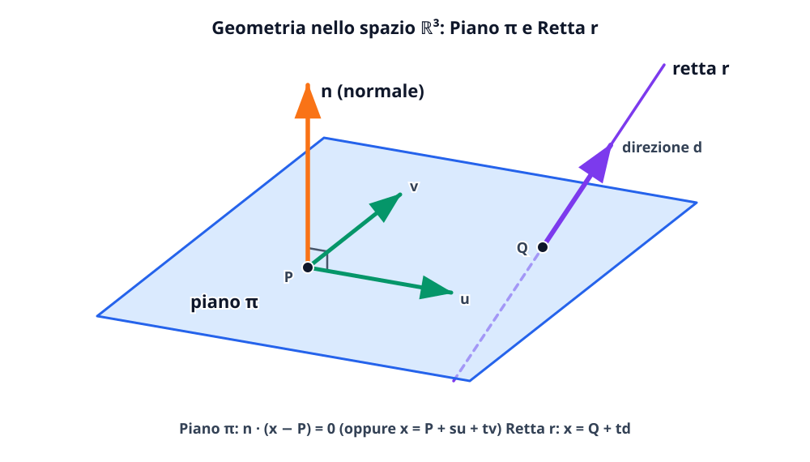

# Cenni di geometria dello spazio

Nello spazio cartesiano tridimensionale $\mathbb{R}^3$ ogni punto è individuato da una terna ordinata di coordinate $(x, y, z)$. Combinando il calcolo vettoriale (prodotto scalare e prodotto vettoriale) con la teoria dei sistemi lineari possiamo descrivere analiticamente **rette** e **piani** nello spazio, passare da una forma all'altra delle loro equazioni, studiarne le posizioni reciproche (parallelismo, perpendicolarità, incidenza, rette sghembe) e calcolare le distanze metriche.

## Punti, vettori e distanza in $\mathbb{R}^3$

Dati due punti $P = (x_1, y_1, z_1)$ e $Q = (x_2, y_2, z_2)$ nello spazio $\mathbb{R}^3$, il vettore spostamento applicato in $P$ che punta verso $Q$ si ottiene sottraendo le coordinate del punto iniziale da quelle del punto finale:
$$
\overrightarrow{PQ} = Q - P = (x_2 - x_1,\; y_2 - y_1,\; z_2 - z_1).
$$
La **distanza euclidea** tra $P$ e $Q$ è la norma del vettore $\overrightarrow{PQ}$:
$$
d(P, Q) = \|\overrightarrow{PQ}\| = \sqrt{(x_2 - x_1)^2 + (y_2 - y_1)^2 + (z_2 - z_1)^2},
$$
mentre il **punto medio** del segmento $PQ$ ha coordinate $M = \left(\frac{x_1+x_2}{2},\, \frac{y_1+y_2}{2},\, \frac{z_1+z_2}{2}\right)$.

## Equazioni della retta nello spazio

Una retta $r$ in $\mathbb{R}^3$ è univocamente determinata assegnando un **punto di passaggio** $P_0 = (x_0, y_0, z_0) \in r$ e un **vettore direzione** (o vettore direttore) non nullo $\mathbf{v} = (l, m, n) \neq (0, 0, 0)$ (oppure assegnando due punti distinti $P_0, P_1 \in r$, nel qual caso il vettore direzione è $\mathbf{v} = \overrightarrow{P_0 P_1}$).

### 1. Equazione vettoriale ed equazioni parametriche

Un generico punto $P = (x, y, z)$ appartiene alla retta $r$ se e solo se il vettore $\overrightarrow{P_0 P} = P - P_0$ è multiplo scalare del vettore direzione $\mathbf{v}$:
$$
P = P_0 + t\mathbf{v}, \qquad t \in \mathbb{R} \qquad \text{(forma vettoriale)}.
$$
Esplicitando le tre componenti si ottengono le **equazioni parametriche della retta** (con **un solo** parametro libero $t \in \mathbb{R}$, perché la retta ha dimensione $1$):
$$
r:\ \begin{cases}
x = x_0 + l t \\
y = y_0 + m t \\
z = z_0 + n t
\end{cases} \qquad (t \in \mathbb{R}).
$$
I coefficienti $(l, m, n)$ che moltiplicano il parametro $t$ si chiamano **parametri direttori** della retta (e sono definiti a meno di un fattore di proporzionalità non nullo: $(2, -4, 6)$ individua la stessa direzione di $(1, -2, 3)$).

### 2. Equazioni frazionarie (o simmetriche) ed equazioni cartesiane della retta

Se tutte e tre le componenti del vettore direzione sono diverse da zero ($l \neq 0, m \neq 0, n \neq 0$), ricavando $t$ da ciascuna equazione e uguagliando si ottiene la **forma simmetrica (o frazionaria)**:
$$
\frac{x - x_0}{l} = \frac{y - y_0}{m} = \frac{z - z_0}{n}.
$$
*(Se una componente del vettore direzione è nulla, ad esempio $l = 0$ mentre $m, n \neq 0$, non si può dividere per $0$: la prima equazione resta semplicemente $x = x_0$, affiancata a $\frac{y - y_0}{m} = \frac{z - z_0}{n}$).*

Prendendo a sistema due delle uguaglianze sopra si ottiene un sistema lineare di **due equazioni cartesiane nelle tre incognite $(x, y, z)$**:
$$
r:\ \begin{cases}
a_1 x + b_1 y + c_1 z + d_1 = 0 \\
a_2 x + b_2 y + c_2 z + d_2 = 0.
\end{cases}
$$
Geometricamente, nello spazio $\mathbb{R}^3$ una singola equazione lineare rappresenta un piano, mentre **una retta in forma cartesiana è descritta come intersezione di due piani non paralleli** (la matrice $2 \times 3$ dei coefficienti ha rango $2$).

### Conversione dalla forma cartesiana alla forma parametrica della retta

Data una retta come intersezione di due piani $\pi_1: a_1 x + b_1 y + c_1 z + d_1 = 0$ (con normale $\mathbf{n}_1 = (a_1, b_1, c_1)$) e $\pi_2: a_2 x + b_2 y + c_2 z + d_2 = 0$ (con normale $\mathbf{n}_2 = (a_2, b_2, c_2)$), come si trovano le sue equazioni parametriche e il suo vettore direzione $\mathbf{v}$? Ci sono due metodi:
1. **Metodo algebrico (per sostituzione):** si pone una delle tre variabili uguale al parametro $t$ (ad esempio $z = t$) e si risolve il sistema $2 \times 2$ rispetto alle altre due variabili $x(t)$ e $y(t)$ in funzione di $t$.
2. **Metodo geometrico col prodotto vettoriale:** poiché la retta $r = \pi_1 \cap \pi_2$ giace contemporaneamente su $\pi_1$ e su $\pi_2$, il suo vettore direzione $\mathbf{v}$ deve essere ortogonale sia a $\mathbf{n}_1$ sia a $\mathbf{n}_2$! Pertanto il vettore direzione di $r$ è dato direttamente dal **prodotto vettoriale delle due normali**:
$$
\mathbf{v} = \mathbf{n}_1 \times \mathbf{n}_2.
$$

## Equazioni del piano nello spazio

### 1. Forma parametrica e piano per tre punti non allineati

Un piano $\pi$ nello spazio (oggetto bidimensionale) è individuato da un punto $P_0 = (x_0, y_0, z_0) \in \pi$ e da **due vettori giacitura non paralleli** (linearmente indipendenti) $\mathbf{u} = (u_1, u_2, u_3)$ e $\mathbf{v} = (v_1, v_2, v_3)$ paralleli al piano:
$$
P = P_0 + \alpha \mathbf{u} + \beta \mathbf{v}, \qquad \alpha, \beta \in \mathbb{R} \qquad \text{(dipende da 2 parametri liberi)}.
$$
Se il piano è assegnato tramite **tre punti non allineati $A, B, C \in \mathbb{R}^3$**, si scelgono come punto base $P_0 = A$ e come vettori giacitura $\mathbf{u} = \overrightarrow{AB} = B - A$ e $\mathbf{v} = \overrightarrow{AC} = C - A$.

### 2. Forma cartesiana e vettore normale al piano

Molto più compatta è la descrizione di un piano tramite il suo **vettore normale** (perpendicolare al piano) $\mathbf{n} = (a, b, c) \neq (0, 0, 0)$. Un punto $P = (x, y, z)$ appartiene al piano $\pi$ passante per $P_0 = (x_0, y_0, z_0)$ e perpendicolare a $\mathbf{n} = (a, b, c)$ se e solo se il vettore $\overrightarrow{P_0 P}$ è ortogonale a $\mathbf{n}$:
$$
\mathbf{n} \cdot \overrightarrow{P_0 P} = 0 \iff a(x - x_0) + b(y - y_0) + c(z - z_0) = 0.
$$
Sviluppando i prodotti e ponendo $d = -(ax_0 + by_0 + cz_0)$ si ottiene l'**equazione cartesiana generale del piano**:
$$
\pi:\quad ax + by + cz + d = 0.
$$
> [!important] Lettura immediata del vettore normale
> Data l'equazione cartesiana di un piano $ax + by + cz + d = 0$, i tre coefficienti delle incognite forniscono immediatamente le componenti di un **vettore normale (perpendicolare) al piano**:
> $$\mathbf{n} = (a, b, c) \perp \pi.$$
> Se il piano è assegnato mediante tre punti non allineati $A, B, C$ (o tramite due vettori giacitura $\mathbf{u}, \mathbf{v}$), il vettore normale $\mathbf{n}$ si calcola immediatamente con il **prodotto vettoriale**:
> $$\mathbf{n} = \overrightarrow{AB} \times \overrightarrow{AC} = \mathbf{u} \times \mathbf{v}.$$

## Posizioni reciproche nello spazio

> [!warning] Regola d'oro: non confondere il vettore direzione $\mathbf{v}$ di una retta col vettore normale $\mathbf{n}$ di un piano!
> - Una retta $r$ è individuata dal suo vettore **direzione** $\mathbf{v} \parallel r$.
> - Un piano $\pi$ è individuato dal suo vettore **normale** $\mathbf{n} \perp \pi$.
> Di conseguenza, nelle condizioni tra **retta e piano** i ruoli di parallelismo e ortogonalità tra $\mathbf{v}$ e $\mathbf{n}$ sono **scambiati** rispetto ai casi retta-retta e piano-piano!

| Coppia di oggetti | Condizione di **Parallelismo** ($\parallel$) | Condizione di **Ortogonalità** ($\perp$) |
| --- | --- | --- |
| **Due rette** $r_1, r_2$ (direzioni $\mathbf{v}_1, \mathbf{v}_2$) | $\mathbf{v}_1 \parallel \mathbf{v}_2 \iff \mathbf{v}_1 = \lambda \mathbf{v}_2$ ($\mathbf{v}_1 \times \mathbf{v}_2 = \mathbf{0}$) | Direzioni ortogonali: $\mathbf{v}_1 \cdot \mathbf{v}_2 = 0$ |
| **Due piani** $\pi_1, \pi_2$ (normali $\mathbf{n}_1, \mathbf{n}_2$) | $\mathbf{n}_1 \parallel \mathbf{n}_2 \iff \mathbf{n}_1 = \lambda \mathbf{n}_2$ | $\mathbf{n}_1 \perp \mathbf{n}_2 \iff \mathbf{n}_1 \cdot \mathbf{n}_2 = 0$ |
| **Una retta $r$ ($\mathbf{v}$) e un piano $\pi$ ($\mathbf{n}$)** | $r \parallel \pi \iff \mathbf{v} \perp \mathbf{n} \iff \mathbf{v} \cdot \mathbf{n} = 0$ | $r \perp \pi \iff \mathbf{v} \parallel \mathbf{n} \iff \mathbf{v} = \lambda \mathbf{n}$ |

### Posizioni reciproche di due rette in $\mathbb{R}^3$: incidenti, parallele o sghembe

Nel piano $\mathbb{R}^2$ due rette non parallele si intersecano sempre in un punto. Nello spazio $\mathbb{R}^3$, invece, due rette $r_1$ e $r_2$ (con direzioni $\mathbf{v}_1$ e $\mathbf{v}_2$) possono trovarsi in quattro posizioni:
1. **Coincidenti** ($\mathbf{v}_1 \parallel \mathbf{v}_2$ e hanno tutti i punti in comune);
2. **Parallele disgiunte** ($\mathbf{v}_1 \parallel \mathbf{v}_2$ e non hanno punti in comune: complanari);
3. **Incidenti** ($\mathbf{v}_1 \nparallel \mathbf{v}_2$ e hanno **un unico punto di intersezione** $P = r_1 \cap r_2$: complanari);
4. **Sghembe** ($\mathbf{v}_1 \nparallel \mathbf{v}_2$ e **non hanno alcun punto di intersezione**: non esiste alcun piano che le contenga entrambe!).

Per stabilire se due rette non parallele sono incidenti o sghembe, si mettono a sistema le loro equazioni parametriche (usando **due nomi diversi per i parametri**, ad esempio $t$ per $r_1$ e $s$ per $r_2$!): se il sistema di $3$ equazioni nelle $2$ incognite $(t, s)$ ha soluzione unica le rette sono **incidenti**; se è impossibile sono **sghembe**.

## Distanze metriche nello spazio

### 1. Distanza punto-piano

Dato un punto $P_0 = (x_0, y_0, z_0)$ e un piano $\pi: ax + by + cz + d = 0$ (con normale $\mathbf{n} = (a, b, c)$), la distanza di $P_0$ da $\pi$ (lunghezza del segmento di perpendicolare condotto da $P_0$ a $\pi$) è data dalla formula:
$$
d(P_0, \pi) = \frac{|ax_0 + by_0 + cz_0 + d|}{\sqrt{a^2 + b^2 + c^2}}.
$$

### 2. Distanza punto-retta nello spazio

Dato un punto $P_0$ e una retta $r$ passante per $Q \in r$ con vettore direzione $\mathbf{v}$, la distanza $d(P_0, r)$ si può calcolare in due modi equivalenti:
- **Metodo 1 (Con il prodotto vettoriale - rapidissimo):** l'area del parallelogramma generato da $\overrightarrow{QP_0}$ e $\mathbf{v}$ è $\|\overrightarrow{QP_0} \times \mathbf{v}\| = \text{base} \cdot \text{altezza} = \|\mathbf{v}\| \cdot d(P_0, r)$, da cui:
$$
d(P_0, r) = \frac{\|\overrightarrow{QP_0} \times \mathbf{v}\|}{\|\mathbf{v}\|}.
$$
- **Metodo 2 (Costruzione geometrica della proiezione ortogonale $H \in r$):** si scrive il punto mobile di $r$ come $P(t) = (x(t), y(t), z(t))$ e si impone che il vettore $\overrightarrow{P_0 P(t)}$ sia ortogonale a $\mathbf{v}$ ($\overrightarrow{P_0 P(t)} \cdot \mathbf{v} = 0$) oppure si interseca $r$ con il piano per $P_0$ perpendicolare a $r$. Trovato il piede della perpendicolare $H = P(t^*)$, si ha $d(P_0, r) = d(P_0, H)$ e la retta per $P_0$ e $H$ è l'unica retta per $P_0$ perpendicolare e incidente a $r$.

## Esempi guidati

### Esempio 1: Conversione di una retta da forma cartesiana a parametrica e intersezione con un piano

Sia data la retta $r$ come intersezione di due piani e sia dato il piano $\pi$:
$$
r:\ \begin{cases}
x - y + z = 1 \\
2x + y - 3z = 2
\end{cases}, \qquad \pi:\ x + 2y + z - 6 = 0.
$$
Scriviamo le equazioni parametriche di $r$, determiniamo il suo vettore direzione $\mathbf{v}$ e studiamo la posizione reciproca tra $r$ e $\pi$ trovandone l'eventuale punto di intersezione.

**Passaggi:**
1. **Forma parametrica di $r$:** poniamo $z = t \in \mathbb{R}$ nel sistema di $r$:
   $$\begin{cases}
   x - y = 1 - t \\
   2x + y = 2 + 3t.
   \end{cases}$$
   Sommando membro a membro le due equazioni otteniamo $3x = 3 + 2t \implies x = 1 + \frac{2}{3}t$, e dalla prima $y = x - 1 + t = \frac{5}{3}t$.
   Quindi la retta $r$ passa per $P_0 = (1, 0, 0)$ e ha vettore direzione $\left(\frac{2}{3}, \frac{5}{3}, 1\right)$, o equivalentemente (moltiplicando per $3$ per eliminare le frazioni) $\mathbf{v} = (2, 5, 3)$. Riscrivendo col parametro riscalato $\lambda = t/3$:
   $$r:\ \begin{cases}
   x = 1 + 2\lambda \\
   y = 5\lambda \\
   z = 3\lambda
   \end{cases} \quad (\lambda \in \mathbb{R}).$$
   *(Verifica col prodotto vettoriale delle normali $\mathbf{n}_1 = (1, -1, 1)$ e $\mathbf{n}_2 = (2, 1, -3)$: $\mathbf{n}_1 \times \mathbf{n}_2 = (3 - 1,\ 2 + 3,\ 1 + 2) = (2, 5, 3)$, identico!).*
2. **Intersezione $r \cap \pi$:** il vettore normale a $\pi$ è $\mathbf{n} = (1, 2, 1)$. Poiché $\mathbf{v} \cdot \mathbf{n} = 2(1) + 5(2) + 3(1) = 15 \neq 0$, la retta non è parallela al piano e lo interseca in un unico punto. Sostituiamo le equazioni parametriche di $r$ nell'equazione di $\pi$:
   $$(1 + 2\lambda) + 2(5\lambda) + (3\lambda) - 6 = 0 \implies 15\lambda - 5 = 0 \implies \lambda = \frac{1}{3}.$$
   Sostituendo $\lambda = \frac{1}{3}$ nelle equazioni di $r$ troviamo il punto di intersezione $Q = \left(\frac{5}{3},\, \frac{5}{3},\, 1\right)$.

### Esempio 2: Equazione del piano passante per tre punti non allineati

Determiniamo l'equazione cartesiana del piano $\pi$ passante per i tre punti $A(1, 1, 0)$, $B(2, 0, 1)$ e $C(0, -1, 2)$.

**Passaggi:**
1. Calcoliamo i due vettori giacitura uscenti da $A$:
   $$\mathbf{u} = \overrightarrow{AB} = B - A = (1, -1, 1), \qquad \mathbf{v} = \overrightarrow{AC} = C - A = (-1, -2, 2).$$
2. Calcoliamo un vettore normale $\mathbf{n} = (a, b, c)$ al piano tramite il prodotto vettoriale $\mathbf{u} \times \mathbf{v}$:
   $$\mathbf{n} = \overrightarrow{AB} \times \overrightarrow{AC} = \det\begin{pmatrix}
   \mathbf{i} & \mathbf{j} & \mathbf{k} \\
   1 & -1 & 1 \\
   -1 & -2 & 2
   \end{pmatrix} = (-2 + 2)\mathbf{i} - (2 + 1)\mathbf{j} + (-2 - 1)\mathbf{k} = (0, -3, -3).$$
   Possiamo scegliere il vettore normale semplificato proporzionale $\mathbf{n}' = (0, 1, 1)$ (dividendo per $-3$).
3. Imponiamo il passaggio per $A(1, 1, 0)$:
   $$0(x - 1) + 1(y - 1) + 1(z - 0) = 0 \implies \pi:\ y + z - 1 = 0.$$
   *(Verifica rapida: $A(1,1,0) \to 1+0-1=0$; $B(2,0,1) \to 0+1-1=0$; $C(0,-1,2) \to -1+2-1=0$. Tutti e tre appartengono al piano!).*

### Esempio 3: Retta per l'origine perpendicolare e incidente a una retta data, e distanza punto-retta

Data la retta $r:\ \begin{cases} x = 1 - k \\ y = 2 + k \\ z = 3 - k \end{cases}$ ($k \in \mathbb{R}$), determiniamo la proiezione ortogonale $H$ dell'origine $O(0, 0, 0)$ su $r$, la distanza $d(O, r)$ e l'equazione della retta $q$ passante per $O$ e perpendicolare (e incidente!) a $r$.

**Passaggi:**
1. Il vettore direzione di $r$ è $\mathbf{v} = (-1, 1, -1)$ e il generico punto mobile di $r$ è $P(k) = (1 - k,\ 2 + k,\ 3 - k)$.
2. Il vettore $\overrightarrow{OP(k)} = (1 - k,\ 2 + k,\ 3 - k)$ è perpendicolare a $r$ se e solo se il suo prodotto scalare con $\mathbf{v} = (-1, 1, -1)$ è nullo:
   $$\overrightarrow{OP(k)} \cdot \mathbf{v} = -(1 - k) + (2 + k) - (3 - k) = -2 + 3k = 0 \implies k = \frac{2}{3}.$$
3. Sostituendo $k = \frac{2}{3}$ in $P(k)$ otteniamo il piede della perpendicolare:
   $$H = P\left(\frac{2}{3}\right) = \left(\frac{1}{3},\, \frac{8}{3},\, \frac{7}{3}\right).$$
4. La distanza dell'origine dalla retta $r$ è:
   $$d(O, r) = \|\overrightarrow{OH}\| = \sqrt{\frac{1}{9} + \frac{64}{9} + \frac{49}{9}} = \frac{\sqrt{114}}{3}.$$
5. La retta $q$ cercata passa per $O(0, 0, 0)$ e ha direzione parallela a $\overrightarrow{OH}$, cioè $\mathbf{u}_q = 3\overrightarrow{OH} = (1, 8, 7)$:
   $$q:\ \begin{cases} x = t \\ y = 8t \\ z = 7t \end{cases} \quad (t \in \mathbb{R}).$$

## Errori frequenti

- **Usare lo stesso nome di parametro (es. $t$) per entrambe le rette quando si cerca l'intersezione tra due rette $r_1$ e $r_2$:** un punto di intersezione può essere raggiunto per $t = 2$ sulla prima retta e per $s = -1$ sulla seconda! Se usi la stessa lettera $t$ in entrambi i sistemi, stai cercando solo se i due punti mobili si scontrano «allo stesso istante $t$» e puoi sbagliare concludendo che le rette non si intersecano mentre sono incidenti.
- **Scambiare le condizioni di parallelismo e perpendicolarità tra retta e piano:** una retta di direzione $\mathbf{v}$ è **parallela** al piano di normale $\mathbf{n}$ quando $\mathbf{v} \cdot \mathbf{n} = 0$ (non quando $\mathbf{v}$ è proporzionale a $\mathbf{n}$, che è invece la condizione di perpendicolarità $r \perp \pi$!).
- **Pensare che una singola equazione $2x - y + 3z = 5$ nello spazio rappresenti una retta:** in $\mathbb{R}^3$ una singola equazione lineare rappresenta sempre un **piano** ($3 - 1 = 2$ gradi di libertà).
- **Concludere che due rette in $\mathbb{R}^3$ sono perpendicolari (e incidenti) solo perché $\mathbf{v}_1 \cdot \mathbf{v}_2 = 0$:** due rette con direzioni ortogonali nello spazio possono essere **sghembe** (come l'asse $x$ e la retta $y = t, z = 1$).

## Esercizi di prova

1. (**Base - Equazioni della retta per due punti e del piano ortogonale**) Dati i punti $A(1, -2, 3)$ e $B(3, 0, -1)$:
   (a) scrivi le equazioni parametriche e cartesiane della retta $r$ passante per $A$ e $B$;
   (b) scrivi l'equazione cartesiana del piano $\pi$ passante per $A$ e perpendicolare alla retta $r$.
> [!tip]- Soluzione
> - (a) Il vettore direzione è $\overrightarrow{AB} = B - A = (2, 2, -4)$, che è proporzionale a $\mathbf{v} = (1, 1, -2)$. Scegliendo $A(1, -2, 3)$ come punto base, le equazioni parametriche sono:
>   $$r:\ \begin{cases} x = 1 + t \\ y = -2 + t \\ z = 3 - 2t \end{cases} \quad (t \in \mathbb{R}).$$
>   Eliminando $t = x - 1$ otteniamo la forma simmetrica e cartesiana:
>   $$x - 1 = y + 2 = \frac{z - 3}{-2} \iff r:\ \begin{cases} x - y - 3 = 0 \\ 2x + z - 5 = 0. \end{cases}$$
> - (b) Poiché $\pi \perp r$, il vettore normale a $\pi$ coincide col vettore direzione di $r$, ossia $\mathbf{n} = (1, 1, -2)$. Imponendo il passaggio per $A(1, -2, 3)$:
>   $$1(x - 1) + 1(y + 2) - 2(z - 3) = 0 \implies \pi:\ x + y - 2z + 7 = 0.$$

2. (**Base - Distanza punto-piano e proiezione ortogonale di un punto su un piano**) Dato il punto $P(2, -1, 3)$ e il piano $\pi: 2x - 2y + z - 3 = 0$, calcola la distanza $d(P, \pi)$ e le coordinate della proiezione ortogonale $H$ di $P$ sul piano $\pi$.
> [!tip]- Soluzione
> - **Distanza $d(P, \pi)$:** applicando la formula della distanza punto-piano:
>   $$d(P, \pi) = \frac{|2(2) - 2(-1) + 1(3) - 3|}{\sqrt{2^2 + (-2)^2 + 1^2}} = \frac{|4 + 2 + 3 - 3|}{\sqrt{9}} = \frac{6}{3} = 2.$$
> - **Proiezione ortogonale $H$:** la retta $n$ passante per $P(2, -1, 3)$ e perpendicolare a $\pi$ ha vettore direzione uguale alla normale $\mathbf{n} = (2, -2, 1)$:
>   $$n:\ \begin{cases} x = 2 + 2t \\ y = -1 - 2t \\ z = 3 + t. \end{cases}$$
>   Intersechiamo $n$ con $\pi$:
>   $$2(2 + 2t) - 2(-1 - 2t) + (3 + t) - 3 = 0 \implies 4 + 4t + 2 + 4t + 3 + t - 3 = 0 \implies 9t + 6 = 0 \implies t = -\frac{2}{3}.$$
>   Sostituendo $t = -\frac{2}{3}$ troviamo $H = \left(\frac{2}{3},\, \frac{1}{3},\, \frac{7}{3}\right)$.

3. (**Intermedio - Posizione reciproca di due rette nello spazio: incidenti, parallele o sghembe**) Stabilisci la posizione reciproca delle due rette:
   $$r_1:\ \begin{cases} x = 1 + t \\ y = 2 - t \\ z = 2t \end{cases} (t \in \mathbb{R}), \qquad r_2:\ \begin{cases} x = 2 + 2s \\ y = 1 + s \\ z = 1 - s \end{cases} (s \in \mathbb{R}).$$
> [!tip]- Soluzione
> I vettori direzione sono $\mathbf{v}_1 = (1, -1, 2)$ e $\mathbf{v}_2 = (2, 1, -1)$. Poiché le loro componenti non sono proporzionali ($\frac{1}{2} \neq \frac{-1}{1}$), le due rette **non sono parallele**.
> Mettiamo a sistema le equazioni uguagliando le coordinate $(x, y, z)$ con parametri distinti $t$ e $s$:
> $$\begin{cases}
> 1 + t = 2 + 2s \\
> 2 - t = 1 + s \\
> 2t = 1 - s.
> \end{cases}$$
> Sommando le prime due equazioni otteniamo $3 = 3 + 3s \implies s = 0$, e dalla prima $t = 1$.
> Sostituiamo la coppia $(t, s) = (1, 0)$ nella **terza equazione** per verificare la compatibilità:
> $$2(1) = 1 - 0 \implies 2 = 1 \quad (\text{impossibile!}).$$
> Il sistema non ha soluzioni ($r_1 \cap r_2 = \varnothing$): poiché non sono parallele e non si intersecano, **$r_1$ e $r_2$ sono rette sghembe**.

4. (**Intermedio - Piano contenente una retta e passante per un punto esterno**) Determina l'equazione cartesiana del piano $\pi$ che contiene la retta $r:\ \begin{cases} x = 1 + 2t \\ y = -t \\ z = 2 + t \end{cases}$ e passa per il punto $Q(0, 1, 1)$.
> [!tip]- Soluzione
> Verifichiamo prima che $Q(0, 1, 1) \notin r$: per $y = 1$ serve $t = -1$, che dà $x = -1 \neq 0$.
> La retta $r$ passa per il punto $P_0(1, 0, 2)$ e ha vettore direzione $\mathbf{v} = (2, -1, 1)$.
> Il piano $\pi$ cercato contiene sia $P_0$ sia $Q$, quindi è generato dai due vettori giacitura $\mathbf{v} = (2, -1, 1)$ e $\overrightarrow{P_0 Q} = Q - P_0 = (-1, 1, -1)$.
> Calcoliamo il vettore normale $\mathbf{n} = \mathbf{v} \times \overrightarrow{P_0 Q}$:
> $$\mathbf{n} = \det\begin{pmatrix}
> \mathbf{i} & \mathbf{j} & \mathbf{k} \\
> 2 & -1 & 1 \\
> -1 & 1 & -1
> \end{pmatrix} = (1 - 1)\mathbf{i} - (-2 + 1)\mathbf{j} + (2 - 1)\mathbf{k} = (0, 1, 1).$$
> Imponendo il passaggio per $Q(0, 1, 1)$ otteniamo:
> $$0(x - 0) + 1(y - 1) + 1(z - 1) = 0 \implies \pi:\ y + z - 2 = 0.$$
> *(Verifica: per ogni punto di $r$ vale $y + z - 2 = (-t) + (2 + t) - 2 = 0$, quindi l'intera retta $r$ giace su $\pi$!).*

5. (**Intermedio - Distanza punto-retta nello spazio**) Calcola la distanza del punto $P(1, 2, 3)$ dalla retta $r$ di equazioni cartesiane $\begin{cases} x - y = 0 \\ z = 1 \end{cases}$.
> [!tip]- Soluzione
> Ponendo $y = t$, le equazioni parametriche di $r$ sono $\begin{cases} x = t \\ y = t \\ z = 1 \end{cases}$, quindi $r$ passa per $Q(0, 0, 1)$ e ha vettore direzione $\mathbf{v} = (1, 1, 0)$.
> Costruiamo il vettore $\overrightarrow{QP} = P - Q = (1, 2, 2)$ e calcoliamo il prodotto vettoriale $\overrightarrow{QP} \times \mathbf{v}$:
> $$\overrightarrow{QP} \times \mathbf{v} = \det\begin{pmatrix}
> \mathbf{i} & \mathbf{j} & \mathbf{k} \\
> 1 & 2 & 2 \\
> 1 & 1 & 0
> \end{pmatrix} = (-2, 2, -1).$$
> Applicando la formula della distanza punto-retta:
> $$d(P, r) = \frac{\|\overrightarrow{QP} \times \mathbf{v}\|}{\|\mathbf{v}\|} = \frac{\sqrt{(-2)^2 + 2^2 + (-1)^2}}{\sqrt{1^2 + 1^2 + 0^2}} = \frac{\sqrt{9}}{\sqrt{2}} = \frac{3}{\sqrt{2}} = \frac{3\sqrt{2}}{2}.$$

6. (**Esame - Posizione reciproca tra retta e piano al variare di un parametro $k$**) Siano dati il piano $\pi_k: kx + 2y - z + 1 = 0$ e la retta:
   $$r_k:\ \begin{cases}
   x = 1 + 2t \\
   y = -1 - kt \\
   z = k + 2t
   \end{cases} \quad (t \in \mathbb{R}).$$
   (a) Determina per quali valori di $k \in \mathbb{R}$ la retta $r_k$ è parallela al piano $\pi_k$, specificando se giace sul piano o è esterna ad esso.
   (b) Esistono valori di $k \in \mathbb{R}$ per cui la retta $r_k$ è perpendicolare al piano $\pi_k$?
> [!tip]- Soluzione
> Il vettore direzione di $r_k$ è $\mathbf{v}_k = (2, -k, 2)$, mentre il vettore normale a $\pi_k$ è $\mathbf{n}_k = (k, 2, -1)$.
> - (a) **Parallelismo ($r_k \parallel \pi_k$):** la retta è parallela al piano se e solo se $\mathbf{v}_k \perp \mathbf{n}_k$, cioè $\mathbf{v}_k \cdot \mathbf{n}_k = 0$:
>   $$2(k) + (-k)(2) + 2(-1) = 0 \implies 2k - 2k - 2 = 0 \implies -2 = 0,$$
>   che è impossibile! Quindi **per nessun valore di $k \in \mathbb{R}$** la retta $r_k$ è parallela a $\pi_k$: per ogni $k \in \mathbb{R}$ la retta interseca il piano in un unico punto.
> - (b) **Perpendicolarità ($r_k \perp \pi_k$):** la retta è perpendicolare al piano se e solo se $\mathbf{v}_k = (2, -k, 2)$ è parallelo (proporzionale) a $\mathbf{n}_k = (k, 2, -1)$, ossia se esiste $\lambda \in \mathbb{R}$ tale che $(2, -k, 2) = \lambda(k, 2, -1)$.
>   Dalla terza componente $2 = -\lambda \implies \lambda = -2$. Sostituendo $\lambda = -2$ nelle prime due componenti otteniamo il sistema:
>   $$\begin{cases}
>   2 = -2k \implies k = -1 \\
>   -k = -4 \implies k = 4,
>   \end{cases}$$
>   che è incompatibile. Pertanto **non esiste alcun $k \in \mathbb{R}$** per cui $r_k \perp \pi_k$.

## Provenienza del materiale

Sintesi ragionata ed estesa della lezione `C1MAT1U3L6_Cenni_di_geometria_dello_spazio.pdf` e degli `Appunti_di_Fine_Unità_3.pdf` (Corso di Matematica 1, CdL in Sicurezza Informatica / SecAI - Università degli Studi di Milano), con conversione tra forme della retta, piano per tre punti e distanza punto-retta.
