# Funzioni logaritmiche ed esponenziali

Le **funzioni esponenziali** ($y = a^x$) e le **funzioni logaritmiche** ($y = \log_a x$) costituiscono, insieme alle funzioni goniometriche, la famiglia delle **funzioni trascendenti elementari**. Descrivono tutti i processi in cui il tasso di variazione di una grandezza è proporzionale alla grandezza stessa (crescita di popolazioni, interesse composto, decadimento radioattivo, complessità computazionale $O(\log n)$ e $O(2^n)$, entropia dell'informazione). In questa lezione studiamo le loro proprietà analitiche e grafiche al variare della base $a$, la simmetria tra $e^x$ e $\ln x$, le funzioni composte $a^{f(x)}$, $\log_a(f(x))$ e $[f(x)]^{g(x)}$, e la gerarchia delle velocità di crescita all'infinito.

## La funzione esponenziale $y = a^x$

Fissato un numero reale **strettamente positivo e diverso da $1$** ($a > 0, a \neq 1$), la **funzione esponenziale di base $a$** è definita da:
$$
f: \mathbb{R} \to (0, +\infty), \qquad f(x) = a^x.
$$
*(Si esclude $a \leq 0$ perché potenze come $(-2)^{1/2}$ non esistono in $\mathbb{R}$, e si esclude $a = 1$ perché $1^x = 1$ si riduce alla retta costante orizzontale).*

### Proprietà analitiche e grafiche di $y = a^x$

1. **Dominio naturale:** $\operatorname{Dom}(a^x) = \mathbb{R} = (-\infty, +\infty)$ (l'esponenziale con base costante $a > 0$ esiste per qualunque esponente reale e non impone alcuna condizione di esistenza!).
2. **Positività stretta e insieme immagine:** per ogni $x \in \mathbb{R}$ vale sempre **$a^x > 0$** (un esponenziale **non si annulla mai** e **non è mai negativo**!). L'insieme immagine è l'intera semiretta positiva:
$$
\operatorname{Im}(a^x) = (0, +\infty).
$$
3. **Passaggio per il punto fisso $(0, 1)$:** poiché $a^0 = 1$ per ogni base $a > 0$, tutti i grafici esponenziali intersecano l'asse $y$ nel punto $(0, 1)$ (e passano per $(1, a)$).
4. **Monotonia e asintoto orizzontale in base a $a > 1$ oppure $0 < a < 1$:**
   - **Caso $a > 1$ (es. $y = 2^x$, $y = e^x$, $y = 10^x$):** la funzione è **strettamente crescente** su tutto $\mathbb{R}$ ($x_1 < x_2 \iff a^{x_1} < a^{x_2}$). Per $x \to +\infty$ cresce illimitatamente ($a^x \to +\infty$), mentre per $x \to -\infty$ tende a $0^+$ (**l'asse $x$ di equazione $y = 0$ è asintoto orizzontale sinistro**). Inoltre $a^x > 1 \iff x > 0$ e $0 < a^x < 1 \iff x < 0$.
   - **Caso $0 < a < 1$ (es. $y = (1/2)^x = 2^{-x}$):** la funzione è **strettamente decrescente** su tutto $\mathbb{R}$ ($x_1 < x_2 \iff a^{x_1} > a^{x_2}$: nelle disequazioni si inverte il verso!). Per $x \to -\infty$ diverge a $+\infty$, mentre per $x \to +\infty$ tende a $0^+$ (**$y = 0$ è asintoto orizzontale destro**). Inoltre $a^x > 1 \iff x < 0$ e $0 < a^x < 1 \iff x > 0$.
   - *Simmetria tra base $a$ e base $1/a$:* poiché $\left(\frac{1}{a}\right)^x = a^{-x}$, il grafico di $\left(\frac{1}{a}\right)^x$ è il simmetrico del grafico di $a^x$ rispetto all'**asse $y$**.
5. **Proprietà algebriche delle potenze:** per ogni $x, y \in \mathbb{R}$,
$$
a^{x+y} = a^x \cdot a^y, \qquad a^{x-y} = \frac{a^x}{a^y}, \qquad (a^x)^y = a^{xy}, \qquad a^{-x} = \frac{1}{a^x}.
$$

### Il numero di Nepero $e$ e l'esponenziale naturale $y = e^x$

In analisi matematica la base privilegiata è il **numero di Nepero** (o costante di Eulero) $e$, un numero irrazionale trascendente definito come il limite fondamentale:
$$
e = \lim_{n \to +\infty}\left(1 + \frac{1}{n}\right)^n \approx 2.7182818\dots > 1.
$$
La funzione $y = e^x$ (scritta anche $\exp(x)$) è l'unica funzione esponenziale la cui retta tangente nel punto $(0, 1)$ ha coefficiente angolare esattamente uguale a $1$ (cioè coincide con la propria derivata: $(e^x)' = e^x$).

## La funzione logaritmica $y = \log_a x$

Poiché la funzione esponenziale $f: \mathbb{R} \to (0, +\infty)$, $f(x) = a^x$ (con $a > 0, a \neq 1$) è strettamente monotona, è **biiettiva** da $\mathbb{R}$ in $(0, +\infty)$. La sua **funzione inversa** si chiama **logaritmo in base $a$**:
$$
\log_a : (0, +\infty) \to \mathbb{R}, \qquad y = \log_a x \iff a^y = x \qquad (\forall x > 0,\ \forall y \in \mathbb{R}).
$$
- Quando la base è il numero di Nepero $e$, si parla di **logaritmo naturale** (o neperiano) e si scrive $\ln x = \log_e x$.
- Quando la base è $10$, si parla di **logaritmo decimale** $\log_{10} x$ (o $\operatorname{Log} x$); in informatica si usa spesso $\log_2 x$.

### Proprietà analitiche e grafiche di $y = \log_a x$

Essendo la funzione inversa di $y = a^x$, il grafico di $y = \log_a x$ è il **simmetrico del grafico di $y = a^x$ rispetto alla bisettrice $y = x$**, e dominio e immagine si scambiano di ruolo:

1. **Dominio naturale (C.E.):** il logaritmo esiste **esclusivamente per argomenti strettamente positivi**:
$$
\operatorname{Dom}(\log_a) = (0, +\infty) \iff x > 0.
$$
2. **Insieme immagine e segno:** $\operatorname{Im}(\log_a) = \mathbb{R} = (-\infty, +\infty)$ (il logaritmo può assumere valori positivi, nulli e negativi!).
3. **Zero del logaritmo e punto fisso $(1, 0)$:** poiché $a^0 = 1$, per ogni base $a$ vale sempre:
$$
\log_a 1 = 0 \qquad \text{e} \qquad \log_a a = 1.
$$
4. **Monotonia, segno e asintoto verticale in base a $a > 1$ oppure $0 < a < 1$:**
   - **Caso $a > 1$ (es. $y = \ln x$, $y = \log_2 x$, $y = \log_{10} x$):** la funzione è **strettamente crescente** su $(0, +\infty)$ ($0 < x_1 < x_2 \iff \log_a x_1 < \log_a x_2$). Per $x \to +\infty$ diverge a $+\infty$, mentre per $x \to 0^+$ diverge a $-\infty$ (**l'asse $y$ di equazione $x = 0$ è asintoto verticale**).
     Il segno (per $a > 1$) è:
     $$\log_a x > 0 \iff x > 1, \qquad \log_a x = 0 \iff x = 1, \qquad \log_a x < 0 \iff 0 < x < 1.$$
   - **Caso $0 < a < 1$ (es. $y = \log_{1/2} x = -\log_2 x$):** la funzione è **strettamente decrescente** su $(0, +\infty)$ ($0 < x_1 < x_2 \iff \log_a x_1 > \log_a x_2$: nelle disequazioni **si inverte il verso**!). Per $x \to 0^+$ diverge a $+\infty$ e per $x \to +\infty$ diverge a $-\infty$.
     Il segno (per $0 < a < 1$) è opposto:
     $$\log_a x > 0 \iff 0 < x < 1, \qquad \log_a x < 0 \iff x > 1.$$
5. **Proprietà algebriche dei logaritmi (per $x, y > 0$):**
$$
\begin{aligned}
\log_a(x \cdot y) &= \log_a x + \log_a y, & \log_a\left(\frac{x}{y}\right) &= \log_a x - \log_a y,\\
\log_a(x^\alpha) &= \alpha \log_a x \quad (\alpha \in \mathbb{R}), & \log_b x &= \frac{\log_a x}{\log_a b} = \frac{\ln x}{\ln b} \quad (\text{cambio di base}).
\end{aligned}
$$
In particolare $\log_{1/a} x = \frac{\ln x}{\ln(1/a)} = -\log_a x$: il grafico di $\log_{1/a} x$ è il simmetrico di $\log_a x$ rispetto all'**asse $x$**.

## Funzioni composte: $a^{f(x)}$, $\log_a(f(x))$ e $[f(x)]^{g(x)}$

### 1. Funzioni esponenziali composte $y = a^{f(x)}$

- **Dominio:** coincide con il dominio dell'esponente, $\operatorname{Dom}\bigl(a^{f(x)}\bigr) = \operatorname{Dom}(f)$.
- **Segno:** è **sempre strettamente positiva** su tutto il suo dominio ($a^{f(x)} > 0 \ \forall x \in \operatorname{Dom}(f)$).
- **Monotonia:**
  - se **$a > 1$**, $a^{f(x)}$ ha la **stessa monotonia** dell'esponente $f(x)$ (cresce dove $f$ cresce, decresce dove $f$ decresce);
  - se **$0 < a < 1$**, $a^{f(x)}$ ha **monotonia opposta** a quella di $f(x)$.

### 2. Funzioni logaritmiche composte $y = \log_a\bigl(f(x)\bigr)$

- **Dominio:** si ottiene imponendo che $f(x)$ esista e sia **strettamente positiva**:
$$
\operatorname{Dom}\bigl(\log_a f(x)\bigr) = \bigl\{x \in \operatorname{Dom}(f) \;\big|\; f(x) > 0\bigr\}.
$$
- **Zeri e segno (per $a > 1$):**
  - $\log_a(f(x)) = 0 \iff f(x) = 1$;
  - $\log_a(f(x)) > 0 \iff f(x) > 1$ (mentre per $0 < a < 1$ equivale a $0 < f(x) < 1$).

### 3. Funzioni potenza-esponenziale a base ed esponente variabili $y = [f(x)]^{g(x)}$

Quando la variabile $x$ compare **sia nella base sia nell'esponente** (ad esempio $y = x^x$ oppure $y = (x - 1)^{\sin x}$), affinché la potenza reale ad esponente variabile sia ben definita si impone che **la base $f(x)$ sia strettamente positiva**, e si riscrive la funzione tramite l'identità fondamentale $A^B = e^{B \ln A}$:
$$
y = [f(x)]^{g(x)} = e^{g(x)\,\ln f(x)}, \qquad \text{con } \operatorname{Dom} = \bigl\{x \in \operatorname{Dom}(f) \cap \operatorname{Dom}(g) \;\big|\; f(x) > 0\bigr\}.
$$
*(Essendo della forma $e^{\text{qualcosa}}$, anche $[f(x)]^{g(x)}$ è sempre **strettamente positiva** su tutto il suo dominio!).*

## Confronto tra velocità di crescita per $x \to +\infty$

Quando $x$ diventa molto grande ($x \to +\infty$), le tre famiglie di funzioni crescenti — logaritmi $\log_a x$ ($a > 1$), potenze $x^\alpha$ ($\alpha > 0$) ed esponenziali $b^x$ ($b > 1$) — vanno tutte a $+\infty$, ma con **velocità radicalmente diverse**:
1. **La crescita esponenziale $b^x$ ($b > 1$) domina qualsiasi potenza $x^\alpha$**, per quanto grande sia l'esponente $\alpha > 0$ e per quanto vicino a $1$ sia $b > 1$:
   $$\text{per } x \text{ sufficientemente grande: } \quad b^x \gg x^\alpha.$$
2. **Qualsiasi potenza positiva $x^\alpha$ ($\alpha > 0$) domina qualsiasi potenza del logaritmo $(\ln x)^\beta$**: il logaritmo cresce a $+\infty$, ma con estrema lentezza (per far arrivare $\ln x$ a $100$ occorre $x = e^{100} \approx 2.68 \times 10^{43}$!).

Vale quindi la **gerarchia fondamentale degli infiniti** per $x \to +\infty$:
$$
\ln x \ll x^\alpha \ll b^x \qquad (\forall \alpha > 0,\ \forall b > 1).
$$

## Esempi guidati

### Esempio 1: Attenzione alla trasformazione $\ln(x^2)$ vs $2\ln x$

Confrontiamo le tre funzioni:
$$
f_1(x) = \ln(x^2), \qquad f_2(x) = 2\ln x, \qquad f_3(x) = 2\ln|x|.
$$

**Passaggi:**
1. **Dominio di $f_1(x) = \ln(x^2)$:** imponiamo $x^2 > 0 \iff x \neq 0$. Quindi $\operatorname{Dom}(f_1) = \mathbb{R} \setminus \{0\} = (-\infty, 0) \cup (0, +\infty)$, ed $f_1$ è una funzione **pari** (due rami simmetrici rispetto all'asse $y$).
2. **Dominio di $f_2(x) = 2\ln x$:** imponiamo $x > 0 \implies \operatorname{Dom}(f_2) = (0, +\infty)$ (un solo ramo nel semipiano destro!).
3. **Conclusione fondamentale:** $f_1(x)$ e $f_2(x)$ **NON sono la stessa funzione**, perché hanno domini diversi! L'identità corretta valida per ogni $x \neq 0$ richiede il valore assoluto:
   $$\ln(x^2) = \ln(|x|^2) = 2\ln|x| = f_3(x) \qquad \forall x \in \mathbb{R} \setminus \{0\}.$$
   Quindi **non applicare mai** la regola $\log_a(x^{2k}) = 2k\log_a x$ prima di aver determinato il dominio, oppure scrivi sempre $2k\log_a|x|$!

### Esempio 2: Studio di dominio, monotonia e immagine di un esponenziale composto

Studiamo il dominio, la parità, gli intervalli di monotonia e l'insieme immagine della funzione (legata alla campana di Gauss):
$$
f(x) = e^{1 - x^2}.
$$

**Passaggi:**
1. **Dominio e parità:** l'esponente $g(x) = 1 - x^2$ è un polinomio definito su tutto $\mathbb{R}$, quindi $\operatorname{Dom}(f) = \mathbb{R}$. Inoltre $f(-x) = e^{1 - (-x)^2} = e^{1 - x^2} = f(x)$, dunque $f$ è **pari** e strettamente positiva ($f(x) > 0$).
2. **Monotonia:** poiché la base dell'esponenziale è $e > 1$ (strettamente crescente), $f(x) = e^{g(x)}$ ha la stessa monotonia dell'esponente $g(x) = 1 - x^2$:
   - su $(-\infty, 0]$, $g(x) = 1 - x^2$ è strettamente crescente $\implies f(x)$ è **strettamente crescente**;
   - su $[0, +\infty)$, $g(x) = 1 - x^2$ è strettamente decrescente $\implies f(x)$ è **strettamente decrescente**.
   Il punto $x = 0$ è quindi il punto di **massimo assoluto** di $f$, con valore massimo $f(0) = e^1 = e$.
3. **Insieme immagine:** al variare di $x \in \mathbb{R}$, l'esponente $t = 1 - x^2$ varia nell'intervallo $(-\infty, 1]$. Di conseguenza $e^t$ assume tutti i valori in $(0, e^1]$, ossia:
   $$\operatorname{Im}(f) = (0, e].$$

### Esempio 3: Studio di una funzione con logaritmo di frazione e base minore di $1$

Determiniamo dominio, zeri e segno della funzione:
$$
f(x) = \log_{1/2}\left(\frac{x - 1}{x + 3}\right).
$$

**Passaggi:**
1. **Dominio (C.E.):** imponiamo l'argomento del logaritmo strettamente positivo (che garantisce anche $x \neq -3$):
   $$\frac{x - 1}{x + 3} > 0 \iff x < -3 \lor x > 1 \implies \operatorname{Dom}(f) = (-\infty, -3) \cup (1, +\infty).$$
2. **Zeri ($f(x) = 0$):**
   $$\log_{1/2}\left(\frac{x - 1}{x + 3}\right) = 0 \iff \frac{x - 1}{x + 3} = 1 \iff x - 1 = x + 3 \iff -1 = 3 \quad (\text{impossibile!}).$$
   La funzione non interseca mai l'asse $x$.
3. **Studio del segno ($f(x) > 0$):** poiché la base del logaritmo è $a = \frac{1}{2} \in (0, 1)$, il logaritmo è strettamente decrescente e **si inverte il verso della disuguaglianza** rispetto a $\log_{1/2}(1) = 0$:
   $$\log_{1/2}\left(\frac{x - 1}{x + 3}\right) > 0 = \log_{1/2}(1) \iff 0 < \frac{x - 1}{x + 3} < 1.$$
   Sull'insieme $\operatorname{Dom}(f)$ (dove la frazione è già $> 0$), resta da risolvere:
   $$\frac{x - 1}{x + 3} - 1 < 0 \iff \frac{x - 1 - x - 3}{x + 3} < 0 \iff \frac{-4}{x + 3} < 0 \iff x + 3 > 0 \iff x > -3.$$
   Intersecando con $\operatorname{Dom}(f) = (-\infty, -3) \cup (1, +\infty)$ otteniamo:
   - $f(x) > 0$ per $x \in (1, +\infty)$;
   - $f(x) < 0$ per $x \in (-\infty, -3)$.

## Errori frequenti

- **Inventare proprietà inesistenti per il logaritmo di una somma:** $\ln(a + b)$ **non è uguale** a $\ln a + \ln b$ (che vale invece $\ln(a \cdot b)$!), e $\frac{\ln a}{\ln b}$ **non è uguale** a $\ln(a - b)$ né a $\ln\left(\frac{a}{b}\right)$ (che vale invece $\ln a - \ln b$).
- **Dimenticare di invertire il verso della disequazione quando la base $a$ appartiene a $(0, 1)$:**
  $$\left(\frac{1}{3}\right)^x > \left(\frac{1}{3}\right)^2 \iff x < 2, \qquad \log_{1/3}(x) > 0 \iff 0 < x < 1.$$
- **Scrivere $e^{f(x)} = 0$ trovando soluzioni:** l'equazione $e^{f(x)} = 0$ (o più in generale $a^{f(x)} \leq 0$) è **sempre impossibile in $\mathbb{R}$**. In un prodotto come $(x^2 - 4)e^{-x} \geq 0$, il fattore $e^{-x}$ è sempre $> 0$ su tutto $\mathbb{R}$, quindi il segno dipende unicamente dal fattore $x^2 - 4$.
- **Usare le proprietà dei logaritmi ($\ln(f(x)g(x)) = \ln f(x) + \ln g(x)$) prima di aver fissato il dominio:** $\ln\bigl((x - 1)(x - 2)\bigr)$ esiste anche per $x < 1$ (dove entrambi i fattori sono negativi e il loro prodotto è positivo!), mentre $\ln(x - 1) + \ln(x - 2)$ esiste solo per $x > 2$.

## Esercizi di prova

1. (**Base - Dominio di funzioni logaritmiche ed esponenziali**) Determina il dominio naturale delle seguenti funzioni:
   (a) $f(x) = \ln(x^2 - 3x - 4)$;
   (b) $g(x) = e^{\frac{1}{x - 2}} + \ln(5 - x)$;
   (c) $h(x) = (x - 2)^{\sqrt{x + 1}}$.
> [!tip]- Soluzione
> - (a) Imponiamo l'argomento del logaritmo $> 0$:
>   $$x^2 - 3x - 4 > 0 \iff (x + 1)(x - 4) > 0 \iff x < -1 \lor x > 4 \implies \operatorname{Dom}(f) = (-\infty, -1) \cup (4, +\infty).$$
> - (b) L'esponenziale richiede che esista il suo esponente ($x - 2 \neq 0$), mentre il logaritmo richiede $5 - x > 0$:
>   $$\begin{cases} x \neq 2 \\ x < 5 \end{cases} \implies \operatorname{Dom}(g) = (-\infty, 2) \cup (2, 5).$$
> - (c) Per una potenza con esponente irrazionale $[f(x)]^{g(x)} = e^{\sqrt{x+1}\ln(x-2)}$, la base deve essere strettamente positiva ($x - 2 > 0$) e deve esistere la radice all'esponente ($x + 1 \geq 0$):
>   $$\begin{cases} x - 2 > 0 \implies x > 2 \\ x + 1 \geq 0 \implies x \geq -1 \end{cases} \implies \operatorname{Dom}(h) = (2, +\infty).$$

2. (**Base - Zeri e segno con fattore esponenziale**) Determina dominio, intersezioni con gli assi e segno della funzione:
   $$f(x) = (x^2 - 3x + 2)\,e^{-2x}.$$
> [!tip]- Soluzione
> - **Dominio:** $\operatorname{Dom}(f) = \mathbb{R}$.
> - **Intersezione con l'asse $y$ ($x = 0$):** $f(0) = 2 \cdot e^0 = 2 \implies (0, 2)$.
> - **Zeri ($f(x) = 0$) e segno ($f(x) > 0$):** poiché $e^{-2x} > 0$ per ogni $x \in \mathbb{R}$, il fattore esponenziale non si annulla mai ed è sempre positivo. Pertanto zeri e segno di $f(x)$ coincidono esattamente con quelli del trinomio $x^2 - 3x + 2 = (x - 1)(x - 2)$:
>   - $f(x) = 0 \iff x = 1 \lor x = 2$;
>   - $f(x) > 0 \iff x < 1 \lor x > 2$;
>   - $f(x) < 0 \iff 1 < x < 2$.

3. (**Intermedio - Dominio di una funzione con radice di un logaritmo**) Determina il dominio naturale della funzione:
   $$f(x) = \sqrt{\ln(x^2 - 3) - 1} + \sqrt{2 - \log_{1/3}(x)}.$$
> [!tip]- Soluzione
> Impostiamo il sistema con le condizioni di esistenza dei due logaritmi e delle due radici quadrate:
> $$\begin{cases}
> x^2 - 3 > 0 \\
> \ln(x^2 - 3) - 1 \geq 0 \\
> x > 0 \\
> 2 - \log_{1/3}(x) \geq 0.
> \end{cases}$$
> Risolviamo le disequazioni:
> - Dalla seconda: $\ln(x^2 - 3) \geq 1 = \ln e \iff x^2 - 3 \geq e \iff x^2 \geq 3 + e$ (che implica automaticamente $x^2 - 3 > 0$). Poiché la terza condizione impone $x > 0$, questa condizione diventa **$x \geq \sqrt{3 + e}$**.
> - Dalla quarta: $\log_{1/3}(x) \leq 2 = \log_{1/3}\left(\frac{1}{9}\right)$. Poiché la base $\frac{1}{3}$ è minore di $1$, invertiamo il verso della disuguaglianza: **$x \geq \frac{1}{9}$**.
>
> Intersecando $x \geq \sqrt{3 + e} \approx 2.39$ con $x \geq \frac{1}{9}$, prevale la condizione più restrittiva:
> $$\operatorname{Dom}(f) = \bigl[\sqrt{3 + e},\; +\infty\bigr).$$

4. (**Intermedio - Insieme immagine e funzione inversa**) Sia data la funzione $f(x) = \dfrac{e^{2x} - 1}{e^{2x} + 1}$.
   (a) Determina il dominio naturale e dimostra che $f$ è una funzione dispari.
   (b) Determina l'insieme immagine $\operatorname{Im}(f)$ e calcola la funzione inversa $f^{-1}: \operatorname{Im}(f) \to \mathbb{R}$.
> [!tip]- Soluzione
> - (a) Poiché $e^{2x} > 0 \implies e^{2x} + 1 \geq 1 \neq 0$, il dominio è $\operatorname{Dom}(f) = \mathbb{R}$. Inoltre:
>   $$f(-x) = \frac{e^{-2x} - 1}{e^{-2x} + 1} = \frac{\frac{1}{e^{2x}} - 1}{\frac{1}{e^{2x}} + 1} = \frac{1 - e^{2x}}{1 + e^{2x}} = -f(x),$$
>   quindi $f$ è dispari (è la *tangente iperbolica* $\tanh x$).
> - (b) Risolviamo l'equazione $f(x) = y$ rispetto a $x$:
>   $$\frac{e^{2x} - 1}{e^{2x} + 1} = y \iff e^{2x} - 1 = y\,e^{2x} + y \iff e^{2x}(1 - y) = 1 + y \iff e^{2x} = \frac{1 + y}{1 - y}.$$
>   Affinché esista $x \in \mathbb{R}$, poiché $e^{2x}$ assume tutti e soli i valori strettamente positivi $(0, +\infty)$, il secondo membro deve essere strettamente positivo:
>   $$\frac{1 + y}{1 - y} > 0 \iff -1 < y < 1 \implies \operatorname{Im}(f) = (-1, 1).$$
>   Applicando il logaritmo naturale per $y \in (-1, 1)$ troviamo l'inversa:
>   $$2x = \ln\left(\frac{1 + y}{1 - y}\right) \iff f^{-1}(y) = \frac{1}{2}\ln\left(\frac{1 + y}{1 - y}\right).$$

5. (**Intermedio - Equazioni e disequazioni riducibili a secondo grado in $e^x$ o $\ln x$**) Determina gli zeri e il segno della funzione:
   $$f(x) = \ln^2 x - 3\ln x + 2.$$
> [!tip]- Soluzione
> - **Dominio:** $x > 0 \implies \operatorname{Dom}(f) = (0, +\infty)$.
> - Ponendo la variabile ausiliaria $t = \ln x$, il trinomio diventa $t^2 - 3t + 2 = (t - 1)(t - 2)$:
>   $$f(x) = (\ln x - 1)(\ln x - 2).$$
> - **Zeri ($f(x) = 0$):** $\ln x = 1 \implies x = e$, oppure $\ln x = 2 \implies x = e^2$.
> - **Segno ($f(x) > 0$):** $(t - 1)(t - 2) > 0 \iff t < 1 \lor t > 2$, ossia:
>   $$\ln x < 1 \quad \lor \quad \ln x > 2 \iff 0 < x < e \quad \lor \quad x > e^2.$$
>   Quindi $f(x) > 0$ per $x \in (0, e) \cup (e^2, +\infty)$ e $f(x) < 0$ per $x \in (e, e^2)$.

6. (**Esame - Studio completo di una funzione logaritmico-esponenziale**) Determina il dominio, le intersezioni con gli assi e il segno della funzione:
   $$f(x) = \ln\left(\frac{e^x - 3}{e^x - 1}\right).$$
> [!tip]- Soluzione
> 1. **Dominio (C.E.):** imponiamo l'argomento del logaritmo strettamente positivo:
>    $$\frac{e^x - 3}{e^x - 1} > 0.$$
>    Poiché $e^x$ è strettamente crescente, $e^x - 3 > 0 \iff x > \ln 3$ e $e^x - 1 > 0 \iff x > \ln 1 = 0$. Dalla regola dei segni della frazione otteniamo:
>    $$\operatorname{Dom}(f) = (-\infty, 0) \cup (\ln 3, +\infty).$$
> 2. **Intersezioni con gli assi:**
>    - Asse $y$ ($x = 0$): non esiste perché $0 \notin \operatorname{Dom}(f)$.
>    - Asse $x$ ($f(x) = 0$):
>      $$\ln\left(\frac{e^x - 3}{e^x - 1}\right) = 0 \iff \frac{e^x - 3}{e^x - 1} = 1 \iff e^x - 3 = e^x - 1 \iff -3 = -1 \quad (\text{impossibile!}).$$
>      Non ci sono intersezioni con gli assi.
> 3. **Studio del segno ($f(x) > 0$):** poiché la base $e > 1$, $\ln(\text{arg}) > 0 \iff \text{arg} > 1$:
>    $$\frac{e^x - 3}{e^x - 1} - 1 > 0 \iff \frac{e^x - 3 - e^x + 1}{e^x - 1} > 0 \iff \frac{-2}{e^x - 1} > 0 \iff e^x - 1 < 0 \iff x < 0.$$
>    Intersecando con il dominio $\operatorname{Dom}(f) = (-\infty, 0) \cup (\ln 3, +\infty)$:
>    - $f(x) > 0$ per ogni $x \in (-\infty, 0)$;
>    - $f(x) < 0$ per ogni $x \in (\ln 3, +\infty)$.

## Provenienza del materiale

Sintesi ragionata ed estesa della lezione `C1MAT1U4L4_Funzioni_logaritmiche_ed_esponenziali.pdf` e degli `Appunti_di_Fine_Unità_4.pdf` (Corso di Matematica 1, CdL in Sicurezza Informatica / SecAI - Università degli Studi di Milano).
