# Zeri e segno di una funzione

Lo **studio preliminare di una funzione** reale di variabile reale $y = f(x)$ — costituito dal calcolo del **dominio (campo di esistenza)**, dall'analisi di **simmetrie e periodicità**, dalla ricerca delle **intersezioni con gli assi cartesiani (zeri)** e dallo **studio del segno** — permette già da solo di delimitare con precisione le **regioni del piano cartesiano in cui il grafico $\Gamma_f$ può esistere**, cancellando tutte le zone proibite. In questa lezione codifichiamo il protocollo operativo completo per affrontare senza errori qualsiasi funzione composta d'esame.

## Il protocollo operativo in 4 passi

Quando ti viene assegnata una funzione $y = f(x)$, segui rigorosamente questa sequenza ordinata di $4$ passi prima ancora di pensare a limiti o derivate:

### Passo 1: Classificazione e Dominio (Campo di Esistenza, C.E.)

Si classificano tutte le operazioni presenti nell'espressione di $f(x)$ (senza mai eseguire semplificazioni algebriche preventive!) e si mettono **a sistema ($\cap$, devono valere tutte contemporaneamente!)** le rispettive condizioni di esistenza secondo la tabella generale:

| Operazione / Funzione elementare presente in $f(x)$ | Condizione di Esistenza (C.E.) da mettere a sistema |
| --- | --- |
| Polinomi, $e^{g(x)}$, $\sin(g(x))$, $\cos(g(x))$, $\sqrt[2k+1]{g(x)}$, $\arctan(g(x))$ | Nessuna restrizione propria (richiedono solo che esista $g(x)$) |
| **Frazione / Rapporto** $\dfrac{N(x)}{D(x)}$ | **Denominatore diverso da zero:** $D(x) \neq 0$ |
| **Radice di indice PARI** $\sqrt[2k]{g(x)}$ ($k \geq 1$, es. $\sqrt{g(x)}$) | **Radicando maggiore o uguale a zero:** $g(x) \geq 0$ |
| **Logaritmo** $\log_a\bigl(g(x)\bigr)$ ($a > 0, a \neq 1$, es. $\ln g(x)$) | **Argomento strettamente positivo:** $g(x) > 0$ |
| **Tangente** $\tan\bigl(g(x)\bigr)$ | $g(x) \neq \dfrac{\pi}{2} + k\pi \quad (k \in \mathbb{Z})$ |
| **Cotangente** $\cot\bigl(g(x)\bigr)$ | $g(x) \neq k\pi \quad (k \in \mathbb{Z})$ |
| **Arcoseno / Arcocoseno** $\arcsin\bigl(g(x)\bigr)$ o $\arccos\bigl(g(x)\bigr)$ | **Argomento tra $-1$ e $1$:** $-1 \leq g(x) \leq 1$ |
| **Potenza a base ed esponente variabili** $[g(x)]^{h(x)}$ | **Base strettamente positiva:** $g(x) > 0$ (più C.E. di $g$ e $h$) |

> [!tip] Combinazioni frequenti: attenzione agli estremi!
> - Se una radice di indice pari si trova **al denominatore**, come in $\frac{1}{\sqrt{g(x)}}$, mettendo a sistema $g(x) \geq 0$ e $\sqrt{g(x)} \neq 0$ si ottiene la disuguaglianza **stretta** **$g(x) > 0$**!
> - Se un logaritmo si trova **al denominatore**, come in $\frac{1}{\ln g(x)}$, occorre imporre sia $g(x) > 0$ sia $\ln g(x) \neq 0 \iff \mathbf{g(x) \neq 1}$!

Una volta determinato il dominio $\operatorname{Dom}(f) \subseteq \mathbb{R}$, nel piano cartesiano si tracciano subito delle **rette verticali tratteggiate** nei punti di frontiera esclusi e si **barrano (cancellano) verticalmente** tutti gli intervalli di ascisse che non appartengono a $\operatorname{Dom}(f)$.

### Passo 2: Simmetrie (Parità / Disparità) e Periodicità

1. Si controlla a vista se il dominio $\operatorname{Dom}(f)$ appena trovato è **simmetrico rispetto all'origine** ($x \in \operatorname{Dom}(f) \iff -x \in \operatorname{Dom}(f)$):
   - se **non** è simmetrico, si scrive subito: *«Dominio non simmetrico $\implies f$ non è né pari né dispari»*;
   - se è simmetrico, si calcola $f(-x)$:
     - se $f(-x) = f(x)$, $f$ è **pari** (simmetrica rispetto all'asse $y$);
     - se $f(-x) = -f(x)$, $f$ è **dispari** (simmetrica rispetto all'origine $O(0, 0)$).
2. Se compaiono solo funzioni goniometriche, si verifica l'eventuale **periodicità** di periodo $T$.

### Passo 3: Intersezioni con gli assi cartesiani

1. **Intersezione con l'asse $y$ (asse delle ordinate, equazione $x = 0$):**
   - Si controlla prima se **$0 \in \operatorname{Dom}(f)$**! Se $0 \notin \operatorname{Dom}(f)$, non esiste alcuna intersezione con l'asse $y$.
   - Se $0 \in \operatorname{Dom}(f)$, basta sostituire $x = 0$ nella funzione calcolando l'unico punto $A = (0, f(0))$.
2. **Intersezioni con l'asse $x$ (asse delle ascisse, equazione $y = 0$, detti ZERI della funzione):**
   - Si risolve l'equazione $f(x) = 0$ cercando tutte le soluzioni reali $x_i$ che **appartengono a $\operatorname{Dom}(f)$** (scartando eventuali soluzioni non accettabili fuori dal dominio). I punti $(x_i, 0)$ vengono segnati con un pallino pieno sull'asse $x$.

### Passo 4: Studio del segno ($f(x) > 0$) e regioni nel piano cartesiano

Si risolve la disequazione:
$$
f(x) > 0 \qquad \text{per } x \in \operatorname{Dom}(f).
$$
- Se $f(x)$ è fattorizzata in prodotti e rapporti, come $f(x) = \frac{F_1(x) \cdot F_2(x)}{F_3(x)}$, conviene studiare separatamente dove ciascun fattore è $> 0$ ($F_1(x) > 0$, $F_2(x) > 0$, $F_3(x) > 0$) e combinare i risultati in un **quadro dei segni** (ricordando di **limitare il quadro solo agli intervalli appartenenti a $\operatorname{Dom}(f)$**).
- Sfruttare i **fattori sempre positivi sul dominio** per velocizzare i calcoli: fattori come $e^{g(x)}$, $x^2 + c$ (con $c > 0$), $\sqrt{g(x)}$ (per $g(x) > 0$) o $\arccos(g(x))$ (per $g(x) < 1$) sono sempre $> 0$ e non alterano mai il segno degli altri fattori!

#### Come riportare lo studio del segno nel piano cartesiano (cancellazione delle regioni escluse)
- Negli intervalli $(a, b) \subseteq \operatorname{Dom}(f)$ in cui risulta **$f(x) > 0$**, il grafico deve trovarsi **sopra l'asse $x$** ($y > 0$): si **cancella (ombreggia) la striscia sottostante $y < 0$**.
- Negli intervalli $(a, b) \subseteq \operatorname{Dom}(f)$ in cui risulta **$f(x) < 0$**, il grafico deve trovarsi **sotto l'asse $x$** ($y < 0$): si **cancella (ombreggia) la striscia soprastante $y > 0$**.

## Esempi guidati completi

### Esempio 1: Studio preliminare completo di una funzione razionale fratta

Eseguiamo lo studio preliminare completo (dominio, simmetrie, intersezioni e segno) della funzione:
$$
f(x) = \frac{x^3 - 4x}{x^2 - 1}.
$$

**Svolgimento passo-passo:**
1. **Dominio (C.E.):** imponiamo il denominatore diverso da zero:
   $$x^2 - 1 \neq 0 \iff x \neq \pm 1 \implies \operatorname{Dom}(f) = \mathbb{R} \setminus \{-1, 1\} = (-\infty, -1) \cup (-1, 1) \cup (1, +\infty).$$
2. **Simmetrie:** il dominio $\mathbb{R} \setminus \{-1, 1\}$ è simmetrico rispetto all'origine. Calcoliamo $f(-x)$:
   $$f(-x) = \frac{(-x)^3 - 4(-x)}{(-x)^2 - 1} = \frac{-x^3 + 4x}{x^2 - 1} = -\frac{x^3 - 4x}{x^2 - 1} = -f(x).$$
   Quindi $f$ è una **funzione dispari** (il grafico sarà simmetrico rispetto all'origine $O(0, 0)$).
3. **Intersezioni con gli assi:**
   - *Asse $y$ ($x = 0 \in \operatorname{Dom}(f)$):* $f(0) = 0 \implies O(0, 0)$ (come previsto per ogni funzione dispari definita in $0$).
   - *Asse $x$ ($f(x) = 0$):* annulliamo il numeratore $x^3 - 4x = 0 \iff x(x^2 - 4) = 0 \iff x(x + 2)(x - 2) = 0$, ottenendo i tre zeri accettabili:
     $$x_1 = -2, \quad x_2 = 0, \quad x_3 = 2 \quad \longrightarrow \quad (-2, 0),\ (0, 0),\ (2, 0).$$
4. **Studio del segno ($f(x) > 0$):** scriviamo $f(x) = \frac{x(x + 2)(x - 2)}{(x + 1)(x - 1)}$. I capisaldi ordinati sono $-2 < -1 < 0 < 1 < 2$:
   - $N(x) = x(x^2 - 4) > 0 \iff -2 < x < 0 \lor x > 2$;
   - $D(x) = x^2 - 1 > 0 \iff x < -1 \lor x > 1$.
   Combinando nella tabella dei segni:
   - $f(x) > 0$ per $x \in (-2, -1) \cup (0, 1) \cup (2, +\infty)$ (qui cancelliamo la parte sotto l'asse $x$);
   - $f(x) < 0$ per $x \in (-\infty, -2) \cup (-1, 0) \cup (1, 2)$ (qui cancelliamo la parte sopra l'asse $x$).

### Esempio 2: Studio preliminare completo di una funzione irrazionale fratta

Eseguiamo lo studio preliminare completo della funzione:
$$
f(x) = \frac{\sqrt{4 - x^2}}{x - 1}.
$$

**Svolgimento passo-passo:**
1. **Dominio (C.E.):** mettiamo a sistema la condizione della radice quadrata (indice pari) e quella del denominatore:
   $$\begin{cases}
   4 - x^2 \geq 0 \iff -2 \leq x \leq 2 \\
   x - 1 \neq 0 \iff x \neq 1
   \end{cases} \implies \operatorname{Dom}(f) = [-2, 1) \cup (1, 2].$$
   Nel piano cartesiano cancelliamo subito le regioni esterne $x < -2$ e $x > 2$, e tracciamo la retta verticale $x = 1$.
2. **Simmetrie:** poiché $-1 \in \operatorname{Dom}(f)$ ma $+1 \notin \operatorname{Dom}(f)$, il dominio **non è simmetrico** rispetto all'origine. Quindi $f$ non è né pari né dispari.
3. **Intersezioni con gli assi:**
   - *Asse $y$ ($x = 0 \in \operatorname{Dom}(f)$):* $f(0) = \frac{\sqrt{4}}{-1} = -2 \implies A(0, -2)$.
   - *Asse $x$ ($f(x) = 0$):* $\sqrt{4 - x^2} = 0 \iff 4 - x^2 = 0 \iff x = \pm 2 \in \operatorname{Dom}(f)$. I punti di intersezione con l'asse $x$ sono gli estremi del dominio $B(-2, 0)$ e $C(2, 0)$.
4. **Studio del segno ($f(x) > 0$) sul dominio $[-2, 1) \cup (1, 2]$:**
   - Il numeratore $\sqrt{4 - x^2}$ è **sempre $\geq 0$** su $[-2, 2]$ (ed è strettamente positivo su $(-2, 2)$).
   - Pertanto, per $x \in (-2, 1) \cup (1, 2)$, il segno di $f(x)$ dipende **esclusivamente dal denominatore $x - 1$**:
     - per $x \in (-2, 1)$: $x - 1 < 0 \implies f(x) < 0$;
     - per $x \in (1, 2)$: $x - 1 > 0 \implies f(x) > 0$;
     - per $x = \pm 2$: $f(\pm 2) = 0$.

### Esempio 3: Studio preliminare completo di una funzione logaritmica composta con radice

Eseguiamo lo studio preliminare completo della funzione:
$$
f(x) = \sqrt{\ln\left(\frac{x + 2}{x - 1}\right)}.
$$

**Svolgimento passo-passo:**
1. **Dominio (C.E.):** dobbiamo imporre il sistema formato da denominatore non nullo, argomento del logaritmo strettamente positivo e radicando della radice quadrata maggiore o uguale a zero:
   $$\begin{cases}
   x - 1 \neq 0 \\
   \dfrac{x + 2}{x - 1} > 0 \\
   \ln\left(\dfrac{x + 2}{x - 1}\right) \geq 0.
   \end{cases}$$
   **Osservazione strategica:** poiché la terza condizione equivale a $\frac{x + 2}{x - 1} \geq e^0 = 1$, se una quantità è $\geq 1$ allora è **automaticamente anche $> 0$**! Quindi la terza condizione assorbe già la seconda:
   $$\frac{x + 2}{x - 1} \geq 1 \iff \frac{x + 2}{x - 1} - 1 \geq 0 \iff \frac{x + 2 - x + 1}{x - 1} \geq 0 \iff \frac{3}{x - 1} \geq 0 \iff x - 1 > 0 \iff x > 1.$$
   Pertanto il dominio della funzione è semplicemente:
   $$\operatorname{Dom}(f) = (1, +\infty).$$
2. **Simmetrie:** il dominio $(1, +\infty)$ non è simmetrico $\implies$ né pari né dispari.
3. **Intersezioni con gli assi:**
   - *Asse $y$ ($x = 0$):* non esiste perché $0 \notin (1, +\infty)$.
   - *Asse $x$ ($f(x) = 0$):* $\sqrt{\ln\left(\frac{x + 2}{x - 1}\right)} = 0 \iff \frac{x + 2}{x - 1} = 1 \iff \frac{3}{x - 1} = 0$, impossibile! Non ci sono intersezioni con gli assi.
4. **Segno:** per ogni $x \in (1, +\infty)$, essendo una radice quadrata che non si annulla mai, vale sempre **$f(x) > 0$** (il grafico vive interamente nel primo quadrante per $x > 1$).

## Errori frequenti

- **Unire ($\cup$) invece di intersecare ($\cap$) le condizioni di esistenza del dominio:** tutte le parti della funzione devono esistere contemporaneamente, quindi le condizioni del dominio formano **sempre un sistema (intersezione)**! Invece nello studio del segno di un prodotto o rapporto si usa la **regola dei segni** ($+ \cdot - = -$), non l'intersezione.
- **Confondere la risoluzione di un sistema (linee continue, si prende dove tutte le righe sono verificate) con il quadro dei segni di una frazione (linee $+$ e $-$, si moltiplicano i segni):** è l'errore più diffuso nei compiti scritti!
  - Quando risolvi $f(x) = \frac{N(x)}{D(x)} > 0 \to$ fai la **tabella dei segni** ($+/-$).
  - Quando cerchi il dominio di $f(x) = \sqrt{A(x)} + \ln(B(x)) \to$ fai il **sistema di intersezione** ($A(x) \geq 0 \land B(x) > 0$).
- **Portare fuori o semplificare fattori senza controllarne il segno:** se dividi una disequazione $A(x) B(x) > 0$ per $A(x)$, sbagli laddove $A(x) < 0$; solo i fattori che sono **strettamente positivi su tutto il dominio** (come $e^{g(x)}$ o $x^2 + 1$) possono essere semplificati senza alterare il segno.

## Esercizi di prova

1. (**Base - Studio preliminare di una funzione razionale con valore assoluto**) Determina dominio, simmetrie, intersezioni con gli assi e segno della funzione:
   $$f(x) = \frac{x^2 - 9}{|x| - 2}.$$
> [!tip]- Soluzione
> 1. **Dominio:** $|x| - 2 \neq 0 \iff |x| \neq 2 \iff x \neq \pm 2 \implies \operatorname{Dom}(f) = \mathbb{R} \setminus \{-2, 2\}$.
> 2. **Simmetrie:** il dominio è simmetrico rispetto a $0$ e $f(-x) = \frac{(-x)^2 - 9}{|-x| - 2} = f(x)$, quindi **$f$ è pari**.
> 3. **Intersezioni con gli assi:**
>    - Asse $y$ ($x = 0 \in \operatorname{Dom}(f)$): $f(0) = \frac{-9}{-2} = \frac{9}{2} \implies \left(0, \frac{9}{2}\right)$.
>    - Asse $x$ ($f(x) = 0$): $x^2 - 9 = 0 \iff x = \pm 3 \in \operatorname{Dom}(f) \implies (-3, 0)$ e $(3, 0)$.
> 4. **Studio del segno ($f(x) > 0$):**
>    - $N(x) = x^2 - 9 > 0 \iff x < -3 \lor x > 3$;
>    - $D(x) = |x| - 2 > 0 \iff |x| > 2 \iff x < -2 \lor x > 2$.
>    Dal quadro dei segni coi capisaldi $-3 < -2 < 2 < 3$:
>    - $f(x) > 0$ per $x \in (-\infty, -3) \cup (-2, 2) \cup (3, +\infty)$;
>    - $f(x) < 0$ per $x \in (-3, -2) \cup (2, 3)$.

2. (**Intermedio - Studio preliminare di una funzione esponenziale fratta**) Determina dominio, intersezioni con gli assi e segno della funzione:
   $$f(x) = \frac{e^{2x} - 5e^x + 4}{e^x - 2}.$$
> [!tip]- Soluzione
> 1. **Dominio:** $e^x - 2 \neq 0 \iff e^x \neq 2 \iff x \neq \ln 2 \implies \operatorname{Dom}(f) = \mathbb{R} \setminus \{\ln 2\}$. (Dominio non simmetrico $\implies$ né pari né dispari).
> 2. **Intersezioni con gli assi:**
>    - Asse $y$ ($x = 0 \neq \ln 2$): $f(0) = \frac{1 - 5 + 4}{1 - 2} = 0 \implies O(0, 0)$.
>    - Asse $x$ ($f(x) = 0$): ponendo $t = e^x > 0$ al numeratore, risolviamo $t^2 - 5t + 4 = 0 \iff (t - 1)(t - 4) = 0 \iff e^x = 1 \lor e^x = 4 \iff x = 0 \lor x = \ln 4 = 2\ln 2$. I punti sono $(0, 0)$ e $(\ln 4, 0)$.
> 3. **Studio del segno ($f(x) > 0$):**
>    - $N(x) = (e^x - 1)(e^x - 4) > 0 \iff e^x < 1 \lor e^x > 4 \iff x < 0 \lor x > \ln 4$;
>    - $D(x) = e^x - 2 > 0 \iff x > \ln 2$.
>    Poiché $0 < \ln 2 < \ln 4$, dal quadro dei segni otteniamo:
>    - $f(x) > 0$ per $x \in (0, \ln 2) \cup (\ln 4, +\infty)$;
>    - $f(x) < 0$ per $x \in (-\infty, 0) \cup (\ln 2, \ln 4)$.

3. (**Intermedio - Studio preliminare di una funzione con logaritmo al denominatore**) Determina dominio, intersezioni con gli assi e segno della funzione:
   $$f(x) = \frac{x - 3}{\ln(x - 1)}.$$
> [!tip]- Soluzione
> 1. **Dominio:** dobbiamo imporre sia l'esistenza del logaritmo ($x - 1 > 0$) sia che il denominatore non si annulli ($\ln(x - 1) \neq 0$):
>    $$\begin{cases}
>    x - 1 > 0 \iff x > 1 \\
>    \ln(x - 1) \neq 0 \iff x - 1 \neq 1 \iff x \neq 2
>    \end{cases} \implies \operatorname{Dom}(f) = (1, 2) \cup (2, +\infty).$$
> 2. **Simmetrie e intersezione con l'asse $y$:** dominio non simmetrico (né pari né dispari); $0 \notin \operatorname{Dom}(f)$ (nessuna intersezione con l'asse $y$).
> 3. **Intersezione con l'asse $x$ ($f(x) = 0$):** $x - 3 = 0 \implies x = 3 \in \operatorname{Dom}(f) \implies (3, 0)$.
> 4. **Studio del segno ($f(x) > 0$) per $x > 1, x \neq 2$:**
>    - $N(x) = x - 3 > 0 \iff x > 3$;
>    - $D(x) = \ln(x - 1) > 0 \iff x - 1 > 1 \iff x > 2$.
>    Combinando i segni su $(1, +\infty)$:
>    - per $x \in (1, 2)$: $N < 0, D < 0 \implies f(x) > 0$;
>    - per $x \in (2, 3)$: $N < 0, D > 0 \implies f(x) < 0$;
>    - per $x = 3$: $f(3) = 0$;
>    - per $x \in (3, +\infty)$: $N > 0, D > 0 \implies f(x) > 0$.

4. (**Intermedio - Funzione irrazionale e logaritmica**) Determina dominio, zeri e segno della funzione:
   $$f(x) = \sqrt{x + 2}\,\ln(4 - x^2).$$
> [!tip]- Soluzione
> 1. **Dominio:** mettiamo a sistema la condizione della radice e quella del logaritmo:
>    $$\begin{cases}
>    x + 2 \geq 0 \iff x \geq -2 \\
>    4 - x^2 > 0 \iff -2 < x < 2
>    \end{cases} \implies \operatorname{Dom}(f) = (-2, 2).$$
>    *(Nota: sebbene $(-2, 2)$ sia un intervallo simmetrico, la funzione $f(x)$ non è né pari né dispari a causa del fattore $\sqrt{x + 2}$).*
> 2. **Intersezioni con gli assi:**
>    - Asse $y$ ($x = 0 \in (-2, 2)$): $f(0) = \sqrt{2}\ln 4 = 2\sqrt{2}\ln 2 \implies (0, 2\sqrt{2}\ln 2)$.
>    - Asse $x$ ($f(x) = 0$ su $(-2, 2)$): poiché su $(-2, 2)$ si ha $\sqrt{x + 2} > 0$, la funzione si annulla se e solo se:
>      $$\ln(4 - x^2) = 0 \iff 4 - x^2 = 1 \iff x^2 = 3 \iff x = \pm\sqrt{3} \in (-2, 2).$$
>      Gli zeri sono $x = -\sqrt{3}$ e $x = \sqrt{3}$.
> 3. **Studio del segno ($f(x) > 0$) su $(-2, 2)$:**
>    Poiché $\sqrt{x + 2} > 0$ per ogni $x \in (-2, 2)$, il segno di $f(x)$ coincide col segno di $\ln(4 - x^2)$:
>    $$\ln(4 - x^2) > 0 \iff 4 - x^2 > 1 \iff x^2 < 3 \iff -\sqrt{3} < x < \sqrt{3}.$$
>    Pertanto:
>    - $f(x) > 0$ per $x \in (-\sqrt{3}, \sqrt{3})$;
>    - $f(x) = 0$ per $x = \pm\sqrt{3}$;
>    - $f(x) < 0$ per $x \in (-2, -\sqrt{3}) \cup (\sqrt{3}, 2)$.

5. (**Esame - Studio preliminare completo con radice e valore assoluto**) Determina dominio, simmetrie, intersezioni con gli assi e segno della funzione:
   $$f(x) = \frac{\sqrt{x^2 - 1} - x}{x + 2}.$$
> [!tip]- Soluzione
> 1. **Dominio:** mettiamo a sistema radicando non negativo e denominatore non nullo:
>    $$\begin{cases}
>    x^2 - 1 \geq 0 \iff x \leq -1 \lor x \geq 1 \\
>    x + 2 \neq 0 \iff x \neq -2
>    \end{cases} \implies \operatorname{Dom}(f) = (-\infty, -2) \cup (-2, -1] \cup [1, +\infty).$$
>    (Dominio non simmetrico perché $2 \in \operatorname{Dom}(f)$ ma $-2 \notin \operatorname{Dom}(f)$ $\implies$ né pari né dispari; inoltre $0 \notin \operatorname{Dom}(f)$ $\implies$ nessuna intersezione con l'asse $y$).
> 2. **Zeri ($f(x) = 0$) e studio del numeratore $N(x) = \sqrt{x^2 - 1} - x$:**
>    Osserviamo che per ogni $x \in \operatorname{Dom}(f)$ vale $|x| \geq 1 > \sqrt{x^2 - 1} \geq 0$:
>    - **Se $x \leq -1$:** allora $x < 0$ e $-x > 0$, mentre $\sqrt{x^2 - 1} \geq 0$. La somma di un numero $\geq 0$ e di un numero $> 0$ è sempre strettamente positiva: $N(x) = \sqrt{x^2 - 1} + (-x) > 0$ per ogni $x \leq -1$.
>    - **Se $x \geq 1$:** poiché $x^2 - 1 < x^2$ e $x > 0$, estraendo la radice quadrata si ha sempre $\sqrt{x^2 - 1} < \sqrt{x^2} = x$, quindi $N(x) = \sqrt{x^2 - 1} - x < 0$ per ogni $x \geq 1$!
>    In particolare **$N(x)$ non si annulla mai** (infatti $\sqrt{x^2 - 1} = x \implies x^2 - 1 = x^2 \implies -1 = 0$, impossibile): non ci sono intersezioni con l'asse $x$.
> 3. **Studio del segno complessivo di $f(x) = \dfrac{N(x)}{D(x)}$ sul dominio:**
>    Il denominatore $D(x) = x + 2$ è $> 0$ per $x > -2$ e $< 0$ per $x < -2$. Combinando con il segno di $N(x)$:
>    - su $(-\infty, -2)$: $N > 0,\ D < 0 \implies f(x) < 0$;
>    - su $(-2, -1]$: $N > 0,\ D > 0 \implies f(x) > 0$;
>    - su $[1, +\infty)$: $N < 0,\ D > 0 \implies f(x) < 0$.

6. (**Esame - Studio preliminare di una funzione mista logaritmica-irrazionale**) Determina dominio, intersezioni con gli assi e segno della funzione:
   $$f(x) = \frac{\ln(x + 3) - 1}{\sqrt{4 - x} - 1}.$$
> [!tip]- Soluzione
> 1. **Dominio (C.E.):** mettiamo a sistema l'esistenza del logaritmo, l'esistenza della radice quadrata e il denominatore diverso da zero:
>    $$\begin{cases}
>    x + 3 > 0 \iff x > -3 \\
>    4 - x \geq 0 \iff x \leq 4 \\
>    \sqrt{4 - x} - 1 \neq 0 \iff 4 - x \neq 1 \iff x \neq 3
>    \end{cases} \implies \operatorname{Dom}(f) = (-3, 3) \cup (3, 4].$$
> 2. **Intersezioni con gli assi:**
>    - *Asse $y$ ($x = 0 \in \operatorname{Dom}(f)$):* $f(0) = \frac{\ln 3 - 1}{\sqrt{4} - 1} = \ln 3 - 1 \implies (0,\ \ln 3 - 1)$.
>    - *Asse $x$ ($f(x) = 0$):* $\ln(x + 3) - 1 = 0 \iff \ln(x + 3) = 1 \iff x + 3 = e \iff x = e - 3 \approx -0.28 \in (-3, 3) \implies (e - 3,\ 0)$.
> 3. **Studio del segno ($f(x) > 0$) su $(-3, 3) \cup (3, 4]$:**
>    - **Numeratore $> 0$:** $\ln(x + 3) - 1 > 0 \iff x + 3 > e \iff x > e - 3$.
>    - **Denominatore $> 0$:** $\sqrt{4 - x} > 1 \iff 4 - x > 1 \iff x < 3$.
>    Combinando nel quadro dei segni su $(-3, 4]$ coi capisaldi $e - 3 < 3$:
>    - per $x \in (-3,\ e - 3)$: $N < 0,\ D > 0 \implies f(x) < 0$;
>    - per $x = e - 3$: $f(e - 3) = 0$;
>    - per $x \in (e - 3,\ 3)$: $N > 0,\ D > 0 \implies f(x) > 0$;
>    - per $x \in (3,\ 4]$: $N > 0,\ D < 0 \implies f(x) < 0$.

## Provenienza del materiale

Sintesi ragionata ed estesa della lezione `C1MAT1U4L5_Zeri_e_segno.pdf` e degli `Appunti_di_Fine_Unità_4.pdf` (Corso di Matematica 1, CdL in Sicurezza Informatica / SecAI - Università degli Studi di Milano).
