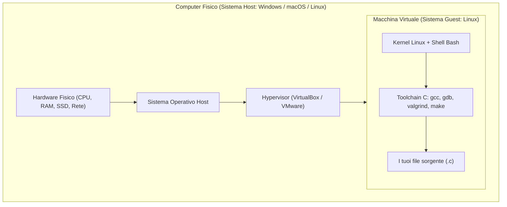
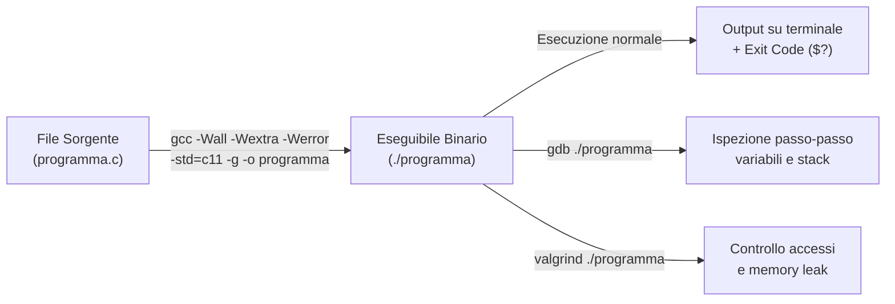

# 0.1 - Guida all'ambiente di sviluppo e macchina virtuale

## Introduzione intuitiva

Quando si impara a programmare in linguaggio C, uno degli ostacoli iniziali più comuni non riguarda il codice stesso, ma le differenze tra i computer degli studenti: sistemi operativi diversi (Windows, macOS, distribuzioni Linux differenti), versioni diverse del compilatore o configurazioni incoerenti possono far sì che un programma funzioni su un computer e si blocchi su un altro.

Per eliminare queste ambiguità e lavorare come in un vero ambiente ingegneristico, nel corso utilizziamo un **ambiente Linux standardizzato**, tipicamente distribuito sotto forma di **Macchina Virtuale (VM)** oppure configurato tramite strumenti nativi equivalenti (come WSL2 su Windows o la toolchain GNU/Clang su macOS e Linux). In questa lezione vedremo come è strutturato questo ambiente, come muoversi agilmente nel terminale e quali sono gli strumenti fondamentali che trasformeranno il nostro codice sorgente in un programma eseguibile sicuro e privo di errori di memoria.

---

## Architettura della Macchina Virtuale e alternative native

### Perché un ambiente Linux standardizzato?
Il linguaggio C è nato a stretto contatto con il sistema operativo UNIX (di cui GNU/Linux è l'erede diretto). Lavorare su un ambiente Linux offre tre vantaggi decisivi:
1. **Riproducibilità**: tutti gli studenti e i sistemi di valutazione automatica del corso usano la stessa versione del compilatore (`gcc`), le stesse librerie di sistema (`glibc`) e la stessa architettura.
2. **Trasparenza**: a differenza degli IDE "pesanti" che nascondono cosa accade dietro un pulsante *Run*, la riga di comando Linux permette di controllare ogni singola fase della compilazione e dell'esecuzione.
3. **Strumenti diagnostici nativi**: utility fondamentali per l'analisi della memoria e il debugging come `gdb` e `valgrind` sono progettate nativamente per Linux.

### Come funziona una Macchina Virtuale (Hypervisor)
Una macchina virtuale è un computer "software" completo che gira all'interno del nostro sistema operativo principale. L'architettura si divide in tre livelli:
- **Sistema Host (Ospitante)**: il computer fisico e il suo sistema operativo principale (es. Windows 11 o macOS).
- **Hypervisor (VirtualBox, VMware, UTM/QEMU)**: il software che intercetta e ripartisce le risorse fisiche (CPU, RAM, disco, scheda di rete) creandone una versione virtualizzata isolata.
- **Sistema Guest (Ospite)**: l'immagine Linux preconfigurata per il corso (es. Ubuntu/Debian), che "crede" di avere a disposizione un vero computer dedicato.



### Alternative native (senza Hypervisor tradizionale)
Se il proprio computer ha poca memoria RAM (es. meno di 8 GB), è possibile ottenere lo stesso ambiente Linux usando:
- **Su Windows — WSL2 (Windows Subsystem for Linux)**: esegue un vero kernel Linux integrato in Windows con un consumo minimo di risorse. Basta installare Ubuntu dallo store o tramite `wsl --install` e poi installare i pacchetti con `sudo apt update && sudo apt install build-essential gdb valgrind`.
- **Su Linux nativo**: è sufficiente installare i pacchetti di sviluppo (`build-essential`, `gdb`, `valgrind` su distribuzioni Debian/Ubuntu).
- **Su macOS**: i *Command Line Tools* di Xcode forniscono `clang` e `lldb` (compatibili con `gcc`), ma per usare `valgrind` o testare il comportamento esatto di Linux su processori Apple Silicon (M1/M2/M3/M4) si consiglia una VM leggera tramite **UTM** o un container Docker Linux.

---

## Strumenti essenziali da riga di comando

### La Shell Bash e la navigazione nel filesystem
La **shell** (tipicamente `bash`, *Bourne Again SHell*) è l'interprete dei comandi testuali. Nel filesystem Linux tutto è organizzato in un unico albero gerarchico che parte dalla radice `/` (*root*). La cartella personale dell'utente è indicata dalla scorciatoia `~` (es. `/home/studente`).

Ecco i comandi indispensabili per orientarsi e gestire i file:

| Comando | Significato | Esempio d'uso | Descrizione tecnica |
| :--- | :--- | :--- | :--- |
| `pwd` | *Print Working Directory* | `pwd` | Mostra il percorso assoluto della cartella corrente. |
| `ls` | *List* | `ls -la` | Elenca file e cartelle (`-l` dettagliato, `-a` mostra anche i file nascosti che iniziano con `.`). |
| `cd` | *Change Directory* | `cd lab01` / `cd ..` | Entra nella cartella `lab01` oppure sale alla cartella padre (`..`). `cd ~` riporta alla home. |
| `mkdir` | *Make Directory* | `mkdir -p esami/2026` | Crea una nuova cartella (`-p` crea anche le cartelle intermedie se non esistono). |
| `cp` | *Copy* | `cp main.c backup.c` | Copia un file (con `cp -r dir1 dir2` copia ricorsivamente un'intera cartella). |
| `mv` | *Move / Rename* | `mv vecchio.c nuovo.c` | Sposta un file in un'altra posizione oppure lo rinomina. |
| `rm` | *Remove* | `rm file.o` | Elimina definitivamente un file (non passa dal cestino!). Con `rm -r` elimina una cartella. |
| `cat` / `less` | Visualizzazione | `less main.c` | `cat` stampa tutto il file a schermo; `less` permette di scorrerlo pagina per pagina (tasto `q` per uscire). |

---

## La Toolchain di sviluppo in C

Il codice scritto in un file `.c` è semplice testo comprensibile agli esseri umani. Per essere eseguito dal processore deve essere tradotto in codice macchina binario e controllato con appositi strumenti.



### 1. Il compilatore `gcc` (GNU Compiler Collection)
Non bisogna mai invocare `gcc` senza opzioni: di default il compilatore è molto permissivo e lascia passare difetti gravi che esplodono a tempo di esecuzione. Durante il corso useremo sempre questa combinazione rigorosa di **flag**:

```bash
gcc -Wall -Wextra -Werror -std=c11 -g -O0 programma.c -o programma
```

Analizziamo il significato di ciascun flag:
- `-Wall` (*Warnings All*): attiva i principali avvisi (warning) su costrutti sospetti (es. variabili non inizializzate o non usate, `printf` con formato errato).
- `-Wextra`: attiva ulteriori controlli stringenti non coperti da `-Wall` (es. confronti tra numeri con segno e senza segno).
- `-Werror`: trasforma tutti i *warning* in **errori bloccanti**, impedendo la generazione dell'eseguibile finché il codice non è perfettamente pulito.
- `-std=c11`: impone il rispetto rigoroso dello standard ISO C11.
- `-g`: inserisce nell'eseguibile le **informazioni di debug** (tabella dei simboli, corrispondenza tra istruzioni macchina e numeri di riga del file `.c`), indispensabili per `gdb` e `valgrind`.
- `-O0` / `-O2`: controlla il livello di ottimizzazione. Durante lo sviluppo e il debug si usa `-O0` (nessuna ottimizzazione, così l'esecuzione segue fedelmente le righe del codice); per il rilascio e i test di performance si usa `-O2`.
- `-o nome_eseguibile`: specifica il nome del file binario generato. Se omesso, `gcc` produce un file chiamato `a.out`.

### 2. Il debugger `gdb` (GNU Debugger)
Quando un programma produce risultati sbagliati o termina improvvisamente con un errore critico (*Segmentation Fault*), `gdb` permette di "congelare" l'esecuzione ed esaminare il contenuto di ogni variabile istante per istante.

Comandi principali all'interno di `gdb ./programma`:
- `break main` (o `b 25`): imposta un *breakpoint* (punto di arresto) all'inizio di `main` o alla riga 25.
- `run` (`r`): avvia il programma dentro il debugger fino al primo breakpoint o crash.
- `next` (`n`): esegue la riga corrente passando alla successiva (senza entrare dentro le funzioni chiamate, *step over*).
- `step` (`s`): esegue la riga corrente entrando dentro eventuali funzioni chiamate (*step into*).
- `print x` (`p x`): stampa il valore attuale della variabile o espressione `x`.
- `backtrace` (`bt`): mostra la pila delle chiamate attive (fondamentale per capire in quale riga precisa si è verificato un crash).
- `quit` (`q`): esce da `gdb`.

### 3. L'analizzatore di memoria `valgrind`
In C il programmatore ha il controllo diretto della memoria. Un accesso fuori dai limiti di un array o l'uso di una variabile non inizializzata può sembrare innocuo durante un test rapido, ma causare crash imprevedibili in seguito. `valgrind` esegue il programma in un processore simulato tracciando ogni singolo byte letto o scritto in RAM:

```bash
valgrind --leak-check=full --track-origins=yes ./programma
```
- Segnala letture/scritture illegali (*Invalid read / Invalid write*).
- Segnala salti o calcoli basati su memoria mai inizializzata (*Conditional jump or move depends on uninitialised value*).
- Verifica che tutta la memoria allocata dinamicamente venga liberata prima della chiusura (*All heap blocks were freed -- no leaks are possible*).

---

## Flusso di lavoro completo ed Exit Code (`$?`)

Un programma C comunica al sistema operativo se la sua esecuzione è andata a buon fine tramite un numero intero restituito dalla funzione `main`, detto **exit code** (o *exit status*):
- Per convenzione universale POSIX/C, **`0` indica successo** (`EXIT_SUCCESS`).
- Qualsiasi valore **diverso da `0`** (tipicamente da `1` a `255`) indica che si è verificato un errore (`EXIT_FAILURE`).

Nella shell Bash, la variabile speciale `$?` conserva l'exit code dell'ultimo comando eseguito.

---

## Esempi guidati

### Esempio 1: Creazione, compilazione, esecuzione e verifica dell'Exit Code
Vediamo l'intero ciclo di vita del primo programma da terminale.

**Passo 1 — Scrittura del file sorgente `saluto.c`:**
```c
#include <stdio.h>

int main(void) {
    printf("Ambiente Linux configurato correttamente!\n");
    return 0; /* Restituisce 0 al sistema operativo (successo) */
}
```

**Passo 2 — Compilazione, esecuzione e ispezione di `$?` in Bash:**
```bash
# Creiamo una cartella dedicata ed entriamoci
mkdir -p ~/corso_c/lezione0 && cd ~/corso_c/lezione0

# Compiliamo con tutti i flag di sicurezza
gcc -Wall -Wextra -Werror -std=c11 -g saluto.c -o saluto

# Eseguiamo il binario (il prefisso ./ indica la cartella corrente)
./saluto

# Controlliamo il codice di uscita restituito dal main
echo $?
```
**Output a terminale:**
```text
Ambiente Linux configurato correttamente!
0
```

### Esempio 2: Come i flag `-Wall -Wextra -Werror` ci salvano da un bug
Supponiamo di scrivere un programma che calcola il doppio di un numero, dimenticando però di assegnare un valore iniziale alla variabile `x`.

**File `bug_inizializzazione.c`:**
```c
#include <stdio.h>

int main(void) {
    int x; /* ERRORE LOGICO: x non è inizializzata! Contiene "spazzatura" */
    int doppio = x * 2;
    printf("Il doppio vale: %d\n", doppio);
    return 0;
}
```

Se compilassimo con un ingenuo `gcc bug_inizializzazione.c`, il compilatore non direbbe nulla e il programma stamperebbe un numero casuale diverso a ogni esecuzione! Con i nostri flag, invece:

```bash
gcc -Wall -Wextra -Werror -std=c11 -g bug_inizializzazione.c -o bug
```
**Output del compilatore:**
```text
bug_inizializzazione.c: In function ‘main’:
bug_inizializzazione.c:5:18: error: ‘x’ is used uninitialized [-Werror=uninitialized]
    5 |     int doppio = x * 2;
      |                  ^
cc1: all warnings being treated as errors
```
Il compilatore indica esattamente la riga (`5`), la colonna (`18`) e il motivo del problema, rifiutandosi di generare un eseguibile difettoso.

### Esempio 3: Diagnosi di un errore con `gdb` e `valgrind`
Vediamo cosa succede quando un programma tenta di accedere a un indirizzo di memoria non valido (ad esempio tramite un puntatore nullo `NULL`, che studieremo in dettaglio nelle prossime lezioni).

**File `crash.c`:**
```c
#include <stdio.h>

int main(void) {
    int *p = NULL; /* Puntatore che non punta a nessuna cella valida */
    printf("Tentativo di scrittura...\n");
    *p = 42;       /* CRASH alla riga 6: scrittura all'indirizzo 0x0 */
    return 0;
}
```

Compiliamo ed eseguiamo con `valgrind`:
```bash
gcc -Wall -Wextra -Werror -std=c11 -g crash.c -o crash
valgrind ./crash
```
**Output diagnostico di `valgrind`:**
```text
==12345== Invalid write of size 4
==12345==    at 0x10915E: main (crash.c:6)
==12345==  Address 0x0 is not stack'd, malloc'd or (recently) free'd
```
Senza bisogno di tirare a indovinare, `valgrind` ci dice che alla riga 6 di `crash.c`, dentro la funzione `main`, abbiamo tentato una scrittura non valida di 4 byte all'indirizzo `0x0`.

---

## Errori frequenti

1. **Dimenticare `./` prima del nome dell'eseguibile (`comando: command not found`)**
   Per motivi di sicurezza, la shell Linux non cerca automaticamente i programmi nella cartella corrente (`.`), ma solo nelle cartelle di sistema elencate nella variabile d'ambiente `$PATH` (come `/usr/bin`). Per eseguire il proprio programma bisogna sempre specificare il percorso relativo `./nome_programma`.
2. **Invertire il nome del sorgente dopo il flag `-o` (`gcc -o main.c main`)**
   *Attenzione massima!* L'argomento che segue immediatamente `-o` è il file **che verrà sovrascritto** dal compilatore come output. Scrivere `gcc -o main.c ...` **cancella e sovrascrive il vostro codice sorgente `main.c`**! Mettete sempre `-o nome_eseguibile` in fondo al comando, senza estensione `.c`.
3. **Modificare il file `.c` ma eseguire il vecchio binario senza ricompilare (o senza salvare il file nell'editor)**
   L'eseguibile non si aggiorna da solo quando modificate il file `.c`. Ricordate sempre la sequenza: *Salva nell'editor $\rightarrow$ Ricompila con `gcc` $\rightarrow$ Esegui `./programma`*.
4. **Eseguire `gdb` o `valgrind` senza aver compilato con il flag `-g`**
   Senza `-g`, gli strumenti di analisi mostrano solo indirizzi esadecimali incomprensibili (es. `0x401136`) invece del nome della funzione e del numero di riga del file `.c`.

---

## Esercizi di prova

1. **[Base — Navigazione e gestione file in Bash]**
   Scrivi la sequenza di comandi Bash per:
   a) Creare nella tua home (`~`) una cartella chiamata `prog1` con dentro una sottocartella `esercizi_01`.
   b) Entrare nella sottocartella `esercizi_01` e verificare il percorso assoluto corrente.
   c) Creare una copia di un file `test.c` chiamandola `test_backup.c`, e infine rimuovere il file originale `test.c`.
> [!tip]- Soluzione
> ```bash
> # a) L'opzione -p crea l'intera gerarchia di cartelle in un solo comando
> mkdir -p ~/prog1/esercizi_01
> 
> # b) Ci spostiamo nella cartella e stampiamo il percorso assoluto
> cd ~/prog1/esercizi_01
> pwd
> # Output atteso: /home/tuo_utente/prog1/esercizi_01
> 
> # c) Copiamo il file e poi eliminiamo l'originale
> cp test.c test_backup.c
> rm test.c
> ```

2. **[Base — Compilazione rigorosa]**
   Dato un file sorgente chiamato `calcolo.c`, scrivi il comando `gcc` completo per compilarlo secondo lo standard C11, attivando tutti i warning, trasformando i warning in errori, includendo i simboli di debug per `gdb` e producendo un eseguibile chiamato `esegui_calcolo`.
> [!tip]- Soluzione
> ```bash
> gcc -Wall -Wextra -Werror -std=c11 -g calcolo.c -o esegui_calcolo
> ```
> *Spiegazione*: `-Wall` e `-Wextra` abilitano i controlli statici, `-Werror` blocca la compilazione in presenza di qualsiasi avviso, `-std=c11` fissa lo standard del linguaggio, `-g` aggiunge la tabella dei simboli di debug e `-o esegui_calcolo` imposta il nome del file binario in uscita.

3. **[Intermedio — Exit Code e concatenazione di comandi in Bash]**
   Considera il seguente programma `codice_uscita.c`:
   ```c
   #include <stdio.h>
   int main(void) {
       printf("Fine elaborazione.\n");
       return 3;
   }
   ```
   a) Cosa stamperà il comando `echo $?` eseguito subito dopo `./codice_uscita`?
   b) Se eseguiamo un secondo comando `echo $?` immediatamente dopo il primo `echo $?`, quale numero verrà stampato e perché?
> [!tip]- Soluzione
> a) Il primo `echo $?` stamperà **`3`**, perché la variabile speciale `$?` contiene il valore restituito dall'istruzione `return 3;` del `main` di `./codice_uscita`.
>
> b) Il secondo `echo $?` stamperà **`0`**! Infatti `$?` memorizza sempre il codice di uscita dell'**ultimo** comando eseguito. Poiché il primo comando `echo $?` è terminato con successo, ha a sua volta restituito `0`, sovrascrivendo il valore precedente.

4. **[Intermedio — Correzione dei Warning del compilatore]**
   Un collega prova a compilare il seguente file `somma.c` con i flag del corso (`-Wall -Wextra -Werror`), ma la compilazione fallisce con due errori:
   ```c
   #include <stdio.h>

   int main(void) {
       int a = 10;
       int b = 20;
       int inutilizzata = 99;
       printf("La somma vale: %f\n", a + b);
   }
   ```
   Individua i due problemi segnalati dal compilatore e riscrivi il codice corretto.
> [!tip]- Soluzione
> I due problemi rilevati da `-Wall -Wextra -Werror` sono:
> 1. `unused variable 'inutilizzata'`: la variabile `inutilizzata` è dichiarata ma non viene mai letta nel programma.
> 2. `format '%f' expects argument of type 'double', but argument 2 has type 'int'`: nella `printf` viene usato lo specificatore `%f` (per numeri in virgola mobile) invece di `%d` (per numeri interi `int`). Inoltre è buona norma esplicitare `return 0;` alla fine di `main`.
>
> **Codice corretto:**
> ```c
> #include <stdio.h>
> 
> int main(void) {
>     int a = 10;
>     int b = 20;
>     printf("La somma vale: %d\n", a + b);
>     return 0;
> }
> ```

5. **[Intermedio/Esame — Sessione di debugging con `gdb`]**
   Hai compilato con il flag `-g` un programma `fattoriale` che entra in un ciclo anomalo o calcola un valore errato dentro la funzione `calcola`. Descrivi la sequenza esatta di comandi da dare per:
   1) Avviare `gdb` sul binario `fattoriale`.
   2) Mettere un punto di interruzione all'inizio della funzione `calcola`.
   3) Far partire l'esecuzione.
   4) Avanzare di una singola riga alla volta ispezionando il valore della variabile `risultato`.
> [!tip]- Soluzione
> ```bash
> # 1) Avviamo gdb passando il nome dell'eseguibile
> gdb ./fattoriale
> ```
> All'interno del prompt `(gdb)`:
> ```text
> (gdb) break calcola       # 2) Imposta un breakpoint all'ingresso della funzione 'calcola'
> (gdb) run                 # 3) Avvia il programma; si fermerà appena entra in 'calcola'
> (gdb) next                # 4) Esegue una riga di codice (step over)
> (gdb) print risultato     #    Mostra il valore attuale della variabile 'risultato'
> (gdb) next                #    Avanza alla riga successiva
> (gdb) print risultato     #    Controlla come è cambiato il valore
> (gdb) quit                #    Esce dal debugger al termine dell'analisi
> ```

---

## Provenienza del materiale

- Dispensa ufficiale del corso: `C1PROG1_Guida_Installazione_VM-rev1.pdf` (Unità 0 — Configurazione dell'ambiente di sviluppo Linux, macchina virtuale e toolchain C).
