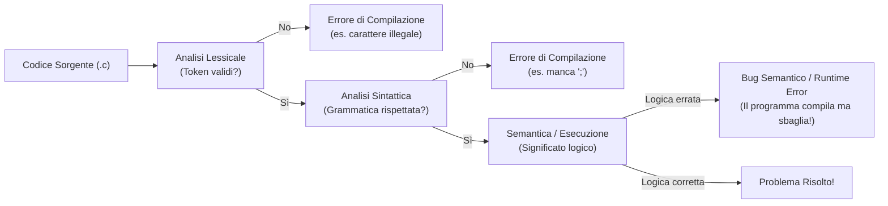
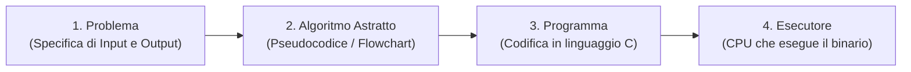
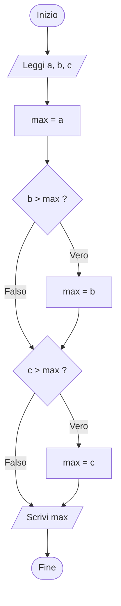

# 0.2 - Semantica, grammatica e algoritmo

## Introduzione intuitiva

Quando parliamo una lingua naturale come l'italiano, seguiamo inconsciamente due livelli di regole:
1. Le regole **ortografiche e grammaticali** (come si scrivono le parole e come si mettono insieme soggetto, verbo e complemento).
2. Il **significato** di ciò che diciamo nel mondo reale.

Se qualcuno ci dice *"Il cane corre nel prato"*, la frase è corretta sia nella forma sia nel significato. Se invece scrive *"Prato cane il corre nel"*, viola la grammatica. Ma cosa succede se leggiamo *"Il numero sette mangia la malinconia triangolare"*? Dal punto di vista grammaticale la frase è impeccabile (soggetto, verbo transitivo, complemento oggetto con aggettivo), eppure non ha alcun senso logico!

Nell'informatica questa distinzione tra **forma (sintassi)** e **significato operativo (semantica)** è ancora più netta, perché il computer è un esecutore rigoroso ma privo di intuito: può verificare automaticamente se abbiamo rispettato la grammatica del linguaggio, ma spetta a noi progettare una sequenza di istruzioni dotata di senso (**un algoritmo**) per risolvere il problema desiderato.

---

## Lessico, Sintassi e Semantica

Ogni linguaggio — sia esso naturale o artificiale come il linguaggio C — è definito da tre componenti fondamentali:

### 1. Lessico (o Vocabolario)
È l'insieme delle parole elementari valide nel linguaggio (in informatica chiamate **token** o **lessemi**).
- *In italiano*: le parole presenti nel dizionario (`casa`, `correre`, `velocemente`). Scrivere `kasa` o `xyzq` è un **errore lessicale** (ortografico).
- *In C*: le parole chiave (`int`, `while`, `return`), gli identificatori validi, i numeri (`42`, `3.14`) e i simboli degli operatori (`+`, `==`, `;`). Scrivere `int 2valori = 5;` o usare un simbolo estraneo come `@` fuori da una stringa provoca un errore lessicale.

### 2. Sintassi (o Grammatica)
È l'insieme delle regole formali che stabiliscono come combinare i token lessicali per formare frasi o istruzioni ben strutturate, **indipendentemente dal loro significato**.
- *In C*: una regola sintattica stabilisce che ogni istruzione semplice deve terminare con un punto e virgola `;` e che la condizione di un `if` deve essere racchiusa tra parentesi tonde `if (condizione)`. Scrivere `if x > 0 return 1` (senza parentesi e senza `;`) è un **errore sintattico**.

### 3. Semantica
Riguarda il **significato** delle frasi sintatticamente valide, ovvero l'effetto concreto che un'istruzione produce sullo stato del calcolatore quando viene eseguita.

#### Il paradosso di Chomsky
Nel 1957 il linguista Noam Chomsky formulò una celebre frase inglese (*"Colorless green ideas sleep furiously"*, in italiano: **"Le idee verdi prive di colore dormono furiosamente"**) per dimostrare che sintassi e semantica sono concetti distinti:
- **Sintatticamente**: la frase è perfetta (Articolo + Nome + Aggettivo + Locuzione aggettivale + Verbo + Avverbio).
- **Semanticamente**: è del tutto priva di senso (come può un'idea astratta dormire? E come può essere contemporaneamente verde e priva di colore?).

Lo stesso fenomeno accade continuamente in programmazione! Consideriamo questa istruzione C:
```c
int media = a + b / 2;
```
- **Lessico e Sintassi**: 100% corretti. Il compilatore `gcc` traduce il codice senza alcun errore.
- **Semantica**: in matematica la divisione ha precedenza sull'addizione, quindi il calcolatore calcola $a + \frac{b}{2}$ invece della media $\frac{a+b}{2}$. Oppure, ancor più drammaticamente, consideriamo `int x = 10 / 0;`: sintatticamente è una divisione valida tra due interi, ma semanticamente la divisione per zero è indefinita e causa il blocco del programma a tempo di esecuzione!



---

## Il concetto di Algoritmo

Prima ancora di scrivere codice in C, dobbiamo capire *come* risolvere un problema. Qui entra in gioco il concetto centrale dell'informatica: l'**algoritmo** (termine che deriva dal nome del matematico persiano del IX secolo *al-Khwārizmī*).

### Definizione formale
> Un **algoritmo** è una sequenza finita di istruzioni elementari, non ambigue ed effettivamente eseguibili da un esecutore deterministico, che a partire da un insieme di dati in ingresso (**input**) produce in un tempo finito un risultato (**output**) che risolve una determinata classe di problemi.

### Le 5 proprietà fondamentali di un algoritmo
Perché un procedimento possa chiamarsi "algoritmo" (e non una semplice ricetta vaga), deve soddisfare rigorosamente cinque proprietà:

1. **Finitezza (Terminazione)**: per ogni input valido, l'esecuzione dell'algoritmo deve terminare dopo un **numero finito di passi**. Un procedimento che entra in un ciclo infinito non è un algoritmo valido.
2. **Determinismo e Non Ambiguità**: ogni passo deve essere definito in modo univoco, senza lasciare spazio a interpretazioni soggettive o scelte casuali. A parità di input e stato iniziale, l'esecutore deve compiere esattamente le stesse mosse e produrre lo stesso output (*"Aggiungi un pizzico di sale quanto basta"* è ambiguo; *"Aggiungi 5 grammi di NaCl"* non è ambiguo).
3. **Effettività (Eseguibilità / Atomicità dei passi)**: ogni singola istruzione deve appartenere al repertorio delle operazioni elementari che l'**esecutore** sa compiere concretamente in un tempo finito e con risorse finite.
4. **Generalità**: un algoritmo non risolve un singolo caso isolato (es. *"trova il massimo tra 4 e 7"*), ma una **classe generale di problemi** parametrizzata dai dati di input (es. *"dati due numeri reali qualsiasi $a$ e $b$, trova il maggiore"*).
5. **Input / Output ben definiti**: deve essere specificato con precisione il dominio dei dati accettati in ingresso (anche zero input, in casi particolari) e la natura del risultato prodotto in uscita.

---

## Dal Problema all'Esecutore: Pseudocodice e Flowchart

Quando affrontiamo un problema informatico, il passaggio diretto dalla traccia scritta in italiano al codice C porta spesso a confondere le difficoltà logiche del problema con i dettagli sintattici del linguaggio. Per questo motivo il processo di sviluppo segue tre fasi:



Per descrivere l'algoritmo nella Fase 2 usiamo due strumenti indipendenti dal linguaggio di programmazione:

### 1. Lo Pseudocodice
È una descrizione testuale strutturata che usa parole chiave semplici (`LEGGI`, `SCRIVI`, `SE ... ALLORA ... ALTRIMENTI`, `MENTRE ... ESEGUI`) combinate con notazione matematica, libera dai vincoli di punteggiatura del C.

### 2. I Diagrammi di Flusso (Flowchart)
Sono rappresentazioni grafiche dell'algoritmo in cui ogni forma geometrica ha un significato standardizzato:
- **Ovale / Stadio** (`([Inizio])`, `([Fine])`): indica l'inizio o la terminazione dell'algoritmo.
- **Parallelogramma** (`[/Input / Output/]`): operazione di lettura dati dall'esterno o stampa di risultati.
- **Rettangolo** (`[Elaborazione / Assegnamento]`): calcolo matematico o modifica di variabili (es. `somma <- somma + x`).
- **Rombo** (`{Condizione?}`): decisione logica o diramazione con due uscite (`Vero` / `Falso`).

---

## Esempi guidati

### Esempio 1: Massimo tra tre numeri (Pseudocodice, Flowchart e C)
**Problema**: Dati in input tre numeri interi $a, b, c$, determinare e stampare il valore massimo.

**1. Pseudocodice:**
```text
INIZIO
    LEGGI a, b, c
    max <- a
    SE (b > max) ALLORA
        max <- b
    FINE SE
    SE (c > max) ALLORA
        max <- c
    FINE SE
    SCRIVI max
FINE
```

**2. Diagramma di flusso (Flowchart):**


**3. Traduzione in linguaggio C:**
```c
#include <stdio.h>

int main(void) {
    int a = 15, b = 42, c = 27;
    int max = a; /* Ipotesi iniziale: il primo numero è il massimo */

    if (b > max) {
        max = b; /* Aggiorniamo il massimo se b lo supera */
    }
    if (c > max) {
        max = c; /* Aggiorniamo il massimo se c lo supera */
    }

    printf("Il massimo tra %d, %d e %d e': %d\n", a, b, c, max);
    return 0;
}
```

### Esempio 2: Algoritmo di Euclide per il Massimo Comun Divisore (MCD)
Uno dei più antichi algoritmi della storia (circa 300 a.C.) calcola il $\text{MCD}(a, b)$ tra due interi positivi $a$ e $b$ usando il resto della divisione intera ($a \bmod b$).
- Finché $b \neq 0$, si sostituisce la coppia $(a, b)$ con $(b, a \bmod b)$.
- Quando $b = 0$, il risultato cercato è il valore corrente di $a$.

**Traccia di esecuzione passo-passo per $a = 48, b = 18$:**
1. Stato iniziale: $a = 48, b = 18$. Poiché $b \neq 0$, calcoliamo $r = 48 \bmod 18 = 12$. Poniamo $a = 18, b = 12$.
2. Passo 2: $b = 12 \neq 0$. Calcoliamo $r = 18 \bmod 12 = 6$. Poniamo $a = 12, b = 6$.
3. Passo 3: $b = 6 \neq 0$. Calcoliamo $r = 12 \bmod 6 = 0$. Poniamo $a = 6, b = 0$.
4. Passo 4: ora $b = 0$, il ciclo termina! Il $\text{MCD}$ è $a = 6$.

*Nota sulla finitezza*: poiché il resto $r = a \bmod b$ soddisfa sempre $0 \le r < b$, a ogni iterazione il valore di $b$ diminuisce strettamente restando $\ge 0$. Di conseguenza, in un numero finito di passi $b$ deve necessariamente raggiungere $0$, garantendo la **terminazione** dell'algoritmo.

```c
#include <stdio.h>

int main(void) {
    int a = 48;
    int b = 18;

    while (b != 0) {
        int resto = a % b;
        a = b;
        b = resto;
    }

    printf("Il MCD vale: %d\n", a); /* Stampa 6 */
    return 0;
}
```

---

## Errori frequenti

1. **Pensare che "compila senza errori" significhi "il programma è giusto"**
   Il compilatore controlla quasi esclusivamente il **lessico** e la **sintassi** (oltre alla compatibilità dei tipi). Non ha alcuna idea di cosa debba fare il programma: se vi viene chiesto di sommare due numeri e scrivete `a - b`, il compilatore è felicissimo, ma il vostro programma ha un grave **errore semantico (logico)**.
2. **Dimenticare i casi limite che violano la finitezza dell'algoritmo**
   Scrivere un ciclo come *"sottrai 2 a $n$ finché $n$ diventa uguale a 0"* termina se $n = 6$ ($6 \to 4 \to 2 \to 0$), ma se l'input è un numero dispari come $n = 5$ ($5 \to 3 \to 1 \to -1 \to -3 \dots$) il procedimento non si ferma mai! Usare sempre condizioni robuste (es. `n > 0` invece di `n != 0`).
3. **Sovrascrivere una variabile prima di averne salvato il valore precedente**
   Nell'algoritmo di Euclide (o nello scambio di due variabili), scrivere `a = b; b = a % b;` è un errore semantico classico: nella prima riga `a` perde il suo valore originale e assume quello di `b`, quindi nella seconda riga `a % b` calcola in realtà `b % b` che fa sempre `0`! Serve una variabile temporanea `resto`.

---

## Esercizi di prova

1. **[Base — Classificazione degli errori: Lessicale, Sintattico o Semantico?]**
   Classifica ciascuno dei seguenti frammenti C indicando se contiene un errore **lessicale**, **sintattico** o **semantico**, spiegandone il motivo:
   a) `int prezzo$ = 100;` (in C standard rigoroso)
   b) `if (x > 0) { printf("Positivo\n") }`
   c) Calcolare il perimetro di un quadrato di lato `L` scrivendo `int perimetro = L * L;`
> [!tip]- Soluzione
> - **a) Errore lessicale**: il simbolo `$` non appartiene all'alfabeto standard degli identificatori del linguaggio C (che ammette solo lettere, cifre e `_`, non iniziando con una cifra).
> - **b) Errore sintattico**: i token (`if`, `printf`, parentesi) sono tutti validi, ma manca il punto e virgola `;` obbligatorio dopo la chiamata a `printf(...)` prima della parentesi graffa chiusa `}`.
> - **c) Errore semantico**: l'istruzione `int perimetro = L * L;` è perfettamente valida per il compilatore, ma calcola l'**area** ($L^2$) del quadrato anziché il suo **perimetro** ($4 \cdot L$).

2. **[Base — Proprietà degli algoritmi]**
   Analizza la seguente procedura che riceve in ingresso un numero intero $n$:
   - *Passo 1*: Se $n = 1$, termina e restituisci `"Fatto"`.
   - *Passo 2*: Altrimenti, incrementa $n$ di $1$ ($n \leftarrow n + 1$) e torna al Passo 1.
   Questa procedura è un algoritmo valido sull'insieme di tutti i numeri interi $\mathbb{Z}$? Quale proprietà fondamentale viene violata se in input viene fornito $n = 5$?
> [!tip]- Soluzione
> **No**, non è un algoritmo valido su tutto $\mathbb{Z}$ perché viola la proprietà di **finitezza (terminazione)** per ogni input $n > 1$.
> Se l'input è $n = 5$, la procedura calcola $5 \to 6 \to 7 \to 8 \dots$ allontanandosi indefinitamente da $1$ senza mai terminare. (Terminerebbe solo per input $n \le 1$).

3. **[Intermedio — Progettazione di algoritmo e Flowchart]**
   Progetta in pseudocodice e con un diagramma di flusso (Mermaid) un algoritmo che, letti in input due numeri reali $a$ e $b$, risolva l'equazione di primo grado $a \cdot x + b = 0$ distinguendo tutti i casi possibili (una soluzione unica, equazione impossibile, equazione indeterminata).
> [!tip]- Soluzione
> **Analisi matematica**: L'equazione $ax + b = 0$ equivale a $ax = -b$.
> - Se $a \neq 0$, esiste l'unica soluzione $x = -b / a$.
> - Se $a = 0$ e $b = 0$, l'equazione diventa $0x = 0$, che è **indeterminata** (vera per ogni $x \in \mathbb{R}$).
> - Se $a = 0$ e $b \neq 0$, l'equazione diventa $0x = -b \neq 0$, che è **impossibile** (nessuna soluzione).
>
> **Pseudocodice:**
> ```text
> INIZIO
>     LEGGI a, b
>     SE (a != 0) ALLORA
>         x <- -b / a
>         SCRIVI "Soluzione unica:", x
>     ALTRIMENTI
>         SE (b == 0) ALLORA
>             SCRIVI "Equazione indeterminata (infinite soluzioni)"
>         ALTRIMENTI
>             SCRIVI "Equazione impossibile (nessuna soluzione)"
>         FINE SE
>     FINE SE
> FINE
> ```
>
> **Diagramma di flusso:**
> ```mermaid
> flowchart TD
>     S(["Inizio"]) --> IN[/"Leggi a, b"/]
>     IN --> C1{"a != 0 ?"}
>     C1 -->|"Vero"| SOL["x = -b / a"]
>     SOL --> OUT1[/"Scrivi x"/]
>     C1 -->|"Falso (a == 0)"| C2{"b == 0 ?"}
>     C2 -->|"Vero"| OUT2[/"Scrivi: Indeterminata"/]
>     C2 -->|"Falso"| OUT3[/"Scrivi: Impossibile"/]
>     OUT1 --> E(["Fine"])
>     OUT2 --> E
>     OUT3 --> E
> ```

4. **[Intermedio — Traccia di esecuzione e comprensione semantica]**
   Considera il seguente algoritmo espresso in C:
   ```c
   #include <stdio.h>

   int main(void) {
       int n = 1234;
       int ris = 0;
       while (n > 0) {
           int cifra = n % 10;
           ris = ris * 10 + cifra;
           n = n / 10;
       }
       printf("Risultato: %d\n", ris);
       return 0;
   }
   ```
   Costruisci la tabella con i valori di `n`, `cifra` e `ris` alla fine di ciascuna iterazione del ciclo `while`, indica cosa viene stampato e spiega qual è lo scopo generale (la semantica) di questo algoritmo.
> [!tip]- Soluzione
> **Traccia di esecuzione:**
> - **Stato iniziale**: `n = 1234`, `ris = 0`.
> - **Iterazione 1** (`n = 1234 > 0`): `cifra = 1234 % 10 = 4`; `ris = 0 * 10 + 4 = 4`; `n = 1234 / 10 = 123`.
> - **Iterazione 2** (`n = 123 > 0`): `cifra = 123 % 10 = 3`; `ris = 4 * 10 + 3 = 43`; `n = 123 / 10 = 12`.
> - **Iterazione 3** (`n = 12 > 0`): `cifra = 12 % 10 = 2`; `ris = 43 * 10 + 2 = 432`; `n = 12 / 10 = 1`.
> - **Iterazione 4** (`n = 1 > 0`): `cifra = 1 % 10 = 1`; `ris = 432 * 10 + 1 = 4321`; `n = 1 / 10 = 0`.
> - Ora `n = 0`, la condizione `n > 0` diventa falsa e il ciclo termina.
>
> **Output**: `Risultato: 4321`.
> **Scopo generale**: L'algoritmo **inverte l'ordine delle cifre decimali** di un numero intero positivo $n$.

5. **[Esame — Lo scambio di due variabili senza e con variabile di appoggio]**
   Dati due contenitori (variabili intere) `x` e `y`:
   a) Scrivi un programma C completo che scambi i valori di `x` e `y` utilizzando una terza variabile temporanea `temp`.
   b) *(Sfida matematica)* È possibile scambiare i valori di due variabili intere `x` e `y` usando solo addizioni e sottrazioni, **senza** usare una terza variabile `temp`? Mostra la sequenza di 3 istruzioni e fanne la traccia con `x = 10, y = 25`.
> [!tip]- Soluzione
> **a) Metodo standard e consigliato (con variabile di appoggio `temp`):**
> ```c
> #include <stdio.h>
> 
> int main(void) {
>     int x = 10, y = 25;
>     int temp = x; /* Salviamo il valore originale di x (10) */
>     x = y;        /* Ora x vale 25 */
>     y = temp;     /* Ora y recupera il vecchio valore di x (10) */
>     printf("x = %d, y = %d\n", x, y);
>     return 0;
> }
> ```
>
> **b) Metodo aritmetico senza terza variabile:**
> ```c
> x = x + y; /* Passo 1: x contiene la somma dei due valori (10 + 25 = 35) */
> y = x - y; /* Passo 2: dalla somma togliamo il vecchio y -> otteniamo il vecchio x (35 - 25 = 10) */
> x = x - y; /* Passo 3: dalla somma togliamo il nuovo y (che è il vecchio x) -> otteniamo il vecchio y (35 - 10 = 25) */
> ```
> *(Nota tecnica: in C reale si preferisce sempre il metodo `a)` con `temp`, perché è più leggibile e non rischia di causare overflow aritmetico nella somma `x + y`).*

---

## Provenienza del materiale

- Slide e dispensa ufficiale del corso: `C1PROG1B1L3_Semantica_grammatica_algoritmo.pdf` (Unità 0 — Lessico, sintassi, semantica e introduzione agli algoritmi).
