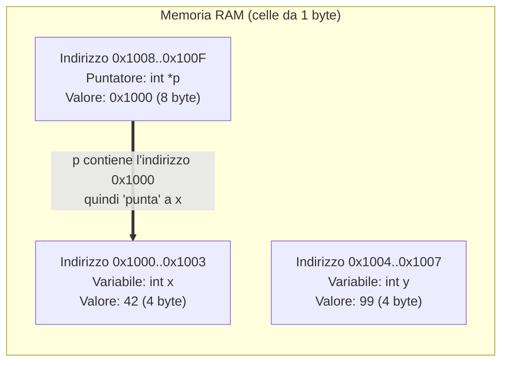
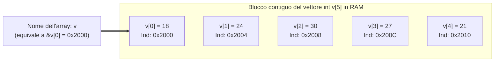

# 0.3 - Introduzione a puntatori e vettori

## Introduzione intuitiva

Immagina la memoria centrale del computer (**RAM**, *Random Access Memory*) come un lunghissimo corridoio d'albergo composto da miliardi di caselle postali (i **byte**), tutte rigorosamente numerate in ordine crescente da `0` fino alla capienza massima della memoria. Il numero scritto sulla targhetta di ogni casella è il suo **indirizzo di memoria** (solitamente espresso in base esadecimale, come `0x7ffd40`).

Quando in un programma C dichiariamo una normale variabile, chiediamo al compilatore di riservarci una o più caselle consecutive e di associarvi un'etichetta comoda da ricordare (il nome della variabile, es. `x`). Ma in C possiamo fare qualcosa di molto più potente: possiamo leggere direttamente **il numero della targhetta** (l'indirizzo di `x`), salvarlo dentro un'altra variabile speciale chiamata **puntatore**, oppure riservare un intero blocco di caselle adiacenti dello stesso tipo, chiamato **vettore (o array)**.

Capire fin da subito questo modello fisico della memoria rende semplicissimi due argomenti — puntatori e vettori — che sono il cuore pulsante del linguaggio C.

---

## Il modello della memoria centrale e le variabili

Ogni variabile nel linguaggio C è caratterizzata da **quattro attributi fondamentali**:
1. **Nome (Identificatore)**: l'etichetta simbolica usata dal programmatore nel codice (es. `eta`).
2. **Tipo**: stabilisce quanti byte occupa la variabile in memoria e come vanno interpretati i bit al suo interno (es. un `int` occupa tipicamente **4 byte** consecutivi, un `char` **1 byte**, un `double` **8 byte**).
3. **Valore (R-value)**: il dato attualmente contenuto nelle celle di memoria della variabile (es. `25`).
4. **Indirizzo (L-value)**: il numero esadecimale del **primo byte** occupato dalla variabile in RAM (es. `0x1000`).

### L'operatore indirizzo `&` ("address-of")
Dato il nome di una variabile `x`, l'espressione **`&x`** restituisce l'indirizzo di memoria in cui `x` è memorizzata. Si legge *"l'indirizzo di `x`"*.



---

## Idea intuitiva di Puntatore

Un **puntatore** non è altro che una variabile il cui **valore** è l'**indirizzo di memoria** di un'altra variabile.

### Dichiarazione e inizializzazione
Per dichiarare un puntatore a una variabile di tipo `int`, si scrive:
```c
int x = 42;
int *p = &x; /* 'p' è un puntatore a int, inizializzato con l'indirizzo di 'x' */
```
Attenzione a non confondere i due usi dell'asterisco `*`:
1. **Nella dichiarazione (`int *p;`)**: l'asterisco fa parte del tipo e dice al compilatore *"la variabile `p` non contiene un intero, ma contiene l'indirizzo di memoria di un intero (`int *`)"*.
2. **Nelle istruzioni successive (`*p`)**: l'asterisco è l'**operatore di dereferenziazione (o indirezione)**. Significa: *"segui la freccia: vai all'indirizzo contenuto in `p` e accedi alla cella di memoria che si trova lì"*.

Di conseguenza, se `p = &x`:
- Scrivere `p` significa leggere l'**indirizzo** di `x` (es. `0x1000`).
- Scrivere `*p` è **totalmente equivalente a scrivere `x`**:
  - `int a = *p;` legge il valore di `x` (`42`) e lo copia in `a`.
  - `*p = 100;` scrive `100` dentro la cella puntata da `p`, quindi **modifica direttamente il valore di `x`** portandolo a `100`!

| Espressione | Tipo | Significato | Valore nell'esempio (`x = 42`, `p = &x`) |
| :--- | :--- | :--- | :--- |
| `x` | `int` | Valore contenuto nella variabile `x` | `42` |
| `&x` | `int *` | Indirizzo di memoria della variabile `x` | `0x1000` |
| `p` | `int *` | Valore contenuto in `p` (cioè l'indirizzo di `x`) | `0x1000` |
| `*p` | `int` | Valore della cella puntata da `p` (alias di `x`) | `42` |
| `&p` | `int **` | Indirizzo di memoria della variabile puntatore `p` stessa | `0x1008` |

---

## Idea intuitiva di Vettore (Array)

Se dobbiamo memorizzare i voti di 5 esami, dichiarare `voto1, voto2, voto3, voto4, voto5` sarebbe scomodissimo: non potremmo usare un ciclo per scorrerli! Un **vettore (array)** risolve il problema allocando in RAM un **blocco contiguo** di celle tutte dello **stesso tipo**.

### Dichiarazione e indicizzazione a partire da `0`
```c
int v[5] = {18, 24, 30, 27, 21};
```
Questa istruzione riserva in memoria **5 celle consecutive di tipo `int`** (quindi $5 \times 4 = 20$ byte totali senza buchi nel mezzo).
- Gli elementi si accedono tramite l'operatore parentesi quadre `v[i]`, dove `i` è l'**indice**.
- **Regola d'oro del C**: gli indici partono sempre da **`0`**! In un vettore di dimensione $N$, il primo elemento è `v[0]` e l'**ultimo elemento valido è `v[N - 1]`** (nel nostro esempio, da `v[0]` a `v[4]`).

### Il legame profondo tra Vettori e Puntatori
Perché gli indici partono proprio da `0`? La risposta sta nel legame tra array e puntatori:
> In C, il nome di un vettore `v` usato in un'espressione rappresenta **l'indirizzo di memoria del suo primo elemento (`&v[0]`)**.

Se il vettore `v` di `int` (4 byte ciascuno) inizia all'indirizzo base `0x2000`:
- `v[0]` si trova a distanza $0$ dall'inizio: indirizzo `0x2000 + 0 * 4 = 0x2000`.
- `v[1]` si trova a distanza $1$ elemento dall'inizio: indirizzo `0x2000 + 1 * 4 = 0x2004`.
- `v[i]` si trova a distanza $i$ elementi dall'inizio: indirizzo $\text{Base}(v) + i \times \operatorname{sizeof}(\text{int})$.



Vale quindi l'identità fondamentale del linguaggio C:
$$\mathtt{v == \&v[0]} \qquad \text{e più in generale} \qquad \mathtt{v[i] == *(v + i)}$$
Quando scriviamo `v[i]`, il compilatore C calcola automaticamente `*(v + i)`: parte dall'indirizzo base `v`, avanza di `i` celle e dereferenzia l'indirizzo ottenuto!

---

## Esempi guidati

### Esempio 1: Modifica indiretta di una variabile tramite puntatore
Vediamo in pratica come un puntatore permetta di leggere e modificare una variabile senza nominarla direttamente.

```c
#include <stdio.h>

int main(void) {
    int saldo = 100;
    int *ptr = &saldo; /* ptr punta alla cella di memoria di 'saldo' */

    printf("Valore iniziale di saldo: %d\n", saldo);
    printf("Indirizzo di saldo (&saldo): %p\n", (void *)&saldo);
    printf("Valore contenuto in ptr:     %p\n", (void *)ptr);
    printf("Valore puntato da *ptr:      %d\n", *ptr);

    /* Modifichiamo la cella puntata da ptr aggiungendo 50 */
    *ptr = *ptr + 50;

    printf("Nuovo valore di saldo dopo '*ptr = *ptr + 50': %d\n", saldo);
    return 0;
}
```
**Traccia e Output:**
```text
Valore iniziale di saldo: 100
Indirizzo di saldo (&saldo): 0x7ffc8b9a1234
Valore contenuto in ptr:     0x7ffc8b9a1234
Valore puntato da *ptr:      100
Nuovo valore di saldo dopo '*ptr = *ptr + 50': 150
```
*Nota*: per stampare un indirizzo con `printf` si usa lo specificatore `%p` convertendo il puntatore a `(void *)`.

### Esempio 2: Esplorazione degli indirizzi contigui di un vettore
Verifichiamo sperimentalmente che gli elementi di un array `int v[4]` distano esattamente 4 byte l'uno dall'altro e che `v` coincide con `&v[0]`.

```c
#include <stdio.h>

int main(void) {
    int v[4] = {10, 20, 30, 40};

    printf("Valore di v (base):  %p\n", (void *)v);
    printf("Indirizzo &v[0]:     %p\n\n", (void *)&v[0]);

    for (int i = 0; i < 4; i++) {
        printf("Elemento v[%d] = %d  |  Indirizzo &v[%d] = %p\n",
               i, v[i], i, (void *)&v[i]);
    }
    return 0;
}
```
**Output tipico:**
```text
Valore di v (base):  0x7ffd3a100420
Indirizzo &v[0]:     0x7ffd3a100420

Elemento v[0] = 10  |  Indirizzo &v[0] = 0x7ffd3a100420
Elemento v[1] = 20  |  Indirizzo &v[1] = 0x7ffd3a100424
Elemento v[2] = 30  |  Indirizzo &v[2] = 0x7ffd3a100428
Elemento v[3] = 40  |  Indirizzo &v[3] = 0x7ffd3a10042c
```
Osserva le ultime cifre esadecimali degli indirizzi: `0`, `4`, `8`, `c` (che in esadecimale vale 12): ogni elemento inizia esattamente 4 byte dopo il precedente!

### Esempio 3: Scansione di un vettore tramite un puntatore
Poiché il nome del vettore `v` è l'indirizzo del primo elemento, possiamo inizializzare un puntatore `int *p = v;` e accedere agli elementi del vettore sia con la notazione `v[i]` sia con `*(p + i)`.

```c
#include <stdio.h>

int main(void) {
    int v[3] = {7, 14, 21};
    int *p = v; /* Equivalente a: int *p = &v[0]; */

    printf("Primo elemento via *p:       %d\n", *p);       /* Stampa 7  */
    printf("Secondo elemento via *(p+1): %d\n", *(p + 1)); /* Stampa 14 */
    printf("Terzo elemento via p[2]:     %d\n", p[2]);     /* Stampa 21 */
    return 0;
}
```

---

## Errori frequenti

1. **Usare un puntatore non inizializzato (*Wild Pointer*)**
   Scrivere:
   ```c
   int *p;   /* ERRORE GRAVISSIMO: p contiene un indirizzo casuale! */
   *p = 10;  /* Tenta di scrivere in una zona arbitraria della RAM -> Crash! */
   ```
   Un puntatore deve **sempre** essere inizializzato all'indirizzo di una variabile valida (`int *p = &x;`) oppure a `NULL` (`int *p = NULL;`) prima di essere usato.
2. **Confondere `p = &x` con `*p = x`**
   - `p = &x` cambia **dove punta** `p` (fa puntare la freccia verso la variabile `x`).
   - `*p = x` lascia invariata la freccia di `p`, ma **copia il valore** di `x` dentro la cella già puntata da `p`.
3. **Accedere a `v[N]` in un vettore dichiarato come `int v[N]` (*Off-by-one / Out-of-bounds*)**
   Se dichiariamo `int v[5];`, gli elementi validi sono 5 ma i loro indici vanno da `0` a `4`. Scrivere `v[5] = 99;` significa scrivere nella **sesta** cella, cioè 4 byte oltre la fine del vettore, corrompendo altre variabili in memoria!
4. **Provare ad assegnare un intero vettore o cambiare l'indirizzo del nome del vettore**
   Il nome di un vettore `v` non è un puntatore modificabile, ma è vincolato permanentemente all'indirizzo della prima cella allocata. Scrivere `v = &x;` oppure `v1 = v2;` (tra due array) produce un errore di compilazione.

---

## Esercizi di prova

1. **[Base — Traccia di puntatori]**
   Determina cosa stampa il seguente programma C seguendo passo-passo lo stato della memoria:
   ```c
   #include <stdio.h>
   int main(void) {
       int a = 5, b = 10;
       int *p = &a;
       *p = *p + b;
       p = &b;
       *p = a * 2;
       printf("a = %d, b = %d\n", a, b);
       return 0;
   }
   ```
> [!tip]- Soluzione
> Seguiamo le istruzioni riga per riga:
> 1. `int a = 5, b = 10;` $\rightarrow$ `a` vale `5`, `b` vale `10`.
> 2. `int *p = &a;` $\rightarrow$ `p` punta ad `a`.
> 3. `*p = *p + b;` $\rightarrow$ poiché `*p` è un alias di `a`, equivale ad `a = a + b = 5 + 10 = 15`. Ora `a` vale **`15`**.
> 4. `p = &b;` $\rightarrow$ ora spostiamo la freccia di `p`: `p` punta alla variabile `b`.
> 5. `*p = a * 2;` $\rightarrow$ ora `*p` è un alias di `b`, quindi equivale a `b = a * 2 = 15 * 2 = 30`. Ora `b` vale **`30`**.
>
> **Output stampato**: `a = 15, b = 30`.

2. **[Base — Calcolo degli indirizzi di un vettore in RAM]**
   Un vettore `double temperature[6]` viene allocato in memoria a partire dall'indirizzo base `0x4000` (in decimale: $16384$). Sapendo che un `double` occupa **8 byte**:
   a) Qual è l'indice del primo e dell'ultimo elemento valido del vettore?
   b) Quanti byte complessivi occupa l'intero vettore `temperature` in RAM?
   c) Qual è l'indirizzo esadecimale (e lo scostamento in byte dalla base) dell'elemento `temperature[3]`?
> [!tip]- Soluzione
> - **a)** Gli indici validi vanno da **`0`** (primo elemento `temperature[0]`) a **`5`** (ultimo elemento `temperature[5]`).
> - **b)** Il vettore contiene 6 elementi da 8 byte ciascuno, quindi occupa $6 \times 8 = \mathbf{48\text{ byte}}$ contigui.
> - **c)** L'elemento `temperature[3]` è il quarto elemento del vettore e si trova a uno scostamento di $3 \times 8 = 24$ byte dall'indirizzo base. In esadecimale $24_{10} = \mathtt{0x18}$, quindi il suo indirizzo è:
>   $$\mathtt{0x4000} + \mathtt{0x18} = \mathbf{\mathtt{0x4018}}$$

3. **[Intermedio — Manipolazione di un array tramite puntatori]**
   Senza eseguire il codice, determina il contenuto finale dei 4 elementi del vettore `v` al termine del seguente programma:
   ```c
   #include <stdio.h>
   int main(void) {
       int v[4] = {2, 4, 6, 8};
       int *p = v;
       *p = 1;
       *(p + 2) = v[1] + v[3];
       p = &v[3];
       *p = v[0] + v[2];
       return 0;
   }
   ```
> [!tip]- Soluzione
> - Stato iniziale: `v = {2, 4, 6, 8}` e `p` punta a `v[0]`.
> - `*p = 1;` modifica `v[0]`: il vettore diventa `{1, 4, 6, 8}`.
> - `*(p + 2) = v[1] + v[3];` modifica `v[2]` assegnandogli `4 + 8 = 12`: il vettore diventa `{1, 4, 12, 8}`.
> - `p = &v[3];` sposta il puntatore `p` sull'ultimo elemento `v[3]`.
> - `*p = v[0] + v[2];` modifica `v[3]` assegnandogli `1 + 12 = 13`.
>
> **Contenuto finale del vettore**: **`v = {1, 4, 12, 13}`**.

4. **[Intermedio — Individuazione di bug di memoria]**
   Il seguente programma contiene **due gravi errori** legati a puntatori e vettori. Individuali, spiega perché sono pericolosi e correggi il codice:
   ```c
   #include <stdio.h>
   int main(void) {
       int numeri[3] = {10, 20, 30};
       int *massimo;
       *massimo = numeri[0];
       for (int i = 0; i <= 3; i++) {
           if (numeri[i] > *massimo) {
               *massimo = numeri[i];
           }
       }
       printf("Massimo: %d\n", *massimo);
       return 0;
   }
   ```
> [!tip]- Soluzione
> **I due errori sono:**
> 1. **Puntatore non inizializzato (`int *massimo; *massimo = ...`)**: `massimo` non è stato fatto puntare a nessuna variabile prima di dereferenziarlo con `*massimo`. Bisogna invece farlo puntare a un elemento valido (es. `int *massimo = &numeri[0];`) oppure usare una normale variabile `int`.
> 2. **Accesso fuori dai limiti dell'array (`i <= 3`)**: il vettore `numeri[3]` ha indici validi `0, 1, 2`. Quando `i` diventa `3`, `numeri[3]` legge memoria non appartenente all'array (*out-of-bounds*). La condizione corretta è `i < 3`.
>
> **Codice corretto (facendo puntare `massimo` alla cella che contiene il valore maggiore):**
> ```c
> #include <stdio.h>
> 
> int main(void) {
>     int numeri[3] = {10, 20, 30};
>     int *massimo = &numeri[0]; /* Punta al primo elemento dell'array */
> 
>     for (int i = 1; i < 3; i++) {
>         if (numeri[i] > *massimo) {
>             massimo = &numeri[i]; /* Aggiorna il puntatore alla cella col nuovo massimo */
>         }
>     }
>     printf("Massimo: %d\n", *massimo);
>     return 0;
> }
> ```

5. **[Intermedio/Esame — Somma e inversione di un vettore]**
   Scrivi un programma C completo che, dato un vettore `int v[5] = {10, 20, 30, 40, 50};`:
   a) Calcoli e stampi la somma di tutti gli elementi.
   b) Inverta l'ordine degli elementi del vettore direttamente sul posto (*in-place*, ottenendo `{50, 40, 30, 20, 10}`) e stampi il vettore invertito.
> [!tip]- Soluzione
> ```c
> #include <stdio.h>
> 
> int main(void) {
>     int v[5] = {10, 20, 30, 40, 50};
>     int n = 5;
>     int somma = 0;
> 
>     /* a) Calcolo della somma */
>     for (int i = 0; i < n; i++) {
>         somma += v[i];
>     }
>     printf("Somma degli elementi: %d\n", somma);
> 
>     /* b) Inversione in-place scambiando gli estremi simmetrici v[i] e v[n - 1 - i] */
>     for (int i = 0; i < n / 2; i++) {
>         int temp = v[i];
>         v[i] = v[n - 1 - i];
>         v[n - 1 - i] = temp;
>     }
> 
>     printf("Vettore invertito: ");
>     for (int i = 0; i < n; i++) {
>         printf("%d ", v[i]);
>     }
>     printf("\n");
>     return 0;
> }
> ```

---

## Provenienza del materiale

- Slide e dispensa ufficiale del corso: `C1PROG1B3L4_Puntatori_e_Vettori.pdf` (Unità 0 — Introduzione al modello di memoria, puntatori e vettori).
