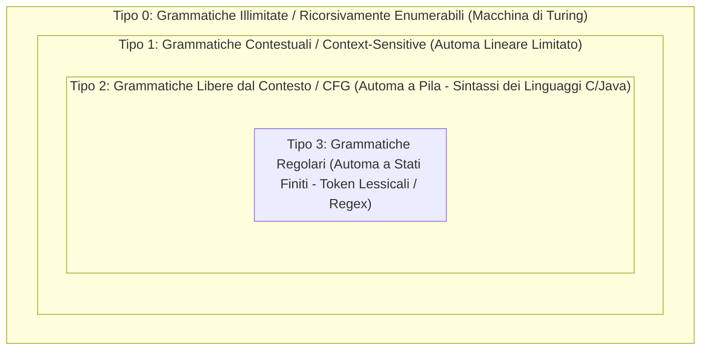
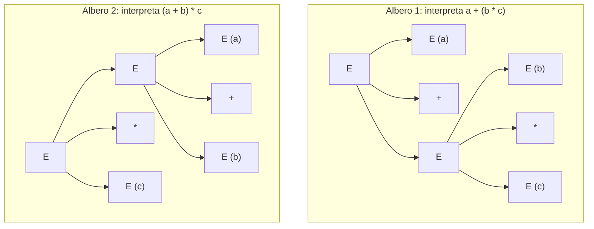

# 1.1.1 - Linguaggi formali e grammatiche

## Introduzione intuitiva

Come fa un compilatore come `gcc` a stabilire con certezza matematica se una sequenza di caratteri scritta in un file `.c` è un programma valido oppure contiene un errore sintattico? Le lingue naturali (italiano, inglese) si evolvono spontaneamente, sono piene di eccezioni, sfumature e ambiguità. Per progettare i linguaggi di programmazione e i compilatori che li traducono, gli informatici avevano bisogno di una teoria matematica rigorosa dei linguaggi.

Negli anni '50 Noam Chomsky gettò le basi della **teoria dei linguaggi formali**: l'idea è partire da un insieme finito di simboli elementari (un **alfabeto**), combinare questi simboli in sequenze finite (**stringhe** o **parole**) e definire un **linguaggio** semplicemente come un sottoinsieme di tutte le stringhe possibili. Poiché un linguaggio contiene quasi sempre **infinite** frasi valide (pensa a quanti programmi C diversi si possono scrivere!), non possiamo elencarle una per una: usiamo allora un insieme finito di regole di riscrittura, chiamato **grammatica formale**, capace di generare tutte e sole le stringhe valide del linguaggio.

---

## Alfabeti, Stringhe e Operazioni

### 1. Alfabeto ($\Sigma$)
Un **alfabeto** (indicato con la lettera greca maiuscola $\Sigma$, *Sigma*) è un **insieme finito e non vuoto** di simboli indivisibili (detti *caratteri* o *lettere*).
- **Esempi**:
  - $\Sigma_1 = \{0, 1\}$: l'alfabeto binario.
  - $\Sigma_2 = \{\mathtt{a}, \mathtt{b}, \dots, \mathtt{z}\}$: l'alfabeto delle lettere minuscole latine.
  - $\Sigma_3 = \{0, 1, \dots, 9, +, -, *, /, (, )\}$: l'alfabeto delle espressioni aritmetiche intere.

### 2. Stringa o Parola ($w$) e Lunghezza ($|w|$)
Una **stringa** (o **parola**) su un alfabeto $\Sigma$ è una **sequenza finita** (ordinata) di simboli scelti da $\Sigma$.
- Ad esempio, su $\Sigma = \{0, 1\}$, $w = 01101$ è una stringa.
- La **lunghezza** di una stringa $w$, indicata con $|w|$, è il numero di simboli (occorrenze) che la compongono: $|01101| = 5$.
- Esiste una stringa speciale priva di simboli, di lunghezza zero, chiamata **stringa vuota** e indicata con $\varepsilon$ (oppure $\lambda$):
  $$|\varepsilon| = 0$$
  *(Attenzione: $\varepsilon$ è una stringa di lunghezza zero, da non confondere con l'insieme vuoto $\emptyset$ che non contiene alcuna stringa!)*

### 3. Concatenazione e Potenza di stringhe
Date due stringhe $x$ e $y$ su $\Sigma$, la loro **concatenazione** $x \cdot y$ (o semplicemente $xy$) è la stringa ottenuta giustapponendo i simboli di $y$ subito dopo quelli di $x$:
- Se $x = \mathtt{ab}$ e $y = \mathtt{bba}$, allora $xy = \mathtt{abbba}$ e vale sempre $|xy| = |x| + |y|$.
- La stringa vuota $\varepsilon$ è l'**elemento neutro** della concatenazione: per ogni stringa $w$, vale $w\varepsilon = \varepsilon w = w$.
- La **potenza $n$-esima** $w^n$ di una stringa $w$ (con $n \in \mathbb{N}$) è definita induttivamente concatenando $w$ con sé stessa $n$ volte:
  $$w^0 = \varepsilon, \qquad w^{n} = w \cdot w^{n-1} \quad (\text{per } n \ge 1)$$
  Ad esempio, se $w = \mathtt{ab}$, allora $w^3 = \mathtt{ababab}$, mentre $\mathtt{a}^3\mathtt{b}^2 = \mathtt{aaabb}$.

### 4. Chiusura di Kleene ($\Sigma^*$) e Chiusura Positiva ($\Sigma^+$)
Dato un alfabeto $\Sigma$:
- Indichiamo con $\Sigma^k$ l'insieme di tutte le stringhe su $\Sigma$ di lunghezza esattamente pari a $k$ (in particolare $\Sigma^0 = \{\varepsilon\}$).
- La **chiusura di Kleene** (o *stella di Kleene*) $\Sigma^*$ è l'insieme (infinito numerabile) di **tutte le possibili stringhe di lunghezza finita** costruibili sull'alfabeto $\Sigma$, inclusa la stringa vuota $\varepsilon$:
  $$\Sigma^* = \bigcup_{k=0}^{\infty} \Sigma^k = \Sigma^0 \cup \Sigma^1 \cup \Sigma^2 \cup \dots$$
- La **chiusura positiva** $\Sigma^+$ è l'insieme di tutte le stringhe di lunghezza $\ge 1$ (escludendo $\varepsilon$):
  $$\Sigma^+ = \bigcup_{k=1}^{\infty} \Sigma^k = \Sigma^* \setminus \{\varepsilon\}$$

---

## Linguaggi Formali e Operazioni sui Linguaggi

### Definizione di Linguaggio Formale
> Dato un alfabeto $\Sigma$, un **linguaggio formale** $L$ su $\Sigma$ è un qualunque sottoinsieme di $\Sigma^*$:
> $$L \subseteq \Sigma^*$$

Un linguaggio $L$ può essere **finito** (es. $L_1 = \{\mathtt{0}, \mathtt{01}, \mathtt{110}\}$) oppure **infinito** (es. $L_2 = \{0^n 1^n \mid n \ge 1\} = \{\mathtt{01}, \mathtt{0011}, \mathtt{000111}, \dots\}$).
Nota la differenza fondamentale tra:
- $L = \emptyset$: il **linguaggio vuoto** (cardinalità $|L| = 0$, non contiene nessuna parola).
- $L = \{\varepsilon\}$: il linguaggio che contiene **una sola parola**, ovvero la stringa vuota (cardinalità $|L| = 1$).

### Operazioni sui linguaggi
Poiché i linguaggi sono insiemi di stringhe, possiamo applicare loro sia le normali operazioni insiemistiche sia le operazioni derivate dalla concatenazione:
1. **Unione**: $L_1 \cup L_2 = \{w \in \Sigma^* \mid w \in L_1 \lor w \in L_2\}$.
2. **Intersezione**: $L_1 \cap L_2 = \{w \in \Sigma^* \mid w \in L_1 \land w \in L_2\}$.
3. **Complemento**: $\overline{L} = \Sigma^* \setminus L = \{w \in \Sigma^* \mid w \notin L\}$.
4. **Concatenazione di linguaggi**: $L_1 \cdot L_2 = \{x \cdot y \mid x \in L_1 \land y \in L_2\}$.
   *(Attenzione: per ogni linguaggio $L$, vale $L \cdot \{\varepsilon\} = L$, ma $L \cdot \emptyset = \emptyset$!)*
5. **Potenza e Stella di Kleene di un linguaggio**:
   $$L^0 = \{\varepsilon\}, \qquad L^k = L \cdot L^{k-1}, \qquad L^* = \bigcup_{k=0}^{\infty} L^k$$

---

## Grammatiche Formali (Grammatiche di Chomsky)

Come rappresentare in modo finito un linguaggio $L$ che contiene infinite parole? Tramite una **grammatica generativa**.

### La quadrupla $G = (V_N, V_T, P, S)$
Una **grammatica formale** è definita da una quadrupla $G = (V_N, V_T, P, S)$ dove:
1. **$V_N$ (Vocabolario dei Non-Terminali o Variabili sintattiche)**: insieme finito di simboli ausiliari (indicati per convenzione con lettere maiuscole $A, B, S$ o tra parentesi angolari `<Espressione>`) che rappresentano categorie grammaticali da espandere.
2. **$V_T$ (Vocabolario dei Terminali)**: insieme finito di simboli dell'alfabeto finale ($\Sigma = V_T$, indicati con lettere minuscole o cifre) che compaiono nelle parole generate. I due insiemi sono disgiunti: $V_N \cap V_T = \emptyset$. Poniamo $V = V_N \cup V_T$.
3. **$P$ (Insieme finito delle Produzioni o Regole di riscrittura)**: ogni produzione è una coppia ordinata scritta nella forma:
   $$\alpha \to \beta \qquad \text{dove } \alpha \in V^+ \setminus V_T^* \text{ (contiene almeno un non-terminale) e } \beta \in V^*$$
   Se uno stesso lato sinistro $\alpha$ ha più alternative $\alpha \to \beta_1$, $\alpha \to \beta_2$, si abbrevia usando la barra verticale: $\alpha \to \beta_1 \mid \beta_2$.
4. **$S \in V_N$ (Simbolo iniziale o Assioma)**: la variabile non-terminale da cui parte ogni generazione di frase.

### Derivazione diretta ($\Rightarrow$), Derivazione in più passi ($\Rightarrow^*$) e Linguaggio Generato $L(G)$
- Diciamo che la stringa $\gamma \alpha \delta$ **deriva direttamente** (in un passo) la stringa $\gamma \beta \delta$, e scriviamo:
  $$\gamma \alpha \delta \Rightarrow \gamma \beta \delta$$
  se nella grammatica esiste la produzione $\alpha \to \beta$ (con $\gamma, \delta \in V^*$).
- Scriviamo $u \Rightarrow^* v$ (**derivazione in zero o più passi**) se esiste una catena finita di derivazioni dirette $u = w_0 \Rightarrow w_1 \Rightarrow \dots \Rightarrow w_k = v$ ($k \ge 0$).
- Il **linguaggio generato dalla grammatica $G$**, indicato con $L(G)$, è l'insieme di tutte le stringhe composte **esclusivamente da simboli terminali** ($w \in V_T^*$) derivabili a partire dall'assioma $S$:
  $$L(G) = \{w \in V_T^* \mid S \Rightarrow^* w\}$$
  Due grammatiche $G_1$ e $G_2$ si dicono **equivalenti** se generano lo stesso linguaggio: $L(G_1) = L(G_2)$.

---

## La Gerarchia di Chomsky

Imponendo vincoli via via più restrittivi sulla forma delle produzioni $\alpha \to \beta$, Chomsky classificò le grammatiche (e i rispettivi linguaggi) in **4 livelli annidati** ($\mathcal{L}_3 \subset \mathcal{L}_2 \subset \mathcal{L}_1 \subset \mathcal{L}_0$):



| Tipo | Nome della Grammatica / Linguaggio | Vincolo sulle produzioni ($\alpha \to \beta$) | Modello Riconoscitore | Uso pratico nei compilatori |
| :---: | :--- | :--- | :--- | :--- |
| **Tipo 0** | **Illimitata** (Ricorsivamente enumerabile) | Nessun vincolo (basta che $\alpha$ contenga almeno un non-terminale) | Macchina di Turing (MdT) | Calcolabilità generale |
| **Tipo 1** | **Contestuale** (*Context-Sensitive*) | $\|\alpha\| \le \|\beta\|$ (la stringa non si accorcia mai), ovvero $\gamma_1 A \gamma_2 \to \gamma_1 \beta \gamma_2$ con $\beta \neq \varepsilon$ | MdT a nastro limitato linearmente (LBA) | Vincoli dipendenti dal contesto |
| **Tipo 2** | **Libera dal Contesto** (*Context-Free*, **CFG**) | Il lato sinistro è un **singolo non-terminale**: $A \to \beta$ con $A \in V_N, \beta \in V^*$ | Automa a Pila (PDA) | **Analisi Sintattica (Parser)**: parentesi bilanciate, `if-else` annidati, espressioni |
| **Tipo 3** | **Regolare** (Lineare destra o sinistra) | Tutte della forma $A \to aB$ o $A \to a$ (oppure $A \to \varepsilon$), con $A,B \in V_N, a \in V_T$ | Automa a Stati Finiti (FSA) | **Analisi Lessicale (Lexer)**: numeri, identificatori, parole chiave |

### La notazione BNF (Backus-Naur Form) per le grammatiche di Tipo 2
Per descrivere la sintassi dei linguaggi di programmazione (come il C) si usano grammatiche di **Tipo 2 (CFG)** scritte nella notazione **BNF**:
- I non-terminali sono racchiusi tra `<` e `>` (es. `<cifra>`, `<intero>`).
- La freccia $\to$ è scritta come `::=` (*"è definito come"*).
- Esempio:
  ```text
  <intero> ::= <cifra> | <cifra> <intero>
  <cifra>  ::= 0 | 1 | 2 | 3 | 4 | 5 | 6 | 7 | 8 | 9
  ```

### Alberi Sintattici (Alberi di Derivazione) e Ambiguità
In una grammatica di Tipo 2 (CFG), la derivazione di una parola $w$ può essere rappresentata graficamente come un **albero sintattico**:
- La **radice** è il simbolo iniziale $S$.
- I **nodi interni** sono simboli non-terminali $A \in V_N$, e i loro figli (letti da sinistra a destra) corrispondono ai simboli di $\beta$ nella produzione applicata $A \to \beta$.
- Le **foglie** (lette da sinistra a destra) sono i simboli terminali che formano la parola generata $w$.

> **Definizione di Grammatica Ambigua**: Una grammatica libera dal contesto $G$ si dice **ambigua** se esiste almeno una stringa $w \in L(G)$ che ammette **due o più alberi di derivazione distinti** (o equivalentemente, due diverse derivazioni canoniche sinistre).

L'ambiguità è pericolosissima nei linguaggi di programmazione! Consideriamo la grammatica delle espressioni:
$$E \to E + E \mid E * E \mid \mathtt{a} \mid \mathtt{b} \mid \mathtt{c}$$
La stringa $\mathtt{a + b * c}$ ha **due alberi sintattici distinti**:
1. Primo albero: espande prima $E \to E + E$, dando significato a $\mathtt{a + (b * c)}$ (corretto in algebra).
2. Secondo albero: espande prima $E \to E * E$, dando significato a $\mathtt{(a + b) * c}$ (errato!).



Per eliminare l'ambiguità e imporre che `*` abbia precedenza su `+`, si riscrive la grammatica introducendo livelli gerarchici distinti ($E$ = Espressione, $T$ = Termine, $F$ = Fattore):
$$E \to E + T \mid T, \qquad T \to T * F \mid F, \qquad F \to (E) \mid \mathtt{a} \mid \mathtt{b} \mid \mathtt{c}$$

---

## Esempi guidati

### Esempio 1: Derivazione e linguaggio di una grammatica di Tipo 2 ($L = \{a^n b^n \mid n \ge 1\}$)
Consideriamo la grammatica $G = (\{S\}, \{\mathtt{a}, \mathtt{b}\}, P, S)$ con produzioni:
$$S \to \mathtt{a}S\mathtt{b} \mid \mathtt{ab}$$
- **Classificazione di Chomsky**: il lato sinistro di ogni produzione è il singolo non-terminale $S$, ma il lato destro $\mathtt{a}S\mathtt{b}$ ha terminali sia a sinistra sia a destra di $S$ (non è lineare destra né sinistra). Quindi $G$ è di **Tipo 2 (Libera dal contesto / CFG)**.
- **Derivazione della stringa $w = \mathtt{aaabbb}$ ($n = 3$)**:
  $$S \Rightarrow \mathtt{a}S\mathtt{b} \Rightarrow \mathtt{aa}S\mathtt{bb} \Rightarrow \mathtt{aaabbb}$$
- **Linguaggio generato**: ogni volta che applichiamo $S \to \mathtt{a}S\mathtt{b}$ aggiungiamo esattamente una $\mathtt{a}$ a sinistra e una $\mathtt{b}$ a destra; per fermarci dobbiamo applicare una volta $S \to \mathtt{ab}$. Pertanto:
  $$L(G) = \{\mathtt{a}^n \mathtt{b}^n \mid n \ge 1\}$$

### Esempio 2: Progettazione di una grammatica Regolare (Tipo 3)
**Problema**: Costruire una grammatica regolare (lineare destra) sull'alfabeto $\Sigma = \{0, 1\}$ che generi tutte le stringhe binarie non vuote che **iniziano con `1` e terminano con `0`** (cioè $L = \{1 w 0 \mid w \in \{0,1\}^*\}$).

**Costruzione ragionata:**
1. La stringa deve iniziare obbligatoriamente con `1`, quindi dal simbolo iniziale $S$ produciamo `1` seguito da un nuovo stato non-terminale $A$:
   $$S \to 1A$$
2. Una volta arrivati in $A$, possiamo generare una sequenza arbitraria di `0` e `1` rimanendo in $A$, oppure chiudere la stringa producendo il simbolo finale `0`:
   $$A \to 0A \mid 1A \mid 0$$

Verifichiamo la derivazione di `1010`:
$$S \Rightarrow 1A \Rightarrow 10A \Rightarrow 101A \Rightarrow 1010$$
Tutte le produzioni hanno la forma $X \to tY$ oppure $X \to t$ ($t \in V_T, X,Y \in V_N$), quindi la grammatica è di **Tipo 3 (Regolare)**.

---

## Errori frequenti

1. **Confondere $\varepsilon$ (stringa vuota), $\emptyset$ (linguaggio vuoto) e $\{\varepsilon\}$**
   - $\varepsilon$ è una **parola** di lunghezza $0$ ($|\varepsilon| = 0$).
   - $\emptyset$ è un **insieme** senza elementi (cardinalità $0$).
   - $\{\varepsilon\}$ è un **insieme** con 1 elemento (la parola vuota).
   Attenzione nella concatenazione: $L \cdot \{\varepsilon\} = L$, mentre $L \cdot \emptyset = \emptyset$!
2. **Mescolare regole lineari destre e lineari sinistre pensando di ottenere una grammatica di Tipo 3**
   Una grammatica con $S \to \mathtt{a}A$ (lineare destra) e $A \to B\mathtt{b}$ (lineare sinistra) **non** è una grammatica di Tipo 3 nella forma standard, ma di Tipo 2! Infatti mescolando ricorsione destra e sinistra si può generare $\{a^n b^n\}$, che non è un linguaggio regolare. Per essere di Tipo 3, le produzioni devono essere *tutte* lineari destre (oppure *tutte* lineari sinistre).
3. **Dimenticare di eliminare i non-terminali alla fine di una derivazione**
   Una sequenza come $S \Rightarrow \mathtt{a}S\mathtt{b} \Rightarrow \mathtt{aa}S\mathtt{bb}$ è una *forma di frase*, ma **non** è ancora una parola del linguaggio $L(G)$ finché contiene il simbolo non-terminale $S$.

---

## Esercizi di prova

1. **[Base — Operazioni su stringhe e linguaggi]**
   Siano $\Sigma = \{\mathtt{a}, \mathtt{b}\}$, $L_1 = \{\varepsilon, \mathtt{a}, \mathtt{ab}\}$ e $L_2 = \{\mathtt{b}, \mathtt{ba}\}$.
   Determina esplicitamente gli insiemi:
   a) $L_1 \cdot L_2$ (concatenazione)
   b) $L_2^2$ (quadrato di $L_2$)
   c) La lunghezza di ciascuna stringa in $L_2^2$.
> [!tip]- Soluzione
> - **a) Concatenazione $L_1 \cdot L_2$**: concateniamo ogni stringa di $L_1$ con ogni stringa di $L_2$:
>   - Da $\varepsilon$: $\varepsilon \cdot \mathtt{b} = \mathtt{b}$ e $\varepsilon \cdot \mathtt{ba} = \mathtt{ba}$.
>   - Da $\mathtt{a}$: $\mathtt{a} \cdot \mathtt{b} = \mathtt{ab}$ e $\mathtt{a} \cdot \mathtt{ba} = \mathtt{aba}$.
>   - Da $\mathtt{ab}$: $\mathtt{ab} \cdot \mathtt{b} = \mathtt{abb}$ e $\mathtt{ab} \cdot \mathtt{ba} = \mathtt{abba}$.
>   Quindi $L_1 \cdot L_2 = \{\mathtt{b}, \mathtt{ba}, \mathtt{ab}, \mathtt{aba}, \mathtt{abb}, \mathtt{abba}\}$.
> - **b) Quadrato $L_2^2 = L_2 \cdot L_2$**:
>   $$L_2^2 = \{\mathtt{bb}, \mathtt{bba}, \mathtt{bab}, \mathtt{baba}\}$$
> - **c) Lunghezze**: $|\mathtt{bb}| = 2$, $|\mathtt{bba}| = 3$, $|\mathtt{bab}| = 3$, $|\mathtt{baba}| = 4$.

2. **[Base — Classificazione nella Gerarchia di Chomsky]**
   Determina il **tipo più specifico** (il numero più alto tra 0, 1, 2, 3) nella gerarchia di Chomsky per ciascuna delle seguenti grammatiche (con $V_N = \{S, A, B\}$ e $V_T = \{\mathtt{a}, \mathtt{b}\}$):
   a) $S \to \mathtt{a}S \mid \mathtt{b}A, \quad A \to \mathtt{a}A \mid \mathtt{b}$
   b) $S \to \mathtt{a}S\mathtt{a} \mid \mathtt{b}S\mathtt{b} \mid \mathtt{a} \mid \mathtt{b}$
   c) $S \to \mathtt{a}AB, \quad \mathtt{a}A \to \mathtt{aa}\mathtt{b}, \quad B \to \mathtt{b}$
   d) $S \to \mathtt{a}AB, \quad AB \to B, \quad B \to \mathtt{b}$
> [!tip]- Soluzione
> - **a) Tipo 3 (Regolare / Lineare destra)**: ogni produzione ha un singolo non-terminale a sinistra e al massimo un terminale seguito da un non-terminale a destra ($X \to tY$ o $X \to t$).
> - **b) Tipo 2 (Libera dal contesto / CFG)**: a sinistra c'è sempre il solo non-terminale $S$, ma a destra ci sono terminali su entrambi i lati di $S$ ($\mathtt{a}S\mathtt{a}$), quindi non è di Tipo 3. (Genera le stringhe palindrome di lunghezza dispari).
> - **c) Tipo 1 (Contestuale)**: nella produzione $\mathtt{a}A \to \mathtt{aab}$ il lato sinistro ha 2 simboli (non è di Tipo 2), ma per tutte le produzioni vale $|\alpha| \le |\beta|$ ($1 \le 3$, $2 \le 3$, $1 \le 1$), cioè la stringa non si contrae mai.
> - **d) Tipo 0 (Illimitata)**: la produzione $AB \to B$ ha $|\alpha| = 2 > |\beta| = 1$ (la stringa si accorcia), violando il vincolo di monotonicità del Tipo 1.

3. **[Intermedio — Dal linguaggio alla grammatica CFG]**
   Costruisci una grammatica libera dal contesto (Tipo 2) sull'alfabeto $\Sigma = \{\mathtt{a}, \mathtt{b}\}$ che generi il linguaggio di tutte le **stringhe palindrome** (stringhe che si leggono ugualmente da sinistra a destra e da destra a sinistra, inclusa $\varepsilon$):
   $$L = \{w \in \{\mathtt{a}, \mathtt{b}\}^* \mid w = w^R\}$$
   Mostra poi la derivazione della stringa $w = \mathtt{abba}$.
> [!tip]- Soluzione
> Una stringa palindroma può essere:
> - di lunghezza $0$ ($\varepsilon$) o $1$ ($\mathtt{a}$ oppure $\mathtt{b}$): casi base;
> - oppure ottenuta racchiudendo una stringa palindroma più corta tra due simboli uguali ($\mathtt{a}S\mathtt{a}$ oppure $\mathtt{b}S\mathtt{b}$).
>
> **Grammatica $G = (\{S\}, \{\mathtt{a}, \mathtt{b}\}, P, S)$:**
> $$S \to \mathtt{a}S\mathtt{a} \mid \mathtt{b}S\mathtt{b} \mid \mathtt{a} \mid \mathtt{b} \mid \varepsilon$$
>
> **Derivazione di $w = \mathtt{abba}$:**
> $$S \Rightarrow \mathtt{a}S\mathtt{a} \Rightarrow \mathtt{ab}S\mathtt{ba} \Rightarrow \mathtt{abba} \quad (\text{applicando infine } S \to \varepsilon)$$

4. **[Intermedio — Riconoscimento del linguaggio generato da una grammatica]**
   Data la grammatica $G = (\{S, A\}, \{\mathtt{a}, \mathtt{b}, \mathtt{c}\}, P, S)$ con produzioni:
   $$S \to \mathtt{a}S\mathtt{c} \mid A$$
   $$A \to \mathtt{b}A \mid \mathtt{b}$$
   Determina formalmente il linguaggio $L(G)$ generato dalla grammatica e stabilisci se la stringa $\mathtt{aabccc}$ appartiene a $L(G)$.
> [!tip]- Soluzione
> Analizziamo le due fasi della derivazione:
> 1. Partendo da $S$, possiamo applicare $n \ge 0$ volte la regola $S \to \mathtt{a}S\mathtt{c}$, ottenendo $\mathtt{a}^n S \mathtt{c}^n$, e poi passare ad $A$ con $S \to A$, ottenendo $\mathtt{a}^n A \mathtt{c}^n$ (stesso numero $n$ di $\mathtt{a}$ iniziali e di $\mathtt{c}$ finali!).
> 2. Da $A$, applicando $m-1$ volte $A \to \mathtt{b}A$ e infine $A \to \mathtt{b}$, generiamo almeno una $\mathtt{b}$, cioè $\mathtt{b}^m$ con $m \ge 1$.
>
> Quindi il linguaggio generato è:
> $$L(G) = \{\mathtt{a}^n \mathtt{b}^m \mathtt{c}^n \mid n \ge 0, \; m \ge 1\}$$
> La stringa $\mathtt{aabccc}$ ha due $\mathtt{a}$ ($n=2$), una $\mathtt{b}$ ($m=1$) ma **tre** $\mathtt{c}$ ($2 \neq 3$), quindi **$\mathtt{aabccc} \notin L(G)$**.

5. **[Intermedio/Esame — Dimostrazione di ambiguità di una grammatica]**
   Considera la grammatica delle parentesi bilanciate $G$ con produzioni:
   $$S \to (S) \mid SS \mid \varepsilon$$
   Dimostra che questa grammatica è **ambigua** mostrando due derivazioni sinistre distinte (o due alberi di derivazione diversi) per la semplice stringa $w = \mathtt{()}$. Come si può riscrivere la grammatica in modo non ambiguo?
> [!tip]- Soluzione
> **Dimostrazione di ambiguità**: A causa della presenza simultanea di $S \to SS$ e $S \to \varepsilon$, possiamo generare $w = \mathtt{()}$ in infiniti modi distinti! Eccone due:
> - **Derivazione sinistra 1** (senza usare $S \to SS$):
>   $$S \Rightarrow (S) \Rightarrow () \quad (\text{usando } S \to \varepsilon)$$
> - **Derivazione sinistra 2** (usando $S \to SS$):
>   $$S \Rightarrow SS \Rightarrow (S)S \Rightarrow ()S \Rightarrow () \quad (\text{espandendo il secondo } S \to \varepsilon)$$
> Poiché la stessa parola $\mathtt{()}$ ammette due alberi sintattici diversi, $G$ è **ambigua**.
>
> **Grammatica equivalente non ambigua**:
> Basta forzare ogni passo a produrre la prima coppia di parentesi `(S)` seguita dal resto della sequenza `S`:
> $$S \to (S)S \mid \varepsilon$$

6. **[Esame — Grammatica per numeri decimali con segno]**
   Scrivi in notazione BNF una grammatica libera dal contesto che definisca i numeri interi decimali con segno opzionale (`+` o `-`) seguiti da almeno una cifra da `0` a `9` (es. `42`, `+7`, `-105`).
> [!tip]- Soluzione
> ```text
> <numero_con_segno> ::= <segno> <sequenza_cifre>
> <segno>            ::= + | - | ε
> <sequenza_cifre>   ::= <cifra> | <cifra> <sequenza_cifre>
> <cifra>            ::= 0 | 1 | 2 | 3 | 4 | 5 | 6 | 7 | 8 | 9
> ```
> *Spiegazione*: `<numero_con_segno>` separa la scelta del segno iniziale (che può essere `+`, `-` oppure la stringa vuota $\varepsilon$) dalla `<sequenza_cifre>`, la quale garantisce per ricorsione destra la presenza di una o più cifre decimali.

---

## Provenienza del materiale

- Slide e dispensa ufficiale del corso: `C1PROG1U1L1a_Linguaggi_Formali.pdf` (Unità 1, Lezione 1a — Linguaggi formali, grammatiche generative e gerarchia di Chomsky).
