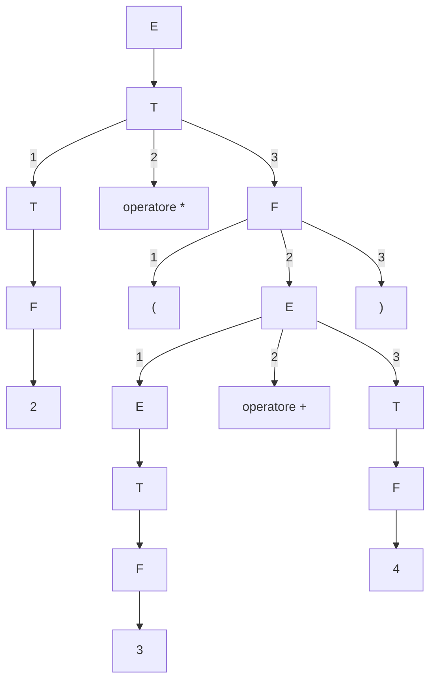
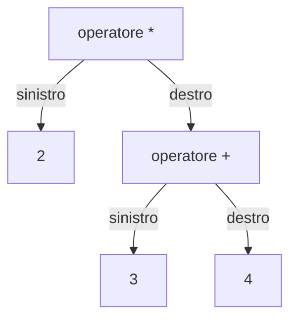

# Linguaggi formali e grammatiche

## Cos'è un linguaggio formale e perché ci serve

Un compilatore legge sequenze di simboli. Per stabilire se una sequenza ha la struttura di un'espressione o di un'istruzione, gli servono regole precise. Per esempio, `2 * (3 + 4)` è un'espressione ben formata, mentre `2 * + 4` viola le regole delle espressioni aritmetiche che useremo in questa nota.

Prima di analizzare la sintassi di un sorgente C, l'analisi **lessicale** raggruppa i caratteri in **token**. In `int totale = 42;` riconosciamo una parola chiave, un identificatore, l'operatore di assegnamento, una costante intera e il punto e virgola. Le regole sintattiche stabiliscono poi come combinare questi token in una dichiarazione.

La stringa `01/03/2013` aiuta a distinguere tre domande sullo stesso enunciato.

| Livello | Domanda | Esempio |
| --- | --- | --- |
| **Sintattico** | La sequenza rispetta le regole di formazione? | La data contiene due cifre, una barra, due cifre, una barra e quattro cifre. |
| **Semantico** | Che cosa significa la sequenza secondo la convenzione adottata? | Giorno/mese/anno indica il 1º marzo. Mese/giorno/anno indica il 3 gennaio. |
| **Pragmatico** | A che cosa serve l'enunciato nel contesto? | In un modulo la data può indicare la scadenza di una domanda oppure il giorno di un appuntamento. |

Per descrivere la sintassi, partiamo da un insieme di simboli e selezioniamo le sequenze ammesse. Una **grammatica formale** permette di descrivere queste sequenze mediante un numero finito di regole anche quando sono infinite.

---

## Alfabeti, stringhe e operazioni

### Alfabeto e stringa

> [!important] Alfabeto e stringa
> Un **alfabeto** $\Sigma$ è un insieme finito e non vuoto di simboli. Una **stringa** (o **parola**) su $\Sigma$ è una sequenza finita di simboli di $\Sigma$.

L'alfabeto binario è $\{0,1\}$. Per descrivere parole possiamo scegliere come simboli le lettere minuscole, mentre per le espressioni aritmetiche possiamo scegliere cifre, operatori e parentesi. La **lunghezza** di una stringa $w$ è il numero di occorrenze dei suoi simboli e si indica con $|w|$. Per esempio, $|01101|=5$. La **stringa vuota** $\varepsilon$ (indicata anche con $\lambda$) ha lunghezza zero.

### Concatenazione e potenza

La **concatenazione** $xy$ mette i simboli di $y$ dopo quelli di $x$. Con $x=\mathtt{ab}$ e $y=\mathtt{bba}$ otteniamo $xy=\mathtt{abbba}$. Vale $|xy|=|x|+|y|$ e $\varepsilon$ è l'elemento neutro, cioè $w\varepsilon=\varepsilon w=w$.

La **potenza** $w^n$ concatena $n$ copie di $w$. Per esempio, $(\mathtt{ab})^3=\mathtt{ababab}$.

$$
w^0=\varepsilon, \qquad w^n=w\,w^{n-1}\quad(n\ge 1).
$$

### Chiusura di Kleene e chiusura positiva

$\Sigma^k$ è l'insieme delle stringhe su $\Sigma$ di lunghezza esattamente $k$, con $\Sigma^0=\{\varepsilon\}$. La **chiusura di Kleene** $\Sigma^*$ contiene tutte le stringhe finite su $\Sigma$. La **chiusura positiva** $\Sigma^+$ contiene quelle di lunghezza almeno uno.

$$
\Sigma^*=\bigcup_{k\ge 0}\Sigma^k, \qquad
\Sigma^+=\bigcup_{k\ge 1}\Sigma^k=\Sigma^*\setminus\{\varepsilon\}.
$$

---

## Linguaggi formali e operazioni sui linguaggi

> [!important] Linguaggio formale
> Un **linguaggio formale** su $\Sigma$ è un insieme di stringhe su quell'alfabeto.
>
> $$
> L\subseteq\Sigma^*.
> $$

Un vocabolario fissato fornisce un linguaggio finito. Una regola come «esattamente $n$ zeri seguiti da $n$ uni per ogni $n\ge 1$» definisce il linguaggio infinito $\{01,0011,000111,\dots\}$. I formati di data e le espressioni aritmetiche sono altri esempi. Una sequenza può usare soltanto simboli dell'alfabeto e violare comunque le regole del linguaggio.

### Operazioni sui linguaggi

| Operazione | Risultato |
| --- | --- |
| Unione $L_1\cup L_2$ | Le parole di almeno uno dei due linguaggi. |
| Intersezione $L_1\cap L_2$ | Le parole di entrambi i linguaggi. |
| Complemento $\overline L=\Sigma^*\setminus L$ | Le stringhe su $\Sigma$ escluse da $L$. |
| Concatenazione $L_1 L_2=\{xy\mid x\in L_1,\ y\in L_2\}$ | Tutte le concatenazioni di una parola di $L_1$ con una parola di $L_2$. |

Per le potenze, le copie sono del linguaggio e ogni fattore può fornire una parola diversa.

$$
L^0=\{\varepsilon\}, \qquad L^k=L\,L^{k-1}\quad(k\ge 1).
$$

$$
L^*=\bigcup_{k\ge 0} L^k, \qquad L^+=\bigcup_{k\ge 1} L^k.
$$

> [!warning] Numero di fattori e lunghezza della stringa
> In $L^+$ concateniamo almeno una parola di $L$. Se $\varepsilon\in L$, possiamo scegliere quella parola e ottenere $\varepsilon\in L^+$.
>
> Il linguaggio vuoto $\emptyset$ ha zero elementi. $\{\varepsilon\}$ ha un elemento e vale $L\{\varepsilon\}=L$. Invece $L\emptyset=\emptyset$, perché manca una parola da scegliere nel secondo fattore.

### Codici e decomposizione univoca

> [!important] Codice
> Un insieme $C$ di parole non vuote è un **codice** se ogni stringa di $C^+$ ha un'unica decomposizione in parole di $C$.

- Con $C=\{\mathtt{1},\mathtt{10}\}$ ogni `0` impone che il precedente `1` faccia parte della parola `10`. Gli altri `1` costituiscono parole singole. La decomposizione è quindi unica per qualsiasi stringa di $C^+$. Per esempio, `101` si separa in `10` e `1`.
- Con $C'=\{\mathtt{bab},\mathtt{aba},\mathtt{ab}\}$ la stessa stringa `ababab` si ottiene sia con `aba · bab` sia con `ab · ab · ab`. Queste due decomposizioni bastano a escludere che $C'$ sia un codice.

In un **codice a prefisso** nessuna parola è prefisso di un'altra. Leggendo da sinistra, al primo riscontro di una parola possiamo tagliare lì. Questo basta a garantire l'univocità. $C$ mostra che la proprietà di prefisso è sufficiente ma non necessaria, dato che `1` è prefisso di `10`.

### Appartenenza, riconoscimento e generazione

Data una stringa $w\in\Sigma^*$, il **problema dell'appartenenza** chiede se $w\in L$. Possiamo descrivere $L$ tramite un modello che riconosce le parole ammesse oppure mediante regole che le generano.

- Nell'**approccio riconoscitivo** il modello legge una parola e applica un criterio di accettazione. Gli [[1.1.2 - Automi a stati finiti (FSA)|automi a stati finiti]] decidono l'appartenenza ai linguaggi regolari. Terminano dopo aver letto l'input.
- Nell'**approccio generativo** si parte da un simbolo iniziale e si applicano produzioni per ottenere le parole ammesse. Una derivazione completa di $w$ dimostra che $w$ appartiene al linguaggio.

Per i modelli di calcolo generali distinguiamo **riconoscibilità** e **decidibilità**. Un riconoscitore accetta tutte le parole del linguaggio e può rifiutare o proseguire indefinitamente sugli altri input. Un decisore termina sempre con un sì o un no. Riprenderemo la distinzione con la [[1.2.1 - Macchina di Turing|macchina di Turing]].

---

## Grammatiche formali

> [!important] La quadrupla della grammatica
> Una grammatica formale è una quadrupla $G=(V_N,V_T,P,S)$.
>
> - $V_N$ è l'insieme finito dei **non-terminali**, cioè le categorie da sviluppare durante la derivazione.
> - $V_T$ è l'insieme finito dei **terminali**, cioè i simboli delle parole generate. Vale $V_N\cap V_T=\emptyset$.
> - $P$ è l'insieme finito delle **produzioni** $\alpha\to\beta$. $\alpha$ contiene almeno un non-terminale, mentre $\beta$ può essere una sequenza qualsiasi di terminali e non-terminali, inclusa $\varepsilon$.
> - $S\in V_N$ è il **simbolo iniziale**.

Scriviamo $V=V_N\cup V_T$. Una produzione $\alpha\to\beta$ applicata alla sottostringa $\alpha$ in $\gamma\alpha\delta$ dà $\gamma\beta\delta$, dove $\gamma,\delta\in V^*$. Usiamo $\Rightarrow$ per un passo e $\Rightarrow^*$ per zero o più passi.

$$
\gamma\alpha\delta \Rightarrow \gamma\beta\delta.
$$

Il **linguaggio generato** raccoglie tutte le derivazioni che arrivano a una stringa di soli terminali.

$$
L(G)=\{w\in V_T^*\mid S\Rightarrow^* w\}.
$$

Due grammatiche sono **equivalenti** se generano lo stesso linguaggio.

---

## La gerarchia di Chomsky

I vincoli sulle produzioni individuano quattro classi di linguaggi. Ogni classe è strettamente inclusa nella precedente, dal tipo più restrittivo (3) al più generale (0).

$$
\mathcal L_3\subsetneq\mathcal L_2\subsetneq\mathcal L_1\subsetneq\mathcal L_0.
$$

| Tipo | Famiglia | Forma delle produzioni | Modello di riconoscimento |
| --- | --- | --- | --- |
| 0 | Illimitata | $\alpha$ contiene almeno un non-terminale. | Macchina di Turing |
| 1 | Contestuale | Nella caratterizzazione non contraente, $\lvert\alpha\rvert\le\lvert\beta\rvert$. | Automa linearmente limitato |
| 2 | Libera dal contesto (CFG) | $A\to\beta$ con un solo non-terminale $A$ a sinistra. | Automa a pila non deterministico |
| 3 | Regolare | Lineare destra, $A\to aB$ o $A\to a$, oppure lineare sinistra, $A\to Ba$ o $A\to a$. | Automa a stati finiti |

Per il tipo 1 usiamo la convenzione non contraente, equivalente per le classi di linguaggi alla formulazione mediante riscrittura in un contesto. Si può ammettere $S\to\varepsilon$ se $S$ è assente da tutti i lati destri. Per il tipo 3 usiamo la forma lineare che ammette anche $A\to\varepsilon$, con $a\in V_T$ e $A,B\in V_N$.

Nell'analisi lessicale, le grammatiche regolari e gli automi a stati finiti descrivono molte categorie di **token**, come numeri e identificatori. Nell'analisi sintattica, le grammatiche libere dal contesto descrivono strutture annidate come le espressioni tra parentesi.

---

## Notazione BNF, alberi e ambiguità

La **BNF** (*Backus–Naur Form*) scrive le produzioni di una grammatica libera dal contesto. I non-terminali compaiono tra parentesi angolari, i terminali tra virgolette, `::=` introduce la produzione e `|` separa le alternative. Per le nostre espressioni, `<E>` indica un'espressione, `<T>` un termine e `<F>` un fattore.

```text
<E> ::= <E> "+" <T> | <T>
<T> ::= <T> "*" <F> | <F>
<F> ::= "(" <E> ")" | "0" | "1" | "2" | "3" | "4" | "5" | "6" | "7" | "8" | "9"
```

Una somma è costruita a livello di `<E>` e i suoi addendi sono già raggruppati in termini. La moltiplicazione si costruisce dentro `<T>` e ha così precedenza sulla somma. Le parentesi permettono di inserire un'intera espressione in un fattore.

L'**albero di derivazione** (*parse tree*) ha come radice il simbolo iniziale. I figli di un nodo non-terminale, nell'ordine, sono i simboli del lato destro della produzione applicata. Leggendo le foglie da sinistra verso destra e omettendo $\varepsilon$ otteniamo la stringa derivata. L'**albero sintattico astratto** (*abstract syntax tree*, **AST**) conserva la struttura che serve nelle fasi successive. Per un'espressione aritmetica, i nodi interni sono gli operatori e i figli ne rappresentano gli operandi in ordine.

> [!important] Grammatica ambigua
> Una grammatica libera dal contesto è **ambigua** se almeno una sua parola ammette due alberi di derivazione distinti. In modo equivalente, la parola ammette due derivazioni sinistre distinte, nelle quali si espande sempre il non-terminale più a sinistra.

Per esempio, con $E\to E+E\mid E*E\mid\mathtt{2}\mid\mathtt{3}\mid\mathtt{4}$, la stringa `2 + 3 * 4` ammette due alberi di derivazione. Nel primo si applica $E\to E+E$ alla radice e si ottiene `2 + (3 * 4)`. Nel secondo si applica $E\to E*E$ alla radice e si ottiene `(2 + 3) * 4`. Nella BNF qui sopra, `2 + 3 * 4` si deriva solo raggruppando prima il prodotto. Le parentesi permettono di esprimere esplicitamente l'altro raggruppamento.

---

## Esempi guidati

### Esempio 1. Una grammatica per $a^n b^n$

**Problema.** Descrivere il linguaggio di $S\to\mathtt{a}S\mathtt{b}\mid\mathtt{ab}$ e derivare `aaabbb`.

**Svolgimento.** Ogni applicazione della prima produzione aggiunge una `a` a sinistra e una `b` a destra. La seconda chiude la derivazione aggiungendo una coppia centrale. Per `aaabbb` usiamo due volte la prima produzione e una volta la seconda.

$$
S\Rightarrow\mathtt{a}S\mathtt{b}
 \Rightarrow\mathtt{aa}S\mathtt{bb}
 \Rightarrow\mathtt{aaabbb}.
$$

Ogni derivazione completa ha la forma $a^n b^n$ e possiamo scegliere $n-1$ passi ricorsivi per ottenere ogni $n\ge 1$. Quindi $L(G)=\{a^n b^n\mid n\ge 1\}$. La grammatica è di tipo 2. La produzione $\mathtt{a}S\mathtt{b}$ ha terminali su entrambi i lati di $S$.

### Esempio 2. Stringhe binarie che iniziano con 1 e finiscono con 0

**Problema.** Costruire una grammatica regolare per $L=\{1w0\mid w\in\{0,1\}^*\}$.

**Svolgimento.** Da $S$ produciamo il primo `1` e passiamo ad $A$. Da $A$ possiamo aggiungere un simbolo intermedio restando in $A$, oppure chiudere con `0`.

$$
S\to 1A,\qquad A\to 0A\mid 1A\mid 0.
$$

Per `1010` otteniamo $S\Rightarrow 1A\Rightarrow 10A\Rightarrow 101A\Rightarrow 1010$. Tutte le produzioni sono lineari destre. La derivazione $S\Rightarrow 1A\Rightarrow 10$ verifica anche il caso in cui $w=\varepsilon$.

### Esempio 3. Dalla BNF all'AST di un'espressione

**Problema.** Usare la BNF per derivare `2 * (3 + 4)` e ricavare le notazioni prefissa e postfissa.

**Svolgimento.** Partiamo da `<E>` e scegliamo `<T>`, poi scomponiamo il prodotto in `<T> "*" <F>`. Il termine a sinistra produce `2` e il fattore a destra apre una nuova espressione tra parentesi. Questa usa `<E> "+" <T>` per produrre la somma.

**Albero di derivazione**. I numeri sulle frecce indicano l'ordine dei figli quando una produzione ne ha più di uno.



Visitando le foglie nell'ordine dei figli otteniamo `2 * ( 3 + 4 )`. Nell'AST il nodo `+` è il secondo operando di `*`. La struttura dell'albero mantiene il raggruppamento delle parentesi e possiamo valutare la somma a `7` prima del prodotto, che dà `14`.

**Albero sintattico astratto**



| Notazione | Ordine di visita dell'AST | Risultato |
| --- | --- | --- |
| Infissa | Operando sinistro, operatore, operando destro. Aggiungiamo le parentesi quando servono a conservare il raggruppamento. | `2 * (3 + 4)` |
| Prefissa | Operatore, operando sinistro, operando destro. | `* 2 + 3 4` |
| Postfissa | Operando sinistro, operando destro, operatore. | `2 3 4 + *` |

La nota sui [[6.6.1 - Compilatori, interpreti e catena di traduzione|compilatori]] riprende gli alberi nella fase di analisi sintattica.

---

## Errori frequenti

> [!caution] Controlli da fare
> **Errore** · Trattare $\varepsilon$, $\emptyset$ e $\{\varepsilon\}$ come lo stesso oggetto.
>
> **Correzione** · Il primo è una stringa di lunghezza zero. Gli altri sono linguaggi di cardinalità rispettivamente zero e uno. Solo $\{\varepsilon\}$ è neutro per la concatenazione di linguaggi.
>
> **Errore** · Supporre che $L^+$ escluda sempre $\varepsilon$.
>
> **Correzione** · Il segno $+$ impone almeno un fattore. Se il fattore scelto è $\varepsilon\in L$, anche il risultato è $\varepsilon$.
>
> **Errore** · Classificare come regolare una grammatica perché ogni regola presa da sola è lineare destra oppure sinistra.
>
> **Correzione** · La forma regolare usa un solo orientamento in tutta la grammatica. Con $S\to\mathtt{a}A$ e $A\to S\mathtt{b}\mid\mathtt{b}$, l'alternanza permette di generare $a^n b^n$ per $n\ge 1$.
>
> **Errore** · Contare $\mathtt{aa}S\mathtt{bb}$ come parola generata.
>
> **Correzione** · È una forma di frase intermedia. Per ottenere una parola di $L(G)$, completiamo la derivazione fino a lasciare soltanto terminali.

---

## Esercizi di prova

### Esercizio 1. Operazioni su linguaggi e codici (Base)

Siano $L_1=\{\varepsilon,\mathtt{a},\mathtt{ab}\}$ e $L_2=\{\mathtt{b},\mathtt{ba}\}$.

1. Calcola $L_1L_2$ e $L_2^2$. Indica la lunghezza di ogni parola di $L_2^2$.
2. Stabilisci se $\varepsilon\in L_1^+$ e se $\varepsilon\in L_2^+$.
3. Stabilisci se $L_2$ è un codice e se è a prefisso.

> [!tip]- Soluzione
> Concatenando ciascun elemento di $L_1$ con $\mathtt b$ e $\mathtt{ba}$ otteniamo
>
> $$
> L_1L_2=\{\mathtt{b},\mathtt{ba},\mathtt{ab},\mathtt{aba},\mathtt{abb},\mathtt{abba}\}.
> $$
>
> Con due fattori da $L_2$ otteniamo $\{\mathtt{bb},\mathtt{bba},\mathtt{bab},\mathtt{baba}\}$, con lunghezze rispettivamente $2,3,3,4$.
>
> $\varepsilon\in L_1^+$ perché $\varepsilon\in L_1$. Ogni fattore in $L_2$ ha lunghezza positiva, quindi $\varepsilon\notin L_2^+$.
>
> Ogni `a` forza il precedente `b` a far parte di `ba` e tutti gli altri `b` sono parole singole. $L_2$ è quindi un codice. La parola `b` è prefisso di `ba`, perciò $L_2$ non è a prefisso.

### Esercizio 2. Classificazione delle produzioni (Base)

Determina il tipo più specifico (il numero più alto) di ciascuna grammatica secondo le convenzioni della nota. I simboli maiuscoli sono non-terminali e $S$ è il simbolo iniziale.

1. $S\to\mathtt{a}S\mid\mathtt{b}A$ e $A\to\mathtt{a}A\mid\mathtt{b}$.
2. $S\to\mathtt{a}S\mathtt{a}\mid\mathtt{b}S\mathtt{b}\mid\mathtt{a}\mid\mathtt{b}$.
3. $S\to\mathtt{a}AB$, $\mathtt{a}A\to\mathtt{aab}$ e $B\to\mathtt{b}$.
4. $S\to\mathtt{a}AB$, $AB\to B$ e $B\to\mathtt{b}$.

> [!tip]- Soluzione
> 1. **Tipo 3.** Le produzioni sono tutte lineari destre.
> 2. **Tipo 2.** A sinistra compare solo $S$. I lati destri $\mathtt{a}S\mathtt{a}$ e $\mathtt{b}S\mathtt{b}$ violano i vincoli della forma regolare.
> 3. **Tipo 1.** Le lunghezze passano da $1$ a $3$, da $2$ a $3$ e da $1$ a $1$. Il lato sinistro $\mathtt{a}A$ esclude il tipo 2.
> 4. **Tipo 0.** $AB\to B$ riduce la lunghezza da $2$ a $1$.

### Esercizio 3. Una grammatica per i palindromi (Intermedio)

Costruisci una grammatica libera dal contesto per le stringhe palindrome su $\{\mathtt a,\mathtt b\}$, inclusa $\varepsilon$. Mostra una derivazione di `abba`.

> [!tip]- Soluzione
> Le stringhe palindrome più corte sono $\varepsilon$, $\mathtt a$ e $\mathtt b$. Per quelle più lunghe, i due simboli esterni coincidono e racchiudono a loro volta un palindromo.
>
> $$
> S\to\mathtt{a}S\mathtt{a}\mid\mathtt{b}S\mathtt{b}\mid\mathtt{a}\mid\mathtt{b}\mid\varepsilon.
> $$
>
> $$
> S\Rightarrow\mathtt{a}S\mathtt{a}\Rightarrow\mathtt{ab}S\mathtt{ba}
> \Rightarrow\mathtt{abba}.
> $$

### Esercizio 4. Appartenenza a un linguaggio generato (Intermedio)

Data la grammatica con produzioni $S\to\mathtt a S\mathtt c\mid A$ e $A\to\mathtt b A\mid\mathtt b$, determina $L(G)$ e stabilisci se `aabccc` vi appartiene.

> [!tip]- Soluzione
> Ogni passo $S\to\mathtt a S\mathtt c$ aggiunge una `a` e una `c`. Dopo $n\ge 0$ passi scegliamo $S\to A$. Da $A$ generiamo $m\ge 1$ copie di `b` con $m-1$ passi ricorsivi e un passo finale $A\to\mathtt b$.
>
> $$
> L(G)=\{\mathtt a^n\mathtt b^m\mathtt c^n\mid n\ge 0,\ m\ge 1\}.
> $$
>
> `aabccc` è esclusa perché ha due `a` e tre `c`.

### Esercizio 5. Due derivazioni per le stesse parentesi (Avanzato)

Considera $S\to (S)\mid SS\mid\varepsilon$. Dimostra l'ambiguità con due derivazioni sinistre di `()`. Proponi una grammatica equivalente e motiva l'unicità della derivazione sinistra.

> [!tip]- Soluzione
> Possiamo creare subito la coppia, oppure usare $SS$ e far sparire il secondo $S$ alla fine.
>
> $$
> S\Rightarrow (S)\Rightarrow (),
> \qquad
> S\Rightarrow SS\Rightarrow (S)S\Rightarrow ()S\Rightarrow ().
> $$
>
> Una grammatica equivalente è $S\to (S)S\mid\varepsilon$. Ogni stringa non vuota di parentesi bilanciate si divide in modo unico tra la prima coppia bilanciata, che termina quando la profondità torna a zero, e il resto. I due $S$ generano rispettivamente l'interno della coppia e il resto. Applicando lo stesso criterio alle due sottostringhe otteniamo una derivazione sinistra unica.

### Esercizio 6. BNF per interi decimali con segno (Intermedio)

Scrivi una grammatica BNF per interi decimali rappresentati con almeno una cifra e un segno iniziale facoltativo. Verifica se `-105`, `0` e `+` appartengono al linguaggio.

> [!tip]- Soluzione
> ```text
> <intero> ::= "+" <cifre> | "-" <cifre> | <cifre>
> <cifre>  ::= <cifra> | <cifra> <cifre>
> <cifra>  ::= "0" | "1" | "2" | "3" | "4" | "5" | "6" | "7" | "8" | "9"
> ```
>
> Per `-105` scegliamo l'alternativa con `-` e produciamo tre cifre. Per `0` basta una cifra e usiamo l'alternativa senza segno. `+` è esclusa perché tutte le alternative richiedono almeno una cifra.

---

## Provenienza del materiale

- Slide e dispensa ufficiale del corso, `C1PROG1U1L1a_Linguaggi_Formali.pdf` (Unità 1, Lezione 1a, linguaggi formali, grammatiche generative e gerarchia di Chomsky).
- Marco Anisetti, *Appunti di Programmazione e Algoritmi I. Fondamenti*, `Appunti_di_fine_Unita_1.pdf`, §§ 1.1–1.10 e 2.1–2.7.
- *Guida unica di studio – Fondamenti*, `Guida_Unita_1_teoria_approfondimenti_per_argomento.pdf`, §§ 1–5.
- *Appunti Avanzati di Programmazione e Algoritmi I*, `AppuntiInformatica-v3.pdf`, §§ 1 e 3.
- Dispensa del corso, `C1PROG1B1L3_Semantica_grammatica_algoritmo.pdf` (Lessico, sintassi, semantica e introduzione agli algoritmi).
