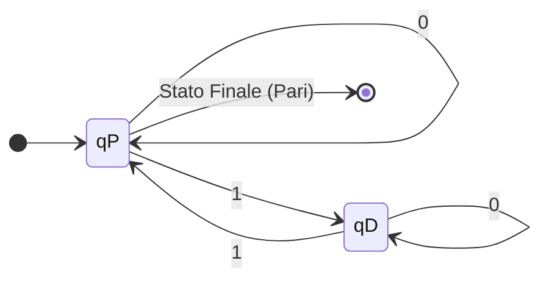
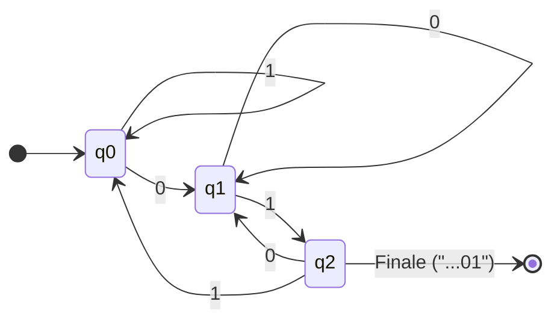
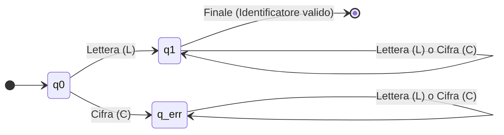

# 1.1.2 - Automi a stati finiti (FSA)

## Introduzione intuitiva

Nella lezione precedente abbiamo visto come *generare* le parole di un linguaggio tramite una grammatica. Ma un compilatore ha il problema opposto: data una stringa già scritta nel file sorgente (ad esempio `contatore_1` oppure `3.14`), deve **riconoscere** se quella stringa appartiene o meno al linguaggio dei token validi.

Per risolvere questo problema per i linguaggi regolari (Tipo 3 della gerarchia di Chomsky) utilizziamo il modello di calcolo più semplice ed elegante dell'informatica: l'**Automa a Stati Finiti** (**FSA**, *Finite State Automaton*, o in italiano **ASF**).

Pensa a un distributore automatico o a un tornello della metropolitana: si trova in uno **stato** iniziale ("Bloccato"); quando riceve un **evento di input** ("Inserisci biglietto valido"), cambia stato diventando "Sbloccato"; quando riceve l'evento "Passa una persona", torna nello stato "Bloccato". L'automa non ha bisogno di un quaderno su cui annotare tutta la sua storia passata: gli basta sapere **in quale stato si trova adesso** (tra un numero finito di stati possibili) e **qual è il simbolo corrente che sta leggendo**.

---

## Definizione formale di Automa a Stati Finiti Deterministico (DFA)

Un **Automa a Stati Finiti Deterministico** (**DFA**, *Deterministic Finite Automaton*) è formalmente definito da una quintupla:
$$M = (Q, \Sigma, \delta, q_0, F)$$
dove ciascun elemento ha un ruolo preciso:
1. **$Q$**: insieme **finito e non vuoto** degli **stati** interni dell'automa ($Q = \{q_0, q_1, \dots, q_{n-1}\}$).
2. **$\Sigma$**: **alfabeto di input** (insieme finito e non vuoto di simboli che l'automa può leggere sul nastro di ingresso).
3. **$\delta$ (Delta)**: **funzione di transizione** di stato:
   $$\delta : Q \times \Sigma \to Q$$
   Preso lo stato corrente $q \in Q$ e il simbolo letto $a \in \Sigma$, $\delta(q, a) = q'$ restituisce l'**unico** stato successivo $q' \in Q$ in cui si porta l'automa. (L'aggettivo *deterministico* indica proprio che per ogni coppia $(q, a)$ la mossa successiva è univocamente determinata).
4. **$q_0 \in Q$**: lo **stato iniziale**, ovvero lo stato in cui si trova l'automa prima di leggere il primo carattere della stringa.
5. **$F \subseteq Q$**: il sottoinsieme degli **stati finali (o di accettazione)**.

### Estensione della funzione di transizione alle stringhe ($\hat{\delta}$)
Per descrivere il comportamento dell'automa quando legge un'intera stringa $w \in \Sigma^*$ (simbolo dopo simbolo, da sinistra verso destra), estendiamo $\delta$ alla funzione $\hat{\delta} : Q \times \Sigma^* \to Q$ definita per induzione sulla lunghezza della stringa:
- **Caso base (stringa vuota $\varepsilon$)**: se l'automa non legge alcun simbolo, resta nello stato in cui si trova:
  $$\forall q \in Q, \qquad \hat{\delta}(q, \varepsilon) = q$$
- **Passo induttivo (stringa $wa$, con $w \in \Sigma^*$ e $a \in \Sigma$)**:
  $$\forall q \in Q, \quad \hat{\delta}(q, wa) = \delta\big(\hat{\delta}(q, w), \, a\big)$$
  *(Prima calcolo in quale stato arrivo dopo aver letto il prefisso $w$, e da quello stato applico $\delta$ con l'ultimo carattere $a$).*

### Accettazione di una stringa e Linguaggio Riconosciuto $L(M)$
> Una stringa $w \in \Sigma^*$ è **accettata (o riconosciuta)** dall'automa $M$ se e solo se, partendo dallo stato iniziale $q_0$ e leggendo tutti i simboli di $w$ fino in fondo, l'automa termina in uno **stato finale**:
> $$w \text{ è accettata da } M \iff \hat{\delta}(q_0, w) \in F$$

L'insieme di tutte le stringhe accettate da $M$ è il **linguaggio riconosciuto dall'automa $M$**, indicato con $L(M)$:
$$L(M) = \{w \in \Sigma^* \mid \hat{\delta}(q_0, w) \in F\}$$

> **Teorema di Kleene / Chomsky (Tipo 3)**: Un linguaggio $L \subseteq \Sigma^*$ è **regolare** (generabile da una grammatica di Tipo 3) se e solo se esiste un Automa a Stati Finiti $M$ tale che $L = L(M)$.

---

## Rappresentazione degli Automi: Grafi e Tabelle

Un DFA può essere descritto in due modi equivalenti e immediatamente leggibili:

1. **Diagramma degli stati (Grafo orientato etichettato)**:
   - I nodi sono gli stati $q \in Q$.
   - Lo stato iniziale $q_0$ ha una freccia entrante dall'esterno (`[*] --> q0`).
   - Gli stati finali $q \in F$ sono indicati con un **doppio cerchio** (nei diagrammi Mermaid li indicheremo chiaramente o con una transizione verso `[*]`).
   - Se $\delta(q_i, a) = q_j$, si disegna un arco orientato da $q_i$ a $q_j$ con etichetta $a$.

2. **Tabella di transizione (Matrice stato $\times$ simbolo)**:
   - Le righe corrispondono agli stati $q \in Q$ (segnando con $\to$ lo stato iniziale e con $*$ gli stati finali).
   - Le colonne corrispondono ai simboli dell'alfabeto $a \in \Sigma$.
   - La cella all'incrocio $(q, a)$ contiene $\delta(q, a)$.

---

## Cenni a NFA (Non Determinismo) e Trasduttori (Mealy e Moore)

### Automi a Stati Finiti Non Deterministici (NFA)
In un **NFA** (*Nondeterministic Finite Automaton*), da uno stato $q$ leggendo un simbolo $a$ possono partire **zero, una o più frecce** con la stessa etichetta $a$ (e persino frecce spontanee etichettate con $\varepsilon$). Formalmente $\delta : Q \times (\Sigma \cup \{\varepsilon\}) \to \mathcal{P}(Q)$ restituisce un *insieme* di stati possibili. Una stringa è accettata se **almeno uno** dei cammini possibili termina in uno stato finale.
- **Teorema di Rabin-Scott**: Ogni NFA può essere trasformato in un DFA equivalente (costruzione per sottoinsiemi). Quindi gli NFA **non** sono più potenti dei DFA: riconoscono esattamente gli stessi linguaggi (i linguaggi regolari).

### Automi con Output (Trasduttori): Macchine di Mealy e di Moore
Un DFA classico produce solo una risposta binaria alla fine della stringa (*Accettata / Rifiutata*). Se invece vogliamo che l'automa emetta una **stringa di output** man mano che legge l'input (ad esempio un circuito digitale o un traduttore), usiamo i trasduttori a stati finiti:
- **Macchina di Mealy**: l'output emesso dipende sia dallo **stato corrente** sia dal **simbolo di input** letto (l'output è scritto sulle frecce sotto forma `input / output`).
- **Macchina di Moore**: l'output emesso dipende **esclusivamente dallo stato** raggiunto (l'output è scritto dentro il nodo dello stato).

---

## Esempi guidati

### Esempio 1: Stringhe binarie con un numero PARI di `1`
**Problema**: Costruire un DFA sull'alfabeto $\Sigma = \{0, 1\}$ che accetti tutte e sole le stringhe contenenti un numero **pari** di simboli `1` (ricordando che $0$ è un numero pari, quindi anche $\varepsilon$ e `000` devono essere accettate!).

**Progettazione degli stati:**
Quante informazioni dobbiamo ricordare mentre leggiamo la stringa da sinistra a destra? Non ci serve contare $1, 2, 3, \dots, 1000$ (servirebbero infiniti stati!): ci basta ricordare **la parità** del numero di `1` visti finora! Bastano quindi **2 stati**:
- **$q_P$ (Stato iniziale e anche FINALE)**: finora abbiamo letto un numero **pari** di `1`.
- **$q_D$ (Stato non finale)**: finora abbiamo letto un numero **dispari** di `1`.

Ogni volta che leggiamo uno `0`, la parità degli `1` non cambia (restiamo nello stesso stato). Ogni volta che leggiamo un `1`, la parità si inverte (passiamo da $q_P$ a $q_D$ o viceversa).



**Tabella di transizione ($Q = \{q_P, q_D\}, q_0 = q_P, F = \{q_P\}$):**

| Stato | Input `0` | Input `1` | Significato dello stato |
| :---: | :---: | :---: | :--- |
| $\to * \mathbf{q_P}$ | $q_P$ | $q_D$ | Numero **pari** di `1` letti (Accettazione) |
| $\mathbf{q_D}$ | $q_D$ | $q_P$ | Numero **dispari** di `1` letti |

**Traccia di esecuzione su $w = \mathtt{10110}$:**
$$q_P \xrightarrow{\mathtt{1}} q_D \xrightarrow{\mathtt{0}} q_D \xrightarrow{\mathtt{1}} q_P \xrightarrow{\mathtt{1}} q_D \xrightarrow{\mathtt{0}} q_D \notin F \implies \textbf{Rifiutata} \text{ (ha tre } 1\text{)}$$
Su $w = \mathtt{1010}$:
$$q_P \xrightarrow{\mathtt{1}} q_D \xrightarrow{\mathtt{0}} q_D \xrightarrow{\mathtt{1}} q_P \xrightarrow{\mathtt{0}} q_P \in F \implies \textbf{Accettata} \text{ (ha due } 1\text{)}$$

### Esempio 2: Stringhe binarie che terminano con la sottostringa `01`
**Problema**: Costruire un DFA su $\Sigma = \{0, 1\}$ che riconosca $L = \{w \in \{0,1\}^* \mid w \text{ termina con } \mathtt{01}\}$.

**Progettazione degli stati (memoria degli ultimi caratteri visti):**
- **$q_0$ (Iniziale)**: non abbiamo ancora visto l'inizio del pattern `01` (siamo all'inizio oppure l'ultimo carattere letto era `1` non preceduto da `0`).
- **$q_1$**: l'ultimo carattere letto è stato `0` (siamo a metà del pattern `01`! Se ora arriva `0` restiamo in $q_1$ perché anche questo nuovo `0` può fare da inizio di `01`; se arriva `1` completiamo `01`).
- **$q_2$ (Finale)**: gli ultimi due caratteri letti sono esattamente `01`. Se la stringa finisce qui, accettiamo! Se invece continua: con uno `0` torniamo in $q_1$ (perché il nuovo `0` potrebbe iniziare un nuovo `01`), mentre con un `1` gli ultimi due caratteri diventano `11`, quindi torniamo in $q_0$.



### Esempio 3: Riconoscitore lessicale di Identificatori in C (e implementazione in C!)
In linguaggio C un identificatore (semplificando a lettere `L` e cifre `C`) deve **iniziare con una lettera `L`**, seguita da zero o più lettere `L` o cifre `C`. Se inizia con una cifra `C`, è un errore lessicale e l'automa finisce in uno **stato pozzo (o stato trappola)** $q_{err}$ da cui non può più uscire.



Ecco come si traduce un DFA direttamente in un programma C pulito:
```c
#include <stdio.h>

int main(void) {
    /* Stringa di test: 'a', '1', 'b' -> valida! */
    char parola[] = "a1b";
    int stato = 0; /* q0 = 0, q1 (finale) = 1, q_err = 2 */

    for (int i = 0; parola[i] != '\0'; i++) {
        char c = parola[i];
        int e_lettera = (c >= 'a' && c <= 'z') || (c >= 'A' && c <= 'Z');
        int e_cifra   = (c >= '0' && c <= '9');

        if (stato == 0) {
            if (e_lettera) stato = 1;
            else           stato = 2; /* Stato pozzo */
        } else if (stato == 1) {
            if (e_lettera || e_cifra) stato = 1;
            else                      stato = 2;
        }
    }

    if (stato == 1) {
        printf("La stringa '%s' e' un identificatore VALIDO.\n", parola);
    } else {
        printf("La stringa '%s' NON e' valida.\n", parola);
    }
    return 0;
}
```

---

## Errori frequenti

1. **Dimenticare di specificare tutte le transizioni in un DFA (funzione $\delta$ incompleta)**
   In un DFA deterministico, da **ogni** stato $q \in Q$ deve uscire **esattamente una freccia per ciascun simbolo dell'alfabeto $\Sigma$**. Se una mossa porta a una stringa irrecuperabilmente errata, bisogna creare esplicitamente uno **stato pozzo (trappola)** non finale con un cappio su tutti i simboli di $\Sigma$.
2. **Sbagliare le transizioni di "ripartenza" nel riconoscimento di sottostringhe**
   Nell'Esempio 2 (stringhe che terminano con `01`), molti studenti nello stato $q_1$ (dopo aver letto `0`), se leggono un altro `0`, tornano erroneamente a $q_0$. In questo modo la stringa `001` verrebbe rifiutata! Se ho letto `0` e leggo un altro `0`, l'ultimo carattere visto è comunque uno `0`, quindi devo rimanere in $q_1$.
3. **Dimenticare di verificare se la stringa vuota $\varepsilon$ appartiene al linguaggio**
   Controlla sempre: se $\varepsilon \in L$, allora lo stato iniziale $q_0$ **deve** appartenere a $F$ ($q_0 \in F$); se $\varepsilon \notin L$, allora $q_0 \notin F$.

---

## Esercizi di prova

1. **[Base — Traccia e linguaggio di un DFA dato]**
   Dato il DFA $M = (\{q_0, q_1, q_2\}, \{\mathtt{a}, \mathtt{b}\}, \delta, q_0, \{q_2\})$ con la seguente tabella di transizione:
   - $\delta(q_0, \mathtt{a}) = q_1, \quad \delta(q_0, \mathtt{b}) = q_0$
   - $\delta(q_1, \mathtt{a}) = q_2, \quad \delta(q_1, \mathtt{b}) = q_0$
   - $\delta(q_2, \mathtt{a}) = q_2, \quad \delta(q_2, \mathtt{b}) = q_2$
   a) Calcola $\hat{\delta}(q_0, \mathtt{baba})$ e $\hat{\delta}(q_0, \mathtt{baab})$ indicando se le due stringhe sono accettate.
   b) Descrivi a parole il linguaggio $L(M)$ riconosciuto dall'automa.
> [!tip]- Soluzione
> - **a) Tracce di esecuzione**:
>   - Per $w_1 = \mathtt{baba}$:
>     $$q_0 \xrightarrow{\mathtt{b}} q_0 \xrightarrow{\mathtt{a}} q_1 \xrightarrow{\mathtt{b}} q_0 \xrightarrow{\mathtt{a}} q_1 \notin F \implies \textbf{Rifiutata}$$
>   - Per $w_2 = \mathtt{baab}$:
>     $$q_0 \xrightarrow{\mathtt{b}} q_0 \xrightarrow{\mathtt{a}} q_1 \xrightarrow{\mathtt{a}} q_2 \xrightarrow{\mathtt{b}} q_2 \in F \implies \textbf{Accettata}$$
> - **b) Linguaggio riconosciuto**: Per raggiungere $q_2$ bisogna leggere due $\mathtt{a}$ consecutive ($\mathtt{aa}$); se si legge una $\mathtt{b}$ in $q_1$ si torna a $q_0$. Una volta raggiunto $q_2$, qualsiasi simbolo mantiene l'automa in $q_2$. Quindi $L(M)$ è il linguaggio di **tutte le stringhe su $\{\mathtt{a}, \mathtt{b}\}$ che contengono almeno due $\mathtt{a}$ consecutive (la sottostringa $\mathtt{aa}$)**.

2. **[Base — Costruzione di un DFA con stato pozzo]**
   Disegna in Mermaid e scrivi la tabella di transizione di un DFA sull'alfabeto $\Sigma = \{0, 1\}$ che accetti tutte e sole le stringhe che **iniziano con `01`** (cioè $L = \{\mathtt{01}w \mid w \in \{0,1\}^*\}$).
> [!tip]- Soluzione
> Servono 4 stati: $q_0$ (iniziale), $q_1$ (letto il primo `0`), $q_2$ (finale: letto `01` all'inizio, accetta qualsiasi seguito), e $q_P$ (stato pozzo per le stringhe che iniziano con `1` o con `00`).
>
> ```mermaid
> stateDiagram-v2
>     direction LR
>     [*] --> q0
>     q0 --> q1 : 0
>     q0 --> qP : 1
>     q1 --> q2 : 1
>     q1 --> qP : 0
>     q2 --> q2 : 0, 1
>     qP --> qP : 0, 1
>     q2 --> [*] : Finale
> ```
>
> | Stato | `0` | `1` |
> | :---: | :---: | :---: |
> | $\to q_0$ | $q_1$ | $q_P$ |
> | $q_1$ | $q_P$ | $q_2$ |
> | $*q_2$ | $q_2$ | $q_2$ |
> | $q_P$ | $q_P$ | $q_P$ |

3. **[Intermedio — Aritmetica modulare con gli automi]**
   Costruisci un DFA sull'alfabeto unario $\Sigma = \{\mathtt{a}\}$ che accetti tutte e sole le stringhe la cui lunghezza $|w|$ è un **multiplo di 3** ($L = \{\mathtt{a}^{3k} \mid k \ge 0\} = \{\varepsilon, \mathtt{aaa}, \mathtt{aaaaaa}, \dots\}$).
> [!tip]- Soluzione
> Basta ricordare il resto della divisione per 3 della lunghezza letta finora ($|w| \bmod 3 \in \{0, 1, 2\}$):
> - $q_0$ (iniziale e **finale**): $|w| \equiv 0 \pmod 3$.
> - $q_1$: $|w| \equiv 1 \pmod 3$.
> - $q_2$: $|w| \equiv 2 \pmod 3$.
>
> ```mermaid
> stateDiagram-v2
>     direction LR
>     [*] --> q0
>     q0 --> q1 : a
>     q1 --> q2 : a
>     q2 --> q0 : a
>     q0 --> [*] : Finale (Resto 0)
> ```

4. **[Intermedio —Complemento di un linguaggio regolare tramite DFA]**
   Dato un DFA $M = (Q, \Sigma, \delta, q_0, F)$ che riconosce un linguaggio $L$, come si può ottenere immediatamente un nuovo DFA $\overline{M}$ che riconosca il **linguaggio complemento** $\overline{L} = \Sigma^* \setminus L$? Applica questa regola per ottenere dal DFA dell'Esercizio 1 l'automa che accetta tutte le stringhe che **non** contengono la sottostringa $\mathtt{aa}$.
> [!tip]- Soluzione
> Poiché un DFA è **completo e deterministico** (ogni stringa $w \in \Sigma^*$ termina in uno e un solo stato $\hat{\delta}(q_0, w) \in Q$), una stringa non appartiene a $L(M)$ se e solo se termina in uno stato di $Q \setminus F$.
> Pertanto basta **invertire gli stati finali con quelli non finali**, mantenendo identici stati, stato iniziale e transizioni:
> $$\overline{M} = (Q, \Sigma, \delta, q_0, Q \setminus F)$$
> Applicandolo all'Esercizio 1, dove $Q = \{q_0, q_1, q_2\}$ e $F = \{q_2\}$, il nuovo insieme degli stati finali diventa semplicemente:
> $$F' = Q \setminus \{q_2\} = \{q_0, q_1\}$$
> *(Nota importante: questo trucco funziona solo sui DFA completi, non direttamente sugli NFA!)*

5. **[Intermedio/Esame — Numeri binari divisibili per 2 o per 4]**
   Costruisci un DFA sull'alfabeto $\Sigma = \{0, 1\}$ che accetti tutte le stringhe binarie non vuote che rappresentano (in base 2) un numero intero **pari** (divisibile per 2). Come cambia l'automa se vogliamo invece i numeri divisibili per 4?
> [!tip]- Soluzione
> In base 2 (proprio come in base 10 per la divisibilità per 10), un numero binario è **pari (divisibile per 2)** se e solo se la sua **ultima cifra a destra è `0`**.
> L'automa per i numeri pari ha quindi 3 stati:
> - $q_0$ (iniziale, non finale perché la stringa deve essere non vuota);
> - $q_{pari}$ (finale: l'ultimo bit letto è `0`);
> - $q_{disp}$ (non finale: l'ultimo bit letto è `1`).
> - Transizioni: per ogni stato $q \in \{q_0, q_{pari}, q_{disp}\}$, $\delta(q, 0) = q_{pari}$ e $\delta(q, 1) = q_{disp}$.
>
> Analogamente, un numero binario (con almeno 2 bit) è **divisibile per 4** se e solo se **termina con `00`** (oppure è la singola cifra `0`).

6. **[Esame — Condizione doppia: parità simultanea di `0` e di `1`]**
   Progetta la tabella di transizione di un DFA su $\Sigma = \{0, 1\}$ che accetti tutte e sole le stringhe aventi un **numero pari di `0` E un numero dispari di `1`**. *(Suggerimento: usa 4 stati che combinano le due parità).*
> [!tip]- Soluzione
> Creiamo 4 stati corrispondenti alle 4 combinazioni di parità $(P/D \text{ di } 0, \; P/D \text{ di } 1)$:
> - $q_{PP}$ (iniziale, perché in $\varepsilon$ ci sono zero `0` e zero `1`, entrambi pari);
> - $q_{PD}$ (**unico stato finale**: Pari `0`, Dispari `1`);
> - $q_{DP}$ (Dispari `0`, Pari `1`);
> - $q_{DD}$ (Dispari `0`, Dispari `1`).
>
> Leggere `0` cambia la prima lettera del pedice ($P \leftrightarrow D$); leggere `1` cambia la seconda lettera del pedice:
>
> | Stato | Input `0` | Input `1` |
> | :---: | :---: | :---: |
> | $\to q_{PP}$ | $q_{DP}$ | $q_{PD}$ |
> | $*q_{PD}$ | $q_{DD}$ | $q_{PP}$ |
> | $q_{DP}$ | $q_{PP}$ | $q_{DD}$ |
> | $q_{DD}$ | $q_{PD}$ | $q_{DP}$ |

---

## Provenienza del materiale

- Slide e dispensa ufficiale del corso: `C1PROG1U1L1b_Automi_a_stati_finiti.pdf` (Unità 1, Lezione 1b — Automi a stati finiti deterministici, non deterministici e riconoscitori di linguaggi regolari).
