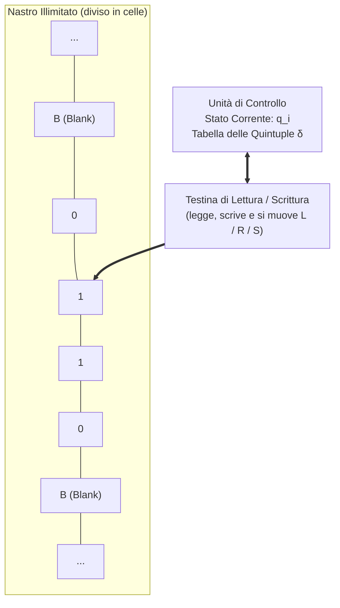
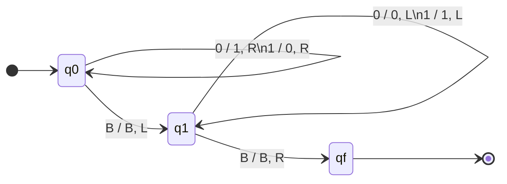

# 1.2.1 - Macchina di Turing

## Introduzione intuitiva: perché gli Automi a Stati Finiti non bastano?

Nella lezione precedente abbiamo visto che un Automa a Stati Finiti (DFA) ha un numero **fissato e finito** di stati $Q$. Questo significa che la sua memoria è limitata a priori: se un automa ha $k$ stati, non può "contare" oltre $k$.

Cosa succede allora se chiediamo a un DFA di riconoscere il semplice linguaggio $L = \{\mathtt{a}^n \mathtt{b}^n \mid n \ge 1\}$ (tante $\mathtt{a}$ seguite dallo stesso numero di $\mathtt{b}$, oppure espressioni con un numero arbitrario di parentesi aperte e chiuse)? **Nessun Automa a Stati Finiti può farlo!** Infatti, poiché $n$ può essere grande a piacere (es. un miliardo di $\mathtt{a}$), per contare tutte le $\mathtt{a}$ prima di confrontarle con le $\mathtt{b}$ l'automa esaurirebbe i suoi $k$ stati finiti e per il *principio dei cassetti* (*Pigeonhole Principle*) entrerebbe in un ciclo, confondendo due valori diversi di $n$.

Nel 1936 il giovane matematico inglese **Alan Turing**, cercando di dare una definizione matematica rigorosa di cosa significhi "calcolare tramite un algoritmo", ideò una macchina astratta dotata di una memoria esterna illimitata su cui poter sia leggere sia scrivere: la **Macchina di Turing (MdT)**. Nonostante la sua estrema semplicità costruttiva, la Macchina di Turing ha esattamente la stessa potenza di calcolo del più moderno supercomputer esistente oggi!

---

## Struttura astratta e Definizione Formale della Macchina di Turing

### Le 3 componenti fisiche astratte
Immaginiamo la Macchina di Turing come composta da:
1. **Un Nastro (Tape) potenzialmente infinito** in entrambe le direzioni, diviso in celle consecutive. Ciascuna cella contiene un singolo simbolo. Inizialmente sul nastro è scritta la stringa di input $w$, mentre tutte le infinite celle rimanenti a sinistra e a destra contengono un simbolo speciale di "cella vuota" chiamato **Blank** ($B$ oppure $\sqcup$ o $\#$).
2. **Una Testina di Lettura/Scrittura (Read/Write Head)** posizionata su una cella del nastro. Ad ogni passo la testina può **leggere** il simbolo sotto di sé, **sovrascriverlo** con un nuovo simbolo e **spostarsi** di una cella a sinistra ($L$), a destra ($R$) oppure rimanere ferma ($S$, *Stay*).
3. **Un'Unità di Controllo a Stati Finiti** dotata di un **registro di stato** che memorizza lo stato corrente $q \in Q$.

### Definizione Formale (Sestupla / Settupla e Quintuple di transizione)
Una **Macchina di Turing Deterministica** è definita formalmente dalla tupla:
$$M = (Q, \Sigma, \Gamma, \delta, q_0, B, F)$$
dove:
1. **$Q$**: insieme finito e non vuoto degli **stati** interni.
2. **$\Sigma$**: **alfabeto di input** ($\Sigma \subset \Gamma$, con $B \notin \Sigma$).
3. **$\Gamma$ (Gamma)**: **alfabeto del nastro** (insieme finito dei simboli che possono essere scritti sul nastro; include l'alfabeto di input $\Sigma$, il simbolo Blank $B$ ed eventuali simboli ausiliari di lavoro come $\mathtt{X}, \mathtt{Y}$).
4. **$q_0 \in Q$**: **stato iniziale** (all'avvio la testina è posizionata sul **primo simbolo a sinistra** della stringa di input).
5. **$B \in \Gamma \setminus \Sigma$**: il simbolo **Blank** (cella vuota).
6. **$F \subseteq Q$**: insieme degli **stati finali** (o di arresto/accettazione).
7. **$\delta$**: **funzione di transizione** (parziale):
   $$\delta : Q \times \Gamma \to Q \times \Gamma \times \{L, R, S\}$$
   Ogni istruzione della funzione $\delta$ può essere scritta come una **quintupla**:
   $$\langle q_i, \; s_{\text{letto}}, \; q_j, \; s_{\text{scritto}}, \; m \rangle \qquad \text{ovvero} \qquad \delta(q_i, s_{\text{letto}}) = (q_j, s_{\text{scritto}}, m)$$
   che significa: *"Se la macchina si trova nello stato $q_i$ e la testina legge sul nastro il simbolo $s_{\text{letto}}$, allora passa nello stato $q_j$, scrive nella cella corrente il simbolo $s_{\text{scritto}}$ e sposta la testina nella direzione $m \in \{L, R, S\}$ ($L=\text{Sinistra}, R=\text{Destra}, S=\text{Ferma}$)"*.

---

## Computazione, Terminazione, Tesi di Church-Turing e Halting Problem

### Configurazione istantanea e Computazione
In ogni istante, la fotografia completa della Macchina di Turing (detta **configurazione istantanea**) è determinata da tre elementi:
1. Il contenuto attuale della porzione non vuota del nastro.
2. Lo stato corrente $q \in Q$.
3. La posizione esatta della testina sul nastro.

Data una stringa di input $w$, una computazione della MdT può avere **tre esiti possibili**:
1. **Terminazione con Accettazione (o Calcolo completato)**: la macchina raggiunge uno stato finale $q_f \in F$ per il quale non sono definite ulteriori mosse e **si arresta (Halt)**. Se la MdT è usata come *trasduttore (calcolatore di funzioni)*, la stringa rimasta scritta sul nastro al momento dell'arresto è l'**output** $f(w)$ del calcolo!
2. **Terminazione con Rifiuto**: la macchina si blocca in uno stato non finale $q \notin F$ perché per la coppia $(q, s_{\text{letto}})$ non esiste alcuna quintupla nella tabella $\delta$.
3. **Ciclo infinito (Non terminazione)**: la macchina continua a muoversi all'infinito senza mai fermarsi (ad esempio spostandosi sempre a destra sulle celle Blank: $\langle q_1, B, q_1, B, R \rangle$).

### La Tesi di Church-Turing
Negli anni '30 diversi matematici proposero modelli formali di calcolo apparentemente molto diversi tra loro (la Macchina di Turing, il $\lambda$-calcolo di Alonzo Church, le funzioni ricorsive di Gödel e Kleene). Si dimostrò che **tutti questi modelli calcolano esattamente la stessa classe di funzioni**! Da qui nasce il principio fondante dell'informatica:
> **Tesi di Church-Turing**: Qualsiasi funzione o problema che sia "intuitivamente calcolabile" tramite un algoritmo effettivo (eseguibile da un qualsiasi computer fisico o linguaggio di programmazione come il C) è calcolabile da una **Macchina di Turing**.

### Macchina di Turing Universale (UTM) e Problema della Fermata (Halting Problem)
- **Macchina di Turing Universale ($U$)**: Turing dimostrò che è possibile codificare la tabella delle quintuple di una qualunque MdT $M$ come una stringa di simboli $\langle M \rangle$ e fornirla sul nastro insieme ai dati $w$ a una speciale MdT "interprete" $U$, capace di simulare passo dopo passo il comportamento di $M$ su $w$. **La Macchina Universale di Turing è il modello teorico del moderno computer programmabile** (architettura di von Neumann), in cui programmi e dati risiedono nella stessa memoria!
- **Il Problema della Fermata (*Halting Problem*)**: Esiste un problema che nessun algoritmo e nessun computer potrà mai risolvere? **Sì!** Turing dimostrò per assurdo (con un argomento diagonale) che **è indecidibile** stabilire in generale, data una qualsiasi Macchina di Turing $M$ (o programma C) e un qualsiasi input $w$, se $M$ terminerà la sua esecuzione su $w$ oppure entrerà in un ciclo infinito. Non può esistere un controllo universale automatico che individui tutti i loop infiniti!

---

## Esempi guidati

### Esempio 1: Complemento bit a bit di una stringa binaria (Trasduttore)
**Problema**: Costruire una Macchina di Turing che, data sul nastro una stringa binaria $w \in \{0, 1\}^+$ (con la testina inizialmente sul primo bit a sinistra), inverta tutti i bit ($0 \to 1$ e $1 \to 0$) e riporti la testina sul primo bit a sinistra prima di fermarsi nello stato finale $q_f$.

**Strategia dell'algoritmo:**
1. Nello stato iniziale $q_0$, scorriamo la stringa verso destra ($R$): se leggiamo `0` scriviamo `1` e andiamo a destra; se leggiamo `1` scriviamo `0` e andiamo a destra.
2. Quando leggiamo il primo Blank `$B$` a destra della stringa, abbiamo invertito tutti i bit! Lasciamo `$B$`, passiamo nello stato di riavvolgimento $q_1$ e ci spostiamo di una cella a sinistra ($L$).
3. Nello stato $q_1$, scorriamo a ritroso verso sinistra ($L$) lasciando inalterati gli `0` e gli `1` finché incontriamo il Blank `$B$` che precede l'inizio della stringa.
4. Appena leggiamo `$B$` a sinistra, facciamo un passo a destra ($R$) per posizionarci esattamente sul primo bit della stringa ed entriamo nello stato finale $q_f$.

**Tabella completa delle Quintuple $\langle q_{\text{corr}}, s_{\text{letto}}, q_{\text{nuovo}}, s_{\text{scritto}}, \text{mossa}\rangle$:**

| Stato corrente | Simbolo letto | Nuovo stato | Simbolo scritto | Movimento | Commento operativo |
| :---: | :---: | :---: | :---: | :---: | :--- |
| $q_0$ | `0` | $q_0$ | `1` | $R$ | Inverte `0` in `1` e avanza a destra |
| $q_0$ | `1` | $q_0$ | `0` | $R$ | Inverte `1` in `0` e avanza a destra |
| $q_0$ | $B$ | $q_1$ | $B$ | $L$ | Fine stringa raggiunta: inizia a tornare a sinistra |
| $q_1$ | `0` | $q_1$ | `0` | $L$ | Scorre a sinistra senza modificare |
| $q_1$ | `1` | $q_1$ | `1` | $L$ | Scorre a sinistra senza modificare |
| $q_1$ | $B$ | $q_f$ | $B$ | $R$ | Raggiunto il Blank di sinistra: si posiziona sul $1^\circ$ bit e termina |

### Esempio 2: Incremento di $+1$ di un numero binario
**Problema**: Dato sul nastro un numero binario intero senza segno (es. `1011`, cioè $11_{10}$), sommare $1$ ottenendo sul nastro `1100` ($12_{10}$).

**Strategia dell'algoritmo (come l'addizione in colonna!):**
1. **Stato $q_0$ (Vai in fondo a destra sul bit meno significativo)**: scorre tutti gli `0` e `1` verso destra ($R$) finché trova `$B$`; a quel punto fa un passo a sinistra ($L$) entrando in $q_1$ (stato di "riporto da sommare").
2. **Stato $q_1$ (Somma il riporto di 1 risalendo verso sinistra)**:
   - Se legge `0`: sommando $1$ diventa `1` **senza ulteriore riporto**! Scrive `1` e passa direttamente allo stato finale $q_f$ ($S$).
   - Se legge `1`: $1 + 1 = 0$ **con riporto di 1**! Scrive `0`, resta in $q_1$ e si sposta a sinistra ($L$) per propagare il riporto al bit successivo.
   - Se legge `$B$` (caso in cui il numero era composto da soli `1`, es. `111` + 1 = `1000`): scrive `1` nella cella Blank di sinistra e termina in $q_f$ ($S$).

**Quintuple:**
- $\langle q_0, 0, q_0, 0, R \rangle$, $\langle q_0, 1, q_0, 1, R \rangle$, $\langle q_0, B, q_1, B, L \rangle$
- $\langle q_1, 1, q_1, 0, L \rangle$ *(propaga il riporto a sinistra)*
- $\langle q_1, 0, q_f, 1, S \rangle$ *(assorbe il riporto e termina)*
- $\langle q_1, B, q_f, 1, S \rangle$ *(aggiunge una cifra in testa se tutti i bit erano `1` e termina)*

### Esempio 3: Riconoscimento del linguaggio non regolare $L = \{\mathtt{a}^n \mathtt{b}^n \mid n \ge 1\}$
Ecco perché la Macchina di Turing supera i limiti degli Automi a Stati Finiti! Per verificare che il numero di $\mathtt{a}$ sia uguale al numero di $\mathtt{b}$ (es. `aaabbb`), la MdT usa il nastro come blocco degli appunti procedendo a "zig-zag":
1. **Stato $q_0$**: legge la prima $\mathtt{a}$ disponibile a sinistra, la "cancellla/marca" sovrascrivendola con $\mathtt{X}$ e passa a $q_1$ muovendosi a destra ($R$).
2. **Stato $q_1$**: salta tutte le $\mathtt{a}$ restanti e le $\mathtt{Y}$ già marcate muovendosi a destra ($R$) finché trova la prima $\mathtt{b}$ libera; la marca sovrascrivendola con $\mathtt{Y}$ e passa a $q_2$ tornando a sinistra ($L$).
3. **Stato $q_2$**: torna indietro a sinistra ($L$) saltando $\mathtt{Y}$ e $\mathtt{a}$ finché incontra l'ultima $\mathtt{X}$ marcata; fa un passo a destra ($R$) e torna in $q_0$ per ripetere il ciclo sulla coppia successiva $(\mathtt{a}, \mathtt{b})$.
4. Quando in $q_0$, subito a destra dell'ultima $\mathtt{X}$, non ci sono più $\mathtt{a}$ ma si incontra direttamente $\mathtt{Y}$, passa a $q_3$ per verificare che tutte le restanti celle fino a $B$ siano solo $\mathtt{Y}$ (nessuna $\mathtt{b}$ in eccesso): se trova $B$, accetta in $q_f$!

**Traccia del nastro per `aabb`:**
$$\mathtt{\underline{a}abb} \to \mathtt{X\underline{a}bb} \to \mathtt{Xa\underline{b}b} \to \mathtt{X\underline{a}Yb} \to \mathtt{XXY\underline{b}} \to \mathtt{XXYY\underline{B}} \implies \textbf{Accettata!}$$

---

## Errori frequenti

1. **Dimenticare che la testina legge un solo simbolo alla volta e non "vede" le celle adiacenti**
   Una MdT non può testare condizioni come *"se la cella successiva è Blank allora fermati"*: deve **prima** spostarsi a destra fino a leggere effettivamente il simbolo Blank `$B$`, e **poi** fare un passo indietro a sinistra ($L$) per tornare sull'ultimo carattere della stringa.
2. **Sovrascrivere il simbolo letto per distrazione quando si vuole solo scorrere il nastro**
   Se nello stato $q_1$ vogliamo solo spostarci a destra sopra gli `0` e gli `1` senza alterarli, dobbiamo scrivere due quintuple distinte: $\langle q_1, 0, q_1, 0, R\rangle$ (se legge `0` riscrive `0`) e $\langle q_1, 1, q_1, 1, R\rangle$ (se legge `1` riscrive `1`).
3. **Creare loop infiniti dimenticando la condizione di arresto sul Blank `$B$`**
   Se una regola dice $\langle q_0, B, q_0, B, R\rangle$, una volta finita la stringa la testina correrà verso destra sul nastro infinito per sempre!

---

## Esercizi di prova

1. **[Base — Simulazione manuale di una Macchina di Turing]**
   Data la Macchina di Turing con stato iniziale $q_0$, stato finale $q_f$ e le seguenti quintuple:
   - $\langle q_0, \mathtt{a}, q_1, \mathtt{b}, R \rangle$
   - $\langle q_0, \mathtt{b}, q_0, \mathtt{b}, R \rangle$
   - $\langle q_1, \mathtt{a}, q_0, \mathtt{a}, R \rangle$
   - $\langle q_1, \mathtt{b}, q_1, \mathtt{b}, R \rangle$
   - $\langle q_0, B, q_f, B, S \rangle$
   - $\langle q_1, B, q_f, B, S \rangle$
   Mostra passo dopo passo il contenuto del nastro e lo stato della macchina partendo dall'input $w = \mathtt{abaa}$. Qual è la funzione generale calcolata da questa macchina?
> [!tip]- Soluzione
> Indichiamo con la sottolineatura la posizione della testina:
> 1. $(q_0, \mathtt{\underline{a}baaB})$: legge $\mathtt{a}$ in $q_0 \to$ scrive $\mathtt{b}$, passa in $q_1$, va a destra ($R$).
> 2. $(q_1, \mathtt{b\underline{b}aaB})$: legge $\mathtt{b}$ in $q_1 \to$ lascia $\mathtt{b}$, resta in $q_1$, va a destra ($R$).
> 3. $(q_1, \mathtt{bb\underline{a}aB})$: legge $\mathtt{a}$ in $q_1 \to$ lascia $\mathtt{a}$, torna in $q_0$, va a destra ($R$).
> 4. $(q_0, \mathtt{bba\underline{a}B})$: legge $\mathtt{a}$ in $q_0 \to$ scrive $\mathtt{b}$, passa in $q_1$, va a destra ($R$).
> 5. $(q_1, \mathtt{bbab\underline{B}})$: legge $B$ in $q_1 \to$ lascia $B$, passa in $q_f$ e si arresta ($S$).
>
> **Output sul nastro**: `bbab`.
> **Funzione generale**: La macchina sostituisce con $\mathtt{b}$ **una $\mathtt{a}$ sì e una $\mathtt{a}$ no** (cioè trasforma in $\mathtt{b}$ tutte le occorrenze di $\mathtt{a}$ di posizione dispari: la $1^\text{a}$, la $3^\text{a}$, la $5^\text{a}$, ecc.).

2. **[Base — Addizione in notazione unaria]**
   In notazione unaria un numero naturale $n \ge 1$ è rappresentato da una sequenza di $n$ bastoncini `1` (es. $3 = \mathtt{111}$, $2 = \mathtt{11}$). Supponiamo che sul nastro siano scritti due numeri unari separati dal simbolo `+`, ad esempio `111+11` ($3 + 2$).
   Scrivi la tabella delle quintuple di una MdT che calcoli la loro somma producendo sul nastro una singola sequenza contigua di `1` (nell'esempio: `11111`, cioè $5$).
> [!tip]- Soluzione
> **Idea furba**: In unario, per unire una sequenza di $n$ uno e una di $m$ uno separate da `+` in un'unica sequenza di $n+m$ uno, basta **trasformare il `+` in `1`** e poi **cancellare (sostituire con Blank `$B$`) l'ultimo `1` in fondo a destra**!
> - `111+11` $\xrightarrow{\text{sostituisco + con 1}}$ `111111` $\xrightarrow{\text{cancello l'ultimo 1}}$ `11111B`.
>
> **Quintuple:**
> 1. $\langle q_0, 1, q_0, 1, R \rangle$ *(scorre il primo numero)*
> 2. $\langle q_0, +, q_1, 1, R \rangle$ *(trovato il `+`, lo trasforma in `1` e passa a $q_1$)*
> 3. $\langle q_1, 1, q_1, 1, R \rangle$ *(scorre il secondo numero fino alla fine)*
> 4. $\langle q_1, B, q_2, B, L \rangle$ *(raggiunto il Blank finale, torna indietro di 1 cella sull'ultimo `1`)*
> 5. $\langle q_2, 1, q_f, B, S \rangle$ *(cancella l'ultimo `1` scrivendo `$B$` e si ferma in $q_f$!)*

3. **[Intermedio — Cancellazione dell'ultimo carattere o aggiunta in coda]**
   Scrivi le quintuple di una Macchina di Turing su $\Sigma = \{\mathtt{a}, \mathtt{b}\}$ che, data una stringa non vuota $w$ sul nastro:
   - Se $w$ inizia con $\mathtt{a}$, aggiunge una $\mathtt{a}$ in fondo a destra della stringa.
   - Se $w$ inizia con $\mathtt{b}$, aggiunge una $\mathtt{b}$ in fondo a destra della stringa.
> [!tip]- Soluzione
> Basta leggere il primo carattere in $q_0$ e "ricordarlo" ramificando in due stati diversi ($q_a$ se iniziava con $\mathtt{a}$, $q_b$ se iniziava con $\mathtt{b}$), che scorrono la stringa fino al primo Blank `$B$` a destra e vi scrivono il carattere memorizzato:
> - **Da $q_0$ (lettura del primo carattere)**:
>   - $\langle q_0, \mathtt{a}, q_a, \mathtt{a}, R \rangle$
>   - $\langle q_0, \mathtt{b}, q_b, \mathtt{b}, R \rangle$
> - **Nello stato $q_a$ (scorre fino al Blank e scrive $\mathtt{a}$)**:
>   - $\langle q_a, \mathtt{a}, q_a, \mathtt{a}, R \rangle$, $\quad \langle q_a, \mathtt{b}, q_a, \mathtt{b}, R \rangle$, $\quad \langle q_a, B, q_f, \mathtt{a}, S \rangle$
> - **Nello stato $q_b$ (scorre fino al Blank e scrive $\mathtt{b}$)**:
>   - $\langle q_b, \mathtt{a}, q_b, \mathtt{a}, R \rangle$, $\quad \langle q_b, \mathtt{b}, q_b, \mathtt{b}, R \rangle$, $\quad \langle q_b, B, q_f, \mathtt{b}, S \rangle$

4. **[Intermedio/Esame — Verifica di stringa palindroma con Macchina di Turing]**
   Descrivi gli stati e scrivi le quintuple di una Macchina di Turing che riconosca il linguaggio delle stringhe **palindrome** su $\Sigma = \{\mathtt{a}, \mathtt{b}\}$ (cancellando progressivamente con `$B$` il primo e l'ultimo carattere e verificando che coincidano).
> [!tip]- Soluzione
> **Strategia**:
> - In $q_0$ leggiamo il primo carattere a sinistra:
>   - Se è `$B$`, la stringa è stata completamente svuotata con successo $\to$ accettiamo in $q_{acc}$!
>   - Se è $\mathtt{a}$, lo cancelliamo scrivendo `$B$` e andiamo a destra nello stato $q_{cerca\_a}$ fino in fondo alla stringa.
>   - Se è $\mathtt{b}$, lo cancelliamo scrivendo `$B$` e andiamo a destra nello stato $q_{cerca\_b}$ fino in fondo alla stringa.
> - Arrivati al Blank di destra in $q_{cerca\_a}$ (o $q_{cerca\_b}$), torniamo a sinistra di una cella nello stato $q_{check\_a}$ (o $q_{check\_b}$):
>   - Se troviamo `$B$` (la stringa aveva un solo carattere centrale rimasto!), accettiamo in $q_{acc}$.
>   - Se troviamo il carattere corrispondente ($\mathtt{a}$ per $q_{check\_a}$, $\mathtt{b}$ per $q_{check\_b}$), lo cancelliamo con `$B$` e torniamo a sinistra con lo stato $q_{ritorna}$ fino al Blank di sinistra, per poi ripartire da $q_0$!
>   - Se troviamo il carattere opposto, non c'è transizione e la macchina rifiuta.
>
> **Quintuple complete:**
> - $\langle q_0, B, q_{acc}, B, S \rangle$
> - $\langle q_0, \mathtt{a}, q_{cerca\_a}, B, R \rangle$, $\quad \langle q_0, \mathtt{b}, q_{cerca\_b}, B, R \rangle$
> - $\langle q_{cerca\_a}, \mathtt{a}, q_{cerca\_a}, \mathtt{a}, R \rangle$, $\quad \langle q_{cerca\_a}, \mathtt{b}, q_{cerca\_a}, \mathtt{b}, R \rangle$, $\quad \langle q_{cerca\_a}, B, q_{check\_a}, B, L \rangle$
> - $\langle q_{cerca\_b}, \mathtt{a}, q_{cerca\_b}, \mathtt{a}, R \rangle$, $\quad \langle q_{cerca\_b}, \mathtt{b}, q_{cerca\_b}, \mathtt{b}, R \rangle$, $\quad \langle q_{cerca\_b}, B, q_{check\_b}, B, L \rangle$
> - $\langle q_{check\_a}, B, q_{acc}, B, S \rangle$, $\quad \langle q_{check\_a}, \mathtt{a}, q_{ritorna}, B, L \rangle$
> - $\langle q_{check\_b}, B, q_{acc}, B, S \rangle$, $\quad \langle q_{check\_b}, \mathtt{b}, q_{ritorna}, B, L \rangle$
> - $\langle q_{ritorna}, \mathtt{a}, q_{ritorna}, \mathtt{a}, L \rangle$, $\quad \langle q_{ritorna}, \mathtt{b}, q_{ritorna}, \mathtt{b}, L \rangle$, $\quad \langle q_{ritorna}, B, q_0, B, R \rangle$

5. **[Esame — Confronto teorico tra FSA e Macchina di Turing]**
   Spiega sinteticamente le **tre differenze strutturali fondamentali** tra un Automa a Stati Finiti (DFA) e una Macchina di Turing (MdT), indicando perché queste differenze permettono alla MdT di riconoscere linguaggi di Tipo 0, 1 e 2 che un DFA non può riconoscere.
> [!tip]- Soluzione
> Le tre differenze strutturali sono:
> 1. **Capacità di Scrittura sul nastro**: un DFA ha una testina di *sola lettura*, mentre la MdT può **scrivere e modificare** i simboli sul nastro usando un alfabeto ausiliario $\Gamma \supset \Sigma$.
> 2. **Movimento Bidirezionale della testina**: un DFA legge la stringa in una sola passata rigorosamente da sinistra verso destra; la MdT può muovere la testina sia a **destra ($R$)** sia a **sinistra ($L$)** (o restare ferma $S$), ripassando più volte sulle stesse celle.
> 3. **Memoria Illimitata**: il nastro della MdT è **potenzialmente infinito** (dotato di infinite celle Blank $B$). Mentre un DFA può ricordare solo un'informazione finita codificata nei suoi $|Q|$ stati, la MdT può usare il nastro come memoria di lavoro illimitata per contare, marcare simboli (come in $\mathtt{a}^n\mathtt{b}^n$ o $\mathtt{a}^n\mathtt{b}^n\mathtt{c}^n$) e calcolare qualsiasi funzione algoritmicamente computabile.

---

## Provenienza del materiale

- Slide e dispensa ufficiale del corso: `C1PROG1U1L2_Macchina_di_Turing.pdf` (Unità 1, Lezione 2 — La Macchina di Turing, quintuple, calcolabilità e tesi di Church-Turing).
