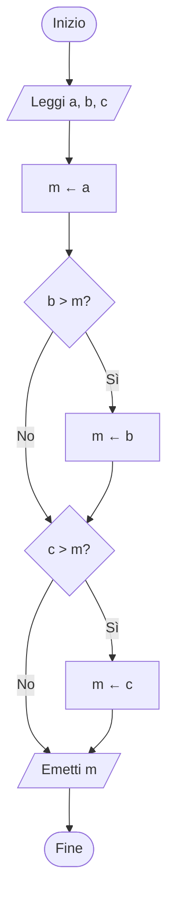

# Algoritmi, macchina RAM e computabilità

## Come passiamo da un problema a una procedura

«Trova il massimo fra due numeri» specifica un risultato. Per ottenere un algoritmo fissiamo il dominio degli ingressi, una regola per il caso di parità e i passi che un esecutore sa compiere. Lo descriviamo con pseudocodice e diagrammi di flusso prima di scegliere un linguaggio o un esecutore.

---

## Specifica, correttezza e terminazione

> [!important] Algoritmo
> Un **algoritmo** per un problema è una procedura descritta con un numero finito di istruzioni, precise ed eseguibili. Su ogni input previsto dalla specifica termina con un risultato che soddisfa la postcondizione.

La descrizione deve precisare il dominio, il risultato e le operazioni che l'esecutore può compiere. Nelle procedure deterministiche di questa nota, ogni passo è univoco una volta fissati i dati e lo stato corrente. Il **pseudocodice** descrive questi passi in forma testuale. Il **diagramma di flusso** mostra l'ordine delle operazioni e i rami che dipendono dai test.

La **precondizione** descrive gli ingressi ammessi. La **postcondizione** descrive la relazione richiesta fra ingresso e risultato. Per il massimo di due interi $a,b$, l'uscita $m$ deve appartenere a $\{a,b\}$ e soddisfare $m\ge a$ e $m\ge b$. L'algoritmo confronta i valori e restituisce $a$ quando $a\ge b$, altrimenti $b$. La correttezza si dimostra esaminando i due esiti del confronto. Il flusso termina perché ogni ramo contiene un numero finito di passi e raggiunge l'uscita.

Un **programma** esprime una procedura in un linguaggio eseguibile. Lo stesso algoritmo può essere rappresentato in pseudocodice, in un diagramma di flusso e in diversi linguaggi.

---

## Il modello a macchina RAM

Una macchina **RAM** (*Random Access Machine*) idealizza un esecutore con celle numerate e accesso diretto tramite indirizzo. Lo stato comprende la memoria e il contatore della prossima istruzione. In un linguaggio didattico bastano lettura e scrittura, assegnamenti con operazioni aritmetiche, salti condizionati o incondizionati e arresto.

| Istruzione didattica | Effetto |
| --- | --- |
| `leggi M[0]` | Copia il prossimo input nella cella 0. |
| `M[1] ← M[0] + 1` | Legge la cella 0, somma uno e scrive nella cella 1. |
| `se M[0] < M[1] vai a L` | Aggiorna il contatore a `L` se il test è vero. Altrimenti continua in sequenza. |
| `vai a L` | Imposta il contatore a `L`. |
| `emetti M[1]` | Scrive il valore della cella 1 in uscita. |
| `arresta` | Termina l'esecuzione. |

Con un indirizzo calcolato, `M[M[0]]` accede alla cella il cui indice è il contenuto di `M[0]`. Per attribuire un costo ai programmi specifichiamo quali operazioni contano come elementari e come sono rappresentati i valori. Il modello a costo unitario per operazioni su parole di macchina non implica che l'aritmetica su interi arbitrariamente grandi abbia costo costante.

---

## Problemi non computabili

Un problema difficile può avere un algoritmo corretto che richiede molte risorse. Per un problema **non computabile** nel modello considerato manca invece un algoritmo che soddisfi la specifica per ogni input ammesso. Il problema generale dell'arresto chiede se un programma arbitrario terminerà su un dato ingresso. La dimostrazione di indecidibilità è nella nota sulla [[1.2.1 - Macchina di Turing|macchina di Turing]]. Singoli casi di arresto si possono comunque provare, per esempio esibendo una quantità intera non negativa che diminuisce a ogni iterazione.

---

## Esempi guidati

### Esempio 1. Massimo di due interi su macchina RAM

**Problema.** Leggere due interi e produrre il massimo.

**Svolgimento.** Mettiamo gli ingressi nelle celle 0 e 1. Un salto seleziona la cella da emettere. A parità si raggiunge l'etichetta `PRIMO`.

```text
leggi M[0]
leggi M[1]
se M[0] >= M[1] vai a PRIMO
emetti M[1]
vai a FINE
PRIMO: emetti M[0]
FINE: arresta
```

Con `-4, -2` la condizione è falsa e si emette `-2`. Con `7, 7` si emette `7` dal primo ramo. In entrambi i casi si raggiunge `FINE`. L'uso dei salti è ripreso in [[1.4.1 - Programmazione non strutturata e salti|programmazione non strutturata]].

### Esempio 2. Dal problema al diagramma per il massimo fra tre valori

**Problema.** Dati tre interi $a,b,c$, restituire uno dei valori di ingresso che sia maggiore o uguale agli altri due.

**Svolgimento.** Partiamo da $a$ come massimo provvisorio. Confrontiamo prima $b$, poi $c$, aggiornando il massimo quando troviamo un valore maggiore. Dopo ogni confronto, `m` è il massimo fra i valori già esaminati.

```text
leggi a, b, c
m ← a
se b > m allora m ← b
se c > m allora m ← c
emetti m
```

Nel diagramma gli ovali delimitano il flusso, i parallelogrammi indicano ingresso e uscita, i rettangoli rappresentano gli assegnamenti e i rombi i test.



Con `a = -4`, `b = -2` e `c = -2` il primo test aggiorna il massimo a `-2` e il secondo lo lascia invariato. Per ogni ingresso si fanno esattamente due confronti prima dell'uscita.

---

## Errori frequenti

> [!caution] Errori da evitare
> **Errore** · Verificare una procedura soltanto su input positivi.
>
> **Correzione** · Esplicitare il dominio e motivare la correttezza per entrambi gli esiti di ogni test.
>
> **Errore** · Dedurre la terminazione dalla brevità del programma.
>
> **Correzione** · Esaminare i salti all'indietro. Per un ciclo, cercare una quantità che diminuisca e abbia un limite inferiore.

---

## Esercizi di prova

### Esercizio 1. Specifica del minimo (Base)

Scrivi la postcondizione del minimo fra due interi.

> [!tip]- Soluzione
> Per ingressi $a,b$, $m\in\{a,b\}$ e $m\le a$ e $m\le b$.

### Esercizio 2. Indirizzo calcolato (Base)

Se `M[0]=3` e `M[3]=8`, quale valore legge `M[M[0]]`?

> [!tip]- Soluzione
> La lettura di `M[0]` fornisce l'indirizzo `3`. La cella `M[3]` contiene `8`.

### Esercizio 3. Cambiare il ramo (Intermedio)

Nel programma del massimo sostituisci `>=` con `>`. Il risultato numerico cambia?

> [!tip]- Soluzione
> Cambia il ramo solo a parità. Si emette la seconda cella, con lo stesso valore della prima.

### Esercizio 4. Variante di un ciclo (Intermedio)

1. Partendo da $n\ge 0$, finché $n>0$ sottrai uno. Quante volte si esegue il corpo?
2. Una procedura su interi matematici termina quando $n=1$ e altrimenti aumenta $n$ di uno. Termina per ogni intero in ingresso? Considera $n=5$.

> [!tip]- Soluzione
> 1. Dopo $k$ iterazioni il valore è $n-k$. La condizione diventa falsa dopo $n$ iterazioni. Il caso $n=0$ fa zero passi di corpo.
> 2. Da $5$ si ottengono $6,7,\ldots$ e non si raggiunge mai $1$. La procedura termina per ogni ingresso $n\le 1$, quindi serve restringere la precondizione o modificare la procedura per coprire tutti gli interi.

### Esercizio 5. Un caso di arresto (Avanzato)

Dimostrare che il ciclo precedente termina contraddice l'indecidibilità dell'arresto?

> [!tip]- Soluzione
> La prova riguarda un programma specifico e gli ingressi nel suo dominio. Il problema indecidibile richiederebbe una procedura valida per tutti i programmi e tutti gli ingressi.

### Esercizio 6. Dalla specifica al diagramma di flusso (Avanzato)

Dati due reali $a,b$, descrivi in pseudocodice e con un diagramma di flusso come risolvere $ax+b=0$. Prova i casi $(2,-6)$, $(0,4)$ e $(0,0)$.

> [!tip]- Soluzione
> ```text
> se a ≠ 0:
>     emetti la soluzione unica -b/a
> altrimenti se b ≠ 0:
>     emetti "nessuna soluzione"
> altrimenti:
>     emetti "tutti i reali"
> ```
>
> ```mermaid
> flowchart TD
>     S(["Inizio"]) --> I[/"Leggi a, b"/]
>     I --> A{"a è zero?"}
>     A -->|"No"| X[/"Soluzione unica: -b/a"/]
>     A -->|"Sì"| B{"b è zero?"}
>     B -->|"No"| N[/"Nessuna soluzione"/]
>     B -->|"Sì"| T[/"Tutti i reali"/]
>     X --> F(["Fine"])
>     N --> F
>     T --> F
> ```
>
> I tre ingressi producono rispettivamente $x=3$, nessuna soluzione e tutti i reali. La divisione avviene soltanto sul ramo con $a\ne0$.

---

## Provenienza del materiale

- Marco Anisetti, *Fondamenti*, `Appunti_di_fine_Unita_1.pdf`, §§ 2.8–2.12 e 3.1–3.3.
- *Guida unica di studio – Fondamenti*, `Guida_Unita_1_teoria_approfondimenti_per_argomento.pdf`, §§ 6–7.
- Dispensa del corso, `C1PROG1B1L3_Semantica_grammatica_algoritmo.pdf` (Lessico, sintassi, semantica e introduzione agli algoritmi).
