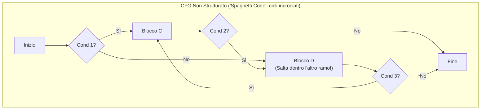
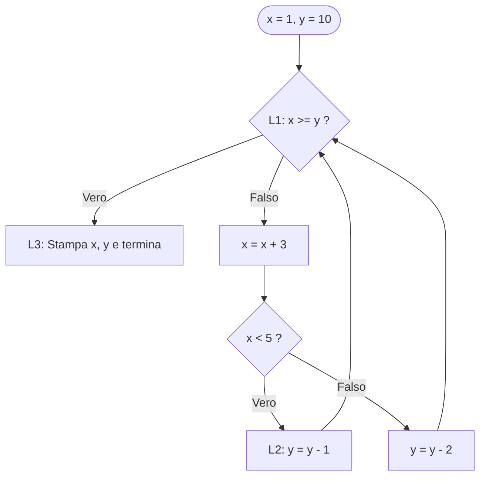

# Programmazione non strutturata e salti

## Come un salto cambia il flusso di esecuzione

Ai primissimi albori dell'informatica (anni '50 e primi anni '60), i programmatori scrivevano il codice direttamente in linguaggio macchina o in *Assembly*, oppure nei primi linguaggi ad alto livello come le prime versioni di FORTRAN e BASIC. In quel mondo, il modo più naturale per prendere una decisione o ripetere un blocco di istruzioni era dire al processore: **"Salta direttamente alla riga 140"** (`GOTO 140` o `JMP indirizzo`).

All'inizio questo approccio sembrava comodissimo e veloce. Ma non appena i programmi superarono qualche centinaio di righe, gli ingegneri si trovarono di fronte a un incubo: seguendo i salti in avanti e all'indietro che si incrociavano da ogni punto del programma, le frecce del diagramma di flusso assomigliavano a un piatto di spaghetti aggrovigliati (**Spaghetti Code**). Capire da dove fosse arrivato il programma in un certo punto, trovare un bug o modificare una funzionalità senza rompere tutto il resto diventò quasi impossibile.

In questa lezione analizziamo come funzionano i salti a basso livello, cos'è la **programmazione non strutturata** e perché la comprensione dei suoi difetti ha portato alla rivoluzione della programmazione strutturata.

---

## Flusso di controllo sequenziale e istruzioni di salto

### L'esecuzione sequenziale e il Program Counter (PC)
All'interno della CPU esiste un registro speciale chiamato **Program Counter** (**PC**, o *Instruction Pointer*, **IP**), che contiene l'indirizzo di memoria della **prossima istruzione macchina da eseguire**.
In assenza di istruzioni di controllo del flusso:
1. La CPU preleva (*fetch*) l'istruzione puntata dal `PC`.
2. Incrementa automaticamente il `PC` per puntare all'istruzione immediatamente successiva in memoria.
3. Esegue (*execute*) l'istruzione corrente.

Questo comportamento predefinito si chiama **flusso di controllo sequenziale**: le istruzioni vengono eseguite una dopo l'altra, dall'alto verso il basso.

### I salti a basso livello e l'istruzione `goto` in C
Per alterare il flusso sequenziale, i processori mettono a disposizione le **istruzioni di salto (branch / jump)**, che sovrascrivono direttamente il valore del *Program Counter* con un nuovo indirizzo:
1. **Salto incondizionato (`JMP etichetta` in Assembly, `goto etichetta;` in C)**: trasferisce immediatamente l'esecuzione al punto contrassegnato dall'etichetta (`etichetta:`), qualunque sia lo stato del programma.
2. **Salto condizionato (`JE`, `JNE`, `JL`, `JG` in Assembly, `if (cond) goto etichetta;` in C)**: valuta una condizione logica; se è vera salta all'etichetta, altrimenti prosegue con l'istruzione successiva.

In linguaggio C la sintassi di `goto` utilizza un'etichetta (*label*) seguita dai due punti `:`:
```c
    int i = 0;
inizio_ciclo:              /* Etichetta di destinazione del salto */
    printf("%d\n", i);
    i = i + 1;
    if (i < 5) {
        goto inizio_ciclo; /* Salto all'indietro (crea un ciclo manuale) */
    }
```

---

## Il problema dello "Spaghetti Code" e i Grafi di Flusso (CFG)

### Cos'è un Grafo di Controllo del Flusso (Control Flow Graph — CFG)
Un **CFG** è un grafo orientato in cui:
- I **nodi** rappresentano i blocchi base di istruzioni sequenziali e i predicati decisionali.
- Gli **archi orientati** rappresentano i possibili trasferimenti del controllo (salti).

### Perché la programmazione non strutturata è dannosa?
Nel 1968 l'informatico olandese **Edsger W. Dijkstra** pubblicò una celebre lettera intitolata *"Go To Statement Considered Harmful"* ("L'istruzione `goto` considerata dannosa"), osservando che *la qualità del codice dei programmatori era inversamente proporzionale al numero di `goto` contenuti nei loro programmi*.

I motivi tecnici sono profondi:
1. **Grafo di flusso non riducibile (intreccio dei cicli)**: usando `goto` arbitrari è possibile saltare **dall'esterno direttamente nel mezzo di un ciclo** (saltando l'inizializzazione delle variabili!) oppure incrociare due cicli in modo che nessuno dei due sia contenuto nell'altro.
2. **Perdita della località del ragionamento (Mancanza del principio *Single-Entry Single-Exit*)**: se in mezzo a una funzione troviamo un'etichetta `punto_x:`, per sapere quanto valgono le variabili in quel punto non basta leggere le righe subito sopra: dobbiamo cercare in tutto il file tutti i possibili `goto punto_x;` provenienti dall'alto o dal basso!
3. **Impossibilità di verifica formale e scarsa manutenibilità**: non è possibile scomporre un programma "a spaghetti" in sottoprogrammi indipendenti, perché i blocchi hanno molteplici punti di ingresso e molteplici punti di uscita intrecciati.


Osserva nel diagramma qui sopra i nodi `C` e `D`: è possibile entrare nel ciclo $C \leftrightarrow D$ sia passando da `C` sia entrando direttamente da `D`! Un grafo simile si dice **irriducibile**.

---

## Dalle celle RAM alle variabili

Nel [[1.3.1 - Algoritmi, macchina RAM e computabilità|modello RAM]] possiamo tradurre una ripetizione in un test seguito da un salto all'indietro. Con una cella `M[0]` inizializzata a `2`, il frammento `L: se M[0] = 0 vai a F; M[0] ← M[0] - 1; vai a L; F: arresta` raggiunge `L` con i valori `2, 1, 0`. Il testo è fisso. L'esecuzione cambia dinamicamente la cella e il contatore delle istruzioni.

Un **identificatore** dà un nome all'oggetto cui ci riferiamo. Il **tipo** determina valori e operazioni ammessi. L'oggetto occupa memoria durante la propria esistenza e il **valore** può cambiare per assegnamento. Più invocazioni della stessa funzione possono avere oggetti distinti per lo stesso identificatore locale. Il legame fra nome e oggetto si comprende insieme ad ambito e durata, trattati in [[4.4.1 - Controllo dello scope e tempo di vita delle variabili|scope e tempo di vita]].

---

## Esempi guidati

### Esempio 1: Calcolo del fattoriale in stile non strutturato
Vediamo come veniva scritto il calcolo del fattoriale $n!$ usando etichette e `goto` invece di un ciclo strutturato, insieme al suo grafo di flusso.

```c
#include <stdio.h>

int main(void) {
    int n = 5;
    int fatt = 1;

    if (n <= 1) goto fine;

ciclo:
    fatt = fatt * n;
    n = n - 1;
    if (n > 1) goto ciclo;

fine:
    printf("Fattoriale: %d\n", fatt);
    return 0;
}
```
Anche in un esempio così piccolo, l'uso combinato di un salto in avanti (`goto fine;`) e di un salto all'indietro (`goto ciclo;`) costringe il lettore a simulare mentalmente i salti come farebbe una CPU.

### Esempio 2: "Spaghetti Code" con salti incrociati e traccia di esecuzione
Analizziamo un frammento classico di codice non strutturato (spesso proposto negli esercizi d'esame per testare la comprensione del flusso e poi chiederne la ristrutturazione):

```c
#include <stdio.h>

int main(void) {
    int x = 1, y = 10;

L1:
    if (x >= y) goto L3;
    x = x + 3;
    if (x < 5) goto L2;
    y = y - 2;
    goto L1;

L2:
    y = y - 1;
    goto L1;

L3:
    printf("Fine: x = %d, y = %d\n", x, y);
    return 0;
}
```

**Grafo di Controllo del Flusso (CFG) in Mermaid:**


**Traccia di esecuzione passo-passo:**
1. **Inizio**: `x = 1`, `y = 10`.
2. **Passaggio 1 in `L1`**: `1 >= 10` è Falso $\to$ `x = 1 + 3 = 4`. Test `x < 5` (`4 < 5`) è **Vero** $\to$ salta a `L2` $\to$ `y = 10 - 1 = 9` $\to$ salta a `L1`.
3. **Passaggio 2 in `L1`**: `4 >= 9` è Falso $\to$ `x = 4 + 3 = 7`. Test `x < 5` (`7 < 5`) è **Falso** $\to$ esegue `y = 9 - 2 = 7` $\to$ salta a `L1`.
4. **Passaggio 3 in `L1`**: `7 >= 7` è **Vero** $\to$ salta a `L3`!
5. **Output**: `Fine: x = 7, y = 7`.

---

## Errori frequenti

> [!caution] Errori da evitare
> 1. **Saltare con `goto` oltre l'inizializzazione di una variabile**
>    Se un `goto avanti;` salta sopra una riga `int k = 10;` ed entra in un punto del blocco in cui `k` viene poi letta (`printf("%d", k);`), la variabile `k` esiste in memoria ma **non è stata inizializzata**!
> 2. **Scambiare un salto all'indietro per una semplice selezione `if`**
>    Un `if (...) goto L;` in cui l'etichetta `L:` si trova **sopra** l'istruzione `if` non è una selezione condizionale, ma un **ciclo (iterazione)**! Al contrario, se `L:` si trova **sotto** l'istruzione `if`, si tratta di una **selezione** (salto di un blocco di codice).
> 3. **Dimenticare che il codice cade nell'etichetta successiva (*fall-through*)**
>    Un'etichetta `L2:` non blocca il flusso sequenziale! Se il codice sopra `L2:` non termina con un `goto` o un `return`, l'esecuzione prosegue dritta entrando dentro `L2:`.

---

## Esercizi di prova

### Esercizio 1. Traccia di codice con `goto` (Base)

Determina l'output esatto del seguente programma C costruendo la traccia dei valori di `a` e `b`:
```c
#include <stdio.h>
int main(void) {
    int a = 2, b = 12;
inizio:
    if (a >= b) goto fine;
    a = a * 2;
    b = b - 2;
    goto inizio;
fine:
    printf("a = %d, b = %d\n", a, b);
    return 0;
}
```

> [!tip]- Soluzione
> - **Stato iniziale**: `a = 2, b = 12`.
> - **Giro 1** (`inizio`): `2 >= 12` Falso $\to$ `a = 4`, `b = 10` $\to$ torna a `inizio`.
> - **Giro 2** (`inizio`): `4 >= 10` Falso $\to$ `a = 8`, `b = 8` $\to$ torna a `inizio`.
> - **Giro 3** (`inizio`): `8 >= 8` **Vero** $\to$ salta a `fine`.
>
> **Output**: `a = 8, b = 8`.

### Esercizio 2. Riconoscere cicli vs selezioni nei salti (Base)

Nel seguente schema di codice astratto:
```c
A:  x = x + 1;
    if (x < 10) goto B;
    y = 0;
B:  if (x < 5) goto A;
```
Indica quale dei due `goto` realizza un'istruzione condizionale in avanti (selezione) e quale realizza un ciclo (iterazione), e determina i valori finali di `x` e `y` se inizialmente `x = 3, y = 99`.

> [!tip]- Soluzione
> - `if (x < 10) goto B;` salta **in avanti** (salta la riga `y = 0;`), quindi realizza una **selezione**.
> - `if (x < 5) goto A;` salta **all'indietro** verso `A:`, quindi realizza un **ciclo (iterazione)**.
> - **Traccia da `x = 3, y = 99`**:
>   1. In `A`: `x` diventa `4`. Poiché `4 < 10`, salta a `B` (non esegue `y = 0`). In `B`: `4 < 5` è Vero, quindi torna ad `A`.
>   2. In `A`: `x` diventa `5`. Poiché `5 < 10`, salta a `B`. In `B`: `5 < 5` è Falso, quindi il programma termina.
> - **Valori finali**: `x = 5`, `y = 99`.

### Esercizio 3. Disegno del CFG e individuazione di ciclo infinito (Intermedio)

Disegna in Mermaid il Control Flow Graph (CFG) del seguente codice e spiega per quali valori iniziali interi di `n` il programma termina e per quali entra in un ciclo infinito:
```c
ciclo:
    if (n == 0) goto fine;
    n = n - 2;
    goto ciclo;
fine:
    printf("Terminato!\n");
```

> [!tip]- Soluzione
> ```mermaid
> flowchart TD
>     C{"ciclo: n == 0 ?"} -->|"Vero"| F["fine: Stampa 'Terminato!'"]
>     C -->|"Falso"| SUB["n = n - 2"]
>     SUB --> C
> ```
> - Il programma **termina** solo se $n \ge 0$ ed è **pari** ($n \in \{0, 2, 4, 6, \dots\}$), perché sottraendo $2$ a ogni passo raggiungerà esattamente $0$.
> - Entra in un **ciclo infinito** se $n$ è **dispari positivo** (passa da $1$ a $-1, -3, \dots$ saltando lo $0$) oppure se $n < 0$ (si allontana sempre più da $0$ verso $-\infty$).

### Esercizio 4. Fall-through tra etichette (Intermedio)

Qual è il valore finale di `ris` nel seguente frammento se `codice = 1`? E perché è un tipico errore di programmazione con `goto`?
```c
int codice = 1, ris = 0;
if (codice == 1) goto caso1;
if (codice == 2) goto caso2;
caso1:
    ris = ris + 10;
caso2:
    ris = ris + 20;
```

> [!tip]- Soluzione
> Il valore finale di `ris` è **`30`** (e non `10`!).
> *Spiegazione*: Quando `codice == 1`, il programma salta all'etichetta `caso1:` ed esegue `ris = 0 + 10 = 10`. Poiché subito dopo **non** c'è un salto verso la fine, l'esecuzione "cade" (*fall-through*) direttamente nelle istruzioni di `caso2:`, eseguendo anche `ris = 10 + 20 = 30`!

### Esercizio 5. Analisi di un grafo "Spaghetti" con ingresso multiplo nel ciclo (Avanzato)

Traccia l'esecuzione del seguente programma (in cui il primo `goto` salta direttamente nel mezzo del ciclo `L1`–`L2`) e determina cosa stampa a video:
```c
#include <stdio.h>
int main(void) {
    int k = 1, s = 0;
    goto L2;
L1:
    k = k * 2;
L2:
    s = s + k;
    if (k < 4) goto L1;
    printf("k = %d, s = %d\n", k, s);
    return 0;
}
```

> [!tip]- Soluzione
> - **Inizio**: `k = 1, s = 0`.
> - `goto L2;` salta sopra `L1` ed entra direttamente in `L2`:
>   - `s = 0 + 1 = 1`.
>   - Test `k < 4` (`1 < 4` Vero) $\to$ salta a `L1`.
> - **In `L1`**: `k = 1 * 2 = 2`. Cade in `L2`:
>   - `s = 1 + 2 = 3`.
>   - Test `k < 4` (`2 < 4` Vero) $\to$ salta a `L1`.
> - **In `L1`**: `k = 2 * 2 = 4`. Cade in `L2`:
>   - `s = 3 + 4 = 7`.
>   - Test `k < 4` (`4 < 4` Falso) $\to$ esce e stampa.
>
> **Output**: `k = 4, s = 7`.

---

## Provenienza del materiale

- Slide e dispensa ufficiale del corso: `C1PROG1U1L4_Programmazione_Non_Strutturata.pdf` (Unità 1, Lezione 4 — Programmazione non strutturata, istruzioni di salto `goto` e problema dello spaghetti code).
- Marco Anisetti, *Fondamenti*, `Appunti_di_fine_Unita_1.pdf`, cap. 3.
- *Guida unica di studio – Fondamenti*, `Guida_Unita_1_teoria_approfondimenti_per_argomento.pdf`, §§ 7–8.
- *Appunti Avanzati di Programmazione e Algoritmi I*, `AppuntiInformatica-v3.pdf`, § 5.
