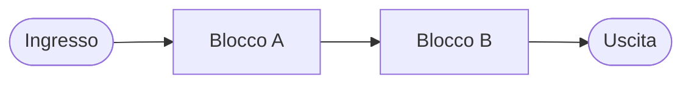
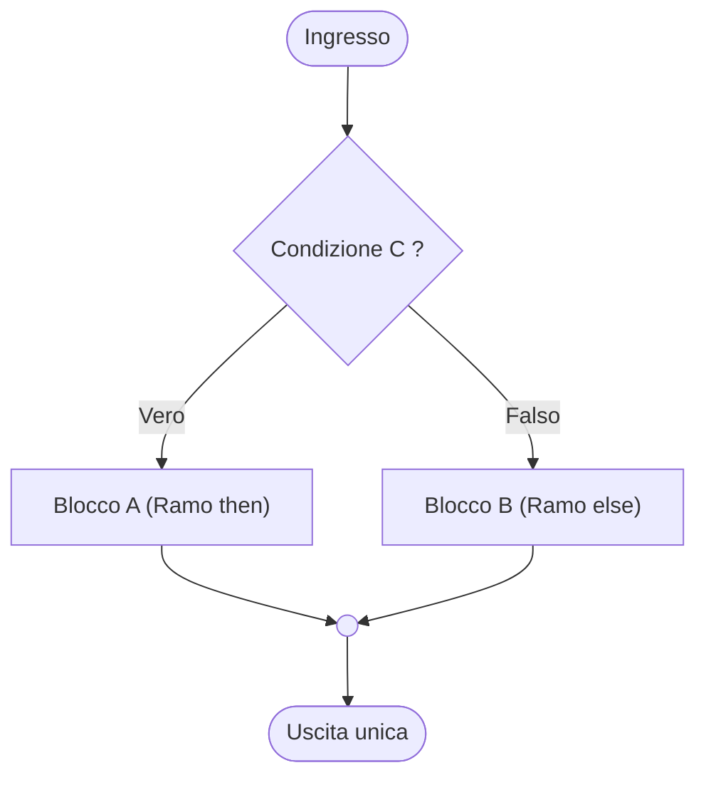
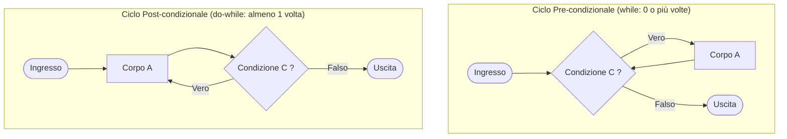

# 1.5.1 - Programmazione strutturata e costrutti fondamentali

## Introduzione intuitiva

Come possiamo liberarci per sempre dal caos dello *spaghetti code* e dall'istruzione `goto` senza perdere la capacità di scrivere qualunque algoritmo?

La risposta arrivò nel **1966** grazie a due informatici italiani, **Corrado Böhm** e **Giuseppe Jacopini**, che dimostrarono uno dei teoremi più importanti della storia dell'informatica: **non serve mai usare il `goto`!** Qualunque algoritmo, per quanto complesso o aggrovigliato sia il suo diagramma di flusso, può sempre essere riscritto combinando esclusivamente **tre mattoncini elementari**:
1. **La Sequenza** (fare un'azione dopo l'altra).
2. **La Selezione** (scegliere tra due strade in base a una condizione).
3. **L'Iterazione** (ripetere un blocco finché una condizione è vera).

Questa scoperta ha dato vita alla **Programmazione Strutturata**, il paradigma su cui si fondano il linguaggio C e tutti i linguaggi moderni.

---

## Il Teorema di Böhm-Jacopini e il principio SESE

### Enunciato del Teorema di Böhm-Jacopini (1966)
> **Teorema di Böhm-Jacopini**: Qualunque diagramma di flusso (o algoritmo calcolabile da una Macchina di Turing), anche non strutturato e contenente salti arbitrari, può essere trasformato in un diagramma di flusso **semanticamente equivalente** (che calcola la stessa funzione sugli stessi dati) utilizzando esclusivamente la composizione (in serie e annidata) di tre strutture di controllo fondamentali:
> 1. **Sequenza**
> 2. **Selezione (Struttura condizionale)**
> 3. **Iterazione (Ciclo condizionato)**
> ed eventualmente l'introduzione di variabili booleane ausiliarie.

### Il principio Single-Entry Single-Exit (SESE)
Perché questi tre costrutti eliminano lo *spaghetti code*? Perché ciascuno di essi è una "scatola chiusa" che rispetta rigorosamente la proprietà **SESE (*Single-Entry, Single-Exit*)**:
- Ha **un unico punto di ingresso** (in alto).
- Ha **un unico punto di uscita** (in basso).

Non è mai possibile saltare dall'esterno nel mezzo di una scatola, né scappare da una scatola verso un punto arbitrario del programma. Grazie a questa proprietà, un intero blocco `if-else` o un intero ciclo `while` può essere visto dall'esterno come **una singola istruzione astratta**, e può essere annidato dentro un'altra sequenza, selezione o iterazione come i mattoncini LEGO!

---

## Analisi dettagliata dei 3 Costrutti Fondamentali

### 1. La Sequenza
È l'esecuzione lineare ordinata di due o più blocchi $A$ e $B$: prima viene eseguito interamente $A$, e solo quando $A$ termina inizia l'esecuzione di $B$.
In C una sequenza di istruzioni racchiusa tra parentesi graffe `{ A; B; }` costituisce un **blocco composto** (*compound statement*), sintatticamente equivalente a una singola istruzione.



---

### 2. La Selezione (`if`, `if-else`, `switch`)
Permette di scegliere quale blocco eseguire in base al valore di verità (Vero $\neq 0$, Falso $= 0$) di un predicato logico $C$:

#### a) Selezione binaria completa (`if-else`) e unaria (`if`)
```c
if (condizione) {
    /* Ramo VERO: eseguito solo se 'condizione' != 0 */
    blocco_A;
} else {
    /* Ramo FALSO: eseguito solo se 'condizione' == 0 */
    blocco_B;
}
```
Se il ramo `else` viene omesso (`if` semplice), quando la condizione è falsa non si esegue alcuna azione e si procede direttamente al punto di uscita.



#### b) Selezione multipla (`switch-case`)
Quando bisogna confrontare una singola espressione **intera o carattere** (`int`, `char`, `enum`) con un elenco di **valori costanti noti a tempo di compilazione**, invece di una lunga catena di `if ... else if ... else` si può usare il costrutto `switch`:
```c
switch (espressione_intera) {
    case 1:
        printf("Scelta Uno\n");
        break; /* Fondamentale per uscire dallo switch! */
    case 2:
    case 3:
        printf("Scelta Due oppure Tre\n");
        break;
    default:
        printf("Scelta non riconosciuta\n");
        break;
}
```
> **Attenzione al *fall-through* nello `switch`**: in C le etichette `case` funzionano come punti di ingresso; se si dimentica il `break;` alla fine di un `case`, l'esecuzione **prosegue eseguendo anche tutte le istruzioni dei `case` successivi** finché non incontra un `break` o la fine dello `switch`!

---

### 3. L'Iterazione (`while`, `do-while`, `for`)
Permette di ripetere l'esecuzione di un blocco (detto **corpo del ciclo**) finché permane vera una **condizione di permanenza nel ciclo**.

#### a) Iterazione pre-condizionale: il ciclo `while`
La condizione viene valutata **prima** di ogni esecuzione del corpo:
```c
while (condizione) {
    corpo_del_ciclo;
}
```
- **Proprietà**: se fin dall'inizio la `condizione` è **Falsa**, il corpo del ciclo viene eseguito **zero volte** ($0, 1, \dots, n$ iterazioni).

#### b) Iterazione post-condizionale: il ciclo `do-while`
Il corpo viene eseguito **prima**, e la condizione viene controllata **alla fine** di ogni giro:
```c
do {
    corpo_del_ciclo;
} while (condizione); /* Nota il punto e virgola obbligatorio! */
```
- **Proprietà**: il corpo del ciclo viene sempre eseguito **almeno una volta** ($1, 2, \dots, n$ iterazioni), anche se la condizione è falsa al primo controllo. È ideale per la **validazione dell'input** (es. *"chiedi un numero positivo all'utente finché non lo inserisce correttamente"*).



#### Equivalenza teorica tra `while` e `do-while`
Nel Teorema di Böhm-Jacopini basta **un solo** tipo di ciclo (il `while`), perché `do-while` e `while` si possono sempre tradurre l'uno nell'altro usando sequenza e selezione:
- **Traduzione di `do { A; } while (C);` usando solo `while`**:
  ```c
  A;          /* Eseguiamo A la prima volta fuori dal ciclo */
  while (C) {
      A;      /* Ripetiamo A finché C è vera */
  }
  ```
- **Traduzione di `while (C) { A; }` usando solo `do-while` e `if`**:
  ```c
  if (C) {
      do {
          A;
      } while (C);
  }
  ```

#### c) Il ciclo `for` (Iterazione con contatore esplicito)
In C il ciclo `for` è una forma compatta ed espressiva del ciclo pre-condizionale `while`, che raccoglie in un'unica riga le tre operazioni fondamentali di gestione del ciclo:
```c
for (inizializzazione; condizione; aggiornamento) {
    corpo_del_ciclo;
}
```
che è **totalmente equivalente** al seguente schema `while`:
```c
inizializzazione;
while (condizione) {
    corpo_del_ciclo;
    aggiornamento;
}
```

---

## Esempi guidati

### Esempio 1: Somma dei primi $N$ numeri interi con `while` e con `for`
Scriviamo un programma strutturato che calcola $\sum_{i=1}^{N} i = 1 + 2 + \dots + N$ verificando che sia equivalente alla formula di Gauss $\frac{N(N+1)}{2}$.

```c
#include <stdio.h>

int main(void) {
    int n = 10;
    int somma = 0;

    /* Costrutto iterativo strutturato: inizializzazione, test e passo in testa */
    for (int i = 1; i <= n; i++) {
        somma = somma + i;
    }

    printf("Somma calcolata col ciclo: %d\n", somma);
    printf("Formula di Gauss n(n+1)/2: %d\n", n * (n + 1) / 2);
    return 0;
}
```

### Esempio 2: Composizione annidata dei 3 costrutti (Verifica di numero primo)
Vediamo come **sequenza**, **iterazione** e **selezione** si annidano tra loro rispettando il principio *Single-Entry Single-Exit* per stabilire se un intero $n \ge 2$ è un numero primo.

```c
#include <stdio.h>

int main(void) {
    int n = 29;
    int e_primo = 1; /* 1 = Vero (ipotesi iniziale), 0 = Falso */
    int d = 2;

    /* ITERAZIONE: proviamo i divisori d da 2 fino a quando d*d <= n
       E finché non abbiamo ancora trovato alcun divisore (e_primo == 1) */
    while (d * d <= n && e_primo == 1) {
        /* SELEZIONE annidata dentro l'iterazione */
        if (n % d == 0) {
            e_primo = 0; /* Trovato un divisore! Non è primo */
        }
        d = d + 1;
    }

    /* SELEZIONE finale in sequenza dopo il ciclo */
    if (e_primo == 1 && n >= 2) {
        printf("%d e' un numero PRIMO.\n", n);
    } else {
        printf("%d NON e' un numero primo.\n", n);
    }
    return 0;
}
```
Nota come il ciclo `while` non usi alcun `goto` o `break` per fermarsi appena trova un divisore: incorpora elegantemente la variabile booleana `e_primo == 1` nella condizione in testa al ciclo!

---

## Errori frequenti

1. **Mettere un punto e virgola `;` subito dopo `if (...)` o `while (...)` o `for (...)`**
   Scrivere:
   ```c
   while (i < 10); { /* ERRORE CRITICO: quel ';' dopo la parentesi chiude il while! */
       i++;
   }
   ```
   Il punto e virgola `;` è l'**istruzione vuota**: il compilatore interpreta `while (i < 10);` come *"ripeti l'istruzione vuota finché `i < 10`"*, bloccando il programma in un **ciclo infinito** perché `i++` (che sta nel blocco successivo, ormai fuori dal `while`) non viene mai raggiunto!
2. **Dimenticare le parentesi graffe `{}` quando un `if` o un `while` contiene più di un'istruzione**
   Senza `{ }`, in C solo la **prima istruzione** immediatamente successiva appartiene all'`if` o al `while`, indipendentemente dall'indentazione visiva!
   ```c
   if (x > 0)
       printf("Positivo\n");
       x = 0; /* ATTENZIONE: questa riga viene eseguita SEMPRE, anche se x <= 0! */
   ```
   **Buona pratica**: usa **sempre** le parentesi graffe `{ }` anche per una sola riga!
3. **Il problema del *Dangling Else* (Else pendente)**
   In due `if` annidati senza parentesi graffe:
   `if (c1) if (c2) A; else B;`
   A quale `if` appartiene quell'`else`? In C la regola sintattica stabilisce che l'`else` si lega sempre all'**`if` aperto più vicino** (quindi a `if (c2)`), anche se lo avevate incolonnato sotto `if (c1)`! Anche qui, le parentesi graffe `{ }` eliminano ogni ambiguità.
4. **Dimenticare `break;` nei rami di uno `switch`**
   Causa l'esecuzione involontaria (*fall-through*) dei casi successivi.

---

## Esercizi di prova

1. **[Base — Differenza tra `while` e `do-while`]**
   Determina cosa stampano i seguenti due frammenti di codice quando entrambi partono con `int x = 10;`:
   ```c
   /* Frammento A */              /* Frammento B */
   int x = 10;                    int x = 10;
   while (x < 5) {                do {
       x = x + 1;                     x = x + 1;
   }                              } while (x < 5);
   printf("A: %d\n", x);          printf("B: %d\n", x);
   ```
> [!tip]- Soluzione
> - **Frammento A (`while`)**: controlla subito `10 < 5`, che è Falso. Il corpo non viene mai eseguito (0 iterazioni) e stampa **`A: 10`**.
> - **Frammento B (`do-while`)**: esegue prima il corpo una volta portando `x` a `11`, e solo dopo controlla `11 < 5` (Falso) uscendo dal ciclo. Stampa quindi **`B: 11`**.

2. **[Base — Il pericolo del *Dangling Else*]**
   Senza eseguire il codice, determina cosa stampa il seguente programma (fai attenzione all'indentazione ingannevole!) e riscrivilo con le parentesi graffe per far sì che l'`else` si riferisca effettivamente al primo `if`:
   ```c
   #include <stdio.h>
   int main(void) {
       int a = 5, b = -3;
       if (a > 0)
           if (b > 0)
               printf("Caso 1\n");
       else
           printf("Caso 2\n");
       return 0;
   }
   ```
> [!tip]- Soluzione
> Il programma stampa **`Caso 2`**!
> *Spiegazione*: In C l'indentazione non ha valore sintattico. L'`else` si associa all'`if` più interno (`if (b > 0)`). Poiché `a > 0` è Vero (`5 > 0`), si entra nel primo `if`; poi si valuta `b > 0` (`-3 > 0`), che è Falso, e quindi scatta il suo ramo `else` (`Caso 2`).
>
> **Codice corretto con parentesi graffe (per associare l'`else` ad `a > 0`):**
> ```c
> if (a > 0) {
>     if (b > 0) {
>         printf("Caso 1\n");
>     }
> } else {
>     printf("Caso 2\n");
> }
> ```

3. **[Intermedio — Conversione da `for` a `while` e da `while` a `do-while`]**
   Dato il seguente ciclo `for`:
   ```c
   int s = 1;
   for (int k = 1; k <= 4; k++) {
       s = s * k;
   }
   ```
   a) Riscrivilo in modo semanticamente identico usando un ciclo `while`.
   b) Riscrivilo per il caso generale `k <= n` (con `n` intero qualsiasi, anche $\le 0$) usando esclusivamente `if` e `do-while`.
> [!tip]- Soluzione
> **a) Con ciclo `while`:**
> ```c
> int s = 1;
> int k = 1;
> while (k <= 4) {
>     s = s * k;
>     k++;
> }
> ```
> **b) Con `if` + `do-while` (valido anche se `n <= 0`):**
> ```c
> int s = 1;
> int k = 1;
> if (k <= n) {
>     do {
>         s = s * k;
>         k++;
>     } while (k <= n);
> }
> ```

4. **[Intermedio — Uso corretto di `switch-case` con raggruppamento]**
   Scrivi un programma C strutturato che, dato un numero intero `mese` (da `1` a `12`) e una variabile `bisestile` (`1` se l'anno è bisestile, `0` altrimenti), usi un costrutto `switch` per determinare e stampare il numero di giorni di quel mese (oppure un messaggio di errore se `mese` non è compreso tra `1` e `12`).
> [!tip]- Soluzione
> ```c
> #include <stdio.h>
> 
> int main(void) {
>     int mese = 2;
>     int bisestile = 1;
>     int giorni = 0;
> 
>     switch (mese) {
>         /* Trenta giorni ha novembre, con april, giugno e settembre... */
>         case 4:
>         case 6:
>         case 9:
>         case 11:
>             giorni = 30;
>             break;
>         /* Di 28 (o 29) ce n'è uno... */
>         case 2:
>             if (bisestile == 1) {
>                 giorni = 29;
>             } else {
>                 giorni = 28;
>             }
>             break;
>         /* Tutti gli altri ne han 31 */
>         case 1: case 3: case 5: case 7: case 8: case 10: case 12:
>             giorni = 31;
>             break;
>         default:
>             giorni = -1; /* Mese non valido */
>             break;
>     }
> 
>     if (giorni != -1) {
>         printf("Il mese %d ha %d giorni.\n", mese, giorni);
>     } else {
>         printf("Errore: mese %d non valido!\n", mese);
>     }
>     return 0;
> }
> ```

5. **[Intermedio/Esame — Costruzione della Successione di Fibonacci strutturata]**
   La successione di Fibonacci è definita da $F_0 = 0, F_1 = 1$ e $F_n = F_{n-1} + F_{n-2}$ per ogni $n \ge 2$. Scrivi un programma C strutturato che, dato $n \ge 0$, calcoli e stampi $F_n$ usando solo i costrutti di selezione e iterazione.
> [!tip]- Soluzione
> ```c
> #include <stdio.h>
> 
> int main(void) {
>     int n = 8;
>     int fn;
> 
>     if (n == 0) {
>         fn = 0;
>     } else if (n == 1) {
>         fn = 1;
>     } else {
>         int f_prec2 = 0; /* F_0 */
>         int f_prec1 = 1; /* F_1 */
>         fn = 1;
>         for (int i = 2; i <= n; i++) {
>             fn = f_prec1 + f_prec2;
>             f_prec2 = f_prec1;
>             f_prec1 = fn;
>         }
>     }
> 
>     printf("F_%d = %d\n", n, fn); /* Per n = 8 stampa 21 */
>     return 0;
> }
> ```

6. **[Esame — Teorema di Böhm-Jacopini: dimostrazione costruttiva con variabile di stato]**
   Spiega come il Teorema di Böhm-Jacopini permette, nel caso più generale in cui un diagramma di flusso abbia blocchi $B_1, B_2, \dots, B_k$ collegati da salti arbitrari non riducibili, di simulare l'intero diagramma usando un **unico ciclo `while` esterno** e una variabile intera di stato `pc` (*Program Counter* simulato).
> [!tip]- Soluzione
> Questa è la costruzione universale della dimostrazione di Böhm-Jacopini:
> 1. Si numera ciascun blocco/nodo del diagramma di flusso originale da $1$ a $k$, usando $0$ per indicare il nodo finale di uscita (`FINE`).
> 2. Si introduce una variabile ausiliaria intera `int stato = 1;` (inizializzata al blocco di partenza).
> 3. Si racchiude tutto in un **unico ciclo `while (stato != 0)`**, al cui interno una **selezione (`if-else` o `switch`)** su `stato` esegue il blocco corrispondente e aggiorna `stato` al numero del blocco successivo invece di fare un `goto`!
>
> ```c
> int stato = 1; /* Partiamo dal blocco 1 */
> while (stato != 0) {
>     if (stato == 1) {
>         /* Istruzioni del Blocco 1 */
>         if (condizione_1) stato = 2;
>         else              stato = 3;
>     } else if (stato == 2) {
>         /* Istruzioni del Blocco 2 */
>         stato = 0; /* Equivale a: vai alla FINE */
>     } else if (stato == 3) {
>         /* Istruzioni del Blocco 3 */
>         stato = 1; /* Equivale a: torna al Blocco 1 */
>     }
> }
> ```
> In questo modo qualsiasi grafo, anche il più intricato, viene calcolato usando solo **1 ciclo `while`** e **selezioni `if-else`**!

---

## Provenienza del materiale

- Slide e dispensa ufficiale del corso: `C1PROG1U1L5_Programmazione_Strutturata_Costrutti_Fondamentali.pdf` (Unità 1, Lezione 5 — Teorema di Böhm-Jacopini, programmazione strutturata e costrutti fondamentali).
