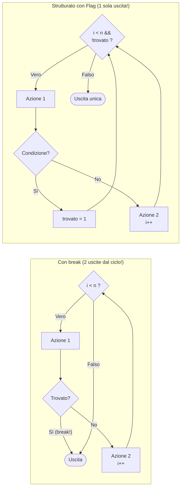

# 1.6.1 - Eliminazione dei salti

## Introduzione intuitiva

Sapere per il Teorema di Böhm-Jacopini che ogni programma può essere scritto senza salti è rassicurante, ma nella pratica — e molto spesso negli esercizi d'esame! — ci troviamo di fronte a un problema concreto: **come si trasforma, passo dopo passo, un programma pieno di `goto`, `break`, `continue` o `return` multipli in mezzo ai cicli in un programma strutturato puro ed elegante?**

Anche istruzioni apparentemente "moderne" come `break` (che interrompe bruscamente un ciclo a metà) e `continue` (che salta il resto del corpo del ciclo passando all'iterazione successiva) sono in realtà dei **salti mascherati**: violano infatti il principio *Single-Entry Single-Exit* (SESE), perché creano molteplici punti di uscita dal corpo del ciclo.

In questa lezione impariamo le **quattro tecniche sistematiche di refactoring** che permettono di eliminare qualunque salto preservando al 100% la semantica del programma.

---

## Le 4 Tecniche Sistematiche per l'Eliminazione dei Salti

### Tecnica 1: Salto in avanti $\rightarrow$ Selezione `if` o `if-else` (con negazione della condizione)
Quando un'istruzione `if (C) goto FineBlocco;` salta **in avanti** scavalcando un gruppo di istruzioni $A$, significa semplicemente che il blocco $A$ deve essere eseguito **solo quando la condizione $C$ è FALSA** (cioè quando vale `!C`):

```c
/* PRIMA (Non strutturato) */          /* DOPO (Strutturato) */
if (x < 0) goto salta;                 if (!(x < 0)) { /* cioè: if (x >= 0) */
    y = radice(x);                         y = radice(x);
    stampa(y);                             stampa(y);
salta:                                 }
```
Se invece abbiamo due rami alternativi realizzati con due salti in avanti:
```c
/* PRIMA (Non strutturato) */          /* DOPO (Strutturato) */
if (C) goto ramo_vero;                 if (C) {
    Blocco_Falso;                          Blocco_Vero;
    goto fine;                         } else {
ramo_vero:                                 Blocco_Falso;
    Blocco_Vero;                       }
fine:
```

---

### Tecnica 2: Salto all'indietro $\rightarrow$ Ciclo `do-while` o `while`
Quando un'etichetta `inizio:` si trova **sopra** e in fondo al blocco compare `if (C) goto inizio;`, siamo di fronte a un ciclo post-condizionale `do-while`:
```c
/* PRIMA (Non strutturato) */          /* DOPO (Strutturato) */
inizio:                                do {
    Blocco_A;                              Blocco_A;
    if (C) goto inizio;                } while (C);
```
Se invece in cima all'etichetta c'è subito un controllo di uscita `if (CondUscita) goto fine;` e in fondo un salto incondizionato `goto inizio;`, si tratta di un normale ciclo `while (!CondUscita)`:
```c
/* PRIMA (Non strutturato) */          /* DOPO (Strutturato) */
inizio:                                while (!CondUscita) {
    if (CondUscita) goto fine;             Blocco_A;
    Blocco_A;                          }
    goto inizio;
fine:
```

---

### Tecnica 3: Eliminazione di `break` (o `goto` di uscita anticipata dal ciclo) tramite Variabile Booleana (Flag / Sentinella)
È il caso più frequente in assoluto! Supponiamo di avere un ciclo che a metà del suo corpo esegue un `break;` (o `goto fuori;`) quando si verifica un evento particolare (ad esempio: abbiamo trovato l'elemento cercato in un vettore, oppure si è verificato un errore).

**Procedura in 3 passi:**
1. Dichiarare prima del ciclo una **variabile booleana di stato (flag)**, ad esempio `int trovato = 0;` (oppure `int continua = 1;`).
2. Rafforzare la condizione del `while` mettendola in **`&&` (AND logico)** con `!trovato` (`while (condizione_originale && !trovato)`).
3. Al posto del `break;`, impostare `trovato = 1;` e racchiudere l'eventuale parte restante del corpo del ciclo dentro un `else` (oppure `if (!trovato)`), così non viene eseguita nell'iterazione in cui il flag scatta!



---

### Tecnica 4: Eliminazione di `continue` tramite selezione `if-else`
L'istruzione `continue;` salta le istruzioni rimanenti del corpo del ciclo e passa direttamente al test dell'iterazione successiva. Per eliminarla senza nemmeno usare un flag, basta **invertire la condizione** che attivava il `continue` e mettere il resto del corpo del ciclo dentro il blocco `if`!

```c
/* PRIMA (Con continue) */             /* DOPO (Strutturato puro) */
while (i < n) {                        while (i < n) {
    Azione_Iniziale;                       Azione_Iniziale;
    if (SaltaResto) {                      if (!SaltaResto) {
        i++;                                   Azione_Finale;
        continue;                          }
    }                                      i++;
    Azione_Finale;                     }
    i++;
}
```

---

## Esempi guidati

### Esempio 1: Refactoring di una ricerca in un vettore (Eliminazione di `break`)
**Problema**: Dato un codice che cerca il primo numero negativo in un array usando `break`, trasformarlo in codice strutturato puro.

**Codice originale (con `break`):**
```c
int v[5] = {4, 12, -3, 8, -9};
int pos = -1;
for (int i = 0; i < 5; i++) {
    if (v[i] < 0) {
        pos = i;
        break; /* Salto fuori dal ciclo! */
    }
    printf("Controllato indice %d (positivo)\n", i);
}
```

**Refactoring passo-passo (Codice strutturato senza `break`):**
1. Possiamo usare direttamente `pos == -1` come nostra condizione di permanenza (finché `pos` vale `-1`, non abbiamo ancora trovato il negativo!).
2. Se `v[i] < 0`, assegniamo `pos = i;` e mettiamo nel ramo `else` la `printf` e l'incremento (o lasciamo l'incremento fuori se usiamo `i` solo nel ciclo):

```c
#include <stdio.h>

int main(void) {
    int v[5] = {4, 12, -3, 8, -9};
    int pos = -1;
    int i = 0;

    while (i < 5 && pos == -1) {
        if (v[i] < 0) {
            pos = i; /* Questo farà terminare il while al controllo successivo! */
        } else {
            printf("Controllato indice %d (positivo)\n", i);
            i++;
        }
    }

    printf("Primo negativo trovato in posizione: %d\n", pos);
    return 0;
}
```

### Esempio 2: Eliminazione combinata di `break` e `continue` in uno stesso ciclo
Consideriamo il seguente ciclo che somma i numeri positivi di un vettore, saltando gli zeri (`continue`) e fermandosi immediatamente se incontra il valore sentinella `-999` (`break`):

**Codice non strutturato:**
```c
int somma = 0;
for (int i = 0; i < n; i++) {
    if (v[i] == -999) {
        break;
    }
    if (v[i] <= 0) {
        continue;
    }
    somma = somma + v[i];
}
```

**Refactoring strutturato completo:**
1. Per eliminare `if (v[i] == -999) break;`, osserviamo che non serve nemmeno un flag separato: basta scrivere nella guardia del `while` la condizione `i < n && v[i] != -999`! *(Attenzione all'ordine: `i < n` deve stare a sinistra di `&&` per non leggere fuori dall'array!)*.
2. Per eliminare `if (v[i] <= 0) continue;`, eseguiamo `somma += v[i]` solo quando `v[i] > 0`.

```c
int somma = 0;
int i = 0;

while (i < n && v[i] != -999) {
    if (v[i] > 0) {
        somma = somma + v[i];
    }
    i++;
}
```
Guarda quanto è più corto, leggibile e matematicamente limpido il codice strutturato rispetto all'originale con `break` e `continue`!

### Esempio 3: Ristrutturazione completa di un programma con `goto` intrecciati (Stile Esame)
Prendiamo il codice "Spaghetti" visto nella Lezione 1.4.1 (Esempio 2) ed eliminiamo tutti i `goto`:

**Codice originale con 3 etichette e 4 `goto`:**
```c
    int x = 1, y = 10;
L1:
    if (x >= y) goto L3;
    x = x + 3;
    if (x < 5) goto L2;
    y = y - 2;
    goto L1;
L2:
    y = y - 1;
    goto L1;
L3:
    printf("Fine: x = %d, y = %d\n", x, y);
```

**Analisi e ristrutturazione passo-passo:**
1. L'etichetta `L1:` inizia con `if (x >= y) goto L3;` (dove `L3` è la fine) e tutti i rami interni (`goto L1;`) riportano a `L1:`. Quindi l'intera struttura tra `L1` e `L3` è un **ciclo `while (x < y)`**!
2. Dentro il ciclo, dopo `x = x + 3;`, c'è `if (x < 5) goto L2;`:
   - Se `x < 5` è **Vero**, salta a `L2`, esegue `y = y - 1;` e torna a `L1`.
   - Se `x < 5` è **Falso**, esegue `y = y - 2;` e torna a `L1`.
   Questa è semplicemente una **selezione `if (x < 5) ... else ...`**!

**Codice strutturato finale (0 `goto`, 100% equivalente):**
```c
#include <stdio.h>

int main(void) {
    int x = 1, y = 10;

    while (x < y) {
        x = x + 3;
        if (x < 5) {
            y = y - 1;
        } else {
            y = y - 2;
        }
    }

    printf("Fine: x = %d, y = %d\n", x, y); /* Stampa x = 7, y = 7 */
    return 0;
}
```

---

## Errori frequenti

1. **Sostituire `break;` con `flag = 1;` dimenticando che il resto del corpo del ciclo verrà comunque eseguito!**
   Questo è l'errore più comune agli esami. Il `break` interrompeva il corpo *immediatamente*, mentre `flag = 1;` viene controllato dal `while` solo **all'inizio del giro successivo**! Se sotto il vecchio `break` ci sono altre istruzioni (es. `somma += x;` o `i++;`), dovete proteggerle dentro un ramo `else` oppure `if (!flag) { ... }`.
2. **Sbagliare la negazione delle condizioni composte (Leggi di De Morgan)**
   Quando si trasforma `if (CondUscita) goto fine;` nella guardia di permanenza `while (!CondUscita)`, bisogna applicare correttamente le **Leggi di De Morgan**:
   - La negazione di `(a > 0 && b > 0)` è **`(a <= 0 || b <= 0)`** (l'AND diventa OR!).
   - La negazione di `(a == 0 || b == 0)` è **`(a != 0 && b != 0)`** (l'OR diventa AND!).
3. **Dimenticare di incrementare il contatore del ciclo quando si elimina un `continue` in un ciclo `while`**
   Assicuratevi sempre che l'istruzione di avanzamento `i++` si trovi **fuori** dall'`if (!Salta)` e venga eseguita a ogni iterazione, altrimenti il ciclo si blocca in un loop infinito.

---

## Esercizi di prova

1. **[Base — Eliminazione di `goto` con Leggi di De Morgan]**
   Trasforma il seguente frammento non strutturato in un ciclo `while` strutturato equivalente, prestando particolare attenzione alla negazione della condizione di uscita:
   ```c
   inizio:
       if (a <= 0 || b >= 100) goto fine;
       a = a - 1;
       b = b * 2;
       goto inizio;
   fine:
       printf("%d %d\n", a, b);
   ```
> [!tip]- Soluzione
> Il ciclo deve continuare finché la condizione di uscita `(a <= 0 || b >= 100)` è **falsa**. Per la legge di De Morgan:
> $$\neg(a \le 0 \lor b \ge 100) \iff (a > 0 \land b < 100)$$
> **Codice strutturato:**
> ```c
> while (a > 0 && b < 100) {
>     a = a - 1;
>     b = b * 2;
> }
> printf("%d %d\n", a, b);
> ```

2. **[Base — Eliminazione di `continue`]**
   Riscrivi il seguente ciclo eliminando l'istruzione `continue`:
   ```c
   int prod = 1;
   for (int i = 0; i < 6; i++) {
       if (v[i] == 0) {
           continue;
       }
       prod = prod * v[i];
   }
   ```
> [!tip]- Soluzione
> Basta invertire la condizione `v[i] == 0` in `v[i] != 0`:
> ```c
> int prod = 1;
> for (int i = 0; i < 6; i++) {
>     if (v[i] != 0) {
>         prod = prod * v[i];
>     }
> }
> ```

3. **[Intermedio — Eliminazione di `break` a metà del corpo del ciclo]**
   Trasforma il seguente frammento in codice strutturato senza usare `break`, `continue` o `goto`, mantenendo invariato il valore finale di tutte le variabili (inclusa `i`!):
   ```c
   int i = 0, s = 0;
   while (i < 10) {
       s = s + i;
       if (s > 15) {
           break;
       }
       i = i + 1;
   }
   ```
> [!tip]- Soluzione
> *Attenzione*: nel codice originale, quando `s > 15` scatta il `break` **prima** di eseguire `i = i + 1`. Quindi nella versione con flag dobbiamo eseguire `i = i + 1` solo nel ramo `else`!
> ```c
> int i = 0, s = 0;
> int ferma = 0; /* Flag booleano: 0 = continua, 1 = esci */
> 
> while (i < 10 && !ferma) {
>     s = s + i;
>     if (s > 15) {
>         ferma = 1;
>     } else {
>         i = i + 1;
>     }
> }
> ```

4. **[Intermedio/Esame — Ristrutturazione di ciclo con ingresso anticipato (Duplicazione controllata o `do-while`)]**
   Trasforma il seguente codice con `goto` (visto nell'Esercizio 5 della lezione 1.4.1) in un programma C strutturato puro:
   ```c
       int k = 1, s = 0;
       goto L2;
   L1:
       k = k * 2;
   L2:
       s = s + k;
       if (k < 4) goto L1;
   ```
> [!tip]- Soluzione
> Osserviamo cosa fa il programma: salta `k = k * 2` solo al **primo giro**, esegue `s = s + k`, e poi finché `k < 4` ripete la coppia `(k = k * 2; s = s + k;)`.
> Possiamo ristrutturarlo in due modi equivalenti ed elegantissimi:
>
> **Metodo A (Con `while` standard anticipando la prima istruzione):**
> ```c
> int k = 1, s = 0;
> s = s + k;          /* Primo ingresso in L2 */
> while (k < 4) {     /* Finché k < 4, ripeti L1 seguito da L2 */
>     k = k * 2;
>     s = s + k;
> }
> ```
> **Metodo B (Con `do-while`):**
> ```c
> int k = 1, s = 0;
> s = s + k;
> if (k < 4) {
>     do {
>         k = k * 2;
>         s = s + k;
>     } while (k < 4);
> }
> ```

5. **[Esame — Eliminazione di `goto` di uscita da due cicli annidati]**
   In C, l'unico caso in cui alcuni programmatori sono tentati di usare `goto` è per uscire contemporaneamente da **due cicli `for` annidati** appena trovano un elemento `m[r][c] == target` in una matrice.
   Riscrivi il seguente codice eliminando il `goto trovato_uscita;` e usando una variabile booleana `trovato`:
   ```c
   int trovato = 0;
   for (int r = 0; r < 3; r++) {
       for (int c = 0; c < 4; c++) {
           if (m[r][c] == target) {
               trovato = 1;
               goto trovato_uscita;
           }
       }
   }
   trovato_uscita:
   ```
> [!tip]- Soluzione
> Basta inserire la condizione `!trovato` nella guardia di **entrambi** i cicli (sia quello interno sulle colonne `c`, sia quello esterno sulle righe `r`):
> ```c
> int trovato = 0;
> int r = 0;
> 
> while (r < 3 && !trovato) {
>     int c = 0;
>     while (c < 4 && !trovato) {
>         if (m[r][c] == target) {
>             trovato = 1; /* Ferma sia il ciclo interno sia quello esterno! */
>         } else {
>             c++;
>         }
>     }
>     if (!trovato) {
>         r++;
>     }
> }
> ```
> Quando `trovato` diventa `1`, termina immediatamente il ciclo interno su `c` e subito dopo termina anche il ciclo esterno su `r`, conservando in `r` e `c` le coordinate esatte della cella trovata!

---

## Provenienza del materiale

- Slide e dispensa ufficiale del corso: `C1PROG1U1L6_Eliminazione_Salti.pdf` (Unità 1, Lezione 6 — Tecniche sistematiche di eliminazione dei salti `goto`, `break` e `continue`).
