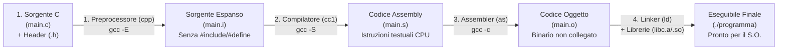

# Introduzione al linguaggio C e compilazione

## Come un programma C arriva all'esecuzione

Perché, a più di cinquant'anni dalla sua nascita, il **linguaggio C** rimane la colonna vertebrale dell'informatica mondiale? Il kernel di Linux, Windows e macOS, gli interpreti di Python e JavaScript, i database più veloci, i firmware dei dispositivi medici e aerospaziali sono tutti scritti in C.

Il motivo è che il C occupa una posizione unica: è un linguaggio **ad alto livello** (strutturato, leggibile, portabile su qualunque processore), ma allo stesso tempo è **vicinissimo all'hardware** ("a medio livello"), perché non nasconde nulla al programmatore. Non c'è un *Garbage Collector* che rallenta l'esecuzione in background né una macchina virtuale pesante: ogni istruzione C si traduce in pochissime istruzioni macchina dirette ed efficienti.

In questa prima lezione dell'Unità 2 scopriremo la storia e le caratteristiche del linguaggio C, cosa accade dietro le quinte nelle **4 fasi della catena di compilazione** e qual è l'anatomia esatta di un programma C.

---

## Storia e Caratteristiche del Linguaggio C

### Breve storia e Standard ufficiali
- **1972 (Bell Labs)**: **Dennis Ritchie** sviluppa il linguaggio C (evoluzione dei precedenti linguaggi BCPL e B di Ken Thompson) per riscrivere da zero il sistema operativo **UNIX** su minicomputer PDP-11, che fino ad allora era scritto in Assembly.
- **1978 (K&R C)**: Brian Kernighan e Dennis Ritchie pubblicano il leggendario libro *"The C Programming Language"*.
- **1989/1990 (ANSI C / C89 / ISO C90)**: prima standardizzazione internazionale ufficiale del linguaggio.
- **1999 (C99)**: introduce novità fondamentali che usiamo quotidianamente, come la possibilità di dichiarare variabili in qualsiasi punto del blocco (es. `for (int i = 0; ...)`), i commenti su singola riga `//`, il tipo booleano `_Bool` (`<stdbool.h>`) e i tipi interi a dimensione fissa (`<stdint.h>`).
- **2011 / 2017 / 2023 (C11, C17, C23)**: gli standard moderni. Nel corso facciamo riferimento allo standard **ISO C11** (`-std=c11`).

### Caratteristiche tecniche del C
1. **Linguaggio Imperativo e Procedurale Strutturato**: un programma è una sequenza di ordini (istruzioni) organizzati in funzioni modulari che modificano lo stato della memoria tramite i costrutti strutturati (`if`, `while`, `for`).
2. **Linguaggio Compilato (non interpretato)**: il codice sorgente non viene letto riga per riga durante l'esecuzione, ma viene interamente tradotto in anticipo (*Ahead-Of-Time*) in codice macchina nativo della CPU.
3. **Tipizzazione Statica**: ogni variabile ha un tipo di dato fissato al momento della dichiarazione (`int`, `double`, `char *`) e controllato dal compilatore prima dell'esecuzione.
4. **Accesso diretto alla memoria**: tramite i puntatori, il programmatore controlla direttamente gli indirizzi di memoria e la gestione dello spazio.

---

## Preparare l'ambiente di sviluppo

L'ambiente Linux del corso rende più semplice riprodurre gli esempi con gli stessi strumenti di compilazione e diagnosi. Se usiamo una **macchina virtuale**, il sistema **host** è quello del computer fisico e il sistema **guest** è Linux. L'hypervisor assegna al guest risorse come CPU, RAM e disco virtuale. Per importare e avviare la VM facciamo riferimento alla dispensa di installazione indicata in fondo alla nota.

Su un sistema Linux nativo o in WSL2 possiamo usare la toolchain Linux direttamente. Su macOS si può compilare C anche con la toolchain nativa. Per riprodurre l'ambiente e gli strumenti Linux del corso si può usare la VM prevista dalla dispensa, verificando la compatibilità con la propria macchina. Una volta avviato Linux, apriamo un **terminale** per interagire con la **shell**, l'interprete dei comandi.

| Comando Bash | Uso |
| --- | --- |
| `pwd` e `ls -la` | Mostrano rispettivamente il percorso della cartella corrente e i file, compresi quelli nascosti. |
| `cd cartella`, `cd ..` e `cd ~` | Entrano in una sottocartella, risalgono alla cartella padre o tornano alla cartella personale. |
| `mkdir -p prog1/esercizi_01` | Crea la cartella di lavoro e quelle intermedie. |
| `cp origine destinazione` e `mv origine destinazione` | Copiano oppure spostano o rinominano un file. |
| `cat saluto.c` e `less saluto.c` | Mostrano il sorgente. In `less` si esce con `q`. |
| `rm saluto-prova.c` | Elimina il file indicato. Controllare il percorso e usare il comando sulla copia di prova. |

Prima di compilare verifichiamo che `gcc --version` mostri il compilatore. Per l'esecuzione passo passo useremo [[3.1.1 - Le funzioni in C#Seguire swap con GDB|GDB]] e, per la diagnosi della memoria, [[4.1.1 - Allocazione dinamica della memoria#Individuare gli errori con valgrind|Valgrind]].

---

## Le 4 Fasi della Catena di Compilazione

Quando scriviamo `gcc programma.c -o programma`, in realtà `gcc` non è un singolo programma monolitico, ma un *driver* che invoca in sequenza **quattro strumenti distinti**:



Analizziamo in dettaglio cosa accade in ciascuna delle 4 fasi:

### Fase 1: Pre-elaborazione — Il Preprocessore (`cpp`)
Prima ancora che inizi la vera compilazione grammaticale, il **Preprocessore C** legge il file `.c` ed esegue tutte le **direttive che iniziano con il simbolo cancelletto `#`**:
- **`#include <stdio.h>`**: cerca il file di intestazione (*header file*) `stdio.h` nelle cartelle di sistema e **lo copia-incolla letteralmente** al posto della riga `#include`.
- **`#define MAX 100`**: sostituisce nel testo ogni occorrenza della parola `MAX` con `100`.
- **Rimozione dei commenti**: cancella tutti i commenti `/* ... */` e `// ...` sostituendoli con un singolo spazio.
- *Output intermedio* (visibile con `gcc -E main.c -o main.i`): un file di puro testo C espanso (`.i`), privo di direttive `#`.

### Fase 2: Compilazione — Il Compilatore vero e proprio (`cc1`)
È il cuore della traduzione:
1. Esegue l'**analisi lessicale** (divide il testo in token), l'**analisi sintattica** (costruisce l'albero sintattico verificando la grammatica C) e l'**analisi semantica** (controlla la compatibilità dei tipi e che ogni variabile/funzione sia stata dichiarata). Se trova errori, si ferma qui stampando i messaggi di errore!
2. Ottimizza il codice intermedio e lo traduce nel **linguaggio Assembly** specifico dell'architettura del processore (es. x86_64 o ARM64).
- *Output intermedio* (visibile con `gcc -S main.c`): un file di testo `.s` contenente istruzioni Assembly come `movl`, `addl`, `call`.

### Fase 3: Assemblaggio — L'Assembler (`as`)
Traduce meccanicamente le istruzioni testuali Assembly del file `.s` in **codice macchina binario** (sequenze di byte `0` e `1` comprensibili alla CPU), generando il **file oggetto** (`main.o`, ottenibile con `gcc -c main.c`).
- *Perché il file `.o` non è ancora eseguibile?* Perché se nel nostro `main.c` abbiamo chiamato `printf("Ciao\n");`, il compilatore sa (grazie a `stdio.h`) che `printf` esiste e quali parametri accetta, ma **il codice binario di `printf` non si trova dentro `main.c`!** Nel file `main.o` c'è quindi un "buco" (un riferimento simbolico non risolto) con scritto *"qui bisognerà saltare all'indirizzo di `printf`"*.

### Fase 4: Collegamento — Il Linker (`ld`)
Il **Linker** prende uno o più file oggetto (`.o`) generati dai nostri file sorgente e li **collega** insieme alle **librerie di sistema** (come la libreria standard del C `libc`, che contiene il codice già compilato di `printf`, `scanf`, ecc., o la libreria matematica `libm` collegata col flag `-lm`).
- Risolve tutti gli indirizzi mancanti: sostituisce il simbolo `printf` con l'indirizzo effettivo della funzione di libreria.
- Verifica che esista **una e una sola funzione `main`** (punto di ingresso del programma).
- Produce infine il **file eseguibile** finale!

---

## Anatomia di un Programma C

Analizziamo riga per riga la struttura minima di un programma C standard:

```c
/*
 * Questo è un commento multi-riga (stile ANSI C).
 * Viene ignorato dal compilatore e serve a documentare il codice.
 */

#include <stdio.h> /* Direttiva al preprocessore: importa i prototipi di Input/Output */

// La funzione 'main' è il punto di ingresso obbligatorio di ogni programma C.
// 'int' indica che restituisce un intero al Sistema Operativo.
// '(void)' indica esplicitamente che non riceve argomenti in ingresso.
int main(void) {
    /* Dichiarazione e inizializzazione di una variabile locale */
    int anno = 2026;

    /* Chiamata alla funzione di libreria printf per stampare a schermo */
    printf("Benvenuti al corso di Programmazione I (%d)!\n", anno);

    /* Restituisce 0 al Sistema Operativo per segnalare terminazione corretta */
    return 0;
}
```

### Regole sintattiche fondamentali da ricordare
1. **Case sensitivity**: il C distingue rigorosamente tra lettere maiuscole e minuscole (`main`, `Main` e `MAIN` sono tre nomi completamente diversi!). Tutte le parole chiave del C (`int`, `if`, `while`, `return`) sono sempre scritte in **minuscolo**.
2. **Punto e virgola `;`**: ogni singola istruzione (*statement*) deve terminare con `;`. Le direttive `#include` e le intestazioni di funzioni/cicli/blocchi (`int main(void) {`, `if (x > 0) {`) **non** hanno il `;` alla fine.
3. **Formato libero (*Free-form*)**: gli spazi bianchi, i tabulatori e gli a capo servono a rendere il codice leggibile per gli esseri umani (indentazione), ma per il compilatore contano solo come separatori tra i token.

---

## Argomenti ed esito di main

In un ambiente ospitato usiamo `int main(void)` per un programma senza parametri oppure `int main(int argc, char *argv[])` per ricevere gli argomenti. `argc` conta le stringhe disponibili, `argv[argc]` è un puntatore nullo e, quando `argc > 0`, `argv[0]` contiene il nome del programma se l'ambiente lo fornisce. Per un comando come `./programma dati.txt`, controlliamo `argc == 2` prima di accedere ad `argv[1]`. Le stringhe arrivano come testo. Per numeri, effettuiamo una conversione con verifica.

Tornare da `main` con `0` o `EXIT_SUCCESS` segnala successo. `EXIT_FAILURE` segnala fallimento. In C11 raggiungere la fine di `main` equivale a restituire `0`. Per riprodurre le fasi di traduzione vedi la sezione [[#Preparare l'ambiente di sviluppo|Preparare l’ambiente di sviluppo]]. Le [[3.2.1 - Parametri e macro del preprocessore|macro]] agiscono durante il preprocessing. La [[6.6.1 - Compilatori, interpreti e catena di traduzione|catena di traduzione]] collega ciascuna fase ai relativi diagnostici.

---

## Esempi guidati

### Compilare ed eseguire il primo programma

Apriamo il terminale nella macchina Linux e creiamo la cartella di lavoro.

```bash
cd ~
mkdir -p prog1/esercizi_01
cd prog1/esercizi_01
pwd
```

Salviamo il programma della sezione **Anatomia di un Programma C** come `saluto.c` in questa cartella. Verifichiamo che il file esista, facciamo una copia di prova e compiliamo il sorgente.

```bash
ls -la
cp saluto.c saluto-backup.c
mv saluto-backup.c saluto-prova.c
gcc -std=c11 -Wall -Wextra -Werror -g -O0 saluto.c -o saluto && ./saluto
printf 'Stato di uscita: %s\n' "$?"
```

`-std=c11` seleziona il dialetto C11, `-Wall` e `-Wextra` abilitano gruppi di avvisi, e `-Werror` li tratta come errori. `-g` include informazioni per il [[3.1.1 - Le funzioni in C#Seguire swap con GDB|debugger]] e `-O0` disabilita le ottimizzazioni durante la prova. `-o saluto` dà un nome al binario e `./saluto` lo avvia dalla cartella corrente. Compilare di nuovo dopo ogni modifica al sorgente.

Se la compilazione riesce, `&&` avvia il programma. Bash espande `$?` con lo stato dell'ultimo comando prima di eseguire il `printf`. Su Linux, il programma di saluto stampa il messaggio previsto e segnala successo con `0`. Se GCC fallisce, `&&` evita di lanciare anche un eventuale binario di una compilazione precedente.

**Prova sui warning.** Nella copia di prova del sorgente, aggiungiamo `int inutilizzata = 99;` e sostituiamo `%d` con `%f` nella chiamata a `printf` lasciando `anno` di tipo `int`. Compiliamo `saluto-prova.c` con gli stessi flag e un nome di output distinto, `-o saluto-prova`. GCC segnala la variabile inutilizzata e il formato incompatibile con l'argomento. Per tornare a un programma compilabile rimuoviamo la dichiarazione e ripristiniamo `%d`. Al termine possiamo eliminare la copia di prova con `rm saluto-prova.c`.

### Esempio 1: Differenza tra Errore del Compilatore ed Errore del Linker
Vediamo due errori classici che avvengono in fasi diverse della catena di compilazione:

**Caso A — Errore di Compilazione (Fase 2: sintassi o dichiarazione mancante):**
```c
#include <stdio.h>

int main(void) {
    valore = 10; /* ERRORE DI COMPILAZIONE: 'valore' non ha un tipo dichiarato! */
    return 0;
}
```
Messaggio di `gcc`: `error: ‘valore’ undeclared (first use in this function)`. Il processo si ferma nella Fase 2 (`cc1`).

**Caso B — Errore di Linking (Fase 4: prototipo noto ma corpo della funzione inesistente):**
```c
#include <stdio.h>

/* Dichiariamo il prototipo di una funzione 'calcola_tutto', ma non la definiamo mai! */
int calcola_tutto(int x);

int main(void) {
    int ris = calcola_tutto(5); /* Per il compilatore (Fase 2) la sintassi è perfetta! */
    printf("%d\n", ris);
    return 0;
}
```
Qui le Fasi 1, 2 e 3 hanno successo (`main.o` viene creato senza problemi!). Ma nella **Fase 4 il Linker (`ld`)** fallisce con il celebre errore:
```text
/usr/bin/ld: main.o: in function `main':
undefined reference to `calcola_tutto'
collect2: error: ld returned 1 exit status
```
Ogni volta che leggi **`undefined reference to ...`**, significa che il **Linker** non ha trovato l'implementazione di una funzione (hai sbagliato a scrivere il nome, hai dimenticato di definire la funzione oppure, per `<math.h>`, hai dimenticato il flag `-lm` in fondo al comando `gcc`).

### Esempio 2: Ispezione dei file intermedi della compilazione
Se eseguiamo in sequenza:
```bash
gcc -E saluto.c -o saluto.i   # Fase 1: genera il sorgente pre-processato
gcc -S saluto.i -o saluto.s   # Fase 2: genera il codice Assembly
gcc -c saluto.s -o saluto.o   # Fase 3: genera il file oggetto binario
gcc saluto.o -o saluto        # Fase 4: collega con libc e crea l'eseguibile
```
Noteremo che mentre `saluto.c` era lungo appena 6 righe, il file `saluto.i` prodotto dal preprocessore è lungo oltre **800 righe**, perché contiene l'intero contenuto espanso di `<stdio.h>`!

---

## Errori frequenti

> [!caution] Errori da evitare
> 1. **Dimenticare `#include <stdio.h>` quando si usa `printf` o `scanf`**
>    Con i flag rigorosi `-Wall -Wextra -Werror -std=c11`, usare `printf` senza aver incluso `<stdio.h>` produce l'errore: `implicit declaration of function 'printf'`.
> 2. **Annidare i commenti multi-riga `/* ... /* ... */ ... */`**
>    In C i commenti `/* ... */` **non si possono annidare**! Il compilatore chiude il commento non appena incontra il **primo** simbolo `*/`, lasciando la parte finale scoperta e causando un errore di sintassi.
> 3. **Scrivere `void main()` invece di `int main(void)`**
>    In C11 ospitato, le forme portabili sono `int main(void)` e `int main(int argc, char *argv[])`, o forme equivalenti. L'implementazione può documentare altre forme.

---

## Esercizi di prova

### Esercizio 1. Le 4 fasi della compilazione (Base)

Associa ciascuna delle seguenti operazioni alla fase esatta della catena di compilazione in cui avviene (**1. Preprocessore**, **2. Compilatore**, **3. Assembler**, **4. Linker**):
a) Traduzione delle istruzioni Assembly in codice macchina binario `.o`.
b) Sostituzione della direttiva `#include <stdio.h>` con il testo del file header e rimozione dei commenti.
c) Collegamento della chiamata `printf` con il codice binario della libreria standard `libc`.
d) Controllo grammaticale della sintassi C e verifica dei tipi delle variabili.

> [!tip]- Soluzione
> - **a)** **Fase 3 — Assembler (`as`)**.
> - **b)** **Fase 1 — Preprocessore (`cpp`)**.
> - **c)** **Fase 4 — Linker (`ld`)**.
> - **d)** **Fase 2 — Compilatore (`cc1`)**.

### Esercizio 2. Individuazione degli errori in un programma C (Base)

Il seguente programma di 7 righe contiene **4 errori** che ne impediscono la compilazione. Individuali tutti e scrivi la versione corretta:
```c
include <stdio.h>

Int Main(void) {
    printf("Inizio programma\n")
    return 0; /* Commento non chiuso
}
```

> [!tip]- Soluzione
> I 4 errori sono:
> 1. Riga 1: manca il simbolo cancelletto `#` davanti a `include` (`#include <stdio.h>`).
> 2. Riga 3: il C è *case-sensitive*: `Int` e `Main` con l'iniziale maiuscola sono errati, vanno scritti in minuscolo `int main(void)`.
> 3. Riga 4: manca il punto e virgola `;` alla fine dell'istruzione `printf("Inizio programma\n");`.
> 4. Riga 5: il commento `/* Commento non chiuso` non viene mai chiuso con `*/`, quindi "mangia" anche la parentesi graffa finale `}`!
>
> **Codice corretto:**
> ```c
> #include <stdio.h>
>
> int main(void) {
>     printf("Inizio programma\n");
>     return 0; /* Commento chiuso correttamente */
> }
> ```

### Esercizio 3. Diagnosi dell'errore `undefined reference` (Intermedio)

Uno studente scrive il seguente programma `test.c`:
```c
#include <stdio.h>
int main(void) {
    printf("Ciao mondo!\n");
    return 0;
}
```
ma per sbaglio in un altro file scrive `print("Ciao mondo!\n");` e in un terzo file dimentica di scrivere la funzione `main` (chiamandola `int avvia(void)`).
Quale errore viene segnalato nel caso di `int avvia(void)` e da quale componente della toolchain (`cpp`, `cc1`, `as` o `ld`) viene generato?

> [!tip]- Soluzione
> Nel file in cui `main` è stata chiamata `avvia`, il preprocessore, il compilatore e l'assembler terminano **senza alcun errore**, perché `int avvia(void)` è una funzione C sintatticamente validissima!
> L'errore scatta nella **Fase 4 (Linker `ld`)**, che cercando il punto di ingresso obbligatorio del programma fallisce con il messaggio:
> `undefined reference to 'main'`.

### Esercizio 4. Trappola dei commenti multi-riga (Intermedio)

Cosa stampa il seguente programma C? Spiega perché compila senza errori nonostante l'intenzione dello studente fosse diversa:
```c
#include <stdio.h>
int main(void) {
    int x = 10;
    /* Disattivo temporaneamente questo blocco:
       x = x + 5; /* incremento di 5 */
    */
    printf("%d\n", x);
    return 0;
}
```

> [!tip]- Soluzione
> Il programma **non compila affatto**! Produce un errore di sintassi alla riga `*/`.
> *Spiegazione*: I commenti `/* ... */` non si possono annidare. Il commento aperto a `/* Disattivo...` si chiude al primo `*/` che incontra, cioè alla fine della riga `/* incremento di 5 */`. Di conseguenza la riga successiva contiene un `*/` rimasto orfano fuori dal commento, che il compilatore segnala come errore sintattico (`expected expression before '/' token`).

### Esercizio 5. Compilazione separata di più file sorgente (Avanzato)

Supponi che un progetto sia diviso in due file sorgente: `main.c` (che contiene `main`) e `utilita.c` (che contiene delle funzioni ausiliarie).
Scrivi i tre comandi `gcc` per:
a) Compilare solo `main.c` fermandosi al file oggetto `main.o` (senza invocare il linker).
b) Compilare solo `utilita.c` fermandosi al file oggetto `utilita.o`.
c) Collegare insieme i due file oggetto `main.o` e `utilita.o` per produrre l'eseguibile finale `progetto`.

> [!tip]- Soluzione
> ```bash
> # a) Compilazione separata di main.c (il flag -c ferma gcc alla Fase 3)
> gcc -Wall -Wextra -Werror -std=c11 -g -c main.c -o main.o
>
> # b) Compilazione separata di utilita.c
> gcc -Wall -Wextra -Werror -std=c11 -g -c utilita.c -o utilita.o
>
> # c) Fase di Linking dei due file oggetto per creare l'eseguibile
> gcc main.o utilita.o -o progetto
> ```
> *Vantaggio ingegneristico*: Nei grandi progetti con centinaia di file `.c`, se modifichiamo solo `main.c` dobbiamo ricompilare solo `main.o` e rifare il linking, senza ricompilare da zero `utilita.c`!

### Esercizio 6. Stato di uscita e concatenazione in Bash (Intermedio)

Su Linux, un programma `codice_uscita.c` termina con `return 3;` nel `main`. Dopo averlo compilato, cosa mostrano due `echo "$?"` consecutivi subito dopo l'esecuzione? Cosa accade con `./codice_uscita && echo "Riuscito"`? Indica anche il comando di compilazione C11 con warning trattati come errori e simboli di debug.

> [!tip]- Soluzione
> ```bash
> gcc -std=c11 -Wall -Wextra -Werror -g -O0 codice_uscita.c -o codice_uscita
> ./codice_uscita
> echo "$?"
> echo "$?"
> ```
>
> Il primo `echo` stampa `3`. Se termina normalmente, il secondo stampa `0`, lo stato del primo `echo`. Con `&&`, Bash esegue il comando a destra soltanto se quello a sinistra restituisce zero. Qui il messaggio `Riuscito` viene saltato.

---

## Provenienza del materiale

- Slide e dispensa ufficiale del corso: `C1PROG1U2L1_Introduzione_al_linguaggio_C.pdf` (Unità 2, Lezione 1 — Introduzione al linguaggio C e fasi della compilazione).
- Marco Anisetti, *Introduzione alla Programmazione in Linguaggio C*, `Appunti_di_fine_Unità_2.pdf`, capp. 1 e 5.
- Marco Anisetti, *Memoria*, `Appunti_di_Fine_Unità_4.pdf`, cap. 3.
- [WG14, bozza C11 N1570](https://www.open-std.org/jtc1/sc22/wg14/www/docs/n1570.pdf), § 5.1.2.2.
- Dispensa del corso, `C1PROG1_Guida_Installazione_VM-rev1.pdf` (Ambiente Linux, macchina virtuale e toolchain C).
