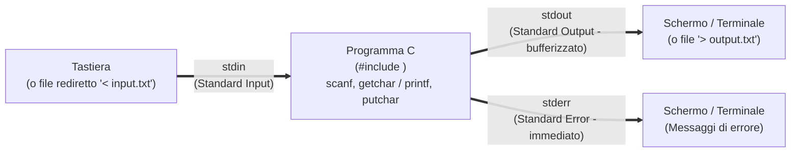

# Input e Output standard in C

## Come leggere e scrivere tramite i flussi standard

Un programma che non può ricevere dati dall'utente e non può comunicare i risultati all'esterno è come una calcolatrice senza tasti e senza schermo: perfettamente inutile!

Una caratteristica interessante del linguaggio C è che **non possiede parole chiave native per leggere o stampare dati** (a differenza di `print` in Python). Tutte le operazioni di Input/Output sono invece delegate alla **Libreria Standard (`<stdio.h>`, *Standard Input and Output*)**, che modella la tastiera e lo schermo come **flussi di caratteri (*stream*)**.

In questa lezione padroneggeremo la formattazione dell'output con `printf`, la lettura sicura dell'input con `scanf` (capendo finalmente *perché* `scanf` esige il simbolo `&` davanti alle variabili e come controllare sempre se la lettura è riuscita!) e la famosa trappola del carattere Invio (`\n`) rimasto nel buffer della tastiera.

---

## Il concetto di Standard Stream (`stdin`, `stdout`, `stderr`)

Quando un programma C viene avviato dal sistema operativo, vengono aperti automaticamente tre canali di comunicazione (chiamati **standard stream**):



1. **`stdin` (*Standard Input*)**: flusso di ingresso collegato di default alla **tastiera**. È letto da `scanf()` e `getchar()`.
2. **`stdout` (*Standard Output*)**: flusso di uscita normale collegato allo **schermo del terminale**. È usato da `printf()` e `putchar()`. È tipicamente *line-buffered* (i caratteri vengono inviati allo schermo quando si stampa un a capo `\n` o il buffer si riempie).
3. **`stderr` (*Standard Error*)**: flusso di uscita dedicato ai **messaggi diagnostici e di errore** (non bufferizzato, così i messaggi compaiono istantaneamente anche se il programma sta per bloccarsi).

---

## Formattazione dell'Output con `printf`

La funzione `printf` (*print formatted*) stampa su `stdout` una **stringa di formato** in cui eventuali segnaposto che iniziano con `%` (**specificatori di formato**) vengono sostituiti dai valori delle espressioni passate come argomenti successivi:

```c
printf("Stringa con segnaposto %d e %.2f\n", espressione_intera, espressione_reale);
```

### Tabella degli Specificatori di Formato essenziali

| Specificatore | Tipo di dato atteso | Significato ed Esempi di formattazione |
| :---: | :--- | :--- |
| `%d` (o `%i`) | `int` | Intero decimale con segno (es. `-42`). Con `%5d` allinea a destra su almeno 5 spazi; con `%05d` riempie con zeri (`00042`). |
| `%u` | `unsigned int` | Intero decimale **senza segno**. |
| `%ld` / `%lu` | `long` / `unsigned long` | Intero `long` con o senza segno (per `long long` si usa `%lld`). |
| `%x` / `%X` | `unsigned int` | Intero in base **esadecimale** (`%x` usa lettere minuscole `a-f`, `%X` maiuscole `A-F`). Con `%o` stampa in ottale. |
| `%f` | `double` (o `float` promosso) | Numero in virgola mobile in notazione decimale fissa (di default 6 cifre dopo il punto). **`%.2f` arrotonda a 2 cifre decimali**! |
| `%e` / `%g` | `double` | `%e` stampa in notazione scientifica esponenziale (`1.25e+03`); `%g` sceglie il formato più compatto. |
| `%c` | `char` (promosso a `int`) | Singolo carattere ASCII (es. `'A'`). |
| `%s` | `char *` (stringa C) | Sequenza di caratteri terminata da `'\0'`. |
| `%p` | `void *` (puntatore) | Indirizzo di memoria in esadecimale (es. `0x7ffd1234`). |
| `%zu` | `size_t` | Risultato dell'operatore `sizeof(...)`. |
| `%%` | *(nessun argomento)* | Stampa un singolo carattere percentuale `%` letterale. |

### Le Sequenze di Escape (`\`)
Per inserire dentro una stringa caratteri speciali non stampabili o con significato sintattico, si usa il carattere *backslash* `\`:
- `\n` (*Newline*): va a capo all'inizio della riga successiva.
- `\t` (*Tab*): inserisce una tabulazione orizzontale (allineamento a colonne).
- `\\`: stampa un singolo carattere backslash `\`.
- `\"`: stampa le doppie virgolette `"` senza chiudere la stringa C.
- `\0`: il carattere nullo (codice ASCII `0`) che termina le stringhe in C.

---

## Lettura dell'Input con `scanf`

La funzione `scanf` (*scan formatted*) legge caratteri da `stdin`, li interpreta secondo gli specificatori di formato e salva i valori convertiti dentro le variabili indicate:

```c
int eta;
double altezza;
int letti = scanf("%d %lf", &eta, &altezza);
```

### 1. Perché in `scanf` è OBBLIGATORIO l'operatore indirizzo `&`?
Come vedremo studiando le funzioni, in C gli argomenti vengono passati **per valore**: se scrivessimo `scanf("%d", eta)`, passeremmo a `scanf` soltanto una copia del valore attuale (magari non inizializzato!) di `eta`, e `scanf` non avrebbe alcun modo di sapere **in quale cella della memoria RAM** andare a depositare il numero digitato dall'utente!
Passando **`&eta`** (l'indirizzo di memoria della variabile `eta`), forniamo a `scanf` le coordinate esatte della casella in cui scrivere il dato letto. Per `%s` un array di `char` viene convertito in puntatore al primo elemento. Si passa anche direttamente un puntatore già disponibile, se ha il tipo richiesto.

### 2. Differenza cruciale tra `printf` e `scanf` per il tipo `double` (`%lf`)!
- In `printf`, qualsiasi `float` viene automaticamente promosso a `double`, quindi sia per `float` sia per `double` si usa **`%f`**.
- In `scanf`, invece, passiamo un puntatore (`float *` da 4 byte oppure `double *` da 8 byte)! Il compilatore non può indovinare la dimensione della cella puntata:
  - Per leggere un **`float`** in `scanf` si usa **`%f`** (`scanf("%f", &mio_float);`).
  - Per leggere un **`double`** in `scanf` si DEVE usare **`%lf`** (*long float*: `scanf("%lf", &mio_double);`)!

### 3. Il valore di ritorno di `scanf` (Controllo degli errori di input)
Cosa succede se chiediamo all'utente un numero intero con `scanf("%d", &x)` ma l'utente digita per sbaglio `"ciao"`? La conversione fallisce e la variabile `x` **non viene scritta** (rimane non inizializzata!).
Per questo motivo, **bisogna sempre controllare il valore intero restituito da `scanf`**:
- `scanf` restituisce il **numero di variabili che è riuscita a leggere e assegnare correttamente** (es. `1` se legge una variabile, `2` se ne legge due).
- Restituisce la costante speciale **`EOF`** (*End Of File*, tipicamente `-1`, generabile da tastiera su Linux premendo `Ctrl+D`) se il flusso di input è terminato prima di leggere alcun dato.

```c
int x;
if (scanf("%d", &x) != 1) {
    printf("Errore: non hai inserito un numero intero valido!\n");
    return 1;
}
```

### 4. La trappola del carattere `\n` residuo nel buffer con `scanf("%c", ...)`
Tutti gli specificatori numerici (`%d`, `%f`, `%lf`) e di parola (`%s`) **saltano automaticamente qualsiasi spazio bianco iniziale** (spazi `' '`, tab `\t` e a capo `\n`).
Lo specificatore **`%c`**, invece, vuole leggere **letteralmente il prossimo carattere presente nel buffer, anche se è uno spazio o un Invio `\n`!**

Guarda cosa succede quando leggiamo un numero e subito dopo un carattere:
1. L'utente digita `42` e preme il tasto **Invio**: nel buffer `stdin` entrano i 3 caratteri `'4'`, `'2'`, `'\n'`.
2. `scanf("%d", &n)` consuma `'4'` e `'2'`, ma **lascia il carattere `'\n'` nel buffer!**
3. La successiva `scanf("%c", &risposta)` trova subito quel `'\n'` rimasto nel buffer, lo mette in `risposta` e va avanti senza aspettare che l'utente digiti nulla!

**La soluzione semplicissima**: mettere **uno spazio prima di `%c`** nella stringa di formato:
```c
scanf(" %c", &risposta); /* Lo spazio iniziale dice a scanf: "salta tutti gli spazi e i \n residui!" */
```

---

## I/O a singolo carattere: `getchar()` e `putchar()`

Per leggere o stampare un singolo carattere alla volta in modo leggerissimo ed efficiente, `<stdio.h>` fornisce:
- **`int c = getchar();`**: legge il prossimo carattere da `stdin` e lo restituisce.
  > **Domanda classica d'esame**: *Perché `getchar()` restituisce un **`int`** e non un `char`?*
  > **Risposta**: Perché `getchar()` deve poter restituire tutti i $256$ possibili byte validi di un carattere (`0..255`) **PIÙ** il valore speciale fuori banda **`EOF` (`-1`)** quando finisce l'input! In una variabile `char` (che ha solo 256 combinazioni possibili) `EOF` si confonderebbe con un carattere valido (o non sarebbe mai uguale a `-1` se `char` è unsigned). Quindi il risultato di `getchar()` va sempre salvato in un **`int`**!
- **`putchar(c);`**: stampa il carattere `c` su `stdout`.

---

## Che cosa resta nel flusso dopo una lettura

Con `scanf("%d %lf", &n, &x)` e input `12 parola`, viene assegnato soltanto `n`. Il risultato è `1` e `x` conserva il valore precedente. Il carattere che impedisce la seconda conversione resta disponibile. Con `parola` già al primo campo il risultato è `0`. `EOF` segnala un errore di lettura o fine del flusso prima della prima conversione completata.

Nel formato, `%` introduce una conversione e può essere seguito da una larghezza, da un modificatore e dallo specificatore. `%3d` limita i caratteri della conversione ma non impone esattamente tre cifre. Un carattere letterale deve corrispondere all'input. Uno spazio nel formato consuma zero o più caratteri bianchi. In `printf`, `%f` riceve un `double` dopo le promozioni variadiche. In `scanf`, `%f` e `%lf` richiedono rispettivamente `float *` e `double *`.

Per input non controllato, possiamo leggere una riga con [[2.6.1 - Le stringhe in C|fgets]] e usare `strtol` per controllare la conversione, il carattere finale e l'intervallo prima di assegnare a `int`. Un numero fuori dall'intervallo del tipo destinazione di `scanf` può provocare comportamento indefinito anche quando il testo è numerico.

---

## Esempi guidati

### Esempio 1: Tabella formattata e allineata con `printf`
```c
#include <stdio.h>

int main(void) {
    printf("+------------+-------+----------+\n");
    printf("| Prodotto   | Q.ta' | Prezzo   |\n");
    printf("+------------+-------+----------+\n");
    /* %-10s allinea la stringa a sinistra su 10 caratteri; %5d allinea a destra su 5; %8.2f usa 8 caratteri con 2 decimali */
    printf("| %-10s | %5d | %8.2f |\n", "Quaderno", 3, 2.50);
    printf("| %-10s | %5d | %8.2f |\n", "Libro C", 1, 34.90);
    printf("| %-10s | %5d | %8.2f |\n", "Matita", 12, 0.80);
    printf("+------------+-------+----------+\n");
    return 0;
}
```
**Output:**
```text
+------------+-------+----------+
| Prodotto   | Q.ta' | Prezzo   |
+------------+-------+----------+
| Quaderno   |     3 |     2.50 |
| Libro C    |     1 |    34.90 |
| Matita     |    12 |     0.80 |
+------------+-------+----------+
```

### Esempio 2: Calcolatrice interattiva con gestione corretta del buffer `stdin`
```c
#include <stdio.h>

int main(void) {
    double a, b;
    char op;

    printf("Inserisci il primo numero: ");
    if (scanf("%lf", &a) != 1) {
        printf("Input non valido!\n");
        return 1;
    }

    printf("Inserisci l'operatore (+, -, *, /): ");
    /* Nota lo SPAZIO prima di %c per ignorare l'Invio (\n) lasciato dal numero precedente! */
    if (scanf(" %c", &op) != 1) {
        return 1;
    }

    printf("Inserisci il secondo numero: ");
    if (scanf("%lf", &b) != 1) {
        printf("Input non valido!\n");
        return 1;
    }

    if (op == '+')      printf("Risultato: %.2f\n", a + b);
    else if (op == '-') printf("Risultato: %.2f\n", a - b);
    else if (op == '*') printf("Risultato: %.2f\n", a * b);
    else if (op == '/') {
        if (b != 0.0) printf("Risultato: %.2f\n", a / b);
        else          printf("Errore: divisione per zero!\n");
    } else {
        printf("Operatore '%c' sconosciuto!\n", op);
    }
    return 0;
}
```

### Esempio 3: Conteggio di caratteri e righe fino a `EOF` con `getchar()`
```c
#include <stdio.h>

int main(void) {
    int c; /* DEVE essere int per poter confrontare correttamente con EOF! */
    int num_caratteri = 0;
    int num_righe = 0;

    printf("Digita del testo (premi Ctrl+D su Linux per terminare):\n");

    while ((c = getchar()) != EOF) {
        num_caratteri++;
        if (c == '\n') {
            num_righe++;
        }
    }

    printf("Letti %d caratteri totali su %d righe.\n", num_caratteri, num_righe);
    return 0;
}
```

---

## Errori frequenti

> [!caution] Errori da evitare
> 1. **Dimenticare `&` davanti alle variabili in `scanf` (`scanf("%d", x);`)**
>    È uno degli errori più gravi in C: il valore di `x` viene interpretato come un indirizzo di memoria casuale, provocando un immediato *Segmentation Fault* a runtime (e un errore bloccante di compilazione con `-Wall -Werror`).
> 2. **Usare `%f` invece di `%lf` in `scanf` per leggere una variabile `double`**
>    Scrivere `double d; scanf("%f", &d);` fa sì che `scanf` scriva solo 4 byte in formato `float` dentro una cella da 8 byte `double`, lasciando metà della variabile corrotta!
> 3. **Mettere `\n` alla fine della stringa di formato di `scanf` (`scanf("%d\n", &x);`)**
>    *Non farlo mai!* In `scanf`, uno spazio o un `\n` nella stringa di formato significa *"continua a leggere e scartare tutti gli spazi bianchi finché l'utente non digita un carattere NON bianco"*. Di conseguenza, `scanf("%d\n", &x)` non ritorna quando premi Invio, ma rimane bloccata finché non digiti anche l'inizio dell'input successivo!

---

## Esercizi di prova

### Esercizio 1. Individuazione di errori in `printf` e `scanf` (Base)

Trova e correggi i **4 errori** presenti nel seguente frammento:
```c
int quantita;
double prezzo;
scanf("%d\n", quantita);
scanf("%f", &prezzo);
printf("Totale per %f pezzi: %d euro\n", quantita, quantita * prezzo);
```

> [!tip]- Soluzione
> 1. In `scanf("%d\n", quantita)`: manca l'operatore indirizzo `&` davanti a `quantita`, e va rimosso il `\n` finale che blocca l'input.
> 2. In `scanf("%f", &prezzo)`: poiché `prezzo` è di tipo `double`, in `scanf` bisogna usare **`%lf`** e non `%f`.
> 3. Nella `printf`: i due specificatori sono invertiti rispetto ai tipi degli argomenti (`quantita` è `int` $\to$ `%d`, mentre `quantita * prezzo` è `double` $\to$ `%.2f`).
>
> **Codice corretto:**
> ```c
> int quantita;
> double prezzo;
> scanf("%d", &quantita);
> scanf("%lf", &prezzo);
> printf("Totale per %d pezzi: %.2f euro\n", quantita, quantita * prezzo);
> ```

### Esercizio 2. Spazio prima di `%c` e buffer di input (Base)

Un programma esegue le seguenti istruzioni:
```c
int codice;
char categoria;
scanf("%d", &codice);
scanf("%c", &categoria);
```
Se l'utente digita `105` seguito dal tasto Invio e poi `A` seguito da Invio, quale valore numerico ASCII (o carattere) conterrà la variabile `categoria`? Come si corregge la seconda `scanf`?

> [!tip]- Soluzione
> La variabile `categoria` conterrà il carattere **`'\n'`** (codice ASCII `10`, cioè il tasto Invio premuto dopo `105`) e **non** `'A'`!
> Per far sì che `scanf` scarti gli spazi bianchi e i `\n` rimasti nel buffer prima di leggere il carattere, basta aggiungere uno spazio davanti a `%c`:
> ```c
> scanf(" %c", &categoria);
> ```

### Esercizio 3. Somma di una sequenza di interi di lunghezza ignota fino a fine input (Intermedio)

 usando il valore di ritorno di `scanf("%d", &x)`, scrivi un programma C che legga da `stdin` una sequenza arbitraria di numeri interi (fino a quando l'utente termina l'input con `EOF` o inserisce un testo non numerico) e stampi quanti numeri validi sono stati letti e la loro somma.

> [!tip]- Soluzione
> ```c
> #include <stdio.h>
>
> int main(void) {
>     int x;
>     int conteggio = 0;
>     int somma = 0;
>
>     /* Il ciclo continua finché scanf riesce a leggere esattamente 1 intero */
>     while (scanf("%d", &x) == 1) {
>         somma += x;
>         conteggio++;
>     }
>
>     printf("Numeri letti: %d | Somma totale: %d\n", conteggio, somma);
>     return 0;
> }
> ```

### Esercizio 4. Svuotamento manuale del buffer di input con `getchar()` (Intermedio)

Quando `scanf("%d", &x)` fallisce (restituisce `0`) perché l'utente ha digitato delle lettere (es. `"abc\n"`), i caratteri `"abc\n"` rimangono bloccati nel buffer `stdin`! Se riprovassimo subito `scanf("%d", &x)` dentro un ciclo, fallirebbe all'infinito leggendo sempre quella `'a'`.
Scrivi un piccolo ciclo con `getchar()` che consumi e scarti tutti i caratteri rimasti sulla riga corrente fino al prossimo `'\n'` (o `EOF`).

> [!tip]- Soluzione
> ```c
> int ch;
> /* Legge e scarta i caratteri residui finché non trova l'a capo '\n' o la fine del file */
> while ((ch = getchar()) != '\n' && ch != EOF) {
>     /* Corpo vuoto: scarta semplicemente il carattere letto */
> }
> ```

### Esercizio 5. Conversione da minuscolo a maiuscolo in streaming con `getchar` e `putchar` (Avanzato)

Scrivi un programma C che legga il testo da `stdin` carattere per carattere tramite `getchar()` fino a `EOF` e lo ristampi su `stdout` con `putchar()`, trasformando tutte le lettere minuscole (`'a'..'z'`) nelle corrispondenti lettere maiuscole (`'A'..'Z'`) e lasciando inalterati tutti gli altri caratteri.

> [!tip]- Soluzione
> Nella tabella ASCII le lettere minuscole (`'a'..'z'`, codici 97..122) e maiuscole (`'A'..'Z'`, codici 65..90) sono contigue. Per convertire una minuscola `c` in maiuscola basta calcolare `c - 'a' + 'A'`:
> ```c
> #include <stdio.h>
>
> int main(void) {
>     int c; /* Tipo int obbligatorio per gestire EOF */
>
>     while ((c = getchar()) != EOF) {
>         if (c >= 'a' && c <= 'z') {
>             c = c - 'a' + 'A';
>         }
>         putchar(c);
>     }
>     return 0;
> }
> ```

### Esercizio 6. Stampa del codice ASCII, esadecimale e successivo di un carattere (Avanzato)

Scrivi un programma C che legga un singolo carattere visibile `c` da tastiera e stampi: il carattere stesso, il suo codice numerico ASCII in base 10, il suo codice in base 16 (esadecimale) e il carattere immediatamente successivo nella tabella ASCII.

> [!tip]- Soluzione
> ```c
> #include <stdio.h>
>
> int main(void) {
>     char c;
>     printf("Inserisci un carattere: ");
>     if (scanf(" %c", &c) == 1) {
>         printf("Carattere letto:       '%c'\n", c);
>         printf("Codice ASCII decimale: %d\n", (int)c);
>         printf("Codice ASCII esadec.:  0x%X\n", (unsigned int)(unsigned char)c);
>         printf("Carattere successivo:  '%c'\n", (char)(c + 1));
>     }
>     return 0;
> }
> ```

---

## Provenienza del materiale

- Dispensa ufficiale del corso: `C1PROG1U2L3-Dispensa_Input_E_Output.pdf` (Unità 2, Lezione 3 — Standard stream e funzioni di Input/Output `printf`, `scanf`, `getchar`, `putchar`).
- Marco Anisetti, *Introduzione alla Programmazione in Linguaggio C*, `Appunti_di_fine_Unità_2.pdf`, cap. 2, lettura e formati.
- [WG14, bozza C11 N1570](https://www.open-std.org/jtc1/sc22/wg14/www/docs/n1570.pdf), §§ 7.21.6.1–7.21.6.2.
