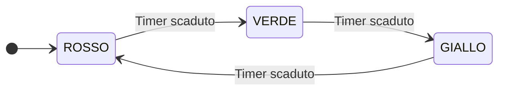

# Tipi enumerativi (enum) e typedef

## Quando usare un enum e quando definire un alias

Immagina di dover scrivere un programma che gestisce un semaforo o i giorni della settimana. Potresti decidere arbitrariamente che `0` significa "Rosso", `1` significa "Giallo" e `2` significa "Verde". Ma dopo due settimane, rileggendo una riga di codice come `if (stato == 1)`, ti ricorderesti subito se `1` era il Giallo, il Verde o un codice di errore? E cosa impedirebbe a un collega di scrivere per sbaglio `stato = 99;`?

Per rendere il codice **autodocumentante**, leggibile e meno soggetto a errori, il linguaggio C mette a disposizione due strumenti potentissimi:
1. **`enum` (Tipi Enumerativi)**: permettono di raggruppare un insieme finito di **costanti intere con nome** (es. `ROSSO`, `GIALLO`, `VERDE`) sotto un unico tipo logico.
2. **`typedef` (Definizione di Alias di Tipo)**: permette di dare un nome nuovo, più chiaro e portabile a un tipo di dato esistente.

---

## I Tipi Enumerativi (`enum`)

### Sintassi e valori numerici di default
Un tipo enumerativo si dichiara con la parola chiave `enum` seguita dal nome dell'enumerazione (detto *tag*) e dalla lista degli **enumeratori** tra parentesi graffe:

```c
enum Giorno {
    LUNEDI,    /* Vale automaticamente 0 */
    MARTEDI,   /* Vale automaticamente 1 */
    MERCOLEDI, /* Vale automaticamente 2 */
    GIOVEDI,   /* Vale automaticamente 3 */
    VENERDI,   /* Vale automaticamente 4 */
    SABATO,    /* Vale automaticamente 5 */
    DOMENICA   /* Vale automaticamente 6 */
}; /* Non dimenticare il punto e virgola finale! */
```

**Regola di numerazione automatica del compilatore:**
- Se non specifichiamo alcun valore, il **primo identificatore vale `0`**.
- Ogni identificatore successivo vale **`1` in più rispetto al precedente** ($0, 1, 2, 3, \dots$).
- Dietro le quinte, in C le costanti di una `enum` sono rappresentate in memoria come normali **numeri interi (`int`)**!

### Assegnazione di valori personalizzati
Possiamo assegnare esplicitamente un valore intero a uno o più elementi dell'enumerazione. Qualsiasi elemento successivo privo di `=` riprenderà a contare da $\text{valore\_precedente} + 1$:

```c
enum CodiceHttp {
    HTTP_OK = 200,
    HTTP_CREATED,           /* Vale 201 (200 + 1) */
    HTTP_BAD_REQUEST = 400,
    HTTP_UNAUTHORIZED,      /* Vale 401 (400 + 1) */
    HTTP_NOT_FOUND = 404,
    HTTP_SERVER_ERROR = 500
};
```

### Vantaggi di `enum` rispetto a una serie di `#define`
Perché usare `enum` invece di scrivere tante `#define LUNEDI 0`, `#define MARTEDI 1`?
1. **Numerazione automatica**: se inseriamo un nuovo valore in mezzo a una `enum`, il compilatore ricalcola da solo tutti i numeri successivi senza doverli riscrivere a mano.
2. **Visibilità nel Debugger (`gdb`)**: le `#define` vengono cancellate dal preprocessore prima della compilazione, quindi `gdb` vede solo `0, 1, 2`. Le costanti `enum` invece rimangono nella tabella dei simboli: se stampate una variabile `enum` in `gdb`, vedrete direttamente scritto **`MERCOLEDI`**!
3. **Controllo di completezza nello `switch`**: se usate una variabile `enum` dentro uno `switch (giorno)` e dimenticate di gestire uno dei casi (es. `DOMENICA`) senza mettere `default:`, il compilatore `gcc -Wall` vi avvisa automaticamente con il warning: `enumeration value 'DOMENICA' not handled in switch`!



---

## Definizione di Alias di Tipo con `typedef`

La parola chiave **`typedef`** **non crea un nuovo tipo di dato**, ma crea un **sinonimo (alias)** per un tipo già esistente.

### Sintassi (la regola d'oro per non sbagliare mai!)
Come si scrive un `typedef`? Basta scrivere una **normale dichiarazione di variabile** di quel tipo, mettere la parola `typedef` all'inizio della riga, e il nome della variabile diventerà il **nome del nuovo tipo**!

```c
/* Dichiarazione normale di variabile:   int contatore;       */
/* Con typedef davanti, 'Contatore' diventa un ALIAS di 'int': */
typedef int Contatore;

/* Da questo momento possiamo dichiarare variabili di tipo Contatore: */
Contatore visite = 0;
Contatore iscritti = 42;
```

### Perché `typedef` è fondamentale nell'ingegneria del software?
1. **Chiarezza semantica (Codice autodocumentante)**:
   Scrivere `typedef double Euro;` o `typedef double Secondi;` rende immediatamente chiaro a chi legge la firma di una funzione se il parametro atteso rappresenta denaro o tempo, anche se entrambi sono `double`.
2. **Portabilità tra architetture diverse**:
   Nella libreria standard del C (es. `<stddef.h>` e `<stdint.h>`), tipi famosissimi come **`size_t`** (usato per le dimensioni in byte e gli indici) oppure **`int32_t`** e **`uint64_t`** (interi a larghezza garantita di 32 o 64 bit) sono realizzati proprio con `typedef`!
3. **Semplificazione di `enum` e `struct`**:
   In C, se dichiariamo `enum Semaforo { ROSSO, GIALLO, VERDE };`, ogni volta che dichiariamo una variabile dobbiamo ripetere la parola `enum`: `enum Semaforo s = ROSSO;`.
   Combinando **`typedef enum`**, creiamo un nome di tipo pulito utilizzabile direttamente:

```c
typedef enum {
    ROSSO,
    GIALLO,
    VERDE
} Semaforo; /* 'Semaforo' è ora il nome del tipo! */

Semaforo incrocio1 = ROSSO; /* Non serve più scrivere 'enum' davanti! */
```

---

## Costanti enumerative e rappresentazione

Con `enum Stato { SPENTO = -1, PRONTO = 2, ATTIVO };`, `ATTIVO` vale 3. Le costanti enumerative hanno tipo `int` in C11. Il tipo `enum Stato` è compatibile con `char` o con un tipo intero con o senza segno, scelto dall'implementazione per rappresentare i valori elencati. `sizeof(PRONTO) == sizeof(int)`, mentre `sizeof(enum Stato)` dipende dal tipo compatibile. Per stamparne il valore usiamo `%zu`.

I valori possono avere intervalli vuoti o duplicati. In uno `switch` si può usare `case PRONTO:`. Due enumeratori con lo stesso valore produrrebbero casi duplicati. Per percorrere i soli stati previsti con valori non consecutivi, conviene iterare su un array di stati espliciti. Un `typedef` fornisce un alias del tipo esistente. Il nome segue le normali regole di ambito.

---

## Esempi guidati

### Esempio 1: Macchina a Stati Finiti (FSA) implementata con `typedef enum` e `switch`
Ricordi gli Automi a Stati Finiti dell'Unità 1? In C il modo professionale per implementare un automa è rappresentare l'insieme degli stati $Q$ con un `typedef enum` e la funzione di transizione $\delta$ con un costrutto `switch`!
Implementiamo l'automa che controlla un tornello della metropolitana:

```c
#include <stdio.h>

/* 1. Definiamo gli stati dell'automa e gli eventi di input con typedef enum */
typedef enum {
    STATO_BLOCCATO,
    STATO_SBLOCCATO
} StatoTornello;

typedef enum {
    EVENTO_MONETA,
    EVENTO_SPINTA
} Evento;

int main(void) {
    StatoTornello stato = STATO_BLOCCATO;
    Evento sequenza_eventi[4] = {EVENTO_SPINTA, EVENTO_MONETA, EVENTO_SPINTA, EVENTO_SPINTA};

    for (int i = 0; i < 4; i++) {
        Evento ev = sequenza_eventi[i];

        switch (stato) {
            case STATO_BLOCCATO:
                if (ev == EVENTO_MONETA) {
                    printf("[Bloccato]  Moneta inserita -> Sblocco il tornello.\n");
                    stato = STATO_SBLOCCATO;
                } else {
                    printf("[Bloccato]  Spinta rifiutata! Inserire moneta.\n");
                }
                break;

            case STATO_SBLOCCATO:
                if (ev == EVENTO_SPINTA) {
                    printf("[Sbloccato] Persona passata -> Riblocco il tornello.\n");
                    stato = STATO_BLOCCATO;
                } else {
                    printf("[Sbloccato] Moneta aggiuntiva: gia' sbloccato.\n");
                }
                break;
        }
    }
    return 0;
}
```

### Esempio 2: Uso di `enum` come maschera di bit (*Bit Flags*)
Quando le opzioni non si escludono a vicenda ma possono essere **combinate insieme** (es. i permessi di un file: Lettura, Scrittura, Esecuzione), si assegnano alle costanti della `enum` le **potenze di 2** (`1 << 0`, `1 << 1`, `1 << 2`) così da poterle unire con l'OR bitwise `|`:

```c
#include <stdio.h>

typedef enum {
    PERM_NESSUNO    = 0,
    PERM_LETTURA    = 1 << 0, /* 1 (binario 001) */
    PERM_SCRITTURA  = 1 << 1, /* 2 (binario 010) */
    PERM_ESECUZIONE = 1 << 2  /* 4 (binario 100) */
} Permessi;

int main(void) {
    /* Combiniamo Lettura e Scrittura con l'OR bit a bit */
    unsigned int mio_file = PERM_LETTURA | PERM_SCRITTURA;

    if (mio_file & PERM_LETTURA) {
        printf("Il file puo' essere letto.\n");
    }
    if ((mio_file & PERM_ESECUZIONE) == 0) {
        printf("Il file NON e' eseguibile.\n");
    }
    return 0;
}
```

---

## Errori frequenti

> [!caution] Errori da evitare
> 1. **Ritenere che due `enum` diverse possano avere costanti con lo stesso nome nello stesso blocco**
>    In C i nomi delle costanti dentro le parentesi `{ }` di una `enum` vivono nello **spazio dei nomi globale del blocco**! Se scrivete:
>    ```c
>    enum ColoreSemaforo { ROSSO, VERDE };
>    enum ColoreVino     { ROSSO, BIANCO }; /* ERRORE DI COMPILAZIONE: 'ROSSO' ridefinito! */
>    ```
>    Il compilatore segnalerà `redefinition of enumerator 'ROSSO'`. Per evitarlo, in C si usa sempre un **prefisso distintivo** per ogni enumerazione (es. `SEM_ROSSO`, `VINO_ROSSO`).
> 2. **Provare a stampare una costante `enum` con `%s` sperando che stampi il nome testuale**
>    In C a tempo di esecuzione `LUNEDI` è semplicemente il numero intero `0`! Scrivere `printf("%s", LUNEDI);` passa il valore `0` (`NULL`) come puntatore a stringa causando un crash immediato! Per stampare il valore numerico si usa `%d`, mentre per stampare la parola `"Lunedì"` si usa uno `switch` o un array di stringhe.
> 3. **Confondere l'ordine dei termini tra `#define` e `typedef`**
>    - Nella `#define`: prima il **nuovo nome**, poi il vecchio (`#define INTERO int`).
>    - Nel `typedef`: prima il **tipo esistente**, poi il **nuovo alias** seguito dal `;` (`typedef int Intero;`).

---

## Esercizi di prova

### Esercizio 1. Calcolo dei valori numerici di una `enum` (Base)

Determina quale valore intero viene associato dal compilatore a ciascuna delle 6 costanti della seguente enumerazione:
```c
enum Livello {
    BASSO,
    MEDIO,
    ALTO = 10,
    CRITICO,
    RESET = -1,
    NORMALE
};
```

> [!tip]- Soluzione
> - `BASSO` = **`0`** (valore iniziale di default)
> - `MEDIO` = **`1`** (`0 + 1`)
> - `ALTO` = **`10`** (impostato esplicitamente)
> - `CRITICO` = **`11`** (`10 + 1`)
> - `RESET` = **`-1`** (impostato esplicitamente)
> - `NORMALE` = **`0`** (`-1 + 1`; nota che in C due costanti della stessa `enum` possono tranquillamente avere lo stesso valore numerico!).

### Esercizio 2. Sintassi di `typedef` e `typedef enum` (Base)

a) Usa `typedef` per definire un alias `Indice` per il tipo `unsigned long`.
b) Usa `typedef enum` per definire un tipo `EsitoEsame` con le tre costanti `BOCCIATO`, `PROMOSSO`, `PROMOSSO_CON_LODE` e dichiara una variabile `mio_esito` inizializzata a `PROMOSSO`.

> [!tip]- Soluzione
> ```c
> /* a) Alias di unsigned long */
> typedef unsigned long Indice;
>
> /* b) Tipo enumerativo con typedef */
> typedef enum {
>     BOCCIATO,
>     PROMOSSO,
>     PROMOSSO_CON_LODE
> } EsitoEsame;
>
> EsitoEsame mio_esito = PROMOSSO;
> ```

### Esercizio 3. Navigazione su una griglia 2D con `enum Direzione` (Intermedio)

Un robot si trova alle coordinate intere `(x = 0, y = 0)` sul piano cartesiano. Definisci un `typedef enum { NORD, EST, SUD, OVEST } Direzione;` e scrivi un programma C che, data una sequenza di 5 mosse `Direzione percorso[5] = {NORD, NORD, EST, SUD, EST};`, aggiorni le coordinate `(x, y)` del robot usando uno `switch` e stampi la posizione finale.

> [!tip]- Soluzione
> ```c
> #include <stdio.h>
>
> typedef enum {
>     NORD,
>     EST,
>     SUD,
>     OVEST
> } Direzione;
>
> int main(void) {
>     int x = 0, y = 0;
>     Direzione percorso[5] = {NORD, NORD, EST, SUD, EST};
>
>     for (int i = 0; i < 5; i++) {
>         switch (percorso[i]) {
>             case NORD:  y++; break;
>             case SUD:   y--; break;
>             case EST:   x++; break;
>             case OVEST: x--; break;
>         }
>     }
>
>     printf("Posizione finale del robot: (%d, %d)\n", x, y); /* Stampa (2, 1) */
>     return 0;
> }
> ```

### Esercizio 4. Perché `typedef` su puntatori non è uguale a `#define`! (Intermedio)

Considera queste due righe:
```c
#define PTR_DEF int *
typedef int * PtrType;
```
Se poi dichiariamo:
```c
PTR_DEF a, b;
PtrType c, d;
```
Qual è il tipo esatto delle 4 variabili `a`, `b`, `c`, `d`? Spiega perché `typedef` si comporta in modo molto più sicuro di `#define`.

> [!tip]- Soluzione
> - Con `#define PTR_DEF int *`, il preprocessore fa una sostituzione puramente testuale trasformando `PTR_DEF a, b;` in `int * a, b;`. In C l'asterisco `*` si lega al nome della singola variabile, quindi **`a` è un puntatore a int (`int *`), ma `b` è un normale `int`!**
> - Con `typedef int * PtrType;`, invece, `PtrType` diventa un vero alias di tipo riconosciuto dal compilatore, quindi in `PtrType c, d;` **sia `c` sia `d` sono puntatori a int (`int *`)**!

### Esercizio 5. Automa riconoscitore di numeri interi con segno tramite `typedef enum` (Avanzato)

Implementa in C tramite `typedef enum` per gli stati (`Q0_INIZIO`, `Q1_SEGNO`, `Q2_CIFRA_VALIDA`, `Q_ERRORE`) l'automa che verifica se una stringa (es. `"-420"`) rappresenta un numero intero decimale valido (segno `+`/`-` opzionale seguito da almeno una cifra `'0'..'9'`).

> [!tip]- Soluzione
> ```c
> #include <stdio.h>
>
> typedef enum {
>     Q0_INIZIO,
>     Q1_SEGNO,
>     Q2_CIFRA_VALIDA,
>     Q_ERRORE
> } StatoNumero;
>
> int main(void) {
>     char input[] = "-420";
>     StatoNumero stato = Q0_INIZIO;
>
>     for (int i = 0; input[i] != '\0'; i++) {
>         char c = input[i];
>         int e_segno = (c == '+' || c == '-');
>         int e_cifra = (c >= '0' && c <= '9');
>
>         switch (stato) {
>             case Q0_INIZIO:
>                 if (e_segno)      stato = Q1_SEGNO;
>                 else if (e_cifra) stato = Q2_CIFRA_VALIDA;
>                 else              stato = Q_ERRORE;
>                 break;
>             case Q1_SEGNO:
>             case Q2_CIFRA_VALIDA:
>                 if (e_cifra)      stato = Q2_CIFRA_VALIDA;
>                 else              stato = Q_ERRORE;
>                 break;
>             case Q_ERRORE:
>                 break;
>         }
>     }
>
>     if (stato == Q2_CIFRA_VALIDA) {
>         printf("'%s' e' un numero intero valido!\n", input);
>     } else {
>         printf("'%s' NON e' un numero valido.\n", input);
>     }
>     return 0;
> }
> ```

---

## Provenienza del materiale

- Slide e dispensa ufficiale del corso: `C1PROG1U2L4_Tipi_Enum_e_Typedef.pdf` (Unità 2, Lezione 4 — Tipi enumerativi `enum` e definizione di alias di tipo con `typedef`).
- Marco Anisetti, *Introduzione alla Programmazione in Linguaggio C*, `Appunti_di_fine_Unità_2.pdf`, cap. 2, tipi enumerativi e sizeof.
- [WG14, bozza C11 N1570](https://www.open-std.org/jtc1/sc22/wg14/www/docs/n1570.pdf), §§ 6.5.3.4, 6.7.2.2 e 6.7.8.
