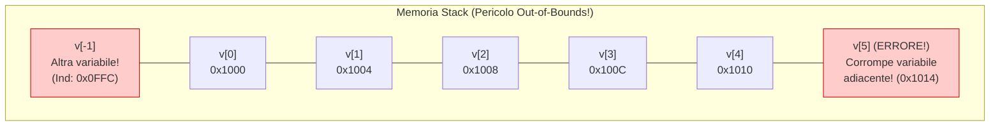
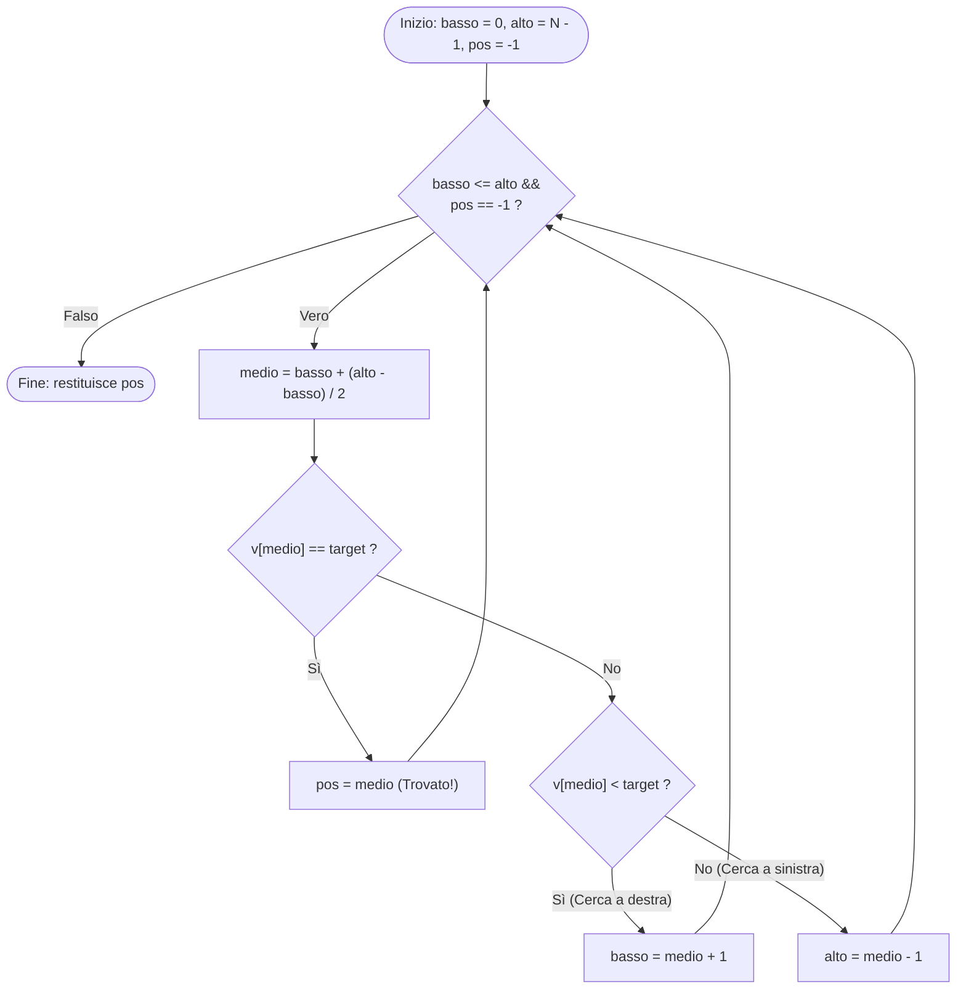

# 2.5.1 - Gestione della memoria e vettori (array)

## Introduzione intuitiva

Nella Lezione 0.3 abbiamo avuto un primo assaggio dei vettori. Ora siamo pronti ad affrontare la gestione della memoria e i vettori in tutta la loro profondità tecnica e algoritmica.

Perché i vettori (array) sono la struttura dati più veloce su qualunque processore moderno? Perché i loro elementi sono memorizzati in un **unico blocco contiguo di RAM**: conoscendo l'indirizzo del primo elemento, il processore può saltare istantaneamente (in tempo costante $O(1)$, senza dover scorrere gli elementi precedenti!) all'elemento $i$-esimo tramite una semplice moltiplicazione e addizione hardware.

In questa lezione studieremo tutte le regole di inizializzazione dei vettori, la formula matematica di indirizzamento in RAM, il pericolo mortale degli accessi *out-of-bounds*, le matrici bidimensionali (*row-major*) e i grandi algoritmi classici sui vettori (ricerca lineare, ricerca binaria dicotomica e ordinamento Bubble Sort / Selection Sort).

---

## Dichiarazione, Inizializzazione e Layout in Memoria

### Regole di dichiarazione e inizializzazione statica
Un vettore di dimensione $N$ e tipo `Tipo` si dichiara con `Tipo nome[N];` (dove $N$ è un'espressione intera $> 0$, tipicamente una costante `#define N 100`).

Ecco tutti i modi validi per inizializzare un array al momento della dichiarazione:

1. **Non inizializzato (variabile locale automatica)**:
   ```c
   int v[5]; /* ATTENZIONE: contiene 5 valori "spazzatura" (indeterminati)! */
   ```
2. **Inizializzazione completa esplicita**:
   ```c
   int v[5] = {10, 20, 30, 40, 50};
   ```
3. **Inizializzazione parziale (Azzeramento automatico del resto!)**:
   > **Regola fondamentale dello standard C**: Se la lista tra `{ }` contiene **meno elementi** della dimensione $N$ dell'array, **tutti gli elementi rimanenti vengono automaticamente inizializzati a `0`**!
   ```c
   int v[5] = {10, 20}; /* Produce: {10, 20, 0, 0, 0} */
   int zeri[100] = {0}; /* Idioma universale C per azzerare tutte le 100 celle a 0! */
   ```
4. **Dimensione dedotta automaticamente dal compilatore**:
   ```c
   int v[] = {2, 4, 6, 8}; /* Il compilatore conta 4 elementi -> equivale a int v[4] */
   ```

### Formula matematica di indirizzamento in RAM e `sizeof`
Dato un vettore `Tipo v[N]` allocato a partire dall'indirizzo base $\text{Base}(v) = \mathtt{\&v[0]}$, ogni elemento occupa esattamente $\operatorname{sizeof}(\text{Tipo})$ byte consecutivi. L'indirizzo in memoria dell'elemento di indice $i$ (con $0 \le i < N$) è calcolato dalla CPU in tempo costante $O(1)$ con la formula:
$$\text{Indirizzo}(\mathtt{v[i]}) = \text{Base}(v) + i \times \operatorname{sizeof}(\text{Tipo})$$

La dimensione totale in byte dell'intero array è $\operatorname{sizeof}(v) = N \times \operatorname{sizeof}(\text{Tipo})$. Da qui ricaviamo l'idioma standard per calcolare il **numero di elementi $N$** di un array statico locale:
```c
int n = sizeof(v) / sizeof(v[0]);
```

---

## L'assenza di controllo dei limiti (*Out-of-Bounds* e Undefined Behavior)

Per garantire la massima velocità di esecuzione, **il linguaggio C NON controlla a tempo di esecuzione che l'indice `i` di `v[i]` sia compreso tra `0` e `N - 1`!**
Se dichiariamo `int v[5];` e scriviamo `v[5] = 42;` oppure `v[-1] = 99;`, il compilatore applica ciecamente la formula $\text{Base}(v) + i \times 4$ e va a leggere o **sovrascrivere variabili adiacenti nello Stack** (o l'indirizzo di ritorno della funzione!), causando bug silenziosi difficilissimi da scovare, vulnerabilità di sicurezza (*Buffer Overflow*) o il crash del programma (*Segmentation Fault*).



---

## Matrici Bidimensionali (`int m[R][C]`) e layout Row-Major

In C una matrice di $R$ righe e $C$ colonne si dichiara come un "array di array":
```c
int m[2][3] = {
    {10, 20, 30}, /* Riga 0: m[0][0], m[0][1], m[0][2] */
    {40, 50, 60}  /* Riga 1: m[1][0], m[1][1], m[1][2] */
};
```
La memoria RAM è però **monodimensionale** (una singola fila di celle). Come viene "appiattita" una matrice $R \times C$ in RAM? Il linguaggio C utilizza l'ordine **per righe (*Row-Major Order*)**: vengono memorizzati prima tutti gli elementi della Riga `0`, subito seguiti da tutti gli elementi della Riga `1`, e così via.

L'elemento `m[r][c]` (con $0 \le r < R$ e $0 \le c < C$) si trova quindi all'indice lineare $(r \cdot C + c)$:
$$\text{Indirizzo}(\mathtt{m[r][c]}) = \text{Base}(m) + (r \cdot C + c) \times \operatorname{sizeof}(\text{Tipo})$$

---

## Algoritmi Fondamentali sui Vettori

### 1. Ricerca Lineare (Sequenziale) — Complessità $O(N)$
Se il vettore **non è ordinato**, per sapere se contiene un valore `target` dobbiamo ispezionare gli elementi uno per uno dall'inizio fino a quando lo troviamo o finisce il vettore (nel caso peggiore servono $N$ confronti).

### 2. Ricerca Binaria (Dicotomica) su Vettore Ordinato — Complessità $O(\log_2 N)$
Se il vettore è **già ordinato in modo crescente**, possiamo fare come quando cerchiamo una parola nel dizionario:
1. Guardiamo l'elemento **centrale** `v[medio]` nell'intervallo `[basso, alto]`.
2. Se `v[medio] == target`, abbiamo trovato l'elemento!
3. Se `v[medio] < target`, poiché l'array è ordinato, il valore cercato può trovarsi **solo nella metà destra**: scartiamo tutta la metà sinistra ponendo `basso = medio + 1`.
4. Se `v[medio] > target`, scartiamo tutta la metà destra ponendo `alto = medio - 1`.

Dimezzando lo spazio di ricerca a ogni passo, su un vettore di **1 milione di elementi** ($N = 10^6$) la ricerca binaria impiega al massimo **20 confronti** ($\log_2(10^6) \approx 19.93$) contro 1 milione della ricerca lineare!



### 3. Ordinamento: Selection Sort e Bubble Sort — Complessità $O(N^2)$
- **Selection Sort (Ordinamento per Selezione)**: per ogni posizione $i$ da $0$ a $N-2$, cerca l'indice `min_idx` dell'elemento minimo nella porzione non ancora ordinata `v[i .. N-1]` e lo scambia con `v[i]`.
- **Bubble Sort (Ordinamento a Bolle)**: confronta coppie di elementi adiacenti `v[j]` e `v[j+1]` e li scambia se sono fuori ordine (`v[j] > v[j+1]`), facendo "galleggiare" a ogni passata il valore più grande verso destra.

---

## Esempi guidati

### Esempio 1: Implementazione strutturata della Ricerca Binaria (Dicotomica)
```c
#include <stdio.h>

#define N 8

int main(void) {
    /* Vettore rigorosamente ORDINATO in modo crescente */
    int v[N] = {3, 7, 12, 18, 25, 31, 44, 60};
    int target = 25;

    int basso = 0;
    int alto = N - 1;
    int pos = -1; /* -1 indica "non ancora trovato" */

    while (basso <= alto && pos == -1) {
        int medio = basso + (alto - basso) / 2;

        if (v[medio] == target) {
            pos = medio;       /* Trovato! */
        } else if (v[medio] < target) {
            basso = medio + 1; /* Cerca nella metà superiore */
        } else {
            alto = medio - 1;  /* Cerca nella metà inferiore */
        }
    }

    if (pos != -1) {
        printf("Valore %d trovato all'indice %d.\n", target, pos);
    } else {
        printf("Valore %d non presente nel vettore.\n", target);
    }
    return 0;
}
```
**Traccia per `target = 25`:**
- **Passo 1**: `basso = 0, alto = 7` $\to$ `medio = 3`. `v[3] = 18 < 25` $\to$ aggiorna `basso = 4`.
- **Passo 2**: `basso = 4, alto = 7` $\to$ `medio = 5`. `v[5] = 31 > 25` $\to$ aggiorna `alto = 4`.
- **Passo 3**: `basso = 4, alto = 4` $\to$ `medio = 4`. `v[4] = 25 == 25` $\to$ **`pos = 4` (Trovato in 3 passi!)**.

### Esempio 2: Ordinamento di un vettore con Selection Sort e Bubble Sort ottimizzato
Mostriamo il Selection Sort completo e commentato:
```c
#include <stdio.h>

#define N 6

int main(void) {
    int v[N] = {29, 10, 14, 37, 13, 5};

    /* Selection Sort: a ogni passo i, porta in v[i] il minimo di v[i..N-1] */
    for (int i = 0; i < N - 1; i++) {
        int min_idx = i;
        for (int j = i + 1; j < N; j++) {
            if (v[j] < v[min_idx]) {
                min_idx = j;
            }
        }
        /* Scambia v[i] con il minimo trovato v[min_idx] */
        if (min_idx != i) {
            int temp = v[i];
            v[i] = v[min_idx];
            v[min_idx] = temp;
        }
    }

    printf("Vettore ordinato: ");
    for (int i = 0; i < N; i++) {
        printf("%d ", v[i]);
    }
    printf("\n");
    return 0;
}
```

### Esempio 3: Elaborazione di una Matrice 2D (Somma delle righe e diagonale principale)
```c
#include <stdio.h>

#define N 3

int main(void) {
    int m[N][N] = {
        {1, 2, 3},
        {4, 5, 6},
        {7, 8, 9}
    };
    int somma_diag = 0;

    for (int r = 0; r < N; r++) {
        int somma_riga = 0;
        for (int c = 0; c < N; c++) {
            somma_riga += m[r][c];
            if (r == c) {
                somma_diag += m[r][c]; /* Elemento sulla diagonale principale */
            }
        }
        printf("Somma della riga %d: %d\n", r, somma_riga);
    }

    printf("Somma della diagonale principale: %d\n", somma_diag); /* 1 + 5 + 9 = 15 */
    return 0;
}
```

---

## Errori frequenti

1. **Pensare che `int v[5] = {1};` inizializzi tutte le 5 celle a `1`!**
   *Trappola classica d'esame!* L'inizializzazione parziale riempie le celle mancanti sempre con **`0`**, non con l'ultimo valore scritto! Quindi `int v[5] = {1};` crea l'array **`{1, 0, 0, 0, 0}`**. Per inizializzare tutte le celle a un valore diverso da zero serve sempre un ciclo `for`.
2. **Confrontare o copiare due vettori con `v1 == v2` oppure `v1 = v2`**
   In C non è possibile copiare un array in un altro con `v1 = v2` (errore di compilazione), e scrivere `if (v1 == v2)` **confronta gli indirizzi di memoria dei due vettori** (che sono sempre diversi, quindi `v1 == v2` è sempre Falso!), non il contenuto delle loro celle! Per copiare o confrontare due array serve un ciclo `for` elemento per elemento.
3. **Applicare la Ricerca Binaria su un vettore NON ordinato**
   La ricerca binaria funziona *solo ed esclusivamente* se il vettore è già ordinato. Su un vettore disordinato produce risultati completamente errati.

---

## Esercizi di prova

1. **[Base — Inizializzazione parziale e indirizzamento Row-Major]**
   a) Qual è il contenuto esatto dei 6 elementi di `int a[6] = {4, 8};`?
   b) Data una matrice `int mat[4][5]` (4 righe e 5 colonne, con `sizeof(int) == 4`) allocata a partire dall'indirizzo base `1000` (in decimale), qual è l'indirizzo decimale dell'elemento `mat[2][3]`?
> [!tip]- Soluzione
> - **a)** `a = {4, 8, 0, 0, 0, 0}` (i 4 elementi non specificati vengono azzerati).
> - **b)** Con $R = 4, C = 5$, prima della riga `2` ci sono le righe `0` e `1` complete ($2 \times 5 = 10$ elementi), più i 3 elementi `mat[2][0], mat[2][1], mat[2][2]` della riga `2`. L'indice lineare è quindi $2 \cdot 5 + 3 = 13$.
>   Moltiplicando per $\operatorname{sizeof}(\mathtt{int}) = 4$ byte:
>   $$\text{Indirizzo}(\mathtt{mat[2][3]}) = 1000 + 13 \times 4 = \mathbf{1052}$$

2. **[Base — Secondo valore massimo in un vettore]**
   Scrivi un programma C che, dato un vettore `int v[6] = {12, 45, 7, 45, 38, 19};`, trovi e stampi il valore massimo (`45`) e il **secondo valore più grande strettamente minore del massimo** (`38`).
> [!tip]- Soluzione
> ```c
> #include <stdio.h>
> #include <limits.h>
> 
> #define N 6
> 
> int main(void) {
>     int v[N] = {12, 45, 7, 45, 38, 19};
>     int max1 = INT_MIN;
>     int max2 = INT_MIN;
> 
>     for (int i = 0; i < N; i++) {
>         if (v[i] > max1) {
>             max2 = max1; /* Il vecchio massimo scende al secondo posto */
>             max1 = v[i];
>         } else if (v[i] > max2 && v[i] < max1) {
>             max2 = v[i];
>         }
>     }
> 
>     printf("Massimo: %d | Secondo massimo distinto: %d\n", max1, max2);
>     return 0;
> }
> ```

3. **[Intermedio — Rotazione a destra (Shift circolare) di un vettore]**
   Scrivi un programma C che ruoti di **una posizione verso destra** tutti gli elementi di un vettore `int v[N] = {10, 20, 30, 40, 50};`, facendo sì che l'ultimo elemento rientri al primo posto `v[0]` (ottenendo `{50, 10, 20, 30, 40}`).
> [!tip]- Soluzione
> *Attenzione*: se copiassimo `v[i+1] = v[i]` partendo da sinistra (`i = 0`), sovrascriveremmo subito `v[1]` perdendone il valore! Dobbiamo salvare l'ultimo elemento `v[N-1]` e far scorrere gli elementi **partendo dal fondo verso l'inizio**:
> ```c
> #include <stdio.h>
> #define N 5
> 
> int main(void) {
>     int v[N] = {10, 20, 30, 40, 50};
>     int ultimo = v[N - 1]; /* Salviamo 50 */
> 
>     for (int i = N - 1; i > 0; i--) {
>         v[i] = v[i - 1];   /* Sposta ogni elemento di 1 posto a destra */
>     }
>     v[0] = ultimo;         /* Rimette l'ultimo elemento in testa */
> 
>     for (int i = 0; i < N; i++) {
>         printf("%d ", v[i]);
>     }
>     printf("\n");
>     return 0;
> }
> ```

4. **[Intermedio — Verifica di vettore ordinato]**
   Scrivi un ciclo C strutturato (senza `break`) che, dato un vettore `int v[N]`, imposti una variabile `ordinato` a `1` se il vettore è ordinato in senso crescente debole ($v[0] \le v[1] \le \dots \le v[N-1]$) e a `0` altrimenti, fermando la scansione appena trova la prima coppia fuori ordine.
> [!tip]- Soluzione
> ```c
> int ordinato = 1;
> int i = 0;
> /* Attenzione: confrontando v[i] con v[i+1], l'indice i deve fermarsi a N - 2! */
> while (i < N - 1 && ordinato == 1) {
>     if (v[i] > v[i + 1]) {
>         ordinato = 0;
>     } else {
>         i++;
>     }
> }
> ```

5. **[Intermedio/Esame — Bubble Sort con arresto anticipato (Flag `scambiato`)]**
   Nel Bubble Sort standard si eseguono sempre $N-1$ passate anche se il vettore diventa ordinato già dopo la prima passata. Scrivi in C la versione ottimizzata del **Bubble Sort** che utilizza una variabile booleana `scambiato` per interrompere l'algoritmo non appena una passata intera si conclude senza aver effettuato alcuno scambio.
> [!tip]- Soluzione
> ```c
> #include <stdio.h>
> #define N 6
> 
> int main(void) {
>     int v[N] = {5, 1, 4, 2, 8, 9};
>     int scambiato = 1;
>     int passata = 0;
> 
>     while (passata < N - 1 && scambiato == 1) {
>         scambiato = 0; /* Ipotesi: nessuna coppia fuori posto in questo giro */
>         for (int j = 0; j < N - 1 - passata; j++) {
>             if (v[j] > v[j + 1]) {
>                 int temp = v[j];
>                 v[j] = v[j + 1];
>                 v[j + 1] = temp;
>                 scambiato = 1; /* C'è stato almeno uno scambio */
>             }
>         }
>         passata++;
>     }
> 
>     for (int i = 0; i < N; i++) {
>         printf("%d ", v[i]);
>     }
>     printf("\n");
>     return 0;
> }
> ```

6. **[Esame — Trasposta di una matrice quadrata *in-place*]**
   Data una matrice quadrata `int m[N][N]`, scrivi il codice C che la sostituisce direttamente sul posto (*in-place*, senza creare una seconda matrice) con la sua **matrice trasposta** $m^T$ (scambiando ogni elemento `m[r][c]` con `m[c][r]`).
   *Domanda tranello*: Perché il ciclo interno sulle colonne `c` deve partire da `c = r + 1` e **non** da `c = 0`?
> [!tip]- Soluzione
> Se facessimo variare sia `r` sia `c` da `0` a `N - 1`, ogni coppia `(r, c)` fuori dalla diagonale verrebbe **scambiata due volte** (una volta quando siamo in `(r, c)` e una seconda volta quando arriviamo in `(c, r)`), riportando la matrice esattamente allo stato iniziale!
> Per scambiare una sola volta il triangolo superiore con quello inferiore basta iterare su **`c` da `r + 1` a `N - 1`**:
> ```c
> for (int r = 0; r < N; r++) {
>     for (int c = r + 1; c < N; c++) {
>         int temp = m[r][c];
>         m[r][c] = m[c][r];
>         m[c][r] = temp;
>     }
> }
> ```

---

## Provenienza del materiale

- Slide e dispensa ufficiale del corso: `C1PROG1U2L5_Introduzione_alla_gestione_di_Memoria_e_Vettori.pdf` (Unità 2, Lezione 5 — Gestione della memoria, vettori, matrici e algoritmi di ricerca e ordinamento).
