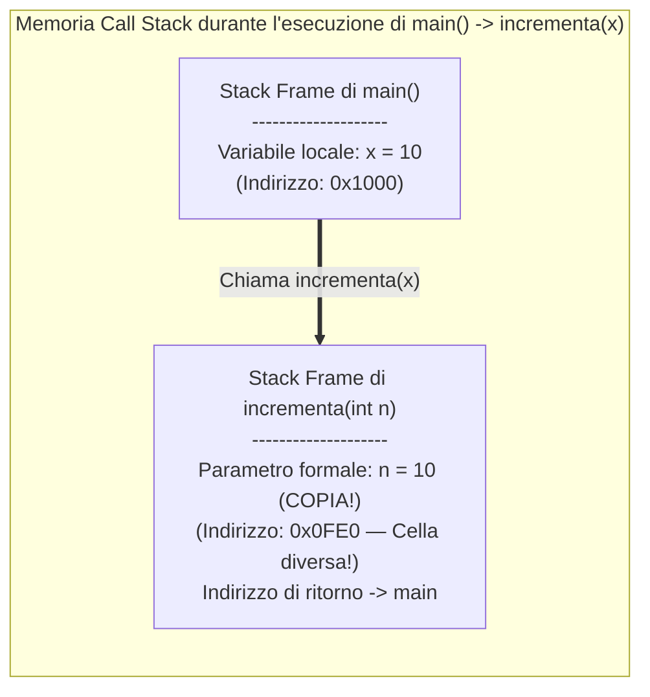
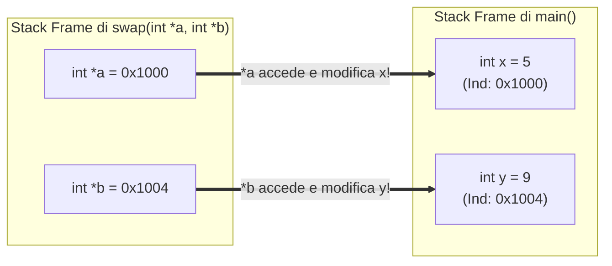

# 3.1.1 - Le funzioni in C

## Introduzione intuitiva

Finora abbiamo scritto tutto il nostro codice dentro un'unica funzione: `main`. Ma cosa succede quando un programma cresce fino a 10.000 o 100.000 righe? Scrivere tutto dentro un unico blocco gigante renderebbe il codice illeggibile, pieno di ripetizioni e impossibile da testare.

Il principio ingegneristico fondamentale per dominare la complessità è il **Divide et Impera (Decomposizione Modulare)**: scomporre un problema grande in sottoproblemi più piccoli, autonomi e riutilizzabili, ciascuno affidato a una **funzione** (o *sottoprogramma*).

Ma per padroneggiare davvero le funzioni in C bisogna capire cosa succede nella memoria RAM (nello **Stack delle chiamate**) quando una funzione viene invocata: perché se modifichiamo una variabile normale dentro una funzione la variabile del `main` **non cambia** (*passaggio per valore*), e come possiamo invece usare i **puntatori** per permettere a una funzione di modificare le variabili del chiamante?

---

## Anatomia di una Funzione: Prototipo, Definizione e Chiamata

### 1. Firma, Parametri Formali e Argomenti Attuali
Una funzione è caratterizzata dalla sua **firma (o intestazione)**:
```c
TipoRitorno nome_funzione(Tipo1 param1, Tipo2 param2)
```
- **`TipoRitorno`**: il tipo del risultato restituito tramite l'istruzione `return espressione;`. Se la funzione compie solo un'azione (es. stampa a video o modifica tramite puntatori) senza restituire alcun valore, il tipo di ritorno è **`void`**.
- **Parametri Formali (`param1`, `param2`)**: sono le variabili locali dichiarate tra le parentesi tonde nella definizione della funzione, che ricevono i dati in ingresso. (Se una funzione non accetta alcun parametro, in C si scrive **`(void)`** tra le parentesi).
- **Argomenti Attuali (o Effettivi)**: sono i valori o le espressioni concrete passate tra parentesi al momento della **chiamata** della funzione (es. `ris = somma(a + 1, 10);`).

### 2. Dichiarazione (Prototipo) vs Definizione
Il compilatore C legge il file sorgente rigorosamente **dall'alto verso il basso** in una sola passata. Se dentro `main` chiamiamo una funzione `calcola(5)` che è definita più in basso nel file, il compilatore non la conosce ancora e segnala un errore!
Per risolvere questo problema, si separa:
- **La Dichiarazione (o Prototipo)**: messa **in cima al file** (o in un file header `.h`), presenta al compilatore solo la firma della funzione chiusa da un punto e virgola `;`, senza il corpo:
  ```c
  int quadrato(int x); /* Prototipo: dice al compilatore che la funzione esiste */
  ```
- **La Definizione**: contiene l'implementazione effettiva (il blocco `{ ... }` del corpo) e può trovarsi sotto il `main` o in un altro file `.c`:
  ```c
  int quadrato(int x) {
      return x * x;
  }
  ```

---

## Lo Stack delle Chiamate e i Record di Attivazione (*Stack Frame*)

Cosa accade fisicamente nella memoria RAM quando `main` chiama una funzione `f()`, e `f()` a sua volta chiama `g()`?
Il sistema utilizza una regione della memoria RAM organizzata a **Pila (LIFO: *Last-In, First-Out*)** chiamata **Call Stack (Pila delle chiamate)**:

1. **Alla chiamata della funzione (*Push*)**: viene creato in cima allo Stack un blocco di memoria dedicato a quella specifica invocazione, chiamato **Record di Attivazione** (o **Stack Frame**), che contiene:
   - Le copie dei **parametri formali** della funzione.
   - Tutte le **variabili locali** dichiarate dentro la funzione.
   - L'**indirizzo di ritorno** (il punto esatto della funzione chiamante a cui tornare quando la funzione terminerà).
2. **Al `return` della funzione (*Pop*)**: l'intero *Stack Frame* della funzione terminata viene **distrutto immediatamente**, liberando lo spazio in memoria, e l'esecuzione riprende nella funzione chiamante!



> **Conseguenza fondamentale (Durata di vita delle variabili locali)**: Poiché lo *Stack Frame* di una funzione viene distrutto al `return`, **è un errore gravissimo restituire l'indirizzo di una variabile locale** (`return &var_locale;`)! Quel puntatore punterebbe a una zona dello Stack ormai distrutta (*Dangling Pointer*).

---

## Passaggio per Valore vs Passaggio per Indirizzo (Puntatori)

### Regola assoluta del linguaggio C: Tutto è passato PER VALORE!
In C, quando chiamiamo una funzione, il valore dell'argomento attuale viene **copiato** dentro la cella del parametro formale sullo Stack.

Guarda perché questo tentativo ingenuo di scambiare due variabili **NON FUNZIONA**:
```c
/* VERSIONE SBAGLIATA: Passaggio per valore (scambia solo le copie locali!) */
void swap_sbagliato(int a, int b) {
    int temp = a;
    a = b;
    b = temp;
} /* Qui le copie 'a' e 'b' vengono distrutte! Le variabili del main sono intatte! */
```

### Come modificare le variabili del chiamante: Passaggio per Indirizzo (Riferimento simulato coi Puntatori)
Se vogliamo che una funzione modifichi due variabili `x` e `y` che vivono nello Stack Frame del `main`, dobbiamo passare alla funzione **i loro indirizzi di memoria (`&x` e `&y`)** e ricevere quei due indirizzi in due **parametri puntatori (`int *a, int *b`)**!
Anche in questo caso il C passa per valore, ma **il valore copiato è l'indirizzo della cella originale**: dereferenziando il puntatore con `*a` e `*b`, la funzione accede direttamente alle celle `x` e `y` del `main`!



```c
/* VERSIONE CORRETTA: Passaggio per indirizzo tramite puntatori */
void swap(int *a, int *b) {
    int temp = *a; /* Legge il valore nella cella puntata da a (cioè x) */
    *a = *b;       /* Scrive il valore di y direttamente nella cella di x */
    *b = temp;     /* Scrive il vecchio valore di x direttamente nella cella di y */
}
/* Nel main si chiama passando gli indirizzi: swap(&x, &y); */
```

---

## Passaggio di Vettori (Array) alle Funzioni

Cosa succede quando passiamo un array `int v[1000]` a una funzione? Il C copia tutti i 1000 elementi sullo Stack?
**No!** Copiare array grandi rallenterebbe enormemente il programma. Perciò in C vale la regola del ** decadimento a puntatore (*Array-to-Pointer Decay*)**:
> Quando un vettore viene passato come argomento a una funzione, **non viene copiato l'array, ma viene passato esclusivamente l'indirizzo del suo primo elemento (`&v[0]`)**!

Di conseguenza:
1. Nella firma di una funzione, scrivere `void elabora(int v[], int n)` è **al 100% identico** a scrivere `void elabora(int *v, int n)`.
2. **Qualsiasi modifica fatta a `v[i]` dentro la funzione modifica direttamente l'array originale del chiamante!** (Se invece vogliamo garantire che la funzione legga soltanto il vettore senza poterlo modificare, lo dichiariamo `const int v[]`).
3. Poiché dentro la funzione `v` è solo un puntatore `int *` (8 byte), **dentro la funzione `sizeof(v)` NON restituisce più la dimensione dell'array, ma `sizeof(int *)` (8 byte)!** Perciò **bisogna sempre passare esplicitamente anche la dimensione `int n` come secondo parametro** (a meno che non sia una stringa terminata da `'\0'`).

---

## Esempi guidati

### Esempio 1: Funzione `swap` corretta e funzione con più risultati tramite puntatori
Una funzione C può restituire un solo valore col `return`. Come facciamo se una funzione `dividi_con_resto` deve calcolare e restituire **due risultati** (il quoziente e il resto)? Usiamo parametri puntatori di output!

```c
#include <stdio.h>

/* Prototipi delle funzioni */
void swap(int *a, int *b);
int dividi_con_resto(int dividendo, int divisore, int *quoziente, int *resto);

int main(void) {
    int x = 10, y = 25;
    printf("Prima di swap: x = %d, y = %d\n", x, y);
    swap(&x, &y); /* Passiamo gli indirizzi con & */
    printf("Dopo swap:     x = %d, y = %d\n", x, y);

    int q, r;
    if (dividi_con_resto(17, 5, &q, &r) == 1) {
        printf("17 / 5 -> Quoziente = %d, Resto = %d\n", q, r);
    }
    return 0;
}

void swap(int *a, int *b) {
    int temp = *a;
    *a = *b;
    *b = temp;
}

/* Restituisce 1 se la divisione è valida, 0 se divisore == 0.
   Scrive i due risultati nelle celle puntate da 'quoziente' e 'resto'. */
int dividi_con_resto(int dividendo, int divisore, int *quoziente, int *resto) {
    if (divisore == 0) {
        return 0; /* Errore: divisione per zero */
    }
    *quoziente = dividendo / divisore;
    *resto     = dividendo % divisore;
    return 1;
}
```

### Esempio 2: Funzioni che leggono (`const`) e modificano un vettore
```c
#include <stdio.h>

/* Legge soltanto l'array -> usiamo 'const int v[]' per proteggerlo */
double calcola_media(const int v[], int n) {
    if (n <= 0) return 0.0;
    int somma = 0;
    for (int i = 0; i < n; i++) {
        somma += v[i];
    }
    return (double)somma / n;
}

/* Modifica direttamente l'array originale del main raddoppiando ogni elemento */
void raddoppia_elementi(int v[], int n) {
    for (int i = 0; i < n; i++) {
        v[i] = v[i] * 2;
    }
}

int main(void) {
    int dati[4] = {10, 20, 30, 40};

    raddoppia_elementi(dati, 4); /* 'dati' diventa {20, 40, 60, 80} */
    printf("Nuova media: %.2f\n", calcola_media(dati, 4)); /* Stampa 50.00 */
    return 0;
}
```

---

## Errori frequenti

1. **Usare `sizeof(v) / sizeof(v[0])` dentro una funzione a cui è stato passato l'array `v[]`**
   Dentro `void f(int v[])`, `v` è decaduto a un semplice puntatore `int *`. Il compilatore `gcc -Wall` blocca questo errore con il messaggio: `'sizeof' on array function parameter 'v' will return size of 'int *'`. Passa sempre `int n` come parametro!
2. **Restituire l'indirizzo di una variabile locale o di un array locale (`return &locale;`)**
   ```c
   int *crea_array_sbagliato(void) {
       int v[3] = {1, 2, 3};
       return v; /* ERRORE CRITICO! 'v' vive sullo Stack e muore appena la funzione ritorna! */
   }
   ```
3. **Confondere la chiamata `swap(x, y)` con `swap(&x, &y)`**
   Se la funzione accetta puntatori `int *a, int *b`, chiamarla bisogna passare gli indirizzi `&x, &y`.

---

## Esercizi di prova

1. **[Base — Traccia dello Stack: Passaggio per valore vs Passaggio per indirizzo]**
   Determina cosa stampa il seguente programma C spiegando cosa accade nello Stack:
   ```c
   #include <stdio.h>
   void mistero(int a, int *b) {
       a = a + 10;
       *b = *b + a;
   }
   int main(void) {
       int x = 5, y = 20;
       mistero(x, &y);
       printf("x = %d, y = %d\n", x, y);
       return 0;
   }
   ```
> [!tip]- Soluzione
> - `x` viene passato **per valore** al parametro `a`: dentro `mistero`, `a` parte da `5` e diventa `5 + 10 = 15`, ma questa modifica avviene solo sulla copia locale `a`. La variabile `x` del `main` **rimane `5`**!
> - `y` viene passato **per indirizzo** (`&y`) al puntatore `b`: l'istruzione `*b = *b + a` modifica direttamente `y` sommandogli `15` (`20 + 15 = 35`).
> - **Output stampato**: **`x = 5, y = 35`**.

2. **[Base — Funzione di verifica di numero primo e uso nel `main`]**
   Scrivi una funzione `int e_primo(int n)` che restituisca `1` se `n` è un numero primo e `0` altrimenti. Usala poi nel `main` per stampare tutti i numeri primi compresi tra `2` e `50`.
> [!tip]- Soluzione
> ```c
> #include <stdio.h>
> 
> int e_primo(int n) {
>     if (n < 2) {
>         return 0;
>     }
>     for (int d = 2; d * d <= n; d++) {
>         if (n % d == 0) {
>             return 0; /* Trovato un divisore */
>         }
>     }
>     return 1;
> }
> 
> int main(void) {
>     printf("Numeri primi fino a 50: ");
>     for (int k = 2; k <= 50; k++) {
>         if (e_primo(k)) {
>             printf("%d ", k);
>         }
>     }
>     printf("\n");
>     return 0;
> }
> ```

3. **[Intermedio — Restituzione simultanea di Minimo e Massimo di un vettore]**
   Scrivi una funzione con firma:
   `void trova_min_max(const int v[], int n, int *min, int *max);`
   che, dato un vettore `v` di `n >= 1` interi, calcoli in una sola scansione sia il valore minimo sia il valore massimo del vettore e li scriva nelle variabili puntate da `min` e `max`.
> [!tip]- Soluzione
> ```c
> #include <stdio.h>
> 
> void trova_min_max(const int v[], int n, int *min, int *max) {
>     *min = v[0];
>     *max = v[0];
>     for (int i = 1; i < n; i++) {
>         if (v[i] < *min) {
>             *min = v[i];
>         }
>         if (v[i] > *max) {
>             *max = v[i];
>         }
>     }
> }
> 
> int main(void) {
>     int a[6] = {14, -5, 28, 3, 99, 0};
>     int minimo, massimo;
>     trova_min_max(a, 6, &minimo, &massimo);
>     printf("Minimo = %d, Massimo = %d\n", minimo, massimo); /* -5 e 99 */
>     return 0;
> }
> ```

4. **[Intermedio — Funzione su stringhe: conteggio occorrenze di un carattere]**
   Scrivi una funzione `int conta_carattere(const char s[], char target)` che restituisca quante volte il carattere `target` compare nella stringa `s`. Spiega perché per una stringa non è necessario passare la dimensione `int n` come parametro.
> [!tip]- Soluzione
> Non serve passare la dimensione `n` perché ogni stringa C valida contiene alla fine la sentinella `'\0'`, che permette alla funzione di sapere autonomamente quando fermarsi:
> ```c
> int conta_carattere(const char s[], char target) {
>     int cont = 0;
>     for (int i = 0; s[i] != '\0'; i++) {
>         if (s[i] == target) {
>             cont++;
>         }
>     }
>     return cont;
> }
> ```

5. **[Intermedio/Esame — Ordinamento di tre variabili tramite chiamate a `swap`]**
   Usando la funzione `void swap(int *a, int *b)`, scrivi una funzione `void ordina_tre(int *x, int *y, int *z)` che riceva gli indirizzi di tre variabili intere e le riordini in modo tale che al termine valga `*x <= *y <= *z`.
> [!tip]- Soluzione
> Bastano 3 confronti con scambio (come una piccola rete di ordinamento a 3 fili):
> ```c
> void swap(int *a, int *b) {
>     int temp = *a;
>     *a = *b;
>     *b = temp;
> }
> 
> void ordina_tre(int *x, int *y, int *z) {
>     if (*x > *y) swap(x, y); /* Ora *x <= *y */
>     if (*y > *z) swap(y, z); /* Ora *z è sicuramente il massimo dei tre! */
>     if (*x > *y) swap(x, y); /* Riordina i primi due se il vecchio *z era il più piccolo */
> }
> ```

6. **[Esame — Passaggio di Matrici 2D a una funzione]**
   Quando si passa una matrice bidimensionale `int m[R][C]` a una funzione in C, il numero di righe `R` può essere lasciato vuoto o passato a parte, ma **il numero di colonne `C` deve essere specificato tra le parentesi quadre** nella firma della funzione (es. `int somma_matrice(int m[][C], int righe)`).
   a) Spiega usando la formula di indirizzamento *Row-Major* perché il compilatore ha assolutamente bisogno di conoscere il numero di colonne `C` per calcolare `m[r][c]`.
   b) Scrivi la funzione `int somma_matrice(const int m[][4], int righe)` che restituisce la somma di tutti gli elementi di una matrice di `righe` $\times 4$ colonne.
> [!tip]- Soluzione
> **a) Motivo teorico**: In memoria *Row-Major*, l'indirizzo di `m[r][c]` è $\text{Base}(m) + (r \cdot \mathbf{C} + c) \times \operatorname{sizeof}(\mathtt{int})$. Per sapere di quanti elementi saltare in avanti quando si passa dalla riga `0` alla riga `r`, il compilatore deve moltiplicare `r` per la larghezza della riga **`C`**! Il numero totale di righe `R` invece non compare nella formula di indirizzamento.
>
> **b) Implementazione:**
> ```c
> int somma_matrice(const int m[][4], int righe) {
>     int totale = 0;
>     for (int r = 0; r < righe; r++) {
>         for (int c = 0; c < 4; c++) {
>             totale += m[r][c];
>         }
>     }
>     return totale;
> }
> ```

---

## Provenienza del materiale

- Slide e dispensa ufficiale del corso: `C1PROG1U3L1_Funzioni.pdf` (Unità 3, Lezione 1 — Le funzioni in C, record di attivazione, passaggio per valore e per indirizzo).
