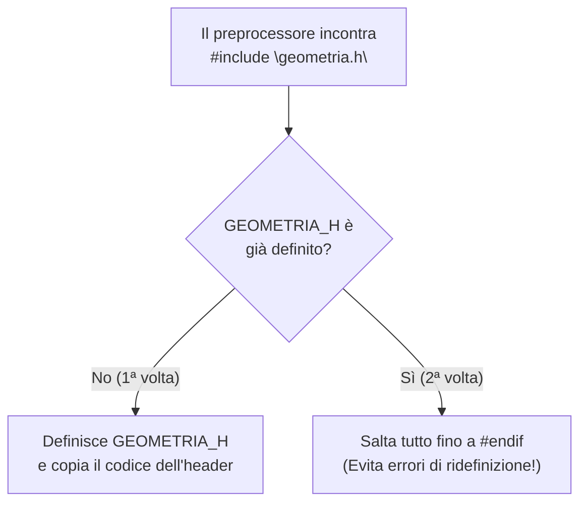

# 3.2.1 - Parametri e macro del preprocessore

## Introduzione intuitiva

Nella Lezione 2.1.1 abbiamo scoperto che il primo strumento della catena di compilazione è il **Preprocessore (`cpp`)**, che trasforma il testo del codice sorgente eseguendo le direttive che iniziano con `#` prima ancora che il compilatore C entri in azione.

Finora abbiamo usato `#define` solo per dare un nome a semplici costanti numeriche (`#define N 100`). Ma il preprocessore può fare molto di più: permette di definire **macro parametriche** che assomigliano in tutto e per tutto a delle funzioni (come `#define MAX(a, b) ...` o `#define SQR(x) ...`), e permette di compilare o escludere intere porzioni di codice tramite la **compilazione condizionale** (`#ifdef`, `#ifndef`, `#endif`).

Tuttavia, poiché il preprocessore non conosce la grammatica del C ma esegue una **pura sostituzione testuale ("copia e incolla")**, le macro parametriche nascondono due trappole famosissime — la **mancanza di parentesi** e gli **effetti collaterali (*side effects*)** — che sono tra i quesiti preferiti di ogni esame di Programmazione C!

---

## Direttive del Preprocessore e Compilazione Condizionale

### 1. `#include <file.h>` vs `#include "file.h"`
Qual è la differenza tra usare le parentesi angolari `<...>` e i doppi apici `"..."`?
- **`#include <stdio.h>`**: cerca il file header esclusivamente nelle **cartelle standard di sistema** (es. `/usr/include`). Si usa per le librerie del linguaggio.
- **`#include "mio_modulo.h"`**: cerca il file header **prima nella cartella corrente del nostro progetto**, e solo se non lo trova lì passa alle cartelle di sistema. Si usa per i file `.h` scritti da noi!

### 2. `#define` e `#undef`
- `#define NOME testo_sostitutivo`: definisce un simbolo o una macro a partire da quella riga fino alla fine del file.
- `#undef NOME`: cancella la definizione precedente di `NOME`.

### 3. Compilazione Condizionale (`#ifdef`, `#ifndef`, `#if`, `#else`, `#endif`)
Permette di decidere quali righe di codice consegnare al compilatore in base al fatto che una macro sia stata definita o meno:
```c
#define MODALITA_DEBUG

int main(void) {
    int x = 42;
#ifdef MODALITA_DEBUG
    /* Questa riga esiste per il compilatore SOLO SE MODALITA_DEBUG è definita! */
    printf("[DEBUG] Valore di x = %d\n", x);
#endif
    return 0;
}
```
 *(Nota: una macro può essere definita anche direttamente da riga di comando durante la compilazione usando il flag **`-D`** di `gcc`, ad esempio: `gcc -DMODALITA_DEBUG main.c`).*

### 4. Le *Include Guards* (Guardie di inclusione) nei file Header `.h`
Nei progetti divisi in più file, capita spesso che `main.c` includa sia `"geometria.h"` sia `"disegno.h"`, e che a sua volta `"disegno.h"` includa `"geometria.h"`. Senza una protezione, il contenuto di `"geometria.h"` verrebbe incollato **due volte** dentro `main.c`, causando errori di *ridefinizione* di tipi e strutture!

Per impedire l'inclusione multipla, **ogni file `.h` deve sempre essere racchiuso in una Include Guard**:
```c
/* File: geometria.h */
#ifndef GEOMETRIA_H   /* 1. Se il simbolo GEOMETRIA_H NON è ancora stato definito... */
#define GEOMETRIA_H   /* 2. ...definiscilo subito adesso... */

/* ...e includi il contenuto del file header: */
typedef struct {
    double x, y;
} Punto;

double distanza(Punto a, Punto b);

#endif /* GEOMETRIA_H — 3. Se venisse incluso una seconda volta, #ifndef sarebbe Falso e salterebbe tutto! */
```



---

## Le Macro Parametriche e le loro 2 Grandi Trappole

Una **macro parametrica** ha la forma:
```c
#define NOME_MACRO(param1, param2) testo_di_espansione
```
> **Attenzione sintattica**: NON ci deve essere **nessuno spazio** tra il nome della macro e la parentesi tonda aperta `(`! Se scrivete `#define SQR (x) ((x)*(x))` con uno spazio prima di `(x)`, il preprocessore pensa che `SQR` sia una macro senza parametri il cui testo inizia con `(x)`!

### Trappola 1: Perché servono TUTTE le parentesi attorno ai parametri e all'intera macro!
Supponiamo di voler creare una macro che calcola il quadrato di un numero e di scriverla ingenuamente senza parentesi:
```c
#define SQR_ERRATO(x) x * x
```
Cosa succede se nel `main` chiamiamo **`SQR_ERRATO(3 + 2)`** sperando di calcolare $(3+2)^2 = 5^2 = 25$?
Il preprocessore **non calcola `3 + 2` prima di passarlo**, ma sostituisce letteralmente il testo `3 + 2` al posto di ogni `x`:
$$\mathtt{SQR\_ERRATO(3 + 2)} \xrightarrow{\text{Preprocessore}} \mathtt{3 + 2 * 3 + 2}$$
Poiché in C la moltiplicazione `*` ha precedenza sull'addizione `+`, il compilatore calcola:
$$3 + (2 \times 3) + 2 = 3 + 6 + 2 = \mathbf{11} \neq 25!$$

E se mettiamo le parentesi solo attorno ai parametri: `#define SQR_QUASI(x) (x) * (x)`?
Se poi scriviamo `100 / SQR_QUASI(5)` sperando di calcolare $100 / 25 = 4$, il preprocessore espande in:
$$\mathtt{100 / (5) * (5)} \implies (100 / 5) \times 5 = 20 \times 5 = \mathbf{100} \neq 4!$$

> **Regola d'oro delle Macro Parametriche**:
> 1. Metti **sempre** le parentesi tonde attorno a **ogni singola occorrenza di ciascun parametro**: `(x)`.
> 2. Metti **sempre** una coppia di parentesi tonde esterna attorno all'**intera espressione della macro**:
> ```c
> #define SQR(x)    ((x) * (x))
> #define MAX(a, b) ((a) > (b) ? (a) : (b))
> #define MIN(a, b) ((a) < (b) ? (a) : (b))
> #define ABS(x)    ((x) >= 0 ? (x) : -(x))
> ```

---

### Trappola 2: Gli Effetti Collaterali (*Side Effects*) nella doppia valutazione!
Anche se abbiamo messo tutte le parentesi con `#define SQR(x) ((x) * (x))` oppure `#define MAX(a, b) ((a) > (b) ? (a) : (b))`, c'è un pericolo che **nessuna parentesi può risolvere**: il parametro `x` (o `a`/`b`) compare **due volte** nel testo espanso!

Cosa succede se passiamo alla macro un'espressione con **effetto collaterale** come un incremento `i++` o una chiamata a funzione `leggi_input()`?
Vediamo cosa succede con:
```c
int i = 4;
int ris = MAX(i++, 3);
```
Espandiamo testualmente la macro `MAX`:
$$\mathtt{((i++) > (3) \; ? \; (i++) \; : \; (3))}$$
1. Prima viene valutata la condizione `(i++) > (3)`: poiché `4 > 3` è Vero, `i` viene incrementato una **prima volta** diventando `5`.
2. Poi viene valutato il ramo vero `(i++)`: restituisce `5`, e `i` viene incrementato una **seconda volta** diventando **`6`**!
Quindi `i` è stato incrementato **due volte invece di una sola**! (E nel caso di `SQR(i++)`, che si espande in `((i++) * (i++))`, modificare due volte la stessa variabile nella stessa espressione senza punto di sequenza è addirittura *Undefined Behavior*!).

---

## Confronto tra Macro (`#define`) e Funzioni C (anche `static inline`)

| Caratteristica | Macro Parametrica (`#define`) | Funzione C (`int f(int x)`) |
| :--- | :--- | :--- |
| **Chi la elabora** | Preprocessore (sostituzione testuale) | Compilatore (analisi sintattica e dei tipi) |
| **Controllo dei tipi (*Type Safety*)** | **Nessuno** (funziona con `int`, `double`, ecc., ma accetta anche tipi insensati) | **Rigoroso** (controlla i tipi dei parametri a compilazione) |
| **Valutazione degli argomenti** | Valutati **ogni volta che compaiono** nel corpo (pericolo *side effects* con `i++`!) | Valutati **una sola volta** prima di entrare nella funzione (sicura con `i++`) |
| **Velocità / Overhead** | Nessun salto di chiamata (il codice è espanso *in loco*, ma ingrandisce il binario) | Piccolo overhead per creare lo *Stack Frame* (eliminabile in C99/C11 con `static inline`) |
| **Debugging in `gdb`** | Difficile (non si può mettere un breakpoint dentro una macro) | Facile (ispezionabile passo-passo con `step` in `gdb`) |

---

## Esempi guidati

### Esempio 1: Analisi passo-passo di espansione di macro con e senza parentesi
```c
#include <stdio.h>

#define DOPPIO_BAD(x) 2 * x
#define DOPPIO_OK(x)  (2 * (x))

int main(void) {
    /* 1. Espansione di DOPPIO_BAD(10 + 5):
          diventa 2 * 10 + 5 = 20 + 5 = 25! */
    int a = DOPPIO_BAD(10 + 5);

    /* 2. Espansione di DOPPIO_OK(10 + 5):
          diventa (2 * (10 + 5)) = 2 * 15 = 30! */
    int b = DOPPIO_OK(10 + 5);

    printf("DOPPIO_BAD(10 + 5) = %d\n", a); /* Stampa 25 */
    printf("DOPPIO_OK(10 + 5)  = %d\n", b); /* Stampa 30 */
    return 0;
}
```

### Esempio 2: Macro multi-istruzione (Scambio di due variabili generiche)
È possibile scrivere una macro `SWAP(Tipo, a, b)` che scambi due variabili di qualunque tipo `Tipo` usando un blocco locale `{ ... }`:

```c
#include <stdio.h>

#define SWAP(Tipo, a, b) do { \
    Tipo temp_swap = (a);     \
    (a) = (b);                \
    (b) = temp_swap;          \
} while (0)

int main(void) {
    int x = 10, y = 20;
    SWAP(int, x, y);
    printf("Interi scambiati: %d, %d\n", x, y);

    double d1 = 1.5, d2 = 9.9;
    SWAP(double, d1, d2);
    printf("Double scambiati: %.1f, %.1f\n", d1, d2);
    return 0;
}
```
*Nota tecnica avanzata*: Il carattere `\` in fondo alla riga permette di continuare una `#define` sulla riga successiva, e l'idioma `do { ... } while (0)` permette di usare `SWAP(int, x, y);` con il punto e virgola finale dentro un `if (...) SWAP(...); else ...` senza creare errori di sintassi!

---

## Errori frequenti

1. **Valutare mentalmente gli argomenti di una macro come se fosse una funzione**
   Quando risolvi un esercizio d'esame con una `#define`, **non fare mai il calcolo a mente prima di sostituire**: scrivi prima su carta il testo letterale espanso dal preprocessore, e solo dopo applica le precedenze degli operatori C!
2. **Mettere uno spazio tra il nome della macro e la parentesi aperta `(`**
   `#define CUBO (x) ((x)*(x)*(x))` è sbagliato perché quello spazio dopo `CUBO` trasforma `(x)` in parte del testo sostituito! Deve essere `#define CUBO(x) ...`.
3. **Passare argomenti con `++` o `--` a una macro parametrica**
   Mai scrivere `MAX(a++, b)` o `ABS(--x)`. Incrementa sempre la variabile su una riga separata prima di invocare la macro.

---

## Esercizi di prova

1. **[Base — Espansione testuale e precedenze degli operatori]**
   Data la seguente macro scritta senza parentesi:
   ```c
   #defineDIFF(a, b) a - b
   #define PROD(a, b) a * b
   ```
   Calcola il valore intero esatto delle seguenti due espressioni dopo l'espansione del preprocessore:
   a) `int x = 20 - DIFF(10, 3);`
   b) `int y = PROD(2 + 3, 4 + 1);`
   Riscrivi poi entrambe le macro in modo completamente corretto.
> [!tip]- Soluzione
> - **a)** `20 - DIFF(10, 3)` si espande testualmente in:
>   `20 - 10 - 3` = `10 - 3` = **`7`** (invece di $20 - (10 - 3) = 13$!).
> - **b)** `PROD(2 + 3, 4 + 1)` si espande testualmente in:
>   `2 + 3 * 4 + 1` = `2 + 12 + 1` = **`15`** (invece di $5 \times 5 = 25$!).
>
> **Macro corrette con tutte le parentesi:**
> ```c
> #define DIFF(a, b) ((a) - (b))
> #define PROD(a, b) ((a) * (b))
> ```

2. **[Base — Scrittura di macro sicure]**
   Scrivi le direttive `#define` completamente parentesizzate per:
   a) `PARI(n)`: vale `1` se l'intero `n` è pari, `0` altrimenti.
   b) `TRA(x, min, max)`: vale `1` se `x` è compreso nell'intervallo chiuso $[min, max]$, `0` altrimenti.
> [!tip]- Soluzione
> ```c
> #define PARI(n)          (((n) % 2) == 0)
> #define TRA(x, min, max) (((x) >= (min)) && ((x) <= (max)))
> ```

3. **[Intermedio — Trappola degli effetti collaterali (*Side Effects*)]**
   Considera il seguente programma:
   ```c
   #include <stdio.h>
   #define MAGGIORE(a, b) ((a) > (b) ? (a) : (b))

   int main(void) {
       int x = 10, y = 5;
       int m = MAGGIORE(++x, y);
       printf("x = %d, y = %d, m = %d\n", x, y, m);
       return 0;
   }
   ```
   Espandi la macro e determina i valori stampati di `x`, `y` e `m`. Cosa sarebbe stato stampato se `MAGGIORE` fosse stata una vera funzione C `int maggiore(int a, int b)`?
> [!tip]- Soluzione
> **Con la macro `#define`:**
> `MAGGIORE(++x, y)` si espande in:
> `((++x) > (y) ? (++x) : (y))`
> 1. Nel test `(++x) > (y)`, `x` viene incrementato da `10` a **`11`**. Il test `11 > 5` è Vero.
> 2. Viene allora valutato il ramo vero `(++x)`: `x` viene incrementato una **seconda volta** da `11` a **`12`**, e questo valore `12` viene assegnato a `m`!
> - **Output con la macro**: **`x = 12, y = 5, m = 12`**.
> - **Se fosse stata una funzione C**: `++x` sarebbe stato valutato **una sola volta** prima della chiamata, stampando `x = 11, y = 5, m = 11`.

4. **[Intermedio — Compilazione condizionale con `#if` / `#ifdef`]**
   Determina cosa stampa il seguente programma:
   ```c
   #include <stdio.h>
   #define VERSIONE 2
   #define ATTIVA_EXTRA
   #undef ATTIVA_EXTRA

   int main(void) {
       int ris = 10;
   #ifdef ATTIVA_EXTRA
       ris = ris + 100;
   #endif
   #if VERSIONE >= 2
       ris = ris * 2;
   #else
       ris = ris + 1;
   #endif
       printf("ris = %d\n", ris);
       return 0;
   }
   ```
> [!tip]- Soluzione
> 1. `ATTIVA_EXTRA` viene definita ma subito dopo cancellata con `#undef ATTIVA_EXTRA`. Quindi `#ifdef ATTIVA_EXTRA` è **Falso** e la riga `ris = ris + 100;` viene rimossa dal preprocessore.
> 2. Poiché `VERSIONE` vale `2`, la condizione `#if VERSIONE >= 2` è **Vera**, quindi viene compilata solo la riga `ris = ris * 2;` (`10 * 2 = 20`).
> - **Output stampato**: **`ris = 20`**.

5. **[Esame — Costruzione di un file Header `.h` completo con Include Guard]**
   Scrivi il contenuto completo di un file header chiamato `vettori_util.h` dotato di **Include Guard** standard, che definisca una macro costante `CAPACITA_MAX` pari a `256` e dichiari i prototipi di due funzioni: `void stampa_vettore(const int v[], int n)` e `int cerca_elemento(const int v[], int n, int target)`.
> [!tip]- Soluzione
> ```c
> #ifndef VETTORI_UTIL_H
> #define VETTORI_UTIL_H
> 
> #define CAPACITA_MAX 256
> 
> void stampa_vettore(const int v[], int n);
> int cerca_elemento(const int v[], int n, int target);
> 
> #endif /* VETTORI_UTIL_H */
> ```

---

## Provenienza del materiale

- Slide e dispensa ufficiale del corso: `C1PROG1U3L2_Parametri_e_Macro tag.pdf` (Unità 3, Lezione 2 — Direttive del preprocessore, macro parametriche e compilazione condizionale).
