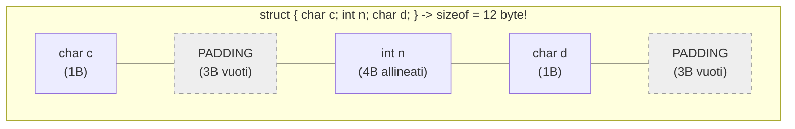

# 3.5.1 - Strutture dati (struct) e Union

## Introduzione intuitiva

Finora abbiamo raggruppato più dati usando i **vettori (array)**, che hanno però un limite rigido: tutti gli elementi di un vettore devono essere **dello stesso tipo** (tutti `int`, oppure tutti `double`, oppure tutti `char`).

Ma nel mondo reale gli oggetti che vogliamo rappresentare sono quasi sempre composti da **dati eterogenei (di tipi diversi)**: uno *Studente* ha una matricola (`int`), un cognome (`char[32]`) e una media dei voti (`double`); un *Punto nel piano* ha due coordinate (`double x, y`); una *Data* ha giorno, mese e anno.

Per raggruppare variabili di tipi diversi sotto un unico "tetto" logico, il linguaggio C fornisce due costrutti fondamentali:
1. **`struct` (Struttura o Record)**: alloca ogni campo **uno dopo l'altro** in memoria, così che tutti i campi esistano contemporaneamente.
2. **`union` (Unione)**: fa **condividere la stessa identica area di memoria** a tutti i suoi campi, permettendo di risparmiare spazio quando sappiamo che in ogni istante verrà usato un solo campo alla volta.

---

## Le Strutture (`struct`): Definizione, Inizializzazione e Accesso

### 1. Definizione di una `struct` (con e senza `typedef`)
```c
/* Modo 1: Con tag 'struct Punto' */
struct Punto {
    double x;
    double y;
};
/* Per dichiarare una variabile bisogna scrivere: struct Punto p1; */

/* Modo 2 (Consigliato): Combinando typedef struct per creare il tipo 'Studente' */
typedef struct {
    int matricola;
    char nome[32];
    double media;
} Studente;
/* Ora possiamo dichiarare direttamente: Studente s1; */
```

### 2. Inizializzazione (Posizionale e con *Designated Initializers* C99/C11)
Una struttura può essere inizializzata al momento della dichiarazione in due modi:
```c
/* a) Inizializzazione posizionale (nell'ordine esatto dei campi): */
Studente s1 = {987654, "Anna Rossi", 28.5};

/* b) Designated Initializers (C99/C11: nominando esplicitamente i campi con '.campo ='):
      più leggibile, indipendente dall'ordine, e azzera a 0 i campi non specificati! */
Studente s2 = {
    .matricola = 123456,
    .media = 29.0,
    .nome = "Marco Bianchi"
};
```

### 3. Accesso ai campi: Operatore Punto `.` vs Operatore Freccia `->`
Come si legge o si modifica un singolo campo di una struttura? Dipende se abbiamo in mano **la variabile struttura stessa** oppure **un puntatore alla struttura**:

- **Operatore Punto (`.` — Accesso diretto da variabile `struct`)**:
  ```c
  s1.media = 29.5;
  printf("Matricola: %d\n", s1.matricola);
  ```
- **Operatore Freccia (`->` — Accesso indiretto tramite puntatore a `struct`)**:
  Se abbiamo un puntatore `Studente *p = &s1;`, per accedere al campo `media` potremmo dereferenziare prima `p` e poi usare il punto: `(*p).media`.*(Attenzione: le parentesi in `(*p).media` sono obbligatorie perché l'operatore `.` ha precedenza più alta dell'asterisco `*`! Scrivere `*p.media` significherebbe `*(p.media)`, che è un errore!).*
  Poiché scrivere `(*p).campo` è scomodo, il C ha introdotto l'elegantissimo **operatore freccia `->`**:
  $$\mathtt{p\text{->}campo} \quad \equiv \quad \mathtt{(*p).campo}$$

```c
Studente *p = &s1;
p->media = 30.0; /* Equivalente a (*p).media = 30.0; -> modifica s1.media! */
```

---

## Operazioni sulle `struct`, Annidamento e Passaggio a Funzioni

### 1. Assegnamento diretto (`s2 = s1`) vs Confronto (`==` NON esiste!)
- **L'assegnamento `=` tra due `struct` dello stesso tipo È CONSENTITO!**
  Scrivere `Studente copia = s1;` copia automaticamente byte per byte tutti i campi di `s1` dentro `copia` (**inclusi eventuali array contenuti dentro la struct**, come `char nome[32]`!).
- **Il confronto con `==` o `!=` tra due `struct` NON È CONSENTITO!**
  Scrivere `if (s1 == s2)` produce un **errore di compilazione** (a causa dei byte di *padding* che vedremo tra poco). Per verificare se due strutture sono uguali bisogna scrivere una funzione che confronti i singoli campi uno per uno (`s1.matricola == s2.matricola && strcmp(s1.nome, s2.nome) == 0 && ...`).

### 2. Strutture annidate e Vettori di `struct`
Una `struct` può contenere al suo interno un'altra `struct` (es. `Studente` che contiene un campo `Data data_nascita;`, a cui si accede con `s1.data_nascita.anno`), e possiamo creare **vettori di strutture** per gestire tabelle di dati:
```c
Studente aula[100];
aula[0].matricola = 1001;
```

### 3. Passaggio di `struct` a Funzioni: Per Valore vs Per Puntatore (`const`)
A differenza dei vettori, quando passiamo una `struct` a una funzione (`void f(Studente s)`), il C **copia l'intera struttura per valore sullo Stack**!
- Se la struttura è grande (es. contiene stringhe o vettori), copiarla a ogni chiamata spreca tempo e memoria.
- **Buona pratica professionale**:
  - Se la funzione deve **modificare** la struttura, passa un puntatore: `void promuovi(Studente *s)`.
  - Se la funzione deve solo **leggere** una struttura grande senza modificarla, passa un **puntatore costante**: `void stampa_studente(const Studente *s)` e usa `s->campo`!

---

## Allineamento in Memoria e *Padding* (`sizeof(struct)`)

> **Domanda classica d'esame**: *La dimensione `sizeof` di una `struct` è sempre uguale alla somma delle dimensioni `sizeof` dei suoi singoli campi?*
> **Risposta**: **NO! Può essere MAGGIORE a causa del Padding (riempimento di allineamento)!**

Perché il compilatore inserisce dei byte "vuoti" (*padding*) tra i campi di una `struct`?
I processori moderni a 32/64 bit leggono la RAM in blocchi allineati: un `int` da 4 byte viene letto in un solo ciclo di clock solo se il suo indirizzo di memoria è un **multiplo di 4** (es. `0x1000`, `0x1004`, `0x1008`).
Guarda cosa accade in questa struttura:

```c
typedef struct {
    char c;   /* 1 byte  (offset 0) */
              /* + 3 byte di PADDING inseriti dal compilatore (offset 1, 2, 3)! */
    int n;    /* 4 byte  (offset 4..7 -> multiplo di 4!) */
    char d;   /* 1 byte  (offset 8) */
              /* + 3 byte di PADDING finale (offset 9, 10, 11) per allineare la struct a multiplo di 4! */
} EsempioPadding;
```
La somma dei campi sarebbe $1 + 4 + 1 = 6\text{ byte}$, ma `sizeof(EsempioPadding)` vale **`12` byte**!
Se invece riordiniamo i campi mettendo vicini quelli della stessa dimensione (`int n; char c; char d;`), i due `char` condividono lo stesso blocco da 4 byte e la struttura occupa solo **8 byte**!



---

## Le `union` (Unioni) e le *Tagged Union*

Una **`union`** ha la stessa identica sintassi di una `struct`, ma con una differenza radicale nel layout di memoria:
- In una **`struct`**, ogni campo ha il proprio indirizzo distinto e `sizeof(struct)` $\ge \sum \operatorname{sizeof}(\text{campi})$.
- In una **`union`**, **tutti i campi partono dallo stesso identico indirizzo base (offset 0) e si sovrappongono nella stessa area di memoria**! La dimensione di una `union` è quindi pari alla dimensione del suo **campo più grande** (più eventuale allineamento):
  $$\operatorname{sizeof}(\mathtt{union}) = \max(\operatorname{sizeof}(\text{campi}))$$

```c
typedef union {
    int intero;      /* 4 byte */
    double reale;    /* 8 byte (il più grande!) */
    char lettera;    /* 1 byte */
} ValoreGenerico;    /* sizeof(ValoreGenerico) == 8 byte! */
```
**Attenzione**: poiché i campi condividono gli stessi byte, scrivere in `v.reale = 3.14;` **sovrascrive e rende non più valido** il valore precedentemente scritto in `v.intero`!
In pratica, una `union` si usa quasi sempre dentro una `struct` accompagnata da un campo `enum` che ricorda quale membro della `union` è attualmente attivo (**Tagged Union** o *Variant*):

```c
typedef enum { TIPO_INT, TIPO_DOUBLE } TipoDato;

typedef struct {
    TipoDato tipo_attivo; /* Il "Tag" che dice quale campo della union leggere! */
    union {
        int i;
        double d;
    } dato;
} CellaFoglioCalcolo;
```

---

## Esempi guidati

### Esempio 1: Geometria nel piano con `typedef struct` e funzioni
```c
#include <stdio.h>

typedef struct {
    double x;
    double y;
} Punto;

typedef struct {
    Punto basso_sx;
    Punto alto_dx;
} Rettangolo;

/* Passiamo un puntatore costante per efficienza e sicurezza */
double calcola_area(const Rettangolo *r) {
    double base    = r->alto_dx.x - r->basso_sx.x;
    double altezza = r->alto_dx.y - r->basso_sx.y;
    return base * altezza;
}

void trasla_punto(Punto *p, double dx, double dy) {
    p->x += dx;
    p->y += dy;
}

int main(void) {
    Rettangolo rett = {
        .basso_sx = {1.0, 2.0},
        .alto_dx  = {6.0, 5.0}
    };

    printf("Area iniziale: %.2f\n", calcola_area(&rett)); /* 5.0 * 3.0 = 15.00 */
    trasla_punto(&rett.alto_dx, 2.0, 0.0); /* Allarga la base di 2 */
    printf("Nuova area:    %.2f\n", calcola_area(&rett)); /* 7.0 * 3.0 = 21.00 */
    return 0;
}
```

### Esempio 2: Gestione di un archivio di `struct` (Ricerca dello studente con media massima)
```c
#include <stdio.h>

#define N_STUDENTI 3

typedef struct {
    int matricola;
    char nome[32];
    double media;
} Studente;

int indice_migliore(const Studente corso[], int n) {
    int idx_max = 0;
    for (int i = 1; i < n; i++) {
        if (corso[i].media > corso[idx_max].media) {
            idx_max = i;
        }
    }
    return idx_max;
}

int main(void) {
    Studente corso[N_STUDENTI] = {
        {101, "Luca Verdi",   26.4},
        {102, "Sara Neri",    29.8},
        {103, "Paolo Gialli", 27.1}
    };

    int top = indice_migliore(corso, N_STUDENTI);
    printf("Miglior studente: %s (Matricola %d) con media %.2f\n",
           corso[top].nome, corso[top].matricola, corso[top].media);
    return 0;
}
```

---

## Errori frequenti

1. **Usare `.` su un puntatore o `->` su una variabile normale**
   - Se `s` è di tipo `Studente`, si usa **`s.campo`**.
   - Se `p` è di tipo `Studente *`, si usa **`p->campo`** (oppure `(*p).campo`).
2. **Scrivere `*p.campo` dimenticando le parentesi tonde attorno a `*p`**
   Poiché `.` ha precedenza maggiore di `*`, `*p.campo` viene interpretato dal compilatore come `*(p.campo)`, che fallisce se `p` è un puntatore! Usa sempre `p->campo`.
3. **Dimenticare il punto e virgola `;` dopo la parentesi graffa di chiusura `};` di una `struct` o `union`**
   È un errore di sintassi molto comune che fa fallire la compilazione della riga successiva.

---

## Esercizi di prova

1. **[Base — Calcolo di `sizeof` in una `struct` vs `union` e Padding]**
   Su un'architettura a 64 bit in cui `sizeof(char) == 1`, `sizeof(int) == 4` (allineato a 4 byte) e `sizeof(double) == 8` (allineato a 8 byte), determina la dimensione in byte (`sizeof`) di:
   ```c
   typedef struct {
       double a;
       int b;
       int c;
   } StructA;

   typedef union {
       double a;
       int b;
       char c[5];
   } UnionB;
   ```
> [!tip]- Soluzione
> - **`sizeof(StructA) == 16` byte**: `a` occupa i byte `0..7` (8 byte); `b` occupa `8..11` (4 byte); `c` occupa `12..15` (4 byte). L'intero blocco è di 16 byte (multiplo di 8, quindi senza bisogno di alcun padding!).
> - **`sizeof(UnionB) == 8` byte**: in una `union` tutti i campi condividono la stessa memoria. Il campo più grande è `double a` (8 byte, che è anche multiplo dell'allineamento massimo 8).

2. **[Base — Operazioni su Numeri Complessi con `typedef struct`]**
   Definisci un tipo `Complesso` con due campi `double re` (parte reale) e `double im` (parte immaginaria). Scrivi due funzioni:
   a) `Complesso somma_complessi(Complesso z1, Complesso z2)` che restituisce $z_1 + z_2$.
   b) `Complesso prodotto_complessi(Complesso z1, Complesso z2)` che restituisce $z_1 \cdot z_2 = (a_1 a_2 - b_1 b_2) + i(a_1 b_2 + b_1 a_2)$.
> [!tip]- Soluzione
> ```c
> typedef struct {
>     double re;
>     double im;
> } Complesso;
> 
> Complesso somma_complessi(Complesso z1, Complesso z2) {
>     Complesso ris = {z1.re + z2.re, z1.im + z2.im};
>     return ris;
> }
> 
> Complesso prodotto_complessi(Complesso z1, Complesso z2) {
>     Complesso ris;
>     ris.re = z1.re * z2.re - z1.im * z2.im;
>     ris.im = z1.re * z2.im + z1.im * z2.re;
>     return ris;
> }
> ```

3. **[Intermedio — Sovrascrittura di memoria in una `union`]**
   Determina cosa stampa il seguente programma e spiega perché:
   ```c
   #include <stdio.h>
   typedef union {
       unsigned int Parola32;
       unsigned char Byte[4];
   } Ispettore;

   int main(void) {
       Ispettore u;
       u.Parola32 = 0;
       u.Byte[0] = 5;
       printf("u.Byte[0] = %u | u.Parola32 != 0 ? %d\n",
              u.Byte[0], u.Parola32 != 0);
       return 0;
   }
   ```
> [!tip]- Soluzione
> Stampa **`u.Byte[0] = 5 | u.Parola32 != 0 ? 1`**!
> *Spiegazione*: Poiché `Parola32` e l'array `Byte[4]` condividono esattamente gli stessi 4 byte di memoria nella `union`, azzerare `u.Parola32 = 0` azzera tutti i 4 byte, e scrivere `5` dentro `u.Byte[0]` modifica uno dei 4 byte di `u.Parola32`, rendendo `u.Parola32` diverso da zero (su architetture *Little-Endian* come x86_64, `u.Parola32` vale proprio `5`).

4. **[Intermedio — Confronto di uguaglianza tra due strutture `Data`]**
   Definisci `typedef struct { int giorno, mese, anno; } Data;` e scrivi una funzione `int confronta_date(Data d1, Data d2)` che restituisca:
   - `0` se le due date sono identiche;
   - `-1` se `d1` precede cronologicamente `d2`;
   - `+1` se `d1` segue cronologicamente `d2`.
> [!tip]- Soluzione
> Confrontiamo prima l'anno; a parità di anno confrontiamo il mese; a parità di mese confrontiamo il giorno:
> ```c
> typedef struct {
>     int giorno;
>     int mese;
>     int anno;
> } Data;
> 
> int confronta_date(Data d1, Data d2) {
>     if (d1.anno != d2.anno) {
>         return (d1.anno < d2.anno) ? -1 : 1;
>     }
>     if (d1.mese != d2.mese) {
>         return (d1.mese < d2.mese) ? -1 : 1;
>     }
>     if (d1.giorno != d2.giorno) {
>         return (d1.giorno < d2.giorno) ? -1 : 1;
>     }
>     return 0; /* Date identiche */
> }
> ```

5. **[Intermedio/Esame — Ordinamento di un vettore di `struct`]**
   Dato un vettore `Prodotto magazzino[N]` dove `typedef struct { int codice; double prezzo; } Prodotto;`, scrivi una funzione `void ordina_per_prezzo(Prodotto v[], int n)` che ordini l'array di strutture in ordine crescente di `prezzo` usando Selection Sort.
> [!tip]- Soluzione
> Nota che per scambiare due elementi dell'array basta un normale assegnamento tra strutture `Prodotto temp = v[i]; v[i] = v[min_idx]; v[min_idx] = temp;`!
> ```c
> typedef struct {
>     int codice;
>     double prezzo;
> } Prodotto;
> 
> void ordina_per_prezzo(Prodotto v[], int n) {
>     for (int i = 0; i < n - 1; i++) {
>         int min_idx = i;
>         for (int j = i + 1; j < n; j++) {
>             if (v[j].prezzo < v[min_idx].prezzo) {
>                 min_idx = j;
>             }
>         }
>         if (min_idx != i) {
>             Prodotto temp = v[i];
>             v[i] = v[min_idx];
>             v[min_idx] = temp;
>         }
>     }
> }
> ```

6. **[Esame — Tagged Union per Figure Geometriche eterogenee]**
   Progetta una *Tagged Union* `Figura` capace di rappresentare un **Cerchio** (caratterizzato da `double raggio`) oppure un **Rettangolo** (caratterizzato da `double base, altezza`), e scrivi una funzione `double area_figura(const Figura *f)` che calcoli l'area corretta in base al tag.
> [!tip]- Soluzione
> ```c
> #include <stdio.h>
> 
> #define PI 3.141592653589793
> 
> typedef enum {
>     FIG_CERCHIO,
>     FIG_RETTANGOLO
> } TipoFigura;
> 
> typedef struct {
>     TipoFigura tipo;
>     union {
>         double raggio;               /* Usato se tipo == FIG_CERCHIO */
>         struct {
>             double base;
>             double altezza;
>         } rett;                      /* Usato se tipo == FIG_RETTANGOLO */
>     } dati;
> } Figura;
> 
> double area_figura(const Figura *f) {
>     switch (f->tipo) {
>         case FIG_CERCHIO:
>             return PI * f->dati.raggio * f->dati.raggio;
>         case FIG_RETTANGOLO:
>             return f->dati.rett.base * f->dati.rett.altezza;
>         default:
>             return 0.0;
>     }
> }
> ```

---

## Provenienza del materiale

- Slide e dispensa ufficiale del corso: `C1PROG1U3L5_Strutture_dati_e_Union.pdf` (Unità 3, Lezione 5 — Strutture dati `struct`, `typedef`, padding di memoria e `union`).
