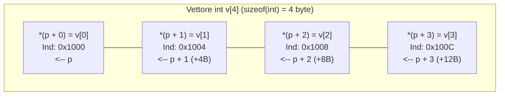
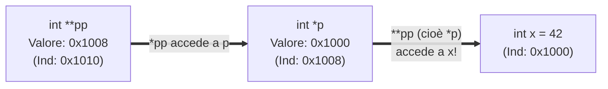

# Approfondimento sui puntatori

## Come usare un puntatore a dati, righe o funzioni

Siamo arrivati alla lezione che corona le prime quattro unità del corso e svela tutta la potenza espressiva del linguaggio C: l'**approfondimento avanzato sui puntatori**.

Nelle lezioni precedenti abbiamo visto l'idea base di puntatore (`int *p = &x;`) e il passaggio per indirizzo alle funzioni. Ora risponderemo a quattro domande fondamentali che distinguono un principiante da un vero programmatore C:
1. Cosa succede esattamente quando sommiamo un intero a un puntatore (`p + k`) o sottraiamo due puntatori (`p2 - p1`)? (**Aritmetica dei puntatori**).
2. Qual è la differenza tra `const int *p`, `int * const p` e `const int * const p`, e a cosa serve il puntatore universale **`void *`**?
3. Cos'è un **puntatore doppio (`int **pp`)**, cioè un puntatore che punta a un altro puntatore?
4. Come può un puntatore puntare non a dei dati, ma **al codice di una funzione (`int (*cmp)(...)`)**, permettendo di passare una funzione come parametro a un'altra funzione (come nella celebre `qsort`)?

---

## 1. Aritmetica dei Puntatori

In C sui puntatori non si possono fare operazioni qualsiasi (ad esempio *non si possono sommare né moltiplicare due puntatori tra loro*), ma sono definite due operazioni geometriche potentissime:

### a) Somma (o sottrazione) di un intero $k$ a un puntatore: `p + k`
Se `p` è un puntatore di tipo `Tipo *` che contiene l'indirizzo base $B$, quanto vale l'indirizzo **`p + k`** (con $k \in \mathbb{Z}$)?
> **Regola fondamentale dell'Aritmetica dei Puntatori**: Sommare $k$ a un puntatore `Tipo *p` **NON aggiunge $k$ byte**, ma fa avanzare l'indirizzo di **$k$ elementi di quel tipo**, cioè di $k \times \operatorname{sizeof}(\text{Tipo})$ byte!
>
> $$
> \text{Indirizzo}(\mathtt{p + k}) = \text{Indirizzo}(\mathtt{p}) + k \times \operatorname{sizeof}(\mathtt{*p})
> $$
>

- Se `char *pc` vale `0x1000` ($\operatorname{sizeof}(\mathtt{char}) = 1$), allora `pc + 1` vale **`0x1001`**, e `pc + 3` vale **`0x1003`**.
- Se `int *pi` vale `0x1000` ($\operatorname{sizeof}(\mathtt{int}) = 4$), allora `pi + 1` vale **`0x1004`**, e `pi + 3` vale **`0x100C`** ($+12$ byte)!
- Se `double *pd` vale `0x1000` ($\operatorname{sizeof}(\mathtt{double}) = 8$), allora `pd + 1` vale **`0x1008`**, e `pd + 3` vale **`0x1018`** ($+24$ byte)!

Da qui nasce l'equivalenza universale tra l'operatore parentesi quadre `[]` e l'aritmetica dei puntatori:

$$
\mathtt{v[i] \quad \equiv \quad *(v + i)}
$$

Di conseguenza:
- Per un indice valido, `&v[i]` equivale a `v + i`. Nella maggior parte delle espressioni, un array come `v` si converte in un puntatore al primo elemento. Con `sizeof v` o `&v` si usa invece l'intero oggetto array.
- Per scorrere un array di `n` elementi, partiamo da `int *p = v` e avanziamo finché `p != v + n`. La posizione `v + n` indica il limite subito oltre l'ultimo elemento. Si può confrontare con `p`, mentre l'ultimo elemento dereferenziabile è `v + n - 1` quando `n > 0`.

Con `int v[] = {2, 4, 6, 8}`, il frammento `for (int *p = v; p != v + 4; ++p) printf("%d ", *p);` visita quattro celle in ordine e si arresta prima di leggere la posizione oltre il limite.



### b) Differenza tra due puntatori dello stesso array: `p2 - p1`
Se `p1` e `p2` puntano a due elementi dello stesso vettore (es. `p1 = &v[1]` e `p2 = &v[4]`), la loro differenza **`p2 - p1`** (di tipo `ptrdiff_t`) restituisce **il numero di elementi di distanza tra i due puntatori** (e NON la differenza in byte!):

$$
\mathtt{p2 - p1} = \frac{\text{Indirizzo}(\mathtt{p2}) - \text{Indirizzo}(\mathtt{p1})}{\operatorname{sizeof}(\mathtt{*p1})}
$$

Nell'esempio sopra, anche se gli indirizzi distano $12$ byte, `&v[4] - &v[1]` vale esattamente **`3`** ($4 - 1 = 3$ elementi)!

---

## 2. Puntatore Generico `void *`, `NULL` e il qualificatore `const`

### Il puntatore nullo `NULL`
Definito in `<stddef.h>` e `<stdio.h>`, **`NULL`** è una costante speciale (valore `0` o `((void *)0)`) che garantisce che il puntatore **non punta ad alcuna area di memoria valida**. Prima di dereferenziare un puntatore che potrebbe essere nullo, si controlla sempre `if (p != NULL)`.

### Il puntatore generico (universale) `void *`
Un puntatore di tipo **`void *`** significa *"indirizzo di memoria puro, senza un tipo associato"*.
- **Vantaggio**: qualunque puntatore tipizzato (`int *`, `double *`, `Studente *`) può essere assegnato a un `void *` (e viceversa in C) senza perdere l'indirizzo. È usato dalle funzioni generiche della libreria standard come `fread`, `fwrite`, `memcpy`, `malloc` e `qsort`.
- **Due limiti rigorosi del `void *`**: poiché il compilatore non sa quanti byte occupi il dato puntato da un `void *gp`:
  1. **NON si può dereferenziare direttamente `*gp`** (prima bisogna fare un cast esplicito a un puntatore tipizzato, es. `*(int *)gp`).
  2. **NON si può fare aritmetica dei puntatori `gp + 1`** in C standard (perché `sizeof(void)` non è definito!).

### Le 3 combinazioni di `const` con i puntatori (Regola di lettura da destra a sinistra!)
Come distinguere dove agisce la parola `const` quando c'è un asterisco `*`? Basta guardare se `const` si trova **a sinistra** oppure **a destra** dell'asterisco `*`:

| Dichiarazione | Come si legge | Il puntatore `p` può cambiare freccia (`p = &y`)? | Il dato puntato `*p` può essere modificato (`*p = 99`)? |
| :--- | :--- | :---: | :---: |
| **`const int *p`**<br>*(o `int const *p`)* | **Puntatore (variabile) a un `int` costante** (`const` è a sinistra di `*`) | **SÌ** (`p = &y;` valido) | **NO!** (`*p = 99;` **Errore!**) |
| **`int * const p = &x`** | **Puntatore costante a un `int` (variabile)** (`const` è a destra di `*`) | **NO!** (`p = &y;` **Errore!**) | **SÌ** (`*p = 99;` valido) |
| **`const int * const p = &x`** | **Puntatore costante a un `int` costante** (`const` sia a sinistra sia a destra) | **NO!** (`p = &y;` **Errore!**) | **NO!** (`*p = 99;` **Errore!**) |

---

## 3. Puntatori Doppi (`int **pp`)

Se un puntatore `int *p` è esso stesso una variabile allocata in memoria dotata di un proprio indirizzo `&p`, quale tipo di variabile può contenere l'indirizzo `&p`? Un **puntatore a puntatore (o puntatore doppio)** **`int **pp`**!

```c
int x = 42;
int *p = &x;   /* p contiene l'indirizzo di x   (*p vale 42)  */
int **pp = &p; /* pp contiene l'indirizzo di p  (*pp è p, e **pp è x = 42!) */
```



### A cosa servono davvero i puntatori doppi in C?
1. **Modificare dove punta un puntatore dentro una funzione**:
   Se vogliamo scrivere una funzione che cambi l'indirizzo contenuto dentro un puntatore `int *p` del `main` (ad esempio per farlo puntare a una nuova cella o azzerarlo a `NULL`), non basta passare `p` per valore: dobbiamo passare **l'indirizzo del puntatore `&p`**, e quindi la funzione deve ricevere **`int **pp`**!
2. **Vettori di stringhe (come `char *argv[]` ovvero `char **argv`)**:
   Una stringa è un `char *`. Un elenco di parole (come gli argomenti passati da riga di comando al programma in `int main(int argc, char *argv[])`) è quindi un vettore di `char *`, che decade a **`char **`**!

---

## 4. Puntatori a Funzione e Callback (`qsort`)

In un computer moderno (architettura di von Neumann), anche il **codice macchina compilato delle funzioni** risiede in memoria RAM (nel segmento *Text/Code*) e ha quindi un **indirizzo di memoria**!
In C possiamo salvare l'indirizzo di una funzione dentro un **puntatore a funzione** e usarlo per invocare la funzione, oppure passarlo come argomento a un'altra funzione (**Callback**).

### Sintassi di un puntatore a funzione
```c
/* Puntatore 'op' a una qualsiasi funzione che prende due int e restituisce un int: */
int (*op)(int, int);
```
> **Attenzione alle parentesi attorno a `(*op)`**:
> - `int (*op)(int, int);` è un **puntatore a una funzione** che restituisce `int`.
> - `int *op(int, int);` (senza parentesi attorno a `*op`) è il prototipo di una funzione che restituisce un puntatore `int *`!

### Esempio pratico: Ordinare qualunque vettore con `qsort` di `<stdlib.h>`
La libreria standard `<stdlib.h>` fornisce una funzione di ordinamento velocissima ($O(N \log N)$), **`qsort`**, capace di ordinare un vettore di **qualsiasi tipo** (`int`, `double`, `Studente`):
```c
void qsort(void *base, size_t n_elem, size_t dim_elem,
           int (*compar)(const void *, const void *));
```
Come fa `qsort` a sapere quale tra due elementi generici `a` e `b` viene prima? Glielo diciamo noi passandogli come quarto argomento un **puntatore alla nostra funzione di confronto `compar`**, che riceve i due indirizzi generici `const void *a, const void *b` e deve restituire:
- `< 0` se `*a` deve precedere `*b`;
- `0` se `*a` e `*b` sono equivalenti;
- `> 0` se `*a` deve seguire `*b`.

---

## Puntatori a righe e firme delle callback

`int m[2][3]` si converte in un puntatore alla prima riga di tipo `int (*)[3]`. Un parametro `const int righe[][3]` è adattato a `const int (*righe)[3]`. Per esempio, possiamo passare direttamente un array dichiarato `const int m[2][3]`. `righe + 1` avanza di una riga e `righe[1][2]` legge l'ultima cella della seconda riga. Un `int **` descrive invece un puntatore a oggetti `int *`. Per una sottrazione fra puntatori servono posizioni dello stesso array, compresa la posizione subito oltre la fine, e una differenza rappresentabile in `ptrdiff_t`.

Una callback deve avere la **firma** attesa. `typedef int (*Confronto)(const void *, const void *);` dà un nome al tipo di puntatore usato da `qsort`. La funzione confronta gli oggetti dopo aver interpretato correttamente i due indirizzi. La nota su [[6.3.1 - Algoritmi di ricerca e ordinamento|ricerca e ordinamento]] mostra un comparatore che evita overflow. Per il passaggio dei parametri e la validità dei dati vedi [[3.1.1 - Le funzioni in C|funzioni]] e [[4.1.1 - Allocazione dinamica della memoria|allocazione dinamica]].

---

## Esempi guidati

### Esempio 1: Scansione e calcolo di `strlen` puramente con Aritmetica dei Puntatori
Vediamo quanto diventa compatta `strlen` usando la differenza tra due puntatori:

```c
#include <stdio.h>

size_t mia_strlen_ptr(const char *s) {
    const char *fine = s; /* Parte dall'inizio della stringa */
    while (*fine != '\0') {
        fine++;           /* Avanza il puntatore di 1 char alla volta */
    }
    /* La differenza tra i due puntatori è esattamente il numero di caratteri! */
    return (size_t)(fine - s);
}

int main(void) {
    const char *msg = "Puntatori";
    printf("Lunghezza di \"%s\": %zu\n", msg, mia_strlen_ptr(msg)); /* Stampa 9 */
    return 0;
}
```

### Esempio 2: Scambio di due puntatori tramite Puntatore Doppio (`int **`)
```c
#include <stdio.h>

/* Scambia dove puntano i due puntatori pa e pb del main! */
void scambia_puntatori(int **ppa, int **ppb) {
    int *temp = *ppa;
    *ppa = *ppb;
    *ppb = temp;
}

int main(void) {
    int x = 10, y = 99;
    int *p1 = &x;
    int *p2 = &y;

    printf("Prima: *p1 = %d, *p2 = %d\n", *p1, *p2);
    scambia_puntatori(&p1, &p2); /* Passiamo gli indirizzi dei due puntatori! */
    printf("Dopo:  *p1 = %d, *p2 = %d (ma x=%d e y=%d non si sono mossi!)\n",
           *p1, *p2, x, y);
    return 0;
}
```

### Esempio 3: Uso di Puntatori a Funzione e `qsort` per ordinare un array di interi
```c
#include <stdio.h>
#include <stdlib.h>

/* Funzione di callback per qsort: ordina gli int in modo CRESCENTE */
int confronta_int_crescente(const void *a, const void *b) {
    /* 1. Convertiamo i puntatori generici void* in puntatori tipizzati const int* */
    int val_a = *(const int *)a;
    int val_b = *(const int *)b;

    /* 2. Restituiamo <0, 0 o >0 in modo sicuro senza rischio di overflow */
    if (val_a < val_b) return -1;
    if (val_a > val_b) return 1;
    return 0;
}

int main(void) {
    int v[6] = {42, -5, 18, 0, 99, 7};

    /* Passiamo a qsort il nome della funzione 'confronta_int_crescente' come puntatore! */
    qsort(v, 6, sizeof(int), confronta_int_crescente);

    printf("Ordinato con qsort: ");
    for (int i = 0; i < 6; i++) {
        printf("%d ", v[i]);
    }
    printf("\n");
    return 0;
}
```

---

## Errori frequenti

> [!caution] Errori da evitare
> 1. **Moltiplicare manualmente per `sizeof` nell'aritmetica dei puntatori (`p + i * sizeof(int)`)**
>    *Errore gravissimo!* Il compilatore moltiplica **già da solo** l'indice `i` per `sizeof(*p)`! Se su un `int *p` scrivete `p + i * sizeof(int)`, il compilatore avanzerà di $i \times 4 \times 4 = 16 \cdot i$ byte, saltando di 4 elementi alla volta e uscendo subito dai limiti del vettore! Scrivete sempre e solo **`p + i`**.
> 2. **Confondere `*p++` con `(*p)++`**
>    - **`*p++`**: poiché l'operatore postfisso `++` ha precedenza più alta di `*`, equivale a **`*(p++)`**: legge il valore attualmente puntato da `p` e **fa avanzare il puntatore `p` alla cella successiva**!
>    - **`(*p)++`**: tiene fermo il puntatore `p` sulla stessa cella e **incrementa di `1` il valore intero contenuto dentro quella cella**!
> 3. **Sottrarre due puntatori che non appartengono allo stesso array**
>    L'operazione `p2 - p1` (e i confronti `<`, `>`) ha senso ed è definita dallo standard C **solo se `p1` e `p2` puntano a elementi dello stesso vettore** (o alla cella immediatamente successiva all'ultimo elemento `&v[N]`).

---

## Esercizi di prova

### Esercizio 1. Aritmetica dei puntatori e precedenze `*p++` vs `(*p)++` (Base)

Senza eseguire il codice, determina il contenuto finale dell'array `v` e cosa stampa `printf`:
```c
#include <stdio.h>
int main(void) {
    int v[4] = {10, 20, 30, 40};
    int *p = v;
    int a = *p++;
    int b = (*p)++;
    int c = *(p + 2);
    printf("a=%d, b=%d, c=%d | v={%d, %d, %d, %d}\n",
           a, b, c, v[0], v[1], v[2], v[3]);
    return 0;
}
```

Riparti poi da `int v[4] = {2, 4, 6, 8};` e segui questo secondo frammento. Annota gli elementi modificati e il valore finale di `p`.

```c
int *p = v;
*p = 1;
*(p + 2) = v[1] + v[3];
p = &v[3];
*p = v[0] + v[2];
```

> [!tip]- Soluzione
> Seguiamo passo-passo:
> 1. Inizialmente `p` punta a `v[0]` (`10`).
> 2. `int a = *p++;` equivale a `*(p++)`: `a` riceve il valore di `v[0]` (**`10`**), e il puntatore `p` avanza su **`v[1]`**!
> 3. `int b = (*p)++;`: ora `*p` è `v[1]` (`20`). Poiché è postfisso, `b` riceve il vecchio valore di `v[1]` (**`20`**), e il contenuto di **`v[1]` viene incrementato a `21`** (mentre `p` rimane fermo su `v[1]`).
> 4. `int c = *(p + 2);`: poiché `p` è su `v[1]`, `p + 2` punta a `v[1 + 2] = v[3]`, che vale **`40`**.
>
> **Output**: **`a=10, b=20, c=40 | v={10, 21, 30, 40}`**.
>
> Nella seconda traccia, prima scriviamo `1` in `v[0]` e poi `4 + 8 = 12` in `v[2]`. Ripuntiamo `p` a `v[3]` e vi scriviamo `1 + 12 = 13`. Il vettore finale è `{1, 4, 12, 13}` e `p` punta ancora all'ultima cella.

### Esercizio 2. Qualificatore `const` coi puntatori (Base)

Date due variabili `int x = 10, y = 20;` e le due dichiarazioni:
```c
const int *p1 = &x;
int * const p2 = &x;
```
Indica quali delle seguenti 4 istruzioni sono **valide** e quali provocano un **errore di compilazione**:
a) `*p1 = 50;`
b) `p1 = &y;`
c) `*p2 = 50;`
d) `p2 = &y;`

> [!tip]- Soluzione
> - **a) `*p1 = 50;` $\to$ ERRORE DI COMPILAZIONE!** `p1` è un puntatore a un `const int` (il dato puntato è a sola lettura tramite `p1`).
> - **b) `p1 = &y;` $\to$ VALIDA.** Il puntatore `p1` stesso non è `const`, quindi può essere spostato per puntare a un'altra variabile.
> - **c) `*p2 = 50;` $\to$ VALIDA.** `p2` punta a un `int` modificabile.
> - **d) `p2 = &y;` $\to$ ERRORE DI COMPILAZIONE!** `p2` è un *puntatore costante* (`* const`): è legato per sempre a `&x` e non può cambiare bersaglio.

### Esercizio 3. Inversione di un array con due puntatori (Intermedio)

Scrivi una funzione `void inverti_ptr(int *v, int n)` che inverta sul posto un vettore di `n` interi usando esclusivamente due puntatori `int *sx = v;` e `int *dx = v + n - 1;` che si muovono l'uno verso l'altro finché `sx < dx`.

> [!tip]- Soluzione
> ```c
> void inverti_ptr(int *v, int n) {
>     int *sx = v;
>     int *dx = v + n - 1; /* Punta all'ultimo elemento v[n - 1] */
>
>     while (sx < dx) {
>         int temp = *sx;
>         *sx = *dx;
>         *dx = temp;
>         sx++; /* Avanza di 1 elemento verso destra */
>         dx--; /* Retrocede di 1 elemento verso sinistra */
>     }
> }
> ```

### Esercizio 4. Traccia con puntatori doppi (`int **`) (Intermedio)

Determina cosa stampa il seguente programma seguendo con attenzione le frecce dei puntatori:
```c
#include <stdio.h>
int main(void) {
    int a = 10, b = 20;
    int *p = &a;
    int **pp = &p;
    **pp = 30;
    *pp = &b;
    **pp = *p + a;
    printf("a = %d, b = %d\n", a, b);
    return 0;
}
```

> [!tip]- Soluzione
> 1. `p` punta ad `a`, e `pp` punta a `p`.
> 2. `**pp = 30;`: poiché `*pp` è `p`, `**pp` è `*p` cioè **`a`**. Quindi **`a` diventa `30`**.
> 3. `*pp = &b;`: poiché `*pp` è la variabile puntatore `p`, questa istruzione equivale a `p = &b;`! Da questo istante **`p` punta a `b`**.
> 4. `**pp = *p + a;`: ora `**pp` (e anche `*p`) è **`b`**. Quindi assegna a `b` il valore `b + a = 20 + 30 = 50`.
>
> **Output**: **`a = 30, b = 50`**.

### Esercizio 5. Funzione che restituisce un puntatore all'elemento massimo (Avanzato)

Scrivi una funzione `int *puntatore_al_massimo(int *v, int n)` che riceva un vettore di `n >= 1` interi e restituisca **l'indirizzo di memoria (`int *`)** della cella che contiene il valore massimo. Mostra poi come nel `main` sia possibile azzerare direttamente il valore massimo del vettore scrivendo `*puntatore_al_massimo(v, 5) = 0;`!
*(Domanda teorica: perché restituire `&v[i]` è perfettamente sicuro, mentre restituire l'indirizzo di una variabile locale della funzione sarebbe un grave errore?)*

> [!tip]- Soluzione
> **Risposta teorica**: Restituire `&v[i]` è sicuro perché l'array `v` appartiene allo Stack Frame del **`main` chiamante** (o alla memoria globale/dinamica), quindi continua a esistere anche dopo che la funzione `puntatore_al_massimo` è terminata!
>
> ```c
> #include <stdio.h>
>
> int *puntatore_al_massimo(int *v, int n) {
>     int *p_max = v; /* Punta inizialmente a v[0] */
>     for (int i = 1; i < n; i++) {
>         if (*(v + i) > *p_max) {
>             p_max = v + i; /* Aggiorna il puntatore alla cella col nuovo massimo */
>         }
>     }
>     return p_max;
> }
>
> int main(void) {
>     int v[5] = {12, 88, 34, 51, 9};
>     /* Troviamo la cella col massimo (88) e la azzeriamo direttamente! */
>     *puntatore_al_massimo(v, 5) = 0;
>
>     for (int i = 0; i < 5; i++) {
>         printf("%d ", v[i]); /* Stampa: 12 0 34 51 9 */
>     }
>     printf("\n");
>     return 0;
> }
> ```

### Esercizio 6. Uso di Puntatori a Funzione per filtrare/contare elementi di un vettore (Avanzato)

Scrivi una funzione di ordine superiore:
`int conta_se(const int v[], int n, int (*predicato)(int));`
che riceva un array `v` di `n` interi e un **puntatore a funzione `predicato`** (una funzione che prende un `int` e restituisce `1` se soddisfa una proprietà, `0` altrimenti), e restituisca quanti elementi di `v` soddisfano `predicato(v[i])`.
Testala nel `main` passandole due diverse funzioni: `int e_pari(int x)` e `int e_negativo(int x)`.

> [!tip]- Soluzione
> ```c
> #include <stdio.h>
>
> int e_pari(int x) {
>     return (x % 2) == 0;
> }
>
> int e_negativo(int x) {
>     return x < 0;
> }
>
> /* Funzione generica che accetta qualsiasi predicato tramite puntatore a funzione! */
> int conta_se(const int v[], int n, int (*predicato)(int)) {
>     int cont = 0;
>     for (int i = 0; i < n; i++) {
>         if (predicato(v[i])) {
>             cont++;
>         }
>     }
>     return cont;
> }
>
> int main(void) {
>     int dati[6] = {-4, 7, -1, 10, 0, -8};
>
>     printf("Elementi pari:     %d\n", conta_se(dati, 6, e_pari));     /* 4 (-4, 10, 0, -8) */
>     printf("Elementi negativi: %d\n", conta_se(dati, 6, e_negativo)); /* 3 (-4, -1, -8)    */
>     return 0;
> }
> ```

---

## Provenienza del materiale

- Slide e dispensa ufficiale del corso: `C1PROG1U3L6_Approfondimento_Puntatori tag accessibilità.pdf` (Unità 3, Lezione 6b — Approfondimento sui puntatori: aritmetica dei puntatori, `void *`, `const`, puntatori doppi e puntatori a funzione).
- Marco Anisetti, *Funzioni*, `Appunti_di_Fine_Unità_3.pdf`, capp. 4 e 6.
- Marco Anisetti, *Memoria*, `Appunti_di_Fine_Unità_4.pdf`, cap. 3.
- [WG14, bozza C11 N1570](https://www.open-std.org/jtc1/sc22/wg14/www/docs/n1570.pdf), §§ 6.3.2.1, 6.5.6 e 6.7.6.3.
- Dispensa del corso, `C1PROG1B3L4_Puntatori_e_Vettori.pdf` (Memoria, puntatori e vettori).
