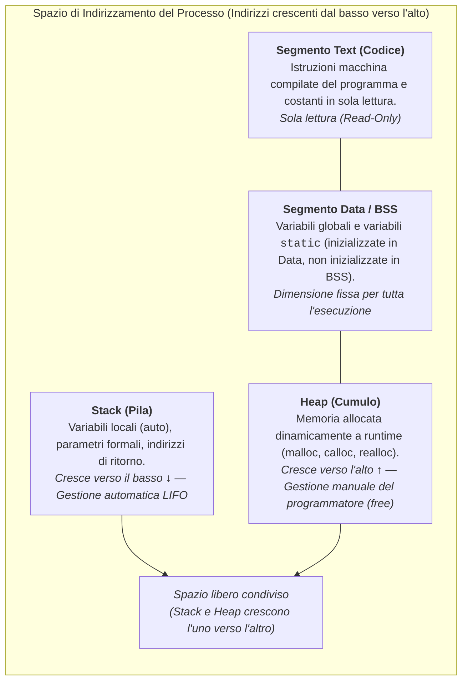
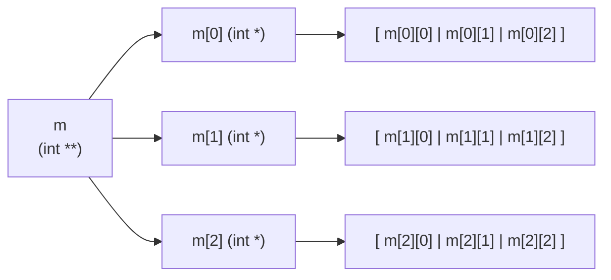

# 4.1.1 - Allocazione dinamica della memoria

Finora abbiamo lavorato con variabili e array la cui dimensione doveva essere nota al momento della scrittura del programma (o determinata automaticamente all'ingresso di una funzione) e il cui ciclo di vita era rigidamente legato al blocco di codice in cui venivano dichiarati. Nei programmi reali, tuttavia, molto spesso **non conosciamo a priori** quanti dati dovremo elaborare: il numero di record di un file, la dimensione di una matrice letta da input o i nodi di una struttura dati che cresce e si riduce durante l'esecuzione.

L'**allocazione dinamica della memoria** risolve questo problema permettendo al programma di richiedere e rilasciare blocchi di memoria **a tempo di esecuzione (runtime)**, attingendo a una regione dedicata chiamata **Heap**.

---

## Layout di memoria di un processo

Quando il sistema operativo avvia un programma compilato in C, gli assegna uno spazio di indirizzamento virtuale suddiviso in quattro segmenti principali, ciascuno con uno scopo e regole di gestione ben precise:



### Confronto tra i segmenti di memoria

| Segmento | Cosa contiene | Quando viene allocato/deallocato | Chi lo gestisce | Dimensione e velocità |
| :--- | :--- | :--- | :--- | :--- |
| **Text (Code)** | Istruzioni binarie eseguibili, stringhe letterali | All'avvio / alla terminazione del processo | Sistema Operativo / Loader | Fissa, sola lettura |
| **Data / BSS** | Variabili globali e `static` (`Data` se inizializzate, `BSS` azzerate di default) | All'avvio / alla terminazione del processo | Compilatore e Loader | Fissa, determinata a compile-time |
| **Stack** | Record di attivazione delle funzioni (variabili locali, parametri, return address) | All'ingresso e all'uscita di ogni funzione/blocco (politica **LIFO**) | Automaticamente dalla CPU (registro Stack Pointer) | Limitata (pochi MB), accesso **estremamente veloce** |
| **Heap** | Blocchi di memoria richiesti dinamicamente a runtime | Su richiesta esplicita (`malloc`/`calloc`) fino a `free` (o fine processo) | **Manualmente dal programmatore** tramite l'allocatore di libreria | Molto grande (limitata dalla RAM/swap), accesso leggermente più lento e soggetto a frammentazione |

> [!IMPORTANT] Variabile puntatore vs Blocco allocato
> Quando scriviamo dentro una funzione:
> ```c
> int *p = (int *)malloc(10 * sizeof(int));
> ```
> dobbiamo distinguere due entità che vivono in segmenti diversi:
> 1. La variabile puntatore `p` (4 o 8 byte che contengono un indirizzo) è una variabile locale e risiede nello **Stack**.
> 2. Il blocco di 10 interi a cui `p` punta ($10 \times 4 = 40\text{ byte}$) risiede nello **Heap**.

---

## La libreria `<stdlib.h>` per la gestione dello Heap

Tutte le funzioni standard per l'allocazione e la deallocazione dinamica sono dichiarate nell'header `<stdlib.h>`. Esse lavorano con il tipo puntatore generico `void *`, che in C può essere assegnato a qualsiasi tipo di puntatore a oggetto (es. `int *`, `double *`, `struct Nodo *`).

### 1. `malloc` (Memory Allocation)

```c
void *malloc(size_t size);
```

- **Scopo**: Alloca nello Heap un blocco contiguo di memoria di `size` byte.
- **Valore di ritorno**: Restituisce l'indirizzo del primo byte del blocco allocato, oppure **`NULL`** se la memoria richiesta non è disponibile (esaurimento dello Heap).
- **Contenuto iniziale**: La memoria allocata da `malloc` **non è inizializzata**; contiene valori "spazzatura" (*garbage*), ovvero i bit lasciati da precedenti utilizzi di quelle celle di memoria.
- **Uso dell'operatore `sizeof`**: Non bisogna **mai** inserire il numero di byte "a mano" (es. `malloc(40)`), perché la dimensione dei tipi primitivi varia tra architetture a 16, 32 e 64 bit. Si moltiplica sempre il numero di elementi $n$ per `sizeof(tipo)`:

```c
int *vettore = (int *)malloc(n * sizeof(int));
if (vettore == NULL) {
    fprintf(stderr, "Errore: memoria insufficiente!\n");
    exit(EXIT_FAILURE);
}
```

### 2. `calloc` (Contiguous Allocation)

```c
void *calloc(size_t nmemb, size_t size);
```

- **Scopo**: Alloca nello Heap spazio per un array di `nmemb` elementi, ciascuno di dimensione `size` byte (per un totale di $\text{nmemb} \times \text{size}$ byte contigui).
- **Differenza chiave rispetto a `malloc`**: `calloc` **azzera tutti i bit** del blocco allocato prima di restituirne l'indirizzo (gli interi partono da `0`, i puntatori da `NULL`). Inoltre controlla internamente che la moltiplicazione `nmemb * size` non causi overflow intero.
- **Valore di ritorno**: Puntatore al blocco azzerato, oppure `NULL` in caso di fallimento.

```c
/* Alloca un array di 100 interi già tutti inizializzati a 0 */
int *contatori = (int *)calloc(100, sizeof(int));
```

### 3. `realloc` (Re-allocation)

```c
void *realloc(void *ptr, size_t new_size);
```

- **Scopo**: Ridimensiona (allarga o restringe) un blocco di memoria nello Heap precedentemente allocato da `malloc`, `calloc` o `realloc` e puntato da `ptr`, portandolo a `new_size` byte.
- **Come funziona sotto il cofano**:
  1. **Allargamento in-place**: Se subito dopo il blocco attuale nello Heap c'è spazio libero sufficiente, `realloc` estende il blocco sul posto e restituisce lo stesso indirizzo `ptr`. I byte aggiunti in coda **non** sono inizializzati.
  2. **Spostamento in una nuova area**: Se non c'è spazio contiguo sufficiente, `realloc` alloca un **nuovo blocco** di dimensione `new_size` in un'altra zona dello Heap, **copia automaticamente** il contenuto del vecchio blocco nel nuovo, **libera (`free`) automaticamente il vecchio blocco** e restituisce il **nuovo indirizzo**.
  3. **Fallimento**: Se non c'è memoria sufficiente nello Heap per soddisfare la richiesta, `realloc` restituisce **`NULL`**, ma **NON libera il blocco originale puntato da `ptr`**, che rimane valido e intatto!
- **Casi particolari standard**:
  - Se `ptr == NULL`, `realloc(NULL, new_size)` si comporta esattamente come `malloc(new_size)`.
  - Se `new_size == 0` (comportamento deprecato in C17/C23), conviene usare direttamente `free(ptr)`.

> [!WARNING] Uso sicuro di `realloc` con puntatore temporaneo
> Non bisogna **mai** assegnare il risultato di `realloc` direttamente allo stesso puntatore:
> ```c
> /* PERICOLO! Se realloc fallisce e restituisce NULL, perdiamo l'indirizzo
>    del vecchio blocco ancora allocato -> Memory Leak immediato! */
> p = realloc(p, nuova_dim * sizeof(int)); // SBAGLIATO!
> ```
> Il pattern corretto utilizza sempre un **puntatore temporaneo**:
> ```c
> int *tmp = (int *)realloc(p, nuova_dim * sizeof(int));
> if (tmp == NULL) {
>     /* Gestione dell'errore: p punta ancora ai vecchi dati validi! */
>     free(p);
>     exit(EXIT_FAILURE);
> }
> p = tmp; /* Aggiorniamo p solo dopo aver verificato il successo */
> ```

### 4. `free` (Deallocazione)

```c
void free(void *ptr);
```

- **Scopo**: Restituisce all'allocatore dello Heap il blocco di memoria puntato da `ptr`, rendendolo nuovamente disponibile per future allocazioni.
- **Regole fondamentali**:
  1. `ptr` deve contenere **esattamente** l'indirizzo iniziale restituito da una precedente chiamata a `malloc`, `calloc` o `realloc` (non si può passare `p + 2` o l'indirizzo di una variabile sullo Stack `&x`).
  2. Se `ptr == NULL`, `free(NULL)` è un'operazione valida che **non fa nulla** (*no-op*).
  3. Dopo `free(ptr)`, la variabile `ptr` sullo Stack **continua a contenere il vecchio indirizzo**, che però ora punta a memoria non più nostra (*dangling pointer*). È buona norma impostare subito `ptr = NULL;`.

---

## Allocazione dinamica di Array 1D e Matrici 2D

### Array monodimensionali (1D)

Un array dinamico di $N$ elementi di tipo `T` si alloca con un singolo puntatore `T *v`. Una volta allocato, grazie all'equivalenza tra array e puntatori (`v[i]` equivale a `*(v + i)`), si usa con la normale sintassi delle parentesi quadre.

### Matrici bidimensionali (2D)

In C esistono due tecniche principali per allocare dinamicamente una matrice di $R$ righe e $C$ colonne:

#### Metodo A: Array di puntatori a righe (`int **m`)

Si alloca prima un vettore principale di $R$ puntatori a intero (`int *`), e poi, con un ciclo, si alloca ciascuna delle $R$ righe di $C$ interi.



- **Vantaggi**: Si accede agli elementi con la comoda sintassi doppia `m[i][j]`; le righe possono anche avere lunghezze diverse (*ragged arrays*) o essere scambiate in $O(1)$ scambiando solo i due puntatori `m[i]` e `m[k]`.
- **Svantaggi**: Richiede $R + 1$ chiamate a `malloc` e $R + 1$ chiamate a `free` (in ordine inverso: **prima le righe, poi il vettore dei puntatori**); le righe non sono necessariamente contigue in memoria (peggiore località della cache).

```c
/* Allocazione di una matrice R x C come array di puntatori */
int **alloca_matrice(int R, int C) {
    int **m = (int **)malloc(R * sizeof(int *));
    if (m == NULL) return NULL;

    for (int i = 0; i < R; i++) {
        m[i] = (int *)malloc(C * sizeof(int));
        if (m[i] == NULL) {
            /* Rollback: liberiamo le righe già allocate prima di uscire! */
            for (int k = 0; k < i; k++) {
                free(m[k]);
            }
            free(m);
            return NULL;
        }
    }
    return m;
}

/* Deallocazione corretta: PRIMA le singole righe, POI il vettore esterno */
void libera_matrice(int **m, int R) {
    if (m == NULL) return;
    for (int i = 0; i < R; i++) {
        free(m[i]);
    }
    free(m);
}
```

#### Metodo B: Blocco unico contiguo (`int *m` di dimensione $R \times C$)

Si effettua **una sola `malloc`** di $R \times C$ elementi e si linearizzano gli indici $(i, j)$ nella posizione $i \cdot C + j$:

```c
int *m = (int *)malloc((size_t)R * C * sizeof(int));
/* Accesso all'elemento di riga i e colonna j: */
m[i * C + j] = 42;
/* Deallocazione in un solo colpo: */
free(m);
```

- **Vantaggi**: Una sola `malloc` e una sola `free`, zero rischio di frammentazione, massima efficienza della cache CPU perché tutti gli elementi sono adiacenti in RAM.

---

## Patologie della memoria dinamica e diagnosi con `valgrind`

Poiché il linguaggio C non possiede un *Garbage Collector* automatico, errori nella gestione manuale dello Heap portano a bug critici di affidabilità e sicurezza:

1. **Memory Leak (Perdita di memoria)**:
   Si verifica quando si perde ogni riferimento (puntatore) a un blocco allocato nello Heap senza aver chiamato `free`. Quel blocco resta "occupato" fino alla fine del processo. In programmi a lunga esecuzione (server, demoni, sistemi embedded), i memory leak esauriscono progressivamente la RAM fino al crash del sistema.
   ```c
   void funzione_con_leak(void) {
       int *p = (int *)malloc(1000 * sizeof(int));
       p[0] = 10;
       /* La funzione termina: p sparisce dallo Stack, ma i 4000 byte
          nello Heap non sono stati liberati con free(p)! */
   }
   ```

2. **Dangling Pointer e Use-After-Free**:
   Un puntatore diventa *dangling* ("penzolante") quando continua a puntare a un'area di memoria che è già stata deallocata (tramite `free` o perché apparteneva a un record di attivazione dello Stack ormai distrutto). Leggere o scrivere attraverso un dangling pointer (*use-after-free*) causa **Undefined Behavior**: può leggere dati corrotti, sovrascrivere strutture interne dell'allocatore o provocare un `Segmentation fault`.
   ```c
   int *p = (int *)malloc(sizeof(int));
   *p = 25;
   free(p);
   *p = 99; /* ERRORE GRAVE (Use-After-Free): p punta a memoria già liberata! */
   ```

3. **Double Free (Doppia deallocazione)**:
   Chiamare `free(p)` due volte sullo stesso indirizzo senza che sia stato riassegnato corrompe le liste dei blocchi liberi dell'allocatore dello Heap, portando quasi sempre all'aborto immediato del programma (`free(): double free detected`) o a vulnerabilità di sicurezza sfruttabili.
   - *Prevenzione*: Impostare sempre `p = NULL;` subito dopo `free(p);` (poiché `free(NULL)` è innocuo).

4. **Buffer Heap Overflow**:
   Scrivere oltre i limiti del blocco allocato (es. allocare $N$ interi e scrivere in `p[N]`, ricordando che gli indici validi vanno da `0` a `N - 1`). Spesso sovrascrive i metadati nascosti che `malloc` memorizza subito prima o dopo il blocco nello Heap, facendo fallire una successiva `free()` o `malloc()` lontano dal punto del vero errore!

### Individuare gli errori con `valgrind`

Sui sistemi Linux/POSIX, lo strumento fondamentale per diagnosticare problemi di memoria è **Valgrind** (e i flag del compilatore `-fsanitize=address -g`). Compilando con i simboli di debug (`gcc -Wall -Wextra -g programma.c -o programma`) ed eseguendo:

```bash
valgrind --leak-check=full --show-leak-kinds=all ./programma
```

Valgrind intercetta ogni singola `malloc`, `free`, lettura e scrittura in memoria, segnalando:
- `Invalid write / Invalid read of size X` (buffer overflow o use-after-free, con il numero esatto di riga nel codice C);
- `Conditional jump or move depends on uninitialised value(s)` (uso di memoria allocata con `malloc` ma mai inizializzata);
- `definitely lost: X bytes in Y blocks` (Memory Leak accertati a fine esecuzione);
- `All heap blocks were freed -- no leaks are possible` quando la gestione è perfetta.

---

## Esempi guidati

### Esempio 1: Vettore dinamico ad espansione geometrica (raddoppio della capacità)

**Problema**: Leggere da tastiera una sequenza di numeri interi di lunghezza ignota a priori (terminata da `0`), memorizzandoli in un array dinamico che parte da capacità iniziale $2$ e raddoppia la propria dimensione con `realloc` ogni volta che si riempie.

```c
#include <stdio.h>
#include <stdlib.h>

int main(void) {
    size_t capacita = 2; /* Capacità iniziale dello Heap */
    size_t n = 0;        /* Numero di elementi effettivamente inseriti */

    int *v = (int *)malloc(capacita * sizeof(int));
    if (v == NULL) {
        fprintf(stderr, "Errore di allocazione iniziale\n");
        return EXIT_FAILURE;
    }

    int valore;
    printf("Inserisci interi (0 per terminare):\n");
    while (scanf("%d", &valore) == 1 && valore != 0) {
        /* Se l'array è pieno, raddoppiamo la capacità con realloc */
        if (n == capacita) {
            size_t nuova_cap = capacita * 2;
            int *tmp = (int *)realloc(v, nuova_cap * sizeof(int));
            if (tmp == NULL) {
                fprintf(stderr, "Errore: realloc fallita a capacita %zu\n", nuova_cap);
                free(v); /* Liberiamo il blocco originale ancora valido! */
                return EXIT_FAILURE;
            }
            v = tmp;
            capacita = nuova_cap;
            printf("  [Debug] Capacita raddoppiata a %zu elementi\n", capacita);
        }
        v[n] = valore;
        n++;
    }

    printf("Hai inserito %zu elementi: ", n);
    for (size_t i = 0; i < n; i++) {
        printf("%d ", v[i]);
    }
    printf("\n");

    free(v);
    v = NULL;
    return EXIT_SUCCESS;
}
```

**Traccia di esecuzione** per l'input `10 20 30 40 50 0`:
1. All'inizio `capacita = 2`, `n = 0`.
2. Legge `10` $\to$ `v[0] = 10`, `n = 1`.
3. Legge `20` $\to$ `v[1] = 20`, `n = 2`.
4. Legge `30` $\to$ `n == capacita` ($2 == 2$): `realloc` porta `capacita` a `4`, poi `v[2] = 30`, `n = 3`.
5. Legge `40` $\to$ `v[3] = 40`, `n = 4`.
6. Legge `50` $\to$ `n == capacita` ($4 == 4$): `realloc` porta `capacita` a `8`, poi `v[4] = 50`, `n = 5`.
7. Legge `0` $\to$ esce dal ciclo, stampa `10 20 30 40 50` e libera `v`.

---

### Esempio 2: Duplicazione dinamica di una stringa (`mia_strdup`)

**Problema**: Scrivere una funzione che riceve una stringa C (`const char *s`) e ne restituisce una copia indipendente allocata dinamicamente nello Heap.

```c
#include <stdio.h>
#include <stdlib.h>
#include <string.h>

char *mia_strdup(const char *s) {
    if (s == NULL) {
        return NULL;
    }
    /* ATTENZIONE: strlen(s) non conta il terminatore '\0'!
       Servono strlen(s) + 1 byte. */
    size_t len = strlen(s);
    char *copia = (char *)malloc((len + 1) * sizeof(char));
    if (copia == NULL) {
        return NULL;
    }
    /* Copiamo tutti i caratteri incluso il '\0' finale */
    memcpy(copia, s, len + 1);
    return copia;
}

int main(void) {
    char *testo = mia_strdup("Programmazione in C");
    if (testo != NULL) {
        printf("Copia nello Heap: %s\n", testo);
        free(testo);
        testo = NULL;
    }
    return 0;
}
```

---

### Esempio 3: Costruzione e trasposizione di una matrice dinamica $R \times C$

**Problema**: Allocare dinamicamente una matrice $R \times C$, calcolarne la trasposta $C \times R$ in una nuova matrice dinamica e liberare entrambe correttamente.

```c
#include <stdio.h>
#include <stdlib.h>

int **crea_matrice(int r, int c) {
    int **m = (int **)malloc(r * sizeof(int *));
    if (!m) return NULL;
    for (int i = 0; i < r; i++) {
        m[i] = (int *)calloc(c, sizeof(int));
        if (!m[i]) {
            for (int k = 0; k < i; k++) free(m[k]);
            free(m);
            return NULL;
        }
    }
    return m;
}

void distruggi_matrice(int **m, int r) {
    if (!m) return;
    for (int i = 0; i < r; i++) free(m[i]);
    free(m);
}

int main(void) {
    int R = 2, C = 3;
    int **A = crea_matrice(R, C);
    int **AT = crea_matrice(C, R); /* Dimensioni invertite C x R */

    if (!A || !AT) {
        distruggi_matrice(A, R);
        distruggi_matrice(AT, C);
        return EXIT_FAILURE;
    }

    /* Riempiamo A e calcoliamo la trasposta AT[j][i] = A[i][j] */
    int cont = 1;
    for (int i = 0; i < R; i++) {
        for (int j = 0; j < C; j++) {
            A[i][j] = cont++;
            AT[j][i] = A[i][j];
        }
    }

    printf("Matrice trasposta (%d x %d):\n", C, R);
    for (int j = 0; j < C; j++) {
        for (int i = 0; i < R; i++) {
            printf("%3d ", AT[j][i]);
        }
        printf("\n");
    }

    distruggi_matrice(A, R);
    distruggi_matrice(AT, C);
    return 0;
}
```

---

## Errori frequenti

1. **Dimenticare il `+ 1` per il terminatore `'\0'` nelle stringhe dinamiche**:
   Scrivere `malloc(strlen(s))` invece di `malloc(strlen(s) + 1)` provoca sistematicamente un **Heap Buffer Overflow** di 1 byte non appena `strcpy` scrive il carattere nulo finale.
2. **Restituire l'indirizzo di una variabile locale sullo Stack invece di allocare sullo Heap**:
   ```c
   int *crea_array_sbagliato(void) {
       int v[10]; /* Allocato sullo STACK! */
       return v;  /* ERRORE: v viene distrutto appena la funzione termina! */
   }
   ```
   Per far sopravvivere un array oltre il ritorno della funzione che lo crea, **deve** essere allocato nello Heap con `malloc`/`calloc`.
3. **Confondere `sizeof(p)` con la dimensione del blocco allocato**:
   Se `int *p = malloc(100 * sizeof(int));`, l'espressione `sizeof(p)` restituisce la dimensione **della variabile puntatore** (es. `8` byte su sistemi a 64 bit), **non** `400`! Il linguaggio C non fornisce alcun modo standard per chiedere a un puntatore quanti byte sono stati allocati con `malloc`: il programmatore deve conservare la dimensione $N$ in una variabile separata.
4. **Sbagliare il tipo dentro `sizeof` nell'allocazione di puntatori doppi**:
   Quando si alloca il vettore delle righe `int **m`, gli elementi di `m` sono puntatori `int *`, quindi ci vuole `malloc(R * sizeof(int *))` (oppure `malloc(R * sizeof(*m))`), non `sizeof(int)` (che su macchine a 64 bit è 4 byte invece di 8 byte, dimezzando lo spazio necessario!).
5. **Deallocare una matrice `int **m` facendo solo `free(m)`**:
   Chiamare solo `free(m)` libera il vettore esterno dei puntatori alle righe, ma lascia tutte le $R$ righe orfane nello Heap (Memory Leak di $R$ blocchi). Se poi si tenta di fare `free(m[i])` *dopo* `free(m)`, si commette un *Use-After-Free*.

---

## Esercizi di prova

1. **(Base — Media e filtraggio con `calloc`)**
   Scrivi una funzione `int *filtra_positivi(const int *v, int n, int *out_len)` che, ricevuto un array `v` di `n` interi, conta quanti sono strettamente positivi ($> 0$), alloca nello Heap un array della dimensione esatta necessaria, vi copia solo gli elementi positivi, scrive la nuova dimensione in `*out_len` e restituisce il puntatore al nuovo array (oppure `NULL` se non ci sono positivi o se `malloc` fallisce).
   > [!tip]- Soluzione
   > ```c
   > #include <stdio.h>
   > #include <stdlib.h>
   > 
   > int *filtra_positivi(const int *v, int n, int *out_len) {
   >     if (v == NULL || n <= 0 || out_len == NULL) {
   >         if (out_len) *out_len = 0;
   >         return NULL;
   >     }
   > 
   >     /* 1. Contiamo quanti elementi sono > 0 */
   >     int conta = 0;
   >     for (int i = 0; i < n; i++) {
   >         if (v[i] > 0) {
   >             conta++;
   >         }
   >     }
   > 
   >     *out_len = conta;
   >     if (conta == 0) {
   >         return NULL;
   >     }
   > 
   >     /* 2. Allocazione esatta nello Heap */
   >     int *ris = (int *)malloc(conta * sizeof(int));
   >     if (ris == NULL) {
   >         *out_len = 0;
   >         return NULL;
   >     }
   > 
   >     /* 3. Copia dei soli valori positivi */
   >     int j = 0;
   >     for (int i = 0; i < n; i++) {
   >         if (v[i] > 0) {
   >             ris[j++] = v[i];
   >         }
   >     }
   >     return ris;
   > }
   > ```

2. **(Base — Caccia al bug di memoria)**
   Individua tutti gli errori di gestione della memoria nel seguente frammento e riscrivilo in modo corretto:
   ```c
   void elabora(int n) {
       int *a = malloc(n);
       for (int i = 0; i <= n; i++) {
           a[i] = i * 2;
       }
       free(a);
       printf("Ultimo elemento: %d\n", a[n - 1]);
       free(a);
   }
   ```
   > [!tip]- Soluzione
   > Il frammento contiene **5 gravi errori**:
   > 1. `malloc(n)` alloca solo `n` **byte** anziché `n * sizeof(int)` byte.
   > 2. Manca il controllo `if (a == NULL)` dopo `malloc`.
   > 3. La condizione del ciclo `i <= n` scrive in `a[n]`, causando un **Heap Buffer Overflow** (gli indici validi sono `0 .. n-1`).
   > 4. `printf(..., a[n - 1])` viene eseguita **dopo** `free(a)`: è un **Use-After-Free** (lettura tramite dangling pointer).
   > 5. Viene chiamata `free(a)` una seconda volta alla fine: **Double Free**.
   > 
   > **Versione corretta**:
   > ```c
   > void elabora(int n) {
   >     if (n <= 0) return;
   >     int *a = (int *)malloc(n * sizeof(int));
   >     if (a == NULL) return;
   > 
   >     for (int i = 0; i < n; i++) {
   >         a[i] = i * 2;
   >     }
   >     printf("Ultimo elemento: %d\n", a[n - 1]);
   > 
   >     free(a);
   >     a = NULL;
   > }
   > ```

3. **(Intermedio — Concatenazione dinamica di due stringhe)**
   Scrivi una funzione `char *concatena(const char *s1, const char *s2)` che restituisce una nuova stringa allocata dinamicamente contenente `s1` seguita da `s2`, senza modificare le stringhe originali.
   > [!tip]- Soluzione
   > ```c
   > #include <stdlib.h>
   > #include <string.h>
   > 
   > char *concatena(const char *s1, const char *s2) {
   >     if (s1 == NULL || s2 == NULL) return NULL;
   > 
   >     size_t len1 = strlen(s1);
   >     size_t len2 = strlen(s2);
   > 
   >     /* +1 per il terminatore '\0' finale */
   >     char *ris = (char *)malloc((len1 + len2 + 1) * sizeof(char));
   >     if (ris == NULL) return NULL;
   > 
   >     memcpy(ris, s1, len1);
   >     memcpy(ris + len1, s2, len2 + 1); /* Copia anche il '\0' di s2 */
   >     return ris;
   > }
   > ```

4. **(Intermedio — Ridimensionamento su misura con `realloc`)**
   Scrivi una funzione `int *leggi_e_compatta(size_t *dim_finale)` che alloca inizialmente un blocco per 100 interi, legge interi da `stdin` finché non incontra un numero negativo (o massimo 100 numeri), e prima di restituire l'array usa `realloc` per ridurre il blocco nello Heap all'esatto numero di elementi effettivamente letti.
   > [!tip]- Soluzione
   > ```c
   > #include <stdio.h>
   > #include <stdlib.h>
   > 
   > int *leggi_e_compatta(size_t *dim_finale) {
   >     size_t cap = 100;
   >     size_t n = 0;
   >     int *v = (int *)malloc(cap * sizeof(int));
   >     if (v == NULL) {
   >         *dim_finale = 0;
   >         return NULL;
   >     }
   > 
   >     int x;
   >     while (n < cap && scanf("%d", &x) == 1 && x >= 0) {
   >         v[n++] = x;
   >     }
   > 
   >     *dim_finale = n;
   >     if (n == 0) {
   >         free(v);
   >         return NULL;
   >     }
   > 
   >     /* Compattiamo il blocco esattamente a n elementi */
   >     int *ridotto = (int *)realloc(v, n * sizeof(int));
   >     if (ridotto != NULL) {
   >         v = ridotto;
   >     }
   >     return v;
   > }
   > ```

5. **(Intermedio/Esame — Matrice triangolare inferiore dinamica / Ragged Array)**
   Scrivi una funzione `int **crea_triangolare(int n)` che alloca nello Heap una matrice "a scalini" di `n` righe, dove la riga `i` (con $0 \le i < n$) ha esattamente `i + 1` colonne (evitando di sprecare memoria per gli elementi sopra la diagonale), e riempie ogni cella `(i, j)` con il coefficiente binomiale del Triangolo di Tartaglia $\binom{i}{j}$. Scrivi anche la corrispondente funzione di deallocazione.
   > [!tip]- Soluzione
   > ```c
   > #include <stdio.h>
   > #include <stdlib.h>
   > 
   > int **crea_triangolare(int n) {
   >     if (n <= 0) return NULL;
   > 
   >     int **t = (int **)malloc(n * sizeof(int *));
   >     if (t == NULL) return NULL;
   > 
   >     for (int i = 0; i < n; i++) {
   >         /* La riga i ha solo (i + 1) colonne! */
   >         t[i] = (int *)malloc((i + 1) * sizeof(int));
   >         if (t[i] == NULL) {
   >             for (int k = 0; k < i; k++) free(t[k]);
   >             free(t);
   >             return NULL;
   >         }
   >         /* Primo e ultimo elemento della riga valgono 1 */
   >         t[i][0] = 1;
   >         t[i][i] = 1;
   >         /* Elementi interni: somma dei due sopra nella riga precedente */
   >         for (int j = 1; j < i; j++) {
   >             t[i][j] = t[i - 1][j - 1] + t[i - 1][j];
   >         }
   >     }
   >     return t;
   > }
   > 
   > void libera_triangolare(int **t, int n) {
   >     if (t == NULL) return;
   >     for (int i = 0; i < n; i++) {
   >         free(t[i]);
   >     }
   >     free(t);
   > }
   > ```

6. **(Esame — Eliminazione di una riga da una matrice dinamica in $O(1)$)**
   Data una matrice dinamica allocata come `int **m` di `R` righe e `C` colonne, scrivi una funzione `int elimina_riga(int ***m_ptr, int *R_ptr, int idx)` che elimina la riga di indice `idx` ($0 \le \text{idx} < R$) liberandone la memoria, fa scorrere i puntatori delle righe successive e riduce il vettore esterno dei puntatori con `realloc`, aggiornando `*R_ptr`.
   > [!tip]- Soluzione
   > Poiché ogni riga è un blocco indipendente nello Heap, non serve copiare i $C$ elementi delle righe successive: basta liberare `m[idx]` e far scorrere i **puntatori** `m[i] = m[i + 1]`!
   > ```c
   > #include <stdlib.h>
   > 
   > int elimina_riga(int ***m_ptr, int *R_ptr, int idx) {
   >     if (m_ptr == NULL || *m_ptr == NULL || R_ptr == NULL) return -1;
   >     int R = *R_ptr;
   >     if (idx < 0 || idx >= R) return -1;
   > 
   >     int **m = *m_ptr;
   > 
   >     /* 1. Liberiamo la memoria della riga da eliminare */
   >     free(m[idx]);
   > 
   >     /* 2. Facciamo scorrere a sinistra i puntatori alle righe successive */
   >     for (int i = idx; i < R - 1; i++) {
   >         m[i] = m[i + 1];
   >     }
   > 
   >     *R_ptr = R - 1;
   >     if (*R_ptr == 0) {
   >         free(m);
   >         *m_ptr = NULL;
   >         return 0;
   >     }
   > 
   >     /* 3. Riduciamo il vettore dei puntatori alle righe */
   >     int **tmp = (int **)realloc(m, (*R_ptr) * sizeof(int *));
   >     if (tmp != NULL) {
   >         *m_ptr = tmp;
   >     }
   >     return 0;
   > }
   > ```

---

## Provenienza del materiale

- Dispensa ufficiale del corso: `C1PROG1U4L1_Memoria_dinamica tag accessibilità.pdf` (Unità 4, Lezione 1 — *Allocazione dinamica della memoria*).
