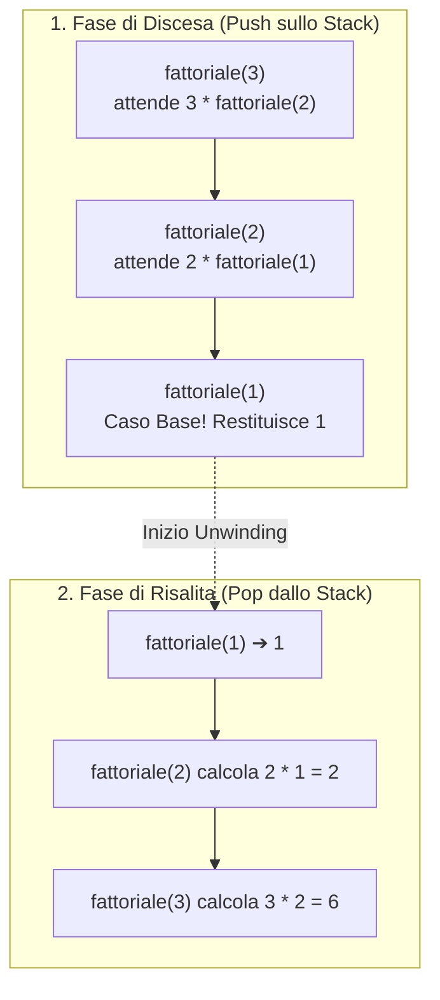
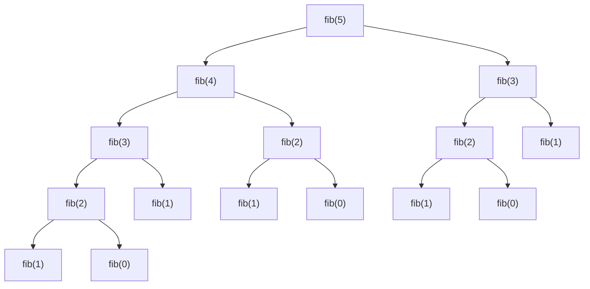

# La ricorsione

## Come un caso più piccolo porta al caso base

In informatica e in matematica, un concetto o una procedura si dice **ricorsivo** quando è definito in termini di **se stesso**, applicato però a istanze via via più semplici dello stesso problema. In programmazione C, una **funzione ricorsiva** è una funzione che, all'interno del proprio corpo, **invoca se stessa** (ricorsione diretta) oppure invoca un'altra funzione che a sua volta la richiama (ricorsione mutua o indiretta).

La ricorsione non è un semplice "trucco sintattico": è un paradigma fondamentale per scomporre problemi complessi (*Divide et Impera*) e per operare su strutture dati intrinsecamente ricorsive come liste concatenate, alberi e grafi.

---

## Anatomia di una funzione ricorsiva e principio di induzione

Perché una funzione ricorsiva calcoli il risultato corretto e **termini** in un numero finito di passi senza entrare-in un ciclo infinito di chiamate, la sua definizione deve sempre poggiare su due componenti indispensabili, esattamente speculari al **Principio di Induzione Matematica**:

| Principio di Induzione Matematica | Funzione Ricorsiva in C | Ruolo fondamentale |
| :--- | :--- | :--- |
| **Passo Base** $P(n_0)$ | **Caso Base** (*Base Case*) | Risolve direttamente l'istanza più elementare del problema **senza** effettuare ulteriori chiamate ricorsive. Garantisce la **condizione di terminazione**. |
| **Passo Induttivo** $P(n-1) \implies P(n)$ | **Passo Ricorsivo** (*Recursive Step*) | Scompone il problema di dimensione $n$ in uno o più sottoproblemi identici ma di **dimensione strettamente minore** (es. $n-1$ oppure $n/2$), avvicinandosi inevitabilmente al caso base. |

### Esempio archetipico: il Fattoriale $n!$

La definizione matematica del fattoriale di un intero $n \ge 0$ è:

$$
n! = \begin{cases} 1 & \text{se } n = 0 \quad \text{(Caso Base)} \\ n \cdot (n - 1)! & \text{se } n > 0 \quad \text{(Passo Ricorsivo)} \end{cases}
$$

La traduzione in C rispecchia fedelmente la formula matematica:

```c
unsigned long long fattoriale(unsigned int n) {
    /* 1. CASO BASE: ferma la ricorsione */
    if (n == 0 || n == 1) {
        return 1ULL;
    }
    /* 2. PASSO RICORSIVO: riduce il problema da n a (n - 1) */
    return (unsigned long long)n * fattoriale(n - 1);
}
```

---

## Evoluzione dello Stack delle chiamate e Stack Overflow

Come fa il calcolatore a non "confondere" il valore di `n` tra una chiamata e la successiva?
Ogni volta che una funzione viene invocata — anche quando invoca se stessa — viene allocato nello **Stack** un nuovo **Record di Attivazione (Stack Frame)** completamente indipendente, che contiene:
1. I parametri formali e le variabili locali di *quella specifica invocazione*;
2. L'**indirizzo di ritorno** (*return address*) a cui riprendere l'esecuzione al termine della chiamata.

L'esecuzione di una funzione ricorsiva si articola quindi in due fasi distinte:
1. **Fase di discesa (o espansione / winding)**: Le chiamate ricorsive si accumulano nello Stack (push di nuovi Stack Frame) con parametri sempre più piccoli, finché non viene raggiunto il **caso base**.
2. **Fase di risalita (o riduzione / unwinding)**: Il caso base restituisce un valore concreto; i record di attivazione vengono rimossi dallo Stack in ordine inverso (**LIFO**), completando le operazioni rimaste in sospeso a ciascun livello.



### Il rischio di Stack Overflow

Poiché ogni chiamata ricorsiva attiva occupa memoria sullo Stack (costituendo un costo spaziale $S(n)$ proporzionale alla **profondità massima dell'albero di ricorsione**), se:
- il caso base è assente o irraggiungibile (es. si chiama `fattoriale(-1)` con `int` segnato che scende a $-2, -3, \dots$), oppure
- l'input $n$ è talmente grande (es. $n = 10^6$) da richiedere più Stack Frame di quanti ne possa contenere lo Stack del processo (tipicamente $1\text{–}8\text{ MB}$),

lo Stack esaurisce lo spazio disponibile e invade la memoria sottostante, causando l'errore fatale di **Stack Overflow** (segnalato dal sistema operativo come `Segmentation fault`).

---

## Classificazione delle forme di ricorsione

### 1. Ricorsione Lineare

Una funzione presenta **ricorsione lineare** quando ogni attivazione del passo ricorsivo effettua **al più una sola chiamata ricorsiva**. L'albero delle chiamate è una semplice catena lineare.

#### Potenza veloce (*Fast Exponentiation*) in $\Theta(\log n)$

Invece di calcolare $x^n = x \cdot x^{n-1}$ in $n$ passi lineari, sfruttiamo la proprietà di dimezzamento dell'esponente:

$$
x^n = \begin{cases} 1 & \text{se } n = 0 \\ \left(x^{n/2}\right)^2 & \text{se } n > 0 \text{ è pari} \\ x \cdot \left(x^{(n-1)/2}\right)^2 & \text{se } n > 0 \text{ è dispari} \end{cases}
$$

```c
double potenza_veloce(double x, unsigned int n) {
    if (n == 0) {
        return 1.0;
    }
    /* Calcoliamo la metà UNA SOLA VOLTA (ricorsione lineare!) */
    double meta = potenza_veloce(x, n / 2);
    if (n % 2 == 0) {
        return meta * meta;
    } else {
        return x * meta * meta;
    }
}
```
Dimezzando $n$ ad ogni chiamata, per calcolare $x^{1024}$ bastano appena $\log_2(1024) = 10$ chiamate ricorsive invece di $1024$!

#### Ricerca Binaria (Dicotomica) ricorsiva su array ordinato

```c
/* Cerca target in v[sin..des]. Restituisce l'indice oppure -1 se assente. */
int ricerca_binaria_ric(const int v[], int sin, int des, int target) {
    /* Caso base 1: sotto-array vuoto -> elemento non trovato */
    if (sin > des) {
        return -1;
    }
    int med = sin + (des - sin) / 2; /* Evita overflow di (sin + des) */

    /* Caso base 2: elemento trovato al centro */
    if (v[med] == target) {
        return med;
    }
    /* Passo ricorsivo: dimezza lo spazio di ricerca */
    if (target < v[med]) {
        return ricerca_binaria_ric(v, sin, med - 1, target);
    } else {
        return ricerca_binaria_ric(v, med + 1, des, target);
    }
}
```

---

### 2. Ricorsione Multipla (Albero di Ricorsione)

Si ha **ricorsione multipla** (in particolare *binaria*) quando il passo ricorsivo contiene **due o più chiamate ricorsive**. Le attivazioni si ramificano formando un **albero di ricorsione**.

#### Numeri di Fibonacci e il pericolo dei sottoproblemi sovrapposti

La successione di Fibonacci è definita da:

$$
F(0) = 0, \quad F(1) = 1, \quad F(n) = F(n-1) + F(n-2) \quad \text{per } n \ge 2
$$

```c
unsigned long long fib_ingenuo(unsigned int n) {
    if (n <= 1) return n;
    return fib_ingenuo(n - 1) + fib_ingenuo(n - 2);
}
```

Osserviamo l'albero delle chiamate per `fib_ingenuo(5)`:



> [!CAUTION] Esplosione esponenziale $O(2^n)$
> Nella versione ricorsiva ingenua di Fibonacci, gli stessi sottoproblemi (`fib(3)`, `fib(2)`) vengono **ricalcolati da capo innumerevoli volte**. Il numero di chiamate cresce come $\Theta(\phi^n)$ dove $\phi = \frac{1+\sqrt{5}}{2} \approx 1.618$ (complessità esponenziale $O(2^n)$), mentre lo spazio sullo Stack è $O(n)$ (pari all'altezza massima dell'albero). Per $n = 50$ servono decine di miliardi di chiamate! In questo caso è molto più efficiente la versione iterativa (o con *memoization*) in tempo $\Theta(n)$.

#### Le Torri di Hanoi

Dato un sistema di 3 pioli (`Sorgente`, `Ausiliario`, `Destinazione`) e $n$ dischi di diametro crescente impilati su `Sorgente`, vogliamo spostare l'intera torre su `Destinazione` muovendo un solo disco alla volta e senza mai poggiare un disco più grande sopra uno più piccolo.

La soluzione iterativa è complessa da ideare, ma quella **ricorsiva** è cristallina:
1. Sposta ricorsivamente i primi $n-1$ dischi da `Sorgente` ad `Ausiliario` (usando `Destinazione` come appoggio);
2. Sposta il disco più grande $n$ da `Sorgente` a `Destinazione`;
3. Sposta ricorsivamente gli $n-1$ dischi da `Ausiliario` a `Destinazione` (usando `Sorgente` come appoggio).

```c
void hanoi(int n, char sorg, char dest, char aux) {
    if (n == 1) {
        printf("Sposta disco 1 da %c a %c\n", sorg, dest);
        return;
    }
    hanoi(n - 1, sorg, aux, dest);
    printf("Sposta disco %d da %c a %c\n", n, sorg, dest);
    hanoi(n - 1, aux, dest, sorg);
}
```
Il numero totale di mosse soddisfa la ricorrenza $T(n) = 2T(n-1) + 1$ con $T(1) = 1$, la cui soluzione esatta è $T(n) = 2^n - 1 = \Theta(2^n)$.

---

### 3. Ricorsione in coda (Tail Recursion) vs Iterazione

Una funzione ricorsiva si dice **ricorsiva in coda (*tail-recursive*)** quando la chiamata ricorsiva è **l'ultima ed unica operazione** eseguita prima del `return`: al ritorno dalla chiamata ricorsiva non resta alcun calcolo pendente da effettuare.

- **NON tail-recursive**: `return n * fattoriale(n - 1);` (dopo il ritorno di `fattoriale(n - 1)`, il chiamante deve ancora moltiplicare per `n`!).
- **Tail-recursive (con accumulatore)**: passiamo il risultato parziale in un parametro **accumulatore** `acc`:

```c
unsigned long long fattoriale_tail(unsigned int n, unsigned long long acc) {
    if (n == 0 || n == 1) {
        return acc;
    }
    /* Chiamata in coda pura: nessuna operazione dopo il ritorno! */
    return fattoriale_tail(n - 1, n * acc);
}
```

**Perché la Tail Recursion è importante?**
Poiché al ritorno dalla chiamata non c'è nulla da fare nello Stack Frame corrente, un compilatore ottimizzante (es. `gcc -O2`) applica la **Tail Call Optimization (TCO)**: anziché allocare un nuovo Stack Frame per la chiamata ricorsiva, **riutilizza lo stesso Stack Frame** sovrascrivendo i parametri (`n = n - 1`, `acc = n * acc`) e saltando all'inizio della funzione con un semplice `jmp`. In questo modo la complessità spaziale sullo Stack scende da $O(n)$ a **$O(1)$**, esattamente come un ciclo `while`!

---

## Tempo totale e chiamate ancora attive

Per le Torri di Hanoi, spostare $n>0$ dischi richiede spostarne $n-1$ sul piolo ausiliario, spostare il disco maggiore, poi spostare i $n-1$ dischi sopra di lui. Il caso $n=0$ non effettua mosse. Contando le mosse abbiamo $T(0)=0$ e $T(n)=2T(n-1)+1$, quindi $T(n)=2^n-1$. Per $n=3$ si ottengono sette mosse. Le due chiamate ricorsive si eseguono una dopo l'altra. Una catena attiva contiene al massimo un'invocazione per valore di $n$ e richiede spazio ausiliario $\Theta(n)$ per $n\ge 1$ se ogni chiamata usa spazio costante.

Questa distinzione separa il numero di nodi dell'albero delle chiamate dalla profondità dello stack. Vedi [[3.1.1 - Le funzioni in C|record di attivazione]] e [[5.5.1 - Costo computazionale e complessità asintotica|analisi del costo]].

---

## Esempi guidati

### Esempio 1: Algoritmo di Euclide per il Massimo Comun Divisore (MCD)

**Problema**: Calcolare il $\text{MCD}(a, b)$ di due interi non negativi sfruttando la proprietà di Euclide: $\text{MCD}(a, 0) = a$ e $\text{MCD}(a, b) = \text{MCD}(b, a \bmod b)$.

```c
#include <stdio.h>

int mcd(int a, int b) {
    /* Caso base: quando il resto b diventa 0, il divisore a è il MCD */
    if (b == 0) {
        return a;
    }
    /* Passo ricorsivo (in coda!): scambia b con il resto di a / b */
    return mcd(b, a % b);
}

int main(void) {
    printf("MCD(48, 18) = %d\n", mcd(48, 18));
    return 0;
}
```

**Traccia delle chiamate**:
`mcd(48, 18)` $\to$ `mcd(18, 48 % 18 = 12)` $\to$ `mcd(12, 18 % 12 = 6)` $\to$ `mcd(6, 12 % 6 = 0)` $\to$ Caso Base (`b == 0`) restituisce `6`.

---

### Esempio 2: Verifica ricorsiva se una stringa è palindroma

**Problema**: Stabilire ricorsivamente se una stringa è palindroma confrontando il primo e l'ultimo carattere e riducendo il problema alla sottostringa interna.

```c
#include <stdio.h>
#include <string.h>
#include <stdbool.h>

bool palindroma_ric(const char *s, int sin, int des) {
    /* Caso base 1: 0 o 1 caratteri rimasti -> è palindroma */
    if (sin >= des) {
        return true;
    }
    /* Caso base 2: gli estremi non coincidono -> non è palindroma */
    if (s[sin] != s[des]) {
        return false;
    }
    /* Passo ricorsivo: stringi la finestra verso il centro */
    return palindroma_ric(s, sin + 1, des - 1);
}

bool e_palindroma(const char *s) {
    if (s == NULL) return false;
    int len = (int)strlen(s);
    return palindroma_ric(s, 0, len - 1);
}

int main(void) {
    printf("'radar': %s\n", e_palindroma("radar") ? "SI" : "NO");
    printf("'algoritmo': %s\n", e_palindroma("algoritmo") ? "SI" : "NO");
    return 0;
}
```

---

### Esempio 3: Stampa delle cifre di un intero in base 2 (Binario)

**Problema**: Stampare la rappresentazione binaria di un numero intero positivo $n$ senza usare array di appoggio, sfruttando lo Stack della ricorsione per invertire l'ordine dei resti.

```c
#include <stdio.h>

void stampa_binario(unsigned int n) {
    /* Passo ricorsivo PRIMA della printf: se ci sono altre cifre più
       significative a sinistra, stampale prima! */
    if (n >= 2) {
        stampa_binario(n / 2);
    }
    /* Durante la fase di RISALITA (unwinding) stampiamo il bit meno significativo */
    printf("%u", n % 2);
}

int main(void) {
    unsigned int num = 13;
    printf("%u in binario = ", num);
    stampa_binario(num); /* Stampa: 1101 */
    printf("\n");
    return 0;
}
```

**Traccia di esecuzione** per `n = 13`:
- Discesa: `stampa_binario(13)` chiama `stampa_binario(6)` che chiama `stampa_binario(3)` che chiama `stampa_binario(1)`.
- In `stampa_binario(1)` la guardia `n >= 2` è falsa $\to$ stampa `1 % 2 = 1` e ritorna.
- Risalita in `stampa_binario(3)` $\to$ stampa `3 % 2 = 1` e ritorna.
- Risalita in `stampa_binario(6)` $\to$ stampa `6 % 2 = 0` e ritorna.
- Risalita in `stampa_binario(13)` $\to$ stampa `13 % 2 = 1` e ritorna.
- Risultato a schermo: `1101`.

---

## Errori frequenti

> [!caution] Errori da evitare
> 1. **Omettere il `return` davanti alla chiamata ricorsiva in funzioni non-`void`**:
>    ```c
>    int cerca(const int v[], int n, int x) {
>        if (n == 0) return 0;
>        if (v[0] == x) return 1;
>        cerca(v + 1, n - 1, x); /* ERRORE! Manca "return": il risultato viene perso! */
>    }
>    ```
> 2. **Usare il post-decremento `n--` invece di `n - 1` come argomento della chiamata ricorsiva**:
>    Scrivere `return n * fattoriale(n--);` è un errore letale: l'operatore postfisso `n--` passa alla chiamata ricorsiva il **vecchio valore** di `n` (prima di decrementarlo!), provocando una ricorsione infinita `fattoriale(n) -> fattoriale(n) -> ...` fino allo Stack Overflow! Bisogna sempre scrivere `n - 1`.
> 3. **Effettuare due volte la stessa chiamata ricorsiva per calcolare il massimo di un array**:
>    ```c
>    /* PESSIMO: chiama max_ric due volte, trasformando una scansione O(n) in O(2^n)! */
>    if (v[n-1] > max_ric(v, n-1)) return v[n-1];
>    else return max_ric(v, n-1);
>    ```
>    Bisogna salvare il risultato di `max_ric(v, n - 1)` in una variabile locale `int m = max_ric(v, n - 1);` e poi confrontare `v[n - 1]` con `m`.
> 4. **Usare variabili `static` o globali senza azzerarle tra un'esecuzione e l'altra**:
>    Se una funzione ricorsiva accumula un risultato in una variabile `static`, alla seconda chiamata dal `main` la variabile partirà dal valore residuo della prima chiamata anziché da zero. Meglio usare una funzione *wrapper* che passa un accumulatore come parametro.

---

## Esercizi di prova

### Esercizio 1. Somma delle cifre di un intero (Base)

Scrivi una funzione ricorsiva `int somma_cifre(int n)` che restituisce la somma delle cifre decimali di un intero non negativo $n$ (es. `somma_cifre(4079)` restituisce $4 + 0 + 7 + 9 = 20$).

> [!tip]- Soluzione
> ```c
> int somma_cifre(int n) {
>     if (n < 0) n = -n;
>     /* Caso base: numero a una sola cifra */
>     if (n < 10) {
>         return n;
>     }
>     /* Passo ricorsivo: ultima cifra (n % 10) + somma delle rimanenti (n / 10) */
>     return (n % 10) + somma_cifre(n / 10);
> }
> ```

### Esercizio 2. Lunghezza e stampa inversa di una stringa (Base)

Scrivi due funzioni ricorsive (senza usare cicli né `<string.h>`):
- `size_t mia_strlen_ric(const char *s)` che calcola la lunghezza di `s`;
- `void stampa_invertita(const char *s)` che stampa i caratteri di `s` dall'ultimo al primo.

> [!tip]- Soluzione
> ```c
> #include <stdio.h>
>
> size_t mia_strlen_ric(const char *s) {
>     if (s == NULL || *s == '\0') {
>         return 0; /* Caso base: fine stringa */
>     }
>     return 1 + mia_strlen_ric(s + 1);
> }
>
> void stampa_invertita(const char *s) {
>     if (s == NULL || *s == '\0') {
>         return; /* Caso base */
>     }
>     /* Prima scendiamo fino in fondo alla stringa... */
>     stampa_invertita(s + 1);
>     /* ...poi in fase di risalita stampiamo il carattere corrente! */
>     putchar(*s);
> }
> ```

### Esercizio 3. Massimo elemento di un array in $O(n)$ (Intermedio)

Scrivi una funzione ricorsiva `int massimo_array(const int v[], int n)` che trova il valore massimo in un array di `n` interi ($n \ge 1$) effettuando esattamente $n - 1$ chiamate ricorsive.

> [!tip]- Soluzione
> ```c
> int massimo_array(const int v[], int n) {
>     /* Caso base: un array di 1 solo elemento ha quell'elemento come massimo */
>     if (n == 1) {
>         return v[0];
>     }
>     /* Passo ricorsivo: calcoliamo UNA SOLA VOLTA il massimo dei primi n-1 */
>     int max_resto = massimo_array(v, n - 1);
>     return (v[n - 1] > max_resto) ? v[n - 1] : max_resto;
> }
> ```

### Esercizio 4. Verifica se un array è ordinato in modo strettamente crescente (Intermedio)

Scrivi una funzione ricorsiva `int e_ordinato(const int v[], int n)` che restituisce `1` se $v[0] < v[1] < \dots < v[n-1]$, altrimenti `0`.

> [!tip]- Soluzione
> ```c
> int e_ordinato(const int v[], int n) {
>     /* Caso base: un array con 0 o 1 elementi è sempre ordinato */
>     if (n <= 1) {
>         return 1;
>     }
>     /* Caso base di fallimento: gli ultimi due elementi violano l'ordine */
>     if (v[n - 2] >= v[n - 1]) {
>         return 0;
>     }
>     /* Passo ricorsivo in coda: controlla i primi n - 1 elementi */
>     return e_ordinato(v, n - 1);
> }
> ```

### Esercizio 5. Da Fibonacci esponenziale a Fibonacci lineare in coda (Avanzato)

Riscrivi il calcolo dell'$n$-esimo numero di Fibonacci usando una funzione ausiliaria **ricorsiva in coda** `fib_tail(unsigned int n, unsigned long long a, unsigned long long b)` che richiede tempo $\Theta(n)$ anziché $O(2^n)$.

> [!tip]- Soluzione
> Manteniamo nei due parametri accumulatori `a` e `b` due termini consecutivi della successione ($F(k)$ e $F(k+1)$) e ad ogni passo facciamo scorrere la coppia in $(b, a+b)$ decrementando $n$:
> ```c
> unsigned long long fib_tail(unsigned int n, unsigned long long a, unsigned long long b) {
>     if (n == 0) return a;
>     if (n == 1) return b;
>     return fib_tail(n - 1, b, a + b);
> }
>
> unsigned long long fibonacci(unsigned int n) {
>     return fib_tail(n, 0ULL, 1ULL);
> }
> ```

### Esercizio 6. Coefficiente Binomiale e numero di chiamate (Avanzato)

Il coefficiente binomiale $\binom{n}{k}$ soddisfa l'identità di Stifel:

$$
\binom{n}{0} = \binom{n}{n} = 1, \qquad \binom{n}{k} = \binom{n-1}{k-1} + \binom{n-1}{k} \quad (0 < k < n)
$$

Scrivi la funzione ricorsiva `long coeff_binom(int n, int k)` e calcola quante volte in totale viene invocata la funzione `coeff_binom` (inclusa la chiamata iniziale) per calcolare `coeff_binom(4, 2)`.

> [!tip]- Soluzione
> ```c
> long coeff_binom(int n, int k) {
>     if (k == 0 || k == n) {
>         return 1L;
>     }
>     return coeff_binom(n - 1, k - 1) + coeff_binom(n - 1, k);
> }
> ```
> **Conteggio delle chiamate per $C(4,2)$**:
> Poiché ogni foglia (caso base) restituisce `1` e i nodi interni sommano i valori delle foglie senza aggiungere costanti, il numero di **foglie** dell'albero di ricorsione è esattamente uguale al valore di $\binom{4}{2} = 6$.
> In un albero binario pieno (in cui ogni nodo interno ha esattamente 2 figli), se ci sono $L = 6$ foglie, ci sono $L - 1 = 5$ nodi interni.
> Pertanto il numero totale di chiamate è $6 + 5 = \mathbf{11}$ chiamate (in generale $2\binom{n}{k} - 1$ chiamate).

---

## Provenienza del materiale

- Dispensa ufficiale del corso: `C1PROG1U4L2_Ricorsione.pdf` (Unità 4, Lezione 2 — *La ricorsione*).
- Marco Anisetti, *Memoria*, `Appunti_di_Fine_Unità_4.pdf`, cap. 2.
