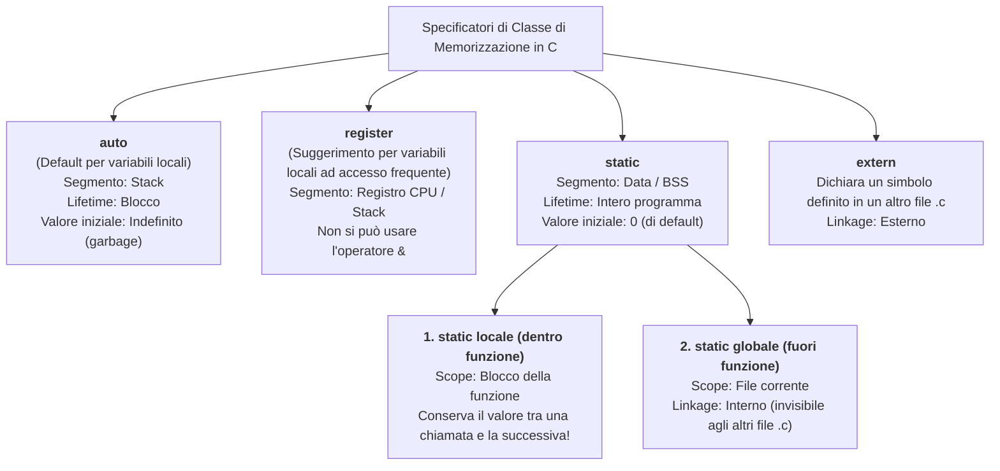

# 4.4.1 - Controllo dello scope e tempo di vita delle variabili

Quando dichiariamo un identificatore (una variabile o una funzione) in un programma C, ad esso sono associate tre proprietà distinte ma spesso confuse tra loro:
1. **Scope (Ambito di visibilità)**: *In quali punti del testo del programma* quell'identificatore è visibile e può essere usato per nome? (Proprietà **spaziale / lessicale**, verificata a *compile-time*).
2. **Lifetime (Tempo di vita o Storage Duration)**: *Per quanto tempo durante l'esecuzione* esiste in memoria la cella associata alla variabile? (Proprietà **temporale**, a *runtime*).
3. **Linkage (Collegamento)**: Se lo stesso nome compare in più file sorgenti `.c` diversi, si riferisce alla stessa entità o a entità distinte?

Comprendere la differenza tra **Scope** e **Lifetime** è fondamentale: una variabile può essere **viva in memoria** ma **temporaneamente fuori scope** (invisibile), come accade alle variabili locali `static` o alle variabili del `main` mentre è in esecuzione una funzione chiamata dal `main`.

---

## Scope: visibilità lessicale (statica) e Shadowing

Il linguaggio C adotta lo **scoping lessicale (o statico)**: è possibile determinare a quale dichiarazione si riferisce un nome semplicemente ispezionando la struttura dei blocchi `{ ... }` nel codice sorgente, senza bisogno di eseguire il programma.

### I 4 livelli di Scope in C

1. **Scope di Blocco (*Block Scope*)**:
   Ogni variabile dichiarata all'interno di un blocco delimitato da parentesi graffe `{ ... }` (il corpo di una funzione, di un `if`, di un `while`, l'intestazione di un `for (int i = 0; ...)` o anche un blocco anonimo) è visibile **dal punto della sua dichiarazione fino alla parentesi graffa chiusa `}` di quel blocco**. Anche i parametri formali di una funzione hanno scope di blocco (visibili in tutta la funzione).
2. **Scope di File (*File Scope* — Variabili Globali)**:
   Ogni identificatore dichiarato **al di fuori** di qualsiasi funzione o blocco è visibile dal punto della dichiarazione fino alla fine del file sorgente `.c` corrente (unità di compilazione).
3. **Scope di Prototipo di Funzione (*Function Prototype Scope*)**:
   I nomi dei parametri scritti dentro un prototipo (es. `int somma(int a, int b);`) hanno visibilità limitata alle sole parentesi tonde del prototipo stesso.
4. **Scope di Funzione (*Function Scope*)**:
   Riguarda esclusivamente le etichette (`label:`) usate con l'istruzione `goto`, visibili ovunque all'interno della funzione in cui compaiono.

### Mascheramento dei nomi (*Variable Shadowing*)

Cosa succede se in un blocco interno dichiariamo una nuova variabile con **lo stesso nome** di una variabile già visibile in un blocco esterno o a livello globale?
La dichiarazione interna è perfettamente legale e **nasconde (maschera / fa *shadowing*)** la variabile esterna per tutta la durata del blocco interno. Non appena il blocco interno si chiude con `}`, la variabile interna cessa di esistere e il nome torna a riferirsi alla variabile esterna rimasta intatta!

```c
#include <stdio.h>

int x = 100; /* x globale (File Scope) */

int main(void) {
    printf("1) x globale = %d\n", x); /* Stampa 100 */

    int x = 20; /* Nasconde la x globale dentro main */
    printf("2) x di main = %d\n", x); /* Stampa 20 */

    if (x > 0) {
        int x = 5; /* Nasconde la x di main dentro il blocco if */
        x += 1;
        printf("3) x del blocco if = %d\n", x); /* Stampa 6 */
    } /* Qui la x del blocco if muore! */

    printf("4) Tornati in main: x = %d\n", x); /* Stampa 20 (intatta!) */
    return 0;
}
```

---

## Classi di memorizzazione (*Storage Classes*) e Linkage

In C possiamo modificare il **tempo di vita (lifetime)**, il segmento di memoria e il **linkage** di una variabile o funzione anteponendo uno specificatore di classe di memorizzazione: `auto`, `register`, `static`, `extern`.



### Tabella riassuntiva completa

| Dichiarazione | Dove si scrive | Scope (Visibilità) | Lifetime (Tempo di vita) | Segmento di memoria | Inizializzazione di default | Linkage |
| :--- | :--- | :--- | :--- | :--- | :--- | :--- |
| `int x;` (oppure `auto int x;`) | Dentro un blocco/funzione | Blocco `{ ... }` | Automatico (creata all'ingresso del blocco, distrutta all'uscita) | **Stack** | **Non inizializzata** (*garbage*) | Nessuno |
| `register int i;` | Dentro un blocco/funzione | Blocco `{ ... }` | Automatico | Registro CPU (o Stack) | Non inizializzata | Nessuno |
| `static int c;` | **Dentro** una funzione | Blocco della funzione | **Statico (tutta la durata del programma)** | **Data / BSS** | **`0`** (inizializzata **una sola volta** prima del `main`) | Nessuno |
| `int g;` | **Fuori** da ogni funzione | File (dal punto di dichiarazione) | **Statico (tutta la durata del programma)** | **Data / BSS** | **`0`** | **Esterno** (condivisibile con altri `.c`) |
| `static int s;` | **Fuori** da ogni funzione | File corrente | **Statico (tutta la durata del programma)** | **Data / BSS** | **`0`** | **Interno** (privata del file `.c` corrente) |
| `extern int g;` | Ovunque (tipicamente in header `.h` o in cima a un `.c`) | File o Blocco in cui compare | Statico (si riferisce alla variabile globale definita altrove) | Data / BSS | N/A (non alloca memoria, è solo una dichiarazione) | **Esterno** |

---

## Approfondimento sui due significati di `static` e su `extern`

La parola chiave `static` in C ha **due usi distinti** a seconda di dove viene collocata:

### Caso 1: Variabile locale `static` (dentro una funzione)

Quando scriviamo `static int contatore = 0;` all'interno di una funzione:
- **Scope**: resta **locale** alla funzione (nessun'altra funzione può leggerla o modificarla direttamente per nome).
- **Lifetime**: diventa **permanente (statico)**! La variabile non viene allocata sullo Stack, ma nel segmento **Data/BSS**. Viene inizializzata **una sola volta** all'avvio del programma e **conserva il proprio valore** tra una chiamata della funzione e la successiva.

```c
int genera_id(void) {
    static int ultimo_id = 1000; /* Inizializzato UNA SOLA VOLTA all'avvio! */
    ultimo_id++;
    return ultimo_id;
}
/* 1a chiamata: restituisce 1001
   2a chiamata: restituisce 1002
   3a chiamata: restituisce 1003 */
```

### Caso 2: Variabile o funzione globale `static` (fuori dalle funzioni)

Quando scriviamo `static` davanti a una variabile globale o a una funzione a livello di file:
- Ne restringiamo il **Linkage da esterno a interno**: quel simbolo diventa **privato** del file `.c` in cui è definito.
- Nessun altro file `.c` del progetto potrà accedervi (nemmeno scrivendo `extern`), evitando collisioni di nomi tra moduli diversi e realizzando l'**incapsulamento a livello di modulo**.

### Condivisione tra file con `extern` (Dichiarazione vs Definizione)

In un progetto C composto da più file (`main.c` e `modulo.c`), vale la **One Definition Rule**:
- Una variabile globale con linkage esterno deve essere **definita** (allocando memoria) in **un solo file `.c`**:
  ```c
  /* In modulo.c — DEFINIZIONE (alloca memoria nel segmento Data) */
  int livello_log = 2;
  ```
- Tutti gli altri file `.c` che vogliono leggerla o modificarla devono includere una **dichiarazione `extern`** (spesso posta in `modulo.h`), che informa il compilatore del tipo e del nome della variabile senza allocare nuova memoria:
  ```c
  /* In modulo.h oppure in cima a main.c — DICHIARAZIONE */
  extern int livello_log;
  ```

> [!NOTE] Nota su `register`
> Lo specificatore `register` suggerisce al compilatore di mantenere una variabile locale molto usata direttamente in un registro della CPU anziché in RAM nello Stack. Poiché i registri della CPU non hanno un indirizzo di memoria RAM, **è vietato a livello di compilazione applicare l'operatore indirizzo `&` a una variabile `register`** (`int *p = &i;` genera errore di compilazione se `i` è `register`).

---

## Esempi guidati

### Esempio 1: Tracciamento completo con `static` locale, variabile globale e shadowing

**Problema**: Determinare esattamente l'output stampato dal seguente programma seguendo passo passo lo stato della memoria.

```c
#include <stdio.h>

int a = 10; /* Variabile globale */

int mistero(int x) {
    static int s = 1; /* Locale statica: mantiene il valore tra le chiamate! */
    int a = 5;        /* Locale automatica: fa shadowing della 'a' globale! */

    s = s + x;
    a = a + s;
    printf("Dentro mistero: a=%d, s=%d\n", a, s);
    return s;
}

int main(void) {
    int ris1 = mistero(2);
    a = a + ris1;
    printf("Dopo 1a chiamata: a globale=%d\n", a);

    int ris2 = mistero(3);
    printf("Dopo 2a chiamata: a globale=%d, ris2=%d\n", a, ris2);
    return 0;
}
```

**Traccia passo-passo**:
1. All'avvio del programma (nel segmento Data): `a (globale) = 10`, `s (static di mistero) = 1`.
2. **Prima chiamata `mistero(2)`**:
   - Viene creata sullo Stack `a (locale) = 5` (nasconde la `a` globale che resta `10`).
   - `s = s + x` $\implies s = 1 + 2 = 3$.
   - `a (locale) = 5 + 3 = 8`.
   - Stampa: `Dentro mistero: a=8, s=3`.
   - La `a` locale muore; `s` resta `3` nel segmento Data; ritorna `3`.
3. Nel `main`: `ris1 = 3`, quindi `a (globale) = 10 + 3 = 13`.
   - Stampa: `Dopo 1a chiamata: a globale=13`.
4. **Seconda chiamata `mistero(3)`**:
   - Viene ricreata da capo sullo Stack `a (locale) = 5`, mentre `s` **NON** viene reinizializzata a `1`, ma vale ancora `3`!
   - `s = s + x` $\implies s = 3 + 3 = 6$.
   - `a (locale) = 5 + 6 = 11`.
   - Stampa: `Dentro mistero: a=11, s=6`.
   - Ritorna `6`.
5. Nel `main`: la `a` globale non è stata toccata dalla seconda chiamata e vale ancora `13`.
   - Stampa: `Dopo 2a chiamata: a globale=13, ris2=6`.

---

### Esempio 2: Restituire l'indirizzo di una variabile locale `auto` vs `static`

**Problema**: Capire perché restituire il puntatore a una variabile locale normale è un errore grave, mentre restituire il puntatore a una variabile `static` è sicuro dal punto di vista del lifetime.

```c
#include <stdio.h>

int *puntatore_pericoloso(void) {
    int x = 42;
    return &x; /* ERRORE! x vive sullo Stack e muore al return! (Dangling Pointer) */
}

int *puntatore_statico_sicuro(void) {
    static int y = 42;
    y += 10;
    return &y; /* CORRETTO: y vive nel segmento Data per tutto il programma! */
}

int main(void) {
    int *p = puntatore_statico_sicuro();
    printf("Valore tramite puntatore a static: %d\n", *p); /* Stampa 52 */
    puntatore_statico_sicuro();
    printf("Valore aggiornato nello stesso indirizzo: %d\n", *p); /* Stampa 62 */
    return 0;
}
```

---

### Esempio 3: Architettura multi-file con `static` globale ed `extern`

Mostriamo come strutturare un modulo `contatore.h` / `contatore.c` che espone una variabile condivisa con `extern` ma protegge il suo stato interno con `static`:

```c
/* === File: contatore.h === */
#ifndef CONTATORE_H
#define CONTATORE_H

extern int passo_incremento; /* Dichiarazione: visibile a chi include l'header */

void incrementa(void);
int leggi_valore(void);

#endif
```

```c
/* === File: contatore.c === */
#include "contatore.h"

/* Definizione con linkage ESTERNO: condivisa con gli altri file .c */
int passo_incremento = 1;

/* Definizione con linkage INTERNO (static): PRIVATA di contatore.c!
   Nessun altro file .c può modificarla direttamente. */
static int valore_interno = 0;

void incrementa(void) {
    valore_interno += passo_incremento;
}

int leggi_valore(void) {
    return valore_interno;
}
```

---

## Errori frequenti

1. **Pensare che `static int s = 0;` dentro una funzione reinizializzi `s` a `0` ad ogni chiamata**:
   L'inizializzazione di una variabile `static` avviene **una sola volta a compile-time/load-time**, prima ancora che inizi il `main`. Nelle chiamate successive della funzione, la riga `static int s = 0;` viene semplicemente ignorata dal flusso di esecuzione!
2. **Provare a inizializzare una variabile `static` o globale con un'espressione non costante**:
   Poiché le variabili statiche e globali vengono inizializzate prima dell'avvio del programma nel segmento Data, in C il loro inizializzatore **deve essere una costante nota a tempo di compilazione**:
   ```c
   int f(int n) {
       static int limite = n * 2; /* ERRORE DI COMPILAZIONE: n non è costante! */
       return limite;
   }
   ```
3. **Scrivere `int x = 10;` dentro un file header `.h` incluso da più file `.c`**:
   Se `header.h` contiene una *definizione* `int x = 10;` senza `extern` (e senza `static`) e viene incluso sia in `a.c` sia in `b.c`, il Linker segnalerà l'errore fatale `multiple definition of 'x'`. Negli header `.h` si mette solo `extern int x;`, e la definizione `int x = 10;` va in un solo file `.c`.
4. **Fare shadowing involontario di una variabile che si voleva invece modificare**:
   Scrivere `int tot = 0;` fuori da un `if` e poi, dentro l'`if`, scrivere per errore `int tot = 50;` invece di `tot = 50;` crea una *nuova* variabile `tot` interna all'`if` che muore subito dopo, lasciando `tot` esterna a `0`.

---

## Esercizi di prova

1. **(Base — Ciclo di vita e inizializzazione automatica)**
   Qual è il valore iniziale di una variabile `int a;` dichiarata dentro `main` rispetto a una variabile `int b;` dichiarata fuori da ogni funzione e a una `static int c;` dichiarata dentro `main`? In quali segmenti di memoria risiedono?
   > [!tip]- Soluzione
   > - `a` è una variabile locale automatica (`auto`): risiede nello **Stack** e il suo valore iniziale è **indeterminato** (*garbage*); leggerla prima di assegnarle un valore è *Undefined Behavior*.
   > - `b` (globale) e `c` (locale `static`) hanno entrambe *static storage duration*: risiedono nel segmento **BSS** (dati statici non esplicitamente inizializzati) e lo standard C garantisce che vengano automaticamente inizializzate a **`0`** prima dell'avvio del `main`.

2. **(Base — Tracciamento di blocchi annidati e shadowing)**
   Determina l'output esatto del seguente programma:
   ```c
   #include <stdio.h>
   int v = 1;
   int main(void) {
       int v = 2;
       {
           int v = 3;
           printf("%d ", v);
       }
       printf("%d ", v);
       {
           v = 4;
           printf("%d ", v);
       }
       printf("%d\n", v);
       return 0;
   }
   ```
   > [!tip]- Soluzione
   > Output: **`3 2 4 4`**
   > - Nel primo blocco `{ int v = 3; ... }` viene dichiarata una nuova variabile `v` che nasconde quella del `main`: stampa `3` e poi muore.
   > - Fuori dal primo blocco, `v` è di nuovo quella del `main`, che vale ancora `2`: stampa `2`.
   > - Nel secondo blocco `{ v = 4; ... }` **non** c'è `int` davanti a `v`: non viene creata una nuova variabile, ma viene modificata direttamente la `v` del `main` portandola a `4`! Stampa `4`.
   > - Fuori dal secondo blocco, la `v` del `main` è rimasta modificata a `4`: stampa `4`. (La `v = 1` globale non viene mai stampata perché mascherata per tutto il `main`).

3. **(Intermedio — Tracciamento di funzione ricorsiva con variabile `static`)**
   Cosa stampa il seguente programma? Traccia tutte le chiamate.
   ```c
   #include <stdio.h>
   int f(int n) {
       static int k = 0;
       if (n <= 0) return 0;
       k += 2;
       return k + f(n - 1);
   }
   int main(void) {
       printf("%d\n", f(3));
       return 0;
   }
   ```
   > [!tip]- Soluzione
   > **Attenzione alla trappola sulla valutazione di `k + f(n - 1)` e al fatto che `k` è una sola cella di memoria condivisa da tutte le chiamate!**
   > Per evitare ambiguità sull'ordine di valutazione degli operandi del `+`, osserviamo tuttavia che se scriviamo:
   > - In `f(3)`: `k` passa da `0` a `2`. Chiama `f(2)`.
   > - In `f(2)`: `k` passa da `2` a `4`. Chiama `f(1)`.
   > - In `f(1)`: `k` passa da `4` a `6`. Chiama `f(0)` che restituisce `0`.
   > Nota importante in C: nell'espressione `k + f(n - 1)`, l'ordine di valutazione tra l'operando sinistro `k` e l'operando destro `f(n - 1)` **non è specificato** dallo standard C (*unspecified evaluation order*), perché `f(n - 1)` modifica `k` tramite side-effect!
   > - Se il compilatore valuta prima `k` (prima della chiamata ricorsiva): la somma vale $2 + 4 + 6 + 0 = 12$.
   > - Se il compilatore chiama prima `f(n - 1)` e legge `k` al ritorno (quando `k` vale ormai `6` per tutti i livelli!): la somma vale $6 + 6 + 6 = 18$.
   > Per rendere il codice deterministico e ben definito bisogna sempre separare la chiamata ricorsiva:
   > ```c
   > k += 2;
   > int corrente = k;
   > return corrente + f(n - 1); /* Ora vale garantitamente 2 + 4 + 6 = 12 */
   > ```

4. **(Intermedio — Generatore di numeri di Fibonacci con stato statico)**
   Scrivi una funzione `unsigned long long prossimo_fib(int reset)` senza usare variabili globali che, ad ogni chiamata con `reset == 0`, restituisce il successivo numero di Fibonacci ($0, 1, 1, 2, 3, 5, 8, \dots$), e se chiamata con `reset != 0` riporta la sequenza all'inizio restituendo `0`.
   > [!tip]- Soluzione
   > ```c
   > unsigned long long prossimo_fib(int reset) {
   >     static unsigned long long a = 0;
   >     static unsigned long long b = 1;
   > 
   >     if (reset) {
   >         a = 0;
   >         b = 1;
   >     }
   >     unsigned long long corrente = a;
   >     unsigned long long succ = a + b;
   >     a = b;
   >     b = succ;
   >     return corrente;
   > }
   > ```

5. **(Esame — Correzione di errori di compilazione e linkage)**
   Spiega perché ciascuno dei seguenti 3 frammenti produce un errore (di compilazione o a runtime) e come correggerlo:
   - **Frammento A**:
     ```c
     void scambia(register int *a, register int *b) { ... }
     int main(void) {
         register int x = 1, y = 2;
         scambia(&x, &y);
     }
     ```
   - **Frammento B**:
     ```c
     int calcola(int n) {
         static int base = n + 1;
         return base * 2;
     }
     ```
   - **Frammento C**:
     ```c
     char *saluto(const char *nome) {
         char buf[64];
         snprintf(buf, sizeof(buf), "Ciao %s!", nome);
         return buf;
     }
     ```
   > [!tip]- Soluzione
   > - **Frammento A**: Errore di compilazione su `&x` e `&y` (`address of register variable requested`). In C non è permesso calcolare l'indirizzo `&` di una variabile dichiarata `register`. *Correzione*: rimuovere `register` dalla dichiarazione di `x` e `y` nel `main`.
   > - **Frammento B**: Errore di compilazione (`initializer element is not constant`). Una variabile `static` viene inizializzata a compile-time, quindi non può essere inizializzata con il parametro `n`. *Correzione*: usare un flag statico `static int inizializzato = 0; static int base; if (!inizializzato) { base = n + 1; inizializzato = 1; }`.
   > - **Frammento C**: Errore grave a runtime (*Dangling Pointer*). `buf` è un array locale automatico sullo Stack che viene distrutto all'uscita di `saluto()`. *Correzione*: allocare `buf` nello Heap con `malloc`, oppure dichiararlo `static char buf[64];` (sapendo che in quest'ultimo caso ogni chiamata sovrascriverà il buffer della precedente).

---

## Provenienza del materiale

- Dispensa ufficiale del corso: `C1PROG1U4L4_Controllo_dello_Scope.pdf` (Unità 4, Lezione 4 — *Controllo dello scope*).
