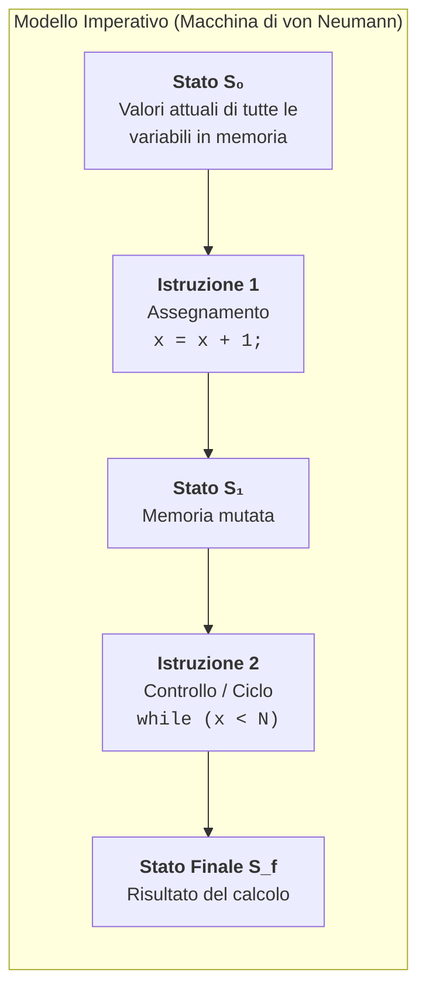

# 4.5.1 - Il paradigma imperativo

Un **paradigma di programmazione** è uno stile concettuale e metodologico con cui un linguaggio di programmazione permette di modellare i problemi ed esprimere i calcoli. I paradigmi si dividono in due grandi famiglie:
- **Paradigmi Imperativi** (Imperativo procedurale, Orientato agli Oggetti): il programmatore descrive **come** (*HOW*) risolvere il problema passo dopo passo, specificando la sequenza esatta di comandi che modificano la memoria del calcolatore.
- **Paradigmi Dichiarativi** (Funzionale, Logico, Query SQL): il programmatore descrive **cosa** (*WHAT*) vuole ottenere (le proprietà matematiche o logiche del risultato), lasciando al motore del linguaggio il compito di stabilire come calcolarlo.

Il linguaggio C è l'esempio per eccellenza del **paradigma imperativo procedurale**.

---

## Fondamenti del paradigma imperativo e architettura di von Neumann

Il paradigma imperativo nasce come astrazione diretta dell'**architettura hardware di von Neumann** (CPU + Memoria RAM collegate da un bus). I suoi tre pilastri concettuali sono:



1. **Lo Stato del programma (*Program State*)**:
   In ogni istante dell'esecuzione, lo **stato** del programma è l'insieme di tutte le coppie $(\text{variabile}, \text{valore})$ presenti in memoria (Stack, Heap, segmento Data), insieme al valore del *Program Counter* (che indica quale istruzione eseguire dopo).
2. **L'Assegnamento distruttivo e la Mutabilità dello stato**:
   Il calcolo avviene **modificando nel tempo il contenuto delle celle di memoria** tramite l'istruzione di assegnamento (`x = espressione;`). A differenza dell'uguaglianza matematica $x = x + 1$ (che sarebbe un'equazione impossibile!), l'assegnamento imperativo `x = x + 1;` legge il vecchio valore dalla cella `x`, vi somma `1` e **sovrascrive distruttivamente** la stessa cella `x` con il nuovo valore.
3. **Il Flusso di Controllo esplicito (*Control Flow*)**:
   L'ordine in cui le istruzioni vengono eseguite è fondamentale (non è possibile scambiare due righe senza rischiare di cambiare il risultato!). Per il **Teorema di Böhm-Jacopini**, qualsiasi algoritmo imperativo può essere espresso combinando tre sole strutture di controllo strutturate (senza bisogno di salti arbitrari `goto`):
   - **Sequenza**: esecuzione lineare di istruzioni una dopo l'altra (`A; B;`);
   - **Selezione (Condizionale)**: scelta tra due rami in base a un predicato booleano (`if / else`, `switch`);
   - **Iterazione (Ciclo)**: ripetizione di un blocco finché vale una condizione (`while`, `for`, `do-while`).

---

## Programmazione Procedurale, Effetti Collaterali e Trasparenza Referenziale

### Astrazione Procedurale

Per evitare che un programma imperativo diventi un unico lunghissimo elenco monolitico di istruzioni, la **programmazione procedurale** (C, Pascal, Fortran) organizza il codice in **procedure e funzioni** (sottoprogrammi):
- Una **procedura** (in C una funzione `void`) viene invocata per l'effetto che produce sullo stato (es. stampare a video, ordinare un array in-place `ordina(v, n)`).
- Una **funzione** calcola e restituisce un valore tramite `return`.

### Effetti Collaterali (*Side Effects*)

In informatica, si dice che una funzione o un'espressione produce un **effetto collaterale (*side effect*)** se, oltre a restituire un eventuale valore di ritorno, **modifica uno stato osservabile all'esterno della funzione stessa**:
- Modifica il valore di una **variabile globale** o di una variabile locale `static`;
- Modifica i dati del chiamante attraverso un **parametro puntatore** (es. `*p = 10;` o `v[i] = 0;`);
- Effettua operazioni di **Input/Output** (scrive su schermo con `printf`, legge da tastiera con `scanf`, modifica un file su disco).

```c
int contatore_globale = 0;

/* Funzione PURA (senza side effects): dipende solo dai suoi parametri
   e non modifica nulla all'esterno. */
int quadrato_puro(int x) {
    return x * x;
}

/* Funzione IMPURA (con side effect): modifica lo stato globale! */
int incrementa_e_somma(int x) {
    contatore_globale++; /* <-- SIDE EFFECT sullo stato globale! */
    return x + contatore_globale;
}
```

### Trasparenza Referenziale (*Referential Transparency*)

Un'espressione si dice **referenzialmente trasparente** se può essere sostituita in qualsiasi punto del programma con il suo valore calcolato senza alterare in alcun modo il comportamento del programma.
Perché una funzione goda di trasparenza referenziale, deve essere una **funzione pura**:
1. A parità di argomenti in ingresso, deve restituire **sempre lo stesso identico risultato**;
2. Non deve produrre **alcun side effect**.

Nel codice sopra:
- `quadrato_puro(4) + quadrato_puro(4)` vale sempre $16 + 16 = 32$ ed è sempre sostituibile con `2 * quadrato_puro(4)` o con `32` (**ha trasparenza referenziale**).
- `incrementa_e_somma(4) + incrementa_e_somma(4)` **NON ha trasparenza referenziale**: la prima chiamata restituisce $4 + 1 = 5$, mentre la seconda chiamata (con lo stesso identico argomento `4`!) restituisce $4 + 2 = 6$, per un totale di $11 \neq 2 \times 5$!

> [!WARNING] Perché l'abuso di stato mutabile globale è pericoloso?
> Quando molte funzioni leggono e modificano le stesse variabili globali tramite side effects:
> - Diventa impossibile capire cosa fa una funzione guardando solo la sua firma (`f(4)` può comportarsi in modo diverso a seconda di quali altre funzioni sono state chiamate prima!);
> - I bug diventano difficili da riprodurre e isolare;
> - In presenza di esecuzione concorrente (*multithreading*), due thread che modificano contemporaneamente la stessa variabile globale causano **Race Conditions** e corruzione dei dati.

---

## Confronto: Approccio Imperativo vs Dichiarativo

Supponiamo di voler calcolare la **somma dei quadrati dei soli numeri pari** presenti in un array $v = [1, 2, 3, 4, 5, 6]$.

| Aspetto | Approccio Imperativo (*"Come fare passo dopo passo"*) | Approccio Dichiarativo (*"Cosa vogliamo calcolare"*) |
| :--- | :--- | :--- |
| **Mentalità** | Crea una variabile accumulatore `somma = 0`, crea un contatore `i = 0`, scorri l'array cella per cella, testa se `v[i]` è pari e in tal caso aggiorna `somma = somma + v[i]*v[i]`. | Definisci l'insieme dei numeri pari di $v$, applica a ciascuno la funzione $x \mapsto x^2$ e riduci con l'operatore $+$: $\sum_{x \in v,\, x \text{ pari}} x^2$. |
| **Gestione dello stato** | Mutazione continua delle variabili `i` e `somma` a ogni iterazione del ciclo. | Nessuna variabile mutata; composizione di trasformazioni su collezioni immutabili. |

```c
/* Approccio IMPERATIVO in C: descrive il "COME" tramite stato mutabile e ciclo */
int somma_quadrati_pari(const int v[], int n) {
    int somma = 0;              /* Stato mutabile 1: accumulatore */
    for (int i = 0; i < n; i++) /* Stato mutabile 2: indice del ciclo */
    {
        if (v[i] % 2 == 0) {    /* Controllo del flusso condizionale */
            somma += v[i] * v[i]; /* Assegnamento distruttivo */
        }
    }
    return somma;
}
```

```python
# Approccio DICHIARATIVO / FUNZIONALE (es. in Python / Haskell / SQL): descrive il "COSA"
somma = sum(x * x for x in v if x % 2 == 0)
```

---

## Esempi guidati

### Esempio 1: Tracciamento della tabella di stato di un algoritmo imperativo

**Problema**: Tracciare l'evoluzione dello stato $\sigma = (\texttt{n}, \texttt{inv})$ per l'algoritmo imperativo che inverte le cifre di un intero positivo `n = 123`.

```c
#include <stdio.h>

int inverti_cifre(int n) {
    int inv = 0;
    /* Stato iniziale S0: (n = 123, inv = 0) */
    while (n > 0) {
        int cifra = n % 10;
        inv = inv * 10 + cifra;
        n = n / 10;
    }
    return inv;
}
```

**Tabella di evoluzione dello stato**:

| Passo | Condizione `n > 0` | Valore di `cifra` | Nuovo stato di `inv` | Nuovo stato di `n` |
| :---: | :---: | :---: | :---: | :---: |
| Stato iniziale $S_0$ | — | — | `0` | `123` |
| Iterazione 1 ($S_1$) | $123 > 0$ (Vero) | $123 \bmod 10 = 3$ | $0 \cdot 10 + 3 = \mathbf{3}$ | $123 / 10 = \mathbf{12}$ |
| Iterazione 2 ($S_2$) | $12 > 0$ (Vero) | $12 \bmod 10 = 2$ | $3 \cdot 10 + 2 = \mathbf{32}$ | $12 / 10 = \mathbf{1}$ |
| Iterazione 3 ($S_3$) | $1 > 0$ (Vero) | $1 \bmod 10 = 1$ | $32 \cdot 10 + 1 = \mathbf{321}$ | $1 / 10 = \mathbf{0}$ |
| Fine ciclo | $0 > 0$ (Falso) | — | Restituisce **`321`** | `0` |

---

### Esempio 2: Rifattorizzare una funzione impura in una funzione pura

**Problema**: Trasformare una funzione che calcola il prezzo scontato appoggiandosi a variabili globali (impura e fragile) in una funzione pura e referenzialmente trasparente.

```c
/* === VERSIONE IMPURA (Sconsigliata) === */
double tasso_sconto_globale = 0.20;
double totale_incassato = 0.0;

double applica_sconto_impura(double prezzo) {
    double finale = prezzo * (1.0 - tasso_sconto_globale);
    totale_incassato += finale; /* Side effect nascosto! */
    return finale;
}

/* === VERSIONE PURA (Consigliata: trasparente e facilmente testabile) === */
double calcola_prezzo_scontato(double prezzo, double tasso_sconto) {
    return prezzo * (1.0 - tasso_sconto);
}
```

---

## Errori frequenti

1. **Affidarsi all'ordine di valutazione di sotto-espressioni con side effects**:
   In C, gli operatori di incremento `++` e `--` producono un side effect immediato sulla variabile. Scrivere espressioni come:
   ```c
   int i = 5;
   int y = i++ + ++i; /* UNDEFINED BEHAVIOR! */
   a[i] = i++;        /* UNDEFINED BEHAVIOR! */
   ```
   modifica la stessa variabile più volte senza un *sequence point* intermedio: lo standard C dichiara questo comportamento **indefinito** (compilatori diversi produrranno risultati diversi!).
2. **Modificare per errore i dati di input passati tramite puntatore**:
   Nel paradigma imperativo il passaggio di un array `int v[]` passa l'indirizzo dell'array originale. Se una funzione `double calcola_mediana(int v[], int n)` ordina `v` sul posto per trovare l'elemento centrale, **distrugge l'ordine dell'array nel `main` chiamante** (side effect inatteso!). Se una funzione non deve modificare un array, il parametro va sempre dichiarato `const int v[]`.
3. **Confondere `=` (assegnamento imperativo di stato) con `==` (predicato di uguaglianza)**:
   Scrivere `if (stato = 0)` anziché `if (stato == 0)` muta lo stato azzerando la variabile `stato` e valuta l'espressione come falsa (`0`).

---

## Esercizi di prova

1. **(Base — Individuazione dei Side Effects)**
   Analizza le seguenti 4 funzioni C e indica per ciascuna se è **pura** (priva di side effects e referenzialmente trasparente) oppure **impura**, specificando qual è l'effetto collaterale:
   ```c
   int g = 10;
   int f1(int a, int b) { return (a > b) ? a : b; }
   int f2(int a) { static int c = 0; c += a; return c; }
   int f3(int *p) { *p = *p + 1; return *p; }
   int f4(int a) { printf("Valore: %d\n", a); return a * 2; }
   ```
   > [!tip]- Soluzione
   > - **`f1`**: **Pura** e referenzialmente trasparente. Dipende solo dai suoi parametri per valore `a` e `b` e non modifica alcuno stato esterno (non usa la variabile globale `g`).
   > - **`f2`**: **Impura**. Modifica la variabile locale `static c` che mantiene lo stato tra le chiamate (`f2(5)` restituisce `5` la prima volta e `10` la seconda!).
   > - **`f3`**: **Impura**. Modifica la memoria del chiamante attraverso la dereferenziazione del puntatore `*p`.
   > - **`f4`**: **Impura**. Sebbene restituisca sempre `a * 2`, esegue un'operazione di I/O (`printf`) che modifica lo stato dello stream di output standard (`stdout`). Se sostituissimo `f4(3) + f4(3)` con `2 * f4(3)`, il messaggio verrebbe stampato una sola volta anziché due!

2. **(Base — Equivalenza per il Teorema di Böhm-Jacopini)**
   Riscrivi il seguente frammento imperativo che usa `goto` utilizzando esclusivamente costrutti strutturati (`while` e `if/else`):
   ```c
   int s = 0, i = 1;
   inizio:
       if (i > 10) goto fine;
       if (i % 2 != 0) goto salta;
       s = s + i;
   salta:
       i = i + 1;
       goto inizio;
   fine:
       printf("%d\n", s);
   ```
   > [!tip]- Soluzione
   > ```c
   > int s = 0, i = 1;
   > while (i <= 10) {
   >     if (i % 2 == 0) {
   >         s = s + i;
   >     }
   >     i = i + 1;
   > }
   > printf("%d\n", s);
   > ```

3. **(Intermedio — Ordine delle istruzioni e mutazione dello stato)**
   Date due variabili intere `a` e `b`, considera la sequenza di 3 assegnamenti senza variabile temporanea:
   ```c
   a = a + b;
   b = a - b;
   a = a - b;
   ```
   Traccia lo stato $(a, b)$ partendo da $a = 7, b = 12$ e dimostra algebricamente che per ogni coppia $(a_0, b_0)$ (in assenza di overflow) lo stato finale è $(b_0, a_0)$. Cosa succede invece se invertiamo le prime due righe?
   > [!tip]- Soluzione
   > - **Stato iniziale**: $(a = 7, b = 12)$ — in generale $(a_0, b_0)$.
   > - **Dopo `a = a + b;`**: $a = 7 + 12 = 19$, $b = 12$ — in generale $(a_0 + b_0,\, b_0)$.
   > - **Dopo `b = a - b;`**: $b = 19 - 12 = 7$, $a = 19$ — in generale $(a_0 + b_0,\, (a_0 + b_0) - b_0) = (a_0 + b_0,\, a_0)$.
   > - **Dopo `a = a - b;`**: $a = 19 - 7 = 12$, $b = 7$ — in generale $((a_0 + b_0) - a_0,\, a_0) = (b_0, a_0)$. I due valori sono stati scambiati!
   > - Se invertiamo le prime due righe (`b = a - b; a = a + b; a = a - b;`), otteniamo:
   >   1. $b = a_0 - b_0$
   >   2. $a = a_0 + (a_0 - b_0) = 2a_0 - b_0$
   >   3. $a = (2a_0 - b_0) - (a_0 - b_0) = a_0$.
   >   Lo stato finale diventa $(a_0, a_0 - b_0)$, che **non** scambia affatto i valori: nel paradigma imperativo l'ordine sequenziale delle mutazioni di stato è determinante.

4. **(Intermedio — Separazione tra calcolo puro e mutazione in-place)**
   La funzione `void normalizza(int v[], int n)` sostituisce ogni elemento negativo di `v` con `0` e restituisce tramite una variabile globale `int modificati` quanti elementi sono stati cambiati. Riscrivila eliminando la variabile globale e creando una versione che non modifica l'array originale ma scrive il risultato in un array di destinazione `int dest[]`.
   > [!tip]- Soluzione
   > ```c
   > /* Restituisce il numero di elementi negativi azzerati, lasciando src intatto */
   > int normalizza_puro(const int src[], int dest[], int n) {
   >     int cont_modificati = 0;
   >     for (int i = 0; i < n; i++) {
   >         if (src[i] < 0) {
   >             dest[i] = 0;
   >             cont_modificati++;
   >         } else {
   >             dest[i] = src[i];
   >         }
   >     }
   >     return cont_modificati;
   > }
   > ```

5. **(Esame — Trasparenza referenziale e ottimizzazione delle chiamate)**
   Considera il ciclo:
   ```c
   for (int i = 0; i < n; i++) {
       ris[i] = v[i] * calcola_fattore(k);
   }
   ```
   Sotto quali condizioni il compilatore (o il programmatore) può spostare la chiamata `int f = calcola_fattore(k);` **fuori dal ciclo** (*Loop-Invariant Code Motion*), riducendo le chiamate da $n$ a $1$ senza cambiare il comportamento del programma?
   > [!tip]- Soluzione
   > Lo spostamento fuori dal ciclo è semanticamente equivalente **se e solo se** `calcola_fattore(k)` gode di **trasparenza referenziale** rispetto al corpo del ciclo, ovvero:
   > 1. Il valore di `k` non viene modificato durante il ciclo;
   > 2. `calcola_fattore` è una **funzione pura**: non modifica variabili `static` o globali da cui dipende il proprio risultato, non effettua I/O (altrimenti stamperebbe 1 volta invece di $n$) e non modifica l'array `v` o `ris`.
   > Se invece `calcola_fattore` contenesse un contatore `static` o facesse una `printf`, spostarla fuori dal ciclo cambierebbe il risultato o l'output del programma!

---

## Provenienza del materiale

- Dispensa ufficiale del corso: `C1PROG1U4L5_Paradigma_Imperativo tag accessibilità.pdf` (Unità 4, Lezione 5 — *Il paradigma imperativo*).
