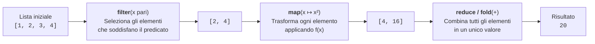
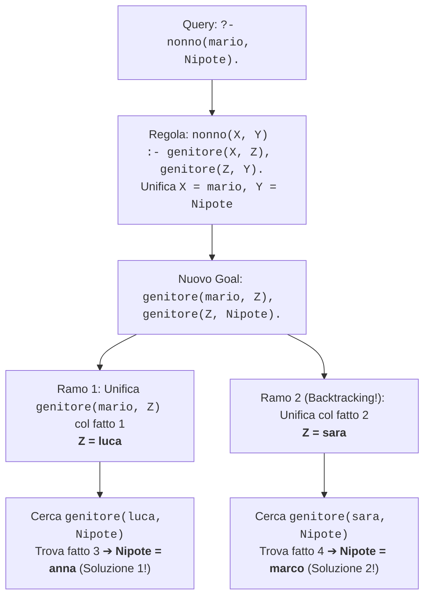

# Paradigmi funzionale e logico

## Come descrivere una trasformazione o una relazione

A fianco del paradigma imperativo (basato sulla macchina di von Neumann e sulla modifica passo-passo dello stato in memoria), l'informatica teorica ha sviluppato i **paradigmi dichiarativi**, in cui il programma non è una sequenza di ordini per la CPU, ma una descrizione formale di **cosa** è il risultato cercato:
1. Il **Paradigma Funzionale** (Lisp, Scheme, ML, Haskell, OCaml, Erlang, e costrutti funzionali in Python/JavaScript/Rust), fondato sul **$\lambda$-calcolo (Lambda Calcolo)** di Alonzo Church (1936): il calcolo è la **valutazione di funzioni matematiche pure**.
2. Il **Paradigma Logico** (Prolog, Datalog, Answer Set Programming), fondato sulla **Logica dei Predicati del Primo Ordine**: il programma è una base di conoscenza di **fatti e regole logiche**, e l'esecuzione consiste nel dimostrare un teorema (interrogazione o *query*).

---

## 1. Il Paradigma Funzionale

Nel paradigma funzionale puro, una funzione non è una procedura che altera variabili in RAM, ma una **mappa matematica** $f: A \to B$ che associa ad ogni valore di input un unico valore di output.

### Principi cardine della programmazione funzionale

1. **Immutabilità dei dati (Assenza di assegnamento distruttivo)**:
   Non esistono variabili mutabili il cui valore cambia nel tempo! Una volta legato un simbolo a un valore (`let x = 5`), quel legame resta immutabile. Per "modificare" una lista non si sovrascrivono le sue celle, ma si costruisce una **nuova lista** trasformata lasciando intatta l'originale.
2. **Funzioni pure, assenza di Side Effects e Trasparenza Referenziale**:
   Poiché non esiste stato globale mutabile, una funzione chiamata con gli stessi argomenti restituisce **sempre** lo stesso risultato. Ogni espressione è referenzialmente trasparente, rendendo immediata la parallelizzazione su più core (nessuna *race condition*!).
3. **Ricorsione al posto dei cicli iterativi**:
   In un ciclo `while (i < n) { i++; }` è indispensabile mutare la variabile `i` ad ogni iterazione. Poiché nel funzionale puro le variabili sono immutabili, i cicli non esistono: ogni iterazione viene espressa tramite **ricorsione** (spesso ottimizzata in coda tramite *Tail Call Optimization*).
4. **Funzioni come "Cittadini di Prima Classe" (*First-Class Citizens*) e di Ordine Superiore (*Higher-Order Functions*)**:
   Le funzioni sono valori esattamente come i numeri interi: possono essere assegnate a variabili, passate come argomento ad altre funzioni e restituite come risultato. Una funzione che prende in input o restituisce un'altra funzione si chiama **funzione di ordine superiore**.

### La triade delle funzioni di ordine superiore: `map`, `filter`, `reduce` (`fold`)

Invece di scrivere cicli `for` manuali, nella programmazione funzionale si elaborano le collezioni componendo tre operatori universali:



1. **`map(f, lista)`**: applica la funzione $f$ a ciascun elemento di $[x_1, x_2, \dots, x_n]$ producendo la nuova lista $[f(x_1), f(x_2), \dots, f(x_n)]$.
2. **`filter(p, lista)`**: applica il predicato booleano $p$ ad ogni elemento e restituisce una nuova lista contenente solo gli elementi $x_i$ per cui $p(x_i) = \text{Vero}$.
3. **`reduce(op, lista, init)`** (detta anche **`fold`**): combina progressivamente tutti gli elementi della lista tramite l'operatore binario `op` a partire dal valore neutro `init` (es. sommatoria o produttoria).

```python
# Esempio di stile funzionale puro in Python (con funzioni anonime lambda)
from functools import reduce

numeri = [1, 2, 3, 4, 5, 6]

# 1. filter: tieni solo i numeri pari -> [2, 4, 6]
pari = list(filter(lambda x: x % 2 == 0, numeri))

# 2. map: eleva ciascuno al quadrato -> [4, 16, 36]
quadrati = list(map(lambda x: x * x, pari))

# 3. reduce: somma tutti gli elementi -> 4 + 16 + 36 = 56
somma_totale = reduce(lambda acc, x: acc + x, quadrati, 0)
```

> [!TIP] Come si realizzano le funzioni di ordine superiore in C?
> Anche in C è possibile passare una funzione come argomento a un'altra funzione usando i **puntatori a funzione**! Ad esempio, la funzione standard `qsort` di `<stdlib.h>` è una funzione di ordine superiore che riceve un puntatore alla funzione di confronto `int (*compar)(const void *, const void *)`.

---

## 2. Il Paradigma Logico (Prolog)

Nel **paradigma logico**, ideato negli anni '70 da Robert Kowalski e Alain Colmerauer (creatore del linguaggio **Prolog**, *PROgramming in LOGic*), programmare non significa scrivere né comandi imperativi né funzioni da valutare, bensì **dichiarare relazioni vere** su un dominio del discorso tramite **Clausole di Horn** (un sottoinsieme della logica dei predicati del primo ordine).

### I 3 mattoni di un programma Prolog

In Prolog i nomi che iniziano con lettera **minuscola** (`mario`, `luca`, `genitore`) sono **costanti (atomi)** o nomi di predicati, mentre i nomi che iniziano con lettera **MAIUSCOLA** (`X`, `Y`, `Z`, `Nonno`) sono **variabili logiche**.

1. **Fatti (*Facts*)**: Asserzioni incondizionatamente vere sulle relazioni tra oggetti del mondo. Terminano con un punto fermo `.`.
   ```prolog
   % genitore(X, Y) significa: "X è genitore di Y"
   genitore(mario, luca).
   genitore(mario, sara).
   genitore(luca, anna).
   genitore(sara, marco).
   ```

2. **Regole (*Rules*)**: Implicazioni logiche della forma `Testa :- Corpo.` dove il simbolo `:-` si legge **"se"** ($\leftarrow$, implicazione inversa) e la virgola `,` nel corpo indica la **congiunzione logica AND ($\land$)**.
   ```prolog
   % X è nonno/a di Y SE X è genitore di Z E Z è genitore di Y
   nonno(X, Y) :- genitore(X, Z), genitore(Z, Y).

   % Regola ricorsiva: X è antenato di Y
   antenato(X, Y) :- genitore(X, Y).                   % Caso base
   antenato(X, Y) :- genitore(X, Z), antenato(Z, Y).   % Passo ricorsivo
   ```

3. **Interrogazioni (*Queries / Goals*)**: Domande poste dall'utente all'interprete (`?-`) per verificare se un fatto è deducibile o per trovare **per quali valori delle variabili** un predicato è vero.
   ```prolog
   ?- nonno(mario, anna).
   true.

   ?- nonno(mario, Nipote).
   Nipote = anna ;
   Nipote = marco.
   ```

### Il motore inferenziale: Unificazione, Risoluzione SLD e Backtracking

Come fa Prolog a rispondere a una query senza che il programmatore abbia scritto un solo ciclo `for`? L'interprete Prolog applica automaticamente due meccanismi:

1. **Unificazione (*Pattern Matching bidirezionale*)**:
   Dati due termini logici (es. l'obiettivo corrente `genitore(mario, Z)` e un fatto nella base dati `genitore(mario, luca)`), l'unificazione cerca la sostituzione più generale delle variabili ($\{Z / \text{luca}\}$) che rende i due termini sintatticamente identici.
2. **Risoluzione SLD e Backtracking (Ricerca in profondità con ritorno sui propri passi)**:
   L'interprete esplora l'albero delle regole dall'alto verso il basso e da sinistra verso destra. Quando un sotto-obiettivo fallisce (o quando l'utente chiede una soluzione alternativa premendo `;`), Prolog effettua automaticamente **backtracking**: annulla l'ultimo legame di variabile effettuato (*unbinding*), risale all'ultimo punto di scelta (*choice point*) e prova la clausola successiva!



---

## Tabella comparativa dei tre paradigmi

| Caratteristica | Paradigma Imperativo (es. C) | Paradigma Funzionale (es. Haskell, Lisp) | Paradigma Logico (es. Prolog) |
| :--- | :--- | :--- | :--- |
| **Modello teorico di riferimento** | Macchina di von Neumann / Macchina di Turing | $\lambda$-calcolo (Lambda Calcolo di Church) | Logica dei Predicati del Primo Ordine (Clausole di Horn) |
| **Stile di programmazione** | **Imperativo** (*Come* calcolare passo passo) | **Dichiarativo** (*Cosa* calcolare tramite funzioni) | **Dichiarativo** (*Quali* relazioni sono vere) |
| **Unità fondamentale** | Istruzione / Procedura che modifica lo stato | Funzione matematica pura $f: A \to B$ | Predicato / Relazione $R(x_1, \dots, x_n)$ |
| **Variabili** | Celle di memoria **mutabili** (assegnamento distruttivo) | Simboli **immutabili** legati a valori | Variabili logiche istanziate tramite **unificazione** |
| **Meccanismo di ripetizione** | Cicli espliciti (`for`, `while`) + ricorsione | **Ricorsione** e funzioni di ordine superiore (`map`, `filter`, `fold`) | **Ricorsione** di regole + **Backtracking** automatico |
| **Effetti collaterali (Side effects)** | Centrali (mutazione di stato e puntatori) | Assenti nel funzionale puro (Trasparenza Referenziale) | Assenti nella logica pura |
| **Direzionalità del calcolo** | Unidirezionale (dagli input fissati all'output) | Unidirezionale (dagli argomenti al valore di ritorno) | **Multidirezionale** (lo stesso predicato può verificare o generare input/output) |

---

## La stessa informazione come funzione o come relazione

Una funzione di ordine superiore come `map(f, xs)` riceve una funzione da applicare a ogni elemento. Se `f` è pura, possiamo sostituire una sua chiamata con il valore risultante senza cambiare il comportamento osservabile. Una callback C permette di passare il comportamento, ma può leggere o modificare stato esterno. La simulazione di `map` in C richiede quindi un contratto di purezza se vogliamo usare lo stesso ragionamento.

In programmazione logica, il fatto `genitore(anna, luca).` descrive una relazione. Una regola per `nonno(X, Z)` può richiedere `genitore(X, Y), genitore(Y, Z)`. Aggiungendo il fatto `genitore(luca, mia).`, la domanda `nonno(anna, Chi)` ammette `Chi = mia`. Una simulazione C può attraversare tabelle per cercare lo stesso risultato. L'unificazione e la ricerca delle soluzioni sono allora implementate esplicitamente.

---

## Esempi guidati

### Esempio 1: Simulare `map` e `filter` in C con puntatori a funzione

Anche se il C è un linguaggio imperativo, possiamo adottare uno stile funzionale scrivendo funzioni di ordine superiore che ricevono **puntatori a funzione** come argomento:

```c
#include <stdio.h>

/* Funzione di ordine superiore MAP: applica f(x) ad ogni elemento di src */
void map_array(const int src[], int dest[], int n, int (*f)(int)) {
    for (int i = 0; i < n; i++) {
        dest[i] = f(src[i]);
    }
}

/* Funzione di ordine superiore REDUCE (FOLD): combina gli elementi con op(acc, x) */
int reduce_array(const int src[], int n, int init, int (*op)(int, int)) {
    int acc = init;
    for (int i = 0; i < n; i++) {
        acc = op(acc, src[i]);
    }
    return acc;
}

/* Funzioni pure da passare come argomento */
int triplo(int x) { return x * 3; }
int somma(int a, int b) { return a + b; }
int prodotto(int a, int b) { return a * b; }

int main(void) {
    int v[4] = {1, 2, 3, 4};
    int v_triplo[4];

    map_array(v, v_triplo, 4, triplo); /* v_triplo diventa {3, 6, 9, 12} */

    int s = reduce_array(v_triplo, 4, 0, somma);    /* 3 + 6 + 9 + 12 = 30 */
    int p = reduce_array(v_triplo, 4, 1, prodotto); /* 3 * 6 * 9 * 12 = 1944 */

    printf("Somma dei tripli = %d, Prodotto dei tripli = %d\n", s, p);
    return 0;
}
```

---

### Esempio 2: Lo stesso problema risolto nei tre paradigmi (Appartenenza a una lista)

**Problema**: Verificare se l'elemento $x$ appartiene a una sequenza/lista $L$.

1. **Imperativo (C)**: scorriamo un array mutando l'indice `i`:
   ```c
   int appartiene_imp(const int v[], int n, int x) {
       for (int i = 0; i < n; i++) {
           if (v[i] == x) return 1;
       }
       return 0;
   }
   ```
2. **Funzionale (Python / Haskell style, senza cicli né mutazioni)**: una lista è vuota `[]` oppure è formata da una testa `head` e una coda `tail`:
   ```python
   def appartiene_funz(lista, x):
       if not lista:              # Caso base: lista vuota -> False
           return False
       return (lista[0] == x) or appartiene_funz(lista[1:], x)
   ```
3. **Logico (Prolog)**: dichiariamo le due clausole di verità per il predicato `membro(X, Lista)` (dove `[Testa | Coda]` scompone la lista per unificazione):
   ```prolog
   % Caso base (Fatto): X è membro di una lista se X è proprio la Testa della lista.
   membro(X, [X | _]).

   % Passo ricorsivo (Regola): X è membro della lista se X è membro della Coda.
   membro(X, [_ | Coda]) :- membro(X, Coda).
   ```
   **Meraviglia della multidirezionalità in Prolog**:
   - Se chiediamo `?- membro(2, [1, 2, 3]).` Prolog risponde `true.` (verifica).
   - Se chiediamo `?- membro(E, [1, 2, 3]).` con `E` variabile, Prolog genera uno per uno tutti gli elementi: `E = 1 ; E = 2 ; E = 3`!

---

## Errori frequenti

> [!caution] Errori da evitare
> 1. **In Prolog, scambiare lettere minuscole (costanti) e MAIUSCOLE (variabili)**:
>    Scrivere `genitore(Mario, luca).` non dichiara che l'individuo `mario` è genitore di `luca`, ma che **qualsiasi oggetto `Mario` dell'universo** (variabile universale!) è genitore di `luca`! I nomi di individui costanti devono sempre iniziare con una lettera minuscola (`mario`).
> 2. **In Prolog, scrivere `X = X + 1` pensando che faccia un calcolo aritmetico**:
>    In Prolog l'operatore `=` indica l'**unificazione sintattica**, non la valutazione aritmetica! Se `X` vale `3`, `3 = 3 + 1` **fallisce** (`false`) perché il termine `3` non unifica col termine composto `+(3, 1)`. Per valutare un'espressione aritmetica in Prolog si usa l'operatore `is`: `X1 is X + 1` (usando una **nuova variabile** `X1`, perché `X` già istanziata non può cambiare valore!).
> 3. **Nel paradigma funzionale, modificare in-place una lista passata come argomento**:
>    In linguaggi ibridi come Python o JavaScript, chiamare metodi distruttivi come `lista.append(x)` o `lista.sort()` dentro una funzione viola l'immutabilità e introduce side effects sul chiamante (meglio usare `nuova = sorted(lista)` o `lista + [x]`).

---

## Esercizi di prova

### Esercizio 1. Pipeline funzionale `map` / `filter` / `reduce` (Base)

Data la lista $L = [1, 2, 3, 4, 5]$, determina passo dopo passo il valore prodotto dall'espressione funzionale:

$$
\text{reduce}\Big((a, b) \mapsto a + b,\; \text{map}\big(x \mapsto 2x + 1,\; \text{filter}(x \mapsto x \ge 3,\, L)\big),\; 0\Big)
$$

> [!tip]- Soluzione
> Valutiamo dall'interno verso l'esterno:
> 1. **`filter(x >= 3, [1, 2, 3, 4, 5])`**: mantiene solo gli elementi $\ge 3$, producendo la lista `[3, 4, 5]`.
> 2. **`map(x -> 2x + 1, [3, 4, 5])`**: applica $2x + 1$ a ciascun elemento:
>    - $2(3) + 1 = 7$
>    - $2(4) + 1 = 9$
>    - $2(5) + 1 = 11$
>    Risultato del `map`: `[7, 9, 11]`.
> 3. **`reduce((a, b) -> a + b, [7, 9, 11], 0)`**: somma tutti gli elementi partendo da `0`:
>    $((0 + 7) + 9) + 11 = \mathbf{27}$.

### Esercizio 2. Lettura e interrogazione di una base di conoscenza Prolog (Base)

Data la seguente base di conoscenza Prolog:
```prolog
amico(anna, luca).
amico(luca, marco).
amico(anna, sara).
studia(luca, informatica).
studia(marco, matematica).
studia(sara, informatica).

compagno_studio(X, Y) :- amico(X, Y), studia(Y, informatica).
```
Quali soluzioni restituisce l'interprete Prolog per la query `?- compagno_studio(anna, Chi).`? Mostra i passi di unificazione e backtracking.

> [!tip]- Soluzione
> L'interprete unifica la query con la testa della regola ponendo `X = anna` e `Y = Chi`, e deve soddisfare il corpo `amico(anna, Chi), studia(Chi, informatica).`:
> 1. **Primo tentativo**: `amico(anna, Chi)` unifica col 1° fatto `amico(anna, luca)` legando `Chi = luca`. Si passa al secondo goal `studia(luca, informatica)`, che unifica col fatto `studia(luca, informatica)` $\to$ **Successo! Prima soluzione: `Chi = luca`**.
> 2. **Backtracking**: L'utente chiede altre soluzioni (`;`). Prolog annulla `Chi = luca` e cerca altri fatti per `amico(anna, Chi)`. Il 2° fatto `amico(luca, marco)` non unifica (`anna \= luca`). Il 3° fatto `amico(anna, sara)` unifica legando `Chi = sara`. Si passa a `studia(sara, informatica)`, che è vero $\to$ **Successo! Seconda soluzione: `Chi = sara`**.
> 3. Non ci sono altri fatti: la ricerca termina con `Chi = luca ; Chi = sara`.

### Esercizio 3. Scrittura di regole logiche in Prolog: `fratello` (Intermedio)

Usando il predicato `genitore(X, Y)` ("`X` è genitore di `Y`"), scrivi in Prolog la regola per il predicato `fratello(A, B)` ("`A` e `B` sono fratelli/sorelle, cioè hanno almeno un genitore in comune"). Quale condizione aggiuntiva è necessaria affinché una persona non risulti fratello di se stessa?

> [!tip]- Soluzione
> Se scrivessimo solo `fratello(A, B) :- genitore(G, A), genitore(G, B).`, interrogando `?- fratello(luca, luca).` Prolog risponderebbe erroneamente `true` ponendo `A = luca` e `B = luca`! Dobbiamo imporre che `A` e `B` non unifichino (`A \= B`):
> ```prolog
> fratello(A, B) :-
>     genitore(G, A),
>     genitore(G, B),
>     A \= B.
> ```

### Esercizio 4. Implementazione di `filter` in C con allocazione dinamica (Intermedio)

Scrivi in C la funzione di ordine superiore `int *filter_dinamico(const int v[], int n, int (*pred)(int), int *out_n)` che riceve un array `v` di `n` interi e un puntatore a funzione predicato `pred`, e restituisce un nuovo array allocato dinamicamente contenente solo gli elementi `x` per cui `pred(x)` restituisce un valore diverso da `0`.

> [!tip]- Soluzione
> ```c
> #include <stdlib.h>
>
> int *filter_dinamico(const int v[], int n, int (*pred)(int), int *out_n) {
>     if (!v || n <= 0 || !pred || !out_n) {
>         if (out_n) *out_n = 0;
>         return NULL;
>     }
>     int conta = 0;
>     for (int i = 0; i < n; i++) {
>         if (pred(v[i])) conta++;
>     }
>     *out_n = conta;
>     if (conta == 0) return NULL;
>
>     int *ris = (int *)malloc(conta * sizeof(int));
>     if (!ris) {
>         *out_n = 0;
>         return NULL;
>     }
>     int j = 0;
>     for (int i = 0; i < n; i++) {
>         if (pred(v[i])) {
>             ris[j++] = v[i];
>         }
>     }
>     return ris;
> }
> ```

### Esercizio 5. Somma degli elementi di una lista in Funzionale e in Prolog (Avanzato)

Esprimi il calcolo della somma degli elementi di una lista di numeri:
1. Come funzione ricorsiva pura (senza cicli né variabili mutabili);
2. Come predicato Prolog `somma_lista(Lista, Somma)` specificando il fatto base per la lista vuota `[]` e la regola ricorsiva per `[Testa | Coda]`.

> [!tip]- Soluzione
> 1. **Formulazione Funzionale ricorsiva**:
>
>    $$
>    \text{somma}(L) = \begin{cases} 0 & \text{se } L = [] \\ \text{head}(L) + \text{somma}(\text{tail}(L)) & \text{se } L \neq [] \end{cases}
>    $$
>
>    In Python funzionale:
>    ```python
>    def somma_funz(lista):
>        return 0 if not lista else lista[0] + somma_funz(lista[1:])
>    ```
> 2. **Formulazione Logica in Prolog**:
>    ```prolog
>    % Caso base: la somma della lista vuota è 0.
>    somma_lista([], 0).
>
>    % Passo ricorsivo: la somma di [Testa | Coda] è Somma se
>    % SommaCoda è la somma di Coda E Somma vale Testa + SommaCoda.
>    somma_lista([Testa | Coda], Somma) :-
>        somma_lista(Coda, SommaCoda),
>        Somma is Testa + SommaCoda.
>    ```

---

## Provenienza del materiale

- Dispensa ufficiale del corso: `C1PROG1U4L6_Paradigmi_Funzionale_e_Logico tag accessibilità.pdf` (Unità 4, Lezione 6 — *I paradigmi funzionale e logico*).
- Marco Anisetti, *Memoria*, `Appunti_di_Fine_Unità_4.pdf`, cap. 5, paradigmi funzionale e logico.
