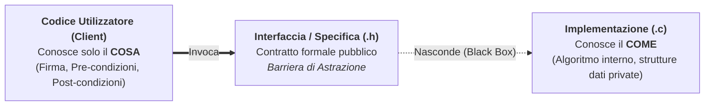
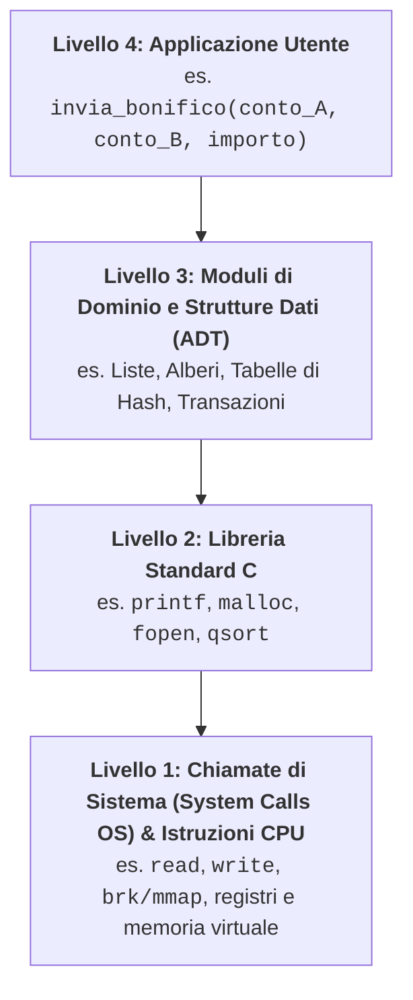

# Principi di astrazione

## Come isolare le decisioni che possono cambiare

I sistemi software moderni sono composti da centinaia di migliaia o milioni di righe di codice. La mente umana, tuttavia, riesce a tenere sotto controllo solo una manciata di dettagli contemporaneamente. Come è possibile allora progettare, comprendere e mantenere programmi così vasti senza perdersi nella complessità?

Lo strumento intellettuale fondamentale dell'informatica per dominare la complessità è l'**astrazione** (dal latino *abstrahere*, "trarre fuori, isolare l'essenziale"). Astrarre significa **concentrarsi sulle proprietà essenziali di un'entità rispetto allo scopo corrente, ignorando deliberatamente i dettagli secondari o implementativi**.

---

## Separazione tra "Cosa" (Interfaccia) e "Come" (Implementazione)

Quando guidiamo un'automobile, interagiamo con una semplice **interfaccia** (volante, pedale dell'acceleratore, pedale del freno) senza dover conoscere i dettagli chimici della combustione interna o il funzionamento della centralina elettronica (l'**implementazione**). Se sostituiamo un motore termico con uno elettrico mantenendo gli stessi pedali e lo stesso volante, il guidatore può continuare a guidare senza cambiare le proprie abitudini.

Nel software vale esattamente lo stesso principio di **separazione delle preoccupazioni (*Separation of Concerns*)**:



- **Specifica / Interfaccia (il *COSA*)**: Descrive il comportamento osservabile dall'esterno del componente (quali dati riceve, quale risultato garantisce). In C corrisponde tipicamente al file header `.h` commentato.
- **Implementazione (il *COME*)**: Contiene il codice effettivo, le scelte algoritmiche e i dettagli di basso livello che realizzano la specifica. In C corrisponde al file sorgente `.c`.
- **Barriera di astrazione (*Black Box*)**: Il client usa il componente come una "scatola nera". Finché l'interfaccia non cambia, possiamo sostituire l'algoritmo interno (ad esempio passando da *Bubble Sort* a *Quick Sort* dentro una funzione `ordina()`) senza dover modificare una sola riga del codice chiamante!

---

## Le due dimensioni dell'astrazione nel software

Nei linguaggi di programmazione utilizziamo due forme complementari di astrazione:

### 1. Astrazione Procedurale e Funzionale (Astrazione sulle operazioni)

Consiste nel dare un **nome simbolico** a una sequenza arbitrariamente complessa di istruzioni, parametrizzandola rispetto ai dati su cui opera.
- **Generalizzazione tramite Parametrizzazione**: Invece di scrivere un blocco di codice che calcola solo la radice quadrata di `25`, astraiamo il valore concreto in un **parametro formale** `double x` e definiamo `double sqrt(double x)`.

#### Il Contratto di una procedura: Pre-condizioni e Post-condizioni (*Design by Contract*)

Una buona astrazione procedurale è definita da un **contratto formale** tra chi *chiama* la funzione (Client) e chi la *implementa* (Fornitore/Supplier):
1. **Pre-condizione (*Precondition* — $\text{PRE}$)**: La condizione sugli argomenti di ingresso e sullo stato che **il chiamante si impegna a garantire vera PRIMA** di invocare la funzione (es. per `radice_quadrata(x)`: $\text{PRE}: x \ge 0$; per `ricerca_binaria(v, n, k)`: $\text{PRE}: v \neq \texttt{NULL} \land n \ge 0 \land v \text{ è ordinato}$).
2. **Post-condizione (*Postcondition* — $\text{POST}$)**: La proprietà sul valore restituito e sullo stato finale che **la funzione garantisce vera AL TERMINE** dell'esecuzione, **a patto che la pre-condizione sia stata rispettata** (es. $\text{POST}: \text{ris} \ge 0 \land |\text{ris}^2 - x| < \varepsilon$).

```c
#include <assert.h>
#include <math.h>

/**
 * @brief Calcola la radice quadrata approssimata col metodo di Erone.
 * @pre   x >= 0.0  e  eps > 0.0
 * @post  Restituisce r >= 0 tale che |r * r - x| <= eps
 */
double radice_erone(double x, double eps) {
    /* Verifica difensiva della PRE-CONDIZIONE in fase di debug */
    assert(x >= 0.0 && eps > 0.0);

    if (x == 0.0) return 0.0;
    double r = x;
    while (fabs(r * r - x) > eps) {
        r = 0.5 * (r + x / r);
    }
    return r;
}
```

### 2. Astrazione dei Dati (Astrazione sulle informazioni)

Consiste nel separare il **significato logico** di un tipo di dato e le operazioni che ha senso compiere su di esso (es. una *Data del calendario*, un *Numero Complesso*, una *Pila di richieste*) dal modo concreto in cui quei bit sono rappresentati nella memoria RAM (es. tre interi `gg, mm, aaaa` oppure un singolo intero che conta i giorni trascorsi dal `1970-01-01`). Questo concetto porta ai **Tipi di Dato Astratti (ADT)** e agli **Oggetti**.

---

## Gerarchie di astrazione, Coesione e Accoppiamento

Un sistema ben progettato è organizzato in **livelli gerarchici di astrazione** (*Levels of Abstraction*), dove ogni livello poggia sui servizi offerti dal livello immediatamente inferiore senza conoscerne i dettagli interni:



Per valutare la qualità della scomposizione in moduli e astrazioni di un programma si usano due metriche architetturali fondamentali:

| Metrica | Definizione | Obiettivo di qualità | Perché è importante |
| :--- | :--- | :--- | :--- |
| **Coesione (*Cohesion*)** | Misura quanto gli elementi interni a **uno stesso modulo/funzione** sono strettamente correlati e cooperano per **un unico scopo ben definito**. | **ALTA Coesione** (*Single Responsibility*) | Una funzione che fa una sola cosa (es. solo ordinare un array, senza anche leggerlo da tastiera e stamparlo su file) è facile da capire, testare e riutilizzare. |
| **Accoppiamento (*Coupling*)** | Misura il grado di **dipendenza reciproca tra moduli diversi** (quante informazioni interne di un modulo A devono essere note al modulo B). | **BASSO Accoppiamento** (*Loose Coupling*) | Se due moduli comunicano solo tramite parametri chiari e interfacce minime (senza condividere variabili globali), modificare il modulo A non rompe il modulo B! |

---

## Astrazione procedurale e astrazione modulare

Un client che invoca `calcola_media(v, n)` può ragionare sul contratto della procedura. L'interfaccia precisa cosa accade con `n = 0` e quale risultato viene restituito per `n > 0`. Il corpo può cambiare il modo di sommare lasciando valido il contratto. Questa è **astrazione procedurale**.

Se l'elaborazione raccoglie anche conteggio e somma da più chiamate, un **modulo** può riunire inizializzazione, aggiornamento e interrogazione dietro un header. L'implementazione conserva la rappresentazione e usa funzioni di supporto con linkage interno. Un client include l'header e usa i servizi documentati. In questo modo il modulo nasconde le decisioni condivise da più procedure. Quando servono più raccolte indipendenti, passiamo un oggetto esplicito alle operazioni, come negli [[5.2.1 - Astrazione dei dati e Tipi di Dato Astratti (ADT)|ADT]].

---

## Esempi guidati

### Esempio 1: Rifattorizzazione da codice monolitico a livelli di astrazione

**Problema**: Abbiamo un programma che calcola la distanza massima tra coppie di punti nel piano. Nella versione "piatta" (senza astrazione) tutte le formule matematiche sono mescolate dentro i cicli del `main`. Riprogettiamolo per livelli di astrazione con alta coesione.

```c
#include <stdio.h>
#include <math.h>

/* Livello 1: Astrazione dei dati elementare per un Punto 2D */
typedef struct {
    double x;
    double y;
} Punto;

/* Livello 2: Astrazione procedurale per la distanza tra DUE punti.
   Nasconde la formula di Pitagora: se domani volessimo usare la distanza
   di Manhattan |dx| + |dy|, basterebbe cambiare SOLO questa funzione! */
double distanza(Punto a, Punto b) {
    double dx = a.x - b.x;
    double dy = a.y - b.y;
    return sqrt(dx * dx + dy * dy);
}

/* Livello 3: Operazione sul dominio (diametro di un insieme di punti).
   Si legge quasi come testo in italiano perché usa le astrazioni inferiori! */
double diametro_insieme(const Punto pts[], int n) {
    double max_d = 0.0;
    for (int i = 0; i < n; i++) {
        for (int j = i + 1; j < n; j++) {
            double d = distanza(pts[i], pts[j]);
            if (d > max_d) {
                max_d = d;
            }
        }
    }
    return max_d;
}

int main(void) {
    Punto triangolo[3] = {{0.0, 0.0}, {3.0, 0.0}, {0.0, 4.0}};
    printf("Distanza massima = %.2f\n", diametro_insieme(triangolo, 3)); /* 5.00 */
    return 0;
}
```

---

### Esempio 2: Specificare formalmente Pre-condizioni e Post-condizioni

**Problema**: Scrivere la specifica formale (contratto) e l'implementazione di una funzione che divide due interi restituendo sia il quoziente sia il resto tramite puntatori.

```c
#include <assert.h>

/**
 * @brief Calcola quoziente e resto della divisione intera a / b.
 * @pre   b != 0,  quoz_out != NULL,  resto_out != NULL
 * @post  (*quoz_out) * b + (*resto_out) == a  &&  |(*resto_out)| < |b|
 */
void dividi_intera(int a, int b, int *quoz_out, int *resto_out) {
    assert(b != 0 && quoz_out != NULL && resto_out != NULL);
    *quoz_out = a / b;
    *resto_out = a % b;
}
```

---

## Errori frequenti

> [!caution] Errori da evitare
> 1. **Creare funzioni a "Bassa Coesione" (*Funzioni Tuttofare*)**:
>    Scrivere una funzione `calcola_media_array()` che al suo interno contiene anche `scanf` per chiedere i numeri all'utente e `printf` per stampare il risultato impedisce di riutilizzare quella funzione quando l'array proviene da un file o da un calcolo precedente. **Regola d'oro**: separa sempre l'Input/Output dalla logica di calcolo!
> 2. **Accoppiamento patologico tramite variabili globali (*Common Coupling*)**:
>    Passare dati a una funzione depositandoli in variabili globali invece di passarli come parametri espliciti rompe la barriera di astrazione e crea dipendenze nascoste impossibili da tracciare.
> 3. **Astrazione che "perde" (*Leaky Abstraction*)**:
>    Si ha quando l'utente di una funzione è costretto a conoscere dettagli implementativi interni per non incorrere in errori o crolli di prestazioni (ad esempio non documentare nel contratto chi è responsabile di chiamare `free()` su un puntatore restituito da una funzione).

---

## Esercizi di prova

### Esercizio 1. Specifica di Pre-condizioni e Post-condizioni (Base)

Scrivi formalmente la **Pre-condizione ($\text{PRE}$)** e la **Post-condizione ($\text{POST}$)** per la funzione `int indice_minimo(const int v[], int n)` che restituisce l'indice dell'elemento minimo di un array di interi.

> [!tip]- Soluzione
> - **Pre-condizione ($\text{PRE}$)**: `v != NULL` $\land$ `n >= 1` (un array vuoto non ammette un elemento minimo!).
> - **Post-condizione ($\text{POST}$)**: Detto $k$ il valore restituito dalla funzione, vale:
>
>   $$
>   0 \le k < n \quad \land \quad \forall i \in \{0, \dots, n-1\}:\; v[k] \le v[i]
>   $$
>
>   Inoltre l'array `v` non è stato modificato (garantito anche dal qualificatore `const`).

### Esercizio 2. Diagnosi di Coesione e Accoppiamento (Base)

Valuta il seguente codice in termini di coesione e accoppiamento e riscrivilo correttamente:
```c
int base_globale, altezza_globale, area_globale;
void gestisci_rettangolo(void) {
    printf("Inserisci base e altezza: ");
    scanf("%d %d", &base_globale, &altezza_globale);
    area_globale = base_globale * altezza_globale;
    printf("Area = %d\n", area_globale);
}
```

> [!tip]- Soluzione
> **Difetti**:
> - **Accoppiamento altissimo (patologico)**: usa tre variabili globali invece di parametri e valore di ritorno.
> - **Coesione bassa**: mescola lettura da tastiera, calcolo geometrico e stampa a video in un'unica procedura non riutilizzabile.
>
> **Versione corretta (Alta coesione, Basso accoppiamento)**:
> ```c
> /* Funzione pura ad alta coesione: calcola SOLO l'area */
> int calcola_area_rettangolo(int base, int altezza) {
>     return base * altezza;
> }
> ```

### Esercizio 3. Parametrizzazione e generalizzazione di codice duplicato (Intermedio)

Un programma contiene queste due funzioni quasi identiche:
```c
int conta_pari(const int v[], int n) {
    int c = 0;
    for (int i = 0; i < n; i++) if (v[i] % 2 == 0) c++;
    return c;
}
int conta_negativi(const int v[], int n) {
    int c = 0;
    for (int i = 0; i < n; i++) if (v[i] < 0) c++;
    return c;
}
```
Applica l'astrazione funzionale per unificarle in un'unica funzione generale `conta_se` che accetta il criterio di selezione come parametro.

> [!tip]- Soluzione
> Astraiamo la condizione booleana passando un **puntatore a funzione predicato** `int (*criterio)(int)`:
> ```c
> int conta_se(const int v[], int n, int (*criterio)(int)) {
>     int c = 0;
>     for (int i = 0; i < n; i++) {
>         if (criterio(v[i])) {
>             c++;
>         }
>     }
>     return c;
> }
>
> int e_pari(int x)     { return (x % 2 == 0); }
> int e_negativo(int x) { return (x < 0); }
> ```

### Esercizio 4. Indipendenza dall'implementazione (Intermedio)

Supponi di progettare un modulo per gestire gli orari della giornata con le funzioni `Orario crea_orario(int ore, int min)` e `int differenza_minuti(Orario a, Orario b)`. Mostra due modi internamente diversi di rappresentare `Orario` che offrono all'esterno esattamente la stessa interfaccia.

> [!tip]- Soluzione
> - **Rappresentazione 1 (Due campi separati)**:
>   `struct Orario { int ore; int minuti; };`
>   Qui `crea_orario` salva `ore` e `min`, mentre `differenza_minuti` calcola `(a.ore * 60 + a.minuti) - (b.ore * 60 + b.minuti)`.
> - **Rappresentazione 2 (Minuti totali dalla mezzanotte)**:
>   `struct Orario { int minuti_da_mezzanotte; };`
>   Qui `crea_orario(ore, min)` salva direttamente `ore * 60 + min`, e `differenza_minuti(a, b)` diventa una singola sottrazione immediata `a.minuti_da_mezzanotte - b.minuti_da_mezzanotte`!
> Grazie alla barriera di astrazione, il codice client che chiama `crea_orario` e `differenza_minuti` non si accorge di quale delle due rappresentazioni sia usata internamente.

### Esercizio 5. Responsabilità in caso di violazione del Contratto (Avanzato)

Se una funzione ha come specifica $\text{PRE}: n > 0$ e $\text{POST}: \text{restituisce } 100 / n$, e un programma chiamante invoca la funzione passando $n = 0$ provocando un crash per divisione per zero, di chi è il bug secondo il principio del *Design by Contract*? Della funzione o del chiamante? Quando invece il bug è della funzione?

> [!tip]- Soluzione
> - Secondo il *Design by Contract*, se il chiamante invoca la funzione **violando la Pre-condizione** ($n = 0$ quando era richiesto $n > 0$), **il bug è nel codice chiamante (Client)**: la funzione non è tenuta a garantire nulla se il chiamante non rispetta la sua parte del contratto.
> - Il bug è invece **nella funzione (Fornitore)** se e solo se il chiamante le passa un argomento che **soddisfa la Pre-condizione** (es. $n = 5 > 0$) ma la funzione termina senza soddisfare la Post-condizione (ad esempio restituisce un valore diverso da $20$ o va in crash).

---

## Provenienza del materiale

- Dispensa ufficiale del corso: `C1PROG1U5L1_Astrazione.pdf` (Unità 5, Lezione 1 — *Astrazione*).
- Marco Anisetti, *Astrazione*, `Appunti_di_Fine_Unità_5.pdf`, cap. 1.
