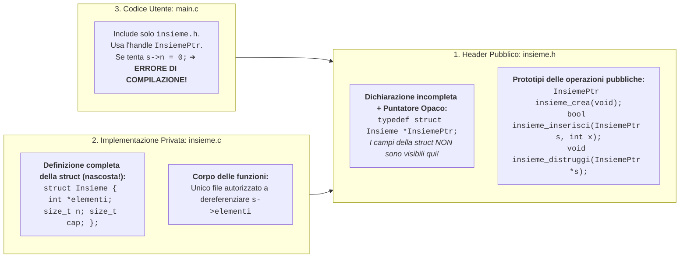

# 5.2.1 - Astrazione dei dati e Tipi di Dato Astratti (ADT)

Nei linguaggi di programmazione i tipi primitivi (`int`, `double`, `char`) sono già un'astrazione offerta dall'hardware: quando sommiamo due `double` con `a + b`, non manipoliamo manualmente i bit di segno, esponente e mantissa IEEE 754, ma usiamo le operazioni algebriche messe a disposizione dal tipo.

L'**Astrazione dei Dati** estende questo principio ai tipi definiti dal programmatore, portando alla nozione formale di **Tipo di Dato Astratto** (**ADT**, *Abstract Data Type*).

---

## Definizione formale di Tipo di Dato Astratto (ADT)

Un **Tipo di Dato Astratto (ADT)** è un modello matematico definito esclusivamente da una coppia:

$$
\text{ADT} = (\mathcal{D},\; \mathcal{O})
$$

1. **Dominio dei valori ($\mathcal{D}$)**: L'insieme dei valori astratti che le istanze del tipo possono assumere (es. l'insieme matematico degli insiemi finiti di interi, o delle pile di caratteri).
2. **Insieme delle operazioni ammesse ($\mathcal{O}$)**: Le uniche funzioni autorizzate a creare, interrogare, combinare e distruggere i valori di $\mathcal{D}$, specificate tramite la loro firma e semantica.

> [!IMPORTANT] Indipendenza dalla rappresentazione
> La definizione di un ADT **non menziona mai come i dati sono memorizzati fisicamente in RAM** (se con un array statico, un array dinamico, una lista concatenata o un albero). Chi utilizza l'ADT può manipolarne i valori **esclusivamente** invocando le operazioni di $\mathcal{O}$.

### Classificazione delle operazioni di un ADT

Le operazioni di un ADT si dividono tipicamente in quattro categorie:
- **Costruttori (*Constructors / Creators*)**: Allocano e inizializzano una nuova istanza valida dell'ADT (es. `insieme_crea()`).
- **Osservatori / Selettori (*Observers / Getters*)**: Interrogano lo stato dell'istanza senza modificarla (es. `insieme_cardinalita(s)`, `insieme_contiene(s, x)`).
- **Mutatori / Trasformatori (*Mutators / Modifiers*)**: Modificano lo stato dell'istanza (in-place) o ne producono una nuova istanza modificata (es. `insieme_inserisci(s, x)`).
- **Distruttori (*Destructors*)**: Rilasciano tutta la memoria dinamica allocata dall'istanza (es. `insieme_distruggi(s)`).

---

## Information Hiding e Invariante di Rappresentazione

Perché vietare al codice client (`main.c`) di accedere direttamente ai campi interni della `struct` che realizza l'ADT?
I motivi fondamentali sono due:

1. **Modificabilità senza impatto (*Evolution*)**: Se i campi della `struct` sono nascosti (**Information Hiding / Incapsulamento**), possiamo cambiare la struttura dati interna (es. da array non ordinato a tabella di hash) ricompilando solo il modulo dell'ADT, senza dover toccare una sola riga dei file client.
2. **Protezione dell'Invariante di Rappresentazione (*Representation Invariant*)**:
   Ogni rappresentazione concreta di un ADT si basa su ipotesi di coerenza interna chiamate **invariante di rappresentazione**.
   Ad esempio, se rappresentiamo un insieme matematico $\{1, 5, 9\}$ tramite un array dinamico `dati` con dimensione logica `n` e capacità `cap`, l'invariante di rappresentazione può richiedere che:
   - $0 \le n \le \text{cap}$;
   - se $\text{cap} > 0$, allora `dati != NULL`;
   - **non esistano elementi duplicati** in `dati[0 .. n-1]`.
   Se il client potesse scrivere direttamente `s.dati[0] = s.dati[1];` o `s.n = -5;`, **distruggerebbe l'invariante di rappresentazione**, facendo impazzire tutte le operazioni successive! Costringendo il client a passare dalle funzioni dell'ADT, ogni funzione garantisce che l'invariante sia preservato prima e dopo ogni operazione.

---

## Come realizzare un ADT di Prima Classe in C: i Puntatori Opachi

In C, se mettiamo l'intera definizione `struct Insieme { int *dati; int n; int cap; };` nel file header `.h`, chiunque includa l'header potrà accedere liberamente a `s->dati` e `s->n`, violando l'*Information Hiding*.

La tecnica professionale standard in C per ottenere un **incapsulamento totale verificato dal compilatore** utilizza i **Tipi Incompleti (*Incomplete Types*) e i Puntatori Opachi (*Opaque Pointers*)**:



**Come funziona questo meccanismo in C?**
- La dimensione di un puntatore (`struct Insieme *`) è sempre fissa e nota al compilatore (es. 8 byte su architetture a 64 bit), **anche se il compilatore non conosce ancora i campi di `struct Insieme`!**
- Pertanto `main.c` può dichiarare variabili di tipo `InsiemePtr` e passarle alle funzioni di `insieme.h`.
- Tuttavia, se `main.c` prova a dereferenziare il puntatore (`s->n`) o a calcolare `sizeof(*s)`, il compilatore blocca immediatamente la compilazione con l'errore: **`dereferencing pointer to incomplete type 'struct Insieme'`**!

---

## Esempi guidati

### Esempio 1: Implementazione completa dell'ADT `Insieme` di interi (`.h`, `.c`, `main.c`)

Realizziamo un ADT completo che modella un insieme matematico finito di numeri interi (senza duplicati), allocato dinamicamente nello Heap.

#### 1. File di interfaccia pubblica: `insieme.h`

```c
#ifndef INSIEME_H
#define INSIEME_H

#include <stdbool.h>
#include <stddef.h>

/* PUNTATORE OPACO (Handle all'ADT di prima classe):
   La struct Insieme è dichiarata ma NON definita nell'header! */
typedef struct Insieme *InsiemePtr;

/* Costruttore: crea e restituisce un insieme vuoto (o NULL se memoria esaurita) */
InsiemePtr insieme_crea(void);

/* Distruttore: libera tutta la memoria dell'insieme e azzera il puntatore *s_ptr */
void insieme_distruggi(InsiemePtr *s_ptr);

/* Osservatori */
size_t insieme_cardinalita(const InsiemePtr s);
bool insieme_contiene(const InsiemePtr s, int elem);
void insieme_stampa(const InsiemePtr s);

/* Mutatori: inserisce o rimuove un elemento mantenendo l'invariante "no duplicati" */
bool insieme_inserisci(InsiemePtr s, int elem);
bool insieme_rimuovi(InsiemePtr s, int elem);

/* Operazione insiemistica: crea un NUOVO insieme unione di A e B */
InsiemePtr insieme_unione(const InsiemePtr a, const InsiemePtr b);

#endif /* INSIEME_H */
```

#### 2. File di implementazione privata: `insieme.c`

```c
#include "insieme.h"
#include <stdio.h>
#include <stdlib.h>

#define CAP_INIZIALE 4

/* DEFINIZIONE PRIVATA DELLA STRUTTURA DATI (visibile SOLO dentro insieme.c).
   Invariante di rappresentazione:
   1) 0 <= n <= cap
   2) elementi != NULL di dimensione cap
   3) Per ogni i != j in [0..n-1]: elementi[i] != elementi[j] (nessun duplicato!) */
struct Insieme {
    int *elementi;
    size_t n;
    size_t cap;
};

InsiemePtr insieme_crea(void) {
    /* 1. Allocazione della struct descrittore nello Heap */
    InsiemePtr s = (InsiemePtr)malloc(sizeof(struct Insieme));
    if (s == NULL) return NULL;

    /* 2. Allocazione dell'array interno degli elementi */
    s->elementi = (int *)malloc(CAP_INIZIALE * sizeof(int));
    if (s->elementi == NULL) {
        free(s); /* Rollback per evitare memory leak! */
        return NULL;
    }
    s->n = 0;
    s->cap = CAP_INIZIALE;
    return s;
}

void insieme_distruggi(InsiemePtr *s_ptr) {
    if (s_ptr == NULL || *s_ptr == NULL) return;
    /* Liberiamo PRIMA l'array interno e POI la struct descrittore */
    free((*s_ptr)->elementi);
    free(*s_ptr);
    *s_ptr = NULL; /* Azzera il puntatore del chiamante contro i dangling pointer! */
}

size_t insieme_cardinalita(const InsiemePtr s) {
    return (s != NULL) ? s->n : 0;
}

bool insieme_contiene(const InsiemePtr s, int elem) {
    if (s == NULL) return false;
    for (size_t i = 0; i < s->n; i++) {
        if (s->elementi[i] == elem) {
            return true;
        }
    }
    return false;
}

bool insieme_inserisci(InsiemePtr s, int elem) {
    if (s == NULL) return false;

    /* Tutela dell'invariante: se l'elemento è già presente, non facciamo nulla */
    if (insieme_contiene(s, elem)) {
        return true;
    }

    /* Se l'array interno è pieno, raddoppiamo la capacità con realloc */
    if (s->n == s->cap) {
        size_t nuova_cap = s->cap * 2;
        int *tmp = (int *)realloc(s->elementi, nuova_cap * sizeof(int));
        if (tmp == NULL) return false;
        s->elementi = tmp;
        s->cap = nuova_cap;
    }

    s->elementi[s->n] = elem;
    s->n++;
    return true;
}

bool insieme_rimuovi(InsiemePtr s, int elem) {
    if (s == NULL) return false;
    for (size_t i = 0; i < s->n; i++) {
        if (s->elementi[i] == elem) {
            /* Poiché in un insieme l'ordine non conta, rimpiazziamo l'elemento
               cancellato con l'ULTIMO elemento dell'array in tempo O(1)! */
            s->elementi[i] = s->elementi[s->n - 1];
            s->n--;
            return true;
        }
    }
    return false;
}

InsiemePtr insieme_unione(const InsiemePtr a, const InsiemePtr b) {
    if (a == NULL || b == NULL) return NULL;
    InsiemePtr u = insieme_crea();
    if (u == NULL) return NULL;

    for (size_t i = 0; i < a->n; i++) insieme_inserisci(u, a->elementi[i]);
    for (size_t i = 0; i < b->n; i++) insieme_inserisci(u, b->elementi[i]);
    return u;
}

void insieme_stampa(const InsiemePtr s) {
    if (s == NULL) { printf("NULL\n"); return; }
    printf("{ ");
    for (size_t i = 0; i < s->n; i++) {
        printf("%d%s", s->elementi[i], (i + 1 < s->n) ? ", " : " ");
    }
    printf("}\n");
}
```

#### 3. File utilizzatore (Client): `main.c`

```c
#include <stdio.h>
#include "insieme.h"

int main(void) {
    InsiemePtr A = insieme_crea();
    InsiemePtr B = insieme_crea();

    insieme_inserisci(A, 10);
    insieme_inserisci(A, 20);
    insieme_inserisci(A, 10); /* Duplicato ignorato automaticamente! */

    insieme_inserisci(B, 20);
    insieme_inserisci(B, 30);

    InsiemePtr U = insieme_unione(A, B);
    printf("Cardinalita di U = %zu, elementi: ", insieme_cardinalita(U));
    insieme_stampa(U); /* Stampa: { 10, 20, 30 } */

    /* Deallocazione pulita tramite il distruttore dell'ADT */
    insieme_distruggi(&A);
    insieme_distruggi(&B);
    insieme_distruggi(&U);
    return 0;
}
```

---

### Esempio 2: Cambio trasparente di rappresentazione (L'ADT `Complesso`)

Un numero complesso $z \in \mathbb{C}$ può essere rappresentato internamente in **coordinate cartesiane** $(a + ib)$ oppure in **coordinate polari** $(\rho e^{i\theta})$. Con un puntatore opaco `typedef struct Complesso *ComplessoPtr;`, l'header `complesso.h` offre sempre le stesse quattro funzioni:
- `ComplessoPtr comp_da_cartesiano(double re, double im);`
- `double comp_parte_reale(ComplessoPtr z);`
- `double comp_modulo(ComplessoPtr z);`
- `ComplessoPtr comp_prodotto(ComplessoPtr z1, ComplessoPtr z2);`

Se in `complesso.c` passiamo dalla rappresentazione cartesiana a quella polare (per rendere immediato il calcolo del prodotto $\rho_1 \rho_2 e^{i(\theta_1 + \theta_2)}$), il client continua a funzionare senza alcuna modifica!

---

## Errori frequenti

1. **Chiamare `free(s)` direttamente nel `main` invece del distruttore `insieme_distruggi(&s)`**:
   Se il client chiama semplicemente `free(s)` sul puntatore opaco, libera solo i byte della `struct Insieme`, ma **non libera l'array dinamico interno `s->elementi`** (che il client non può nemmeno vedere!), causando un **Memory Leak**. Ogni ADT allocato dinamicamente deve sempre essere distrutto tramite la propria funzione distruttore.
2. **Copiare un puntatore opaco con `=` pensando di duplicare l'ADT (*Shallow Copy vs Deep Copy*)**:
   Scrivere `InsiemePtr B = A;` non crea un secondo insieme indipendente! Copia solo l'indirizzo di memoria (*aliasing*): ora `A` e `B` puntano alla **stessa identica istanza** nello Heap. Modificare `B` modificherà anche `A`, e distruggere entrambi causerà un **Double Free**! Per duplicare un ADT serve un costruttore di copia profonda (*deep copy*) `InsiemePtr insieme_clona(const InsiemePtr s)`.
3. **Scrivere `sizeof(struct Insieme)` nel file `.c` client**:
   Nel client il tipo `struct Insieme` è incompleto: la sua dimensione è nota esclusivamente dentro `insieme.c`.

---

## Esercizi di prova

1. **(Base — Invariante di rappresentazione per l'ADT `Frazione`)**
   Si vuole realizzare un ADT `Frazione` rappresentato internamente in `frazione.c` da `struct Frazione { int num; int den; };` in modo che due frazioni equivalenti (es. $2/4$, $-1/-2$ e $1/2$) abbiano un'**unica rappresentazione canonica**. Formula l'invariante di rappresentazione esatto che ogni costruttore deve garantire.
   > [!tip]- Soluzione
   > L'invariante di rappresentazione canonica per una frazione ridotta ai minimi termini richiede tre condizioni simultanee:
   > 1. **Denominatore strettamente positivo**: $\text{den} > 0$ (l'eventuale segno negativo della frazione è sempre portato al numeratore $\text{num}$, evitando l'ambiguità tra $\frac{-1}{2}$ e $\frac{1}{-2}$).
   > 2. **Frazione ridotta ai minimi termini**: $\text{MCD}(|\text{num}|, \text{den}) = 1$.
   > 3. **Unicità dello zero**: se $\text{num} == 0$, allora $\text{den} == 1$.
   > Grazie a questo invariante, confrontare l'uguaglianza di due frazioni `f1` e `f2` diventa semplicemente `f1->num == f2->num && f1->den == f2->den`!

2. **(Base — Implementazione del costruttore dell'ADT `Frazione`)**
   Scrivi in C la funzione costruttore `FrazionePtr frazione_crea(int n, int d)` che rispetta l'invariante dell'esercizio precedente (restituendo `NULL` se `d == 0`).
   > [!tip]- Soluzione
   > ```c
   > #include <stdlib.h>
   > 
   > struct Frazione { int num; int den; };
   > typedef struct Frazione *FrazionePtr;
   > 
   > static int mcd_privato(int a, int b) {
   >     if (a < 0) a = -a;
   >     if (b < 0) b = -b;
   >     while (b != 0) { int r = a % b; a = b; b = r; }
   >     return a;
   > }
   > 
   > FrazionePtr frazione_crea(int n, int d) {
   >     if (d == 0) return NULL;
   >     FrazionePtr f = (FrazionePtr)malloc(sizeof(struct Frazione));
   >     if (f == NULL) return NULL;
   > 
   >     /* 1. Portiamo il segno al numeratore */
   >     if (d < 0) { n = -n; d = -d; }
   > 
   >     /* 2. Riduciamo ai minimi termini dividendo per il MCD */
   >     int g = mcd_privato(n, d);
   >     f->num = n / g;
   >     f->den = d / g;
   >     return f;
   > }
   > ```

3. **(Intermedio — Funzione di clonazione profonda `insieme_clona`)**
   Aggiungi all'ADT `Insieme` dell'Esempio Guidato 1 la funzione `InsiemePtr insieme_clona(const InsiemePtr s)` che effettua una **Deep Copy** (copia profonda) dell'insieme `s` in una nuova istanza completamente indipendente nello Heap.
   > [!tip]- Soluzione
   > ```c
   > InsiemePtr insieme_clona(const InsiemePtr s) {
   >     if (s == NULL) return NULL;
   > 
   >     InsiemePtr copia = (InsiemePtr)malloc(sizeof(struct Insieme));
   >     if (copia == NULL) return NULL;
   > 
   >     copia->elementi = (int *)malloc(s->cap * sizeof(int));
   >     if (copia->elementi == NULL) {
   >         free(copia);
   >         return NULL;
   >     }
   >     for (size_t i = 0; i < s->n; i++) {
   >         copia->elementi[i] = s->elementi[i];
   >     }
   >     copia->n = s->n;
   >     copia->cap = s->cap;
   >     return copia;
   > }
   > ```

4. **(Intermedio — Intersezione di due `Insieme`)**
   Scrivi per l'ADT `Insieme` la funzione `InsiemePtr insieme_intersezione(const InsiemePtr a, const InsiemePtr b)` che restituisce un nuovo insieme contenente solo gli elementi presenti sia in `a` sia in `b`, usando le primitive già definite.
   > [!tip]- Soluzione
   > ```c
   > InsiemePtr insieme_intersezione(const InsiemePtr a, const InsiemePtr b) {
   >     if (a == NULL || b == NULL) return NULL;
   >     InsiemePtr inter = insieme_crea();
   >     if (inter == NULL) return NULL;
   > 
   >     for (size_t i = 0; i < a->n; i++) {
   >         int elem = a->elementi[i];
   >         if (insieme_contiene(b, elem)) {
   >             if (!insieme_inserisci(inter, elem)) {
   >                 insieme_distruggi(&inter);
   >                 return NULL;
   >             }
   >         }
   >     }
   >     return inter;
   > }
   > ```

5. **(Esame — Progettazione di un ADT `BufferCircolare` o `StringBuilder`)**
   Progetta l'header `.h` e l'implementazione `.c` di un ADT `StringaDin` (Stringa Dinamica con lunghezza memorizzata in $O(1)$) che nasconde la rappresentazione `struct StringaDin { char *buf; size_t len; }` e offre: `str_crea(const char *init)`, `str_lunghezza(const StringaDinPtr s)` in tempo $O(1)$ senza chiamare `strlen`, `str_accoda(StringaDinPtr s, const char *suffisso)` e `str_distruggi(StringaDinPtr *s)`.
   > [!tip]- Soluzione
   > ```c
   > /* === stringadin.h === */
   > typedef struct StringaDin *StringaDinPtr;
   > StringaDinPtr str_crea(const char *init);
   > size_t str_lunghezza(const StringaDinPtr s);
   > int str_accoda(StringaDinPtr s, const char *suffisso);
   > const char *str_cstr(const StringaDinPtr s);
   > void str_distruggi(StringaDinPtr *s);
   > 
   > /* === stringadin.c === */
   > #include <stdlib.h>
   > #include <string.h>
   > 
   > struct StringaDin {
   >     char *buf;
   >     size_t len; /* Invariante: len == strlen(buf) e buf[len] == '\0' */
   > };
   > 
   > StringaDinPtr str_crea(const char *init) {
   >     if (!init) init = "";
   >     StringaDinPtr s = (StringaDinPtr)malloc(sizeof(struct StringaDin));
   >     if (!s) return NULL;
   >     s->len = strlen(init);
   >     s->buf = (char *)malloc(s->len + 1);
   >     if (!s->buf) { free(s); return NULL; }
   >     memcpy(s->buf, init, s->len + 1);
   >     return s;
   > }
   > 
   > size_t str_lunghezza(const StringaDinPtr s) {
   >     return s ? s->len : 0; /* Costo O(1) immediato! */
   > }
   > 
   > int str_accoda(StringaDinPtr s, const char *suffisso) {
   >     if (!s || !suffisso) return 0;
   >     size_t add_len = strlen(suffisso);
   >     char *tmp = (char *)realloc(s->buf, s->len + add_len + 1);
   >     if (!tmp) return 0;
   >     s->buf = tmp;
   >     memcpy(s->buf + s->len, suffisso, add_len + 1);
   >     s->len += add_len;
   >     return 1;
   > }
   > 
   > const char *str_cstr(const StringaDinPtr s) { return s ? s->buf : ""; }
   > 
   > void str_distruggi(StringaDinPtr *s) {
   >     if (!s || !*s) return;
   >     free((*s)->buf);
   >     free(*s);
   >     *s = NULL;
   > }
   > ```

---

## Provenienza del materiale

- Dispensa ufficiale del corso: `C1PROG1U5L2_Astrazione_dei_dati tag.pdf` (Unità 5, Lezione 2 — *Astrazione dei dati*).
