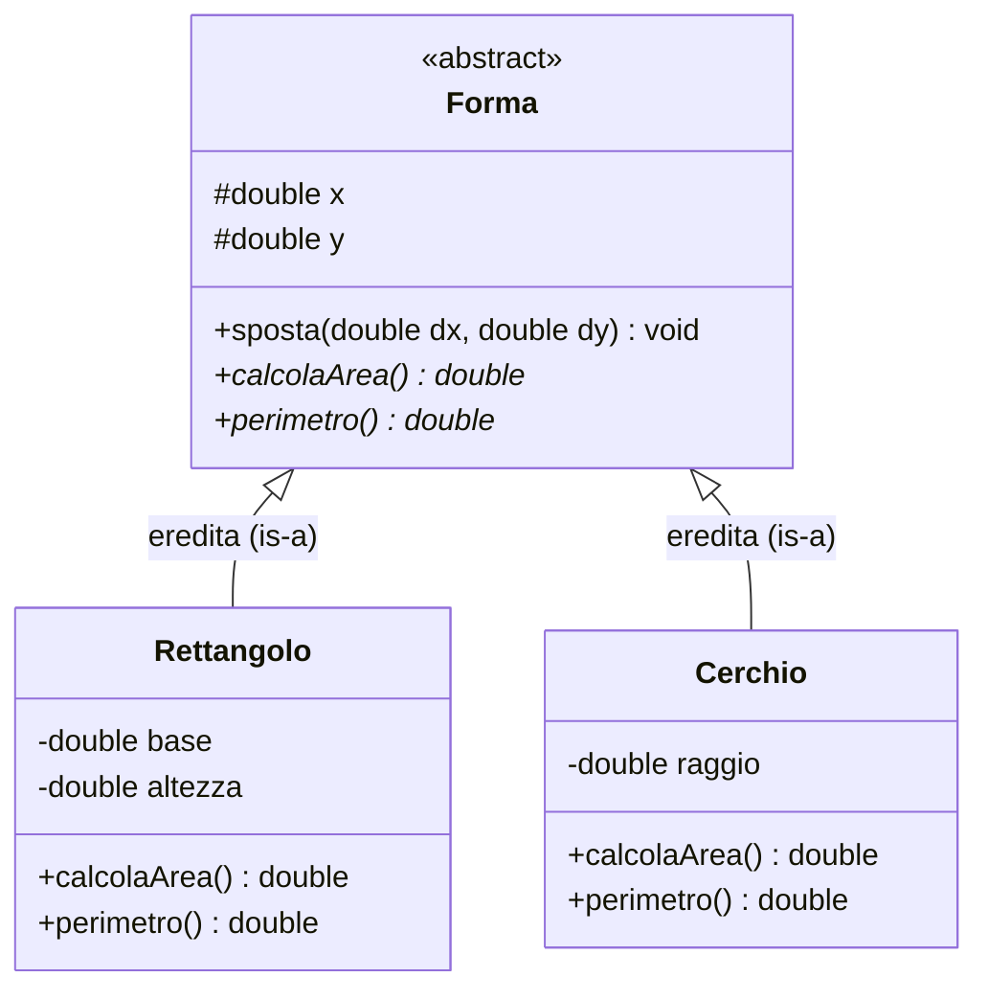

# Astrazione orientata agli oggetti (OOP)

## Come un oggetto combina stato e comportamento

Nella programmazione procedurale tradizionale (come il C), i **dati** (`struct`) e le **procedure** che operano su di essi sono entità separate: passiamo esplicitamente il puntatore alla struttura a ogni funzione (`insieme_inserisci(s, 10)`).

La **Programmazione Orientata agli Oggetti (OOP — *Object-Oriented Programming*)**, introdotta da linguaggi come Simula, Smalltalk, C++, Java, C# e Python, compie un passo ulteriore nell'astrazione dei dati: **fonde stato (dati) e comportamento (operazioni) in un'unica entità inscindibile chiamata Oggetto**. Un programma orientato agli oggetti è modellato come una comunità di oggetti autonomi che interagiscono scambiandosi messaggi (invocazioni di metodi).

---

## Classe vs Oggetto (Istanza)

Alla base dell'OOP vi è la distinzione tra il *concetto generale* (il tipo astratto) e gli *esemplari concreti* creati in memoria durante l'esecuzione:

| Concetto | Definizione | Analogia nel mondo reale | Corrispettivo in C |
| :--- | :--- | :--- | :--- |
| **Classe (*Class*)** | È lo **stampo / progetto / tipo di dato** che definisce in astratto quali **attributi** (campi dati) e quali **metodi** (funzioni) avranno tutti gli elementi di quella categoria. Non occupa memoria per i dati finché non viene istanziata. | Il progetto architettonico di una casa o lo stampo per biscotti. | La dichiarazione del tipo `struct ContoBancario` più il gruppo di funzioni associate. |
| **Oggetto / Istanza (*Object / Instance*)** | È un **esemplare concreto** allocato in memoria a runtime a partire da una classe. Possiede una propria area di memoria per gli attributi. | Una specifica casa costruita in via Roma 10 a partire da quel progetto. | Una variabile allocata nello Heap tramite il costruttore (`ContoPtr c1 = conto_crea(...)`). |

Ogni **Oggetto** è caratterizzato da tre proprietà fondamentali:
1. **Stato (*State*)**: L'insieme dei valori attuali dei suoi **attributi** (detti anche *campi* o *variabili d'istanza*), ad es. `saldo = 1500.0`, `iban = "IT00..."`.
2. **Comportamento (*Behavior*)**: L'insieme dei **metodi** (operazioni) che l'oggetto è in grado di eseguire quando riceve un messaggio, ad es. `conto.deposita(200.0)`.
3. **Identità (*Identity*)**: Ciò che distingue un oggetto da qualsiasi altro oggetto della stessa classe, **anche se hanno esattamente gli stessi valori degli attributi** (ad es. due gemelli omonimi o due conti bancari entrambi con saldo `0.0` hanno indirizzi di memoria / identità distinte!).

---

## I Tre Pilastri dell'OOP

Un linguaggio si definisce pienamente orientato agli oggetti quando supporta nativamente tre meccanismi fondamentali: **Incapsulamento**, **Ereditarietà** e **Polimorfismo**.

### 1. Incapsulamento (*Encapsulation & Information Hiding*)

L'incapsulamento racchiude attributi e metodi dentro la classe e controlla rigorosamente la visibilità di ciascun membro tramite **modificatori di accesso**:
- **`private`**: L'attributo o metodo è visibile **esclusivamente all'interno dei metodi della classe stessa**. È la regola standard per tutti gli attributi di stato, così da proteggere l'invariante di classe.
- **`protected`**: Visibile all'interno della classe stessa e nelle sue **sottoclassi** derivate.
- **`public`**: Costituisce l'**interfaccia pubblica** dell'oggetto, invocabile da qualsiasi codice esterno.

---

### 2. Ereditarietà (*Inheritance* — Relazione *"is-a"*)

L'ereditarietà consente di definire una nuova classe (**Sottoclasse** o *Classe Derivata / Figlia*) a partire da una classe esistente (**Superclasse** o *Classe Base / Padre*):
- La sottoclasse **eredita automaticamente** tutti gli attributi e i metodi della superclasse (favorendo il **riuso del codice** senza copier-incollare);
- Può **estendere** la superclasse aggiungendo nuovi attributi o nuovi metodi specifici;
- Può **ridefinire (*Method Overriding*)** il corpo di un metodo ereditato per specializzarne il comportamento.

> [!NOTE] La regola del "è-un" (*is-a*) vs "ha-un" (*has-a*)
> - L'**Ereditarietà** modella una relazione tassonomica **"è-un" (*is-a*)**: un `Cerchio` *è una* `FormaGeometrica`; uno `Studente` *è una* `Persona`.
> - La **Composizione** modella invece una relazione di contenimento **"ha-un" (*has-a*)**: un'`Automobile` *ha un* `Motore` (non *è un* `Motore`!).

---

### 3. Polimorfismo (*Polymorphism*) e Binding Dinamico

La parola *polimorfismo* significa "capacità di assumere molte forme". In OOP, il **polimorfismo per inclusione (o per sottotipi)** permette a una variabile o a un puntatore dichiarato con il tipo della **Superclasse** (`Forma *f`) di puntare a runtime a un oggetto di **qualsiasi sua Sottoclasse** (`Cerchio`, `Rettangolo`, `Triangolo`).

Quando invochiamo `f->calcolaArea()`, quale codice viene eseguito?
Grazie al **Binding Dinamico (*Late Binding / Dynamic Dispatch*)**, la decisione su quale metodo eseguire **non** viene presa a tempo di compilazione guardando il tipo statico del puntatore (`Forma *`), ma viene presa **a tempo di esecuzione (runtime)** ispezionando il **tipo reale dell'oggetto** a cui `f` punta in quel momento:
- se `f` punta a un `Cerchio`, viene eseguita $\pi r^2$;
- se `f` punta a un `Rettangolo`, viene eseguita $b \cdot h$.



Una classe come `Forma`, che dichiara metodi privi di implementazione (`calcolaArea()`) solo per definire un'interfaccia comune a tutte le sottoclassi, si chiama **Classe Astratta** (o **Interfaccia** se contiene solo firme di metodi astratti) e non può essere istanziata direttamente.

---

## Sotto il cofano: come l'OOP viene tradotta a basso livello in C (`vtable` e puntatore `this`)

I compilatori per linguaggi OOP (come i primi compilatori C++ *Cfront* che traducevano C++ in C!) realizzano oggetti, metodi e polimorfismo usando esattamente gli strumenti del C che già conosciamo: **`struct`** e **puntatori a funzione**!

1. **Il parametro implicito `this` (o `self`)**:
   Quando in C++/Java scriviamo `conto.deposita(100.0)`, il compilatore lo traduce in una normale funzione C che riceve come **primo parametro nascosto** il puntatore all'oggetto stesso (`this`):
   ```c
   void Conto_deposita(Conto *this, double importo) {
       this->saldo += importo;
   }
   ```
2. **La Tabella dei Metodi Virtuali (`vtable`) per il Polimorfismo**:
   Per realizzare il binding dinamico, ogni oggetto polimorfico contiene in cima alla propria `struct` un puntatore nascosto (`vptr`) a una tabella di puntatori a funzione chiamata **Virtual Method Table (`vtable`)**, specifica per la sua classe concreta!

---

## Dagli ADT a oggetti con operazioni selezionate a runtime

Un ADT specifica operazioni e proprietà del dato, come inserire e rimuovere da una coda. Un oggetto è un'istanza con stato proprio. Due contatori possono offrire la stessa operazione `incrementa` e mantenere valori distinti. Una classe definisce la struttura e le operazioni condivise fra istanze.

In C, un puntatore a funzione come `void (*incrementa)(struct Contatore *)` può selezionare il comportamento per un'istanza. Il chiamante passa esplicitamente l'oggetto. Un contatore ordinario può incrementare di uno. Un contatore con soglia può incrementare solo quando il valore è sotto la soglia, purché il contratto dell'interfaccia lo permetta. È una simulazione del dispatch: inizializzazione della tabella, compatibilità delle firme, durata dell'oggetto e distruzione sono responsabilità del codice C.

---

## Esempi guidati

### Esempio 1: Gerarchia di classi con Polimorfismo in C++ / Java

Vediamo prima come si esprime nativamente la gerarchia `Forma` $\to$ `Rettangolo`, `Cerchio` in C++ (o Java):

```cpp
#include <iostream>
#include <cmath>

// SUPERCLASSE ASTRATTA
class Forma {
protected:
    double x, y; // Coordinate del centro (visibili alle sottoclassi)
public:
    Forma(double x0, double y0) : x(x0), y(y0) {}
    virtual ~Forma() {}

    // Metodo concreto ereditato da tutte le forme
    void sposta(double dx, double dy) {
        x += dx;
        y += dy;
    }

    // Metodo VIRTUALE PURO (astratto): obbliga le sottoclassi a fare overriding!
    virtual double area() const = 0;
};

// SOTTOCLASSE 1: Rettangolo "is-a" Forma
class Rettangolo : public Forma {
private:
    double base, altezza; // Incapsulati (privati)
public:
    Rettangolo(double x0, double y0, double b, double h)
        : Forma(x0, y0), base(b), altezza(h) {}

    // Overriding del metodo polimorfico
    double area() const override {
        return base * altezza;
    }
};

// SOTTOCLASSE 2: Cerchio "is-a" Forma
class Cerchio : public Forma {
private:
    double raggio;
public:
    Cerchio(double x0, double y0, double r)
        : Forma(x0, y0), raggio(r) {}

    double area() const override {
        return 3.141592653589793 * raggio * raggio;
    }
};

int main() {
    // Array polimorfico di puntatori alla superclasse Forma!
    Forma *disegno[2];
    disegno[0] = new Rettangolo(0, 0, 5.0, 4.0);
    disegno[1] = new Cerchio(1, 1, 3.0);

    // Grazie al binding dinamico, disegno[i]->area() chiama il metodo giusto!
    for (int i = 0; i < 2; i++) {
        std::cout << "Area figura " << i << " = " << disegno[i]->area() << "\n";
        delete disegno[i];
    }
    return 0;
}
```

---

### Esempio 2: Come simulare Ereditarietà e Polimorfismo (`vtable`) in puro C!

Costruiamo in C standard esattamente lo stesso meccanismo che il compilatore C++ genera dietro le quinte:

```c
#include <stdio.h>
#include <stdlib.h>

struct Forma; /* Forward declaration */

/* 1. VTABLE: Tabella dei puntatori ai metodi polimorfici */
typedef struct {
    double (*calcola_area)(const struct Forma *self);
    void   (*stampa)(const struct Forma *self);
} FormaVTable;

/* 2. SUPERCLASSE Forma: contiene il puntatore alla vtable (vptr) e i campi comuni */
typedef struct Forma {
    const FormaVTable *vptr;
    double x, y;
} Forma;

/* Dispatch polimorfico: invoca il metodo attraverso la vtable dell'oggetto! */
double forma_area(const Forma *f) {
    return f->vptr->calcola_area(f);
}

/* 3. SOTTOCLASSE Rettangolo: mette "Forma base" come PRIMO campo della struct! */
typedef struct {
    Forma base; /* Ereditarietà di struttura in memoria */
    double larghezza;
    double altezza;
} Rettangolo;

static double rettangolo_area_impl(const Forma *self) {
    const Rettangolo *r = (const Rettangolo *)self;
    return r->larghezza * r->altezza;
}

static void rettangolo_stampa_impl(const Forma *self) {
    const Rettangolo *r = (const Rettangolo *)self;
    printf("Rettangolo %.1fx%.1f (area=%.2f)\n",
           r->larghezza, r->altezza, rettangolo_area_impl(self));
}

/* VTable condivisa da tutte le istanze di Rettangolo */
static const FormaVTable VTABLE_RETTANGOLO = {
    .calcola_area = rettangolo_area_impl,
    .stampa       = rettangolo_stampa_impl
};

/* 4. SOTTOCLASSE Cerchio */
typedef struct {
    Forma base;
    double raggio;
} Cerchio;

static double cerchio_area_impl(const Forma *self) {
    const Cerchio *c = (const Cerchio *)self;
    return 3.14159265 * c->raggio * c->raggio;
}

static void cerchio_stampa_impl(const Forma *self) {
    const Cerchio *c = (const Cerchio *)self;
    printf("Cerchio r=%.1f (area=%.2f)\n", c->raggio, cerchio_area_impl(self));
}

static const FormaVTable VTABLE_CERCHIO = {
    .calcola_area = cerchio_area_impl,
    .stampa       = cerchio_stampa_impl
};

int main(void) {
    Rettangolo r = { .base = { &VTABLE_RETTANGOLO, 0, 0 }, .larghezza = 4.0, .altezza = 5.0 };
    Cerchio    c = { .base = { &VTABLE_CERCHIO,    1, 1 }, .raggio = 3.0 };

    /* Array eterogeneo di puntatori alla superclasse Forma! */
    const Forma *figure[2] = { (const Forma *)&r, (const Forma *)&c };

    for (int i = 0; i < 2; i++) {
        figure[i]->vptr->stampa(figure[i]);
    }
    return 0;
}
```

---

## Errori frequenti

> [!caution] Errori da evitare
> 1. **Confondere *Overloading* (Sovraccarico) e *Overriding* (Ridefinizione)**:
>    - **Overloading (Polimorfismo ad-hoc, risolto a *compile-time*)**: Avere nella stessa classe due metodi con lo **stesso nome ma lista di parametri diversa** per tipo o numero (es. `stampa(int x)` e `stampa(double x)`).
>    - **Overriding (Polimorfismo per inclusione, risolto a *runtime*)**: Una sottoclasse riscrive un metodo ereditato dalla superclasse mantenendo **esattamente la stessa firma** (stesso nome, stessi parametri e stesso tipo di ritorno).
> 2. **Abusare dell'ereditarietà quando servirebbe la composizione**:
>    Se si fa ereditare `Pila` da `VettoreDinamico` solo per riusarne il codice, un utente della `Pila` potrà chiamare anche `pila.rimuovi_in_posizione(3)`, violando la politica LIFO! In questo caso una `Pila` non *è un* vettore, ma *usa / contiene un* vettore (**Composizione**, non Ereditarietà!).
> 3. **Confondere uguaglianza di stato (`equals`) e identità (`==` su riferimenti)**:
>    Confrontare due puntatori/riferimenti a oggetti con `p1 == p2` verifica se puntano allo **stesso identico oggetto in memoria** (identità), non se i loro attributi contengono gli stessi valori (uguaglianza di stato).

---

## Esercizi di prova

### Esercizio 1. Classe, Istanza, Stato e Identità (Base)

Considera una classe `Punto2D` con attributi `x` e `y`. Se eseguiamo:
- `p1 = nuovo Punto2D(3, 4)`
- `p2 = nuovo Punto2D(3, 4)`
- `p3 = p1`
Quanti oggetti distinti sono stati allocati in memoria? `p1` e `p2` hanno lo stesso stato? Hanno la stessa identità? E `p1` e `p3`?

> [!tip]- Soluzione
> - Sono stati allocati in memoria **2 soli oggetti distinti** (uno per ciascuna invocazione del costruttore `nuovo Punto2D`).
> - **`p1` e `p2`** hanno lo **stesso stato** (entrambi hanno $x = 3, y = 4$), ma hanno **identità diversa** (sono due oggetti distinti allocati a indirizzi di memoria diversi: se spostiamo `p1`, `p2` non si muove).
> - **`p1` e `p3`** sono due riferimenti (*alias*) che puntano allo **stesso identico oggetto**: condividono quindi sia l'**identità** sia lo **stato** (modificare `p3.x = 10` cambia anche `p1.x`).

### Esercizio 2. Scelta tra Ereditarietà *is-a* e Composizione *has-a* (Base)

Per ciascuna delle seguenti coppie di classi, stabilisci se la relazione corretta di progettazione è l'**Ereditarietà (*is-a*)** o la **Composizione (*has-a*)**, motivando la risposta:
1. `Veicolo` e `Autobus`
2. `Biblioteca` e `Libro`
3. `Dipendente` e `Manager`
4. `Computer` e `SchedaMadre`

> [!tip]- Soluzione
> 1. **`Autobus` — `Veicolo`**: **Ereditarietà (*is-a*)**. Un autobus *è un* particolare tipo di veicolo (ne condivide proprietà come targa, velocità, capacità di muoversi).
> 2. **`Biblioteca` — `Libro`**: **Composizione/Aggregazione (*has-a*)**. Una biblioteca non è un libro, ma *contiene* una collezione di libri.
> 3. **`Manager` — `Dipendente`**: **Ereditarietà (*is-a*)**. Un manager *è un* dipendente dell'azienda (ha matricola e stipendio base, più attributi aggiuntivi come il budget del team gestito).
> 4. **`Computer` — `SchedaMadre`**: **Composizione (*has-a*)**. Un computer è *composto da* una scheda madre (insieme a CPU, RAM, disco).

### Esercizio 3. Tracciamento del Binding Dinamico (Intermedio)

Data una superclasse `Animale` con metodo polimorfico `verso()` (che restituisce `"..."`), e due sottoclassi `Cane` (che fa overriding di `verso()` restituendo `"Bau"`) e `Gatto` (che restituisce `"Miao"`), più una sottoclasse `CanePastore` che eredita da `Cane` senza ridefinire `verso()`. Cosa stampa un ciclo che invoca `a[i]->verso()` su un array `Animale *a[3]` contenente nell'ordine un `Gatto`, un `CanePastore` e un `Animale` generico?

> [!tip]- Soluzione
> Grazie al **binding dinamico**, ad ogni iterazione viene ricercato il metodo `verso()` a partire dalla classe reale dell'oggetto istanziato, risalendo la gerarchia se non ridefinito direttamente:
> 1. `a[0]` punta a un `Gatto` $\to$ esegue `Gatto::verso()` $\to$ stampa **`"Miao"`**.
> 2. `a[1]` punta a un `CanePastore` $\to$ `CanePastore` non ridefinisce `verso()`, quindi eredita l'override della sua superclasse diretta `Cane::verso()` $\to$ stampa **`"Bau"`**.
> 3. `a[2]` punta a un `Animale` $\to$ esegue `Animale::verso()` $\to$ stampa **`"..."`**.

### Esercizio 4. Incapsulamento e validazione nei Setter (Intermedio)

Spiega perché in una classe `Studente` è preferibile dichiarare l'attributo `int voto_laurea` come `private` fornendo un metodo pubblico `bool setVotoLaurea(int v)` anziché dichiarare `public int voto_laurea`. Scrivi la logica del metodo `setVotoLaurea`.

> [!tip]- Soluzione
> Se `voto_laurea` fosse `public`, qualsiasi parte del programma potrebbe assegnargli valori privi di senso nel dominio (es. `s.voto_laurea = -50;` oppure `s.voto_laurea = 999;`), violando l'invariante di stato dell'oggetto. Dichiarandolo `private` e incapsulando la modifica in `setVotoLaurea`, possiamo **validare** il nuovo valore prima di accettarlo:
> ```c
> bool Studente_setVotoLaurea(Studente *self, int v) {
>     if (self == NULL || v < 66 || v > 110) {
>         return false; /* Rifiuta la modifica: lo stato resta valido! */
>     }
>     self->voto_laurea = v;
>     return true;
> }
> ```

### Esercizio 5. Sostituibilità ed eliminazione degli `switch` sul tipo (Avanzato)

In un programma procedurale C non orientato agli oggetti, per calcolare lo stipendio di diversi tipi di lavoratori (`OPERAIO`, `IMPIEGATO`, `DIRIGENTE`) è stata scritta una funzione con uno `switch (lavoratore->tipo_enum)`. Spiega quale problema di manutenibilità presenta questo approccio quando si aggiunge un quarto tipo `CONSULENTE`, e come il **polimorfismo OOP** risolve il problema (Principio *Open/Closed*).

> [!tip]- Soluzione
> - **Problema dello `switch` procedurale**: Ogni volta che si introduce una nuova categoria (es. `CONSULENTE`), bisogna andare a **cercare e modificare tutte le funzioni del programma** che contengono uno `switch (lavoratore->tipo_enum)` (calcolo stipendio, calcolo ferie, stampa cedolino, calcolo tasse...). Dimenticarne anche solo una introduce un bug.
> - **Soluzione tramite Polimorfismo OOP (*Open/Closed Principle*)**: Si definisce una classe base astratta `Lavoratore` con il metodo virtuale `calcolaStipendio()`. Ogni categoria (`Operaio`, `Impiegato`, `Dirigente`) è una sottoclasse che implementa il proprio `calcolaStipendio()`. Quando si aggiunge la nuova sottoclasse `Consulente`, **non bisogna modificare nessuna delle funzioni o classi già esistenti**: il sistema è *aperto alle estensioni, ma chiuso alle modifiche*!

---

## Provenienza del materiale

- Dispensa ufficiale del corso: `C1PROG1U5L3_Astrazione_ad_oggetti.pdf` (Unità 5, Lezione 3 — *Astrazione orientata agli oggetti*).
- Marco Anisetti, *Astrazione*, `Appunti_di_Fine_Unità_5.pdf`, capp. 2–3.
