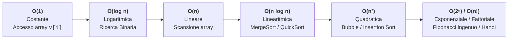

# Costo computazionale e complessità asintotica

## Come stimare il costo prima di misurarlo

Dato un problema computazionale, esistono quasi sempre molti algoritmi diversi che lo risolvono correttamente. Come stabiliamo quale algoritmo è **più efficiente**?

Misurare i secondi con un cronometro eseguendo il programma su un computer specifico è un metodo scientifico **inadeguato**, perché il tempo in secondi dipende dalla velocità della CPU, dalla quantità di RAM, dal sistema operativo e dalle ottimizzazioni del compilatore. L'**analisi della complessità computazionale** valuta invece l'efficienza intrinseca di un algoritmo in modo **matematico e indipendente dall'hardware**, contando come cresce il numero di operazioni elementari (e la memoria occupata) al crescere della **dimensione dell'input $n$**.

---

## Complessità in Tempo $T(n)$ e in Spazio $S(n)$

Fissata la **dimensione dell'input $n$** (es. il numero di elementi di un array, il numero di vertici di un grafo o il numero di bit di un intero), definiamo:

1. **Complessità Temporale $T(n)$**: Il numero di **operazioni elementari** (assegnamenti, confronti, operazioni aritmetiche, accessi a `v[i]`, ciascuna assunta di costo costante $c = O(1)$ nel modello *RAM — Random Access Machine*) eseguite dall'algoritmo su un input di taglia $n$.
2. **Complessità Spaziale $S(n)$**: La quantità di **celle di memoria aggiuntive** (oltre all'input stesso) richieste dall'algoritmo in funzione di $n$, comprendendo:
   - variabili locali e strutture dati allocate dinamicamente nello **Heap**;
   - i record di attivazione sullo **Stack delle chiamate** in caso di funzioni ricorsive (pari alla profondità massima dell'albero di ricorsione!).

### Caso Migliore, Caso Peggiore e Caso Medio

A parità di dimensione $n$, un algoritmo può compiere più o meno passi a seconda della **configurazione dei dati** (es. cercare un elemento `x` in un array `v` di $n$ elementi con la ricerca lineare):

- **Caso Migliore $T_{\min}(n)$**: Il minimo numero di operazioni su tutti gli input di taglia $n$ (es. nella ricerca lineare, `x` si trova subito in `v[0]` $\implies 1$ solo confronto, $T_{\min}(n) = \Theta(1)$).
- **Caso Peggiore $T_{\max}(n)$**: Il **massimo** numero di operazioni su tutti gli input di taglia $n$ (es. `x` è nell'ultima cella `v[n-1]` o non è presente $\implies n$ confronti, $T_{\max}(n) = \Theta(n)$). **È la misura più usata in informatica**, perché fornisce una **garanzia assoluta**: l'algoritmo non impiegherà mai più di $T_{\max}(n)$!
- **Caso Medio $T_{\text{avg}}(n)$**: Il valore atteso del numero di operazioni mediato sulla distribuzione di probabilità di tutti gli input di taglia $n$ (es. se `x` ha uguale probabilità $\frac{1}{n}$ di trovarsi in ciascuna posizione, in media servono $\frac{1 + 2 + \dots + n}{n} = \frac{n+1}{2} = \Theta(n)$ confronti).

---

## Notazioni Asintotiche Formali: $O$, $\Omega$, $\Theta$

Quando $n$ diventa molto grande ($n \to +\infty$), le costanti moltiplicative e i termini di grado inferiore diventano trascurabili: un algoritmo con costo $T_1(n) = 100n\log_2 n$ batterà sempre, per $n$ sufficientemente grande, un algoritmo con costo $T_2(n) = 2n^2$.

L'**analisi asintotica** cattura l'**ordine di grandezza del tasso di crescita** di una funzione $f(n)$ confrontandola con una funzione modello $g(n)$:

### 1. Notazione O-grande: $f(n) \in O(g(n))$ — Limite Superiore Asintotico ($\le$)

Si dice che $f(n)$ è di ordine **O-grande** di $g(n)$, e si scrive $f(n) \in O(g(n))$, se esistono una costante reale positiva $c > 0$ e una soglia $n_0 \ge 0$ tali che:

$$
\forall n \ge n_0:\quad 0 \le f(n) \le c \cdot g(n)
$$

- **Significato intuitivo**: A partire da $n_0$ in poi, $f(n)$ **non cresce più velocemente** di $g(n)$ (a meno di una costante moltiplicativa $c$). È un **tetto superiore**.
- *Esempio*: $f(n) = 3n^2 + 5n + 10 \in O(n^2)$ perché per ogni $n \ge 1$ vale $3n^2 + 5n + 10 \le 3n^2 + 5n^2 + 10n^2 = 18n^2$ (basta scegliere $c = 18, n_0 = 1$). *(Nota: essendo un limite superiore, è formalmente vero anche che $3n^2 \in O(n^3)$, ma si cerca sempre il limite superiore più stretto possibile!).*

### 2. Notazione Omega-grande: $f(n) \in \Omega(g(n))$ — Limite Inferiore Asintotico ($\ge$)

Si dice che $f(n)$ è **Omega-grande** di $g(n)$, e si scrive $f(n) \in \Omega(g(n))$, se esistono due costanti $c > 0$ e $n_0 \ge 0$ tali che:

$$
\forall n \ge n_0:\quad f(n) \ge c \cdot g(n) \ge 0
$$

- **Significato intuitivo**: $f(n)$ cresce **almeno** veloce quanto $g(n)$. È un **pavimento inferiore**.

### 3. Notazione Theta-grande: $f(n) \in \Theta(g(n))$ — Ordine di Grandezza Esatto ($=$)

Si dice che $f(n)$ è **Theta-grande** di $g(n)$, e si scrive $f(n) \in \Theta(g(n))$, se $f(n)$ è **contemporaneamente** $O(g(n))$ e $\Omega(g(n))$, ovvero esistono tre costanti $c_1 > 0, c_2 > 0$ e $n_0 \ge 0$ tali che:

$$
\forall n \ge n_0:\quad 0 \le c_1 \cdot g(n) \le f(n) \le c_2 \cdot g(n)
$$

- **Significato intuitivo**: $f(n)$ e $g(n)$ hanno **esattamente lo stesso tasso di crescita asintotico** (racchiudono $f(n)$ "a sandwich" dall'alto e dal basso). Ogni polinomio di grado $k$, $P(n) = a_k n^k + a_{k-1}n^{k-1} + \dots + a_0$ con $a_k > 0$, appartiene a **$\Theta(n^k)$**.

---

## Gerarchia delle classi di complessità

Le principali classi di complessità, ordinate dalla più efficiente alla più lenta per $n \to +\infty$, formano una gerarchia rigorosa:

$$
\Theta(1) \prec \Theta(\log n) \prec \Theta(\sqrt{n}) \prec \Theta(n) \prec \Theta(n \log n) \prec \Theta(n^2) \prec \Theta(n^3) \prec \Theta(2^n) \prec \Theta(n!)
$$



### Impatto pratico dei tempi di calcolo al crescere di $n$

Supponendo un calcolatore capace di eseguire $10^9$ (un miliardo) di operazioni elementari al secondo ($1\text{ op} = 1\text{ ns}$):

| Classe $T(n)$ | Nome | $n = 10$ | $n = 1\,000$ | $n = 10^6$ (1 milione) | Algoritmo tipico |
| :--- | :--- | :---: | :---: | :---: | :--- |
| **$O(1)$** | Costante | $1\text{ ns}$ | $1\text{ ns}$ | $1\text{ ns}$ | Accesso a `v[i]`, `push` su Pila |
| **$O(\log_2 n)$** | Logaritmica | $3\text{ ns}$ | $10\text{ ns}$ | $20\text{ ns}$ | Ricerca Binaria su array ordinato |
| **$O(n)$** | Lineare | $10\text{ ns}$ | $1\text{ }\mu\text{s}$ | $1\text{ ms}$ | Ricerca lineare, massimo di un array |
| **$O(n \log_2 n)$** | Linearitmica | $33\text{ ns}$ | $10\text{ }\mu\text{s}$ | $20\text{ ms}$ | Merge Sort, Heap Sort |
| **$O(n^2)$** | Quadratica | $100\text{ ns}$ | $1\text{ ms}$ | $\mathbf{16.7\text{ minuti}}$ | Bubble Sort, Selection Sort, Insertion Sort |
| **$O(n^3)$** | Cubica | $1\text{ }\mu\text{s}$ | $1\text{ secondo}$ | $\mathbf{31.7\text{ anni}}$ | Prodotto standard tra matrici $n \times n$ |
| **$O(2^n)$** | Esponenziale | $1\text{ }\mu\text{s}$ | $> 10^{290}\text{ secoli}$ | Incalcolabile | Sottoinsiemi di un insieme, Torri di Hanoi |

> [!TIP] Cambiamento di base dei logaritmi
> Nella notazione asintotica la base del logaritmo non conta ($O(\log_2 n) = O(\log_{10} n) = O(\ln n)$), perché per la formula del cambiamento di base $\log_a n = \frac{1}{\log_b a} \cdot \log_b n$, e il fattore $\frac{1}{\log_b a}$ è solo una **costante moltiplicativa**!

---

## Regole pratiche per calcolare la complessità di codice C

1. **Istruzioni elementari**: assegnamenti, aritmetica, accesso a `v[i]`, `return` costano **$O(1)$**.
2. **Sequenza di blocchi `A; B;`**: vale la **regola della somma (massimo)**:

   $$
   T(A; B) = T(A) + T(B) = \Theta\big(\max(T(A), T(B))\big)
   $$

3. **Condizionale `if (cond) A else B`**: nel caso peggiore:

   $$
   T = T(\text{cond}) + \max(T(A), T(B))
   $$

4. **Cicli con limiti indipendenti**: si moltiplica il numero di iterazioni per il costo del corpo. Due cicli `for` annidati da `0` a `n` costano $n \times n = \Theta(n^2)$.
5. **Cicli annidati con indice interno DIPENDENTE dall'esterno (Serie di Gauss)**:
   ```c
   for (int i = 0; i < n; i++) {
       for (int j = 0; j <= i; j++) {
           /* operazione O(1) */
       }
   }
   ```
   Per $i = 0$ il ciclo interno fa $1$ passo, per $i = 1$ ne fa $2$, ..., per $i = n-1$ ne fa $n$. Sommando tutti i passi otteniamo la **Progressione Aritmetica di Gauss**:

   $$
   \sum_{i=1}^{n} i = 1 + 2 + 3 + \dots + n = \frac{n(n+1)}{2} = \frac{1}{2}n^2 + \frac{1}{2}n = \mathbf{\Theta(n^2)}
   $$

6. **Cicli con raddoppio o dimezzamento dell'indice (`i = i * 2` oppure `i = i / 2`)**:
   ```c
   for (int i = 1; i < n; i = i * 2) {
       /* operazione O(1) */
   }
   ```
   L'indice assume i valori $1, 2, 4, 8, \dots, 2^k$. Il ciclo termina quando $2^k \ge n \iff k \ge \log_2 n$. Dunque il numero di iterazioni è **$\Theta(\log n)$**!

### Equazioni di ricorrenza fondamentali per funzioni ricorsive

Per una funzione ricorsiva, si esprime $T(n)$ tramite un'**equazione di ricorrenza**:

| Schema della funzione ricorsiva | Equazione di ricorrenza | Soluzione asintotica | Esempio |
| :--- | :--- | :--- | :--- |
| Riduce $n \to n-1$ con lavoro $O(1)$ | $T(n) = T(n-1) + c$ | **$\Theta(n)$** | Fattoriale, Somma ricorsiva |
| Riduce $n \to n-1$ con lavoro $O(n)$ | $T(n) = T(n-1) + c\cdot n$ | **$\Theta(n^2)$** | Selection Sort ricorsivo |
| Dimezza $n \to n/2$ (1 chiamata) con lavoro $O(1)$ | $T(n) = T(n/2) + c$ | **$\Theta(\log n)$** | Ricerca Binaria, Potenza veloce |
| Dimezza $n \to n/2$ (**2 chiamate**) con lavoro $O(1)$ | $T(n) = 2T(n/2) + c$ | **$\Theta(n)$** | Visita completa di un albero binario |
| Dimezza $n \to n/2$ (**2 chiamate**) con lavoro $O(n)$ | $T(n) = 2T(n/2) + c\cdot n$ | **$\Theta(n \log n)$** | Merge Sort |
| Riduce $n \to n-1$ (**2 chiamate**) con lavoro $O(1)$ | $T(n) = 2T(n-1) + c$ | **$\Theta(2^n)$** | Torri di Hanoi |

---

## Profilazione, modello di costo e dimensione dell'input

La **profilazione** misura un programma concreto con dati, compilatore e macchina specifici. L'**analisi** sceglie una dimensione dell'ingresso e conta operazioni rappresentative. Per la ricerca lineare su $n$ elementi, contando le uguaglianze, troviamo un confronto se la chiave è in testa e $n$ confronti se è in fondo o assente. Se la chiave è presente una sola volta e ogni posizione ha probabilità $1/n$, il valore atteso è $(n+1)/2$. Questa conclusione cambia se modifichiamo la distribuzione delle posizioni o includiamo input in cui la chiave è assente.

Un esperimento può misurare il tempo per $n=1000$ e $n=2000$ mantenendo uguali distribuzione, compilatore e condizioni di prova. Il modello spiega la crescita attesa, mentre le misure includono costanti, effetti della cache e rumore. Specifichiamo anche se il costo in spazio include l'input o solo la memoria ausiliaria. Per gli ordinamenti concreti vedi [[6.3.1 - Algoritmi di ricerca e ordinamento|ricerca e ordinamento]].

---

## Esempi guidati

### Esempio 1: Analisi di cicli annidati misti (Lineare $\times$ Logaritmico)

**Problema**: Determinare la complessità temporale $\Theta$ in funzione di $n$ del seguente frammento:

```c
int mistero(int n) {
    int s = 0;
    /* Blocco A */
    for (int i = 0; i < n; i++) {
        for (int j = n; j >= 1; j = j / 3) {
            s += i + j;
        }
    }
    /* Blocco B */
    for (int k = 0; k < n; k++) {
        s -= k;
    }
    return s;
}
```

**Analisi passo-passo**:
1. **Blocco A**:
   - Il ciclo esterno su `i` esegue esattamente $n$ iterazioni.
   - Il ciclo interno su `j` parte da $n$ e ad ogni passo divide `j` per $3$ ($n, n/3, n/9, \dots, n/3^m \ge 1$), quindi esegue $\lfloor \log_3 n \rfloor + 1 = \Theta(\log n)$ iterazioni.
   - Poiché i limiti di `j` non dipendono da `i`, il costo del Blocco A è il prodotto: $n \cdot \Theta(\log n) = \Theta(n \log n)$.
2. **Blocco B**: è un ciclo semplice da `0` a `n - 1`, quindi costa $\Theta(n)$.
3. **Totale (Regola della somma)**:

   $$
   T(n) = T_A(n) + T_B(n) = \Theta(n \log n) + \Theta(n) = \mathbf{\Theta(n \log n)}
   $$

---

### Esempio 2: Risoluzione di una ricorrenza per srotolamento (*Unrolling*)

**Problema**: Scrivere e risolvere l'equazione di ricorrenza per il tempo $T(n)$ e lo spazio sullo Stack $S(n)$ della seguente funzione:

```c
int elabora_ric(const int v[], int n) {
    if (n <= 1) return 0;
    int somma = 0;
    for (int i = 0; i < n; i++) {
        somma += v[i];
    }
    return somma + elabora_ric(v, n / 2);
}
```

**Analisi passo-passo**:
1. **Impostazione della ricorrenza**:
   - Per $n \le 1$, il caso base costa $T(1) = c_0 = \Theta(1)$.
   - Per $n > 1$, la funzione esegue un ciclo `for` di $n$ passi ($\implies c \cdot n$) e poi effettua **una sola chiamata ricorsiva** su dimensione $n/2$:

     $$
     T(n) = T(n/2) + c \cdot n
     $$

2. **Srotolamento (*Unrolling*)**:

   $$
   T(n) = c \cdot n + T(n/2) = c \cdot n + c \cdot \frac{n}{2} + c \cdot \frac{n}{4} + \dots + c \cdot \frac{n}{2^k} = c \cdot n \sum_{i=0}^{\log_2 n} \left(\frac{1}{2}\right)^i
   $$

   Poiché la serie geometrica $\sum_{i=0}^{\infty} (1/2)^i = 2$ converge a una costante, abbiamo $1 \le \sum (1/2)^i < 2$, da cui:

   $$
   T(n) = \mathbf{\Theta(n)}
   $$

3. **Complessità Spaziale $S(n)$**:
   Ad ogni chiamata $n$ viene dimezzato ($n \to n/2 \to n/4 \dots \to 1$), quindi ci sono al massimo $\log_2 n$ chiamate attive contemporaneamente sullo Stack: **$S(n) = \Theta(\log n)$**.

---

### Esempio 3: La trappola di `strlen(s)` nella condizione del ciclo `for`

**Problema**: Confrontare la complessità di queste due versioni della scansione di una stringa di lunghezza $n$:

```c
/* Versione 1 (LENTA!) */
for (size_t i = 0; i < strlen(s); i++) {
    putchar(s[i]);
}

/* Versione 2 (VELOCE!) */
size_t n = strlen(s);
for (size_t i = 0; i < n; i++) {
    putchar(s[i]);
}
```

**Analisi**:
La funzione `strlen(s)` non conosce a priori la lunghezza della stringa: deve scorrerla tutta dal primo carattere fino a `'\0'`, impiegando tempo **$\Theta(n)$** ad ogni singola chiamata!
- Nella **Versione 1**, la guardia `i < strlen(s)` viene rivalutata **ad ogni iterazione** del ciclo ($n$ volte), costando $n \times \Theta(n) = \mathbf{\Theta(n^2)}$ (quadratica)!
- Nella **Versione 2**, `strlen(s)` viene chiamata **una sola volta** prima del ciclo ($\Theta(n)$) e poi il ciclo fa $n$ passi da $O(1)$: costo totale $\Theta(n) + \Theta(n) = \mathbf{\Theta(n)}$ (lineare)!

---

## Errori frequenti

> [!caution] Errori da evitare
> 1. **Confondere $O(g(n))$ con "Caso Peggiore" e $\Omega(g(n))$ con "Caso Migliore"**:
>    È un equivoco diffuso! $O$, $\Omega$ e $\Theta$ sono **notazioni matematiche sulle funzioni**, mentre Caso Peggiore ($T_{\max}$) e Caso Migliore ($T_{\min}$) sono **proprietà dell'input**. Possono essere combinate liberamente: ad esempio, nella ricerca lineare il caso migliore è $T_{\min}(n) = \Theta(1)$ e il caso peggiore è $T_{\max}(n) = \Theta(n)$.
> 2. **Assumere che ogni chiamata di funzione dentro un ciclo costi $O(1)$**:
>    Se dentro un ciclo `for` di $n$ iterazioni invochiamo `ricerca_lineare(v, n, x)` (che costa $\Theta(n)$), il ciclo non costa $\Theta(n)$ ma $n \times \Theta(n) = \Theta(n^2)$! Bisogna sempre moltiplicare per la complessità della funzione chiamata.
> 3. **Dimenticare lo spazio dello Stack nelle funzioni ricorsive**:
>    Una funzione ricorsiva che non chiama `malloc` non ha costo spaziale $O(1)$ (a meno di *Tail Call Optimization*): ogni livello di ricorsione aperto occupa uno Stack Frame in memoria, quindi $S(n)$ è almeno pari alla profondità massima di ricorsione.

---

## Esercizi di prova

### Esercizio 1. Confronto di ordini di grandezza asintotici (Base)

Ordina le seguenti funzioni di costo dalla asintoticamente più piccola (più veloce) alla più grande per $n \to +\infty$, indicando se alcune appartengono alla stessa classe $\Theta$:

$$
f_1(n) = 1000n + 50000, \quad f_2(n) = 2n^2 + 10n, \quad f_3(n) = 50\log_2 n, \quad f_4(n) = 3n\log_2 n, \quad f_5(n) = 0.001 \cdot 2^n, \quad f_6(n) = 4n + 20\log_{10} n
$$

> [!tip]- Soluzione
> Trascurando le costanti moltiplicative e i termini di ordine inferiore:
> - $f_3(n) \in \Theta(\log n)$
> - $f_1(n) \in \Theta(n)$ e anche $f_6(n) \in \Theta(n)$ (perché $4n$ domina su $20\log_{10} n$) $\implies$ **$f_1$ e $f_6$ hanno lo stesso ordine di grandezza $\Theta(n)$**!
> - $f_4(n) \in \Theta(n \log n)$
> - $f_2(n) \in \Theta(n^2)$
> - $f_5(n) \in \Theta(2^n)$
>
> Ordine finale: **$f_3 \prec (f_1 \equiv f_6) \prec f_4 \prec f_2 \prec f_5$**.

### Esercizio 2. Dimostrazione formale con la definizione di $\Theta$ (Base)

Dimostra usando la definizione formale ($c_1 g(n) \le f(n) \le c_2 g(n)$ per $n \ge n_0$) che $f(n) = 5n^2 + 3n \in \Theta(n^2)$.

> [!tip]- Soluzione
> Dobbiamo trovare $c_1 > 0, c_2 > 0$ e $n_0 \ge 1$ tali che per ogni $n \ge n_0$:
>
> $$
> c_1 n^2 \le 5n^2 + 3n \le c_2 n^2
> $$
>
> - **Limite inferiore ($\Omega$)**: Poiché per $n \ge 1$ il termine $3n > 0$, vale sempre $5n^2 + 3n \ge 5n^2$. Basta scegliere **$c_1 = 5$**.
> - **Limite superiore ($O$)**: Per ogni $n \ge 1$ vale $n \le n^2$, dunque $3n \le 3n^2$. Sommando otteniamo $5n^2 + 3n \le 5n^2 + 3n^2 = 8n^2$. Basta scegliere **$c_2 = 8$**.
> Con **$c_1 = 5,\; c_2 = 8,\; n_0 = 1$** la doppia disuguaglianza $5n^2 \le 5n^2 + 3n \le 8n^2$ è soddisfatta per ogni $n \ge 1$, quindi $f(n) \in \Theta(n^2)$.

### Esercizio 3. Analisi di un doppio ciclo con passo geometrico (Intermedio)

Determina la complessità temporale $\Theta$ in funzione di $n$ del seguente frammento C:
```c
int conta = 0;
for (int i = 1; i <= n; i = i * 2) {
    for (int j = 0; j < n; j++) {
        conta++;
    }
}
```

> [!tip]- Soluzione
> - Il ciclo esterno parte da `i = 1` e raddoppia `i` ad ogni passo (`i = 1, 2, 4, 8, ..., 2^k <= n`), quindi viene eseguito esattamente $\lfloor \log_2 n \rfloor + 1 = \Theta(\log n)$ volte.
> - Ad ogni iterazione del ciclo esterno, il ciclo interno su `j` scorre da `0` a `n - 1`, eseguendo esattamente $n = \Theta(n)$ passi.
> - Poiché il numero di iterazioni del ciclo interno è indipendente da `i`, il costo totale è il prodotto:
>
>   $$
>   T(n) = \Theta(\log n) \times \Theta(n) = \mathbf{\Theta(n \log n)}
>   $$
>

### Esercizio 4. Analisi sottile: quando un ciclo interno da `1` a `i` con passo raddoppiato costa $\Theta(n)$! (Intermedio)

Determina la complessità temporale $\Theta$ di questo frammento (attenzione a come varia il limite del ciclo interno!):
```c
int s = 0;
for (int i = 1; i <= n; i = i * 2) {
    for (int j = 0; j < i; j++) {
        s++;
    }
}
```

> [!tip]- Soluzione
> Qui il limite superiore del ciclo interno è **`i`** (non `n`!), dove `i` assume solo le potenze di 2: $i = 1, 2, 4, 8, \dots, 2^k$ con $2^k \le n$ (cioè $k = \lfloor \log_2 n \rfloor$).
> Sommiamo il numero esatto di volte in cui viene eseguito `s++` al variare di $i$:
>
> $$
> T(n) = 1 + 2 + 4 + 8 + \dots + 2^k = \sum_{m=0}^{k} 2^m = 2^{k+1} - 1
> $$
>
> Poiché $2^k \le n < 2^{k+1}$, abbiamo $n \le 2^{k+1} - 1 < 2n$.
> Sorpresa: la somma delle potenze di 2 fino a $n$ è inferiore a $2n$, quindi la complessità complessiva non è $O(n \log n)$, bensì **$\mathbf{\Theta(n)}$ (lineare)**!

### Esercizio 5. Caso migliore e caso peggiore con uscita anticipata (Avanzato)

Determina la complessità nel **caso migliore** $T_{\min}(n)$ e nel **caso peggiore** $T_{\max}(n)$ della seguente funzione che verifica se un array contiene elementi duplicati:
```c
int ha_duplicati(const int v[], int n) {
    for (int i = 0; i < n; i++) {
        for (int j = i + 1; j < n; j++) {
            if (v[i] == v[j]) {
                return 1; /* Uscita anticipata! */
            }
        }
    }
    return 0;
}
```

> [!tip]- Soluzione
> - **Caso Migliore $T_{\min}(n)$**: Si verifica quando i primi due elementi dell'array sono già uguali (`v[0] == v[1]`). Alla prima iterazione ($i = 0, j = 1$) il test dell'`if` è subito vero e la funzione termina con `return 1;` dopo **1 solo confronto**:
>
>   $$
>   T_{\min}(n) = \mathbf{\Theta(1)}
>   $$
>
> - **Caso Peggiore $T_{\max}(n)$**: Si verifica quando tutti gli elementi dell'array sono distinti (oppure l'unico duplicato sono gli ultimi due elementi `v[n-2] == v[n-1]`). La funzione deve confrontare tutte le coppie $(i, j)$ con $0 \le i < j < n$:
>
>   $$
>   T_{\max}(n) = \sum_{i=0}^{n-1} (n - 1 - i) = \frac{n(n-1)}{2} = \mathbf{\Theta(n^2)}
>   $$
>

### Esercizio 6. Analisi di funzione ricorsiva con ramificazione binaria (Avanzato)

Determina la complessità temporale $T(n)$ e la complessità spaziale sullo Stack $S(n)$ della seguente funzione ricorsiva:
```c
int f(int n) {
    if (n <= 1) return 1;
    return f(n / 2) + f(n / 2);
}
```
Come cambierebbe la complessità temporale se sostituissimo l'ultima riga con `int m = f(n / 2); return m + m;`?

> [!tip]- Soluzione
> 1. **Versione originale `return f(n / 2) + f(n / 2);`**:
>    - **Tempo $T(n)$**: Ad ogni livello la funzione effettua **2 chiamate ricorsive** distinte di taglia $n/2$ più una somma $O(1)$, quindi:
>
>      $$
>      T(n) = 2T(n/2) + c
>      $$
>
>      L'albero di ricorsione ha altezza $\log_2 n$ e ad ogni livello il numero di chiamate raddoppia ($1, 2, 4, \dots, 2^{\log_2 n} = n$). Il numero totale di nodi dell'albero è $\sum_{k=0}^{\log_2 n} 2^k = 2n - 1 = \mathbf{\Theta(n)}$.
>    - **Spazio sullo Stack $S(n)$**: Poiché la seconda chiamata `f(n / 2)` inizia solo dopo che la prima ha terminato e liberato i propri frame dallo Stack, il numero massimo di chiamate attive contemporaneamente è pari all'**altezza dell'albero**:
>
>      $$
>      S(n) = \mathbf{\Theta(\log n)}
>      $$
>
> 2. **Versione ottimizzata `int m = f(n / 2); return m + m;`**:
>    Ora viene effettuata **una sola chiamata ricorsiva** per livello: la ricorrenza diventa $T(n) = T(n/2) + c$, abbattendo la complessità temporale da $\Theta(n)$ a **$\mathbf{\Theta(\log n)}$**!

---

## Provenienza del materiale

- Dispensa ufficiale del corso: `C1PROG1U5L5_Costo_Computazionale.pdf` (Unità 5, Lezione 5 — *Costo computazionale*).
- Marco Anisetti, *Astrazione*, `Appunti_di_Fine_Unità_5.pdf`, cap. 4.
