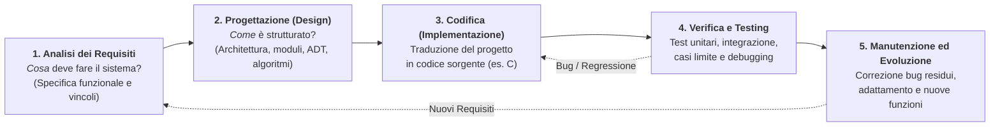
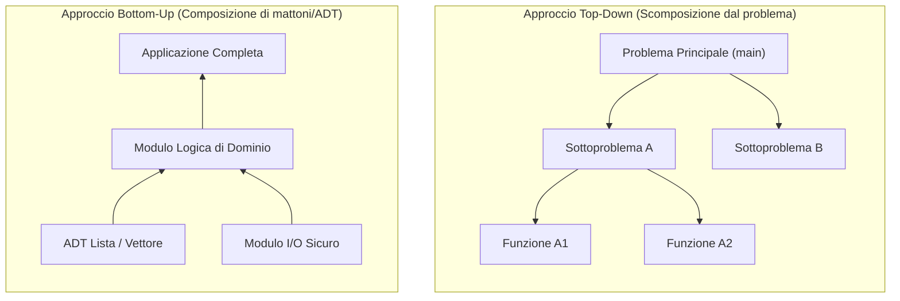

# 5.6.1 - Progettazione del software

Scrivere un programma di poche decine di righe per un esercizio scolastico è molto diverso dal costruire un sistema software reale, destinato a durare nel tempo, essere modificato da altri sviluppatori e resistere a input imprevisti senza andare in crash.

L'**Ingegneria e Progettazione del Software** fornisce le metodologie sistematiche per passare dall'enunciato informale di un problema a un programma corretto, modulare, verificabile e facile da mantenere.

---

## Il Ciclo di Vita del Software (*Software Life Cycle*)

Lo sviluppo di un prodotto software si articola in cinque fasi fondamentali (organizzate in modo sequenziale nel modello a cascata *Waterfall*, oppure ripetute in cicli rapidi incrementali nei modelli *Iterativi / Agili*):



1. **Analisi dei Requisiti**: Comprensione rigorosa del dominio del problema. Elimina le ambiguità del linguaggio naturale stabilendo esattamente input, output attesi, vincoli di efficienza e gestione degli errori.
2. **Progettazione (Architetturale e di Dettaglio)**:
   - *Progettazione architetturale*: scompone il sistema in moduli indipendenti e ne definisce le interfacce (`.h`).
   - *Progettazione di dettaglio*: sceglie le strutture dati concrete e gli algoritmi per ciascun modulo.
3. **Codifica (Implementazione)**: Scrittura del codice seguendo standard di stile chiari (nomi significativi, indentazione, commenti sul *perché* e non sull'ovvio, assenza di *magic numbers*).
4. **Verifica, Validazione e Testing**: Controllo sistematico che il programma rispetti le specifiche (*Verifica*: "stiamo costruendo il prodotto nel modo giusto?") e soddisfi i bisogni reali dell'utente (*Validazione*: "stiamo costruendo il prodotto giusto?").
5. **Manutenzione**: Rappresenta spesso oltre il **60–70% del costo totale** di un software nel tempo! Si divide in manutenzione *correttiva* (risoluzione di bug), *adattativa* (nuovi sistemi operativi/hardware) ed *evolutiva/perfettiva* (aggiunta di nuove funzionalità).

---

## Metodologie di Progettazione: Top-Down vs Bottom-Up

Come affrontiamo la progettazione di un problema complesso? Esistono due strategie complementari:

### 1. Progettazione Top-Down (Raffinamento per passi successivi — *Stepwise Refinement*)

Ideata da Niklaus Wirth ed Edsger Dijkstra, procede **dal generale al particolare**:
1. Si parte dal problema globale visto come un'unica operazione astratta di altissimo livello;
2. La si scompone in 3–5 sottoproblemi più semplici (sottoprogrammi di cui si fissa subito il prototipo e il contratto, rimandandone l'implementazione);
3. Si ripete ricorsivamente il raffinamento su ciascun sottoproblema finché ogni foglia dell'albero è talmente semplice da essere codificata in poche righe di C.

### 2. Progettazione Bottom-Up (Dal basso verso l'alto)

Procede **dal particolare al generale**:
1. Si individuano innanzitutto i mattoni fondamentali e i **Tipi di Dato Astratti (ADT)** di base riutilizzabili (es. gestione delle stringhe dinamiche, liste, coordinate geometriche, parser di file);
2. Si implementano e si **testano isolatamente** questi componenti di base;
3. Si combinano progressivamente i mattoni per costruire i moduli di livello superiore fino all'applicazione completa.



> [!TIP] Nella pratica professionale si usa un approccio Ibrido (Yo-Yo)
> Si progetta l'architettura generale dell'applicazione in modo **Top-Down**, e contemporaneamente si costruiscono le librerie di strutture dati fondamentali (ADT) in modo **Bottom-Up**, incontrandosi a metà strada!

---

## Verifica, Testing, Casi Limite e Programmazione Difensiva

> *"Il testing può dimostrare la presenza di bug, ma mai la loro assenza."* — Edsger W. Dijkstra

Nonostante l'osservazione di Dijkstra, una suite di test ben progettata è indispensabile per individuare gli errori prima che il software vada in produzione.

### Tecniche di Testing

1. **Unit Testing (Test Unitario)**: Testa ogni singola funzione o ADT **in totale isolamento** dal resto del programma tramite piccoli programmi di prova (*test driver*) e asserzioni automatiche.
2. **Black-Box Testing (Test Funzionale)**: Progetta i casi di test guardando **solo la specifica (pre/post-condizioni)** della funzione, senza leggerne il codice interno.
3. **White-Box Testing (Test Strutturale)**: Progetta i casi di test ispezionando il codice sorgente per garantire la **copertura dei cammini (*branch/statement coverage*)**, assicurandosi che ogni ramo `if/else` e ogni ciclo venga attraversato almeno una volta.

### La Check-list d'oro dei Casi Limite (*Edge & Corner Cases*)

La maggior parte dei bug in C non si manifesta sui casi "normali" (es. un array di 10 numeri positivi), ma sui **valori di frontiera (*boundary values*)**. Ogni funzione va sempre messa alla prova contro questa check-list:

| Tipo di input | Casi limite (*Edge Cases*) obbligatori da testare |
| :--- | :--- |
| **Array / Liste / Sequenze** | Dimensione `n = 0` (vuoto), `n = 1` (un solo elemento), `n = 2`, elementi **tutti uguali**, array già ordinato, array ordinato al contrario, elemento cercato in **prima posizione** (`v[0]`), in **ultima posizione** (`v[n-1]`), oppure **assente**. |
| **Numeri interi** | `0`, `1`, `-1`, numeri negativi, valori massimi/minimi rappresentabili (`INT_MAX`, `INT_MIN` in `<limits.h>` per verificare l'assenza di overflow aritmetico). |
| **Stringhe C** | Stringa vuota `""` (che contiene solo `'\0'`), stringa di 1 carattere `"a"`, stringa senza spazi o fatta di soli spazi. |
| **Puntatori** | Passaggio di puntatore **`NULL`**. |

### Programmazione Difensiva e uso di `<assert.h>`

La **programmazione difensiva** consiste nello scrivere codice che non si fida ciecamente del mondo esterno e intercetta immediatamente stati anomali:
- **Per gli errori esterni a runtime** (file inesistente, input utente errato su `scanf`, `malloc` che restituisce `NULL`): bisogna usare **sempre normali controlli `if`** con gestione pulita dell'errore (mai `assert`!).
- **Per verificare bug logici interni e invarianti durante lo sviluppo**: si usa la macro `assert(condizione)` di `<assert.h>`. Se `condizione` è falsa, il programma si arresta immediatamente stampando file sorgente, numero di riga e funzione che ha violato il contratto.

---

## Esempi guidati

### Esempio 1: Progettazione Top-Down di un analizzatore statistico di testo

**Problema**: Leggere una riga di testo e stampare il numero di parole e la lunghezza della parola più lunga.
Procediamo per **raffinamento Top-Down**:
1. *Livello 0*: `main` $\to$ legge la riga, invoca `analizza_testo(riga, &num_parole, &max_len)` e stampa i risultati.
2. *Livello 1*: `analizza_testo` $\to$ scorre la stringa distinguendo se si trova dentro o fuori da una parola tramite l'astrazione `e_separatore(c)` e aggiorna il massimo tramite `massimo(a, b)`.

```c
#include <stdio.h>
#include <stdbool.h>
#include <assert.h>

/* Sottoproblema elementare 1: decide se un carattere separa due parole */
bool e_separatore(char c) {
    return (c == ' ' || c == '\t' || c == '\n' || c == '\0');
}

/* Sottoproblema elementare 2: massimo tra due interi */
int max_int(int a, int b) {
    return (a > b) ? a : b;
}

/* Raffinamento intermedio: logica pura di analisi (senza I/O -> testabile!) */
void analizza_testo(const char *s, int *out_parole, int *out_max_len) {
    assert(s != NULL && out_parole != NULL && out_max_len != NULL);

    int parole = 0;
    int max_l = 0;
    int len_corrente = 0;

    for (size_t i = 0; ; i++) {
        if (!e_separatore(s[i])) {
            if (len_corrente == 0) {
                parole++; /* Inizio di una nuova parola! */
            }
            len_corrente++;
        } else {
            max_l = max_int(max_l, len_corrente);
            len_corrente = 0;
            if (s[i] == '\0') break;
        }
    }
    *out_parole = parole;
    *out_max_len = max_l;
}
```

---

### Esempio 2: Scrivere una suite di Unit Test con Casi Limite

Testiamo automaticamente la funzione `analizza_testo` dell'Esempio 1 contro tutti gli *edge cases* possibili usando `<assert.h>`:

```c
void esegui_unit_test(void) {
    int p, m;

    /* Test 1 (Caso normale) */
    analizza_testo("Il linguaggio C", &p, &m);
    assert(p == 3 && m == 10);

    /* Test 2 (Edge case: stringa vuota "") */
    analizza_testo("", &p, &m);
    assert(p == 0 && m == 0);

    /* Test 3 (Edge case: soli spazi) */
    analizza_testo("     ", &p, &m);
    assert(p == 0 && m == 0);

    /* Test 4 (Edge case: una sola parola senza spazi finali) */
    analizza_testo("Algoritmi", &p, &m);
    assert(p == 1 && m == 9);

    /* Test 5 (Edge case: spazi multipli in testa e in coda) */
    analizza_testo("   a   bb   ", &p, &m);
    assert(p == 2 && m == 2);

    printf("Tutti i 5 Unit Test sono passati con successo!\n");
}
```

---

## Errori frequenti

1. **Usare `assert()` per controllare il successo di `malloc()` o `fopen()`**:
   Quando si compila il software per il rilascio finale con il flag `-DNDEBUG`, il preprocessore C **rimuove completamente tutte le `assert(...)` dal codice**! Se avete scritto `assert((p = malloc(n)) != NULL);`, in modalità *Release* la `malloc` non verrà nemmeno eseguita! Le `assert` devono controllare solo condizioni booleane prive di *side effects* e riservate ai bug logici interni.
2. **Iniziare a scrivere codice C prima di aver disegnato le strutture dati e i casi limite**:
   Codificare "a tentoni" (*code-and-fix*) porta a cambiare continuamente i tipi dei parametri e a rattoppare i cicli con condizioni `if` disordinate.
3. **Fare debugging "alla cieca" cambiando `+ 1` e `- 1` a caso finché compila**:
   Il debugging scientifico procede come il metodo sperimentale: **1) Riproduci** il bug con l'input minimo possibile; **2) Formula un'ipotesi** sullo stato delle variabili; **3) Verifica** l'ipotesi con un debugger (`gdb`) o stampe mirate; **4) Correggi** la causa radice e aggiungi un test per evitare regressioni.

---

## Esercizi di prova

1. **(Base — Progettazione di una Test Suite di Casi Limite)**
   Devi testare in modalità *Black-Box* una funzione `int cerca_secondo_massimo(const int v[], int n, int *out_val)` che trova il secondo valore più grande distinto in un array (restituendo `1` in caso di successo e `0` se non esiste). Elenca almeno **6 casi di test** (input e risultato atteso) che coprano i casi normali e tutti i casi di frontiera.
   > [!tip]- Soluzione
   > 1. **Array con meno di 2 elementi**: `n = 0` e `n = 1` (es. `{10}`) $\to$ deve restituire `0` (impossibile avere un secondo massimo).
   > 2. **Array di $n \ge 2$ elementi tutti uguali**: `{5, 5, 5}` $\to$ deve restituire `0` (non esiste un secondo valore *distinto*).
   > 3. **Massimo in prima posizione**: `{20, 15, 10, 5}` $\to$ restituisce `1` con `*out_val = 15`.
   > 4. **Massimo in ultima posizione (array crescente)**: `{5, 10, 15, 20}` $\to$ restituisce `1` con `*out_val = 15`.
   > 5. **Massimo duplicato più volte**: `{20, 10, 20, 15}` $\to$ restituisce `1` con `*out_val = 15` (non `20`!).
   > 6. **Valori tutti negativi e `INT_MIN`**: `{-100, -5, -20}` $\to$ restituisce `1` con `*out_val = -20` (scopre il bug classico di chi inizializza `max = 0` invece di `v[0]` o `INT_MIN`!).

2. **(Base — Scoperta del bug sui casi limite)**
   Quale caso limite dell'Esercizio 1 fa fallire la seguente funzione che calcola il massimo di un array non vuoto? Come va corretta?
   ```c
   int massimo_sbagliato(const int v[], int n) {
       int m = 0;
       for (int i = 0; i < n; i++) {
           if (v[i] > m) m = v[i];
       }
       return m;
   }
   ```
   > [!tip]- Soluzione
   > La funzione fallisce su qualsiasi **array composto da soli numeri strettamente negativi** (es. `{-10, -3, -25}`): poiché `m` è inizializzato a `0`, nessun elemento negativo è `> 0`, quindi la funzione restituisce erroneamente `0` (che non appartiene nemmeno all'array!) anziché `-3`.
   > **Correzione**: inizializzare `m = v[0];` e far partire il ciclo da `i = 1`:
   > ```c
   > int massimo_corretto(const int v[], int n) {
   >     assert(v != NULL && n >= 1);
   >     int m = v[0];
   >     for (int i = 1; i < n; i++) {
   >         if (v[i] > m) m = v[i];
   >     }
   >     return m;
   > }
   > ```

3. **(Intermedio — Uso corretto vs errato di `assert`)**
   Spiega perché nel seguente frammento l'uso di `assert` è gravemente scorretto e riscrivilo separando correttamente i controlli a runtime dalle asserzioni di debug:
   ```c
   int leggi_elemento(FILE *fp, int *v, int idx, int n) {
       assert(idx >= 0 && idx < n);
       assert(fscanf(fp, "%d", &v[idx]) == 1);
       return v[idx];
   }
   ```
   > [!tip]- Soluzione
   > `assert(fscanf(fp, "%d", &v[idx]) == 1);` contiene due errori gravi:
   > 1. **Ha un side-effect vitale** (`fscanf` legge dal file e scrive in `v[idx]`): compilando con `-DNDEBUG`, l'intera `fscanf` scompare dal programma!
   > 2. **Controlla un input esterno a runtime** (il contenuto di un file può sempre essere malformato o terminare con `EOF`).
   > 
   > **Versione corretta**:
   > ```c
   > int leggi_elemento(FILE *fp, int *v, int idx, int n, int *out_ok) {
   >     assert(fp != NULL && v != NULL && idx >= 0 && idx < n); /* Pre-condizioni interne */
   >     if (fscanf(fp, "%d", &v[idx]) != 1) { /* Controllo runtime su I/O esterno */
   >         if (out_ok) *out_ok = 0;
   >         return 0;
   >     }
   >     if (out_ok) *out_ok = 1;
   >     return v[idx];
   > }
   > ```

4. **(Intermedio — White-Box Testing e copertura dei cammini)**
   Considera la funzione:
   ```c
   int classifica(int x, int y) {
       if (x > 0 && y > 0) return 1;
       else if (x < 0)     return 2;
       else                return 3;
   }
   ```
   Fornisci l'insieme minimo di coppie di input `(x, y)` necessario per ottenere il **100% di branch coverage** (tutti i 3 rami `return` eseguiti almeno una volta) e per testare entrambe le cause di fallimento della congiunzione `x > 0 && y > 0`.
   > [!tip]- Soluzione
   > - `(x = 2, y = 3)` $\to$ `x > 0` Vero e `y > 0` Vero $\to$ entra nel **Ramo 1** (`return 1`).
   > - `(x = -1, y = 5)` $\to$ `x > 0` Falso (cortocircuito sul primo operando dell'AND), `x < 0` Vero $\to$ entra nel **Ramo 2** (`return 2`).
   > - `(x = 2, y = -1)` $\to$ `x > 0` Vero ma `y > 0` Falso (testa il secondo operando dell'AND!), `x < 0` Falso $\to$ entra nel **Ramo 3** (`return 3`).
   > - `(x = 0, y = 0)` $\to$ caso di frontiera sull'origine (`x == 0`), entra nel **Ramo 3**.

5. **(Esame — Scomposizione Top-Down e verifica dell'assenza di Overflow)**
   Progetta e implementa una funzione difensiva `bool media_sicura(const int v[], int n, double *out_media)` che calcola la media aritmetica di un array di `n` interi restituendo `false` se l'input non è valido (`v == NULL` o `n <= 0`), evitando qualsiasi rischio di *integer overflow* anche se gli elementi di `v` valgono `INT_MAX`.
   > [!tip]- Soluzione
   > Se sommassimo gli elementi in una variabile `int somma`, già con due elementi pari a `INT_MAX` avremmo un *Signed Integer Overflow* (Undefined Behavior in C!). Accumulando in un `double` (o `long long`), evitiamo l'overflow intero:
   > ```c
   > #include <stdbool.h>
   > 
   > bool media_sicura(const int v[], int n, double *out_media) {
   >     /* Controllo difensivo dei parametri */
   >     if (v == NULL || n <= 0 || out_media == NULL) {
   >         return false;
   >     }
   > 
   >     double somma = 0.0;
   >     for (int i = 0; i < n; i++) {
   >         somma += (double)v[i];
   >     }
   > 
   >     *out_media = somma / (double)n;
   >     return true;
   > }
   > ```

---

## Provenienza del materiale

- Dispensa ufficiale del corso: `C1PROG1U5L6_Progettazione_del_software.pdf` (Unità 5, Lezione 6 — *Progettazione del software*).
