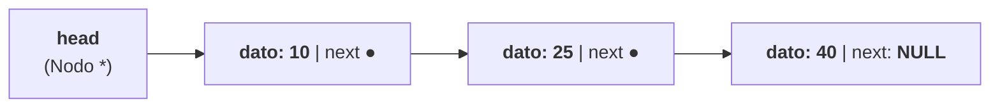
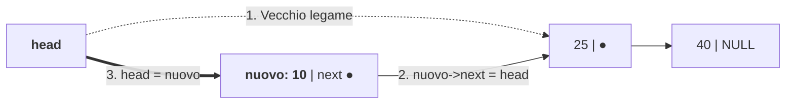
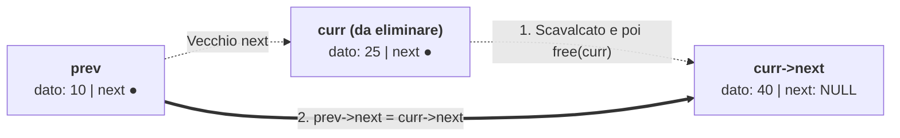

# Liste concatenate

## Come inserire e rimuovere nodi collegati

Gli **array** sono la struttura dati più semplice e veloce quando conosciamo in anticipo il numero di elementi e vogliamo accedere direttamente all'$i$-esimo elemento in tempo costante $O(1)$. Tuttavia, gli array soffrono di due limiti strutturali dovuti alla **contiguità fisica in memoria**:
1. Ridimensionare un array pieno richiede una `realloc` che potrebbe dover ricopiare tutti gli $n$ elementi in una nuova zona dello Heap;
2. **Inserire o cancellare un elemento in testa o al centro** di un array di $n$ elementi obbliga a far scorrere (*shift*) tutti gli elementi successivi, con un costo lineare **$\Theta(n)$**.

Le **Liste Concatenate (*Linked Lists*)** superano entrambi i limiti abbandonando la contiguità fisica: gli elementi (chiamati **nodi**) sono allocati singolarmente nello Heap a indirizzi qualunque e sono collegati tra loro in una catena logica tramite **puntatori**.

---

## Confronto tra Array e Liste Concatenate

| Operazione / Caratteristica | Array (Statico o Dinamico) | Lista Concatenata Semplice (con solo `head`) |
| :--- | :--- | :--- |
| **Disposizione in RAM** | **Contigua** (un unico blocco di memoria) | **Dispersa / Non contigua** (nodi collegati da puntatori) |
| **Dimensione** | Fissa (o ridimensionabile a blocchi con `realloc`) | **Totalmente dinamica** (cresce e decresce nodo per nodo) |
| **Occupazione di memoria per elemento** | Solo il dato `sizeof(T)` (nessun overhead) | Dato + Puntatore `next` (`sizeof(T) + sizeof(Nodo *)`) |
| **Accesso all'$i$-esimo elemento (`v[i]`)** | **$\Theta(1)$** (accesso diretto tramite calcolo dell'indirizzo) | **$\Theta(i) = O(n)$** (accesso sequenziale partendo da `head`) |
| **Inserimento / Rimozione in TESTA** | **$\Theta(n)$** (richiede lo shift di tutti gli elementi) | **$\Theta(1)$** (basta aggiornare 2 puntatori!) |
| **Inserimento / Rimozione dato il puntatore al nodo precedente** | $\Theta(n)$ (shift) | **$\Theta(1)$** (sgancio/aggancio locale dei puntatori) |
| **Ricerca di un valore $x$ (non ordinato)** | $O(n)$ (ottima località della cache) | $O(n)$ (minore località della cache — *pointer chasing*) |

---

## Anatomia di una Lista Concatenata Semplice in C

Una lista concatenata semplice è una sequenza di zero o più **nodi**, ciascuno composto da due campi:
1. Il **campo informazione (`dato` / `val`)**: contiene il valore memorizzato nel nodo (un `int`, una stringa, o una `struct` complessa);
2. Il **campo collegamento (`next`)**: un puntatore al **nodo successivo** della sequenza, oppure **`NULL`** se il nodo è l'ultimo della lista (coda).

L'intera lista è identificata da un unico puntatore esterno **`head` (testa)** che punta al primo nodo. **Una lista vuota è rappresentata semplicemente da `head == NULL`**.



### Definizione autoreferenziale della `struct Nodo`

In C, poiché il campo `next` punta a un'altra struttura dello stesso tipo `struct Nodo`, la struttura si definisce in modo **autoreferenziale**:

```c
typedef struct Nodo {
    int dato;            /* Payload (informazione utile) */
    struct Nodo *next;   /* Puntatore al nodo successivo (o NULL) */
} Nodo;
```

> [!NOTE] Perché dentro la `struct` bisogna scrivere `struct Nodo *next;`?
> All'interno delle parentesi graffe della definizione, l'alias `Nodo` creato dal `typedef` non è ancora completato; il tag `struct Nodo` è invece già visibile non appena viene aperto il blocco `{`.

---

## Implementazione completa di tutte le operazioni in C

Vediamo l'implementazione rigorosa e commentata di tutte le operazioni fondamentali su una lista concatenata semplice.

### 1. Creazione di un nuovo nodo nello Heap

```c
#include <stdio.h>
#include <stdlib.h>

Nodo *crea_nodo(int valore) {
    Nodo *nuovo = (Nodo *)malloc(sizeof(Nodo));
    if (nuovo == NULL) {
        fprintf(stderr, "Errore: memoria esaurita in crea_nodo!\n");
        return NULL;
    }
    nuovo->dato = valore;
    nuovo->next = NULL;
    return nuovo;
}
```

### 2. Inserimento in TESTA in tempo $\Theta(1)$

Per inserire un nuovo nodo davanti a tutti gli altri, dobbiamo cambiare il valore del puntatore `head`. In C esistono due modi equivalenti:
- **Modo A (Restituendo la nuova testa)**: `head = inserisci_testa(head, 10);`
- **Modo B (Passando il puntatore doppio `Nodo **head_ptr`)**: `inserisci_testa_ptr(&head, 10);`



```c
/* Modo A: restituisce il puntatore alla nuova testa della lista */
Nodo *inserisci_testa(Nodo *head, int valore) {
    Nodo *nuovo = crea_nodo(valore);
    if (nuovo == NULL) return head;

    /* ATTENZIONE ALL'ORDINE!
       1) Prima colleghiamo nuovo->next alla vecchia testa... */
    nuovo->next = head;
    /* 2) ...poi il nuovo nodo diventa la nuova testa! */
    return nuovo;
}

/* Modo B: modifica direttamente la variabile head del chiamante tramite Nodo ** */
void inserisci_testa_ptr(Nodo **head_ptr, int valore) {
    Nodo *nuovo = crea_nodo(valore);
    if (nuovo == NULL) return;
    nuovo->next = *head_ptr;
    *head_ptr = nuovo;
}
```

### 3. Inserimento in CODA in tempo $\Theta(n)$

Se non manteniamo un puntatore separato `tail` all'ultimo nodo, dobbiamo scorrere la lista fino all'ultimo nodo (quello con `curr->next == NULL`) e agganciare lì il nuovo nodo, gestendo il **caso speciale di lista inizialmente vuota (`head == NULL`)**:

```c
Nodo *inserisci_coda(Nodo *head, int valore) {
    Nodo *nuovo = crea_nodo(valore);
    if (nuovo == NULL) return head;

    /* Caso speciale: se la lista è vuota, il nuovo nodo diventa la testa! */
    if (head == NULL) {
        return nuovo;
    }

    /* Scorriamo fino all'ULTIMO nodo (curr->next != NULL) */
    Nodo *curr = head;
    while (curr->next != NULL) {
        curr = curr->next;
    }
    curr->next = nuovo;
    return head;
}
```

### 4. Stampa, Calcolo della lunghezza e Ricerca ($\Theta(n)$)

```c
void stampa_lista(const Nodo *head) {
    const Nodo *curr = head;
    while (curr != NULL) {
        printf("%d -> ", curr->dato);
        curr = curr->next; /* Avanza al nodo successivo */
    }
    printf("NULL\n");
}

size_t lunghezza_lista(const Nodo *head) {
    size_t cont = 0;
    for (const Nodo *curr = head; curr != NULL; curr = curr->next) {
        cont++;
    }
    return cont;
}

/* Restituisce il puntatore al primo nodo che contiene target, o NULL se assente */
Nodo *cerca_lista(Nodo *head, int target) {
    for (Nodo *curr = head; curr != NULL; curr = curr->next) {
        if (curr->dato == target) {
            return curr;
        }
    }
    return NULL;
}
```

### 5. Cancellazione di un elemento (con `free` del nodo!)

Per rimuovere un nodo dalla lista senza spezzare la catena e senza causare *Memory Leak*, dobbiamo mantenere durante la scansione **due puntatori**:
- `curr`: punta al nodo che stiamo esaminando;
- `prev`: punta al nodo **immediatamente precedente** a `curr` (`NULL` quando `curr` è il primo nodo).



```c
/* Elimina la prima occorrenza di 'target' dalla lista e restituisce la nuova testa */
Nodo *elimina_valore(Nodo *head, int target) {
    Nodo *curr = head;
    Nodo *prev = NULL;

    while (curr != NULL && curr->dato != target) {
        prev = curr;
        curr = curr->next;
    }

    /* Caso 1: target non trovato (oppure lista vuota) */
    if (curr == NULL) {
        return head;
    }

    /* Caso 2: il nodo da eliminare è il PRIMO nodo (in testa, prev == NULL) */
    if (prev == NULL) {
        head = curr->next; /* La nuova testa diventa il secondo nodo */
    } else {
        /* Caso 3: nodo interno o in coda -> scavalchiamo curr! */
        prev->next = curr->next;
    }

    /* FONDAMENTALE: liberiamo la memoria del nodo rimosso dallo Heap! */
    free(curr);
    return head;
}
```

### 6. Inserimento Ordinato in una lista crescente

```c
Nodo *inserisci_ordinato(Nodo *head, int valore) {
    Nodo *nuovo = crea_nodo(valore);
    if (nuovo == NULL) return head;

    /* Caso 1: lista vuota oppure valore minore/uguale al primo elemento */
    if (head == NULL || valore <= head->dato) {
        nuovo->next = head;
        return nuovo;
    }

    /* Caso 2: cerchiamo il punto di inserimento mantenendo il puntatore prev */
    Nodo *curr = head;
    while (curr->next != NULL && curr->next->dato < valore) {
        curr = curr->next;
    }
    /* Inseriamo 'nuovo' subito dopo 'curr' */
    nuovo->next = curr->next;
    curr->next = nuovo;
    return head;
}
```

### 7. Deallocazione completa della lista (Iterativa e Ricorsiva)

> [!CAUTION] Mai leggere `curr->next` dopo `free(curr)`!
> Prima di chiamare `free(curr)`, è **obbligatorio salvare l'indirizzo del nodo successivo** in una variabile temporanea `Nodo *succ = curr->next;`!

```c
/* Versione Iterativa */
void libera_lista(Nodo **head_ptr) {
    if (head_ptr == NULL) return;
    Nodo *curr = *head_ptr;
    while (curr != NULL) {
        Nodo *succ = curr->next; /* 1. Salva il puntatore al successivo */
        free(curr);              /* 2. Libera il nodo corrente */
        curr = succ;             /* 3. Avanza al successivo */
    }
    *head_ptr = NULL;
}

/* Versione Ricorsiva (libera dalla coda risalendo verso la testa) */
void libera_lista_ric(Nodo *head) {
    if (head == NULL) return;
    libera_lista_ric(head->next); /* Prima libera tutta la sottolista seguente */
    free(head);                   /* Poi libera il nodo corrente */
}
```

---

## Varianti: Liste Doppiamente Concatenate e Liste Circolari

1. **Lista Doppiamente Concatenata (*Doubly Linked List*)**:
   Ogni nodo possiede **due puntatori**: `next` (verso il successivo) e `prev` (verso il precedente):
   ```c
   typedef struct NodoDoppio {
       int dato;
       struct NodoDoppio *prev;
       struct NodoDoppio *next;
   } NodoDoppio;
   ```
   - *Vantaggio*: Permette di scorrere la lista **in entrambe le direzioni** e di **cancellare un nodo `p` in tempo $\Theta(1)$** anche senza conoscere il nodo precedente, perché il precedente è direttamente accessibile come `p->prev`!
   - *Svantaggio*: Richiede un puntatore in più per ogni nodo e più assegnamenti durante l'inserimento.
2. **Lista Circolare (*Circular Linked List*)**:
   Il puntatore `next` dell'ultimo nodo, anziché valere `NULL`, **punta nuovamente al primo nodo `head`**, formando un anello chiuso (ottima per algoritmi di *Round-Robin* dei processi o turni di gioco). Attenzione: la condizione di arresto di una scansione non è più `curr != NULL`, ma `curr != head` (usando un ciclo `do { ... } while (curr != head);` dopo aver verificato `head != NULL`).

---

## Traccia di cancellazione e controllo dei collegamenti

Partiamo da `testa → 4 → 7 → 9 → NULL`. Per rimuovere `7` teniamo `precedente` sul nodo `4` e `corrente` su `7`. Copiamo `corrente->next` in `precedente->next`, quindi liberiamo `corrente`. Il nodo `9` rimane raggiungibile. Per rimuovere `4` aggiorniamo invece `testa` al successore prima di liberare la vecchia testa. Con una lista vuota o una chiave assente lasciamo la struttura com'è.

Durante la ricerca, i nodi precedenti a `corrente` sono già stati esaminati. Dopo l'eliminazione, la sequenza dei nodi rimanenti mantiene l'ordine originale. Nello svuotamento completo salviamo il successore prima di liberare ciascun nodo. Aggiorniamo la testa a `NULL` per evitare che il chiamante conservi il puntatore al primo nodo liberato.

---

## Esempi guidati

### Esempio 1: Operazioni Ricorsive sulle Liste (Lunghezza, Somma, Stampa Inversa)

Poiché una lista concatenata ha una **natura intrinsecamente ricorsiva** (*una lista è vuota `NULL`, oppure è un nodo seguito da una sottolista*), gli algoritmi ricorsivi sulle liste sono straordinariamente compatti:

```c
/* Somma di tutti gli elementi della lista */
int somma_lista_ric(const Nodo *head) {
    if (head == NULL) return 0; /* Caso base: lista vuota */
    return head->dato + somma_lista_ric(head->next);
}

/* Stampa gli elementi della lista DALL'ULTIMO AL PRIMO senza invertirla! */
void stampa_inversa_ric(const Nodo *head) {
    if (head == NULL) return;
    stampa_inversa_ric(head->next); /* Scende fino in fondo... */
    printf("%d ", head->dato);      /* ...e stampa risalendo lo Stack! */
}
```

---

### Esempio 2: Inversione in-place di una lista concatenata in $\Theta(n)$

**Problema**: Invertire l'ordine dei nodi di una lista concatenata semplice in tempo $\Theta(n)$ e spazio aggiuntivo $O(1)$ (senza allocare nuovi nodi, ma **girando sul posto le frecce `next`**!).

```c
Nodo *inverti_lista(Nodo *head) {
    Nodo *prev = NULL;
    Nodo *curr = head;

    while (curr != NULL) {
        Nodo *succ = curr->next; /* 1. Salva il resto della lista */
        curr->next = prev;       /* 2. Gira la freccia all'indietro! */
        prev = curr;             /* 3. Avanza prev */
        curr = succ;             /* 4. Avanza curr */
    }
    return prev; /* prev punta ora all'ex ultimo nodo (nuova testa!) */
}
```

**Traccia su `10 -> 20 -> 30 -> NULL`**:
- Inizio: `prev = NULL`, `curr = 10`.
- Passo 1: `succ = 20`; `10->next = NULL`; `prev = 10`; `curr = 20`.
- Passo 2: `succ = 30`; `20->next = 10`; `prev = 20`; `curr = 30`.
- Passo 3: `succ = NULL`; `30->next = 20`; `prev = 30`; `curr = NULL`.
- Ritorna `prev` (`30 -> 20 -> 10 -> NULL`).

---

## Errori frequenti

> [!caution] Errori da evitare
> 1. **Perdere il puntatore `head` scorrendo la lista direttamente con `head = head->next`**:
>    Se dentro una funzione (o peggio nel `main`) scorriamo la lista facendo `while (head != NULL) { head = head->next; }`, al termine del ciclo `head` vale `NULL` e abbiamo **perso per sempre l'indirizzo del primo nodo** (Memory Leak dell'intera lista!). Per scorrere una lista bisogna **sempre** usare un puntatore ausiliario `Nodo *curr = head;`.
> 2. **Invertire l'ordine degli assegnamenti nell'inserimento**:
>    Se nell'inserimento dopo un nodo `curr` scriviamo prima `curr->next = nuovo;` e poi `nuovo->next = curr->next;`, abbiamo perso il puntatore al resto della lista e abbiamo fatto puntare `nuovo->next` a se stesso (creando un ciclo infinito di lunghezza 1!). **Regola d'oro**: aggancia *sempre prima* i puntatori del `nuovo` nodo (`nuovo->next = ...`), e *solo dopo* modifica i puntatori della lista esistente!
> 3. **Dereferenziare `curr->next` senza aver prima verificato `curr != NULL`**:
>    Nella condizione `while (curr->next != NULL)`, se la lista passata è vuota (`curr == NULL`), valutare `curr->next` provoca immediatamente un **Segmentation Fault**!

---

## Esercizi di prova

### Esercizio 1. Conteggio delle occorrenze e sostituzione (Base)

Scrivi una funzione `int sostituisci_valore(Nodo *head, int vecchio, int nuovo_val)` che scorre la lista sostituendo ogni occorrenza di `vecchio` con `nuovo_val` e restituisce il numero di nodi modificati.

> [!tip]- Soluzione
> ```c
> int sostituisci_valore(Nodo *head, int vecchio, int nuovo_val) {
>     int cont = 0;
>     for (Nodo *curr = head; curr != NULL; curr = curr->next) {
>         if (curr->dato == vecchio) {
>             curr->dato = nuovo_val;
>             cont++;
>         }
>     }
>     return cont;
> }
> ```

### Esercizio 2. Cancellazione in testa con restituzione del valore (Base)

Scrivi una funzione `int pop_testa(Nodo **head_ptr, int *out_val)` che rimuove il primo nodo della lista, ne copia il dato in `*out_val`, libera la memoria del nodo e restituisce `1` (oppure `0` se la lista è vuota).

> [!tip]- Soluzione
> ```c
> int pop_testa(Nodo **head_ptr, int *out_val) {
>     if (head_ptr == NULL || *head_ptr == NULL) {
>         return 0; /* Lista vuota */
>     }
>     Nodo *da_rimuovere = *head_ptr;
>     if (out_val != NULL) {
>         *out_val = da_rimuovere->dato;
>     }
>     *head_ptr = da_rimuovere->next; /* Avanza la testa al 2° nodo */
>     free(da_rimuovere);
>     return 1;
> }
> ```

### Esercizio 3. Eliminazione di tutti i nodi con valore pari (Intermedio)

Scrivi una funzione `Nodo *rimuovi_pari(Nodo *head)` che elimina dalla lista **tutti** i nodi contenenti un numero pari, liberandone la memoria e restituendo la nuova testa (gestendo anche il caso di più numeri pari consecutivi in testa!).

> [!tip]- Soluzione
> ```c
> Nodo *rimuovi_pari(Nodo *head) {
>     Nodo *curr = head;
>     Nodo *prev = NULL;
>
>     while (curr != NULL) {
>         if (curr->dato % 2 == 0) {
>             Nodo *da_cancellare = curr;
>             curr = curr->next; /* Avanziamo curr prima di fare free */
>             if (prev == NULL) {
>                 head = curr;   /* Cancellazione in testa */
>             } else {
>                 prev->next = curr;
>             }
>             free(da_cancellare);
>         } else {
>             /* Avanza prev SOLO quando il nodo corrente NON viene cancellato! */
>             prev = curr;
>             curr = curr->next;
>         }
>     }
>     return head;
> }
> ```

### Esercizio 4. Concatenazione di due liste (Intermedio)

Scrivi una funzione `Nodo *concatena_liste(Nodo *l1, Nodo *l2)` che aggancia la testa della seconda lista `l2` in coda all'ultimo nodo di `l1` senza allocare nuovi nodi e restituisce la testa della lista risultante.

> [!tip]- Soluzione
> ```c
> Nodo *concatena_liste(Nodo *l1, Nodo *l2) {
>     if (l1 == NULL) return l2;
>     if (l2 == NULL) return l1;
>
>     Nodo *curr = l1;
>     while (curr->next != NULL) {
>         curr = curr->next;
>     }
>     curr->next = l2;
>     return l1;
> }
> ```

### Esercizio 5. Fusione ordinata di due liste ordinate / Merge (Avanzato)

Date due liste concatenate già ordinate in senso crescente `l1` e `l2`, scrivi una funzione ricorsiva `Nodo *merge_liste(Nodo *l1, Nodo *l2)` che le fonde in un'unica lista ordinata riutilizzando i nodi esistenti (senza chiamare `malloc`).

> [!tip]- Soluzione
> ```c
> Nodo *merge_liste(Nodo *l1, Nodo *l2) {
>     /* Casi base: se una lista è finita, restituisci l'altra */
>     if (l1 == NULL) return l2;
>     if (l2 == NULL) return l1;
>
>     /* Passo ricorsivo: scegli il nodo minore come testa e fondi il resto */
>     if (l1->dato <= l2->dato) {
>         l1->next = merge_liste(l1->next, l2);
>         return l1;
>     } else {
>         l2->next = merge_liste(l1, l2->next);
>         return l2;
>     }
> }
> ```

### Esercizio 6. Ricerca dell'elemento centrale con la tecnica *Slow & Fast Pointers* (Avanzato)

Scrivi una funzione `Nodo *trova_centro(Nodo *head)` che restituisce il puntatore al nodo centrale della lista effettuando **una sola scansione** (senza prima contare la lunghezza della lista).

> [!tip]- Soluzione
> Usiamo il celebre algoritmo della **Tartaruga e della Lepre** (*Two Pointers*): `slow` avanza di **1 passo** alla volta, mentre `fast` avanza di **2 passi** alla volta. Quando `fast` raggiunge la fine della lista, `slow` si trova esattamente a metà!
> ```c
> Nodo *trova_centro(Nodo *head) {
>     if (head == NULL) return NULL;
>     Nodo *slow = head;
>     Nodo *fast = head;
>
>     while (fast != NULL && fast->next != NULL) {
>         slow = slow->next;       /* +1 passo */
>         fast = fast->next->next; /* +2 passi */
>     }
>     return slow;
> }
> ```

---

## Provenienza del materiale

- Dispensa ufficiale del corso: `C1PROG1U6L1_Liste.pdf` (Unità 6, Lezione 1 — *Le liste*).
- Marco Anisetti, *Algoritmi e strutture dati dinamiche*, `C1PROG1_Appunti_di_fine_unità_6.pdf`, cap. 1.
