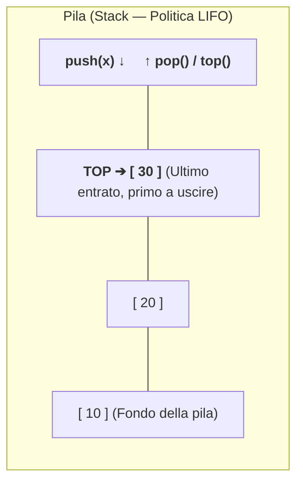
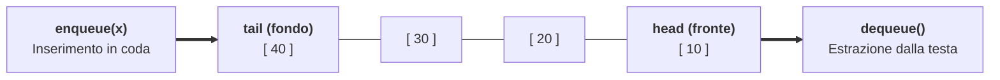
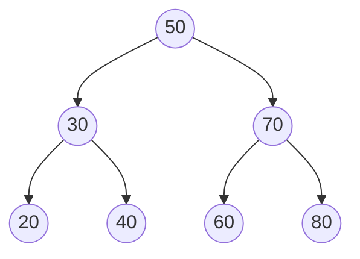

# Pile (Stack), Code (Queue) e Alberi

## Come scegliere fra pila, coda e albero

In questa lezione studiamo tre strutture dati fondamentali dell'informatica:
- Due strutture dati **lineari ad accesso vincolato**: la **Pila (*Stack*)**, governata dalla politica **LIFO**, e la **Coda (*Queue*)**, governata dalla politica **FIFO**;
- La principale struttura dati **gerarchica non lineare**: gli **Alberi (*Trees*)**, gli **Alberi Binari** e gli **Alberi Binari di Ricerca (*BST*)**.

---

## 1. La Pila (Stack — Politica LIFO)

Una **Pila (*Stack*)** è una collezione lineare dinamica in cui sia l'inserimento sia l'estrazione avvengono **esclusivamente da una sola estremità**, chiamata **cima (*top*)** della pila.
Segue la disciplina **LIFO (*Last-In, First-Out*)**: *l'ultimo elemento inserito è il primo ad essere estratto* (esattamente come una pila di piatti, la cronologia del tasto "Annulla/Undo" di un editor o lo Stack dei record di attivazione delle funzioni).



### Operazioni dell'ADT Pila (tutte di costo $\Theta(1)$)

- **`push(s, x)`**: Inserisce l'elemento `x` in cima alla pila.
- **`pop(s)`**: Rimuove e restituisce l'elemento situato in cima alla pila (errore di *Stack Underflow* se la pila è vuota).
- **`top(s)` / `peek(s)`**: Legge l'elemento in cima senza rimuoverlo.
- **`isEmpty(s)`**: Restituisce `true` se la pila non contiene elementi.

### Implementazione in C (tramite Array e tramite Lista Concatenata)

1. **Con Array**: teniamo un indice `top` (inizializzato a `-1` o `0` per pila vuota). `push` incrementa `top`, `pop` decrementa `top` in $\Theta(1)$.
2. **Con Lista Concatenata**: la cima della pila coincide con la **testa `head` della lista**! Sia `push` (inserimento in testa) sia `pop` (cancellazione in testa) costano **$\Theta(1)$** senza alcun limite prefissato di capacità:

```c
typedef struct NodoPila {
    int dato;
    struct NodoPila *next;
} NodoPila;

typedef struct {
    NodoPila *top; /* NULL quando la pila è vuota */
} Pila;

void pila_init(Pila *p) { p->top = NULL; }
int  pila_vuota(const Pila *p) { return (p->top == NULL); }

int pila_push(Pila *p, int val) {
    NodoPila *nuovo = (NodoPila *)malloc(sizeof(NodoPila));
    if (!nuovo) return 0;
    nuovo->dato = val;
    nuovo->next = p->top;
    p->top = nuovo;
    return 1;
}

int pila_pop(Pila *p, int *out_val) {
    if (pila_vuota(p)) return 0; /* Underflow */
    NodoPila *vecchio = p->top;
    if (out_val) *out_val = vecchio->dato;
    p->top = vecchio->next;
    free(vecchio);
    return 1;
}
```

---

## 2. La Coda (Queue — Politica FIFO)

Una **Coda (*Queue*)** è una collezione lineare in cui gli inserimenti avvengono da un'estremità (**fondo / coda / `tail` / `rear`**) e le estrazioni avvengono dall'estremità opposta (**testa / fronte / `head` / `front`**).
Segue la disciplina **FIFO (*First-In, First-Out*)**: *il primo elemento arrivato è il primo ad essere servito* (come una fila allo sportello, uno spooler di stampa o la coda dei pacchetti di rete).



### Operazioni dell'ADT Coda (tutte di costo $\Theta(1)$)

- **`enqueue(q, x)`**: Accoda l'elemento `x` in fondo alla coda (`tail`).
- **`dequeue(q)`**: Estrae e restituisce l'elemento più vecchio in testa alla coda (`head`).
- **`front(q)`**: Legge l'elemento in testa senza rimuoverlo.
- **`isEmpty(q)`**: Verifica se la coda è vuota.

### Implementazione 1: Array Circolare (con aritmetica modulare `% CAP`)

Se usassimo un array normale facendo avanzare `head` ad ogni `dequeue`, le celle iniziali dell'array andrebbero sprecate; se facessimo scorrere gli elementi a sinistra, `dequeue` costerebbe $\Theta(n)$!
La soluzione elegante è l'**Array Circolare (*Ring Buffer*)**: quando `head` o `tail` raggiungono la fine dell'array (`CAP - 1`), **ripartono dall'indice `0`** grazie all'operatore modulo `(idx + 1) % CAP`, mantenendo un contatore `size` degli elementi presenti:

```c
#define CAP_CODA 64

typedef struct {
    int dati[CAP_CODA];
    int head; /* Indice del primo elemento da estrarre */
    int tail; /* Indice della prima cella libera in fondo */
    int size; /* Numero attuale di elementi (0 <= size <= CAP_CODA) */
} CodaCircolare;

void coda_circ_init(CodaCircolare *q) {
    q->head = 0;
    q->tail = 0;
    q->size = 0;
}

int enqueue_circ(CodaCircolare *q, int val) {
    if (q->size == CAP_CODA) return 0; /* Coda piena! */
    q->dati[q->tail] = val;
    q->tail = (q->tail + 1) % CAP_CODA; /* Avanzamento circolare O(1) */
    q->size++;
    return 1;
}

int dequeue_circ(CodaCircolare *q, int *out_val) {
    if (q->size == 0) return 0; /* Coda vuota! */
    if (out_val) *out_val = q->dati[q->head];
    q->head = (q->head + 1) % CAP_CODA; /* Avanzamento circolare O(1) */
    q->size--;
    return 1;
}
```

### Implementazione 2: Lista Concatenata con doppio puntatore `head` e `tail`

Per ottenere $\Theta(1)$ sia su `enqueue` sia su `dequeue` con una lista concatenata, la struttura della coda conserva **sia `head` (per estrarre in testa in $O(1)$) sia `tail` (per inserire in fondo in $O(1)$ senza scorrere la lista!)**:

```c
typedef struct NodoCoda {
    int dato;
    struct NodoCoda *next;
} NodoCoda;

typedef struct {
    NodoCoda *head; /* Estrazione (dequeue) da qui */
    NodoCoda *tail; /* Inserimento (enqueue) qui */
} CodaLista;

int enqueue_lista(CodaLista *q, int val) {
    NodoCoda *nuovo = (NodoCoda *)malloc(sizeof(NodoCoda));
    if (!nuovo) return 0;
    nuovo->dato = val;
    nuovo->next = NULL;

    if (q->tail == NULL) { /* Coda inizialmente vuota */
        q->head = nuovo;
        q->tail = nuovo;
    } else {
        q->tail->next = nuovo;
        q->tail = nuovo;
    }
    return 1;
}

int dequeue_lista(CodaLista *q, int *out_val) {
    if (q->head == NULL) return 0;
    NodoCoda *primo = q->head;
    if (out_val) *out_val = primo->dato;
    q->head = primo->next;
    /* ATTENZIONE: se la coda è diventata vuota, dobbiamo azzerare anche tail! */
    if (q->head == NULL) {
        q->tail = NULL;
    }
    free(primo);
    return 1;
}
```

---

## 3. Alberi, Alberi Binari e Alberi Binari di Ricerca (BST)

Un **Albero radicato (*Tree*)** è una struttura dati non lineare che organizza gli elementi in modo **gerarchico** (come il file system `/home/user/doc`, l'albero DOM di una pagina HTML o un albero genealogico).

### Terminologia essenziale degli alberi

- **Radice (*Root*)**: L'unico nodo superiore privo di padre.
- **Padre (*Parent*) e Figli (*Children*)**: Ogni nodo (eccetto la radice) ha esattamente **un solo nodo padre** e zero o più **nodi figli**. Nodi con lo stesso padre si dicono **fratelli (*siblings*)**.
- **Foglia (*Leaf*)**: Un nodo privo di figli (grado di uscita $0$).
- **Nodo Interno**: Un nodo che ha almeno un figlio.
- **Profondità (*Depth / Level*) di un nodo**: La lunghezza (numero di archi) dell'unico cammino dalla **radice** a quel nodo (la radice ha profondità $0$).
- **Altezza (*Height*) di un albero $h$**: La **massima profondità** raggiunta dalle sue foglie (per convenzione un albero vuoto ha altezza $-1$, un albero con la sola radice ha altezza $0$).

### Alberi Binari e rappresentazione in C

Un **Albero Binario** è un albero in cui ogni nodo ha **al massimo due figli**, distinti posizionalmente in **figlio sinistro (`left`)** e **figlio destro (`right`)**:

```c
typedef struct TreeNode {
    int val;
    struct TreeNode *left;  /* Sottoalbero sinistro (o NULL) */
    struct TreeNode *right; /* Sottoalbero destro (o NULL) */
} TreeNode;
```

- In un albero binario, al livello $k$ ci sono al massimo $2^k$ nodi; un albero binario di altezza $h$ contiene al massimo $2^{h+1} - 1$ nodi. Viceversa, un albero binario con $n$ nodi ha altezza compresa tra **$\lfloor \log_2 n \rfloor$** (albero perfettamente bilanciato) e **$n - 1$** (albero degenere "a zig-zag", isomorfo a una lista!).

---

## Alberi Binari di Ricerca (BST — *Binary Search Tree*)

Un **Albero Binario di Ricerca (BST)** è un albero binario che soddisfa in ogni suo nodo la seguente **Proprietà Fondamentale di Ordinamento**:

> Per ogni nodo $u$ dell'albero:
> - Tutte le chiavi contenute nel **sottoalbero sinistro** di $u$ sono **strettamente minori** di `u->val`;
> - Tutte le chiavi contenute nel **sottoalbero destro** di $u$ sono **strettamente maggiori** di `u->val`.



### Ricerca, Minimo/Massimo e Inserimento in un BST in tempo $O(h)$

Ogni confronto scarta un sottoalbero. Le dimensioni dei due sottoalberi possono essere molto diverse. Ricerca, minimo, massimo e inserimento seguono un cammino di lunghezza al più $h$ archi e costano $O(h+1)$. Un albero bilanciato ha altezza $O(\log n)$, mentre un BST senza bilanciamento può degenerare in una catena.

```c
/* Ricerca in un BST: costo O(h) */
TreeNode *bst_cerca(TreeNode *root, int target) {
    if (root == NULL || root->val == target) {
        return root;
    }
    if (target < root->val) {
        return bst_cerca(root->left, target);
    } else {
        return bst_cerca(root->right, target);
    }
}

/* Inserimento di una nuova chiave in un BST: costo O(h) */
TreeNode *bst_inserisci(TreeNode *root, int chiave) {
    if (root == NULL) {
        TreeNode *nuovo = (TreeNode *)malloc(sizeof(TreeNode));
        if (!nuovo) return NULL;
        nuovo->val = chiave;
        nuovo->left = nuovo->right = NULL;
        return nuovo;
    }
    if (chiave < root->val) {
        root->left = bst_inserisci(root->left, chiave);
    } else if (chiave > root->val) {
        root->right = bst_inserisci(root->right, chiave);
    }
    /* Se chiave == root->val, è già presente: non facciamo nulla */
    return root;
}

/* Il MINIMO di un BST è il nodo più a SINISTRA in assoluto! */
TreeNode *bst_minimo(TreeNode *root) {
    if (root == NULL) return NULL;
    while (root->left != NULL) {
        root = root->left;
    }
    return root;
}
```

---

## Visite (Attraversamenti) di un Albero Binario in $\Theta(n)$

Visitare un albero significa ispezionare sistematicamente tutti i suoi $n$ nodi una sola volta. Esistono **3 visite in profondità (DFS)** ricorsive (distinte dall'istante in cui viene elaborata la **Radice `R`** rispetto al sottoalbero **Sinistro `S`** e **Destro `D`**) e **1 visita in ampiezza (BFS)**:

| Tipo di Visita | Ordine di visita | Uso tipico fondamentale | Sequenza sull'albero `[50 (30 (20, 40)), (70 (60, 80))]` |
| :--- | :---: | :--- | :--- |
| **1. Pre-Order (Prefissa)** | **Radice** $\to$ Sinistro $\to$ Destro (`R S D`) | Clonazione dell'albero, stampa di espressioni in notazione prefissa | `50, 30, 20, 40, 70, 60, 80` |
| **2. In-Order (Simmetrica / Infissa)** | Sinistro $\to$ **Radice** $\to$ Destro (`S R D`) | **Visita le chiavi di un BST in ordine strettamente CRESCENTE!** | `20, 30, 40, 50, 60, 70, 80` |
| **3. Post-Order (Postfissa)** | Sinistro $\to$ Destro $\to$ **Radice** (`S D R`) | **Deallocazione (`free`) dell'albero** e calcolo dal basso (altezza, somma) | `20, 40, 30, 60, 80, 70, 50` |
| **4. BFS (Per livelli)** | Livello $0 \to$ Livello $1 \to$ Livello $2 \dots$ (usa una **Coda FIFO**) | Esplorazione per distanza crescente dalla radice | `50, 30, 70, 20, 40, 60, 80` |

```c
/* 1. Visita PRE-ORDER (Radice - Sinistro - Destro) */
void visita_preorder(const TreeNode *r) {
    if (r == NULL) return;
    printf("%d ", r->val);
    visita_preorder(r->left);
    visita_preorder(r->right);
}

/* 2. Visita IN-ORDER (Sinistro - Radice - Destro): stampa un BST ORDINATO! */
void visita_inorder(const TreeNode *r) {
    if (r == NULL) return;
    visita_inorder(r->left);
    printf("%d ", r->val);
    visita_inorder(r->right);
}

/* 3. Visita POST-ORDER applicata alla DEALLOCAZIONE sicura dell'albero:
      libera PRIMA il figlio sinistro, POI il figlio destro, e INFINE il padre! */
void libera_albero_postorder(TreeNode *r) {
    if (r == NULL) return;
    libera_albero_postorder(r->left);
    libera_albero_postorder(r->right);
    free(r);
}
```

---

## Coda circolare, backtracking e priorità

Con una coda circolare di capacità `4`, testa `3` e lunghezza `3`, le posizioni occupate in ordine FIFO sono `3, 0, 1`. Per crescere, copiamo in un nuovo array in quest'ordine. Impostiamo testa a `0` e il prossimo inserimento a `3`. Copiare le celle nel loro ordine fisico farebbe uscire gli elementi nell'ordine sbagliato. Un ridimensionamento può costare $\Theta(n)$. Con crescita geometrica e inserimenti di costo costante fra ridimensionamenti, il costo per inserimento è costante ammortizzato.

Nel **backtracking**, ogni elemento della pila può rappresentare una scelta e la prossima alternativa ancora da provare. In un labirinto, al vicolo cieco togliamo l'ultima posizione dal percorso e riprendiamo dall'alternativa del punto precedente. In una visita di un grafo, teniamo separato l'insieme dei vertici già visitati per evitare cicli.

In un **min-heap** ogni genitore ha chiave minore o uguale a quella dei figli. L'albero è binario completo e può stare in un array. La radice permette di leggere il minimo in $\Theta(1)$. Inserimento ed estrazione del minimo richiedono al più $O(\log n)$ ripristinando l'ordine lungo un cammino. Un heap implementa una coda di priorità, utile per [[6.4.1 - Grafi e algoritmi di ricerca|Dijkstra]]. Nel BST il vincolo separa invece le chiavi di interi sottoalberi. Per cancellare un nodo con due figli, possiamo sostituire la chiave col minimo del sottoalbero destro e rimuovere il nodo che lo conteneva, seguendo la politica fissata per i duplicati.

---

## Esempi guidati

### Esempio 1: Verifica del bilanciamento delle parentesi tramite una Pila (Stack)

**Problema**: Data una stringa contenente parentesi tonde `()`, quadre `[]` e graffe `{}`, stabilire in tempo $\Theta(n)$ se le parentesi sono correttamente bilanciate e annidate (es. `"{[()]}"` è valida, `"([)]"` o `"((()"` no).

```c
#include <stdio.h>
#include <stdbool.h>

bool parentesi_bilanciate(const char *s) {
    char stack[256];
    int top = 0; /* Pila su array: top indica la prima posizione libera */

    for (size_t i = 0; s[i] != '\0'; i++) {
        char c = s[i];
        /* Se è una parentesi APERTA, facciamo PUSH sulla pila */
        if (c == '(' || c == '[' || c == '{') {
            if (top >= 256) return false;
            stack[top++] = c;
        }
        /* Se è una parentesi CHIUSA, deve corrispondere alla cima della pila! */
        else if (c == ')' || c == ']' || c == '}') {
            if (top == 0) return false; /* Chiusa senza aperta corrispondente! */
            char aperta = stack[--top]; /* POP */
            if ((c == ')' && aperta != '(') ||
                (c == ']' && aperta != '[') ||
                (c == '}' && aperta != '{')) {
                return false; /* Tipo di parentesi non corrispondente! */
            }
        }
    }
    /* Alla fine la pila DEVE essere rimasta vuota! */
    return (top == 0);
}
```

---

### Esempio 2: Calcolo di numero di nodi, foglie e altezza di un Albero Binario

```c
int conta_nodi(const TreeNode *r) {
    if (r == NULL) return 0;
    return 1 + conta_nodi(r->left) + conta_nodi(r->right);
}

int conta_foglie(const TreeNode *r) {
    if (r == NULL) return 0;
    /* Un nodo è una FOGLIA se non ha né figlio sinistro né figlio destro */
    if (r->left == NULL && r->right == NULL) {
        return 1;
    }
    return conta_foglie(r->left) + conta_foglie(r->right);
}

int altezza_albero(const TreeNode *r) {
    if (r == NULL) return -1; /* Albero vuoto: altezza -1 (radice sola: altezza 0) */
    int h_sin = altezza_albero(r->left);
    int h_des = altezza_albero(r->right);
    int max_h = (h_sin > h_des) ? h_sin : h_des;
    return 1 + max_h;
}
```

---

## Errori frequenti

> [!caution] Errori da evitare
> 1. **Deallocare un albero binario in Pre-Order anziché in Post-Order**:
>    Se si chiama `free(r)` *prima* di `libera(r->left)` e `libera(r->right)`, si accede a `r->left` e `r->right` dopo aver liberato `r` (**Use-After-Free**). La deallocazione di un albero deve essere fatta **sempre in Post-Order** (prima i figli, poi il padre).
> 2. **Dimenticare di azzerare `q->tail = NULL` quando `dequeue` svuota l'ultimo elemento di una coda su lista**:
>    Quando viene estratto l'ultimo nodo, `q->head` diventa `NULL`. Se non si imposta anche `q->tail = NULL`, `q->tail` resta un *dangling pointer* al nodo appena deallocato!
> 3. **Verificare la proprietà di BST controllando solo che `r->left->val < r->val < r->right->val`**:
>    Questo controllo locale **non basta**! Ad esempio, se la radice è `50`, il figlio sinistro è `30`, ma il figlio destro di `30` è `60`, localmente `30 < 60` è vero, ma `60` si trova nel sottoalbero sinistro di `50` violando `60 < 50`! Bisogna propagare un intervallo `(min, max)` ammesso per ogni sottoalbero.

---

## Esercizi di prova

### Esercizio 1. Tracciamento di Pila LIFO e Coda FIFO (Base)

Partendo da una Pila $S$ vuota e da una Coda $Q$ vuota, eseguiamo in entrambi i casi la sequenza:
Inserisci `10`, Inserisci `20`, Estrai un elemento, Inserisci `30`, Inserisci `40`, Estrai un elemento.
Quali elementi vengono estratti nei due casi e cosa resta dentro $S$ e dentro $Q$?

> [!tip]- Soluzione
> - **Nella Pila $S$ (LIFO)**:
>   1. `push(10)`, `push(20)` $\to$ cima = `20`.
>   2. 1a `pop()` $\to$ estrae **`20`** (resta `[10]`).
>   3. `push(30)`, `push(40)` $\to$ pila `[10, 30, 40]` con cima = `40`.
>   4. 2a `pop()` $\to$ estrae **`40`**. Restano in $S$: `30` (in cima) e `10` (sul fondo).
> - **Nella Coda $Q$ (FIFO)**:
>   1. `enqueue(10)`, `enqueue(20)` $\to$ fronte = `10`, coda = `20`.
>   2. 1a `dequeue()` $\to$ estrae **`10`** (il primo entrato! Resta `[20]`).
>   3. `enqueue(30)`, `enqueue(40)` $\to$ coda `[20, 30, 40]` con fronte = `20`.
>   4. 2a `dequeue()` $\to$ estrae **`20`**. Restano in $Q$: `30` (in fronte) e `40` (in fondo).

### Esercizio 2. Costruzione di un BST e sequenze di visita (Base)

Disegna l'Albero Binario di Ricerca (BST) che si ottiene inserendo in un albero inizialmente vuoto le chiavi nell'ordine: `40, 20, 60, 10, 30, 50, 25`. Scrivi poi l'output delle visite **Pre-Order**, **In-Order** e **Post-Order**.

> [!tip]- Soluzione
> Struttura del BST:
> - Radice: `40`
> - Sottoalbero sinistro di `40`: radice `20`, con figlio sinistro `10` e figlio destro `30` (il quale ha figlio sinistro `25`).
> - Sottoalbero destro di `40`: radice `60`, con figlio sinistro `50` (e figlio destro `NULL`).
>
> Sequenze di visita:
> - **Pre-Order (`R S D`)**: `40, 20, 10, 30, 25, 60, 50`
> - **In-Order (`S R D`)**: `10, 20, 25, 30, 40, 50, 60` *(sempre ordinata in modo crescente!)*
> - **Post-Order (`S D R`)**: `10, 25, 30, 20, 50, 60, 40`

### Esercizio 3. Inversione di una Coda usando una Pila (Intermedio)

Scrivi una funzione che inverte l'ordine degli elementi contenuti in una Coda `q` utilizzando come unica struttura ausiliaria una Pila `p` e le sole operazioni dei due ADT.

> [!tip]- Soluzione
> Poiché la Pila è LIFO, svuotare la Coda dentro la Pila e poi riversare la Pila dentro la Coda inverte automaticamente l'ordine degli elementi in tempo $\Theta(n)$!
> ```c
> void inverti_coda(CodaLista *q) {
>     Pila p;
>     pila_init(&p);
>     int x;
>     /* 1. Svuota la coda spingendo ogni elemento sulla pila */
>     while (dequeue_lista(q, &x)) {
>         pila_push(&p, x);
>     }
>     /* 2. Svuota la pila riaccodando ogni elemento nella coda */
>     while (pila_pop(&p, &x)) {
>         enqueue_lista(q, x);
>     }
> }
> ```

### Esercizio 4. Somma dei nodi a un dato livello $k$ di un Albero Binario (Intermedio)

Scrivi una funzione ricorsiva `int somma_livello(const TreeNode *r, int k)` che restituisce la somma dei valori di tutti i nodi situati esattamente a profondità $k$ ($k \ge 0$).

> [!tip]- Soluzione
> ```c
> int somma_livello(const TreeNode *r, int k) {
>     if (r == NULL || k < 0) {
>         return 0;
>     }
>     /* Caso base: siamo arrivati esattamente al livello desiderato! */
>     if (k == 0) {
>         return r->val;
>     }
>     /* Passo ricorsivo: scendi nei figli decrementando la distanza k */
>     return somma_livello(r->left, k - 1) + somma_livello(r->right, k - 1);
> }
> ```

### Esercizio 5. Specchiamento di un Albero Binario (Avanzato)

Scrivi una funzione ricorsiva `void specchia_albero(TreeNode *r)` che trasforma un albero binario nella sua immagine speculare scambiando in ogni nodo il sottoalbero sinistro con il sottoalbero destro.

> [!tip]- Soluzione
> ```c
> void specchia_albero(TreeNode *r) {
>     if (r == NULL) return;
>
>     /* Scambia i puntatori ai due figli */
>     TreeNode *tmp = r->left;
>     r->left = r->right;
>     r->right = tmp;
>
>     /* Specchia ricorsivamente i due sottoalberi */
>     specchia_albero(r->left);
>     specchia_albero(r->right);
> }
> ```

### Esercizio 6. Verifica rigorosa se un Albero Binario è un BST valido (Avanzato)

Scrivi una funzione `bool e_bst_valido(const TreeNode *r)` che restituisce `true` se e solo se l'albero binario radicato in `r` soddisfa globalmente la proprietà di Albero Binario di Ricerca in tutti i suoi nodi.

> [!tip]- Soluzione
> Passiamo ricorsivamente a ogni nodo l'intervallo aperto `(min_node, max_node)` entro cui deve trovarsi la sua chiave:
> ```c
> #include <stdbool.h>
>
> static bool bst_aux(const TreeNode *r, const TreeNode *min_n, const TreeNode *max_n) {
>     if (r == NULL) return true;
>
>     /* Se il valore viola il confine inferiore o superiore, NON è un BST! */
>     if (min_n != NULL && r->val <= min_n->val) return false;
>     if (max_n != NULL && r->val >= max_n->val) return false;
>
>     /* A sinistra il nuovo massimo diventa r; a destra il nuovo minimo diventa r */
>     return bst_aux(r->left, min_n, r) && bst_aux(r->right, r, max_n);
> }
>
> bool e_bst_valido(const TreeNode *r) {
>     return bst_aux(r, NULL, NULL);
> }
> ```

---

## Provenienza del materiale

- Dispensa ufficiale del corso: `C1PROG1U6L2_Pile_Code_Alberi.pdf` (Unità 6, Lezione 2 — *Pile, Code e Alberi*).
- Marco Anisetti, *Algoritmi e strutture dati dinamiche*, `C1PROG1_Appunti_di_fine_unità_6.pdf`, cap. 2.
