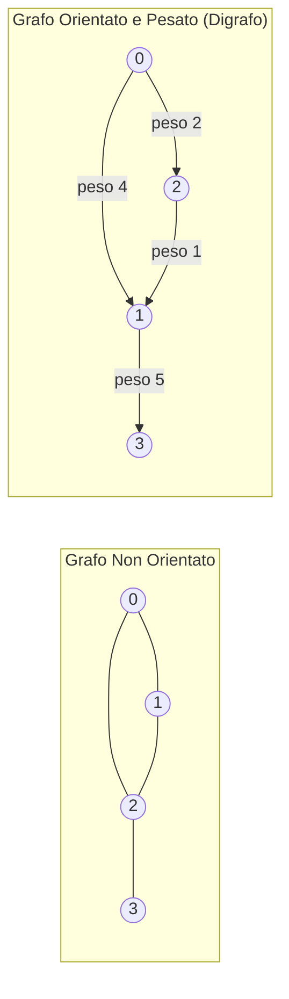
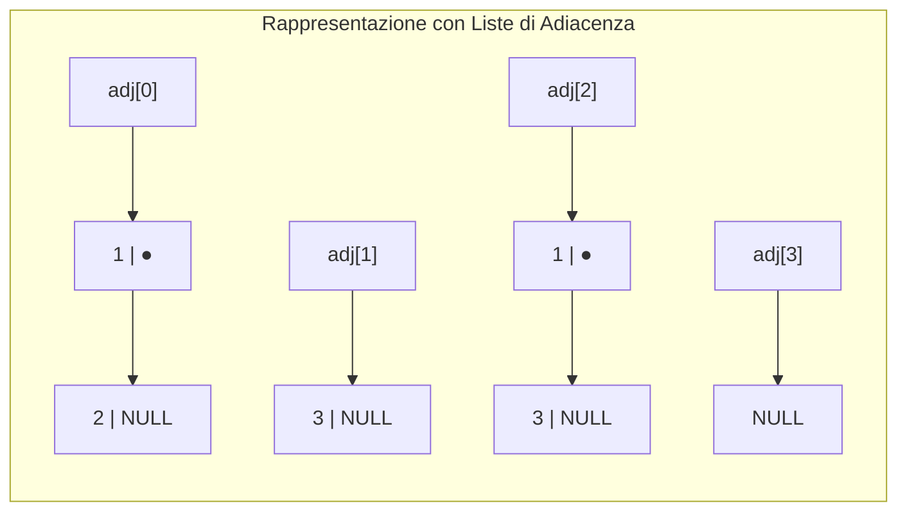

# 6.4.1 - Grafi e algoritmi di ricerca

Gli alberi permettono di rappresentare solo relazioni strettamente gerarchiche (dove ogni nodo ha un unico padre e non esistono cicli). Quando dobbiamo modellare relazioni arbitrarie tra coppie di oggetti — come una **rete stradale** di città, la topologia dei router di **Internet**, le amicizie in un **social network**, o le dipendenze tra pacchetti software — utilizziamo la struttura matematica e informatica più generale: il **Grafo**.

---

## Definizione formale e terminologia dei Grafi

Un **Grafo** è una coppia ordinata $G = (V, E)$ dove:
- **$V$** è un insieme finito e non vuoto di elementi chiamati **vertici (o nodi)**; indichiamo il numero di vertici con $|V| = n$.
- **$E$** è un insieme di coppie di vertici chiamate **archi (o spigoli / lati, *edges*)**; indichiamo il numero di archi con $|E| = m$.

### Classificazione dei grafi

1. **Grafo Non Orientato (*Undirected Graph*)**:
   Gli archi sono **coppie non ordinate** $\{u, v\}$: la connessione è bidirezionale/simmetrica ($(u, v)$ equivale a $(v, u)$, come l'amicizia reciproca o una strada a doppio senso). Il numero massimo di archi (senza cappi) è $\binom{|V|}{2} = \frac{|V|(|V|-1)}{2} = \Theta(|V|^2)$.
2. **Grafo Orientato o Digrafo (*Directed Graph*)**:
   Gli archi sono **coppie ordinate** $(u, v)$ rappresentate da frecce $u \to v$, dove $u$ è la *coda/sorgente* e $v$ è la *testa/destinazione* (come i link tra pagine web o il "seguire" su un social). Il numero massimo di archi è $|V|(|V|-1) = \Theta(|V|^2)$.
3. **Grafo Pesato (*Weighted Graph*)**:
   Ad ogni arco $e = (u, v) \in E$ è associato un numero reale $w(u, v)$ chiamato **peso o costo** (es. distanza in km, latenza in ms, costo del pedaggio).



### Grado, Cammini, Cicli, Connessione e Alberi

- **Adiacenza e Grado**: Se $(u, v) \in E$, il vertice $v$ si dice **adiacente** a $u$.
  - In un grafo non orientato, il **grado $\deg(u)$** è il numero di archi incidenti in $u$. Vale il *Lemma delle strette di mano*: $\sum_{u \in V} \deg(u) = 2|E|$.
  - In un grafo orientato, si distinguono il **grado entrante ($\text{in-degree}$)** (numero di frecce che arrivano in $u$) e il **grado uscente ($\text{out-degree}$)** (numero di frecce che partono da $u$). Vale $\sum_{u} \text{out-deg}(u) = \sum_{u} \text{in-deg}(u) = |E|$.
- **Cammino (*Path*)**: Una sequenza di vertici $\langle v_0, v_1, \dots, v_k \rangle$ collegati da archi consecutivi $(v_{i-1}, v_i) \in E$. La **lunghezza** del cammino è il numero di archi $k$ (o la somma dei pesi in un grafo pesato). Un cammino è *semplice* se non ripete vertici.
- **Ciclo (*Cycle*)**: Un cammino di lunghezza $\ge 1$ in cui il vertice finale coincide con quello iniziale ($v_0 = v_k$). Un grafo privo di cicli si dice **aciclico**. Un grafo orientato aciclico è chiamato **DAG (*Directed Acyclic Graph*)**.
- **Connessione e Alberi Liberi**: Un grafo non orientato è **connesso** se esiste almeno un cammino tra qualsiasi coppia di vertici. Un **Albero** è semplicemente un **grafo non orientato connesso e aciclico**, ed è caratterizzato dalla relazione fondamentale:
  $$|E| = |V| - 1$$
- **Grafo Sparso vs Grafo Denso**: Un grafo si dice **sparso** se $|E| \ll |V|^2$ (es. $|E| = O(|V|)$, come le reti stradali dove ogni incrocio ha $3\text{–}4$ strade); si dice **denso** se $|E| \approx \Theta(|V|^2)$.

---

## Rappresentazione dei Grafi in memoria in C

Supponendo di numerare i vertici da $0$ a $V - 1$, esistono due strutture dati canoniche per rappresentare un grafo:

### 1. Matrice di Adiacenza (*Adjacency Matrix*)

È una matrice quadrata $A$ di dimensione $|V| \times |V|$ in cui:

$$
A[u][v] = \begin{cases} 1 \text{ (oppure } w(u, v)\text{)} & \text{se l'arco } (u, v) \in E \\ 0 \text{ (oppure } +\infty\text{)} & \text{se } (u, v) \notin E \end{cases}
$$

*(Nota: se il grafo non è orientato, la matrice di adiacenza è **simmetrica**: $A[u][v] = A[v][u]$).*

### 2. Liste di Adiacenza (*Adjacency Lists*)

È un **array di $|V|$ puntatori a liste concatenate**, dove la lista `adj[u]` contiene esclusivamente i vertici $v$ adiacenti a $u$ (cioè gli archi uscenti da $u$).



### Tabella comparativa: Matrice vs Liste di Adiacenza

| Criterio / Operazione | Matrice di Adiacenza | Liste di Adiacenza |
| :--- | :--- | :--- |
| **Spazio di memoria $S(V, E)$** | **$\Theta(|V|^2)$** (indipendente dal numero di archi!) | **$\Theta(|V| + |E|)$** (proporzionale a vertici + archi) |
| **Testare se esiste l'arco $(u, v)$** | **$\Theta(1)$** (basta leggere `A[u][v]`) | **$O(\deg(u))$** (bisogna scorrere la lista `adj[u]`) |
| **Scorrere tutti i vicini di $u$** | **$\Theta(|V|)$** (bisogna scandire tutta la riga $u$) | **$\Theta(\deg(u))$** (si toccano solo i vicini reali!) |
| **Inserire un arco $(u, v)$** | $\Theta(1)$ | $\Theta(1)$ (inserimento in testa a `adj[u]`) |
| **Quando conviene usarla?** | **Grafi DENSI** ($|E| \approx |V|^2$) o con $|V|$ piccolo | **Grafi SPARSI** ($|E| \ll |V|^2$) — lo standard negli algoritmi! |

---

## Algoritmi di Visita e Ricerca sui Grafi

Per esplorare tutti i vertici raggiungibili da un vertice sorgente $s$ senza cadere in cicli infiniti, manteniamo un array booleano `visitato[V]` (inizializzato a `0`). Esistono due strategie universali di esplorazione, entrambe di complessità ottima **$\Theta(|V| + |E|)$** con liste di adiacenza (e $\Theta(|V|^2)$ con matrice di adiacenza):

### 1. Ricerca in Ampiezza: BFS (*Breadth-First Search*)

La **BFS** esplora il grafo "a onde concentriche" (per livelli di distanza dalla sorgente $s$): prima visita $s$ (distanza $0$), poi tutti i vicini a distanza $1$, poi tutti i vertici a distanza $2$, e così via.
- **Struttura dati di supporto**: utilizza una **Coda FIFO (`Queue`)**.
- **Proprietà fondamentale**: In ogni grafo non pesato, la BFS calcola la **distanza minima `dist[v]` (cammino minimo col minor numero di archi)** dalla sorgente $s$ a tutti gli altri vertici, costruendo l'*albero dei cammini minimi* tramite il vettore dei padri `padre[v]`!

### 2. Ricerca in Profondità: DFS (*Depth-First Search*)

La **DFS** esplora il grafo spingendosi il più lontano possibile lungo un singolo cammino finché non incontra un vicolo cieco (tutti i vicini già visitati), per poi fare **backtracking** all'ultimo bivio non ancora esaurito.
- **Struttura dati di supporto**: utilizza la **ricorsione** (lo Stack delle chiamate) oppure una **Pila LIFO (`Stack`)** esplicita.
- **Applicazioni**: Individuazione di **cicli**, calcolo delle **componenti connesse**, **ordinamento topologico** di un DAG, risoluzione di labirinti.

### Cenni all'Algoritmo di Dijkstra per Grafi Pesati ($w(u, v) \ge 0$)

Quando gli archi hanno **pesi positivi diversi tra loro**, il cammino con meno archi (trovato dalla BFS) non è necessariamente il cammino di peso totale minimo!
L'**Algoritmo di Dijkstra** generalizza la BFS sostituendo la Coda FIFO con una **Coda con Priorità (Min-Heap)**:
1. Inizializza `dist[s] = 0` e `dist[v] = +INFINITO` per tutti gli altri vertici;
2. Ad ogni passo estrae il vertice non ancora definitivo $u$ avente **`dist[u]` minima**;
3. **Rilassa (*Relaxation*)** tutti gli archi uscenti $(u, v)$: se passare per $u$ migliora la distanza verso $v$, aggiorna:
   $$\text{se } \text{dist}[u] + w(u, v) < \text{dist}[v] \implies \text{dist}[v] = \text{dist}[u] + w(u, v), \quad \text{padre}[v] = u$$

---

## Implementazione completa in C: Grafo con Liste di Adiacenza, BFS e DFS

```c
#include <stdio.h>
#include <stdlib.h>

/* Nodo di una lista di adiacenza */
typedef struct ArcoNodo {
    int dest;
    struct ArcoNodo *next;
} ArcoNodo;

/* Struttura del Grafo con Liste di Adiacenza */
typedef struct {
    int V;            /* Numero di vertici (0 .. V-1) */
    ArcoNodo **adj;   /* Array di V puntatori alle liste di adiacenza */
} Grafo;

Grafo *grafo_crea(int V) {
    Grafo *g = (Grafo *)malloc(sizeof(Grafo));
    if (!g) return NULL;
    g->V = V;
    g->adj = (ArcoNodo **)calloc(V, sizeof(ArcoNodo *));
    if (!g->adj) { free(g); return NULL; }
    return g;
}

/* Aggiunge un arco orientato u -> v in tempo O(1) */
void grafo_aggiungi_arco(Grafo *g, int u, int v) {
    ArcoNodo *nuovo = (ArcoNodo *)malloc(sizeof(ArcoNodo));
    if (!nuovo) return;
    nuovo->dest = v;
    nuovo->next = g->adj[u];
    g->adj[u] = nuovo;
}

/* === 1. VISITA IN AMPIEZZA (BFS) con calcolo delle distanze minime === */
void grafo_bfs(const Grafo *g, int sorgente) {
    int *visitato = (int *)calloc(g->V, sizeof(int));
    int *dist     = (int *)malloc(g->V * sizeof(int));
    int *coda     = (int *)malloc(g->V * sizeof(int));
    int head = 0, tail = 0;

    for (int i = 0; i < g->V; i++) dist[i] = -1;

    /* Inizializza la BFS dalla sorgente */
    visitato[sorgente] = 1;
    dist[sorgente] = 0;
    coda[tail++] = sorgente; /* enqueue(sorgente) */

    printf("Ordine BFS da %d: ", sorgente);
    while (head < tail) {
        int u = coda[head++]; /* dequeue() */
        printf("%d(d=%d) ", u, dist[u]);

        /* Esplora tutti i vicini v di u */
        for (ArcoNodo *p = g->adj[u]; p != NULL; p = p->next) {
            int v = p->dest;
            if (!visitato[v]) {
                visitato[v] = 1;
                dist[v] = dist[u] + 1;
                coda[tail++] = v; /* enqueue(v) */
            }
        }
    }
    printf("\n");
    free(visitato);
    free(dist);
    free(coda);
}

/* === 2. VISITA IN PROFONDITA (DFS) ricorsiva === */
static void dfs_ric(const Grafo *g, int u, int visitato[]) {
    visitato[u] = 1;
    printf("%d ", u);

    for (ArcoNodo *p = g->adj[u]; p != NULL; p = p->next) {
        int v = p->dest;
        if (!visitato[v]) {
            dfs_ric(g, v, visitato);
        }
    }
}

void grafo_dfs(const Grafo *g, int sorgente) {
    int *visitato = (int *)calloc(g->V, sizeof(int));
    printf("Ordine DFS da %d: ", sorgente);
    dfs_ric(g, sorgente, visitato);
    printf("\n");
    free(visitato);
}

void grafo_distruggi(Grafo *g) {
    if (!g) return;
    for (int i = 0; i < g->V; i++) {
        ArcoNodo *curr = g->adj[i];
        while (curr) {
            ArcoNodo *succ = curr->next;
            free(curr);
            curr = succ;
        }
    }
    free(g->adj);
    free(g);
}
```

---

## Esempi guidati

### Esempio 1: Traccia passo-passo di BFS e DFS su un grafo concreto

Dato il grafo non orientato con $V = \{0, 1, 2, 3, 4, 5\}$ e liste di adiacenza (ordinate in senso crescente):
- `adj[0] = {1, 2}`
- `adj[1] = {0, 3, 4}`
- `adj[2] = {0, 4}`
- `adj[3] = {1, 5}`
- `adj[4] = {1, 2, 5}`
- `adj[5] = {3, 4}`

1. **Traccia della BFS partendo da `0`**:
   - Livello $d = 0$: Coda `[0]` $\to$ estrae **`0`**, scopre e accoda i vicini `1` ($d=1$) e `2` ($d=1$). Coda: `[1, 2]`.
   - Livello $d = 1$:
     - Estrae **`1`**, scopre e accoda `3` ($d=2$) e `4` ($d=2$). Coda: `[2, 3, 4]`.
     - Estrae **`2`**, i suoi vicini `0` e `4` sono già visitati! Coda: `[3, 4]`.
   - Livello $d = 2$:
     - Estrae **`3`**, scopre e accoda `5` ($d=3$). Coda: `[4, 5]`.
     - Estrae **`4`**, i suoi vicini `1, 2, 5` sono già visitati! Coda: `[5]`.
   - Livello $d = 3$: Estrae **`5`**. Coda vuota.
   - **Sequenza BFS**: **`0, 1, 2, 3, 4, 5`**.

2. **Traccia della DFS ricorsiva partendo da `0`**:
   - Visita **`0`** $\to$ scende nel primo vicino non visitato **`1`** $\to$ scende nel primo vicino **`3`** $\to$ scende in **`5`** $\to$ scende in **`4`** $\to$ scende in **`2`**. Da `2` tutti i vicini (`0` e `4`) sono già visitati, quindi risale fino a `0`.
   - **Sequenza DFS**: **`0, 1, 3, 5, 4, 2`**.

---

### Esempio 2: Contare il numero di Componenti Connesse di un grafo non orientato

Se un grafo non è connesso, è formato da più "isole" disgiunte chiamate **componenti connesse**. Per contarle in tempo $\Theta(|V| + |E|)$, basta eseguire un ciclo su tutti i vertici $v \in V$: ogni volta che troviamo un vertice non ancora visitato, incrementiamo il contatore delle isole e lanciamo una DFS/BFS da $v$ che marcherà tutta la sua isola!

```c
int conta_componenti_connesse(const Grafo *g) {
    int *visitato = (int *)calloc(g->V, sizeof(int));
    int num_componenti = 0;

    for (int v = 0; v < g->V; v++) {
        if (!visitato[v]) {
            num_componenti++; /* Trovata una nuova componente connessa! */
            dfs_ric(g, v, visitato); /* Marca tutti i vertici raggiungibili da v */
        }
    }
    free(visitato);
    return num_componenti;
}
```

---

## Errori frequenti

1. **Dimenticare l'array `visitato[]` durante la visita di un grafo**:
   A differenza degli alberi (che non hanno cicli), i grafi possono contenere **cicli** (o archi bidirezionali $u \leftrightarrow v$). Senza il vettore `visitato[]`, sia la BFS sia la DFS rimbalzano all'infinito tra $u$ e $v$ fino al crash!
2. **Nella BFS, marcare `visitato[v] = 1` solo quando `v` viene estratto dalla coda (`dequeue`) anziché quando viene inserito (`enqueue`)**:
   Se si marca un vertice come visitato solo al momento della `dequeue`, lo stesso vertice `v` può essere accodato **più volte** da più vicini diversi prima di essere estratto, gonfiando la coda e rallentando l'algoritmo. **Regola d'oro**: `visitato[v] = 1` va impostato **subito prima di `enqueue(v)`**!
3. **Applicare l'algoritmo di Dijkstra a grafi con archi di peso negativo**:
   Dijkstra assume che aggiungere un arco a un cammino non possa mai diminuirne il peso totale ($w(u,v) \ge 0$). In presenza di pesi negativi Dijkstra produce risultati errati (serve invece l'algoritmo di *Bellman-Ford*).

---

## Esercizi di prova

1. **(Base — Scelta tra Matrice e Liste di Adiacenza)**
   Un grafo orientato rappresenta una rete stradale con $|V| = 100\,000$ incroci e $|E| = 300\,000$ tratti stradali. Calcola l'ordine di grandezza della memoria richiesta dalla Matrice di Adiacenza (assumendo `1` byte per cella) rispetto alle Liste di Adiacenza, e stabilisci quale rappresentazione è necessaria.
   > [!tip]- Soluzione
   > - **Matrice di Adiacenza**: richiede $|V|^2 = (10^5)^2 = 10^{10}$ celle $\approx \mathbf{10\text{ GB}}$ di RAM, quasi tutta piena di zeri (il grafo è estremamente sparso: solo lo $0.003\%$ delle coppie ha un arco!).
   > - **Liste di Adiacenza**: richiedono un vettore di $100\,000$ puntatori più $300\,000$ nodi lista ($\Theta(|V| + |E|)$), occupando appena **pochi Megabyte ($\approx 5.6\text{ MB}$)**!
   > Per grafi sparsi di grandi dimensioni le **Liste di Adiacenza** sono l'unica scelta praticabile.

2. **(Base — Calcolo di grado entrante e uscente su Matrice di Adiacenza)**
   Dato un grafo orientato rappresentato tramite una matrice di adiacenza `int A[V][V]`, scrivi due funzioni `int grado_uscente(int A[V][V], int u)` e `int grado_entrante(int A[V][V], int u)` e indicane la complessità temporale.
   > [!tip]- Soluzione
   > ```c
   > /* Il grado uscente di u è la somma della RIGA u: costo Theta(V) */
   > int grado_uscente(int V, int A[V][V], int u) {
   >     int deg = 0;
   >     for (int v = 0; v < V; v++) {
   >         if (A[u][v] != 0) deg++;
   >     }
   >     return deg;
   > }
   > 
   > /* Il grado entrante di u è la somma della COLONNA u: costo Theta(V) */
   > int grado_entrante(int V, int A[V][V], int u) {
   >     int deg = 0;
   >     for (int v = 0; v < V; v++) {
   >         if (A[v][u] != 0) deg++;
   >     }
   >     return deg;
   > }
   > ```

3. **(Intermedio — Verifica di grafo non orientato tramite simmetria)**
   Scrivi una funzione `int matrice_simmetrica(int V, int A[V][V])` che verifica se la matrice di adiacenza `A` rappresenta un grafo non orientato privo di cappi ($A[u][u] == 0$ e $A[u][v] == A[v][u]$) ispezionando solo il triangolo superiore della matrice.
   > [!tip]- Soluzione
   > ```c
   > int matrice_simmetrica(int V, int A[V][V]) {
   >     for (int i = 0; i < V; i++) {
   >         if (A[i][i] != 0) return 0; /* Presenza di un cappio (self-loop) */
   >         for (int j = i + 1; j < V; j++) {
   >             if (A[i][j] != A[j][i]) {
   >                 return 0; /* Arco non simmetrico */
   >             }
   >         }
   >     }
   >     return 1;
   > }
   > ```

4. **(Intermedio — Ricostruzione del cammino minimo dopo la BFS)**
   Supponi che la BFS a partire da `sorgente` abbia popolato il vettore dei padri `int padre[V]` (dove `padre[sorgente] = -1` e `padre[v] = u` indica che `v` è stato scoperto da `u`). Scrivi una procedura ricorsiva `void stampa_cammino(const int padre[], int s, int dest)` che stampa i vertici del cammino minimo da `s` a `dest` nell'ordine corretto da `s` a `dest`.
   > [!tip]- Soluzione
   > ```c
   > void stampa_cammino(const int padre[], int s, int dest) {
   >     if (dest == s) {
   >         printf("%d", s);
   >         return;
   >     }
   >     if (padre[dest] == -1) {
   >         printf("Nessun cammino da %d a %d", s, dest);
   >         return;
   >     }
   >     stampa_cammino(padre, s, padre[dest]);
   >     printf(" -> %d", dest);
   > }
   > ```

5. **(Intermedio/Esame — Test se un grafo non orientato è un Albero)**
   Ricordando che un grafo non orientato $G = (V, E)$ è un **albero** se e solo se è **connesso** e ha esattamente **$|E| = |V| - 1$ archi**, spiega come verificare in tempo $\Theta(|V| + |E|)$ se un grafo non orientato rappresentato con liste di adiacenza è un albero.
   > [!tip]- Soluzione
   > 1. **Conteggio degli archi**: Scorriamo tutte le liste di adiacenza sommando le loro lunghezze per ottenere $\sum \deg(u) = 2|E|$. Se $|E| \neq |V| - 1$, possiamo restituire subito `false`!
   > 2. **Verifica della connessione**: Lanciamo una singola visita `DFS` (o `BFS`) a partire dal vertice `0` e contiamo quanti vertici vengono visitati. Se tutti i $|V|$ vertici risultano visitati (e avevamo già verificato $|E| = |V| - 1$), un teorema fondamentale della teoria dei grafi garantisce che il grafo è sia connesso sia aciclico, quindi è un **albero** (`true`).

6. **(Esame — Traccia dell'Algoritmo di Dijkstra)**
   Dato un grafo orientato pesato con vertici $\{0, 1, 2, 3\}$ e archi:
   $0 \to 1 \text{ (peso } 6\text{)}$, $0 \to 2 \text{ (peso } 2\text{)}$, $2 \to 1 \text{ (peso } 3\text{)}$, $1 \to 3 \text{ (peso } 1\text{)}$, $2 \to 3 \text{ (peso } 5\text{)}$,
   calcola passo dopo passo il vettore delle distanze minime `dist[]` dalla sorgente `0` applicando l'algoritmo di Dijkstra.
   > [!tip]- Soluzione
   > - **Inizializzazione**: `dist = [0, +∞, +∞, +∞]`, insieme dei definitivi $S = \emptyset$.
   > - **Passo 1**: Estraiamo il minimo `u = 0` (`dist[0] = 0`). Rilassiamo gli archi da `0`:
   >   - $0 \to 1$: `dist[1] = 0 + 6 = 6`, `padre[1] = 0`.
   >   - $0 \to 2$: `dist[2] = 0 + 2 = 2`, `padre[2] = 0`.
   >   Stato: `dist = [0, 6, 2, +∞]`, $S = \{0\}$.
   > - **Passo 2**: Tra i non visitati $\{1, 2, 3\}$, il minimo è **`u = 2`** (`dist[2] = 2`). Rilassiamo gli archi da `2`:
   >   - $2 \to 1$: $\text{dist}[2] + w(2,1) = 2 + 3 = 5 < 6 \implies$ aggiorniamo **`dist[1] = 5`**, `padre[1] = 2`!
   >   - $2 \to 3$: $\text{dist}[2] + w(2,3) = 2 + 5 = 7 < +\infty \implies$ `dist[3] = 7`, `padre[3] = 2`.
   >   Stato: `dist = [0, 5, 2, 7]`, $S = \{0, 2\}$.
   > - **Passo 3**: Tra $\{1, 3\}$, il minimo è **`u = 1`** (`dist[1] = 5`). Rilassiamo l'arco da `1`:
   >   - $1 \to 3$: $\text{dist}[1] + w(1,3) = 5 + 1 = 6 < 7 \implies$ aggiorniamo **`dist[3] = 6`**, `padre[3] = 1`!
   >   Stato: `dist = [0, 5, 2, 6]`, $S = \{0, 2, 1\}$.
   > - **Passo 4**: Estraiamo `u = 3` (`dist[3] = 6`). Fine!
   > **Distanze minime finali da `0`**: `dist = [0, 5, 2, 6]` (il cammino minimo da `0` a `3` è $0 \to 2 \to 1 \to 3$ di costo $2 + 3 + 1 = 6$).

---

## Provenienza del materiale

- Dispensa ufficiale del corso: `C1PROG1U6L4_Ricerca_Applicata_ai_Grafi.pdf` (Unità 6, Lezione 4 — *Ricerca applicata ai grafi*).
