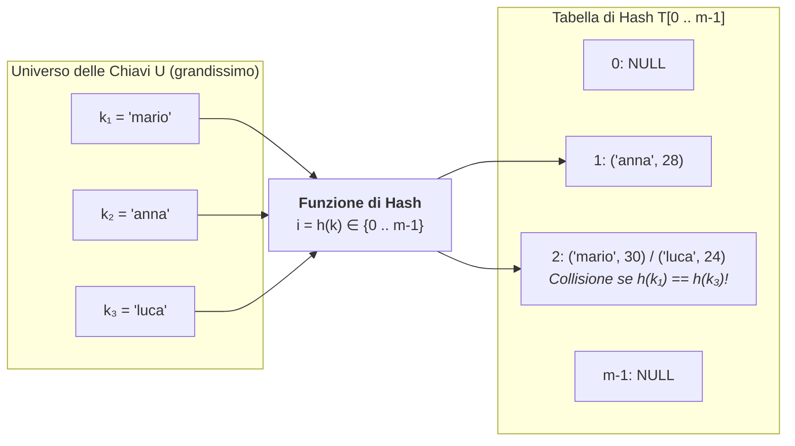
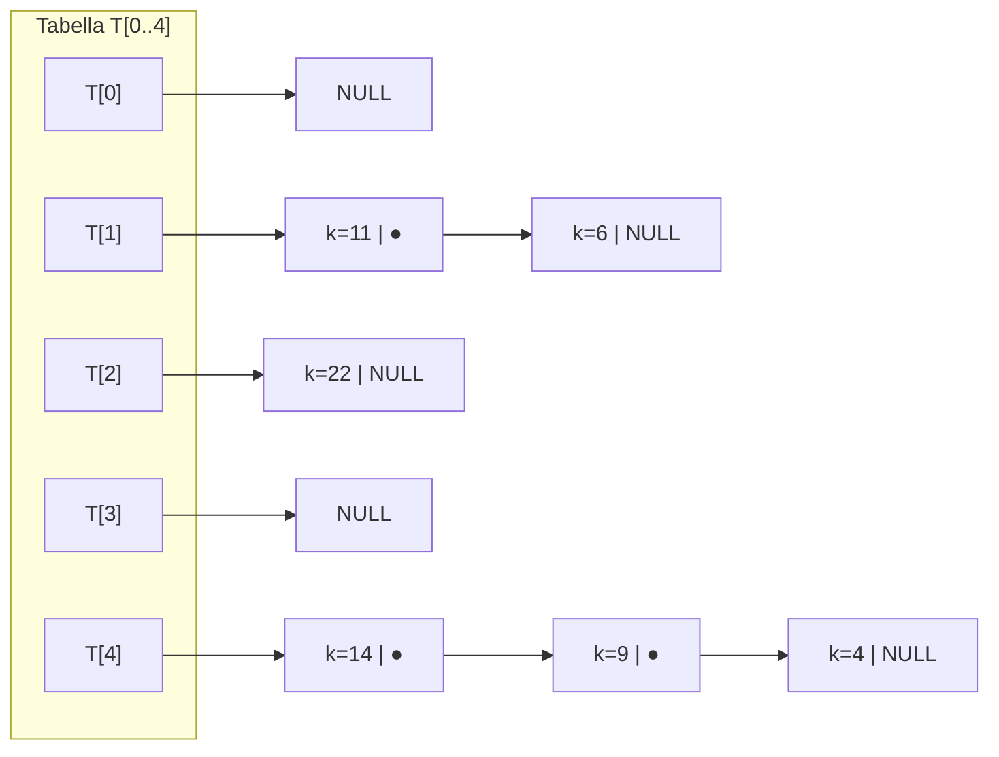

# Tabelle di Hash

## Come l'hash riduce il costo della ricerca

Molte applicazioni informatiche (compilatori, database, cache, dizionari in Python, oggetti in JavaScript) hanno bisogno di memorizzare un insieme dinamico di coppie **`(chiave, valore)`** supportando le tre operazioni dell'ADT **Dizionario**:
- **`insert(k, v)`**: inserisce una nuova coppia;
- **`search(k)`**: recupera il valore associato alla chiave `k`;
- **`delete(k)`**: rimuove la coppia con chiave `k`.

Con gli array non ordinati e le liste concatenate la ricerca richiede tempo lineare $O(n)$; con gli array ordinati e gli alberi binari di ricerca bilanciati si scende a $O(\log n)$. È possibile abbattere questa barriera e arrivare a un tempo medio costante **$O(1)$** (indipendente dal numero di elementi)?

Sì: le **Tabelle di Hash (*Hash Tables*)** raggiungono una complessità nel **caso medio di $\Theta(1)$** per ricerca, inserimento e cancellazione!

---

## Dall'Indirizzamento Diretto alle Funzioni di Hash

### Il limite dell'Indirizzamento Diretto

Se le chiavi fossero numeri interi piccoli appartenenti all'universo $U = \{0, 1, \dots, m-1\}$ (ad es. le matricole da `0` a `999`), basterebbe allocare un array `T[1000]` e salvare l'elemento con chiave $k$ direttamente nella cella `T[k]` in tempo $\Theta(1)$ (**Tavola a Indirizzamento Diretto**).

Tuttavia, nella realtà l'universo delle chiavi possibili $U$ è **immenso** (es. tutti i codici fiscali di 16 caratteri, tutti gli indirizzi IPv6 o tutte le stringhe di identificatori di un programma), mentre il numero $n$ di chiavi effettivamente memorizzate in un dato momento è molto piccolo ($n \ll |U|$). Allocare un array di $|U|$ celle sarebbe impossibile!

### L'idea dell'Hashing

Invece di usare la chiave $k$ direttamente come indice, allochiamo un array (**Tabella di Hash**) `T[0 .. m-1]` di dimensione $m$ proporzionale a $n$, e usiamo una funzione matematica chiamata **Funzione di Hash**:

$$
h : U \longrightarrow \{0, 1, \dots, m - 1\}
$$

che trasforma in tempo $\Theta(1)$ qualsiasi chiave $k \in U$ in un indice valido $i = h(k)$ della tabella (detto **bucket** o **slot**).



### Il Fattore di Carico $\alpha$ e le Collisioni

Definiamo il **Fattore di Carico (*Load Factor*) $\alpha$** di una tabella di hash come il rapporto tra il numero $n$ di elementi memorizzati e il numero $m$ di slot della tabella:

$$
\alpha = \frac{n}{m}
$$

Poiché $|U| > m$, per il **Principio dei Cassetti (*Pigeonhole Principle*)** è matematicamente inevitabile che esistano chiavi distinte $k_1 \neq k_2$ che vengono mappate nello **stesso indice** $h(k_1) = h(k_2)$. Questo evento si chiama **Collisione (*Collision*)**.

Una buona tabella di hash deve quindi combinare due ingredienti:
1. Una **ottima Funzione di Hash** che distribuisca le chiavi nel modo più uniforme possibile tra i bucket $\{0, \dots, m-1\}$ (**Ipotesi di Hashing Uniforme Semplice**);
2. Una **strategia deterministica di risoluzione delle collisioni**.

---

## Progettazione delle Funzioni di Hash

Una funzione di hash $h(k)$ deve essere **deterministica** (la stessa chiave $k$ deve dare sempre lo stesso indice $h(k)$), **veloce da calcolare in $O(1)$** e **uniforme** (deve dipendere da tutti i bit/caratteri della chiave).

### 1. Metodo della Divisione (per chiavi intere)

$$
h(k) = k \bmod m
$$

- **Come scegliere $m$?**
  - **Evitare le potenze di 2** ($m = 2^p$): perché $k \bmod 2^p$ estrae solo gli ultimi $p$ bit meno significativi di $k$, ignorando completamente tutti gli altri bit!
  - **Scelta ottima**: scegliere per $m$ un **numero primo** non troppo vicino a una potenza di 2 (ad es. $m = 97$, $m = 1009$).

### 2. Metodo della Moltiplicazione

Si sceglie una costante reale $A \in (0, 1)$ (Knuth suggerisce la sezione aurea coniugata $A = \frac{\sqrt{5}-1}{2} \approx 0.6180339887$), si prende la **parte frazionaria** di $k \cdot A$ e la si moltiplica per $m$:

$$
h(k) = \Big\lfloor m \cdot \big(k \cdot A - \lfloor k \cdot A \rfloor\big) \Big\rfloor
$$

### 3. Funzioni di Hash per Stringhe (Polinomiale / `djb2`)

Se la chiave è una stringa $s = c_0 c_1 \dots c_{L-1}$, sommare semplicemente i codici ASCII ($\sum c_i \bmod m$) è una **pessima idea**, perché tutti gli anagrammi (es. `"roma"`, `"amor"`, `"mora"`) produrrebbero sistematicamente la stessa somma e colliderebbero!
Bisogna pesare la posizione di ciascun carattere con una potenza di una base prima (es. $B = 31$ o $B = 33$, come nel celebre algoritmo **`djb2`** di Dan Bernstein):

```c
/* Funzione di hash polinomiale (djb2) per stringhe C */
size_t hash_stringa(const char *s, size_t m) {
    unsigned long hash = 5381;
    unsigned char c;
    while ((c = (unsigned char)*s++) != '\0') {
        hash = ((hash << 5) + hash) + c; /* hash * 33 + c */
    }
    return (size_t)(hash % m);
}
```

---

## Risoluzione delle Collisioni: i due paradigmi

### Metodo 1: Concatenamento (*Separate Chaining* — Hashing Aperto)

Ogni cella `T[i]` della tabella non contiene direttamente un singolo elemento, ma è la **testa di una lista concatenata** che raccoglie tutti gli elementi le cui chiavi hanno indice di hash $h(k) = i$.



- **Inserimento (`insert`)**: Si calcola $i = h(k)$, si verifica se $k$ è già nella lista `T[i]` (aggiornandone il valore) e altrimenti si inserisce il nuovo nodo **in testa** alla lista `T[i]` in tempo $O(1)$.
- **Ricerca (`search`) e Cancellazione (`delete`)**: Si calcola $i = h(k)$ e si cerca/rimuove il nodo nella sola lista `T[i]`.
- **Lunghezza media delle liste e Complessità**:
  Con $n$ elementi distribuiti uniformemente su $m$ liste, la lunghezza media di ciascuna lista è esattamente pari al **fattore di carico $\alpha = \frac{n}{m}$**! Pertanto la ricerca costa nel **caso medio $\Theta(1 + \alpha)$** (che è **$\Theta(1)$** se manteniamo $\alpha \le 1$), mentre nel **caso peggiore** (tutte le $n$ chiavi collidono nello stesso bucket!) degenera a **$\Theta(n)$**.

---

### Metodo 2: Indirizzamento Aperto (*Open Addressing* — Hashing Chiuso)

Nell'indirizzamento aperto **non si usano liste esterne né puntatori**: tutti gli elementi risiedono **direttamente dentro l'array `T[0 .. m-1]`** (quindi deve sempre valere $n \le m$, ovvero $\alpha \le 1$).

Quando vogliamo inserire una chiave $k$ e scopriamo che la cella principale $h(k)$ è già occupata, **ispezioniamo (*probing*) una sequenza deterministica di celle alternative** nella tabella:

$$
h(k, j) \in \{0, \dots, m-1\} \quad \text{per } j = 0, 1, 2, \dots, m-1
$$

finché non troviamo una cella libera! Esistono tre schemi classici di scansione (*probing*):

1. **Scansione Lineare (*Linear Probing*)**:

   $$
   h(k, j) = \big(h(k) + j\big) \bmod m \quad (j = 0, 1, 2, \dots)
   $$

   Se la cella $h(k)$ è occupata, prova la cella successiva $h(k)+1$, poi $h(k)+2$, ecc. (ripartendo da $0$ dopo $m-1$).
   - *Difetto*: soffre di **Addensamento Primario (*Primary Clustering*)**: le chiavi che collidono formano lunghi blocchi contigui di celle occupate, aumentando la probabilità di nuove collisioni su quel blocco.
2. **Scansione Quadratica (*Quadratic Probing*)**:

   $$
   h(k, j) = \big(h(k) + c_1 j + c_2 j^2\big) \bmod m
   $$

   Fa salti quadratici ($+1, +4, +9, \dots$) evitando i blocchi contigui dell'addensamento primario.
3. **Doppio Hashing (*Double Hashing*)**:

   $$
   h(k, j) = \big(h_1(k) + j \cdot h_2(k)\big) \bmod m
   $$

   Usa una **seconda funzione di hash** $h_2(k) \neq 0$ (coprima con $m$) per determinare il passo del salto: così due chiavi che collidono in $h_1$ faranno salti di ampiezza diversa!

> [!WARNING] Il problema della Cancellazione nell'Indirizzamento Aperto: i *Tombstone* (`DELETED`)
> Nell'indirizzamento aperto, **non possiamo cancellare un elemento rimettendo semplicemente la sua cella a `EMPTY` (`VUOTA`)**!
> Perché? Supponiamo che $k_1$ e $k_2$ abbiano lo stesso hash $h(k_1) = h(k_2) = 3$: $k_1$ viene inserito in `T[3]` e $k_2$ scivola per linear probing in `T[4]`. Se poi cancellassimo $k_1$ mettendo `T[3] = EMPTY`, una successiva ricerca di $k_2$ partirebbe da `T[3]`, vedrebbe `EMPTY` e **si fermerebbe subito concludendo erroneamente che $k_2$ non esiste!**
> - **Soluzione**: Si usa la **cancellazione logica** marcando la cella rimossa con uno stato speciale **`DELETED` (*Tombstone* / Lapide)**:
>   - La **Ricerca (`search`)** tratta `DELETED` come "occupata" e **continua a scorrere** oltre la lapide;
>   - L'**Inserimento (`insert`)** tratta `DELETED` come "libera" e può **riutilizzare** la cella!

---

## Marcatori, ricostruzione e ipotesi sui costi

Con probing lineare e cinque celle, le chiavi `1` e `6` partono entrambe dalla cella `1` usando `chiave % 5`. Dopo gli inserimenti occupano le celle `1` e `2`. Rimuovendo `1`, mettiamo `DELETED` nella cella `1`. Cercando `6` continuiamo oltre quel marcatore. Un'inserzione può ricordare la prima cella cancellata e proseguire per verificare che la chiave non esista più avanti. Ci fermiamo a una cella mai usata o dopo un giro completo.

Il rapporto fra elementi vivi e capacità è il **fattore di carico**. Nel probing contano anche i marcatori, perché allungano le ricerche. Per un rehash si crea una tabella vuota e si reinseriscono le chiavi vive con gli indici della nuova capacità. I marcatori spariscono. Una soglia di crescita è una scelta di implementazione. Nel concatenamento, il costo atteso $\Theta(1+\alpha)$ suppone una distribuzione uniforme e costo costante per hash e confronto. Nel probing, costo medio e clustering dipendono anche dalla sequenza di tentativi. Nel caso peggiore una ricerca può ancora esaminare tutta la tabella.

Un hash per tabelle mira a distribuire le chiavi e rendere le operazioni rapide. Un **hash crittografico** persegue anche proprietà come resistenza a collisioni trovate intenzionalmente e difficoltà di ricavare un input da un digest. Una funzione come il resto della divisione è utile per calcolare un indice e non offre queste proprietà.

---

## Esempi guidati

### Esempio 1: Traccia numerica completa di Concatenamento vs Linear Probing

**Problema**: Sia data una Tabella di Hash di dimensione $m = 7$ con funzione di hash $h(k) = k \bmod 7$. Inseriamo nell'ordine le chiavi: **`10, 24, 31, 17, 25`** sia con **Concatenamento** sia con **Indirizzamento Aperto a Scansione Lineare**.

1. **Calcolo degli indici iniziali $h(k) = k \bmod 7$**:
   - $h(10) = 10 \bmod 7 = \mathbf{3}$
   - $h(24) = 24 \bmod 7 = \mathbf{3}$ *(Collisione in 3!)*
   - $h(31) = 31 \bmod 7 = \mathbf{3}$ *(Collisione in 3!)*
   - $h(17) = 17 \bmod 7 = \mathbf{3}$ *(Collisione in 3!)*
   - $h(25) = 25 \bmod 7 = \mathbf{4}$

2. **Con Concatenamento (*Chaining*)** (inserimento in testa alle liste):
   - `T[0]`: `NULL`
   - `T[1]`: `NULL`
   - `T[2]`: `NULL`
   - `T[3]`: `17 -> 31 -> 24 -> 10 -> NULL`
   - `T[4]`: `25 -> NULL`
   - `T[5]`, `T[6]`: `NULL`.

3. **Con Indirizzamento Aperto (*Linear Probing* $h(k, j) = (h(k) + j) \bmod 7$)**:
   - Inserisci **`10`** ($h=3$): `T[3]` è vuota $\to$ **`T[3] = 10`**.
   - Inserisci **`24`** ($h=3$): `T[3]` occupata ($j=0$) $\to$ prova $j=1$: `T[4]` è vuota $\to$ **`T[4] = 24`**.
   - Inserisci **`31`** ($h=3$): `T[3]` occupata, `T[4]` occupata $\to$ prova $j=2$: `T[5]` è vuota $\to$ **`T[5] = 31`**.
   - Inserisci **`17`** ($h=3$): `T[3], T[4], T[5]` occupate $\to$ prova $j=3$: `T[6]` è vuota $\to$ **`T[6] = 17`**.
   - Inserisci **`25`** ($h=4$): `T[4]` occupata (da `24`! Ecco il *Primary Clustering*!), `T[5]` occupata, `T[6]` occupata $\to$ fa il giro circolare a **`T[0]`** che è vuota $\to$ **`T[0] = 25`**!
   - Tabella finale: **`T = [ 25, _, _, 10, 24, 31, 17 ]`**.

---

### Esempio 2: Implementazione in C di una Tabella di Hash con Concatenamento

```c
#include <stdio.h>
#include <stdlib.h>
#include <string.h>

#define NUM_BUCKETS 13 /* Numero primo */

typedef struct HashNodo {
    char *chiave;
    int valore;
    struct HashNodo *next;
} HashNodo;

typedef struct {
    HashNodo *buckets[NUM_BUCKETS];
    size_t num_elementi;
} HashTable;

void ht_init(HashTable *ht) {
    for (int i = 0; i < NUM_BUCKETS; i++) {
        ht->buckets[i] = NULL;
    }
    ht->num_elementi = 0;
}

/* Inserisce o aggiorna la coppia (chiave, valore) */
int ht_inserisci(HashTable *ht, const char *chiave, int valore) {
    size_t idx = hash_stringa(chiave, NUM_BUCKETS);

    /* 1. Controlla se la chiave esiste già nel bucket idx */
    for (HashNodo *curr = ht->buckets[idx]; curr != NULL; curr = curr->next) {
        if (strcmp(curr->chiave, chiave) == 0) {
            curr->valore = valore; /* Aggiorna il valore esistente */
            return 1;
        }
    }

    /* 2. Altrimenti crea un nuovo nodo e inseriscilo in testa al bucket idx */
    HashNodo *nuovo = (HashNodo *)malloc(sizeof(HashNodo));
    if (!nuovo) return 0;
    nuovo->chiave = (char *)malloc(strlen(chiave) + 1);
    if (!nuovo->chiave) { free(nuovo); return 0; }
    strcpy(nuovo->chiave, chiave);
    nuovo->valore = valore;

    nuovo->next = ht->buckets[idx];
    ht->buckets[idx] = nuovo;
    ht->num_elementi++;
    return 1;
}

/* Cerca una chiave: restituisce 1 se trovata (scrivendo in *out_val), 0 se assente */
int ht_cerca(const HashTable *ht, const char *chiave, int *out_val) {
    size_t idx = hash_stringa(chiave, NUM_BUCKETS);
    for (const HashNodo *curr = ht->buckets[idx]; curr != NULL; curr = curr->next) {
        if (strcmp(curr->chiave, chiave) == 0) {
            if (out_val) *out_val = curr->valore;
            return 1;
        }
    }
    return 0;
}
```

---

## Errori frequenti

> [!caution] Errori da evitare
> 1. **Confrontare solo gli hash $h(k_1) == h(k_2)$ invece delle chiavi effettive `strcmp(k1, k2) == 0`**:
>    Avere lo stesso valore di hash **non significa essere la stessa chiave** (potrebbe essere una collisione!). Quando si scorre la lista del bucket `T[h(k)]`, bisogna **sempre** confrontare la chiave memorizzata nel nodo con la chiave cercata tramite `strcmp` (o `==` per gli interi).
> 2. **Lasciare che il fattore di carico $\alpha$ si avvicini a $1$ nell'Indirizzamento Aperto**:
>    Nel probing lineare, una tabella vicina alla saturazione o piena di marcatori può richiedere molti tentativi. Una politica può far crescere o ricostruire la tabella oltre una soglia scelta, per esempio $0.75$, reinserendo gli elementi con la nuova funzione di indice.
> 3. **Nel Rehashing, copiare i vecchi bucket con `memcpy` senza ricalcolare la funzione di hash**:
>    Poiché la dimensione della tabella cambia da $m$ a $m'$, l'indice $k \bmod m'$ di ogni chiave **cambia**! Bisogna ricalcolare l'hash di ogni singolo elemento.

---

## Esercizi di prova

### Esercizio 1. Fattore di carico $\alpha$ nei due modelli (Base)

In una tabella di hash di dimensione $m = 20$ vengono inserite $n = 30$ chiavi distinte.
1. Quanto vale il fattore di carico $\alpha$?
2. È possibile memorizzare queste $30$ chiavi usando l'Indirizzamento Aperto senza ridimensionare la tabella? E usando il Concatenamento? Qual è la lunghezza media delle liste nel Concatenamento?

> [!tip]- Soluzione
> 1. Il fattore di carico vale $\alpha = \frac{n}{m} = \frac{30}{20} = \mathbf{1.5}$.
> 2. Con l'**Indirizzamento Aperto** è **impossibile** senza fare *rehashing*, perché ogni slot dell'array può ospitare al massimo 1 chiave (quindi $\alpha$ non può mai superare $1$, ovvero $n \le 20$).
>    Con il **Concatenamento** è invece **perfettamente possibile**: tutte le $30$ chiavi vengono inserite nelle 20 liste collegate, e la lunghezza media di ciascuna lista è esattamente $\alpha = \mathbf{1.5}$ nodi.

### Esercizio 2. Simulazione di Scansione Lineare vs Scansione Quadratica (Base)

Data una tabella di hash con $m = 11$ a indirizzamento aperto inizialmente vuota e funzione base $h(k) = k \bmod 11$, mostra la posizione finale in cui vengono inserite le chiavi `22, 1, 13, 11, 24, 33`:
1. Con **Scansione Lineare** $h(k, j) = (h(k) + j) \bmod 11$;
2. Con **Scansione Quadratica** $h(k, j) = (h(k) + j^2) \bmod 11$.

> [!tip]- Soluzione
> Calcoliamo prima $h(k) = k \bmod 11$:
> $h(22)=0,\; h(1)=1,\; h(13)=2,\; h(11)=0,\; h(24)=2,\; h(33)=0$.
> 1. **Scansione Lineare**:
>    - `22` ($h=0$) $\to$ `T[0] = 22`
>    - `1` ($h=1$) $\to$ `T[1] = 1`
>    - `13` ($h=2$) $\to$ `T[2] = 13`
>    - `11` ($h=0$): `0, 1, 2` occupate $\to$ `T[3] = 11` ($j=3$)
>    - `24` ($h=2$): `2, 3` occupate $\to$ `T[4] = 24` ($j=2$)
>    - `33` ($h=0$): `0, 1, 2, 3, 4` occupate $\to$ `T[5] = 33` ($j=5$).
>    Tabella finale lineare: `[22, 1, 13, 11, 24, 33, _, _, _, _, _]`.
> 2. **Scansione Quadratica** ($+0, +1, +4, +9, \dots$):
>    - `22, 1, 13` vanno in `T[0], T[1], T[2]`.
>    - `11` ($h=0$): $j=0 \to 0$ (occ.), $j=1 \to 0+1=1$ (occ.), $j=2 \to 0+4=\mathbf{4}$ (libera!) $\to$ `T[4] = 11`.
>    - `24` ($h=2$): $j=0 \to 2$ (occ.), $j=1 \to 2+1=\mathbf{3}$ (libera!) $\to$ `T[3] = 24`.
>    - `33` ($h=0$): $j=0 \to 0$, $j=1 \to 1$, $j=2 \to 4$ (tutte occupate!), $j=3 \to (0 + 9) \bmod 11 = \mathbf{9}$ (libera!) $\to$ `T[9] = 33`.
>    Tabella finale quadratica: `[22, 1, 13, 24, 11, _, _, _, _, 33, _]`.

### Esercizio 3. Cancellazione logica con `DELETED` nel Linear Probing (Intermedio)

Nella tabella lineare ottenuta al punto 1 dell'Esercizio 2 (`[22, 1, 13, 11, 24, 33, ...]`), eseguiamo `delete(13)` (marcando `T[2] = DELETED`), poi `search(24)` e infine `insert(35)`. Mostra cosa accade in ciascuna operazione.

> [!tip]- Soluzione
> 1. **`delete(13)`**: $h(13) = 2$, troviamo `13` in `T[2]` e lo sostituiamo con il *tombstone* **`T[2] = DELETED`**.
> 2. **`search(24)`**: $h(24) = 2$. Guardiamo `T[2]`: troviamo `DELETED` (non `EMPTY`!), quindi **non ci fermiamo**: proseguiamo a `T[3]` (contiene `11` $\neq 24$) e poi a `T[4]` dove troviamo **`24`**!
> 3. **`insert(35)`**: $h(35) = 35 \bmod 11 = 2$. Guardiamo `T[2]`: contiene `DELETED`. Poiché `35` non è presente più avanti nella catena, **riutilizziamo lo slot `T[2]`** scrivendo **`T[2] = 35`**!

### Esercizio 4. Cancellazione di una chiave da una Tabella di Hash con Concatenamento (Intermedio)

Scrivi per la `HashTable` dell'Esempio Guidato 2 la funzione `int ht_rimuovi(HashTable *ht, const char *chiave)` che rimuove il nodo corrispondente a `chiave` liberando sia la stringa sia il nodo, e restituisce `1` (o `0` se assente).

> [!tip]- Soluzione
> ```c
> int ht_rimuovi(HashTable *ht, const char *chiave) {
>     size_t idx = hash_stringa(chiave, NUM_BUCKETS);
>     HashNodo *curr = ht->buckets[idx];
>     HashNodo *prev = NULL;
>
>     while (curr != NULL) {
>         if (strcmp(curr->chiave, chiave) == 0) {
>             if (prev == NULL) {
>                 ht->buckets[idx] = curr->next;
>             } else {
>                 prev->next = curr->next;
>             }
>             free(curr->chiave);
>             free(curr);
>             ht->num_elementi--;
>             return 1;
>         }
>         prev = curr;
>         curr = curr->next;
>     }
>     return 0;
> }
> ```

### Esercizio 5. Doppio Hashing (Avanzato)

Data una tabella con $m = 7$, $h_1(k) = k \bmod 7$ e seconda funzione di passo $h_2(k) = 1 + (k \bmod 5)$, determina la sequenza di indici ispezionati da $h(k, j) = (h_1(k) + j \cdot h_2(k)) \bmod 7$ per la chiave $k = 17$ al variare di $j = 0, 1, 2, 3$. Perché è fondamentale che $h_2(k)$ non possa mai restituire $0$?

> [!tip]- Soluzione
> Per $k = 17$:
> - $h_1(17) = 17 \bmod 7 = \mathbf{3}$
> - $h_2(17) = 1 + (17 \bmod 5) = 1 + 2 = \mathbf{3}$
> Sequenza di scansione $(3 + j \cdot 3) \bmod 7$:
> - $j = 0$: $(3 + 0) \bmod 7 = \mathbf{3}$
> - $j = 1$: $(3 + 3) \bmod 7 = \mathbf{6}$
> - $j = 2$: $(3 + 6) \bmod 7 = 9 \bmod 7 = \mathbf{2}$
> - $j = 3$: $(3 + 9) \bmod 7 = 12 \bmod 7 = \mathbf{5}$
> Se $h_2(k)$ valesse $0$, per ogni $j \ge 0$ avremmo $h(k, j) = (h_1(k) + j \cdot 0) \bmod m = h_1(k)$: l'algoritmo resterebbe bloccato all'infinito sulla stessa cella iniziale senza mai avanzare!

### Esercizio 6. Confronto tra Tabelle di Hash e Alberi Binari di Ricerca Bilanciati (Avanzato)

Se le Tabelle di Hash effettuano ricerca, inserimento e cancellazione in tempo medio $\Theta(1)$ mentre gli Alberi Binari di Ricerca (BST) bilanciati richiedono $\Theta(\log n)$, in quali situazioni pratiche conviene comunque preferire un BST rispetto a una Tabella di Hash?

> [!tip]- Soluzione
> I BST bilanciati sono preferibili alle Tabelle di Hash in tre scenari fondamentali:
> 1. **Operazioni basate sull'ordine delle chiavi**: Una Tabella di Hash mescola le chiavi in modo pseudo-casuale! Stampare tutte le chiavi in **ordine crescente**, trovare il **minimo/massimo** o cercare tutte le chiavi comprese in un intervallo $[k_1, k_2]$ (*Range Query*) è immediato in un BST (tramite visita In-Order), mentre in una Hash Table richiede di scandire l'intera tabella $\Theta(m + n)$ e poi ordinarla in $\Theta(n \log n)$!
> 2. **Garanzia sul Caso Peggiore (*Real-Time Systems*)**: Un BST bilanciato (AVL, Red-Black Tree) garantisce $O(\log n)$ **anche nel caso peggiore assoluto**, mentre una Hash Table soggetta a collisioni malevole (*Hash-Flooding DoS*) può degradare a $\Theta(n)$ per singola operazione.
> 3. **Assenza di una buona funzione di hash**: Per usare un BST basta saper confrontare due chiavi con `<`.

---

## Provenienza del materiale

- Dispensa ufficiale del corso: `C1PROG1U6L5_Tabelle_di_Hash.pdf` (Unità 6, Lezione 5 — *Tabelle di Hash*).
- Marco Anisetti, *Algoritmi e strutture dati dinamiche*, `C1PROG1_Appunti_di_fine_unità_6.pdf`, cap. 5.
