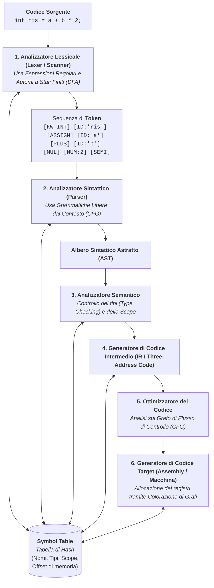
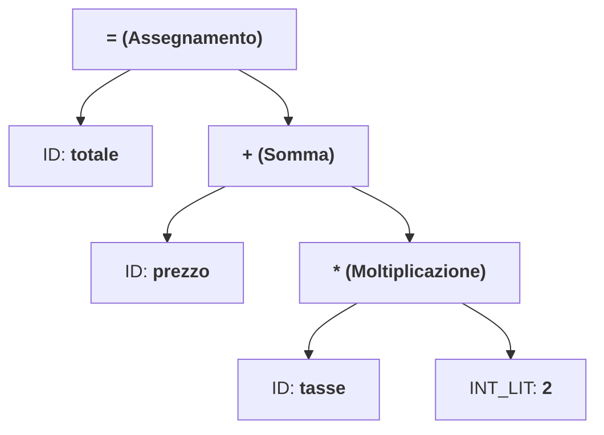
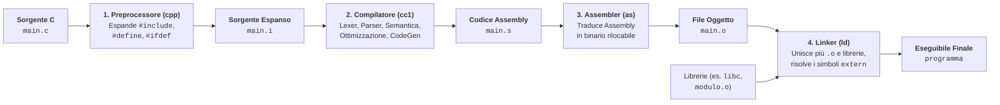

# 6.6.1 - Compilatori, interpreti e catena di traduzione

Questa lezione conclusiva del corso mostra come **tutti i concetti teorici e le strutture dati** che abbiamo studiato — dalle Grammatiche Formali e gli Automi dell'Unità 1, alla Ricorsione e allo Scope dell'Unità 4, fino ad Alberi, Grafi e Tabelle di Hash dell'Unità 6 — convergano armoniosamente all'interno del programma più affascinante dell'informatica: il **Compilatore**.

Un processore (CPU) è in grado di eseguire esclusivamente istruzioni elementari codificate in binario nel proprio **linguaggio macchina**. Per eseguire un programma scritto in un linguaggio ad alto livello ($L_{\text{sorgente}}$, come C, Java o Python), è necessario un **traduttore**.

---

## Compilazione pura vs Interpretazione vs Approccio Ibrido (Bytecode + JIT)

Esistono tre modelli architetturali principali per tradurre ed eseguire un linguaggio di programmazione:

```mermaid
flowchart TD
    subgraph Compilato["1. Compilazione Pura (C, C++, Rust)"]
        S1["Codice Sorgente (.c)"] --> C1["<b>Compilatore + Linker</b><br/>(Traduzione offline anticipata)"]
        C1 --> EXE["Eseguibile Macchina Nativo (.exe / ELF)"]
        EXE --> CPU1["<b>Esecuzione diretta su CPU</b> + Input ➔ Output"]
    end
    subgraph Interpretato["2. Interpretazione Pura (Bash, Python classico)"]
        S2["Codice Sorgente (.py / .sh) + Input"] --> INT["<b>Interprete</b><br/>(Legge, analizza ed esegue riga per riga a runtime)"]
        INT --> OUT2["Output"]
    end
    subgraph Ibrido["3. Modello Ibrido Bytecode + VM/JIT (Java JVM, C# .NET)"]
        S3["Sorgente (.java)"] --> JAVAC["<b>Compilatore Front-End</b> (javac)"]
        JAVAC --> BC["<b>Bytecode</b> (.class)<br/>Indipendente dall'hardware"]
        BC --> JVM["<b>Macchina Virtuale (JVM) + Compilatore JIT</b>"]
        JVM --> OUT3["Output"]
    end
```



| Caratteristica | Compilazione Pura (C, C++, Rust, Go) | Interpretazione (Shell, Python standard) | Modello Ibrido su VM / JIT (Java, C#) |
| :--- | :--- | :--- | :--- |
| **Come funziona** | Traduce **prima dell'esecuzione** l'intero sorgente in codice macchina nativo per una specifica architettura CPU + OS. | Un programma (**Interprete**) legge il sorgente (o una sua rappresentazione interna) e lo esegue istantaneamente istruzione per istruzione. | Compila il sorgente in un linguaggio intermedio astratto (**Bytecode**), eseguito poi da una **Virtual Machine** dotata di compilatore **JIT (*Just-In-Time*)** che traduce a caldo i tratti più usati in codice nativo. |
| **Velocità di esecuzione** | **Massima** (esecuzione diretta sull'hardware, ottimizzazioni globali spinte). | **Più lenta** (overhead di analisi e decodifica a runtime). | **Molto alta** (vicina al nativo dopo il "riscaldamento" del JIT). |
| **Portabilità dell'eseguibile** | **Bassa**: bisogna ricompilare il sorgente per ogni combinazione di CPU (x86_64, ARM) e Sistema Operativo. | **Altissima**: lo stesso script gira ovunque sia installato l'interprete. | **Altissima** (*"Write Once, Run Anywhere"*): lo stesso file `.class` gira su qualsiasi piattaforma dotata di JVM. |
| **Scoperta degli errori** | Errori sintattici e di tipo scoperti **tutti prima dell'esecuzione** (*compile-time*). | Gli errori in un ramo `if` vengono scoperti solo se e quando quel ramo viene eseguito a runtime. | Controllo statico completo dei tipi a compile-time + controlli di sicurezza a runtime nella VM. |

---

## Architettura interna di un Compilatore

Un compilatore moderno (come `gcc` o `clang`) non traduce il testo C in codice macchina in un solo colpo, ma è strutturato come una **pipeline di fasi** divisa in due grandi blocchi collegati a una **Tabella dei Simboli (*Symbol Table*)** centrale:
- **Front-End** (dipendente dal *linguaggio sorgente*, indipendente dalla CPU target): Analisi Lessicale $\to$ Analisi Sintattica $\to$ Analisi Semantica $\to$ Generazione del Codice Intermedio (IR).
- **Back-End** (indipendente dal linguaggio sorgente, dipendente dall'*architettura hardware target*): Ottimizzazione del Codice $\to$ Generazione del Codice Macchina/Assembly.



---

## Le Fasi di Compilazione nel dettaglio

Seguiamo passo passo come viene trasformata l'istruzione C:
```c
totale = prezzo + tasse * 2;
```

### Fase 1: Analisi Lessicale (*Lexer / Scanner*)

Lo **Scanner** legge il file sorgente come un flusso grezzo di caratteri, elimina gli spazi bianchi e i commenti, e raggruppa i caratteri in unità minime dotate di significato chiamate **Lessemi (*Lexemes*)**, classificandole in **Token** della forma $\langle \text{Categoria}, \text{Attributo} \rangle$:
1. `<ID, "totale">`
2. `<ASSIGN, "=">`
3. `<ID, "prezzo">`
4. `<PLUS, "+">`
5. `<ID, "tasse">`
6. `<MUL, "*">`
7. `<INT_LIT, 2>`
8. `<SEMICOLON, ";">`

- **Strumento teorico**: Le regole che definiscono gli identificatori (`[a-zA-Z_][a-zA-Z0-9_]*`), i numeri e gli operatori sono **Linguaggi Regolari (Tipo 3 di Chomsky)**, specificati tramite **Espressioni Regolari** e riconosciuti in tempo lineare $\Theta(n)$ da **Automi a Stati Finiti Deterministici (DFA)**!
- **Errori lessicali**: sequenze di caratteri che non appartengono a nessun token valido del linguaggio (es. un carattere illegale `@` fuori da una stringa o una costante numerica malformata `123abc`).

---

### Fase 2: Analisi Sintattica (*Parser*)

Il **Parser** riceve la sequenza lineare di Token prodotta dal Lexer e verifica se essa rispetta le regole grammaticali del linguaggio, costruendo una struttura gerarchica ad albero chiamata **Albero di Derivazione (*Parse Tree*)** o, nella sua forma compatta priva di punteggiatura superflua, **Albero Sintattico Astratto (*AST — Abstract Syntax Tree*)**.



Osserva come l'AST catturi automaticamente la **precedenza degli operatori**: il nodo `*` è figlio del nodo `+`, quindi in una visita **Post-Order** dell'AST verrà valutato *prima* `tasse * 2` e *poi* la somma con `prezzo`!

- **Strumento teorico**: La sintassi dei linguaggi di programmazione (con parentesi bilanciate e blocchi annidati `{ ... }` a profondità arbitraria) non può essere descritta da automi a stati finiti, ma richiede **Grammatiche Libere dal Contesto (CFG — Tipo 2 di Chomsky)** e **Automi a Pila**. I parser si dividono in:
  - **Parser Top-Down (es. $LL(k)$ / Discesa Ricorsiva)**: costruiscono l'albero dalla radice (simbolo iniziale $S$) scendendo verso le foglie (i token);
  - **Parser Bottom-Up (es. $LR(k)$ / Shift-Reduce)**: partono dalle foglie (i token) e le riducono progressivamente fino alla radice $S$.
- **Errori sintattici**: sequenze di token valide lessicalmente ma disposte in modo grammaticalmente errato (es. `int a = * + 5;`, parentesi non chiusa o `;` mancante).

---

### Fase 3: Analisi Semantica e la *Symbol Table*

Un programma può essere lessicalmente e sintatticamente perfetto, ma privo di senso rispetto alle regole di tipo e di visibilità del linguaggio (es. in C: sommare una `struct` a un `float`, chiamare una funzione con 2 argomenti invece di 4, o usare una variabile mai dichiarata).

L'**Analizzatore Semantico** visita l'AST consultando la **Tabella dei Simboli (*Symbol Table*)** — implementata concretamente tramite **Tabelle di Hash** annidate per gestire lo *Scope* dei blocchi — ed effettua:
1. **Controllo dello Scope e delle dichiarazioni**: verifica che ogni identificatore usato sia stato dichiarato nello scope corrente o in uno scope esterno visibile, e che non vi siano doppie dichiarazioni nello stesso blocco.
2. **Type Checking (Controllo dei Tipi)** e conversioni implicite (*coercions*): se nell'esempio `prezzo` è `double` e `tasse` è `int`, l'analizzatore semantico inserisce nell'AST un nodo di conversione `int_to_double(tasse * 2)` prima di sommarlo a `prezzo`.

---

### Fase 4, 5 e 6: Codice Intermedio (IR), Ottimizzazione e Codice Macchina

1. **Generazione del Codice Intermedio (IR — *Three-Address Code*)**:
   L'AST annotato viene linearizzato in una sequenza di istruzioni elementari con al più un operatore e variabili temporanee `t1, t2`:
   ```text
   t1 = tasse * 2
   t2 = int_to_double(t1)
   t3 = prezzo + t2
   totale = t3
   ```
2. **Ottimizzazione del Codice**:
   Trasforma il codice intermedio in una versione semanticamente equivalente ma **più veloce** o **più compatta**:
   - *Constant Folding*: calcola a compile-time espressioni costanti (`x = 3 * 4;` diventa direttamente `x = 12;`);
   - *Dead Code Elimination*: rimuove codice irraggiungibile (es. dopo un `return`) o variabili calcolate ma mai lette;
   - *Strength Reduction*: sostituisce operazioni costose con operazioni più veloci (es. `tasse * 2` su interi diventa uno shift a sinistra di 1 bit: `tasse << 1`!).
3. **Generazione del Codice Target (Assembly)**:
   Assegna le variabili ai limitati **registri fisici della CPU** (risolvendo un problema di **colorazione di un grafo di interferenza**!) ed emette le istruzioni Assembly dell'architettura target.

---

## La Catena Completa di Traduzione del C: Preprocessore, Compilatore, Assembler e Linker

Quando eseguiamo `gcc main.c modulo.c -o programma`, dietro le quinte vengono invocati in sequenza **4 programmi distinti**:



- **Linking Statico vs Dinamico**:
  - Nel **Linking Statico**, il Linker copia fisicamente il codice macchina delle funzioni di libreria usate (es. `printf`) dentro il file eseguibile finale (eseguibile più grande ma autonomo).
  - Nel **Linking Dinamico** (default nei sistemi moderni con librerie `.so` su Linux o `.dll` su Windows), il Linker inserisce nell'eseguibile solo un riferimento alla libreria condivisa di sistema, che verrà collegata in RAM al momento del caricamento da parte del *Dynamic Loader* del sistema operativo.

---

## Il Quadro Unificante: tutte le strutture dati del corso dentro un Compilatore!

| Fase / Componente del Compilatore | Struttura Dati o Modello del Corso utilizzato |
| :--- | :--- |
| **Analisi Lessicale (Lexer)** | **Espressioni Regolari** e **Automi a Stati Finiti (DFA)** (Unità 1) |
| **Analisi Sintattica (Parser)** | **Grammatiche Libere dal Contesto (CFG)** (Unità 1), **Pila (Stack)** e **Ricorsione** (Unità 4 e 6) |
| **Rappresentazione del Programma (AST)** | **Alberi N-ari e Alberi Binari** con visite ricorsive Pre/Post-Order (Unità 6.2) |
| **Tabella dei Simboli (*Symbol Table*)** | **Tabelle di Hash** (Unità 6.5) collegate in una **Pila di Scope** (Unità 4.4 e 6.2) |
| **Ottimizzazione e Allocazione dei Registri** | **Grafi orientati** (*Control Flow Graph*, *Dependency DAG*) e **Grafi non orientati** (Unità 6.4) |

---

## Esempi guidati

### Esempio 1: Traccia completa dall'istruzione C al Codice Intermedio

**Problema**: Mostrare i Token, l'AST, i controlli semantici e il Three-Address Code per l'istruzione C:
```c
while (i < 10) a = a + i;
```
assumendo `int i; float a;`.

1. **Analisi Lessicale (10 Token)**:
   `[KW_WHILE]`, `[LPAREN]`, `[ID, "i"]`, `[LT, "<"]`, `[INT_LIT, 10]`, `[RPAREN]`, `[ID, "a"]`, `[ASSIGN, "="]`, `[ID, "a"]`, `[PLUS, "+"]`, `[ID, "i"]`, `[SEMI]`.
2. **Analisi Sintattica (AST)**:
   Radice `WHILE` con due figli:
   - Figlio sinistro (Condizione): nodo `<` con figli `ID("i")` e `INT_LIT(10)`.
   - Figlio destro (Corpo): nodo `=` con figlio sinistro `ID("a")` e figlio destro `+` (che ha figli `ID("a")` e `ID("i")`).
3. **Analisi Semantica**:
   - Cerca `"i"` e `"a"` nella *Symbol Table*: entrambi dichiarati (`i: int`, `a: float`).
   - Nella condizione `i < 10`: entrambi gli operandi sono `int` $\to$ tipo booleano/`int` valido.
   - Nella somma `a + i`: `a` è `float`, `i` è `int` $\to$ inserisce una conversione implicita `int_to_float(i)`.
4. **Codice Intermedio (con etichette di salto)**:
   ```text
   L_inizio:
       t1 = i < 10
       if_false t1 goto L_fine
       t2 = int_to_float(i)
       t3 = a + t2
       a  = t3
       goto L_inizio
   L_fine:
   ```

---

### Esempio 2: Classificare il tipo di errore (Lessicale, Sintattico, Semantico o di Linking)

Vediamo come distinguere immediatamente quale fase della catena di traduzione segnala un errore in C:

| Frammento di codice C errato | Fase che rileva l'errore | Spiegazione tecnica |
| :--- | :--- | :--- |
| `int Prezzo$ = 10;` | **1. Analizzatore Lessicale (Lexer)** | Il carattere `$` non appartiene all'alfabeto degli identificatori né degli operatori standard C. |
| `if (x > 0 { x++; }` | **2. Analizzatore Sintattico (Parser)** | Tutti i token sono validi, ma manca la parentesi tonda chiusa `)` richiesta dalla produzione grammaticale dell'`if`. |
| `int x = 5; x = "ciao" + 3.5;` | **3. Analizzatore Semantico** | La sintassi `id = expr + expr;` è corretta, ma i tipi (`const char *` sommato a un `double`) sono incompatibili per il *Type Checker*! |
| `extern void foo(void); int main(void) { foo(); }` *(senza definire `foo` in nessun `.c`)* | **4. Linker (`ld`)** | `main.c` compila senza errori in `main.o` (grazie al prototipo `extern`), ma il Linker fallisce con `undefined reference to 'foo'` perché non trova il corpo compilato di `foo` in nessun file oggetto! |

---

## Errori frequenti

1. **Confondere un errore Semantico a compile-time con un errore di Logica/Runtime**:
   - Un errore **semantico statico** (es. assegnare una `struct` a un `int` o usare una variabile non dichiarata) viene bloccato **dal compilatore prima dell'esecuzione**.
   - Un errore **a runtime** (es. divisione per zero `x / y` con `y` letto da input uguale a `0`, o dereferenziazione di `NULL`) si verifica invece durante l'esecuzione del programma già compilato.
2. **Pensare che un file `.h` venga compilato da solo**:
   I file header `.h` non vengono passati direttamente al compilatore: è il **Preprocessore** che, incontrando `#include "mioheader.h"` dentro un file `.c`, copia testualmente il contenuto del file `.h` dentro il file `.c` prima che inizi l'analisi lessicale!
3. **Confondere errore del Compilatore ed errore del Linker (`undefined reference`)**:
   Se si dimentica di includere `<math.h>` (o si sbaglia la sintassi di una chiamata), l'errore è del **compilatore**. Se invece si include correttamente `<math.h>` ma su Linux si dimentica di passare il flag `-lm` a `gcc`, la compilazione in `.o` riesce e l'errore `undefined reference to 'sqrt'` viene emesso dal **Linker**!

---

## Esercizi di prova

1. **(Base — Scansione Lessicale e conteggio dei Token)**
   Elenca esattamente tutti i **Token** individuati dall'Analizzatore Lessicale (Scanner) sulla seguente riga di codice C (ignorando spazi e commenti):
   ```c
   /* Calcolo indice */
   vett[i + 1] = max_val * 20;
   ```
   Quanti token vengono prodotti in totale?
   > [!tip]- Soluzione
   > Il commento `/* Calcolo indice */` e gli spazi bianchi vengono scartati dallo Scanner. I token estratti sono **11**:
   > 1. `<ID, "vett">`
   > 2. `<LBRACKET, "[">`
   > 3. `<ID, "i">`
   > 4. `<PLUS, "+">`
   > 5. `<INT_LIT, 1>`
   > 6. `<RBRACKET, "]">`
   > 7. `<ASSIGN, "=">`
   > 8. `<ID, "max_val">`
   > 9. `<MUL, "*">`
   > 10. `<INT_LIT, 20>`
   > 11. `<SEMICOLON, ";">`

2. **(Base — Classificazione degli errori nella pipeline di traduzione)**
   Per ciascuno dei seguenti 5 problemi in un programma C, indica se si tratta di un errore **Lessicale**, **Sintattico**, **Semantico (compile-time)**, **del Linker** oppure **di Runtime**:
   1. `int a = 10 / 0;` (oppure `10 / x` quando l'utente inserisce `x = 0`);
   2. `while (a == 5) else a++;`
   3. `int 99bottiglie = 10;`
   4. `void f(int a, int b);` chiamata come `f(10);` (numero errato di argomenti);
   5. Scrivere `int main(void)` come `int mian(void)` (errore di battitura nel nome di `main`).
   > [!tip]- Soluzione
   > 1. **Errore di Runtime** (eccezione hardware di divisione per zero durante l'esecuzione).
   > 2. **Errore Sintattico (Parser)**: la parola chiave `else` non può seguire un `while` secondo la grammatica del C.
   > 3. **Errore Lessicale (Scanner)**: un token identificatore o numerico non può iniziare con cifre seguite da lettere (`99bottiglie` non è un token valido).
   > 4. **Errore Semantico (Analizzatore Semantico)**: la sintassi `f(10);` è grammaticalmente una chiamata di funzione valida, ma confrontando la chiamata con la firma di `f` nella *Symbol Table* emerge che il numero di argomenti ($1 \neq 2$) è errato.
   > 5. **Errore del Linker (`ld`)**: per il compilatore C, `mian` è una normalissima funzione definita dall'utente, quindi il file `.o` viene generato senza alcun errore! È il **Linker** che, al momento di creare l'eseguibile finale, cerca il punto di ingresso obbligatorio `main` e fallisce con `undefined reference to 'main'`.

3. **(Intermedio — Costruzione dell'AST e valutazione di un'espressione)**
   Disegna (o descrivi i nodi padre/figli) l'**Albero Sintattico Astratto (AST)** per l'espressione aritmetica:
   $$(a + b) * c - d / 2$$
   e scrivi la sequenza di istruzioni di **Codice Intermedio a 3 indirizzi (*Three-Address Code*)** prodotta da una visita **Post-Order** dell'AST.
   > [!tip]- Soluzione
   > **Struttura dell'AST**:
   > - **Radice**: operatore `-` (sottrazione, ha la precedenza più bassa ed è l'ultimo ad essere eseguito).
   >   - **Figlio sinistro di `-`**: operatore `*`
   >     - Figlio sinistro di `*`: operatore `+` (forzato dalle parentesi!) con figli `a` e `b`.
   >     - Figlio destro di `*`: foglia `c`.
   >   - **Figlio destro di `-`**: operatore `/` con figlio sinistro `d` e figlio destro `2`.
   > 
   > **Visita Post-Order (`Sinistro -> Destro -> Radice`) e Three-Address Code**:
   > ```text
   > t1 = a + b
   > t2 = t1 * c
   > t3 = d / 2
   > t4 = t2 - t3
   > ```

4. **(Intermedio — Perché le Espressioni Regolari non bastano per il Parser?)**
   Spiega facendo riferimento alla Gerarchia di Chomsky (Automi a Stati Finiti vs Grammatiche Libere dal Contesto) perché l'Analizzatore Lessicale può usare un Automa a Stati Finiti (DFA), mentre l'Analizzatore Sintattico non può usare un DFA per verificare che le parentesi tonde `(((a + b)))` o i blocchi `{ { ... } }` siano bilanciati.
   > [!tip]- Soluzione
   > Un **Automa a Stati Finiti (DFA)** possiede un numero **finito e fissato $K$ di stati** e non ha alcuna memoria ausiliaria illimitata: pertanto non può "contare" quante parentesi aperte `(` sono state lette se il livello di annidamento $n$ può essere arbitrariamente grande ($n > K$).
   > Il linguaggio delle parentesi bilanciate $L = \{ (^n \, )^n \mid n \ge 0 \}$ **non è un linguaggio regolare (Tipo 3)**, ma è un **linguaggio Libero dal Contesto (CFG, Tipo 2)** generato dalla grammatica $S \to (S) \mid \varepsilon$, che richiede la memoria LIFO illimitata di un **Automa a Pila** (lo Stack del Parser!).

5. **(Intermedio/Esame — Ottimizzazioni del Compilatore)**
   Dato il seguente frammento di codice C:
   ```c
   int calcola(int x) {
       int sec_in_giorno = 60 * 60 * 24;
       int y = x * 8;
       return y + sec_in_giorno;
       printf("Calcolo terminato!\n");
   }
   ```
   Individua le **3 ottimizzazioni** che il Back-End del compilatore può applicare automaticamente a questo codice senza cambiarne la semantica osservabile.
   > [!tip]- Soluzione
   > 1. **Constant Folding & Constant Propagation**: Il prodotto di costanti `60 * 60 * 24` viene calcolato direttamente a tempo di compilazione (`86400`), sostituendo `sec_in_giorno` con la costante `86400`.
   > 2. **Strength Reduction**: La moltiplicazione intera per una potenza di due `x * 8` ($8 = 2^3$) viene sostituita con un'istruzione macchina di shift aritmetico a sinistra di 3 bit: `x << 3` (o sommata direttamente in `return (x << 3) + 86400;`).
   > 3. **Dead Code Elimination**: L'istruzione `printf("Calcolo terminato!\n");` si trova **dopo un `return` incondizionato**, quindi è codice irraggiungibile (*unreachable code*) nel Grafo di Flusso di Controllo e viene eliminata completamente dall'eseguibile.

6. **(Esame — Gestione dello Scope annidato nella Symbol Table)**
   Spiega come un compilatore C organizza la **Symbol Table** per gestire correttamente il *Variable Shadowing* quando entra ed esce da blocchi annidati `{ int x = 1; { double x = 2.5; } }` in tempo medio $O(1)$ per ogni ricerca di identificatore.
   > [!tip]- Soluzione
   > Il compilatore utilizza una **Pila (Stack) di Tabelle di Hash** (oppure una singola Tabella di Hash con liste di collisione ordinate secondo la profondità del blocco):
   > 1. **Ingresso in un nuovo blocco `{`**: viene fatto `push` sulla pila di una nuova Tabella di Hash vuota associata allo scope corrente; le dichiarazioni locali del blocco (es. `double x`) vengono inserite nella tabella in cima alla pila.
   > 2. **Ricerca di un identificatore `x`**: il compilatore cerca `x` partendo dalla Tabella di Hash **in cima alla pila** (blocco più interno) e, solo se non la trova, risale verso le tabelle sottostanti fino allo scope globale. Così la dichiarazione interna `double x` maschera automaticamente (`shadowing`) quella esterna `int x`!
   > 3. **Uscita dal blocco `}`**: viene fatto `pop` e distrutta la Tabella di Hash in cima alla pila, ripristinando istantaneamente la visibilità di tutte le variabili del blocco esterno.

---

## Provenienza del materiale

- Dispense ufficiali del corso:
  - `C1PROG1U6_Fine_Unita_Dispensa_Compilatori.pdf` (Unità 6, Dispensa di fine unità — *Compilatori e interpreti*)
  - `C1PROG1_Appunti_di_fine_unità_6.pdf` (Unità 6 — *Appunti di riepilogo dell'Unità 6*).
